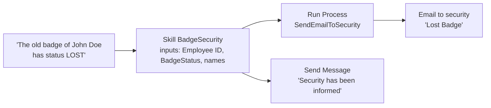

# Tutorial: Run an automated process from a Joule skill

*Let a Joule skill start an SAP Build Process Automation process, here an email to security when a badge is lost or stolen.*

> [!NOTE]
> **📍 At a glance**
> - **SAP tutorial:** [Consume an Automated Process in a Joule Skill](https://developers.sap.com/tutorials/joulestudio-skill-process.html) (part 5 of 5)
> - **You will build:** a process *SendEmailToSecurity*, published to the library, and the skill *BadgeSecurity* that runs it
> - **You need:** email configured for SAP Build Process Automation; the environment from [tutorial 21](tutorial-joule-skill-setup.md)
> - **Level:** beginner
> - **Not done in class:** the lecturer skipped it as mostly Process Automation, and left it as optional practice
> - **Concepts:** [Joule Studio Classic](joule-studio-classic.md), 19.8

**After this tutorial you can:**

- Build and publish a simple automated process with inputs
- Call it from a Joule skill and pass values to it
- Check in monitoring that the process ran

## 25.1 What you build

## 25.2 Steps

**The process**
1. Lobby → *Create* → *Automated Process* → *Process* → project `InitiateSecurityChecksViaEmail` → *Create*.
2. In the editor, *Create* a process `SendEmailToSecurity`. In the side panel → *Variables* → *Process Inputs*, add four required inputs: `EmployeeID`, `BadgeStatus`, `FirstName`, `LastName`.
3. **+** before End → *Email*: a recipient, subject "Lost Badge", and a body built from the process inputs in the mail body editor. *Save*.
4. *Release* → *Show project version* → *Deploy* to your environment.
5. Back in the Lobby → the project's *Versions* → **…** beside *Deployed* → **Publish to Library**.

**The skill**
1. New Joule Skill project `BadgeSecurity`, then a skill `BadgeSecurity` described as contacting security when a badge is lost or stolen.
2. On the *Trigger*, switch off *Allow Joule to generate a response*. Add four inputs: employee ID, badge status and first name (required), last name (optional). No outputs.
3. **+** → **Run Process** → *Browse All Processes* → `SendEmailToSecurity` → map each process input to the matching skill input.
4. **+** before End → *Send Message*: title "Security has been Informed", with a text that names the badge status and employee through data mapping.
5. *Release* and *Deploy* to your environment.
6. **Test** in the standalone assistant: report that John Doe's (1003764) old badge has the status LOST.
7. Check the run under *Monitoring* → *Process and Workflow Instances*.

## 25.3 Why it works

- **Fire and forget:** a skill can pass values into a process, but in the current release it cannot read the process's outputs back. Hence a skill with no outputs and its own message.
- **Publish to Library** is what makes a process visible to Joule Studio. Release and deploy alone are not enough (19.8).
- Existing Process Automation content can be reused the same way, without rebuilding it as a skill.

## 25.4 Things to watch

- The email step needs email set up for Process Automation by an admin; without it the process fails.
- Because the skill cannot see the result, check failures in *Monitoring*, not in the chat.

> [!IMPORTANT]
> **🏭 In production**
> - Use this pattern for actions that must happen in a fixed order, such as approvals and notifications; let agents decide only what to trigger.
> - Add an approval step in the process for anything with financial or security impact.
>
> *Added by Claude*

## Check yourself

Where do you publish a process so a Joule skill can use it?

- In the Lobby, on the project's *Versions* tab: **…** beside the deployed version → *Publish to Library*

Can the skill use the process's result in its reply?

- Not in the current release: the call is fire and forget
- The skill only passes inputs; check the outcome in monitoring

## How this page was checked

- **SAP tutorial read in full on 21 Nov 2026** (last updated by SAP on 21 Aug 2026).
- **Lecture 12 recording:** caption 2:11 (the lecturer skips this part and recommends it as optional practice).
- Not run by me: there is no SAP Build tenant in this workspace.

## Sources

- SAP Developer Center, *Consume an Automated Process in a Joule Skill*: https://developers.sap.com/tutorials/joulestudio-skill-process.html
- BTPAI course, Lecture 12 recording (BT025)

Previous: [Tutorial: Filter an action and let Joule write the reply](tutorial-joule-action-filter.md) · Next: [Tutorial: Create a Joule agent in Joule Studio Classic](tutorial-joule-agent-create.md)
