# Tutorial: Set up environments and destinations for Joule skills

*The groundwork before any Joule skill can run: a test environment, and two destinations that let your skills reach an SAP system and a third-party service.*

> [!NOTE]
> **📍 At a glance**
> - **SAP tutorial:** [Setup Environment and Connectivity for Joule Skills](https://developers.sap.com/tutorials/joulestudio-skill-environment-setup.html) (part 1 of 5 in *Build Your First Joule Skill in Joule Studio, Classic Edition*)
> - **You will build:** a test environment, and two destinations (`S4HANA_MOCK`, `Badge_Service`) linked to it
> - **You need:** a BTP subaccount with Joule and Joule Studio Classic set up; admin rights in the control tower and the cockpit
> - **Level:** beginner · **Time:** about 20 minutes (SAP's estimate)
> - **Concepts:** [Joule Studio Classic](joule-studio-classic.md), 19.3
> - **Quick reference:** [Joule setup building blocks](reference-joule-setup-building-blocks.md) (destinations, booster, Work Zone, IPS, AI units)
> - **Last checked:** 21 Nov 2026

**After this tutorial you can:**

- Create or activate an environment for testing Joule skills
- Create a destination with the three properties action projects need
- Link a destination to the environments that may use it

## 21.1 What you build

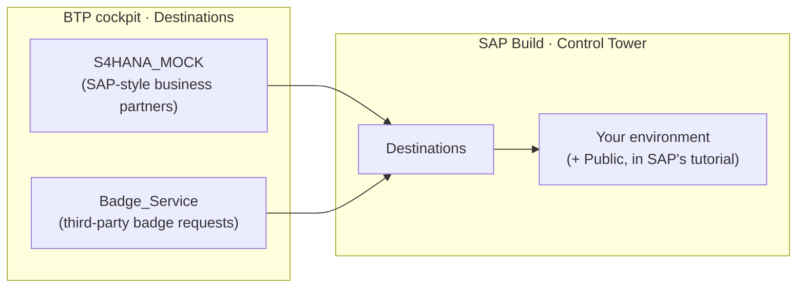

- Both services are mock OData services that SAP runs for this tutorial; their URLs are on SAP's page.
- The scenario across the five parts: look up an employee as an SAP business partner, then create a building badge for them in another system.

## 21.2 Steps

*Steps and screenshots adapted from SAP's tutorial (© SAP SE, [CC BY 4.0](https://creativecommons.org/licenses/by/4.0/)). Steps reworded; screenshots resized.*

> [!TIP]
> **Names in the screenshots**
> - SAP's screenshots show every name with a `tutorial_` prefix, for example `tutorial_S4HANA_MOCK`.
> - In a shared tenant, add your own prefix the same way, so your objects do not clash with other learners'.

### Step 1: Create an environment for testing Joule skills

1. Open the **SAP Build lobby**, the start page where you create and open all your projects.
2. In the left menu choose **Control Tower**, then the **Environments** tile.

    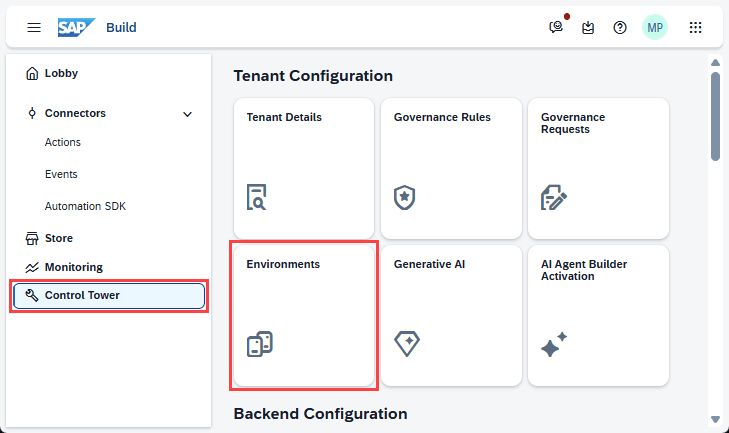

3. Choose **Create**. In the *Create Environment* dialog:
   - **Environment Name:** a name of your own, for example `tutorial`. The *Identifier* fills in by itself.
   - **Description:** what the environment is for, for example "Environment for testing the tutorial for Joule Skills".
   - Choose **Create**.

    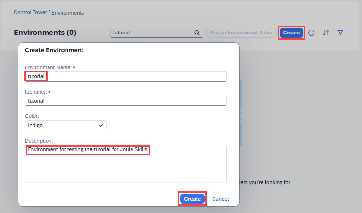

4. Open your new environment and choose its **Joule** tab.
   - *Joule Digital Assistant* shows *Standalone*, but the capability list says *No Data*.
   - That is expected: nothing is deployed yet, so the standalone assistant cannot be launched.

    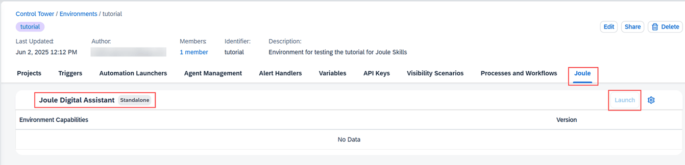

> [!TIP]
> **No admin rights?**
> - Creating environments needs admin rights in the control tower.
> - On the same *Environments* page, choose **Activate Private Environment** instead. The class worked this way.

### Step 2: Create the two destinations

1. Open the **SAP BTP cockpit** for the subaccount where SAP Build runs, and go to **Connectivity → Destinations**.
2. Choose **Create**, then **From Scratch**, then **Create**.

    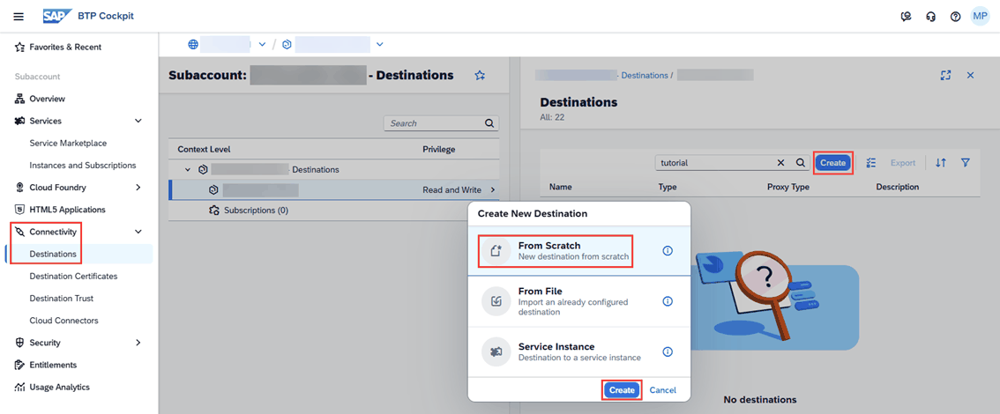

3. Fill in the main properties:

    | Field | Value |
    |---|---|
    | Name | `S4HANA_MOCK` |
    | Type | HTTP |
    | Proxy Type | Internet |
    | Authentication | NoAuthentication |
    | URL | `https://s4hana-mock.cfapps.eu10.hana.ondemand.com/sap/opu/odata/sap/API_BUSINESS_PARTNER` |

4. Under **Additional Properties**, choose **Add Property** three times and enter:

    | Key | Value |
    |---|---|
    | `sap.processautomation.enabled` | `true` |
    | `sap.applicationdevelopment.actions.enabled` | `true` |
    | `sap.build.usage` | `odata_gen` |

    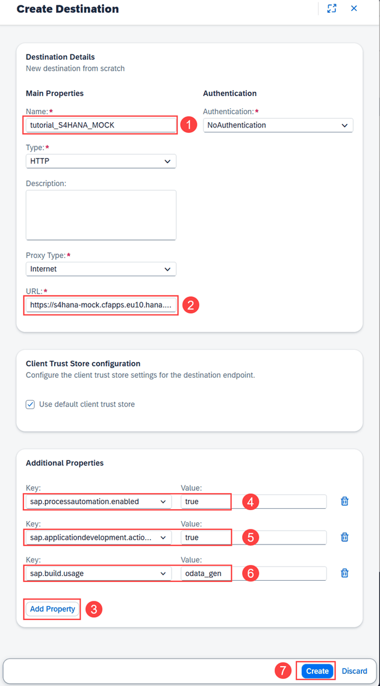

5. Choose **Create**, then **Check Connection**. The message should say the HTTP request succeeded. Choose **Close**.

    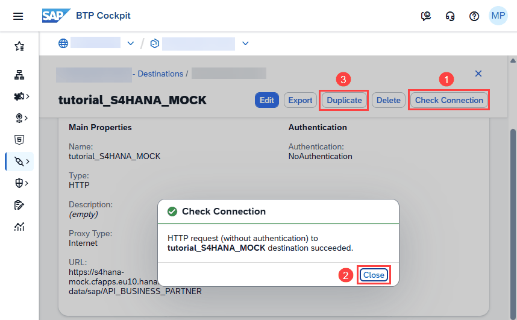

6. With `S4HANA_MOCK` still open, choose **Duplicate**. Change only two fields:
   - **Name:** `Badge_Service`
   - **URL:** `https://badges.cfapps.eu10.hana.ondemand.com/service/BadgeRequests`
   - The three additional properties are copied, so leave them.

    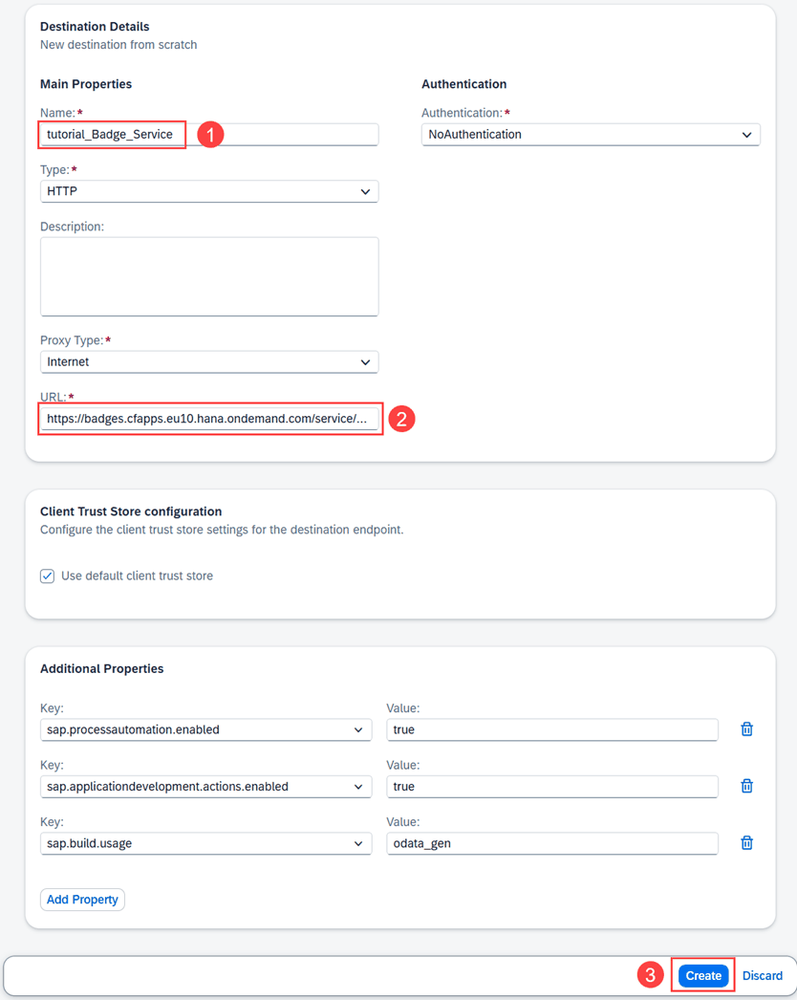

7. Choose **Create**, then **Check Connection**, then **Close**.

    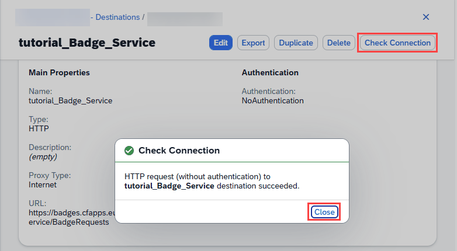

### Step 3: Link the destinations to your environment

1. Back in the **SAP Build lobby**, choose **Control Tower**, then **Destinations**.
   - The list is empty: a destination that exists only in the cockpit is not yet visible to SAP Build.
2. Choose **Add**.

    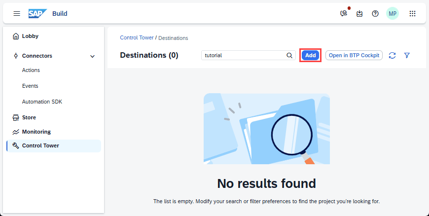

3. In the *Add Destination* wizard, select **Badge_Service** and choose **Next**.
   - The list shows each destination's type, authentication and URL, so you can check you have the right one.

    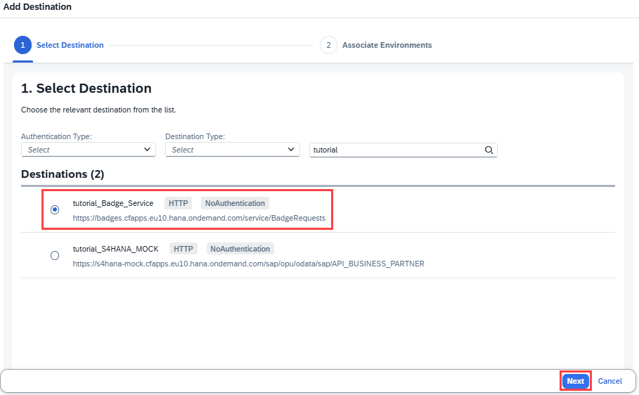

4. Choose **Specific Environments**, search for your environment and select it.

    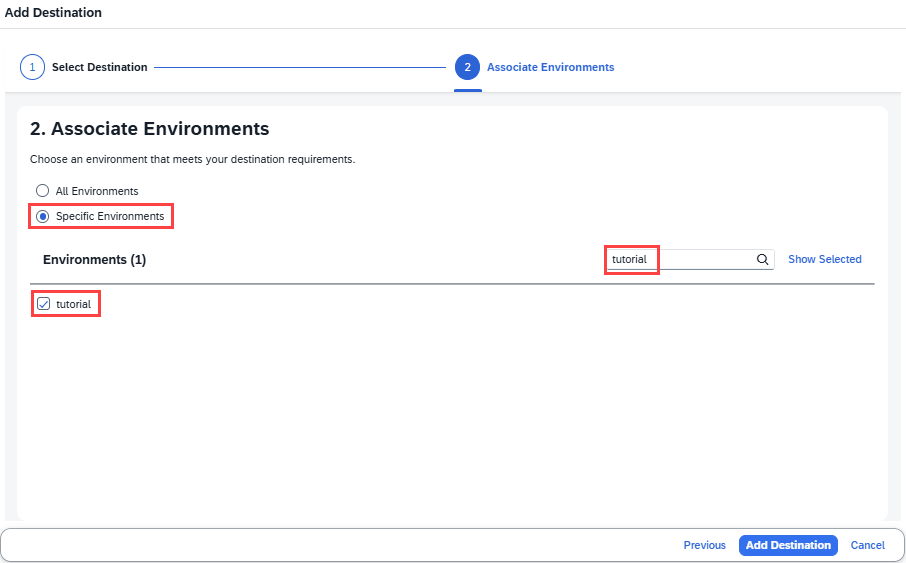

5. Search for **Public** and select it as well (see the note in 21.3), then choose **Add Destination**.

    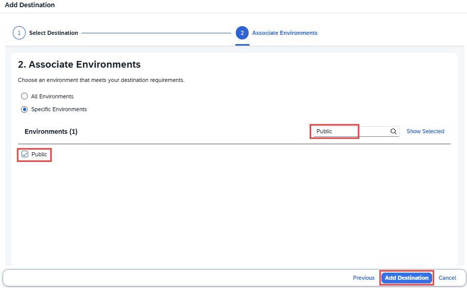

6. Repeat steps 2 to 5 for **S4HANA_MOCK**.
7. Check the result: both destinations show **2 Environments**. Click the link to see *Public* and your own environment.

    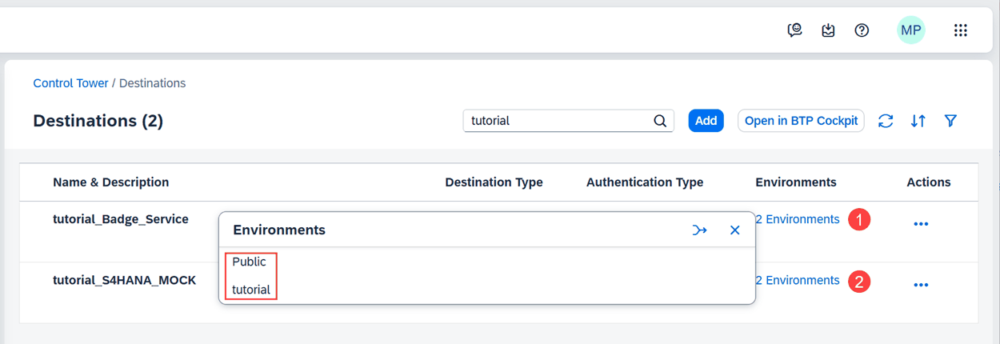

## 21.3 Why it works

- The **destination** holds where the system is and how to log on; skills and actions never store a URL themselves (19.3).
- The **three properties** make the destination visible to Process Automation and to the action generator.
- **Linking in the control tower** decides which environments may use a destination. A destination that exists only in the cockpit is invisible to SAP Build.

> [!NOTE]
> **The Public environment**
> - SAP's tutorial (updated Aug 2026) links the destinations to *Public* as well as your own environment.
> - The course used only private environments, and its tenant warned that Public is being phased out (chapter 19, 19.3).
> - If your tenant shows no Public environment, link to your own environment or to *All Environments*.

## 21.4 Common mistakes (seen in class)

| What you see | Why | Fix |
|---|---|---|
| No environment to choose when you test | Your private environment is not active | Control Tower → Environments → *Activate Private Environment*, then refresh the Joule Studio tab |
| No *Destinations* tile in the control tower | You have developer, not admin, rights | Ask the admin; developers start at action projects (tutorial 22) |
| A destination you created is missing | It was created in a different subaccount (for example your own trial) | Create it in the subaccount where SAP Build runs |

## 21.5 The same steps with Northwind (Lecture 11)

- Destination `NORTHWIND_D` to the public Northwind OData service: type HTTP, no authentication, and the same three properties.
- Added in the control tower for all environments, so every learner could use it.

> [!IMPORTANT]
> **🏭 In production**
> - Real systems need real authentication: for S/4HANA Cloud usually OAuth or principal propagation, and Cloud Connector for on-premise systems.
> - Create one destination per system and landscape (development, test, production). Skills pick one through destination variables (tutorial 23).
>
> *Added by Claude*

## Check yourself

Which three properties does a destination need for action projects?

- `sap.processautomation.enabled` = `true`
- `sap.applicationdevelopment.actions.enabled` = `true`
- `sap.build.usage` = `odata_gen`

You created a destination in the cockpit, but Joule Studio cannot see it. Why?

- It has not been added in the control tower, or not for your environment
- Or it lives in another subaccount than SAP Build

## How this page was checked

- **SAP tutorial read in full on 21 Nov 2026** (last updated by SAP on 21 Aug 2026).
- **Steps rebuilt on 21 Nov 2026** from the tutorial's source file, with all 13 of its screenshots.
  - Every screenshot was checked for personal data; none needed blurring.
  - SAP's page has a *Test yourself* heading, but its public source contains no questions, so none were taken over.
- **Lecture 12 recording:** captions 0:11 to 0:22 (the lecturer creates both destinations and links them). **Lecture 11:** 0:12 to 0:24 (the Northwind destination).
- Not run by me: there is no SAP Build tenant in this workspace.

## Sources

- SAP Developer Center, *Setup Environment and Connectivity for Joule Skills*: https://developers.sap.com/tutorials/joulestudio-skill-environment-setup.html
- Tutorial source and screenshots: https://github.com/sap-tutorials/sap-build-process-automation (© SAP SE, licensed CC BY 4.0)
- SAP Developer Center, *Build Your First Joule Skill in Joule Studio, Classic Edition*: https://developers.sap.com/group.joule-studio-first-skill.html
- BTPAI course, Lecture 11 Part A (BT023) and Lecture 12 (BT025) recordings

Previous: [The new Joule Studio: intent-based development, agents and extensions](joule-studio-intent-based.md) · Next: [Tutorial: Create action projects](tutorial-joule-action-projects.md)
