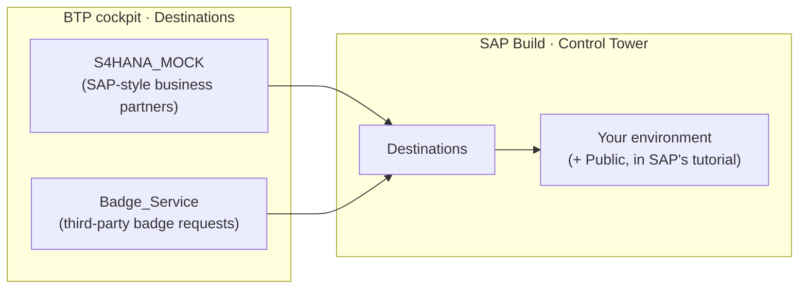

# Tutorial: Set up environments and destinations for Joule skills

*The groundwork before any Joule skill can run: a test environment, and two destinations that let your skills reach an SAP system and a third-party service.*

> [!NOTE]
> **📍 At a glance**
> - **SAP tutorial:** [Setup Environment and Connectivity for Joule Skills](https://developers.sap.com/tutorials/joulestudio-skill-environment-setup.html) (part 1 of 5 in *Build Your First Joule Skill in Joule Studio, Classic Edition*)
> - **You will build:** a test environment, and two destinations (`S4HANA_MOCK`, `Badge_Service`) linked to it
> - **You need:** a BTP subaccount with Joule and Joule Studio Classic set up; admin rights in the control tower and the cockpit
> - **Level:** beginner
> - **Concepts:** [Joule Studio Classic](joule-studio-classic.md), 19.3

**After this tutorial you can:**

- Create or activate an environment for testing Joule skills
- Create a destination with the three properties action projects need
- Link a destination to the environments that may use it

## 21.1 What you build

- Both services are mock OData services that SAP runs for this tutorial; their URLs are on SAP's page.
- The scenario across the five parts: look up an employee as an SAP business partner, then create a building badge for them in another system.

## 21.2 Steps

1. **Create an environment for testing** (admin): Lobby → *Control Tower* → *Environments* → *Create*, with a name and description.
   - Open it and look at the *Joule* tab. It stays empty until a skill is deployed there.
   - **Without admin rights**, use *Activate Private Environment* on the same page instead. That is what the class did.
2. **Create the first destination** in the BTP cockpit: *Connectivity* → *Destinations* → *Create* → *From Scratch*.
   - Name `S4HANA_MOCK`, the URL from SAP's tutorial, no authentication.
   - Add the three properties: `sap.processautomation.enabled` = `true`, `sap.applicationdevelopment.actions.enabled` = `true`, `sap.build.usage` = `odata_gen`.
   - *Create*, then *Check Connection*.
3. **Create the second destination** by *Duplicate*: rename it `Badge_Service` and change only the URL. The properties are copied.
4. **Link both destinations in the control tower:** Lobby → *Control Tower* → *Destinations* → *Add* → pick the destination → *Next*.
   - Choose *Specific Environments*, then your environment, and *Add Destination*. Repeat for the second one.
   - SAP's tutorial also selects the *Public* environment.

## 21.3 Why it works

- The **destination** holds where the system is and how to log on; skills and actions never store a URL themselves (19.3).
- The **three properties** make the destination visible to Process Automation and to the action generator.
- **Linking in the control tower** decides which environments may use a destination. A destination that exists only in the cockpit is invisible to SAP Build.

> [!NOTE]
> **The Public environment**
> - SAP's tutorial (updated Aug 2026) links the destinations to *Public* as well as your own environment.
> - The course used only private environments, and its tenant warned that Public is being phased out (chapter 19, 19.3).
> - If your tenant shows no Public environment, link to your own environment or to *All Environments*.

## 21.4 Common mistakes (seen in class)

| What you see | Why | Fix |
|---|---|---|
| No environment to choose when you test | Your private environment is not active | Control Tower → Environments → *Activate Private Environment*, then refresh the Joule Studio tab |
| No *Destinations* tile in the control tower | You have developer, not admin, rights | Ask the admin; developers start at action projects (tutorial 22) |
| A destination you created is missing | It was created in a different subaccount (for example your own trial) | Create it in the subaccount where SAP Build runs |

## 21.5 The same steps with Northwind (Lecture 11)

- Destination `NORTHWIND_D` to the public Northwind OData service: type HTTP, no authentication, and the same three properties.
- Added in the control tower for all environments, so every learner could use it.

> [!IMPORTANT]
> **🏭 In production**
> - Real systems need real authentication: for S/4HANA Cloud usually OAuth or principal propagation, and Cloud Connector for on-premise systems.
> - Create one destination per system and landscape (development, test, production). Skills pick one through destination variables (tutorial 23).
>
> *Added by Claude*

## Check yourself

Which three properties does a destination need for action projects?

- `sap.processautomation.enabled` = `true`
- `sap.applicationdevelopment.actions.enabled` = `true`
- `sap.build.usage` = `odata_gen`

You created a destination in the cockpit, but Joule Studio cannot see it. Why?

- It has not been added in the control tower, or not for your environment
- Or it lives in another subaccount than SAP Build

## How this page was checked

- **SAP tutorial read in full on 21 Nov 2026** (last updated by SAP on 21 Aug 2026).
- **Lecture 12 recording:** captions 0:11 to 0:22 (the lecturer creates both destinations and links them). **Lecture 11:** 0:12 to 0:24 (the Northwind destination).
- Not run by me: there is no SAP Build tenant in this workspace.

## Sources

- SAP Developer Center, *Setup Environment and Connectivity for Joule Skills*: https://developers.sap.com/tutorials/joulestudio-skill-environment-setup.html
- SAP Developer Center, *Build Your First Joule Skill in Joule Studio, Classic Edition*: https://developers.sap.com/group.joule-studio-first-skill.html
- BTPAI course, Lecture 11 Part A (BT023) and Lecture 12 (BT025) recordings

Previous: [The new Joule Studio: intent-based development, agents and extensions](joule-studio-intent-based.md) · Next: [Tutorial: Create action projects](tutorial-joule-action-projects.md)
