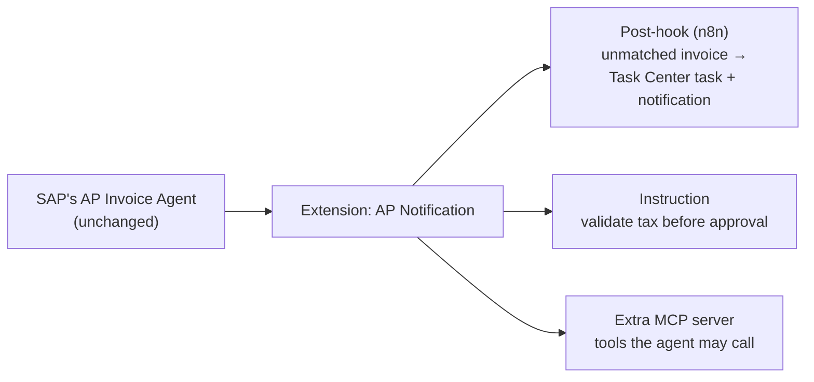

# Tutorial: Extend SAP's AP Invoice Agent

*Add your own rules and follow-up steps to an agent that SAP delivers, without changing it: a post-hook, an instruction and an extra MCP server.*

> [!NOTE]
> **📍 At a glance**
> - **SAP tutorial:** [Use Joule Studio to Extend the AP Invoice Agent using Agent Extensions](https://developers.sap.com/tutorials/joule-studio-agent-extension.html)
> - **You will build:** the extension *AP Notification* for SAP's AP Invoice Agent: a post-hook n8n workflow, a tax-validation instruction and an added MCP server
> - **You need:** Joule Work and the new Joule Studio. SAP built the tutorial for the Sapphire 2026 Agent Lab, a pre-release version
> - **Level:** beginner
> - **Course use:** reference only. The class extended a different SAP assistant in the C_JSD practice system (Lecture 10)
> - **Concepts:** [The new Joule Studio](joule-studio-intent-based.md), 20.6

**After this tutorial you can:**

- Start an agent extension from an intent
- Add a hook, an instruction and an MCP server to an SAP agent
- Explain why an extension keeps SAP's agent upgradeable

## 28.1 What you build

## 28.2 Steps

1. **Start:** Joule Work → *Develop* (shown as **<> Develop** if tiles are hidden) → *Agent Extension* → *Create* → *Agent Extension*. Keep *New Solution*.
   - Name *AP Notification*.
   - Intent: extend the AP Invoice Agent with a post-hook n8n workflow that, for any invoice that cannot be matched, creates an SAP Task Center task and notifies the responsible AP clerk.
   - *OK*. The tool finds the AP Invoice Agent on its own.
2. **Intent:** answer any clarifying questions; the landscape uses S/4HANA as its backend. The tool maps the goal to the Reference Business Architecture and runs a fit-gap. Ask for *Create Requirement* if it waits.
3. **Requirement:** review the PRD and accept it.
4. **Solution:** the *Solution* tab shows the extension built as a **post-hook n8n workflow**; you can open its code.
5. **Add an instruction:** *Design* tab → *Edit* under *Instructions and Context*. Add a tax-validation rule:
   - always check tax on pending invoices with the tax-validation tool before recommending approval
   - errors block approval; warnings allow it with a note
   - watch for foreign vendors charging domestic tax
6. **Add an MCP server:** *Design* tab → *Extensions* → *MCP Servers* → *Add Server*. Use *View Details* to see its tools, then *Add MCP Server*.
7. **Deploy:** not done in the Agent Lab; *Deploy* would send it to the runtime.

## 28.3 Why it works

- An **extension** sits on top of SAP's agent, so SAP can still update the agent underneath (20.6).
- A **post-hook** runs after the agent, in a fixed order: right for a step that must always happen. An **MCP tool** is something the agent may choose to call.
- **Instructions and context** change how the agent decides, without code.

## 28.4 Things to watch

- **Which extension points exist** depends on the agent; the dialog shows them for the agent you pick.
- **Keep the intent small.** SAP's tutorial warns that a more complex scenario takes longer to generate and test.

> [!IMPORTANT]
> **🏭 In production**
> - Test the extension with matched, unmatched and borderline invoices, and with tax errors and warnings, before go-live.
> - Review an added MCP server like any integration: which user it calls with, and what it can change.
>
> *Added by Claude*

## Check yourself

Why a post-hook rather than an extra tool for the Task Center task?

- A hook runs every time, after the agent, in a fixed order
- A tool runs only when the agent decides to call it

What does an extension leave untouched?

- SAP's agent itself; your changes sit in the extension, so SAP updates still apply

## How this page was checked

- **SAP tutorial read in full on 21 Nov 2026** (created May 2026, updated by SAP on 21 Aug 2026; marked pre-release).
- **Lecture 10 Part B recording:** the extension demo in the C_JSD practice system (1:04 to 1:12) used the same dialog.
- Not run by me: there is no Joule Studio access in this workspace.

## Sources

- SAP Developer Center, *Use Joule Studio to Extend the AP Invoice Agent using Agent Extensions*: https://developers.sap.com/tutorials/joule-studio-agent-extension.html
- BTPAI course, Lecture 10 Part B recording (BT022)

Previous: [Tutorial: Build an HR assistant with intent-based development](tutorial-joule-studio-hr-assistant.md) · Next: [Responsible AI: SAP's ethics policy, the EU AI Act and the AI Terms](responsible-ai-ethics-governance.md)
