# Tutorial: Extend SAP's AP Invoice Agent

*Add your own rules and follow-up steps to an agent that SAP delivers, without changing it: a post-hook, an instruction and an extra MCP server.*

> [!NOTE]
> **📍 At a glance**
> - **SAP tutorial:** [Use Joule Studio to Extend the AP Invoice Agent using Agent Extensions](https://developers.sap.com/tutorials/joule-studio-agent-extension.html)
> - **You will build:** the extension *AP Notification* for SAP's AP Invoice Agent: a post-hook n8n workflow, a tax-validation instruction and an added MCP server
> - **You need:** Joule Work and the new Joule Studio. SAP built the tutorial for the Sapphire 2026 Agent Lab, a pre-release version
> - **Level:** beginner · **Time:** about 20 minutes (SAP's estimate)
> - **Course use:** reference only. The class extended a different SAP assistant in the C_JSD practice system (Lecture 10)
> - **Concepts:** [The new Joule Studio](joule-studio-intent-based.md), 20.6

**After this tutorial you can:**

- Start an agent extension from an intent
- Add a hook, an instruction and an MCP server to an SAP agent
- Explain why an extension keeps SAP's agent upgradeable

## 28.1 What you build

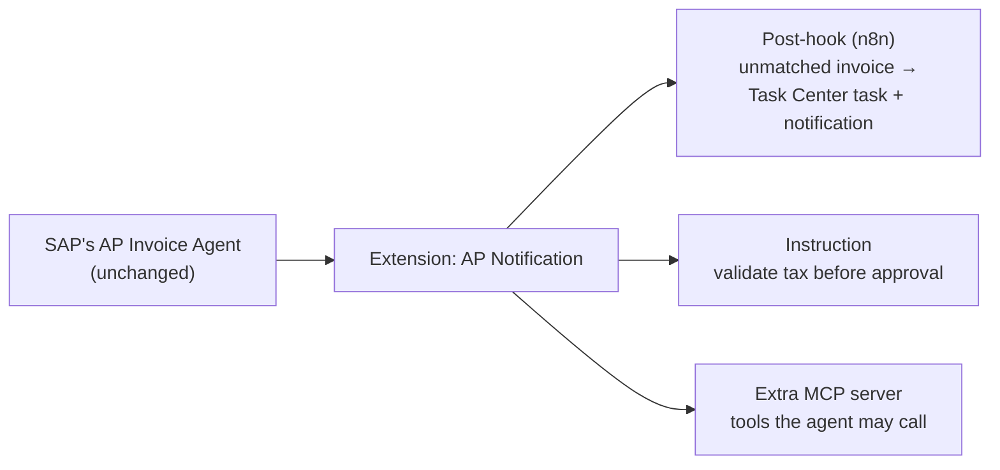

## 28.2 Steps

*Steps and screenshots adapted from SAP's tutorial (© SAP SE, [CC BY 4.0](https://creativecommons.org/licenses/by/4.0/)). Steps reworded; screenshots resized.*

> [!WARNING]
> **Pre-release screens**
> - SAP wrote this tutorial for the Sapphire 2026 Agent Lab, a pre-release Joule Studio: screens, names and features may change, and it is for learning only.
> - The tool generates new text and code on every run, so your questions, documents and file names will differ from the screenshots.

- **The agent being extended:** SAP's *AP Invoice Agent* automates accounts payable invoices that arrive through EDI, with 2-way, 3-way and ERS matching.

### Step 1: Getting started

1. Go to **Joule Work**. If you do not see the tiles, choose **<> Develop**.
2. On the **Agent Extension** tile, choose **Create**.

    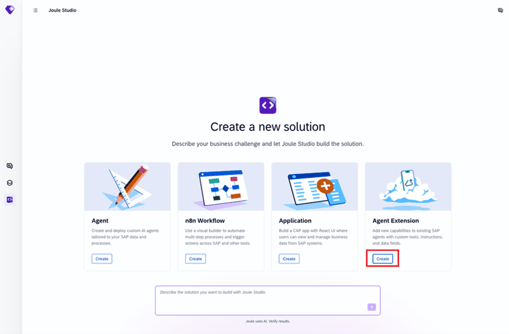

3. In *Create Extension*, choose **Agent Extension**.
   - The other types are *Agent Skill* and *Custom Data Fields*.

    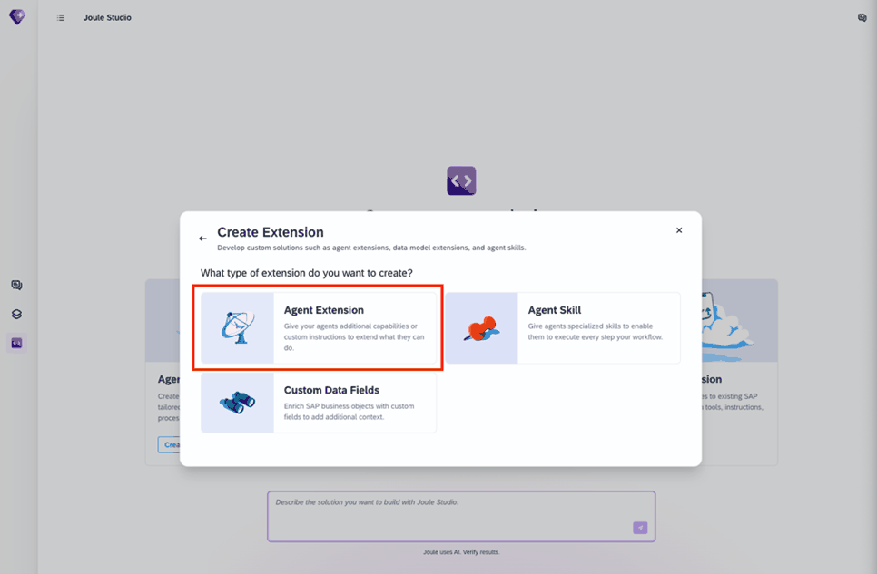

4. Keep **New Solution** and fill in:
   - **Name:** `AP Notification`
   - **Intent Statement**, SAP's text to paste:

     ```text
     Create an extension to the AP Invoice Agent. Add a post-hook n8n workflow.
     For any invoice that cannot be matched: Create a SAP Task Center task.
     Send a notification to the responsible AP team member via SAP Task Center.
     ```

    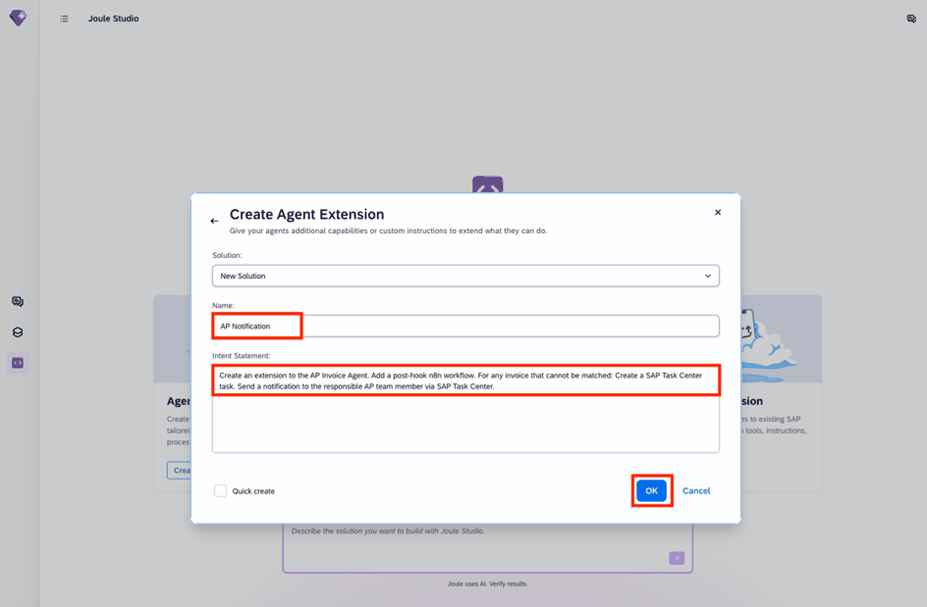

5. Choose **OK**. Your intent statement becomes the first prompt in the chat on the right.
   - The tool finds the AP Invoice Agent by itself and starts creating the extension.

    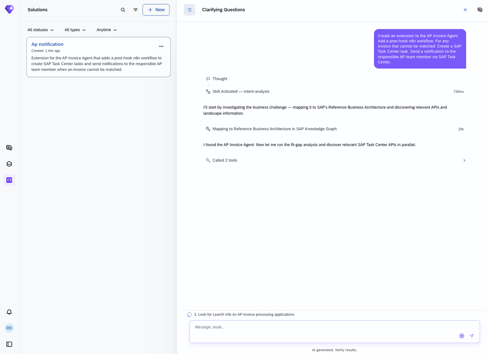

### Step 2: Intent

- The tool tries to understand your goal and will likely ask clarifying questions.
- Then it maps the goal to SAP's **Reference Business Architecture** and runs a **fit-gap analysis**, using SAP Knowledge Graph, SAP LeanIX and SAP Domain Models. *Intent fit* shows how well the solution matches the goal.

1. Answer the tool's questions with your own judgement. It may offer answers to pick from.
   - The questions cannot be predicted.
   - The landscape has **S/4HANA** as its backend, so answer with that in mind.
   - A more complex scenario takes longer to generate and test.

    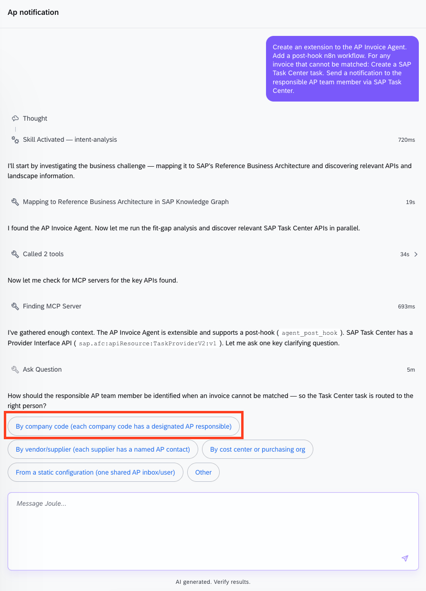

2. When the intent document is ready, requirements come next. If the tool waits for you, type **Create Requirement** or similar.
3. While the requirements are generated, look at the intent on the **Idea Board**.

    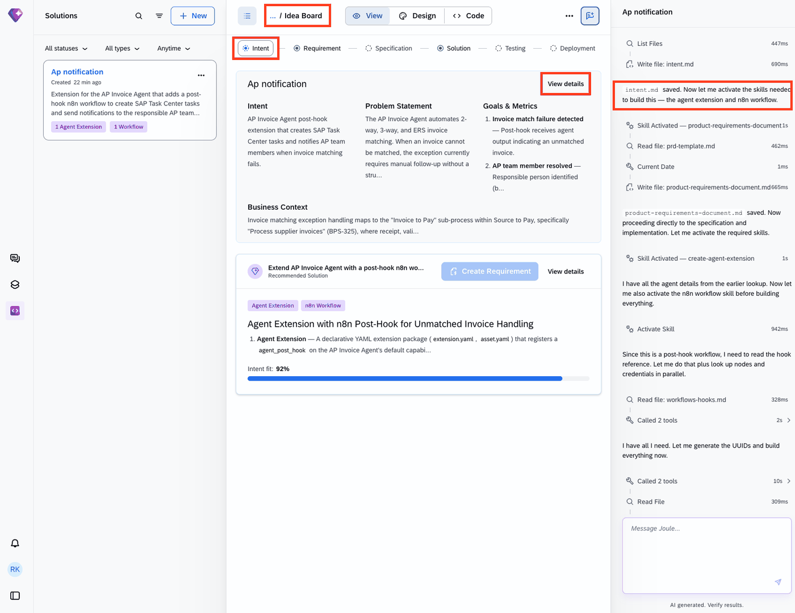

### Step 3: Requirement

1. Review the **PRD**, shown as markdown. SAP's tutorial accepts it unchanged.
   - To change it, click the text in the view or edit the file in the **Code** tab.
   - You could stop here and hand the PRD to another team.

    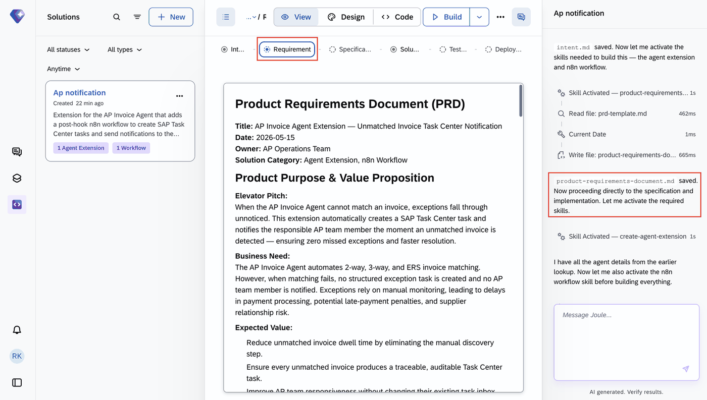

### Step 4: Solution

1. Wait until the build finishes. The **Solution** tab shows the extension, built as a **post-hook n8n workflow**.

    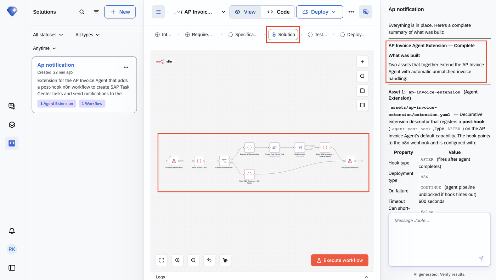

2. Open the n8n workflow's code if you want to (**Code** tab, under `workflows`).
   - The post-hook extension is now complete.

    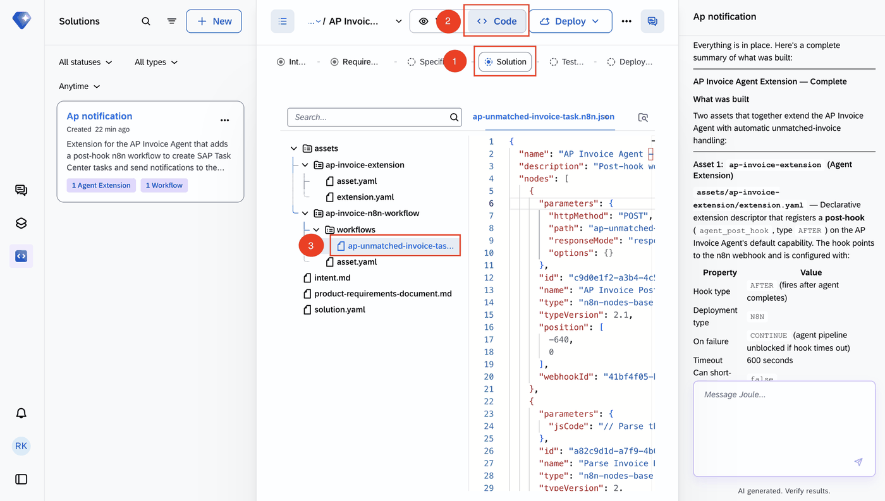

**Add an instruction**

3. Open the **Design** tab and choose **Edit** under **Instructions and Context**.
   - Here you add your own context, rules and guidance to the agent's prompt.

    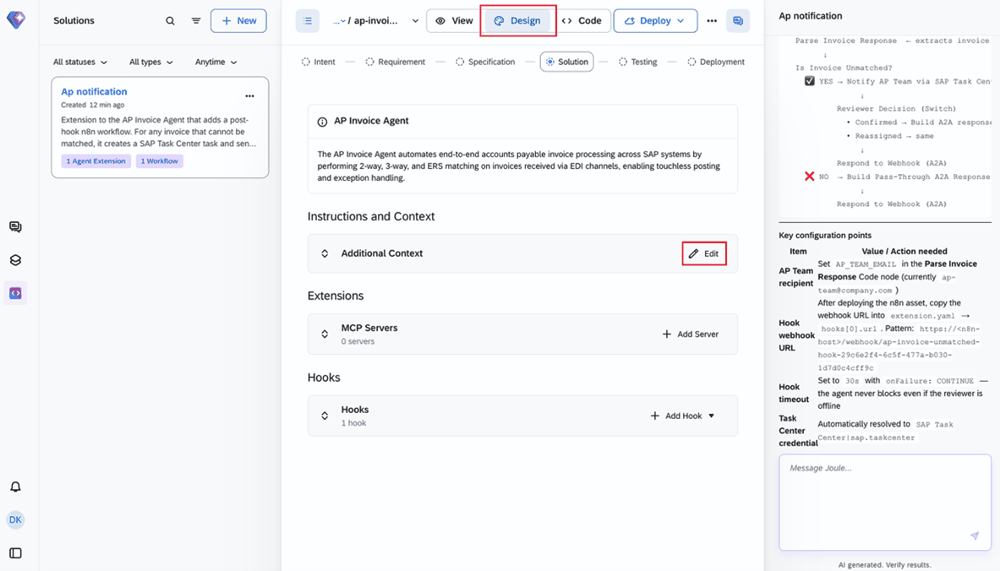

4. Add SAP's tax-validation instruction (exact text on SAP's page). In short:
   - Always validate tax on pending invoices with the `validate-tax` tool before recommending approval.
   - ERROR or BLOCK: flag as not approvable. WARNING: note the discrepancy and allow with a warning. OK: safe to approve.
   - Watch for international vendors charging domestic tax rates on cross-border shipments.

    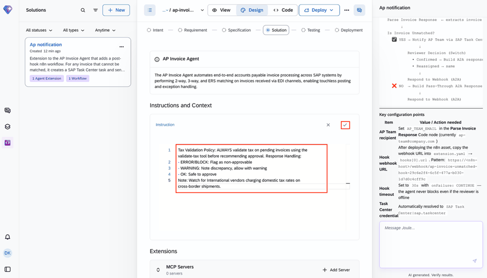

**Add an MCP server**

5. On the **Design** tab, under **Extensions → MCP Servers**, choose **Add Server**.

    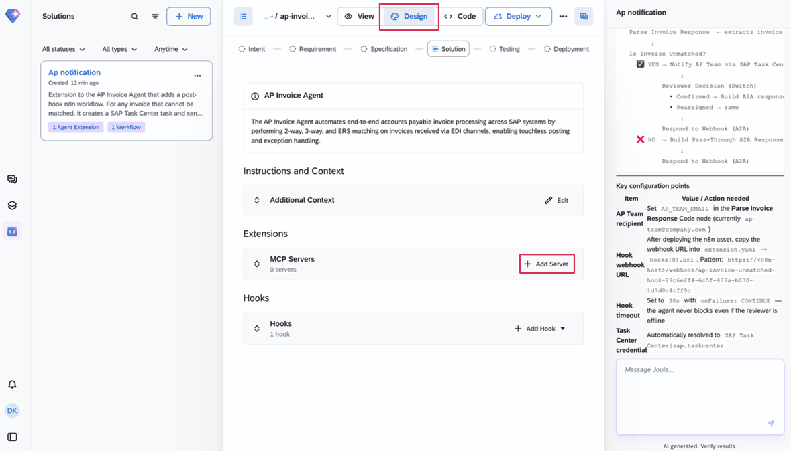

6. The *MCP Server Catalog* lists the available servers. On **Tax Validator MCP Server**, choose **View Details**.

    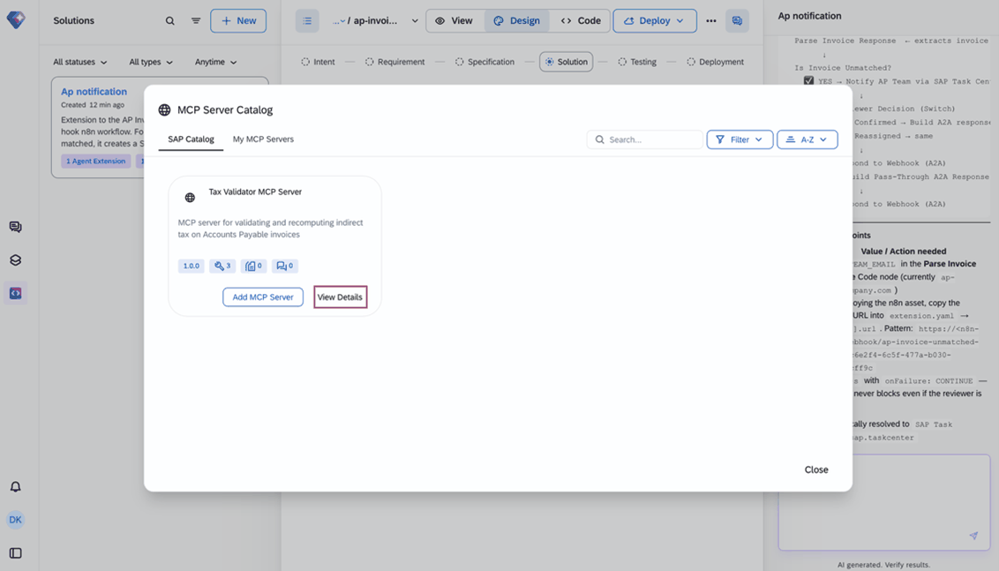

7. The details list its three tools and what they do: `validate-tax`, `lookup-tax-rate` and `compare-invoices`. Choose **Add MCP Server**.

    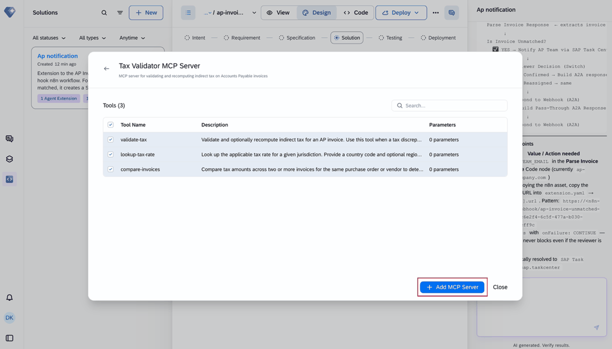

8. The extension now has all three parts: the instruction, the MCP server and the post-hook.

    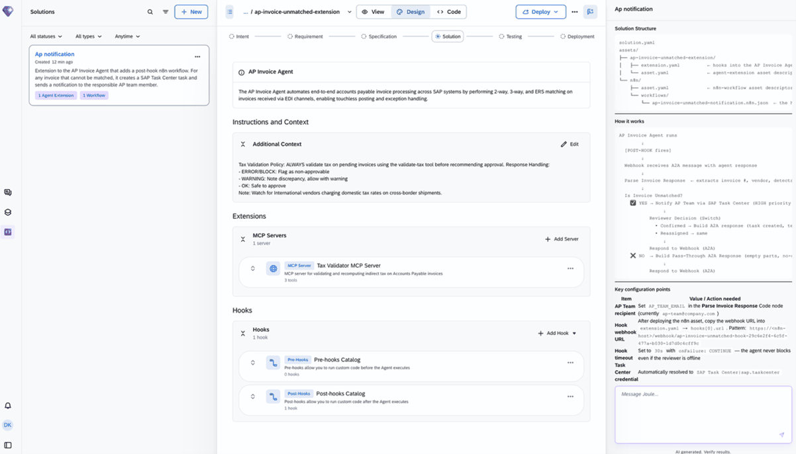

**Deploy**

9. In the Agent Lab the extension is not deployed. In a normal tenant, **Deploy** would send it to the runtime.

## 28.3 Why it works

- An **extension** sits on top of SAP's agent, so SAP can still update the agent underneath (20.6).
- A **post-hook** runs after the agent, in a fixed order: right for a step that must always happen. An **MCP tool** is something the agent may choose to call.
- **Instructions and context** change how the agent decides, without code.

## 28.4 Things to watch

- **Which extension points exist** depends on the agent; the dialog shows them for the agent you pick.
- **Keep the intent small.** SAP's tutorial warns that a more complex scenario takes longer to generate and test.

> [!IMPORTANT]
> **🏭 In production**
> - Test the extension with matched, unmatched and borderline invoices, and with tax errors and warnings, before go-live.
> - Review an added MCP server like any integration: which user it calls with, and what it can change.
>
> *Added by Claude*

## Check yourself

<details class="qa"><summary>Why a post-hook rather than an extra tool for the Task Center task?</summary>

- A hook runs every time, after the agent, in a fixed order
- A tool runs only when the agent decides to call it

</details>

<details class="qa"><summary>What does an extension leave untouched?</summary>

- SAP's agent itself; your changes sit in the extension, so SAP updates still apply

</details>

## How this page was checked

- **SAP tutorial read in full on 21 Nov 2026** (created May 2026, updated by SAP on 21 Aug 2026; marked pre-release).
- **Steps rebuilt on 21 Nov 2026** from the tutorial's source file, with all 15 of its screenshots.
  - Every screenshot was checked for personal data; none needed blurring. The address `ap-team@company.com` in them is a generated placeholder.
- **Lecture 10 Part B recording:** the extension demo in the C_JSD practice system (1:04 to 1:12) used the same dialog.
- Not run by me: there is no Joule Studio access in this workspace.

## Sources

- SAP Developer Center, *Use Joule Studio to Extend the AP Invoice Agent using Agent Extensions*: https://developers.sap.com/tutorials/joule-studio-agent-extension.html
- Tutorial source and screenshots: https://github.com/sap-tutorials/sap-build-process-automation (© SAP SE, licensed CC BY 4.0)
- BTPAI course, Lecture 10 Part B recording (BT022)

Previous: [Tutorial: Build an HR assistant with intent-based development](tutorial-joule-studio-hr-assistant.md) · Next: [Tutorial: Bring SAP Analytics Cloud insights into Joule](tutorial-joule-sac-analytical-insights.md)
