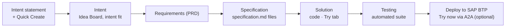

# Tutorial: Build an HR assistant with intent-based development

*In the new Joule Studio, a one-sentence intent becomes a tested HR agent: intent, requirements, specification, code, tests and an optional deployment.*

> [!NOTE]
> **📍 At a glance**
> - **SAP tutorial:** [Use Joule Studio to Create an HR Onboarding Assistant](https://developers.sap.com/tutorials/joule-studio-hr-onboarding-assistant.html)
> - **You will build:** an *HR Virtual Assistant* agent that answers HR questions, analyses simulated workforce data and flags attrition risks
> - **You need:** Joule Work and the new Joule Studio. SAP's page says it is written for its pre-release Agent Lab, so screens may differ
> - **Level:** beginner
> - **Course use:** reference only. The class used the C_JSD practice system, and access to the new Studio was limited (Lecture 10)
> - **Concepts:** [The new Joule Studio](joule-studio-intent-based.md), 20.2 to 20.4

**After this tutorial you can:**

- Start an agent with Quick Create from an intent statement
- Follow and review each phase's output
- Try the agent, read its test results and deploy it

## 27.1 What you build

## 27.2 Steps

1. **Start:** Joule Work → *Develop* → **+** → *Agent* → *Create*. Keep *New Solution*.
   - Agent name *HR Virtual Assistant*.
   - An intent statement along these lines: an assistant that answers employees' HR questions, analyses workforce data, predicts attrition risk and recommends development actions, using simulated HCM data.
   - Select **Quick Create**, then *Create*.
2. **Intent:** the tool maps the goal to SAP's Reference Business Architecture and reports the intent fit.
   - It draws on SAP Knowledge Graph, SAP LeanIX and SAP Domain Models.
   - With Quick Create it skips clarifying questions. Explore the intent on the *Idea Board*.
3. **Requirements:** a PRD appears in markdown. The tutorial accepts it unchanged; you could edit it in the view or in the Code tab.
4. **Specification:** generated next. Find the `specification.md` files under the specification folder in the Code tab.
5. **Solution:** wait for the implementation. Then open *Try* and ask "How can I test this agent?" for example prompts, such as showing the profile of employee E0001.
6. **Testing:** runs automatically. The *Testing* tab shows tests passed and failed, code coverage and an overall score, plus checks per artifact.
7. **Deployment (optional):** *Deploy* → *Deploy*. The record appears on the *Deployment* tab; *Try now* talks to the deployed agent over A2A.

## 27.3 Why it works

- Each phase writes a document the next one builds on: intent, then requirements, then specification, then code (20.3).
- **Quick Create** chains the phases without stopping; without it you confirm each one.
- **Stopping after the PRD or specification** is a supported hand-over point to another team (20.4).

## 27.4 Things to watch

- **Review the intent and PRD** even in Quick Create; a wrong goal flows into the code (20.4).
- **Simulated data:** the tutorial uses simulated HCM data; a real agent needs real SuccessFactors APIs and HR-grade access control.

> [!IMPORTANT]
> **🏭 In production**
> - HR agents touch personal data: mask what the model does not need, and keep people in decisions about people (chapter 17).
> - Add your own test cases with edge cases before deploying; generated tests check what the tool understood.
>
> *Added by Claude*

## Check yourself

What does Quick Create change?

- It skips clarifying questions and runs from intent to tests without stopping
- You can still review and edit every document afterwards

Where do you see whether the generated agent passed its tests?

- On the *Testing* tab: tests passed and failed, coverage and an overall score

## How this page was checked

- **SAP tutorial read in full on 21 Nov 2026** (created May 2026, updated by SAP on 21 Sep 2026; marked pre-release).
- **Lecture 10 Part B recording:** the live build in the C_JSD practice system (0:39 to 1:00) followed the same phases.
- Not run by me: there is no Joule Studio access in this workspace.

## Sources

- SAP Developer Center, *Use Joule Studio to Create an HR Onboarding Assistant*: https://developers.sap.com/tutorials/joule-studio-hr-onboarding-assistant.html
- BTPAI course, Lecture 10 Part B recording (BT022)

Previous: [Tutorial: Create a Joule agent in Joule Studio Classic](tutorial-joule-agent-create.md) · Next: [Tutorial: Extend SAP's AP Invoice Agent](tutorial-joule-studio-agent-extension.md)
