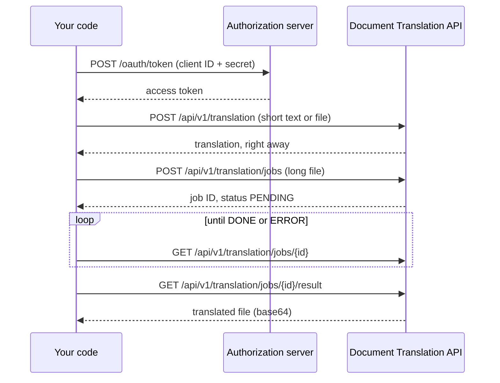

# Hands-on: Translate text and documents with SAP Translation Hub from Python

*Get a token, translate a sentence with the LLM model, translate a PDF while you wait, and run a long document as a job you poll, download and delete.*

> [!NOTE]
> **📍 At a glance**
> - **Sources:**
>   - the course's `translation-hub` folder: README, `requirements.txt` and three notebooks (text, synchronous and asynchronous document translation)
>   - SAP Help's *SAP Translation Hub* pages on the Document Translation API (read 21 Nov 2026)
> - **You will build:** a small Python client that translates text, translates a short PDF three ways, and runs a long PDF as an asynchronous job
> - **You need:** a Document Translation service instance and key from SAP Translation Hub, Python 3.10+, `requests`, `python-dotenv`, `python-docx`
> - **Level:** beginner
> - **Concepts:** [Identity and trust](btp-identity-trust-federation.md) (OAuth tokens), [Inside a subaccount](btp-subaccount-walkthrough.md) (service keys)
> - **Last checked:** 21 Nov 2026

**After this tutorial you can:**

- Get an OAuth token from a service key and call the Document Translation API with it
- Translate text with the `llm` or `default` model
- Pick sync or async by document size, and choose how to upload and receive the file
- Run a job end to end: create, poll, fetch the result, delete

## 35.1 Two services, one key

- **SAP Translation Hub** has two parts: **Software Translation** (UI texts of applications) and **Document Translation** (files and text). This chapter uses Document Translation.
- One service key holds the login details and both base URLs. The course's `.env` maps them like this:

```bash
# .env — the field each value comes from in the service key
CLIENT_ID=<uaa.clientid>
CLIENT_SECRET=<uaa.clientsecret>
AUTH_URL=<uaa.url>/oauth/token
DOCTRANS_BASE=<documenttranslation.url>
SOFTWARE_BASE=<softwaretranslation.url>
```



> [!NOTE]
> **Try it for free**
> - SAP Help describes testing the API with a **BTP free tier** account on SAP Business Accelerator Hub.
> - Choose region `us10` or `eu10`, then paste your client ID and secret.

## 35.2 Get a token

```python
import os, requests
from dotenv import load_dotenv

load_dotenv()

def get_token(auth_url, client_id, client_secret):
    """Client-credentials token for the Document Translation API."""
    r = requests.post(auth_url, data={"grant_type": "client_credentials"},
                      auth=(client_id, client_secret), timeout=30)
    r.raise_for_status()                     # fail loudly instead of returning None
    return r.json()["access_token"]

token = get_token(os.environ["AUTH_URL"], os.environ["CLIENT_ID"], os.environ["CLIENT_SECRET"])
base = os.environ["DOCTRANS_BASE"]
```

- The course's version prints an error when the token request fails, then still returns `access_token`, which was never set. The next line fails with a confusing error. `raise_for_status()` stops at the real cause.
- Tokens expire. When a call returns **401**, get a new token.

## 35.3 Translate text

```python
def translate_text(base, token, text, target, source=None, model="llm"):
    body = {"targetLanguage": target, "encoding": "plain", "model": model, "data": text}
    if source:
        body["sourceLanguage"] = source        # optional: the service can detect it
    r = requests.post(f"{base}/api/v1/translation", json=body,
                      headers={"Authorization": f"Bearer {token}"}, timeout=60)
    r.raise_for_status()
    return r.json()["data"]

print(translate_text(base, token, "Happy journey to the moon", "fr-FR", "en-US"))
# course run: Bon voyage vers la lune
```

✅ *Verified: this client ran end to end against a local stand-in of the API (details at the end).*

| `model` | Use it for |
|---|---|
| `llm` | Short texts where natural wording matters, such as marketing copy |
| `default` | Machine translation; what the course uses for documents |

- The reply echoes the languages and model, and puts the translation in `data`.
- `encoding` is `plain` for text and `base64` for binary content.

## 35.4 Translate a short document (synchronous)

SAP Help's limits for the synchronous API:

| Limit | Value |
|---|---|
| File size | 500 MB |
| Characters | 40,000; lower for Japanese (13,500), Chinese (14,500), Korean (12,500) and Thai (7,000) |
| Stored afterwards? | No. The translation comes back in the response only |

The course sends the same PDF three ways:

| Style | Send | Get back | Pick it when |
|---|---|---|---|
| **JSON body** | the PDF's text in `data` | JSON with translated text | You already have the text and want readable JSON to log |
| **Form-data** | the file as a multipart upload; `Accept: application/octet-stream` | the translated **file as raw bytes** | You want to save or forward the file without decoding |
| **Raw upload** | the file's bytes as the body, `Content-Type: application/pdf`, languages in the query string | JSON with the file in base64 | Your client can't build multipart requests |

```python
# Form-data upload: translated file back as raw bytes
from io import BytesIO
from docx import Document

with open("sample_doc/SAP_BTP_Translation_Hub_DE.pdf", "rb") as f:
    r = requests.post(f"{base}/api/v1/translation",
                      headers={"Authorization": f"Bearer {token}",
                               "Accept": "application/octet-stream"},
                      data={"sourceLanguage": "de-DE", "targetLanguage": "en-US", "model": "default"},
                      files={"file": ("in.pdf", f, "application/pdf")}, timeout=120)
r.raise_for_status()
print("\n".join(p.text for p in Document(BytesIO(r.content)).paragraphs))
```

- In the course run, the German PDF came back as a **Word (DOCX)** file, which is why the code reads it with `python-docx`.
- **Don't set `Content-Type: multipart/form-data` yourself.** `requests` sets it, with the boundary, when you pass `files=`.
- The JSON-body route lost some line structure in the course run ("if: more natural formulations"). The file routes kept whole sentences.

## 35.5 Translate a long document (asynchronous job)

SAP Help's limits for the asynchronous API: **500 MB** and **2,500,000 characters** per file.

```python
import base64, time

def create_job(base, token, path, source, target, model="default"):
    with open(path, "rb") as f:
        r = requests.post(f"{base}/api/v1/translation/jobs",
                          headers={"Authorization": f"Bearer {token}", "Accept": "application/json"},
                          data={"sourceLanguage": source, "targetLanguage": target, "model": model},
                          files={"file": (os.path.basename(path), f, "application/pdf")}, timeout=120)
    r.raise_for_status()
    return r.json()["id"]

def wait_until_done(base, token, job_id, poll=5, timeout=600):
    deadline = time.monotonic() + timeout
    while True:
        r = requests.get(f"{base}/api/v1/translation/jobs/{job_id}",
                         params={"enableRedirect": "false"},
                         headers={"Authorization": f"Bearer {token}"}, timeout=30)
        r.raise_for_status()
        info = r.json()
        if info["status"] != "PENDING":      # DONE or ERROR
            return info
        if time.monotonic() > deadline:
            raise TimeoutError(f"job {job_id} still PENDING after {timeout}s")
        time.sleep(poll)

def get_result_docx(base, token, job_id):
    r = requests.get(f"{base}/api/v1/translation/jobs/{job_id}/result",
                     headers={"Authorization": f"Bearer {token}", "Accept": "application/json"}, timeout=60)
    r.raise_for_status()
    return Document(BytesIO(base64.b64decode(r.json()["data"])))

job = create_job(base, token, "sample_doc/SAP_BTP_Translation_Hub_DE_long_.pdf", "de-DE", "en-US")
info = wait_until_done(base, token, job)
if info["status"] == "DONE":
    doc = get_result_docx(base, token, job)
    requests.delete(f"{base}/api/v1/translation/jobs/{job}",
                    headers={"Authorization": f"Bearer {token}"}, timeout=30).raise_for_status()
```

| Status (SAP Help) | Meaning | What you get |
|---|---|---|
| `PENDING` | Still translating | Progress |
| `ERROR` | Failed | An error object |
| `DONE` | Finished | Progress and where the result is |

- **`enableRedirect=false`** (course notebook): without it, a status call for a finished job answers **HTTP 303** and redirects to the result. With it, you get a plain 200 and fetch the result yourself.
- **Results are kept for three days**, then deleted (SAP Help). Fetch them promptly. Delete a job once you have stored its result.
- In the course run, a 3.9 MB German PDF finished as one job and came back as DOCX.

> [!WARNING]
> **⚠️ Pitfall: listing jobs needs a user token**
> - `GET /api/v1/translation/jobs` (your job history) is a **user-specific** API.
> - It needs a JWT from the *Authorization Code* or *Password Credentials* grant (SAP Help). A client-credentials token like the one above won't do.
> - Deleting follows the token type too (course notebook). With user tokens, only that user's jobs can be deleted; without them, only jobs created without user tokens.

## 35.6 Things to watch

- **Size decides the API, not taste:** check the character count first, then pick sync or async.
- **Glossaries** keep company terms consistent. SAP Help has a page on using the API with a term-aware glossary.
- **Formats:** in the course run, PDFs came back as DOCX. Plan a conversion step if users need PDF again, and check SAP Help's *Supported File Formats* page for yours.

> [!IMPORTANT]
> **🏭 In production**
> - Cache the token until shortly before it expires, instead of fetching one per call.
> - Store job IDs. Downloads expire after three days, so a crash between "done" and "downloaded" can lose the result.
> - Machine translation of contracts or policies still needs a person's review before use.
>
> *Added by Claude*

## Check yourself

<details class="qa"><summary>When do you use the synchronous API, and when a job?</summary>

- Synchronous for short files: up to 40,000 characters in most languages.
- A job for long files, up to 2.5 million characters: create, poll, fetch, delete.
- **Stronger answer:** synchronous results are never stored, and job results last three days. Either way, save the result yourself.

</details>

<details class="qa"><summary>Why does listing your jobs fail with the same token that created them?</summary>

- Listing jobs is a user-specific API, and a client-credentials token belongs to the client, not to a user.
- It needs a JWT from the Authorization Code or Password Credentials grant.
- **Stronger answer:** to track jobs without user tokens, store the job IDs yourself when you create them.

</details>

## How this page was checked

- **Course files read in full on 21 Nov 2026:**
  - `README.md` and `requirements.txt`
  - the notebooks `text_translation_llm`, `document_translation_synchronous` and `document_translation_aynchronous`, with the course run's outputs
- **Sample PDFs:** read through the notebooks' outputs only.
- **Not read:** `pyproject.toml` (Drive shows no preview). **Skipped:** `uv.lock` and `.gitignore`.
- **Run on 21 Nov 2026:** the token, text, job, result and delete code. It ran against a **local stand-in server** that mimics the documented requests and replies, not against SAP. The stand-in returned a generated DOCX in base64.
- **Not run against SAP:** every call, which needs a Document Translation key.
- **SAP Help read in full on 21 Nov 2026:**
  - synchronous and asynchronous process documentation (limits, statuses, three-day retention)
  - *User-Specific JSON Web Tokens*
  - *Testing the API with SAP BTP Free Tier*

## Sources

- BTPAI course Drive: `translation-hub` (README, `requirements.txt`, three notebooks, `sample_doc`) (BT059)
- SAP Help, *Synchronous Document Translation API - Process Documentation*: https://help.sap.com/docs/translation-hub/sap-translation-hub/document-translation-api-process-documentation
- SAP Help, *Asynchronous Document Translation API - Process Documentation*: https://help.sap.com/docs/translation-hub/sap-translation-hub/async-document-translation-api-process-documentation
- SAP Help, *User-Specific JSON Web Tokens*: https://help.sap.com/docs/translation-hub/sap-translation-hub/user-specific-json-web-tokens
- SAP Help, *Testing the API with SAP BTP Free Tier*: https://help.sap.com/docs/translation-hub/sap-translation-hub/testing-api-with-sap-btp-free-tier-account

Previous: [Hands-on: Extract invoice data with SAP Document AI from Python](tutorial-document-ai-python.md) · Next: [Hands-on: RAG and document grounding with the generative AI hub](tutorial-rag-grounding-genai-hub.md)
