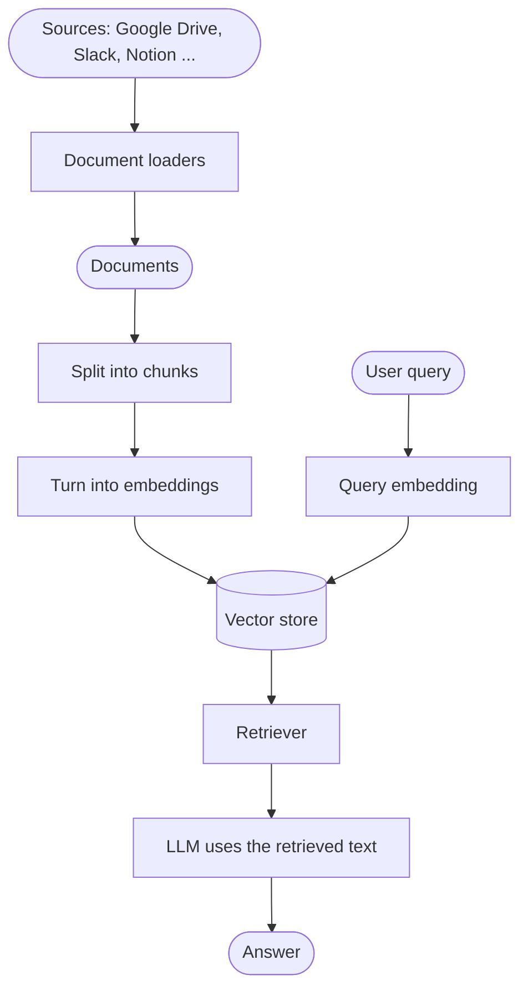
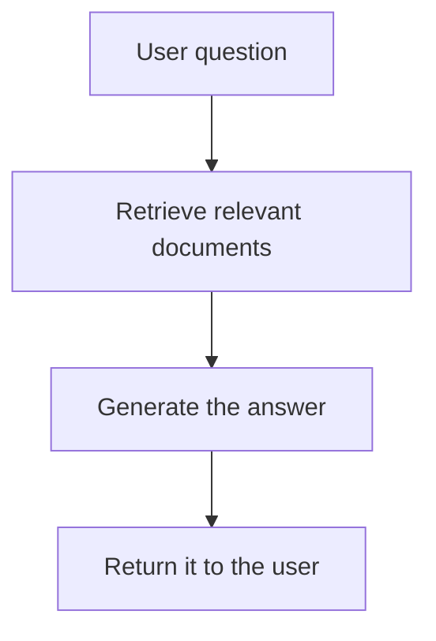
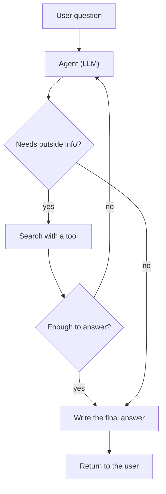
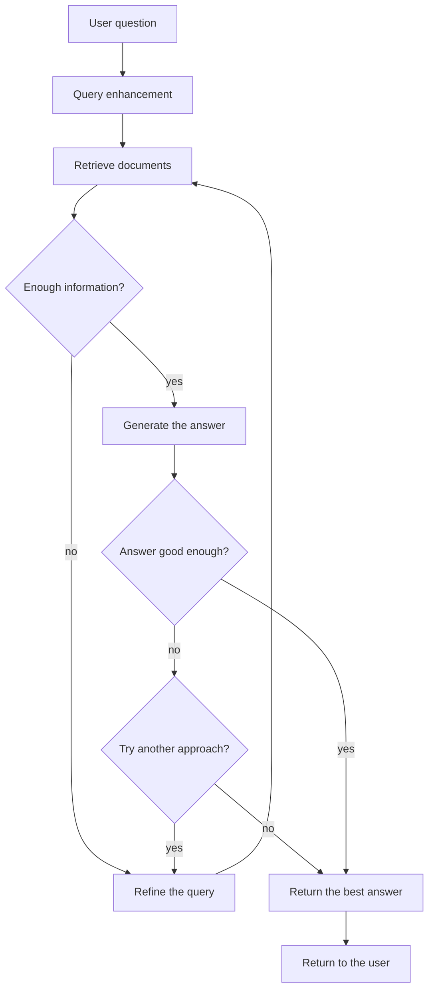

# Chapter 1: Retrieval and RAG

*Give a model the knowledge it was never trained on: fetch it at question time, then answer from it.*

> [!NOTE]
> **📍 At a glance**
> - **You will learn:** why retrieval exists, the retrieval pipeline, and the three RAG architectures (2-step, agentic, hybrid)
> - **You will build:** a 2-step RAG function, an agentic RAG agent with a fetch tool, and a hybrid loop that checks its own retrieval
> - **Level:** beginner to intermediate · **Time:** about 35 minutes
> - **Builds on:** [Langchain, Chapter 5](../langchain/05-tools.md) (tools) and [Langchain, Chapter 16](../langchain/16-tutorials-knowledge-base-sql-and-voice.md), 16.1 (building a knowledge base)

**After this chapter you can:**

- Explain the two limits of an LLM that retrieval fixes
- Draw the retrieval pipeline and name its five building blocks
- Choose between 2-step, agentic and hybrid RAG, and say what each costs
- Build agentic RAG with nothing more than a retrieval tool
- Keep a fetch tool from reaching sites it should not

**Where this page lives:** the docs moved their Retrieval page from the LangChain section to the Deep Agents section (`/oss/deepagents/retrieval`). Its content is general: it uses `create_agent`, not a Deep Agents API.

## 1.1 Why retrieval

- An LLM has two limits:
  - **Finite context:** it cannot read a whole corpus at once
  - **Static knowledge:** what it learned stops at its training date
- **Retrieval** fetches the relevant pieces of outside knowledge **at question time**
- **RAG** (Retrieval-Augmented Generation) feeds those pieces to the model, so its answer is grounded in them
- Retrieval alone gives you search results. RAG goes one step further: it **combines search with generation** into one answer

## 1.2 The knowledge base and the retrieval pipeline

- A **knowledge base** is the store of documents or structured data you retrieve from
- **Already have one** (a SQL database, a document store, a CRM, an internal wiki)? You do not need to rebuild it (docs):
  - expose it to an agent as a **tool** (agentic RAG, 1.5), or
  - query it yourself and pass the result to the model as context (2-step RAG, 1.4)
- To build one from your own files, follow the semantic-search tutorial: [Langchain, Chapter 16](../langchain/16-tutorials-knowledge-base-sql-and-voice.md), 16.1



**The five building blocks** (each can be swapped without rewriting the app):

| Block | Job |
|---|---|
| **Document loaders** | read a source (Drive, Slack, Notion, PDFs) into standard `Document` objects |
| **Text splitters** | cut long documents into chunks small enough to retrieve one by one and to fit the context window |
| **Embedding models** | turn text into vectors, so texts with similar meaning land close together |
| **Vector stores** | databases that store and search those vectors |
| **Retrievers** | the interface "give me documents for this query", whatever sits behind it |

## 1.3 Three RAG architectures

| Architecture | How it works | Control | Flexibility | Latency | Example use |
|---|---|---|---|---|---|
| **2-step RAG** | always retrieve, then generate | high | low | fast, predictable | FAQs, documentation bots |
| **Agentic RAG** | an agent decides **when** and **how** to retrieve while it reasons | low | high | variable | research assistants with several tools |
| **Hybrid RAG** | 2-step plus checks: rewrite the query, validate what was found, validate the answer | medium | medium | variable | domain Q&A that needs quality checks |

- **Latency** (docs): 2-step is the most **predictable**, because the number of LLM calls is fixed
  - That assumes model time dominates. Slow retrieval (an API, the network, a database query) still adds its own delay

## 1.4 2-step RAG



- Retrieval **always** runs first, then **one** generation call. Simple, cheap and easy to debug
- The docs give no code here (they link the semantic-search tutorial). A minimal version (*added by Claude*):

```python
from langchain.chat_models import init_chat_model
from langchain_core.vectorstores import InMemoryVectorStore
from langchain_openai import OpenAIEmbeddings

store = InMemoryVectorStore.from_texts(
    ["Refunds are accepted within 30 days of purchase.",
     "Standard shipping takes 3 to 5 working days.",
     "Gift cards cannot be exchanged for cash."],
    embedding=OpenAIEmbeddings(model="text-embedding-3-small"),
)
model = init_chat_model("openai:gpt-5-mini")

def answer(question: str) -> str:
    docs = store.similarity_search(question, k=2)                  # step 1: retrieve, always
    context = "\n\n".join(d.page_content for d in docs)
    prompt = ("Answer only from the context. If it is not there, say you don't know.\n\n"
              f"Context:\n{context}\n\nQuestion: {question}")
    return model.invoke(prompt).text                               # step 2: generate, once
```

- Exactly **one** model call per question, whatever the question. That is the predictability in 1.3
- The weakness: it retrieves even when the question needs nothing, and it cannot go back for more

✅ *Verified with a fake embedding and a scripted model: the function made one model call, and the prompt held the two retrieved chunks (details at the end).*

## 1.5 Agentic RAG



- An agent **reasons step by step** and decides **when** and **how** to retrieve, possibly several times
- **The only thing it needs is a tool that fetches knowledge** (docs): a document loader, a web API, a database query

```python
import requests
from langchain.agents import create_agent
from langchain.tools import tool

@tool
def fetch_url(url: str) -> str:
    """Fetch text content from a URL"""
    response = requests.get(url, timeout=10.0)
    response.raise_for_status()
    return response.text

agent = create_agent(
    model="claude-sonnet-4-6",
    tools=[fetch_url],                       # a tool for retrieval is all agentic RAG needs
    system_prompt="Use fetch_url when you need information from a web page; quote relevant snippets.",
)
```

**The docs' fuller example: a documentation assistant built on `llms.txt`**

- `llms.txt` is a site's plain-text index of pages written for LLMs. The agent reads it in its prompt, then fetches only the pages it needs
- It keeps the tool to **one allowed domain**

```python
import requests
from langchain.agents import create_agent
from langchain.chat_models import init_chat_model
from langchain.tools import tool
from markdownify import markdownify

ALLOWED_DOMAINS = ["https://docs.langchain.com/"]
LLMS_TXT = "https://docs.langchain.com/llms.txt"

@tool
def fetch_documentation(url: str) -> str:
    """Fetch and convert documentation from a URL"""
    if not any(url.startswith(domain) for domain in ALLOWED_DOMAINS):
        return f"Error: URL not allowed. Must start with one of: {', '.join(ALLOWED_DOMAINS)}"
    response = requests.get(url, timeout=10.0)
    response.raise_for_status()
    return markdownify(response.text)                 # HTML -> markdown: fewer tokens

llms_txt_content = requests.get(LLMS_TXT).text      # fetched once, before any model call

system_prompt = f"""You are an expert Python developer and technical assistant.
If a question likely involves API usage, behaviour or configuration, you MUST use
fetch_documentation to consult the docs. Do not use URLs outside the allowed domain.
If a fetch fails, tell the user and continue with your best understanding.

Approved sources:
{llms_txt_content}"""

agent = create_agent(model=init_chat_model("claude-sonnet-4-6", max_tokens=32_000),
                     tools=[fetch_documentation], system_prompt=system_prompt, name="Agentic RAG")
```

- The prompt **requires** a fetch for API questions, so the model does not answer from stale memory
- `llms.txt` is fetched **once, up front**: no model call is spent on finding the index

✅ *Verified with a stubbed `requests.get` and a scripted model: the agent called the tool and quoted the fetched text; the allow-list refused other domains (details at the end).*

> [!CAUTION]
> **🔒 A fetch tool is an open door. Keep the lock on it.**
> - Without an allow-list, the model (or text injected into a page it read) can make your server fetch internal URLs, such as cloud metadata endpoints
> - The docs' prefix check includes the trailing `/`, so `https://docs.langchain.com.evil.com/` and `https://docs.langchain.com@evil.com/` are refused (checked)
> - It does not stop **redirects**: `requests` follows them by default, so an allowed page that redirects elsewhere is still fetched. Pass `allow_redirects=False`, or check `response.url` again (*added by Claude*; not run against a real redirect)
> - Treat fetched text as **data**, not instructions: a page can contain "ignore your rules" text ([Langchain, Chapter 9](../langchain/09-guardrails-to-do-lists-and-tool-resilience.md), 9.1)

- The same idea with a vector store instead of the web, plus citations: [Langchain, Chapter 16](../langchain/16-tutorials-knowledge-base-sql-and-voice.md), 16.1, "Retrieval as an agent tool"
- With Deep Agents, retrieved chunks can be written to the agent's file system and analysed by subagents (the docs' "RAG with Deep Agents" tutorial; not read yet)

## 1.6 Hybrid RAG

- Sits between the two: a fixed pipeline with **checks and retries** added (docs). Typical steps:
  - **Query enhancement:** rewrite an unclear question, generate variations, or add context before retrieving
  - **Retrieval validation:** are the documents relevant and enough? If not, refine the query and retrieve again
  - **Answer validation:** is the answer accurate, complete and backed by the sources? If not, regenerate or revise



- **Suits** (docs): vague or underspecified questions, systems that need quality checks, several sources or step-by-step refinement
- A compact version of the loop (*added by Claude*; the docs point to a LangGraph self-correcting RAG tutorial, not read yet):

```python
def ask_yes_no(question: str) -> bool:
    return model.invoke(question + "\nAnswer only yes or no.").text.strip().lower().startswith("yes")

def hybrid_answer(question: str, max_tries: int = 2) -> str:
    query = model.invoke(f"Rewrite as a search query: {question}").text      # query enhancement
    for _ in range(max_tries):
        docs = store.similarity_search(query, k=3)
        context = "\n".join(d.page_content for d in docs)
        if ask_yes_no(f"Does this text answer '{question}'?\n{context}"):  # retrieval validation
            break
        query = model.invoke(f"Write a different search query for: {question}").text
    draft = model.invoke(f"Answer from the context only.\n{context}\n\nQ: {question}").text
    if not ask_yes_no(f"Is every claim in this answer supported by the context?\n{context}\n\n{draft}"):
        draft = "I could not find a reliable answer in the documents."                   # answer validation
    return draft
```

- Each check is another model call, so latency becomes variable. Cap the retries (`max_tries`)
- In production, use structured output for the yes/no checks instead of parsing text ([Langchain, Chapter 4](../langchain/04-structured-output.md))

✅ *Verified with a fake embedding and a scripted model: a failed first retrieval check triggered one retry; a failed answer check returned the fallback text (details at the end).*

> [!IMPORTANT]
> **🏭 In production**
> - Start with 2-step RAG and measure; move to agentic or hybrid only for questions it demonstrably fails
> - Measure retrieval on its own (did the right chunk come back?) before judging answers, or you tune the wrong part
> - Log which documents each answer used, so a wrong answer can be traced to a bad chunk or a bad generation
> - *Added by Claude.*

## 1.7 Added by Claude, not from the sources

- **Chunking decides quality more than the model does.** Chunks that cut a table or a list in half retrieve badly. Split on structure (headings, paragraphs) and keep a small overlap
- **Keep metadata with every chunk** (source, page, date). It enables filtering ("only 2026 policies") and citations
- **Hybrid search is not hybrid RAG.** "Hybrid search" usually means keyword + vector retrieval combined; "hybrid RAG" (this chapter) means a pipeline with validation loops. Interviewers mix them up on purpose
- **Agentic RAG can loop.** Put a model-call or tool-call limit on it ([Langchain, Chapter 8](../langchain/08-prebuilt-middleware-limits-fallback-and-pii.md), 8.1–8.2)

## 1.8 Interview corner

**What interviewers listen for:** that you can say *why* retrieval exists, pick an architecture from latency and control needs, and treat retrieved text as untrusted.

### 🟢 Basic

<details class="qa"><summary>1. What problem does RAG solve?</summary>

- Models have a limited context window and knowledge frozen at training time
- RAG retrieves relevant outside text at question time and gives it to the model
- *Stronger answer:* it also lets you cite sources and update knowledge without retraining

</details>

<details class="qa"><summary>2. Name the parts of a retrieval pipeline.</summary>

- Loaders → splitters → embeddings → vector store → retriever, then the LLM uses the result
- Each part is swappable
- *Stronger answer:* most quality problems come from chunking and metadata, not from the vector store

</details>

### 🟡 Intermediate

<details class="qa"><summary>3. 2-step or agentic RAG: how do you choose?</summary>

- 2-step: always retrieve, one generation; predictable latency and cost; best for FAQs and doc bots
- Agentic: the agent decides when and how to retrieve, can retrieve several times or use several tools; flexible, variable latency
- *Stronger answer:* start with 2-step, measure which questions fail, and only then add agentic or hybrid behaviour for those

</details>

<details class="qa"><summary>4. The company already has its data in a CRM. Do you build a vector store?</summary>

- Not necessarily: expose the CRM as a tool (agentic RAG), or query it and pass the result as context (2-step)
- Build a vector store only for unstructured text that needs semantic search
- *Stronger answer:* keep the system of record as the source of truth; a copied index goes stale and needs a refresh process

</details>

### 🔴 Senior

<details class="qa"><summary>5. What makes hybrid RAG worth its extra calls?</summary>

- Query rewriting helps vague questions; retrieval validation catches "found nothing useful" before generating
- Answer validation catches unsupported claims before the user sees them
- *Stronger answer:* each check costs a model call, so cap retries, log every check's verdict, and drop checks that never change the outcome

</details>

<details class="qa"><summary>6. How do you secure a tool that fetches URLs for an agent?</summary>

- An allow-list of exact domain prefixes (with the trailing `/`), timeouts and size limits
- Block or re-check redirects; never allow internal addresses
- *Stronger answer:* treat fetched content as data, fence it from instructions, and keep fetch tools away from agents that also hold send, delete or pay tools

</details>

> [!TIP]
> **🧩 Design question to practise:** *"Build a support assistant that answers from 5,000 policy PDFs and a live orders database."* Cover the knowledge base (chunking, metadata, refresh), 2-step for policy questions vs a tool for orders, citations, and how you would measure retrieval quality.

## Cheat sheet

| Need | Use |
|---|---|
| Predictable latency and cost, simple questions | 2-step RAG: `docs = store.similarity_search(q)` → one `model.invoke` |
| The model should decide when and what to look up | Agentic RAG: `create_agent(model, tools=[retrieval_tool])` |
| Vague questions, quality checks | Hybrid RAG: rewrite → retrieve → validate → generate → validate |
| Data already in a database or CRM | Expose it as a tool; don't rebuild it |
| A tool that fetches URLs | Allow-list with the trailing `/`, timeouts, no blind redirects |

## Recap

- Retrieval fixes two limits: finite context and static knowledge. RAG = retrieval + generation
- Pipeline: loaders → splitters → embeddings → vector store → retriever → LLM
- **2-step:** always retrieve, one model call, predictable. **Agentic:** the agent decides, flexible, variable. **Hybrid:** a pipeline with validation loops
- Agentic RAG needs nothing more than a retrieval tool
- Lock fetch tools down, and treat retrieved text as data

## Practice

1. Build the 2-step `answer` function over ten sentences of your own, and print the retrieved chunks next to each answer
2. Ask it something not in the texts. Does it say it doesn't know?
3. Turn the same store into a `search_docs` tool and give it to `create_agent`. Compare the number of model calls on three questions
4. Add a retrieval check to the 2-step function and count how often it triggers a retry
5. Try `https://docs.langchain.com.evil.com/` and `https://docs.langchain.com@evil.com/` against the allow-list

## How this chapter was checked

- **Environment:** `langchain` 1.5.0, `langchain-core` 1.8.0, `langgraph` 1.2.22; scripted chat models and `DeterministicFakeEmbedding` (no keys); `requests.get` stubbed, because docs.langchain.com was blocked from this environment
- **Details by section:**
  - *1.4:* `answer()` made 1 model call; the prompt it sent contained the 2 chunks returned by `similarity_search(k=2)` (with a fake embedding the ranking itself is not meaningful)
  - *1.5:* `fetch_url` and `fetch_documentation` ran inside agents with a scripted model that called them; the stubbed page text came back in the tool message, converted to markdown by `markdownify`. The allow-list refused `https://example.com/`, `https://docs.langchain.com.evil.com/` and `https://docs.langchain.com@evil.com/`. The redirect point was not run
  - *1.6:* with scripted answers, a "no" from the retrieval check caused one extra retrieval and query rewrite; a "no" from the answer check returned the fallback text
- **Not run:** real embeddings, a real model, a real website, the `llms.txt` fetch, the linked tutorials
- The 2-step and hybrid code, 1.7 and the 🏭 box are *added by Claude*; everything else in 1.1–1.6 is from the docs page

## Sources and further reading

- LangChain docs: [Retrieval](https://docs.langchain.com/oss/python/deepagents/retrieval), read in full 2026-11-15 from its source (`langchain-ai/docs` commit `04d4d4a`, `src/oss/deepagents/retrieval.mdx`; the old `langchain/retrieval.mdx` now redirects here)
- Not read yet, linked from the page: the semantic-search tutorial (covered in [Langchain, Chapter 16](../langchain/16-tutorials-knowledge-base-sql-and-voice.md)), "Evaluate a RAG application" (LangSmith), "RAG with Deep Agents", and "Agentic RAG with self-correction" (LangGraph)
- [llmstxt.org](https://llmstxt.org/), the `llms.txt` proposal the docs' example uses

Previous: [Langchain, Chapter 16](../langchain/16-tutorials-knowledge-base-sql-and-voice.md) · Next: more chapters as Deep Agents pages are added
