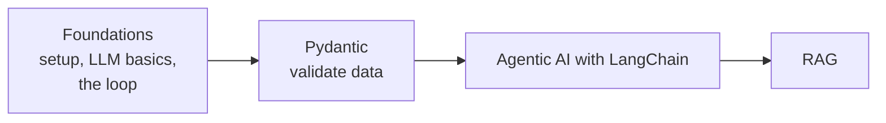

# Python and Agent Foundations
> lead: The ground floor of the library: set up your machine, understand what an LLM is, and build a working agent in plain Python before any framework appears.
meta: Book 1 of the library | 4 chapters

## What this book covers

| Chapter | You will be able to |
| --- | --- |
| 1. Set up and Python refresh | Reproduce the course environment with `uv`, keep keys in `.env`, and find the right refresher file |
| 2. LLM basics | Explain tokens, the context window, embeddings and why a model is stateless |
| 3. What an agent is | Draw brain, memory and tools, and write the tool-calling loop from memory |
| 4. Agents in plain Python | Walk through Project 0, a complete agent with no framework |

:::key Where this book sits
Read this book first, then **Pydantic**, then **Agentic AI with LangChain**, then **RAG**. Later books refer back here instead of repeating the basics.
:::

<!-- best -->
## How to study this course (the instructor's guidance)

The page opens with "First 20 minutes (quick points)". The parts that matter for study:

| Topic | What it says |
| --- | --- |
| Mindset | Learn one concept at a time, understand before remembering, build first and memorisation follows. Learn concepts, patterns and architecture, not framework names: frameworks change, fundamentals do not |
| Class rhythm | Weekend classes 8:00 to 11:00 AM IST, taught with Excalidraw and live coding, in a 15 to 20 minute teach, doubt, continue rhythm, with a doubt session after each class and recordings within 24 hours |
| Asking questions | Try for 10 to 15 minutes first, then ask. Debugging is a core skill |
| Tools | Free tiers and trials first; paid tools only when truly necessary |
| What the course is | Production-focused: build, deploy, monitor and improve AI systems, with cloud as a deployment platform |
| Final thought | "Leave saying I can build production AI systems" |

:::tip Doubt helper
The page links a custom GPT, **Mayank Doubt Solver - Agents**, for asking common doubts in simple language, and the main course repository `github.com/mayank953/Live-Class-2026`.
:::
<!-- /best -->

## How each chapter is built

Every chapter has the same shape: why it matters, core ideas, common mistakes, an interview corner with tap-to-reveal answers, a tickable revision list and links to the exact course files. The **Quiz me** page collects every interview question in this book.

:::beyond Labels
A box marked **Beyond the class** means the content comes from a different class than the chapter's own, or is an explanation added to fill a gap. **Repo note** boxes point out problems in the course code.
:::
