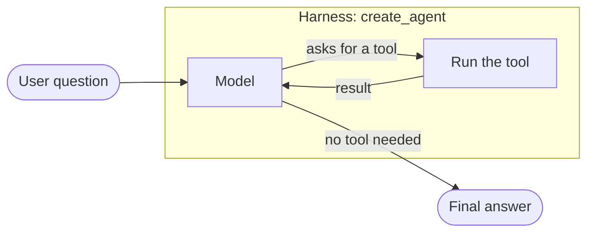
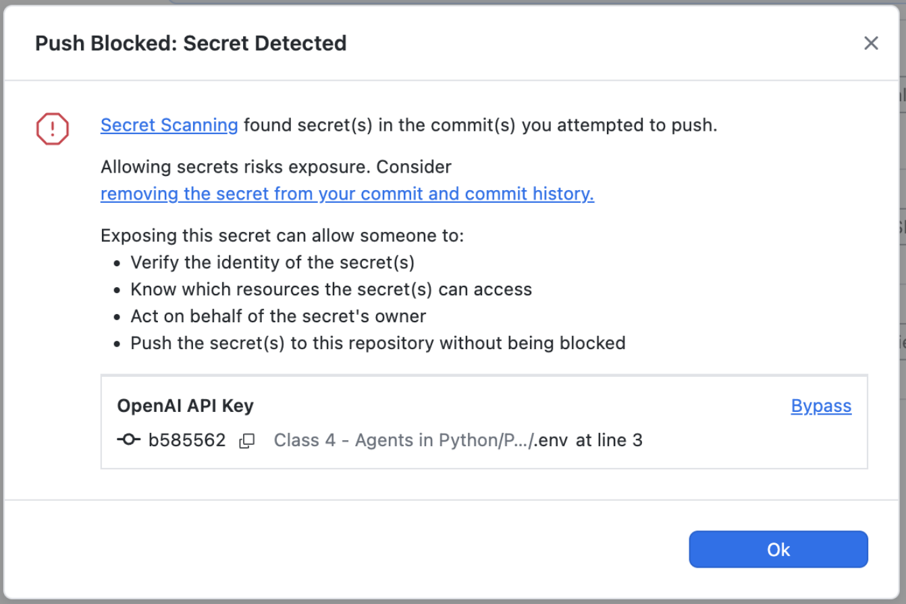
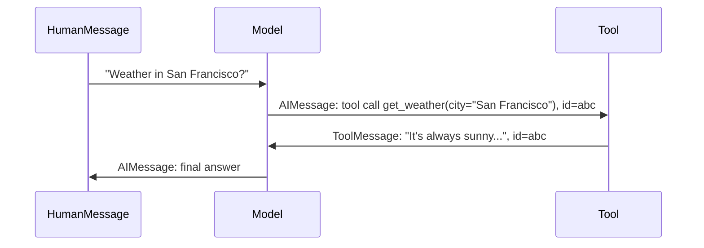

# Chapter 1: Introduction to LangChain

*From a plain model to a working, remembering agent in about 20 lines.*

> [!NOTE]
> **📍 At a glance**
> - **You will learn:** what an agent is, how `create_agent()` runs the loop, how to read its output, how to add memory
> - **You will build:** a weather agent, then a "check, don't guess" research agent
> - **Level:** beginner · **Time:** about 60 minutes
> - **Builds on:** the hand-written agent loop in [LLM, Chapter 2](../llm/02-the-agentic-loop-in-pure-python.md)

**After this chapter you can:**

- Explain what an agent is, in one sentence
- Build one with `create_agent()`
- Read every message it returns
- Give it memory
- Answer the common interview questions on all of the above

## 1.1 Why a framework

- **Agent** = a model that decides the next step, calls tools, and loops until it has an answer
- The raw loop is easy to write **once**. Repeating it in every project is the pain:

| You must handle | Without a framework | With LangChain |
|---|---|---|
| Different providers | One SDK each, different message shapes | Change one string |
| Tool schemas | Hand-written JSON | Built from your function |
| Memory | Your own storage | Checkpointer + `thread_id` |
| Retries, approvals, limits | Your own code | Middleware ([Ch7](07-middleware.md)) |
| Tracing | Print statements | LangSmith ([Ch15](15-testing-agents-and-tracing.md)) |

- **LangChain** supplies that plumbing. You choose the model, tools and instructions. It runs the loop
- **Quick test:** if an AI tells *you* to search the web and paste results back, it is not acting as an agent. An agent calls the tool **itself**

## 1.2 Agent = model + harness



- **Model:** text in, text out. No memory, no tools, no actions
- **Harness:** everything around the model:
  - system prompt (role and rules)
  - tools (actions the model can request)
  - the loop (call model → run tools → feed results back → repeat)
  - memory (stored conversation)
  - middleware (hooks on the loop, from [Chapter 7](07-middleware.md))
- `create_agent()` is LangChain's harness: minimal, but highly configurable

> [!TIP]
> Say it this way in an interview: **"The model is stateless and can't act. Almost everything useful in an agent comes from the harness."**

## 1.3 The LangChain family (short version)

Full detail in [Chapter 2](02-langchain-family-and-harness-engineering.md). They are **layers, not rivals**.

| Layer | What it is | Control | Pick it when |
|---|---|---|---|
| **Deep Agents** | Batteries-included harness: planning, virtual files, sub-agents | Low | Long research or coding tasks, fast start |
| **LangChain** | `create_agent()`, a harness you configure with middleware | Medium | Most tool-calling agents. **This book starts here** |
| **LangGraph** | Low-level graph: you define every step and branch | High | Custom flows, durable long runs |
| **LangSmith** | Tracing and evals, not a builder | — | Always, once you go past a demo |

- **Version note:** everything before LangChain v1 is now **LangChain Classic** (`langchain-classic`). Old tutorials with `AgentExecutor` or `LLMChain` are Classic. Mismatched code usually means a version difference
- **The class's food analogy:**
  - Deep Agents = ordering on Swiggy: ready fast, but you can't change how it is cooked
  - LangChain = cooking at home: you choose the spice and the ingredients
  - LangGraph = the raw vegetables: you control every step
- **The docs' rule of thumb:** "Use deep agents when you want maximum capability with minimal setup; choose LangChain agents when you need fine-grained control." 1.7 shows the difference on one task

> [!IMPORTANT]
> **🏭 In production**
> - Since v1.0 (October 2025), `create_agent` runs **on the LangGraph runtime**. Start with `create_agent`, and drop to a LangGraph `StateGraph` only when you need custom branching or durable multi-step control. Most production teams use both.
> - LangChain's v1 announcement names Uber, JPMorgan, BlackRock, Cisco, LinkedIn and Klarna as production users.
> - *Added by Claude; sources at the end of the chapter.*

## 1.4 Set up a project

```bash
uv init
uv add langchain langchain-openai langchain-anthropic
uv sync
```

Create three files:

| File | Holds | Commit it? |
|---|---|---|
| `.env` | Your real provider keys | ❌ Never |
| `.gitignore` | Must list `.env` and `.venv` | ✅ Yes |
| `.env.example` | Key names with empty values | ✅ Yes |

```bash
# .env.example
OPENAI_API_KEY=
ANTHROPIC_API_KEY=
```

- Three installs pull in many dependencies: the class saw 45; on `langchain` 1.5.0 it was 49. That is normal, and `uv.lock` pins every one of them
- `pyproject.toml` already does the job of `requirements.txt`
- You need **your own key** for each provider. LangChain is only the harness: it needs no key of its own
- `uv init` writes a `.gitignore` that lists `.venv` but **not `.env`**. Add `.env` yourself before the first commit

```bash
echo ".env" >> .gitignore
uv run python langchain_agents.py   # runs with the project's .venv; no "activate" needed
```

> [!WARNING]
> **`ImportError: cannot import name 'create_agent' from 'langchain.agents'` means the wrong Python ran your file.**
> - In class, a plain `python langchain_agents.py` picked up a Python that had an old, pre-v1 LangChain installed. The class's message also suggested `create_react_agent`, an older API.
> - The mentor fixed it by activating the venv: `source .venv/bin/activate` on Mac and Linux, `.venv\Scripts\activate` on Windows.
> - `uv run python file.py` avoids the problem: it always uses the project's `.venv`.
> - *Tested:* with `langchain` 0.3.27 the same `ImportError` appeared (on Python 3.13 without the "Did you mean" hint). `uv run` in the project printed `ok`.

> [!CAUTION]
> **🔒 Keys and git**
> - A key pushed to a public repo is found by bots within minutes. Deleting the commit is **not** enough: **revoke the key** and create a new one. See [Chapter 3](03-models-messages-and-parameters.md), section 3.2.
> - It happened in class 05. The mentor's own push was blocked because an OpenAI key sat in a committed `.env`; he then deleted the key. The screenshot below is from the class whiteboard.



- **What blocked it:** GitHub's **push protection**. Since 2024 it is on by default for pushes to public repositories. It checks each push against known key formats (OpenAI, AWS, Stripe and many more) **before** the commit lands
- **It is a safety net, not a plan:**
  - it only knows provider key patterns. A database password or an internal token can slip through
  - **Bypass** lets the push through anyway
- *Added by Claude:* when a key leaks, act in this order:
  1. Revoke the key at the provider and create a new one
  2. Check the provider's usage page for calls you did not make
  3. If the repo matters, remove the file from git history (`git filter-repo`)
  4. Add a pre-commit secret scanner (for example `gitleaks`) so it can't happen again

## 1.5 Your first agent

```python
from langchain.agents import create_agent

def get_weather(city: str) -> str:
    """Get weather for a given city."""
    return f"It's always sunny in {city}!"

agent = create_agent(
    model="openai:gpt-5.4-mini",     # "provider:model-name"
    tools=[get_weather],
    system_prompt="You are a helpful weather assistant.",
)

result = agent.invoke(
    {"messages": [{"role": "user", "content": "Weather in San Francisco?"}]}
)
print(result["messages"][-1].content)          # the answer as text
print(result["messages"][-1].content_blocks)   # [{'type': 'text', 'text': ...}], the docs' choice
```

| Argument | What it does | Watch out for |
|---|---|---|
| `model` | `provider:model-name` string. Switch provider by changing the prefix | Model names change often. Check the provider's current list. The class used `openai:gpt-5.5`, the docs now show `openai:gpt-6.1-sol`, and this book uses the cheaper `gpt-5.4-mini`. `gpt-4o-mini`, used here before, is reported to leave OpenAI's API on 14 Jan 2027 |
| `tools` | Plain Python functions. The JSON schema is built from **name, type hints and docstring** | A vague docstring = wrong tool choice |
| `system_prompt` | Role and rules | Keep it specific and actionable |
| `agent.invoke(...)` | Runs the whole loop, returns when the model stops asking for tools | It can loop. Set a step limit (1.10) |

> [!WARNING]
> **The model never sees your code.** It only sees the tool's name, parameters and docstring. A vague docstring is the top reason for wrong tool choices.

`@tool` makes the tool explicit ([Chapter 5](05-tools.md)):

```python
from langchain.tools import tool

@tool
def get_weather(city: str) -> str:
    """Get the current weather for a city. Use for any weather question."""
    return f"It's always sunny in {city}!"
```

### What comes back

```python
for m in result["messages"]:
    m.pretty_print()
```

`result["messages"]` is the full conversation:



1. **`HumanMessage`:** the question
2. **`AIMessage`:** empty text plus a **tool call** (`get_weather`, `{"city": "San Francisco"}`, an id)
3. **`ToolMessage`:** the function's return value, with the **same id** as step 2
4. **`AIMessage`:** the final answer

- The model was called **twice**: once to ask for the tool, once to answer. **Every tool round trip is another paid model call**
- The matching id tells the model which result belongs to which request. It matters when several tools are requested at once

The class printed the whole result. The same run, replayed through a local stand-in for the OpenAI API with the class's token numbers:

```text
HumanMessage  'Weather in San Francisco?'
AIMessage     content=''  tool_calls=[get_weather({'city': 'San Francisco'}), id='call_Xy12']
              finish_reason='tool_calls'  usage: input 141, output 18, total 159
ToolMessage   "It's always sunny in San Francisco!"  tool_call_id='call_Xy12'  name='get_weather'
AIMessage     "It's currently sunny in San Francisco."  finish_reason='stop'  usage: input 177, output 11
```

```python
ai, tool_msg = result["messages"][1], result["messages"][2]
ai.tool_calls[0]["id"]                  # 'call_Xy12', written by the provider
tool_msg.tool_call_id                   # 'call_Xy12', copied by the harness
ai.response_metadata["finish_reason"]   # 'tool_calls' here; 'stop' on the final answer
ai.usage_metadata                       # {'input_tokens': 141, 'output_tokens': 18, 'total_tokens': 159, ...}
```

- **Who makes the id?** The provider, inside its reply. It is new on every call: in class, asking about Tokyo a second time produced a fresh id and a second tool call. The harness only copies it into the `ToolMessage`
- The raw OpenAI tool message carries only the id and the content. LangChain's `ToolMessage` also stores the tool's `name`, which helps when you read logs
- **Token counts:** OpenAI calls them `prompt_tokens` and `completion_tokens`. LangChain puts them in `usage_metadata` as `input_tokens` and `output_tokens`, with the **same keys for every provider**. Use them to work out cost
- **The second call's input grew from 141 to 177 tokens:** the whole history, now including the tool result, is sent again

> [!NOTE]
> **"Why is it slow?"** In class the agent took a while to answer.
> - **The mentor's view:** LangChain adds work (ids, message objects, bookkeeping).
> - **Measured, added by Claude:** with a fake model, a whole run with one tool round trip took about **3 ms** of LangChain time (median of 200 runs on `langchain` 1.5.0). The seconds you wait are the **two model calls**: network plus generation, and reasoning models such as `gpt-5.5` think before they answer.
> - **So cut latency by:** making fewer model calls, picking a faster model, letting the model request tools in parallel, caching results (1.8) and streaming (1.10). Dropping the framework saves milliseconds, not seconds.

✅ *Verified on `langchain` 1.5.0: message order, matching ids, `ToolMessage.name`, `finish_reason`, `usage_metadata`, `content_blocks` and `pretty_print` (details at the end).*

## 1.6 Memory

- Each `invoke` sees **only the messages you pass in**
- So "Hi, I am Mayank" in one call and "Who am I?" in the next: the agent does not know
- Fix: a **checkpointer** (stores state) plus a **thread_id** (picks the conversation)

```python
from langgraph.checkpoint.memory import InMemorySaver

agent = create_agent(
    model="openai:gpt-5.4-mini",
    tools=[get_weather],
    system_prompt="You are a helpful assistant.",
    checkpointer=InMemorySaver(),
)

config = {"configurable": {"thread_id": "chat-1"}}
agent.invoke({"messages": [{"role": "user", "content": "Hi, I am Mayank"}]}, config)
reply = agent.invoke({"messages": [{"role": "user", "content": "Who am I?"}]}, config)
```

- Same `thread_id` → remembers. New `thread_id` → fresh start

> [!WARNING]
> - `InMemorySaver` lives in the running process. Script ends → memory gone. Production needs a database-backed saver ([Chapter 6](06-agents-and-memory.md)).
> - `checkpointer=checkpointer` raises `NameError` if you never created it. Create it first.

> [!IMPORTANT]
> **🏭 In production**
> - One `thread_id` per **conversation**, never one per user for everything. Shared threads leak context between tasks.
> - The thread grows on every turn, and so does the cost of each call. Plan for trimming or summarising ([Chapter 7](07-middleware.md)).
> - *Added by Claude.*

✅ *Verified: memory per `thread_id`.*

## 1.7 Make the model check, not guess

- Models sound sure even when wrong. Counting, lookups and maths should come from a **tool**, not from the model
- Pattern: give a fetch tool, then tell the model not to guess
- The example is the docs quickstart's research agent, which is also the class file `langchain_basics.py`. It asks three things about *The Great Gatsby* on Project Gutenberg:
  - how many lines contain `Gatsby`
  - the line number of the first line with `Daisy`
  - a two-sentence synopsis

The docs version:

```python
import urllib.request, urllib.error
from langchain.tools import tool
from langchain.chat_models import init_chat_model

@tool
def fetch_text_from_url(url: str) -> str:
    """Fetch the text of a document from a URL."""
    req = urllib.request.Request(url, headers={"User-Agent": "notes-demo/1.0"})
    try:
        with urllib.request.urlopen(req, timeout=120) as resp:
            return resp.read().decode("utf-8", errors="replace")
    except urllib.error.URLError as e:
        return f"Fetch failed: {e}"

SYSTEM_PROMPT = """You are a literary data assistant.

## Capabilities
- `fetch_text_from_url`: loads document text from a URL.

Do not guess line counts or positions. Ground them in tool results.
If an exact answer cannot be verified, return null and explain why."""

model = init_chat_model("openai:gpt-5.4-mini", temperature=0.5, timeout=300, max_tokens=25000)
```

Three habits to copy:

1. **Name each tool's purpose** in the system prompt, not only its docstring
2. **Allow "I cannot verify this."** Otherwise the model invents a number
3. **Return errors as text** (`"Fetch failed: ..."`) so the model can react instead of the run crashing

`init_chat_model(...)` is the alternative to the model string. Use it to set `temperature`, `timeout` or `max_tokens` ([Chapter 3](03-models-messages-and-parameters.md)).

> [!CAUTION]
> This tool fetches **any** URL the model chooses. That opens two holes: **prompt injection** (the page contains fake instructions) and **SSRF** (the model is steered to internal addresses). `find_lines` below closes the second with an allow-list; more in 1.10.

### What happens when you run it

- **The tool returns the whole novel.** The docs warn: "This example sends the entire text of The Great Gatsby to the model and may take a minute or two to respond." The book is about 50,000 words, so tens of thousands of tokens on **every** model call that follows (*size added by Claude, approximate*)
- **The mentor did not run it** in class: "lots of tokens … very costly"
- **The docs' own sample output:**

| Agent | Lines with `Gatsby` | First `Daisy` line | How |
|---|---|---|---|
| `create_agent` + `fetch_text_from_url` | `null` | `null` | It refused to guess: "LLMs cannot reliably perform exact line-counting or indexing over massive texts" |
| `create_deep_agent`, same tool | 258 | 181 | Its harness saved the huge tool result to a file, then ran `grep` on it |

- The docs also warn: "You may also get errors that the prompt is too long"
- **The lesson:** the prompt was right to forbid guessing, but the agent had no way to count. Either give it a harness that can search files (Deep Agents, see the [Deep Agents book](../deep-agents/README.md)), or give it a tool that does the counting

### The industrial fix: count in the tool, return a small answer

*Added by Claude; tested offline (details at the end).*

```python
import functools, urllib.error, urllib.request
from urllib.parse import urlparse
from langchain.tools import tool

ALLOWED_HOSTS = {"www.gutenberg.org"}            # SSRF guard: only hosts you trust

@functools.lru_cache(maxsize=32)                  # one download per URL; errors are not cached
def _download(url: str) -> str:
    if urlparse(url).hostname not in ALLOWED_HOSTS:
        raise ValueError(f"host not allowed: {url}")
    req = urllib.request.Request(url, headers={"User-Agent": "notes-demo/1.0"})
    with urllib.request.urlopen(req, timeout=60) as resp:
        return resp.read(5_000_000).decode("utf-8", errors="replace")   # size cap

@tool
def find_lines(url: str, substring: str) -> dict:
    """Count the lines of a text file that contain `substring` (case-sensitive).
    Returns the count, the 1-based number of the first matching line and its text.
    Use it for any question about counts or positions in a document."""
    try:
        lines = _download(url).splitlines()
    except (ValueError, urllib.error.URLError) as e:
        return {"error": str(e)}
    hits = [n for n, line in enumerate(lines, start=1) if substring in line]
    return {"total_lines": len(lines), "matching_lines": len(hits),
            "first_match_line": hits[0] if hits else None,
            "first_match_text": lines[hits[0] - 1].strip() if hits else None}
```

Then ask for a typed answer instead of free text:

```python
from pydantic import BaseModel, Field
from langgraph.checkpoint.memory import InMemorySaver

class GatsbyAnswer(BaseModel):
    lines_with_gatsby: int | None = Field(description="From find_lines. null if not verified")
    first_daisy_line: int | None = Field(description="From find_lines. null if not verified")
    synopsis: str = Field(description="Two neutral sentences")
    how_you_computed_counts: str

agent = create_agent(
    model=model,
    tools=[find_lines],
    system_prompt="You are a literary data assistant. Use `find_lines` for every count or "
                  "line number. Never count by reading the text yourself.",
    checkpointer=InMemorySaver(),
    response_format=GatsbyAnswer,
)
result = agent.invoke({"messages": [{"role": "user", "content": content}]},   # the same questions
                      config={"configurable": {"thread_id": "great-gatsby-lc"}})
answer = result["structured_response"]    # a GatsbyAnswer object, not text to parse
```

| | Docs version: `fetch_text_from_url` | `find_lines` |
|---|---|---|
| What enters the context | The whole novel, on every later call | Under 200 characters of JSON |
| Who counts | The model: unreliable, so it answers `null` | Python: exact |
| Downloads | One per tool call | One per URL (`lru_cache`) |
| Unsafe URLs | Fetched | Refused (`ALLOWED_HOSTS`) |
| Final answer | Free text | A validated `GatsbyAnswer` |

- `response_format` also fixes a gap in the class file. Its prompt asks for a `how_you_computed_counts` field, but nothing defines that field. With `GatsbyAnswer` the field exists and is validated
- For an OpenAI model, `create_agent` used the provider's native structured output: every request carried a `json_schema` `response_format` ([Chapter 4](04-structured-output.md))
- `content` in `agent.invoke` is the class's question text, the same one the docs use
- **Design rule:** tools do the exact work (count, search, compute) and return **small, structured** results. The model plans, picks tools and writes the words
- **What the class file got wrong**, besides the cost:
  - `checkpointer` is used but never created, which raises a `NameError` (see 1.6)
  - `deepagents` is imported but never used

## 1.8 Caching tool results

Cache time depends on **how fast the data changes**:

| Data | Cache for | The class's example |
|---|---|---|
| Stock prices | Don't cache | "They change every second" |
| Currency rates | Minutes | About 10 minutes |
| Weather | Hours | Up to a day |
| Static reference data | Days or longer | |

- **TTL** (time-to-live) = how long a stored result may be reused
- A cached wrong answer is worse than a slow right one
- **Why it matters:** in class the same Tokyo question, asked twice, made a second tool call. Nothing was cached, and the model can't know your data is still fresh
- `@tool` has no TTL option. Caching is your code, inside the tool

```python
import time
from langchain.tools import tool

_cache = {}

def cached(key, ttl_seconds, fetch):
    hit = _cache.get(key)
    if hit and time.monotonic() - hit[0] < ttl_seconds:
        return hit[1]
    value = fetch()                              # if this raises, nothing is stored
    _cache[key] = (time.monotonic(), value)
    return value

@tool
def get_fx_rate(base: str, quote: str) -> str:
    """Current exchange rate between two currency codes, e.g. base='USD', quote='INR'."""
    key = ("fx", base.strip().upper(), quote.strip().upper())   # 'usd ' and 'USD' share one entry
    try:
        return cached(key, 600, lambda: call_rates_api(key[1], key[2]))   # 10 minutes
    except Exception as e:
        return f"Rate lookup failed: {e}"        # an error is returned, never cached
```

- **Normalise the key.** The model may write `usd`, `USD` or `USD `. Without normalising, each spelling is a separate cache miss
- **Never cache a failure.** One API outage would otherwise be served for the next 10 minutes
- `time.monotonic()`, not `time.time()`: a clock change can't make an old entry look fresh
- **Several workers or servers:** a dict lives in one process. Use a shared cache such as Redis; `r.set("fx:USD:INR", value, ex=600)` expires the key by itself (the class's answer too: "we cache these things in Redis")

✅ *Verified: the error was not cached, `usd ` and `USD` hit one entry, the entry expired after 600 s (fake clock), and the Redis `ex=600` call gave a TTL of 600 (`fakeredis`).*

## 1.9 Trade-offs, and when not to use LangChain

| You gain | You give up |
|---|---|
| A working agent in a few lines | Some visibility: the tool schema is inferred |
| Provider swap by changing a string | Some speed: message objects, ids, bookkeeping |
| Memory, structured output, middleware, tracing on tap | Fine control, unless you step down to LangGraph |
| A large integration ecosystem | One more fast-moving dependency to upgrade |

- **Career angle:** depth in the fundamentals (the raw loop) lasts longer than a list of framework names. Clients care about control and speed, not how many frameworks you know
- **The mentor's practice:** for some client work he writes his own agent, or uses no agent at all. If the framework's run time can't be improved, the client won't accept the software

### Agent, or a single model call?

- **The mentor, class 05:** "I don't create agents in real world in my real problems. This is a lot time saving and token saving." Often one model call that picks the tool, followed by plain code, is enough:

```python
from langchain.chat_models import init_chat_model

TOOLS = {t.name: t for t in [get_weather, get_fx_rate]}
model = init_chat_model("openai:gpt-5.4-mini").bind_tools(list(TOOLS.values()))

msg = model.invoke("Weather in Tokyo?")          # one model call
for call in msg.tool_calls:                       # your code runs the tool. No loop, no second call
    print(TOOLS[call["name"]].invoke(call["args"]))
```

- *Added by Claude:* how to choose
  - **The steps are known in advance** (classify, then look up, then format) → a **workflow**: your code calls the model at fixed points. It is cheaper, faster and easier to test
  - **The model must decide the next step** from what it just learned → an **agent loop** (`create_agent`)
  - Interview line: **"Use the least autonomy that solves the problem."**

✅ *Verified: the single-call version made exactly one model request and ran the tool from code.*

> [!IMPORTANT]
> **🏭 In production: the landscape you will be asked about**
>
> | If the team… | They often pick |
> |---|---|
> | Wants a cross-provider Python agent with middleware | LangChain `create_agent` (+ LangGraph when flows get custom) |
> | Cares most about typed, validated outputs | Pydantic AI |
> | Is committed to one model vendor | That vendor's SDK: OpenAI Agents SDK, Claude Agent SDK, Google ADK |
> | Builds a TypeScript web app | Vercel AI SDK or Mastra |
>
> - **Don't reach for a framework** for a single model call or a fixed two-step pipeline: the plain provider SDK is simpler.
> - The framework is free; **the real running cost is model API spend**, so count model calls per task.
> - *Added by Claude; sources at the end of the chapter.*

## Questions from the class (classes 05–06)

Asked during the teaching part of the classes on 11 and 12 Jul. The after-class doubt sessions are not included, and neither is the pure-Python agent build.

| Question | Answer |
|---|---|
| Is the system message sent only the first time? | No, on every call: the model is stateless. *Tested:* `create_agent` put the `system_prompt` first in **both** model requests of a one-tool run, so you pay for its tokens on every step |
| Is the tool schema part of the context? | Yes. Every tool's name, description and parameters go with every model call. More tools = more input tokens per step |
| Do we need an API key for LangChain itself? | No. LangChain is the harness. You need a key for the model provider you call |
| Can it run with Groq? | Yes. `uv add langchain-groq`, set `GROQ_API_KEY`, then `init_chat_model("groq:llama-3.3-70b-versatile")`. *Tested:* that returned a `ChatGroq`. Gemini, OpenRouter, Ollama, Azure and Bedrock work the same way |
| Does every provider return the same response shape? | No. *Added by Claude:* LangChain maps them all into the same `AIMessage` fields (`tool_calls`, `usage_metadata`, `content_blocks`), so your code doesn't change |
| Is `max_tokens` the output limit? | Yes: it caps the completion (output) tokens. That also caps what one call can cost, even if someone abuses a leaked key |
| Will the tool-call id be the same if I ask the same question again? | No. The provider writes a new id every time (1.5) |
| If the description is optional, how does the model know when to call the tool? | It guesses from the name, and may guess wrong. Write the docstring (1.5) |
| Can we use Pydantic for the tool schema? | The mentor: yes, but then you must dump it to JSON yourself. *Added by Claude:* in LangChain, `@tool(args_schema=CityArgs)` takes a Pydantic model directly, field descriptions included ([Chapter 5](05-tools.md)) |
| What if the model asks for a tool that doesn't exist? | The class: you get an error. *Tested in LangChain:* the harness answers with an error `ToolMessage` and the loop goes on (1.10) |
| Can the model ask for several tools at once? | Yes, each with its own id. Claude searched FIFA and NBA results as two separate tool calls in the class demo |
| Why a max-turns limit, and what is LangChain's default? | It stops runaway loops and made-up repeat calls; the mentor picked 4–5 by trying. LangChain's default is 9,999 steps, so set your own (1.10) |
| Is there a TTL option on the `@tool` decorator? | No. Cache inside the tool, or in Redis (1.8) |
| What is `config` doing in `invoke`? Is it always needed? | Only with a checkpointer: `thread_id` picks the conversation (1.6). It also carries `recursion_limit` |
| How many messages can memory hold without a database? | A Python list holds as many as RAM allows, but the context window doesn't. Long threads must be trimmed or summarised ([Chapter 7](07-middleware.md)) |
| Why learn the raw loop if the industry uses LangChain? | The mentor: companies pay for people who can control what happens inside an agent. Frameworks are quick to learn once the basics are clear |

## 1.10 Added by Claude, not from the sources

Not in the course material. Well-established practice, but check current docs before relying on it.

- **Prompt injection**
  - A fetched web page can contain text written to look like instructions
  - Treat tool output as **data**, never as instructions
  - Do not give an agent that reads the open web tools that can also send, delete or spend, without a human approval step ([Chapter 11](11-runtime-and-human-in-the-loop.md))
- **SSRF (server-side request forgery)**
  - If the model controls the URL, it can be steered to internal addresses
  - In real systems, allow-list domains and block private IP ranges
- **Set your own step limit**
  - On `langchain` 1.5.0, `create_agent` sets `recursion_limit=9999` (LangGraph's own default is 10007)
  - One step is one node run, so a model call plus its tool run uses two steps
  - *Tested:* a fake model that always asked for a tool made **5,000 model calls** before `GraphRecursionError`. With a real model, every one of them is paid
  - A looping agent can run, and cost money, for a long time

```python
agent.invoke(
    {"messages": [{"role": "user", "content": "..."}]},
    config={"recursion_limit": 25},   # the same runaway model stopped after 13 model calls
)
```

- In production, prefer `ModelCallLimitMiddleware` and `ToolCallLimitMiddleware` ([Chapter 8](08-prebuilt-middleware-limits-fallback-and-pii.md)). They count model and tool calls directly, and can end the run gracefully instead of raising
- **A tool name the model invents**
  - *Tested:* the model asked for `get_wether`. The harness did not crash. It answered with a `ToolMessage` whose `status` was `"error"`:
    `Error: get_wether is not a valid tool, try one of [get_weather].`
  - The model reads that and usually retries with the right name
  - Log these errors: frequent ones mean tool names or descriptions are unclear

- **Tools with side effects can run more than once**
  - Loops, retries or a model asking twice can repeat a call
  - Make write, send and charge tools **idempotent** (safe to repeat), or guard them with approval
- **`create_agent` is the current way to build agents in LangChain v1.** Older tutorials use other helpers

✅ *Verified on `langchain` 1.5.0: `agent.config` showed `recursion_limit: 9999`; the runaway counts above; the unknown-tool `ToolMessage`.*

### Watch the agent work: streaming

`invoke` waits for the whole loop. `stream` shows each step as it happens, which is what a chat UI and your debugging both need.

```python
for mode, chunk in agent.stream(
    {"messages": [{"role": "user", "content": "Weather in Tokyo?"}]},
    stream_mode=["updates"],          # one chunk per finished step
):
    for step, data in chunk.items():  # step is "model" or "tools"
        data["messages"][-1].pretty_print()
```

- A one-tool run streams **three** steps: `model` (asks for the tool) → `tools` (runs it) → `model` (answers)
- `stream_mode="messages"` streams the model's tokens instead, for a typing effect in the UI
- `await agent.ainvoke(...)` / `agent.astream(...)` are the async versions for web servers (FastAPI)

✅ *Verified on `langchain` 1.5.0 with a scripted fake model: the `updates` stream produced `model`, `tools`, `model`.*

### First errors you will hit, and the fix

| Symptom | Cause | Fix |
|---|---|---|
| `ValueError: Checkpointer requires ... thread_id` | Agent has a checkpointer, call has no config | Pass `config={"configurable": {"thread_id": "..."}}` on **every** call |
| Agent "forgets" between calls | No checkpointer, or a new `thread_id` each call | Add a checkpointer; reuse the same `thread_id` |
| Model answers from memory instead of calling the tool | Vague tool name or docstring | Say *when* to use it in the docstring and in the system prompt |
| Wrong tool chosen | Two tools with overlapping descriptions | Make descriptions mutually exclusive |
| `GraphRecursionError` | Hit `recursion_limit` (model keeps calling tools) | Read the trace: usually a tool returns something the model can't use; fix it, don't just raise the limit |
| Authentication error on the first call | Key missing from `.env` or not loaded | `load_dotenv()` before creating the agent; check the variable name the provider expects |
| Run crashes inside a tool | Tool raised an exception | Return an error string, or use tool-error middleware ([Chapter 9](09-guardrails-to-do-lists-and-tool-resilience.md)) |
| `ImportError: cannot import name 'create_agent'` | The Python that ran the file has an old, pre-v1 LangChain | `uv run python file.py` (1.4) |
| `ToolMessage`: `Error: get_wether is not a valid tool` | The model misspelled or invented a tool name | Clear, distinct tool names; check the prompt doesn't mention a tool you removed |
| "Prompt is too long" / context-length error | A tool returned a whole document, or the thread grew too long | Return small results from tools (1.7); trim history ([Chapter 7](07-middleware.md)) |

✅ *Verified: the missing-`thread_id` message above is the exact text raised on `langchain` 1.5.0.*

> [!TIP]
> **Debugging habit:** when an agent misbehaves, print `result["messages"]` with `pretty_print()` (or open the LangSmith trace) **before** changing the prompt. The messages show whether the model asked for the wrong tool, the tool returned junk, or the model ignored a good result. Each needs a different fix.

## 1.11 Interview corner

**What interviewers listen for:** you separate the **model** from the **harness**, you know the loop's stop condition, and you raise **cost, limits and security** without being asked.

### 🟢 Basic

<details class="qa"><summary>1. What is an agent in LangChain?</summary>

- A model plus a harness: instructions, tools, loop, memory, middleware
- `create_agent()` is the minimal configurable harness
- *Stronger answer:* the model alone is stateless and cannot act, so almost everything useful comes from the harness

</details>

<details class="qa"><summary>2. When does the agent loop stop?</summary>

- When the model replies **without** requesting a tool
- *Stronger answer:* you still need a safety limit in case it keeps calling tools. `create_agent`'s default is 9,999 steps, so set `recursion_limit` or the call-limit middleware yourself

</details>

<details class="qa"><summary>3. How does LangChain describe your function to the model?</summary>

- From its name, type hints and docstring. `@tool` gives explicit control
- *Stronger answer:* the docstring is effectively part of the prompt, so write it for the model

</details>

### 🟡 Intermediate

<details class="qa"><summary>4. Why use a framework instead of writing the loop yourself?</summary>

- The loop is easy. The plumbing is not: providers, tool schemas, structured output, memory, retries, approvals, tracing
- *Stronger answer:* name the costs (less visibility, overhead, one more dependency) and say you can still write the loop by hand

</details>

<details class="qa"><summary>5. LangChain vs LangGraph vs Deep Agents vs LangSmith?</summary>

- Deep Agents: batteries-included top layer · LangChain: configurable harness · LangGraph: low-level orchestration · LangSmith: observability, not a builder
- *Stronger answer:* they are layers, not rivals. `create_agent` runs on LangGraph underneath

</details>

<details class="qa"><summary>6. Why does an agent forget between runs, and how do you fix it?</summary>

- Each `invoke` sees only what you pass in. Fix: checkpointer + `thread_id`
- *Stronger answer:* the in-memory saver dies with the process, so production uses a database-backed one, with one thread per conversation

</details>

<details class="qa"><summary>9. What is <code>tool_call_id</code> for, and who creates it?</summary>

- The provider writes it into the model's tool request. The harness copies it into the `ToolMessage` that carries the result
- It tells the model which result answers which request, which matters when it asks for several tools at once
- *Stronger answer:* it is new on every call, even for an identical question, so never use it as a cache key. Cache on the tool name plus normalised arguments

</details>

<details class="qa"><summary>10. The model asks for a tool that doesn't exist. What happens in <code>create_agent</code>?</summary>

- No crash. The harness returns an error `ToolMessage` ("… is not a valid tool, try one of [...]") and the loop continues, so the model can correct itself
- *Stronger answer:* treat a rising rate of these errors as a signal: unclear tool names, overlapping descriptions, or a prompt that mentions a tool you removed. Track it in traces

</details>

### 🔴 Senior

<details class="qa"><summary>7. A tool fetches any URL. What can go wrong, and how do you harden it?</summary>

- Huge pages, hangs, failures → timeouts, size caps, errors returned as text
- *Stronger answer:* prompt injection (treat output as data, no dangerous tools next to a web reader without approval) and SSRF (allow-list domains, block private IPs)

</details>

<details class="qa"><summary>8. Your agent answers correctly but costs 3x the estimate. Where do you look?</summary>

- Count model calls per task: every tool round trip is another call, and the whole history is resent each time
- *Stronger answer:* check for repeated tool calls (loops), a growing thread, oversized tool outputs, and a too-large model; then cap steps, trim history, and route easy steps to a cheaper model ([Ch8](08-prebuilt-middleware-limits-fallback-and-pii.md), [Ch10](10-shell-tools-and-custom-middleware.md))

</details>

<details class="qa"><summary>11. Users say the agent is slow. Where does the time go, and what do you change?</summary>

- Almost all of it is model calls. LangChain itself took about 3 ms per run in a test with a fake model
- Count the model calls per answer: each tool round trip adds one, and reasoning models also think before they answer
- *Stronger answer:* fewer round trips (one tool that does more, parallel tool calls), a faster model for easy steps, cached tool results, and streaming so the user sees progress. Measure in traces before and after each change

</details>

<details class="qa"><summary>12. The agent must give exact counts over a 300-page document. How do you design it?</summary>

- Don't paste the document into the context and ask the model to count: it is slow and costly, and the answer is unreliable
- A tool does the exact work (search, count, compute) and returns a small JSON result; `response_format` makes the final answer typed
- *Stronger answer:* the docs' own run shows both sides. `create_agent` with a fetch-everything tool answered `null`. Deep Agents got 258 and 181 because its harness saved the big result to a file and ran `grep` on it. Either way, exact work happens in code

</details>

<details class="qa"><summary>13. When would you not build an agent at all?</summary>

- When the steps are known in advance: a workflow with fixed model calls is cheaper, faster and easier to test
- One model call with `bind_tools` can pick the tool, and plain code runs it. No loop
- *Stronger answer:* "Use the least autonomy that solves the problem." Move to an agent only when the next step depends on what the model just learned

</details>

<details class="qa"><summary>14. A teammate pushed an API key to GitHub. What do you do, in order?</summary>

- Revoke the key and issue a new one first; deleting the file or commit doesn't help, because bots scan pushes within minutes
- Check the provider's usage for calls you didn't make, then remove the secret from history if the repo matters
- *Stronger answer:* prevent the next one. Keep `.env` in `.gitignore` (`uv init` doesn't add it), add a pre-commit secret scanner, and keep GitHub push protection on. It only knows provider key formats, and "Bypass" exists

</details>

> [!TIP]
> **🧩 Design question to practise:** *"Design a support agent that looks up orders and can issue refunds."* Cover the tools, which ones need approval, memory per conversation, a step limit, and how you would trace a bad refund.

## Cheat sheet

```python
agent = create_agent(model="provider:model", tools=[fn], system_prompt="...",
                     checkpointer=InMemorySaver())        # memory (dev only)
agent.invoke({"messages": [{"role": "user", "content": "..."}]},
             config={"configurable": {"thread_id": "t1"}, "recursion_limit": 25})
# result["messages"]: Human → AI(tool call, id) → Tool(same id) → AI(answer)
ai.usage_metadata                     # input_tokens / output_tokens, same keys for every provider
create_agent(..., response_format=MyModel)   # → result["structured_response"]
```

```bash
echo ".env" >> .gitignore      # uv init doesn't add it
uv run python app.py           # always the project's .venv
```

## Recap

- Agent = **model + harness**. `create_agent()` is the harness
- You give `model`, `tools`, `system_prompt`. `invoke` runs the loop
- Result = human → AI (tool call) → tool result (same id) → final AI. The provider writes the id, new every call
- Tool descriptions come from name, type hints, **docstring**
- Memory = **checkpointer + thread_id**. In-memory is lost when the process ends
- Make the model **verify with tools** and allow "cannot verify". Better still: tools do the exact work and return small results; `response_format` types the answer
- Cache by how fast the data changes; normalise keys; never cache errors
- `create_agent` defaults to 9,999 steps: set your own limit
- Frameworks trade some visibility for a lot of plumbing. The latency and cost are in the model calls, so count them
- Keys: `.env` in `.gitignore`, push protection is only a safety net, a leaked key is revoked first

## Practice

1. New project with `uv add langchain langchain-openai langchain-anthropic`, plus `.env`, `.gitignore`, `.env.example`. Check whether `uv init`'s `.gitignore` already lists `.env`
2. Build the weather agent. Print the messages and match each to a step of the hand-built loop
3. Add `InMemorySaver` and `thread_id`. Show it remembers within a thread and forgets across threads
4. Write a tool with a clear docstring, then make it vague and watch tool choice get worse
5. Run the line-counting agent from 1.7 on a real text and check its numbers yourself with `grep -c`
6. Set `recursion_limit=3` and give the agent a task that needs more steps. Read the error
7. Run the docs version and the `find_lines` version of 1.7, and compare `usage_metadata["input_tokens"]` on the second model call
8. Ask the same question twice and compare the tool-call ids. Then add the 1.8 cache so the second answer makes no API call

## How this chapter was checked

- **Run offline on `langchain` 1.5.0** (`langgraph` 1.2.22, `langchain-openai` 1.8.0, Python 3.13), with scripted fake chat models and a local stand-in for the OpenAI Chat Completions API (`OPENAI_BASE_URL` pointed at it). No API keys, no real model calls
- **1.4:** a fresh `uv init` plus the three `uv add`s locked 49 packages, and `uv init`'s `.gitignore` listed `.venv` but not `.env`. A venv with `langchain` 0.3.27 raised the `create_agent` `ImportError`; `uv run` in the project printed `ok`
- **1.5:** the printed trace (the token numbers are the class's, served by the stand-in), matching ids, `ToolMessage.name`, `finish_reason`, `usage_metadata`, `content_blocks`. Framework time: 200 runs with a fake model, median 3.3–3.7 ms
- **1.7:** `find_lines` against a local copy of a small text: counts matched `grep -c` and `grep -n`; a host outside `ALLOWED_HOSTS` was refused and not cached; a second question on the same URL reused the download. The `GatsbyAnswer` agent returned a `GatsbyAnswer` in `structured_response`, and every request carried a `json_schema` `response_format`. The real Gutenberg file and the docs' 258 / 181 were **not** checked: the site isn't reachable from the test machine
- **1.8:** the `get_fx_rate` cache with a fake clock (error not cached, normalised key hit, expiry after 600 s); the Redis call with `fakeredis`
- **1.9:** the single-call router made one model request and ran the tool from code
- **1.10:** `agent.config` showed `recursion_limit: 9999`; a runaway fake model made 5,000 model calls before `GraphRecursionError` (13 with `recursion_limit=25`); the unknown-tool `ToolMessage` text
- **Questions from the class:** the system prompt in both requests, `@tool(args_schema=...)`, and `init_chat_model("groq:...")` returning `ChatGroq` (`langchain-groq` 1.1.3)
- **Every other code block** re-run on 1.5.0: memory per `thread_id`, streaming steps, the missing-`thread_id` error text, the cheat sheet
- **Web-checked on 2026-11-15:** GitHub push protection defaults; the `gpt-4o-mini` API retirement date (14 Jan 2027) comes from third-party trackers, because OpenAI's deprecations page couldn't be reached from here
- **Class transcripts** (11 and 12 Jul, teaching part only): the providers, `tool_call_id`, max turns, caching TTLs, the food analogy, the import error, "why is it slow", the career advice and the class questions. The pure-Python agent build and the doubt sessions were left out by your choice
- The diagrams, tables and "In production" boxes were added in the 2026 book review; the framework landscape and production users come from the web sources below

## Sources and further reading

- Live-Class-2026, `classes_summary/06 - 12 Jul - Introduction to LangChain.md`
- Live-Class-2026, `classes_transcription_summary/06 - 12 Jul - Introduction to LangChain.md`
- Live-Class-2026, code folder `Weekend 03 - 11-12 Jul/06 - 12 Jul - Introduction to LangChain/` (re-read in full 2026-11-15), including the `Agentic-Python.pdf` whiteboard (the push-protection screenshot in `images/`)
- Class recording transcripts, 11 Jul 2026 (Class 05) and 12 Jul 2026 (Class 06), uploaded by you; teaching part only
- LangChain docs, [Quickstart](https://docs.langchain.com/oss/python/langchain/quickstart): read in full from its source in the `langchain-ai/docs` GitHub repo on 2026-11-15 (the Gatsby example, its warning and its sample results)
- GitHub: [Push protection](https://docs.github.com/en/code-security/concepts/secret-security/push-protection), [push protection on by default for public repositories (2024)](https://github.blog/news-insights/product-news/keeping-secrets-out-of-public-repositories/)
- `gpt-4o-mini` retirement: [GPT-4o and GPT-4.1 leave OpenAI's API on January 14, 2027 (DEV Community)](https://dev.to/gabrielanhaia/gpt-4o-and-gpt-41-leave-openais-api-on-january-14-2027-you-have-92-days-2n9b), [OpenAI API deprecations 2026–2027 (DEV Community)](https://dev.to/max_bob/openai-api-deprecations-2026-2027-every-shutdown-date-and-recommended-replacement-gpt-4o-2ffm). Confirm on [OpenAI's deprecations page](https://developers.openai.com/api/docs/deprecations)
- Production users and v1 runtime: [What is LangChain? A 2026 production engineer's guide (Future AGI)](https://futureagi.com/blog/what-is-langchain/), [LangChain vs LangGraph (Uvik)](https://uvik.net/blog/langchain-vs-langgraph/)
- Framework landscape: [Choosing an agent framework in late 2026 (Developers Digest)](https://www.developersdigest.tech/blog/choosing-an-agent-framework-late-2026), [Python AI agent frameworks: the 2026 comparison (Uvik)](https://uvik.net/python-ai-agent-frameworks/)
- Sections 1.10, the "In production" boxes and the senior interview questions are added by Claude and are not from the course sources. So are: the key-leak steps in 1.4, the measured framework time in 1.5, the `find_lines` fix in 1.7, the cache rules in 1.8, the workflow-or-agent rule in 1.9, and interview questions 9–14

Previous: [LLM, Chapter 2](../llm/02-the-agentic-loop-in-pure-python.md) · Next: [Chapter 2, LangChain family and harness engineering](02-langchain-family-and-harness-engineering.md)
