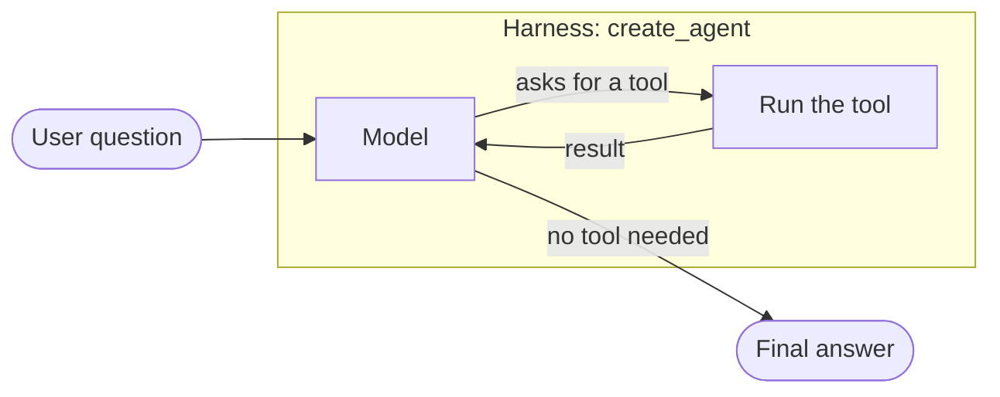
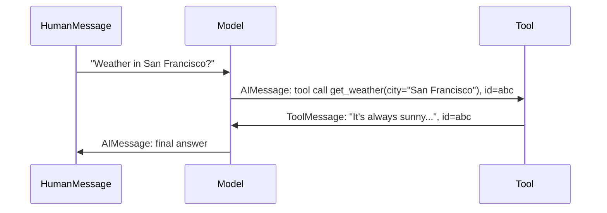

# Chapter 1: Introduction to LangChain

*From a plain model to a working, remembering agent in about 20 lines.*

> [!NOTE]
> **📍 At a glance**
> - **You will learn:** what an agent is, how `create_agent()` runs the loop, how to read its output, how to add memory
> - **You will build:** a weather agent, then a "check, don't guess" research agent
> - **Level:** beginner · **Time:** about 45 minutes
> - **Builds on:** the hand-written agent loop in [LLM, Chapter 2](../llm/02-the-agentic-loop-in-pure-python.md)

**After this chapter you can:**

- Explain what an agent is, in one sentence
- Build one with `create_agent()`
- Read every message it returns
- Give it memory
- Answer the common interview questions on all of the above

## 1.1 Why a framework

- **Agent** = a model that decides the next step, calls tools, and loops until it has an answer
- The raw loop is easy to write **once**. Repeating it in every project is the pain:

| You must handle | Without a framework | With LangChain |
|---|---|---|
| Different providers | One SDK each, different message shapes | Change one string |
| Tool schemas | Hand-written JSON | Built from your function |
| Memory | Your own storage | Checkpointer + `thread_id` |
| Retries, approvals, limits | Your own code | Middleware ([Ch7](07-middleware.md)) |
| Tracing | Print statements | LangSmith ([Ch15](15-testing-agents-and-tracing.md)) |

- **LangChain** supplies that plumbing. You choose the model, tools and instructions. It runs the loop
- **Quick test:** if an AI tells *you* to search the web and paste results back, it is not acting as an agent. An agent calls the tool **itself**

## 1.2 Agent = model + harness



- **Model:** text in, text out. No memory, no tools, no actions
- **Harness:** everything around the model:
  - system prompt (role and rules)
  - tools (actions the model can request)
  - the loop (call model → run tools → feed results back → repeat)
  - memory (stored conversation)
  - middleware (hooks on the loop, from [Chapter 7](07-middleware.md))
- `create_agent()` is LangChain's harness: minimal, but highly configurable

> [!TIP]
> Say it this way in an interview: **"The model is stateless and can't act. Almost everything useful in an agent comes from the harness."**

## 1.3 The LangChain family (short version)

Full detail in [Chapter 2](02-langchain-family-and-harness-engineering.md). They are **layers, not rivals**.

| Layer | What it is | Control | Pick it when |
|---|---|---|---|
| **Deep Agents** | Batteries-included harness: planning, virtual files, sub-agents | Low | Long research or coding tasks, fast start |
| **LangChain** | `create_agent()`, a harness you configure with middleware | Medium | Most tool-calling agents. **This book starts here** |
| **LangGraph** | Low-level graph: you define every step and branch | High | Custom flows, durable long runs |
| **LangSmith** | Tracing and evals, not a builder | — | Always, once you go past a demo |

- **Version note:** everything before LangChain v1 is now **LangChain Classic** (`langchain-classic`). Old tutorials with `AgentExecutor` or `LLMChain` are Classic. Mismatched code usually means a version difference

> [!IMPORTANT]
> **🏭 In production**
> - Since v1.0 (October 2025), `create_agent` runs **on the LangGraph runtime**. Start with `create_agent`, and drop to a LangGraph `StateGraph` only when you need custom branching or durable multi-step control. Most production teams use both.
> - LangChain's v1 announcement names Uber, JPMorgan, BlackRock, Cisco, LinkedIn and Klarna as production users.
> - *Added by Claude; sources at the end of the chapter.*

## 1.4 Set up a project

```bash
uv init
uv add langchain langchain-openai langchain-anthropic
uv sync
```

Create three files:

| File | Holds | Commit it? |
|---|---|---|
| `.env` | Your real provider keys | ❌ Never |
| `.gitignore` | Must list `.env` and `.venv` | ✅ Yes |
| `.env.example` | Key names with empty values | ✅ Yes |

```bash
# .env.example
OPENAI_API_KEY=
ANTHROPIC_API_KEY=
```

- Three installs pull in about 45 dependencies. That is normal
- `pyproject.toml` already does the job of `requirements.txt`
- You need **your own key** for each provider. LangChain is only the harness

> [!CAUTION]
> A key pushed to a public repo is found by bots within minutes. Deleting the commit is **not** enough: **revoke the key** and create a new one. See [Chapter 3](03-models-messages-and-parameters.md), section 3.2.

## 1.5 Your first agent

```python
from langchain.agents import create_agent

def get_weather(city: str) -> str:
    """Get weather for a given city."""
    return f"It's always sunny in {city}!"

agent = create_agent(
    model="openai:gpt-4o-mini",      # "provider:model-name"
    tools=[get_weather],
    system_prompt="You are a helpful weather assistant.",
)

result = agent.invoke(
    {"messages": [{"role": "user", "content": "Weather in San Francisco?"}]}
)
print(result["messages"][-1].content)
```

| Argument | What it does | Watch out for |
|---|---|---|
| `model` | `provider:model-name` string. Switch provider by changing the prefix | Model names change often. Check the provider's current list |
| `tools` | Plain Python functions. The JSON schema is built from **name, type hints and docstring** | A vague docstring = wrong tool choice |
| `system_prompt` | Role and rules | Keep it specific and actionable |
| `agent.invoke(...)` | Runs the whole loop, returns when the model stops asking for tools | It can loop. Set a step limit (1.10) |

> [!WARNING]
> **The model never sees your code.** It only sees the tool's name, parameters and docstring. A vague docstring is the top reason for wrong tool choices.

`@tool` makes the tool explicit ([Chapter 5](05-tools.md)):

```python
from langchain.tools import tool

@tool
def get_weather(city: str) -> str:
    """Get the current weather for a city. Use for any weather question."""
    return f"It's always sunny in {city}!"
```

### What comes back

```python
for m in result["messages"]:
    m.pretty_print()
```

`result["messages"]` is the full conversation:



1. **`HumanMessage`:** the question
2. **`AIMessage`:** empty text plus a **tool call** (`get_weather`, `{"city": "San Francisco"}`, an id)
3. **`ToolMessage`:** the function's return value, with the **same id** as step 2
4. **`AIMessage`:** the final answer

- The model was called **twice**: once to ask for the tool, once to answer. **Every tool round trip is another paid model call**
- The matching id tells the model which result belongs to which request. It matters when several tools are requested at once
- AI messages carry token counts (`prompt_tokens`, `completion_tokens`, `total_tokens`). Use them to work out cost

✅ *Verified: message order, matching ids and `pretty_print` (details at the end).*

## 1.6 Memory

- Each `invoke` sees **only the messages you pass in**
- So "Hi, I am Mayank" in one call and "Who am I?" in the next: the agent does not know
- Fix: a **checkpointer** (stores state) plus a **thread_id** (picks the conversation)

```python
from langgraph.checkpoint.memory import InMemorySaver

agent = create_agent(
    model="openai:gpt-4o-mini",
    tools=[get_weather],
    system_prompt="You are a helpful assistant.",
    checkpointer=InMemorySaver(),
)

config = {"configurable": {"thread_id": "chat-1"}}
agent.invoke({"messages": [{"role": "user", "content": "Hi, I am Mayank"}]}, config)
reply = agent.invoke({"messages": [{"role": "user", "content": "Who am I?"}]}, config)
```

- Same `thread_id` → remembers. New `thread_id` → fresh start

> [!WARNING]
> - `InMemorySaver` lives in the running process. Script ends → memory gone. Production needs a database-backed saver ([Chapter 6](06-agents-and-memory.md)).
> - `checkpointer=checkpointer` raises `NameError` if you never created it. Create it first.

> [!IMPORTANT]
> **🏭 In production**
> - One `thread_id` per **conversation**, never one per user for everything. Shared threads leak context between tasks.
> - The thread grows on every turn, and so does the cost of each call. Plan for trimming or summarising ([Chapter 7](07-middleware.md)).
> - *Added by Claude.*

✅ *Verified: memory per `thread_id`.*

## 1.7 Make the model check, not guess

- Models sound sure even when wrong. Counting, lookups and maths should come from a **tool**, not from the model
- Pattern: give a fetch tool, then tell the model not to guess

```python
import urllib.request, urllib.error
from langchain.tools import tool
from langchain.chat_models import init_chat_model

@tool
def fetch_text_from_url(url: str) -> str:
    """Fetch the text of a document from a URL."""
    req = urllib.request.Request(url, headers={"User-Agent": "notes-demo/1.0"})
    try:
        with urllib.request.urlopen(req, timeout=120) as resp:
            return resp.read().decode("utf-8", errors="replace")
    except urllib.error.URLError as e:
        return f"Fetch failed: {e}"

SYSTEM_PROMPT = """You are a literary data assistant.

## Capabilities
- `fetch_text_from_url`: loads document text from a URL.

Do not guess line counts or positions. Ground them in tool results.
If an exact answer cannot be verified, return null and explain why."""

model = init_chat_model("openai:gpt-4o-mini", temperature=0.5, timeout=300, max_tokens=25000)
```

Three habits to copy:

1. **Name each tool's purpose** in the system prompt, not only its docstring
2. **Allow "I cannot verify this."** Otherwise the model invents a number
3. **Return errors as text** (`"Fetch failed: ..."`) so the model can react instead of the run crashing

`init_chat_model(...)` is the alternative to the model string. Use it to set `temperature`, `timeout` or `max_tokens` ([Chapter 3](03-models-messages-and-parameters.md)).

> [!CAUTION]
> This tool fetches **any** URL the model chooses. That opens two holes: **prompt injection** (the page contains fake instructions) and **SSRF** (the model is steered to internal addresses). Fixes are in 1.10.

## 1.8 Caching tool results

Cache time depends on **how fast the data changes**:

| Data | Cache for |
|---|---|
| Stock prices | Don't cache |
| Currency rates | Minutes |
| Weather | Hours |
| Static reference data | Days or longer |

- **TTL** (time-to-live) = how long a stored result may be reused
- A cached wrong answer is worse than a slow right one

```python
import time

_cache = {}

def cached(key, ttl_seconds, fetch):
    hit = _cache.get(key)
    if hit and time.time() - hit[0] < ttl_seconds:
        return hit[1]
    value = fetch()
    _cache[key] = (time.time(), value)
    return value

# inside a tool:
# return cached(("fx", "USD", "INR"), 600, lambda: call_rates_api("USD", "INR"))
```

✅ *Verified: the `cached` helper.*

## 1.9 Trade-offs, and when not to use LangChain

| You gain | You give up |
|---|---|
| A working agent in a few lines | Some visibility: the tool schema is inferred |
| Provider swap by changing a string | Some speed: message objects, ids, bookkeeping |
| Memory, structured output, middleware, tracing on tap | Fine control, unless you step down to LangGraph |
| A large integration ecosystem | One more fast-moving dependency to upgrade |

- **Career angle:** depth in the fundamentals (the raw loop) lasts longer than a list of framework names. Clients care about control and speed, not how many frameworks you know

> [!IMPORTANT]
> **🏭 In production: the landscape you will be asked about**
>
> | If the team… | They often pick |
> |---|---|
> | Wants a cross-provider Python agent with middleware | LangChain `create_agent` (+ LangGraph when flows get custom) |
> | Cares most about typed, validated outputs | Pydantic AI |
> | Is committed to one model vendor | That vendor's SDK: OpenAI Agents SDK, Claude Agent SDK, Google ADK |
> | Builds a TypeScript web app | Vercel AI SDK or Mastra |
>
> - **Don't reach for a framework** for a single model call or a fixed two-step pipeline: the plain provider SDK is simpler.
> - The framework is free; **the real running cost is model API spend**, so count model calls per task.
> - *Added by Claude; sources at the end of the chapter.*

## 1.10 Added by Claude, not from the sources

Not in the course material. Well-established practice, but check current docs before relying on it.

- **Prompt injection**
  - A fetched web page can contain text written to look like instructions
  - Treat tool output as **data**, never as instructions
  - Do not give an agent that reads the open web tools that can also send, delete or spend, without a human approval step ([Chapter 11](11-runtime-and-human-in-the-loop.md))
- **SSRF (server-side request forgery)**
  - If the model controls the URL, it can be steered to internal addresses
  - In real systems, allow-list domains and block private IP ranges
- **Set your own step limit**
  - In the LangGraph version I checked, the default `recursion_limit` was very high (10007)
  - A looping agent can run, and cost money, for a long time

```python
agent.invoke(
    {"messages": [{"role": "user", "content": "..."}]},
    config={"recursion_limit": 25},
)
```

- **Tools with side effects can run more than once**
  - Loops, retries or a model asking twice can repeat a call
  - Make write, send and charge tools **idempotent** (safe to repeat), or guard them with approval
- **`create_agent` is the current way to build agents in LangChain v1.** Older tutorials use other helpers

✅ *Verified: `recursion_limit` in config.*

## 1.11 Interview corner

**What interviewers listen for:** you separate the **model** from the **harness**, you know the loop's stop condition, and you raise **cost, limits and security** without being asked.

### 🟢 Basic

<details class="qa"><summary>1. What is an agent in LangChain?</summary>

- A model plus a harness: instructions, tools, loop, memory, middleware
- `create_agent()` is the minimal configurable harness
- *Stronger answer:* the model alone is stateless and cannot act, so almost everything useful comes from the harness

</details>

<details class="qa"><summary>2. When does the agent loop stop?</summary>

- When the model replies **without** requesting a tool
- *Stronger answer:* you still need a safety limit (`recursion_limit`) in case it keeps calling tools

</details>

<details class="qa"><summary>3. How does LangChain describe your function to the model?</summary>

- From its name, type hints and docstring. `@tool` gives explicit control
- *Stronger answer:* the docstring is effectively part of the prompt, so write it for the model

</details>

### 🟡 Intermediate

<details class="qa"><summary>4. Why use a framework instead of writing the loop yourself?</summary>

- The loop is easy. The plumbing is not: providers, tool schemas, structured output, memory, retries, approvals, tracing
- *Stronger answer:* name the costs (less visibility, overhead, one more dependency) and say you can still write the loop by hand

</details>

<details class="qa"><summary>5. LangChain vs LangGraph vs Deep Agents vs LangSmith?</summary>

- Deep Agents: batteries-included top layer · LangChain: configurable harness · LangGraph: low-level orchestration · LangSmith: observability, not a builder
- *Stronger answer:* they are layers, not rivals. `create_agent` runs on LangGraph underneath

</details>

<details class="qa"><summary>6. Why does an agent forget between runs, and how do you fix it?</summary>

- Each `invoke` sees only what you pass in. Fix: checkpointer + `thread_id`
- *Stronger answer:* the in-memory saver dies with the process, so production uses a database-backed one, with one thread per conversation

</details>

### 🔴 Senior

<details class="qa"><summary>7. A tool fetches any URL. What can go wrong, and how do you harden it?</summary>

- Huge pages, hangs, failures → timeouts, size caps, errors returned as text
- *Stronger answer:* prompt injection (treat output as data, no dangerous tools next to a web reader without approval) and SSRF (allow-list domains, block private IPs)

</details>

<details class="qa"><summary>8. Your agent answers correctly but costs 3x the estimate. Where do you look?</summary>

- Count model calls per task: every tool round trip is another call, and the whole history is resent each time
- *Stronger answer:* check for repeated tool calls (loops), a growing thread, oversized tool outputs, and a too-large model; then cap steps, trim history, and route easy steps to a cheaper model ([Ch8](08-prebuilt-middleware-limits-fallback-and-pii.md), [Ch10](10-shell-tools-and-custom-middleware.md))

</details>

> [!TIP]
> **🧩 Design question to practise:** *"Design a support agent that looks up orders and can issue refunds."* Cover the tools, which ones need approval, memory per conversation, a step limit, and how you would trace a bad refund.

## Cheat sheet

```python
agent = create_agent(model="provider:model", tools=[fn], system_prompt="...",
                     checkpointer=InMemorySaver())        # memory (dev only)
agent.invoke({"messages": [{"role": "user", "content": "..."}]},
             config={"configurable": {"thread_id": "t1"}, "recursion_limit": 25})
# result["messages"]: Human → AI(tool call, id) → Tool(same id) → AI(answer)
```

## Recap

- Agent = **model + harness**. `create_agent()` is the harness
- You give `model`, `tools`, `system_prompt`. `invoke` runs the loop
- Result = human → AI (tool call) → tool result (same id) → final AI
- Tool descriptions come from name, type hints, **docstring**
- Memory = **checkpointer + thread_id**. In-memory is lost when the process ends
- Make the model **verify with tools** and allow "cannot verify"
- Cache by how fast the data changes
- Frameworks trade some visibility and speed for a lot of plumbing. Count model calls: they are the cost

## Practice

1. New project with `uv add langchain langchain-openai langchain-anthropic`, plus `.env`, `.gitignore`, `.env.example`
2. Build the weather agent. Print the messages and match each to a step of the hand-built loop
3. Add `InMemorySaver` and `thread_id`. Show it remembers within a thread and forgets across threads
4. Write a tool with a clear docstring, then make it vague and watch tool choice get worse
5. Run the line-counting agent from 1.7 on a real text and check its numbers yourself
6. Set `recursion_limit=3` and give the agent a task that needs more steps. Read the error

## How this chapter was checked

- Run offline with a stand-in model on `langchain` 1.4.7: message order, matching tool-call id, `pretty_print`, checkpointer memory per `thread_id`, `recursion_limit` in config (default seen: 10007), and the `cached` helper
- **Not** run against a live model (needs a provider key). Check model names and prompts before running
- The diagrams, tables and "In production" boxes were added in the 2026 book review; the framework landscape and production users come from the web sources below
- **Cheat sheet:** ran `create_agent` with a scripted fake model that makes one tool call; the `thread_id` and `recursion_limit` config was accepted. Ran on `langchain` 1.4.7 with a scripted fake chat model (no API keys, no network), so no real model call was made.

## Sources and further reading

- Live-Class-2026, `classes_summary/06 - 12 Jul - Introduction to LangChain.md`
- Live-Class-2026, `classes_transcription_summary/06 - 12 Jul - Introduction to LangChain.md`
- Live-Class-2026, code folder `Weekend 03 - 11-12 Jul/06 - 12 Jul - Introduction to LangChain/`
- Production users and v1 runtime: [What is LangChain? A 2026 production engineer's guide (Future AGI)](https://futureagi.com/blog/what-is-langchain/), [LangChain vs LangGraph (Uvik)](https://uvik.net/blog/langchain-vs-langgraph/)
- Framework landscape: [Choosing an agent framework in late 2026 (Developers Digest)](https://www.developersdigest.tech/blog/choosing-an-agent-framework-late-2026), [Python AI agent frameworks: the 2026 comparison (Uvik)](https://uvik.net/python-ai-agent-frameworks/)
- Sections 1.10, the "In production" boxes and the senior interview questions are added by Claude and are not from the course sources

Previous: [LLM, Chapter 2](../llm/02-the-agentic-loop-in-pure-python.md) · Next: [Chapter 2, LangChain family and harness engineering](02-langchain-family-and-harness-engineering.md)
