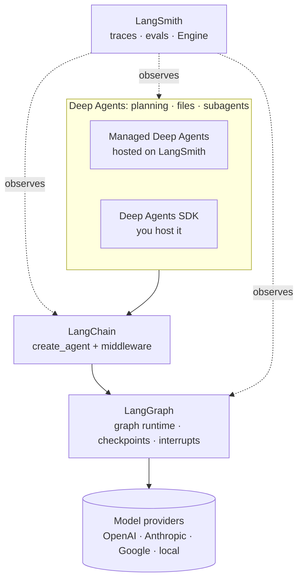
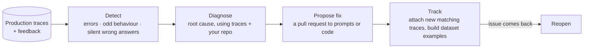

# Chapter 2: LangChain family and harness engineering

*Four products, one stack: know which layer to reach for, and get any provider running.*

> [!NOTE]
> **📍 At a glance**
> - **You will learn:** what LangChain, LangGraph, Deep Agents and LangSmith each do; what a harness is; how to spot an outdated tutorial; how to install any model provider
> - **You will build:** a mental map of the family, and a checked environment
> - **Level:** beginner · **Time:** about 30 minutes
> - **Builds on:** [Chapter 1](01-introduction-to-langchain.md). Model and message basics are in [Chapter 3](03-models-messages-and-parameters.md).

**After this chapter you can:**

- Tell LangChain, LangGraph, Deep Agents and LangSmith apart, and pick the right layer
- Choose between Managed Deep Agents and the self-hosted Deep Agents SDK
- Say why tracing matters, turn it on, and say what LangSmith Engine adds
- Define "agent" and "harness" in one sentence each
- Spot an outdated tutorial from the timeline
- Install any provider, write its model string, and sanity-check your environment

## 2.1 Four products, four jobs



They are **not competitors**. You use as many as the project needs.

| Layer | What it is | Pick it when |
|---|---|---|
| **Deep Agents** | Batteries-included harness on top of `create_agent` | Long research or coding tasks; you want planning, files and subagents ready-made |
| **LangChain** | `create_agent`: a minimal, highly configurable harness | Most tool-calling agents. **This book is built around it** |
| **LangGraph** | Low-level orchestration framework | You must mix fixed (deterministic) steps with agentic ones, or need durable long runs |
| **LangSmith** | Tracing, debugging and evaluation platform | Always, once you go past a demo. Works with agents from any of the three |

- **LangGraph**
  - Low-level foundation: branching, loops, persistence, durable execution
  - Most agent builders do not touch it at first, because LangChain hides it until needed
- **LangChain**
  - `create_agent`: a configurable harness built **on top of** LangGraph
  - You start from the primitives (model, tools, prompt, middleware) and add only what your use case needs
- **Deep Agents**
  - Built on top of `create_agent`
  - Planning tools, a virtual file system, context compression and sub-agent spawning ready-made
  - Comes in two forms, same harness (table below)
- **LangSmith**
  - Observability and evaluation platform, **not** something you build with
  - Watches agents built with any of the above (it supports OpenTelemetry, so almost anything else too)

Why LangChain sits on LangGraph: to get durable execution, human-in-the-loop and persistence for free.

**Common mix-up:** LangFuse is **not** part of the LangChain family. It only shares "Lang" in the name. It is an independent open-source observability platform.

### What `create_agent` gives you: the four core benefits

| Benefit | What it means for you | Where in this book |
|---|---|---|
| **Standard model interface** | One interface for chat models, embeddings and more, across providers. Switch models with minimal code change | [Ch 3](03-models-messages-and-parameters.md), 2.6 |
| **Highly configurable harness** | Start with `create_agent`, add capabilities through middleware: guardrails, retries, routing, custom tool policies | [Ch 7](07-middleware.md)–[10](10-shell-tools-and-custom-middleware.md) |
| **Built on LangGraph** | Durable execution, human-in-the-loop, persistence | [Ch 6](06-agents-and-memory.md), [Ch 11](11-runtime-and-human-in-the-loop.md) |
| **Debug with LangSmith** | Traces, tool calls, state transitions, latency; evaluate quality | 2.2, [Ch 15](15-testing-agents-and-tracing.md) |

### Deep Agents: managed or self-hosted

| | **Managed Deep Agents** | **Deep Agents SDK** |
|---|---|---|
| Harness | The open-source Deep Agents harness | The same harness |
| Who runs it | LangSmith: a managed Agent Server (threads, runs, streaming, an MCP endpoint) | You: you own the backend, store, checkpointer and server |
| Entry point | `define_deep_agent(...)` returns a **definition**; the `mda` CLI hands it to the runtime | `create_deep_agent(...)` returns a **compiled agent** you run |
| Extras | Sandbox, memory, identity, channels (e.g. Slack), schedules, OAuth connections and evals are **declared in files** | You build and operate each one |
| Status (Nov 2026) | Public beta on LangSmith Cloud and Bring Your Own Cloud (BYOC) | Open source, pre-1.0 (`deepagents` 0.x) |

```bash
uvx --from managed-deepagents mda init research-assistant   # new agent project folder
cd research-assistant && uv sync
uv run mda dev       # local Agent Server + LangSmith Studio
uv run mda deploy    # hosted on LangSmith; prints the dashboard URL
```

- A managed agent is a **project folder**: `agent.py` (required), plus optional `instructions.md`, `skills/`, `tools/`, `middleware/`, `sandbox/`, `memory.py`, `channels/`, `schedules/`, `evals/`
- You still need a model provider key and a LangSmith key in `.env`

> [!WARNING]
> Managed Deep Agents is in **beta**. Its CLI and project layout may change, and your traces and agent run on LangSmith's infrastructure (or your BYOC cloud). Check data-residency rules before you put customer data through it.

### Inside LangChain: the component map

- *Source: LangChain docs, `component-architecture.mdx`.*
- **Input processing:** loaders and splitters make documents
- **Embedding and storage:** embedding models, vector stores
- **Retrieval:** retrievers find context for a query
- **Generation:** chat models and tools
- **Orchestration:** agents and memory tie these together
- How they combine:
  - **RAG** = retriever, then chat model with the found context
  - **Agent** = loop of model and tool
  - **Multi-agent** = supervisor plus specialists ([Ch 13](13-multi-agent-systems-and-subagents.md))

## 2.2 Why LangSmith exists

- An ordinary script: when it fails, you read the stack trace and the code
- An agent decides at run time, so the code shows what it **could** do, not what it **did**
- LangSmith records a **trace**: every model call, tool call and decision, timestamped
- It also shows latency and token cost per step
- `print` shows only what you thought to check. A trace shows everything (diary vs flight recorder)

Turn it on with two environment variables:

```
LANGSMITH_TRACING=true
LANGSMITH_API_KEY=your-key-here
```

| Plan | Price | Traces included | Seats |
|---|---|---|---|
| Developer | Free | 5,000 base traces a month, then pay-as-you-go | 1 |
| Plus | $39 per seat a month | 10,000 base traces a month, then pay-as-you-go | Unlimited |

- Base traces are kept for **14 days**; extended traces (180 days) cost extra
- The free tier is enough for learning. Paid tiers matter only for production traffic
- Figures from the LangSmith pricing page, November 2026. Check before budgeting

### LangSmith Engine: an agent that watches your agent

- Tracing shows you what happened. **Engine** reads those traces for you and turns failures into tracked issues
- It runs on each tracing project you connect, on a schedule:



- Connecting a GitHub or GitLab repo is optional but gives better diagnoses. Engine opens PRs but **never merges** them
- It learns from what you do (closing issues, "Incorrectly Flagged", priority changes)
- Engine is **metered separately** from traces, in LangSmith usage units (LSUs, $1 each). The default org cap is 750 LSUs a month; at the cap, new runs pause
- Fix validation (replaying traces against a fix) is beta and LangSmith Cloud only

> [!IMPORTANT]
> **🏭 In production**
> - Tracing is not optional once real users arrive: without it you cannot answer "why did the agent do that?"
> - LangSmith is one option; many teams send traces to an OpenTelemetry-based tool they already run. Pick one before launch, not after the first incident
> - Log the trace id next to every user-facing answer so support can jump straight to the run
> - Treat Engine's PRs like a junior engineer's: review every one, and make sure its proposed dataset examples go into your eval set ([Ch 15](15-testing-agents-and-tracing.md)) so the fix stays fixed. Set the LSU cap deliberately, not by default
> - *Added by Claude.*

## 2.3 Agent and harness, in one sentence each

> An agent is a model calling tools in a loop until a task is complete. A harness is everything around that loop.

- The docs put it in three words: **Agent = Model + Harness**
- **Model:** raw reasoning. It does not know what tools exist, has no behavioural instructions, cannot check anything outside its own knowledge
- **Harness:** system prompt, tools, middleware, memory, context. It makes the model useful
- `create_agent(model=..., tools=..., system_prompt=...)` configures the harness **around** a model. It never builds a model
- Memory aid: **model = engine, harness = everything else, agent = the car you can drive**

**Harness engineering** = how well you wrap a raw model. Parts to design:

- the model
- tools
- system prompt
- memory
- context (earlier messages, documents)
- sub-agents
- guardrails and checkpoints

`create_agent` exposes: model, tools, system prompt, middleware, structured output, invocation and streaming output.

- Middleware is where the harness grows: guardrails, retries, routing between models, custom tool policies ([Ch 7](07-middleware.md))

**The brain sets the ceiling.** A weak model in a good harness is still a weak agent. Choose the model deliberately.

## 2.4 Why start with LangChain, and in what order

- Order: **LangChain → LangGraph → Deep Agents**
- Deep Agents is easy once the other two are solid
- Starting at Deep Agents gives you results with no control (ordering delivery vs cooking)
- LangChain is taught deeply because later frameworks (LangGraph, ADK, AutoGen, Amazon's agent SDK) get compared against it
- Learn one framework well and the next one is faster, like a second programming language

### What LangChain believes

- *Source: LangChain docs, `philosophy.mdx`. Narrative, so nothing here was run.*
- **Beliefs:**
  - LLMs are powerful, and better with outside data
  - Apps will become more agentic
  - It is still early
  - A prototype is easy, but a **reliable** production agent is hard
- **Two focuses:**
  - Let you use the best models: one standard input and output format across providers, so you avoid lock-in
  - Let models **orchestrate** flows that use data and computation, through tools

## 2.5 A real timeline

- **Oct 2022:** LangChain launches with LLM abstractions and "Chains" (fixed sequences of steps)
- **Dec 2022:** first general-purpose agents, based on the ReAct paper. The model writes JSON and LangChain parses it into a tool call
- **Jan 2023:** chat-completion APIs take a **list of messages**; LangChain moves to message lists. LangChain also gets a JavaScript version
- **Feb 2023:** LangChain Inc. is formed
- **Mar 2023:** function calling in model APIs becomes the preferred way to call tools, instead of parsing JSON
- **Jun 2023:** LangSmith released (closed source) for observability and evals
- **Jan 2024:** LangChain 0.1.0, the first non-0.0.x release, with a focus on stability
- **Feb 2024:** LangGraph released: streaming, durable execution, short-term memory, human-in-the-loop
- **Jun 2024:** over 700 integrations; they move to standalone packages or `langchain-community`
- **Oct 2024:** LangGraph becomes the preferred way to build past a single call. Most old chains and agents deprecated
- **Apr 2025:** multimodal model APIs; the message format changes to carry files, images and video
- **Oct 20, 2025:** LangChain v1.0, one unified agent abstraction on LangGraph, **and** a standard message content format for reasoning blocks, citations and server-side tool calls ([Ch 3](03-models-messages-and-parameters.md), standard content blocks). Old code needs the separate `langchain-classic` package
- **Mar 15, 2026:** Deep Agents released
- **Aug 2026:** Managed Deep Agents in public beta on LangSmith

(The Dec 2022 date is from the class summary. The transcript is vaguer, "late 2022 or 2023". The Mar 2026 date is the class figure. *Web check, 2026-11-15:* news reports of the launch are dated 17–18 Mar 2026. The Python package was still 0.6.x in July 2026 (the class project pins `deepagents>=0.6.12`), so "released" here means launched, not version 1.0.)

Key ideas:

- **Chain** = fixed workflow, for example a RAG chain: retrieve documents, then generate an answer
- **2022 to 2024:** building an agent meant hand-parsing JSON into tool calls (`AgentExecutor`, `initialize_agent`). It did not scale, so LangGraph was built
- **ReAct** (Reason + Act): agents that reason and act. Still the shape of most real apps
- **Low level = more control.** Closer to the machine, less abstraction. That is why LangGraph gives more control than LangChain

**Spotting an outdated tutorial:**

```python
from langchain import AgentExecutor   # ImportError on v1.0+
```

- This is not your set-up. The code now deliberately lives in `langchain-classic`
- Classic code still runs but is legacy and unmaintained
- To keep old code running while you migrate: `uv add langchain-classic`

## 2.6 Set up and check your environment

**Where to run code**

- **Google Colab:** free, no local set-up, works on weak laptops. Best for learning line by line
- **VS Code:** real projects with several files and a front end
- Colab resets packages every session. Install once per session

**Project set-up** (same basics as [Chapter 1](01-introduction-to-langchain.md), section 1.4):

```bash
uv init langchain-course
cd langchain-course
uv add langchain langchain-openai langchain-community langgraph python-dotenv
uv add langchain-mcp-adapters langchain-chroma chromadb pypdf   # needed in later modules
```

```python
# Colab
!pip install -q langchain langchain-openai langchain-community langgraph python-dotenv langchain-chroma chromadb
```

**Pick your provider**

- Each provider is its own package. `langchain[openai]` is an **extra** that installs `langchain-openai` for you; the two are the same thing
- The model string is `provider:model-name`. Only the install line and this string change between providers

| Provider | Install | Model string (docs example) |
|---|---|---|
| OpenAI | `pip install -qU langchain "langchain[openai]"` | `openai:gpt-6.1-sol` |
| Anthropic | `pip install -qU langchain "langchain[anthropic]"` | `claude-sonnet-4-6` (prefix inferred) |
| Google Gemini | `pip install -qU langchain "langchain[google-genai]"` | `google_genai:gemini-2.5-flash-lite` |
| AWS Bedrock | `pip install -qU langchain langchain-aws` | `bedrock_converse:us.anthropic.claude-sonnet-4-6` |
| OpenRouter | `pip install -qU langchain langchain-openrouter` | `openrouter:anthropic/claude-sonnet-4-6` |
| Fireworks | `pip install -qU langchain langchain-fireworks` | `fireworks:accounts/fireworks/models/qwen3p5-397b-a17b` |
| Baseten | `pip install -qU langchain langchain-baseten` | `baseten:zai-org/GLM-5.2` |
| Ollama (local) | `pip install -qU langchain langchain-ollama` | `ollama:devstral-2` |
| Hugging Face | `pip install -qU langchain "langchain[huggingface]"` | `huggingface:microsoft/Phi-3-mini-4k-instruct` |

- **Bedrock:** the `us.` prefix routes within the US; use `global.anthropic.claude-sonnet-4-6` for worldwide routing
- **Azure OpenAI** needs your deployment name, so build the model with `init_chat_model` and pass the object:

```python
import os
from langchain.chat_models import init_chat_model

model = init_chat_model(
    "azure_openai:gpt-6.1-sol",
    azure_deployment=os.environ["AZURE_OPENAI_DEPLOYMENT_NAME"],
)
agent = create_agent(model=model, tools=[get_weather], system_prompt="You are a helpful assistant")
```

> [!WARNING]
> **Always write the provider prefix.** A bare name is guessed from how it starts: `gpt-` → OpenAI, `claude` → Anthropic. A bare `gemini-...` is guessed as **Vertex AI**, not the Gemini API, with a deprecation warning. If you use an AI Studio key, write `google_genai:` or you get an authentication error.

**Loading keys**

```python
import os
from dotenv import load_dotenv
load_dotenv()
key = os.environ.get("OPENAI_API_KEY")
print(key[:5] if key else "missing")      # first five characters only, never the whole key
```

- Prefer `.env` + `load_dotenv()` over typing the key into code
- Colab: use the built-in **Secrets** manager (key icon), not a key in a cell
- **Exact names matter.** LangChain looks for each provider's standard variable (`OPENAI_API_KEY`, `ANTHROPIC_API_KEY`, ...). Rename it or switch provider without its variable and you get an authentication error

**Sanity check** (the official overview example; if it runs, the environment is right):

```python
from langchain.agents import create_agent

def get_weather(city: str) -> str:
    """Get weather for a given city."""
    return f"It's always sunny in {city}!"

agent = create_agent(
    model="openai:gpt-6.1-sol",          # swap for any row in the provider table
    tools=[get_weather],
    system_prompt="You are a helpful assistant",
)
result = agent.invoke({"messages": [{"role": "user", "content": "What's the weather in San Francisco?"}]})
print(result["messages"][-1].content_blocks)   # [{'type': 'text', 'text': '...sunny in San Francisco!'}]
```

- `content_blocks` gives the answer in the standard, provider-neutral format ([Ch 3](03-models-messages-and-parameters.md))
- Model names change often. The class used `openai:gpt-5.5`; the docs now show `openai:gpt-6.1-sol`. Use whatever your provider currently lists

✅ *Verified: the sanity-check agent, the Azure `init_chat_model` call and the provider guessing (details at the end).*

**If it fails**

- Retired model name: check docs.langchain.com for the current catalogue, change only that string
- Authentication error, usual causes:
  - `.env` is not in the folder you run from
  - `.env` was created after the session started, so **restart the kernel or runtime**
  - Wrong Python kernel in VS Code: pick the project's own `.venv` interpreter
  - Wrong provider guessed from a bare model name: add the prefix

## 2.7 Open and closed source models

- **Open source (open weights)**
  - You get the weights: self-host and fine-tune
  - Cost: often free, or just your hosting
- **Closed source**
  - Weights never provided, API only
  - You pay the provider per use
  - **Fine-tuning:** the mentor said a closed model can "never" be fine-tuned. *Web check, 2026-11-15:* some providers sell **hosted** fine-tuning, for example several Gemini models on Google Vertex AI. You get a private model to call, never the weights. OpenAI is winding its fine-tuning API down (closed to new users; new jobs reported to stop on 6 Jan 2027). In practice: if you must fine-tune, plan on open weights
- Class examples: recent GPT-OSS releases (`gpt-oss`, `gpt-oss-safeguard`) are open-weight. Flagship GPT-5 line and Claude are closed and API-only
- Running open weights locally is one provider row away: `ollama:<model>` in the table in 2.6

**Free is not the same as open.** The class's two questions:

- **Free or paid?** That is the price
- **Open or closed?** That is whether you get the weights

| | Open weights | Closed |
|---|---|---|
| **Free** | Ollama on your own machine; OpenRouter `:free` models such as NVIDIA Nemotron (the class demo) | Free tiers with limits, such as Gemini's API free tier |
| **Paid** | Open models that someone else hosts for you (Groq, OpenRouter paid models) | GPT-5.x, Claude, Gemini paid plans |

- "Free" open-weight models still cost someone money: you pay in hardware, or the host pays and limits you (OpenRouter's free tier, 3.3 in the next chapter)
- In class the mentor said OpenRouter gives closed models for free. Check each model's page: the free list is usually open-weight models that someone else hosts. Price alone doesn't tell you whether you could download the model

```python
from langchain.chat_models import init_chat_model

local  = init_chat_model("ollama:llama3.2")               # open weights, your hardware, no API key
hosted = init_chat_model("openrouter:openrouter/free")    # free models someone else hosts, rate-limited
closed = init_chat_model("openai:gpt-5.4-mini")          # closed, paid per token
```

**How big is "open"?** The class opened Ollama's DeepSeek-R1 page:

- The full 671B model is a **404 GB** download (4-bit). You need that much disk space to download it, and roughly that much memory (RAM or GPU) to run it
- *Added by Claude:* the smaller `deepseek-r1` tags (1.5B to 70B) are **distilled** models built on Qwen and Llama, not shrunken copies of the 671B model. They are cheaper to run, and noticeably less capable
- Smaller models are cheaper and faster, but less smart. The mentor: "they will be behaving very badly" on hard tasks

## 2.8 FAQs

- **LangChain is built on LangGraph. Why not learn LangGraph directly?**
  - `create_agent` hides LangGraph's complexity until you need it
  - You do not learn assembly before Python. Drop a layer only when the higher one cannot do the job
- **Is LangSmith just logging or `print`?** No. See 2.2
- **Is all this too much just to ask an LLM a question?**
  - One question: call the model directly
  - It pays off with several tool calls, memory across a conversation, or anything you will want to debug
- **Does LangChain cost anything?** No. You only pay your model provider
- **Is it used in production?** Yes
- **Official support if something breaks?** No, as with Python. Open a GitHub issue for a real bug. Support exists only with a company contract
- **Can we use several models and compare outputs?** Yes, common workflow
- **Anthropic or OpenAI? Paid or free?** Depends on use case, budget and needs
- **Does the chat model manage chat history?** No. That is still your job
- **LangSmith needed for the course?** No. The free tier is plenty
- **Old code after upgrading to v1.0?** It does not break silently, but things like `AgentExecutor` raise `ImportError`. Install `langchain-classic`
- **Is Deep Agents just LangGraph or LangChain with extra steps?** Neither. It is built on `create_agent`, one layer out, with planning, a virtual file system and sub-agents ready-made
- **Do I need Managed Deep Agents to use Deep Agents?** No. The SDK is the same harness and you host it yourself; managed only takes the hosting off your hands

Asked in the teaching part of classes 07–08 (18–19 Jul):

- **Is Claude's web app an AI or an agent?** An agent: a model plus memory, tools such as web search, and a system prompt you can't change (class 08)
- **Is Deep Agents related to MCP?** No. Deep Agents is a harness for building agents; MCP is a protocol for connecting tools and data to them. *Added by Claude:* the two meet when an agent loads MCP tools ([Chapter 12](12-mcp-in-langchain.md))
- **A model is a 404 GB download. Disk or RAM?** Both: disk to store it, and about as much RAM or GPU memory to run it (2.7)
- **What is a "base model"?** In class: any bare model before you add a harness. *Added by Claude:* in machine learning "base model" usually means a pretrained model **before** instruction tuning. Say "the bare model" in an interview to avoid the mix-up
- **Do we need a Claude Pro subscription for this course?** No

## 2.9 Self-check

1. Quick agent with lots of customisation? **`create_agent`** (or Deep Agents for batteries included)
2. Agent misbehaved in production, what happened on that run? **LangSmith**
3. An agent is a model calling ___ in a ___ until a task is complete. **Tools, loop**
4. A tutorial uses `AgentExecutor`. What does that tell you? It **predates the Oct 2025 v1.0** unification into `create_agent`
5. You want a deep agent but no servers to run. Which form? **Managed Deep Agents** (`mda deploy`)
6. `create_agent(model="gemini-2.5-flash", ...)` fails to authenticate with an AI Studio key. Why? The bare name was guessed as **Vertex AI**. Write `google_genai:gemini-2.5-flash`

## 2.10 Interview corner

**What interviewers listen for:** you know the products are **layers**, you can say when to step down from `create_agent` to LangGraph, and you treat observability as part of the build, not an afterthought.

### 🟢 Basic

<details class="qa"><summary>1. LangChain vs LangGraph vs Deep Agents vs LangSmith?</summary>

- LangGraph: low-level orchestration and durable execution
- LangChain: configurable harness on LangGraph
- Deep Agents: batteries-included layer on `create_agent`
- LangSmith: observability and evaluation
- *Stronger answer:* you combine them. Pick the highest layer that still gives the control you need

</details>

<details class="qa"><summary>2. What is "harness engineering"?</summary>

- Designing everything around the model: prompt, tools, memory, context, middleware, guardrails
- *Stronger answer:* the model sets the ceiling, the harness decides how close you get to it

</details>

### 🟡 Intermediate

<details class="qa"><summary>3. Why trace an agent instead of printing?</summary>

- Agents decide at run time, so code does not show what happened
- A trace records every model and tool call with latency and cost
- *Stronger answer:* traces also feed evaluation and regression tests

</details>

<details class="qa"><summary>4. How do you recognise an outdated LangChain tutorial?</summary>

- Imports like `AgentExecutor` or `initialize_agent` from `langchain` fail on v1.0+ because they moved to `langchain-classic`
- *Stronger answer:* check the date and the package version before copying code

</details>

<details class="qa"><summary>5. Managed Deep Agents or the self-hosted Deep Agents SDK?</summary>

- Same harness. Managed: LangSmith runs the server, threads, sandbox, schedules; you write a definition and `mda deploy`
- SDK: `create_deep_agent` gives a compiled agent; you own backend, store, checkpointer and server
- *Stronger answer:* decide on data residency, compliance and the team's ops capacity, not features. Managed is beta, so pin the CLI version and keep the agent code portable to the SDK

</details>

<details class="qa"><summary>9. A teammate says: "This model is free, so it's open source." What's wrong?</summary>

- Price and weights are separate questions. Gemini's free tier is closed; an open model that someone else hosts can cost money
- *Stronger answer:* ask three things before choosing: can we get the weights (self-host, fine-tune)? where does our data go (some free endpoints may train on prompts)? what are the limits (requests a day, context window)? Then pick for data control, cost at scale and capability

</details>

### 🔴 Senior

<details class="qa"><summary>6. Open vs closed models?</summary>

- Open weights: self-host, fine-tune, you carry the hosting
- Closed: API only, you pay per use
- *Stronger answer:* the choice is usually about data control, cost at scale and capability

</details>

<details class="qa"><summary>7. When would you move from <code>create_agent</code> to a LangGraph <code>StateGraph</code>?</summary>

- When the flow needs explicit branches, loops or parallel steps you must control, or durable long-running steps
- *Stronger answer:* keep `create_agent` for the tool loop and embed it as a node inside a `StateGraph`; you do not rewrite, you wrap

</details>

<details class="qa"><summary>8. LangSmith Engine proposes a fix as a PR. Would you let it ship?</summary>

- Not unreviewed. It never merges on its own, and its diagnosis is only as good as the traces and repo access it has
- Check the fix against the eval set, plus the dataset examples Engine builds from the failing traces
- *Stronger answer:* treat it as a triage assistant. The win is turning silent failures into tracked, reproducible issues; keep humans on the merge, and cap its LSU spend

</details>

> [!TIP]
> **🧩 Design question to practise:** *"Your bank wants an internal assistant that answers policy questions and drafts emails. Pick the LangChain layers and say why."* Cover the harness, memory, approval for sending, tracing, managed vs self-hosted, and what you would not use yet.

## 2.11 Added by Claude, not from the sources

Not in the course material. Established practice, but check current docs.

- **Traces can contain sensitive data.** Prompts, tool arguments and outputs may include personal or confidential information. Decide what you send to a hosted tracing service, mask fields where you can, and check the retention and data-location terms
- **Pin versions.** This ecosystem moved fast (v1.0 in late 2025). Commit `uv.lock`, and pin a major range such as `langchain>=1,<2`, so a fresh install does not break your project
- **Keep tracing projects separate.** Use a different tracing project (or key) for experiments, staging and production so noise does not bury real runs
- **The Gemini default is changing.** In `langchain` 1.5.0 a bare `gemini-...` name maps to Vertex AI, and the warning says the next major release switches it to `google_genai`. Code without a prefix will change behaviour on upgrade, so always write the prefix

### Old code → v1, side by side (*added by Claude*)

AI assistants and tutorials still produce pre-v1 code. Translate it like this:

| You see (Classic) | Write instead (v1) |
|---|---|
| `initialize_agent(...)`, `AgentExecutor(agent, tools)` | `create_agent(model, tools, system_prompt=...)` |
| `LLMChain(llm, prompt)` | `prompt \| model` (or call the model directly) |
| `ConversationBufferMemory`, `memory=` | `checkpointer=InMemorySaver()` + `thread_id` |
| `ConversationSummaryMemory` | `SummarizationMiddleware` ([Ch 7](07-middleware.md)) |
| `output_parser=` / `PydanticOutputParser` | `with_structured_output(Model)` or `response_format=` ([Ch 4](04-structured-output.md)) |
| `from langchain.llms import OpenAI` | `init_chat_model("openai:...")` or `from langchain_openai import ChatOpenAI` |
| `from langgraph.prebuilt import create_react_agent` | `from langchain.agents import create_agent` |
| callbacks for logging/limits | middleware ([Ch 7](07-middleware.md)–[10](10-shell-tools-and-custom-middleware.md)) |

- If you must run old code unchanged: `pip install langchain-classic` and import from `langchain_classic`; migrate when you next touch it

## Cheat sheet

| Need | Use |
|---|---|
| A tool-calling agent fast | LangChain `create_agent` |
| Custom branching, durable steps | LangGraph `StateGraph` |
| Long research or coding tasks with planning and files | Deep Agents (SDK: `create_deep_agent`) |
| A deep agent with no servers to run | Managed Deep Agents: `mda init` → `mda dev` → `mda deploy` |
| See and evaluate what happened | LangSmith (or an OpenTelemetry tool): `LANGSMITH_TRACING=true` |
| Turn trace failures into issues and fix PRs | LangSmith Engine |
| Switch provider | `uv add langchain-<provider>`, then change the `provider:model` string |
| Azure OpenAI | `init_chat_model("azure_openai:...", azure_deployment=...)` |
| Old `AgentExecutor` code | `langchain-classic`, then migrate |
| Run a model on your own machine | `uv add langchain-ollama`, then `init_chat_model("ollama:llama3.2")` |
| Free models, no card | `init_chat_model("openrouter:openrouter/free")` (rate-limited; check the data policy) |

## Recap

- LangGraph = foundation, LangChain = harness on it, Deep Agents = on top of that, LangSmith = observability
- Agent = model + harness: a model calling tools in a loop, and everything around that loop
- The model sets the ceiling
- Deep Agents comes managed (LangSmith hosts it, beta) or as the SDK (you host it); same harness
- Trace with `LANGSMITH_TRACING=true`. Engine turns trace failures into issues and fix PRs; review them
- Outdated tutorial? Look for `AgentExecutor`
- Any provider = one install line + one `provider:model` string. Always write the prefix
- Sanity check = the overview agent. Restart the kernel after creating `.env`
- Free or paid is the price; open or closed is the weights. Hosted fine-tuning of closed models exists in places, but you never get the weights

## Practice

1. Set up a fresh project and run the sanity check in both Colab and VS Code
2. Run the sanity check with a second provider from the table in 2.6, changing only the install and the model string
3. Turn on `LANGSMITH_TRACING=true` and read one trace from start to finish
4. Learn the timeline well enough to spot an outdated tutorial
5. Answer the six self-check questions without looking back

## How this chapter was checked

- Imports and the `create_agent` signature checked on `langchain` 1.4.7; re-checked on `langchain` 1.5.0 (`langgraph` 1.2.22, `langchain-core` 1.8.0) in this update
- **Sanity check:** ran the overview agent with a scripted fake chat model in place of `openai:gpt-6.1-sol` (no key, no network); it called `get_weather` and `content_blocks` returned a text block
- **Provider table:** confirmed every prefix (`openai`, `anthropic`, `google_genai`, `bedrock_converse`, `openrouter`, `fireworks`, `baseten`, `ollama`, `huggingface`, `azure_openai`) is in `langchain` 1.5.0's provider list, and that the `langchain[...]` extras install the matching `langchain-<provider>` packages
- **Provider guessing:** ran the guessing function: `claude-sonnet-4-6` → `anthropic`; `gemini-2.5-flash` → `google_vertexai` with a `DeprecationWarning`
- **Azure snippet:** checked that `azure_openai` is a supported prefix and that `init_chat_model` passes extra keyword arguments such as `azure_deployment` on to the provider class; not run (needs `langchain-openai` and an Azure deployment)
- **Not run:** any live model call, the `mda` CLI, LangSmith Engine. These come from the LangChain docs and pricing page (Sources)
- Dates and the class model name are class figures; the timeline's 2023–2025 items come from the docs' philosophy page
- **Class transcripts (18–19 Jul, teaching part), added 2026-11-15:** the fine-tuning claim, free vs open, the DeepSeek-R1 size and the new FAQ answers. *Ran on `langchain` 1.5.0:* the three `init_chat_model` lines in 2.7 built `ChatOllama`, `ChatOpenRouter` and `ChatOpenAI` (with `langchain-ollama` and `langchain-openrouter` installed; no calls made). *Web-checked:* the Deep Agents launch reports (17–18 Mar 2026), hosted fine-tuning on Vertex AI and OpenAI's wind-down, the 404 GB DeepSeek-R1 download and its distilled smaller tags
- The 2026 review added the diagrams, 🏭 In production boxes, graded interview layout, extra senior and design questions and the cheat sheet. These are Added by Claude: standard engineering practice
- **Cheat sheet:** it is a table, so there was nothing to run

## Sources and further reading

- Live-Class-2026, `classes_summary/07 - 18 Jul - LangChain Family & Harness Engineering.md`
- Live-Class-2026, `classes_transcription_summary/07 - 18 Jul - LangChain Family & Harness Engineering.md`
- Live-Class-2026, notebooks `01_landscape_student_notes.ipynb`, `Revision_Parts_1-4.ipynb` and the `langchain-course` folder (`Common FAQs`, `commands.txt`, `setup_check.ipynb`) in `Weekend 04 - 18-19 Jul/07-08 - .../`
- LangChain docs: [LangChain overview](https://docs.langchain.com/oss/python/langchain/overview) (read 2026-11-15), `philosophy.mdx`, `component-architecture.mdx`
- [Managed Deep Agents overview](https://docs.langchain.com/langsmith/managed-deep-agents-overview) and [quickstart](https://docs.langchain.com/langsmith/python/managed-deep-agents-quickstart); [Managed Deep Agents is now in public beta (LangChain blog)](https://langchain.com/blog/managed-deep-agents-is-now-in-public-beta)
- [LangSmith Engine](https://docs.langchain.com/langsmith/engine) and the [LangSmith pricing FAQ](https://docs.langchain.com/langsmith/pricing-faq)
- [LangSmith pricing](https://www.langchain.com/langsmith-pricing) (plans and trace limits, November 2026)
- Class recording transcripts, 18 Jul 2026 (Class 07) and 19 Jul 2026 (Class 08), uploaded by you; teaching part only
- Web checks, 2026-11-15: [Deep Agents launch report (Mar 2026)](https://ascii.co.uk/news/article/news-20260317-3e7156d1/langchain-releases-deep-agents-open-source-llm-agent-framewo); [Gemini supervised tuning on Vertex AI](https://docs.cloud.google.com/vertex-ai/generative-ai/docs/models/gemini-supervised-tuning); [OpenAI is winding down fine-tuning (Developers Digest, Oct 2026)](https://www.developersdigest.tech/blog/openai-fine-tuning-shutdown-alternatives); [DeepSeek-R1 on Ollama, sizes (Morph)](https://www.morphllm.com/ollama-deepseek-r1), [the smaller tags are distilled models (Open WebUI)](https://docs.openwebui.com/tutorials/integrations/deepseekr1-dynamic)
- Section 2.11 and the 🏭 boxes are added by Claude and are not from these sources. So are the free-vs-open table, the distilled-model note, the "base model" note and interview question 9

Previous: [Chapter 1](01-introduction-to-langchain.md) · Next: [Chapter 3, Models, messages and parameters](03-models-messages-and-parameters.md)
