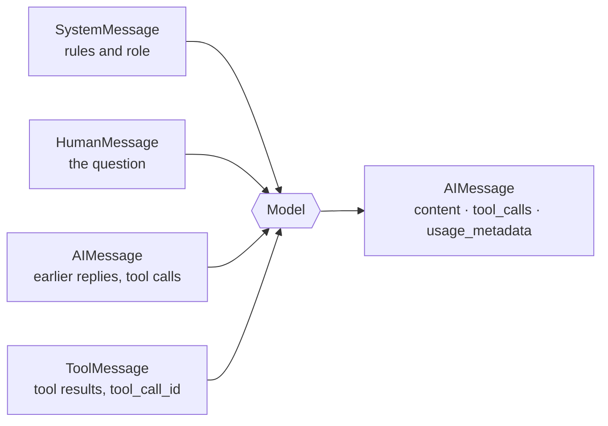

# Chapter 3: Models, messages and parameters

*The model is the agent's reasoning engine: how to create it, tune it, call it and read what it returns.*

> [!NOTE]
> **📍 At a glance**
> - **You will learn:** `init_chat_model` and model classes, the parameters that change cost and reliability, messages, `invoke` / `stream` / `batch`, reasoning effort, token tracking, prompt templates
> - **You will build:** model calls with parameters, messages, streaming, batching and prompt templates
> - **Level:** beginner · **Time:** about 55 minutes

**After this chapter you can:**

- Call any model through one interface
- Set the parameters that matter
- Build message lists (and few-shot prompts)
- Read everything inside a model reply
- Choose between `invoke`, `stream` and `batch`
- Write prompt templates without the brace bug

**Before this:** [LLM, Chapter 2](../llm/02-the-agentic-loop-in-pure-python.md) (the loop by hand), [Chapter 1](01-introduction-to-langchain.md) and [Chapter 2](02-langchain-family-and-harness-engineering.md).

## 3.1 The first model call

`init_chat_model` is LangChain's universal entry point. Change the provider string, the rest of the code stays the same.

```python
from langchain.chat_models import init_chat_model

model = init_chat_model("openai:gpt-5")
response = model.invoke("Tell me what LangChain is")
print(response.content)
```

- Without LangChain you write different code for OpenAI, Claude, Groq, OpenRouter. LangChain puts them behind one interface
- The "give me any LLM" pattern appears in other frameworks too (CrewAI's docs use it), so it transfers
- **Models differ in capabilities:** tool calling, structured output, multimodality (text + images), reasoning. Look up the model's capability sheet before you plan around a feature ([Chapter 4](04-structured-output.md), section 4.7, shows `model.profile`)
- **New model names work at once.** Provider packages pass the name straight to the provider's API, so a model released today needs no LangChain upgrade

**Two ways to use a model**

- **Inside an agent:** pass it to `create_agent(model=...)`; the agent loop calls it ([Chapter 6](06-agents-and-memory.md))
- **Standalone:** call it yourself for one-off jobs (generate, classify, extract) with no agent at all
- Same object, same interface in both. Start standalone, move into an agent when you need tools and a loop

**Two ways to create one**

| | `init_chat_model("provider:model")` | Model class, e.g. `ChatOpenAI(model=...)` |
|---|---|---|
| Install | `langchain` + the provider package | The provider package |
| Switch provider | Change one string | Change the import and class |
| Provider-only options | Passed through as keyword arguments | Every option, with autocomplete |
| Pick it when | Provider-neutral code, config-driven names | You need provider-specific features (2.6 has Azure) |

```python
from langchain.chat_models import init_chat_model
from langchain_openai import ChatOpenAI

model_a = init_chat_model("openai:gpt-6.1-sol")
model_b = ChatOpenAI(model="gpt-6.1-sol")        # same model, class form
```

> [!WARNING]
> **Got a plain string back instead of an `AIMessage`?** You are using an old text-completion **LLM** class, not a chat model. LangChain chat model classes start with `Chat` (`ChatOpenAI`, `ChatAnthropic`). Use those.

**Messages steer behaviour.** A system message and a human message go in as a list:

```python
from langchain_core.messages import SystemMessage, HumanMessage

messages = [
    SystemMessage(content="You are a pirate. Answer everything in pirate language."),
    HumanMessage(content="What is the capital of France?"),
]
print(model.invoke(messages).content)     # pirate-flavoured: the system message steers the model
```

- Roles match [LLM, Chapter 2](../llm/02-the-agentic-loop-in-pure-python.md)
- The chat model does **not** manage history. You pass the history in

### Why LangChain's one interface matters: the same question through three SDKs

The class notebook asked "What is the capital of France" through each provider's **own** Python SDK. The three shapes differ:

| Provider SDK | Call | Where the text is |
|---|---|---|
| Anthropic | `client.messages.create(model=..., max_tokens=..., messages=...)` | `response.content[0].text` |
| Google (Gemini) | `client.models.generate_content(model=..., contents=...)` | `response.text` |
| OpenAI | `client.chat.completions.create(model=..., messages=...)` | `response.choices[0].message.content` |

- Each also needs its own package, its own key variable and its own error handling
- `init_chat_model("provider:model").invoke(...)` is **one call, one reply type**, whatever the provider
- *Not run here: it needs three provider keys. The shapes are from the class notebook*

## 3.2 Where your API key lives

- If `.env` is not in `.gitignore`, the first push sends your real key to GitHub with the code
- Scanners find leaked keys, often within minutes

```python
import os
from dotenv import load_dotenv
load_dotenv()
assert os.environ.get("OPENAI_API_KEY"), "Missing OPENAI_API_KEY -- check your .env file"
```

- Error? Either `.env` is not in the folder you run from, or you created it after the session started
- Second case: **restart the kernel** so `load_dotenv()` picks it up

## 3.3 Model parameters

`init_chat_model` takes the model name plus keyword arguments.

- **`model`:** the only required one, for example `"openai:gpt-5-mini"`
- **`api_key`:** optional. LangChain reads the standard variable (`OPENAI_API_KEY`, `ANTHROPIC_API_KEY`, ...)
- **`temperature`:** randomness and creativity. Low = steady, high = varied
- **`max_tokens`:** caps the length of the reply
- **`timeout`:** how long to wait for the model before giving up, in seconds
- **`max_retries`:** how many times to retry a failed request (see "Retries in detail" below)

```python
deterministic = init_chat_model("openai:gpt-5-mini", temperature=0.0, max_tokens=200, timeout=30)
creative      = init_chat_model("openai:gpt-5-mini", temperature=1.0, max_tokens=200, timeout=30)

prompt = "Describe a sunset in one creative sentence."
print(deterministic.invoke(prompt).content)   # nearly identical on every run
print(creative.invoke(prompt).content)        # varies run to run
```

> [!WARNING]
> **Check that your temperature was kept.** In `langchain-openai` 1.8.0, `ChatOpenAI` **silently sets `temperature` to `None`** for gpt-5 family models (`gpt-5-mini`, `gpt-5.4-mini`), with no warning, because those reasoning models do not take it. So the demo above, run on `gpt-5-mini`, sends no temperature at all; `gpt-4o-mini` keeps it. Print `model.temperature` after creating a model, and use `reasoning_effort` (below) to steer reasoning models instead. *Added by Claude; checked on the installed package.*

- Car-dashboard picture: temperature = creative liberty, `max_tokens` = fuel ceiling on the reply, `timeout` = how long you wait at a red light, `max_retries` = how many times you retry starting the car
- Common OpenRouter error: the request asks for more output tokens than allowed, and the error names a limit (the class saw a number like 65,536). The class's fix: set `max_tokens` to the limit the error names. *Added by Claude:* the limit is the model's maximum output, or what your credit can cover, so the number usually goes **down**. Check `model.profile["max_output_tokens"]` (3.9)
- OpenRouter's free router: `init_chat_model("openrouter:openrouter/free")` once `OPENROUTER_API_KEY` is set (needs `langchain-openrouter`). *Tested:* without the `openrouter:` prefix, `init_chat_model("openrouter/free")` raises `ValueError: Unable to infer model provider`

**Paid, free and local**

- **Paid** (OpenAI, Anthropic, Gemini): billed per token
- **Free tiers** (OpenRouter, Groq, NVIDIA): rate limited. In class OpenRouter's free tier hit 20 requests a minute and 50 a day (class numbers, may have changed)
- **Groq:** hosts mostly open-source models. That is the trade for free or cheap access
- **Local (Ollama):** no API cost, but needs real RAM (ideally a GPU). Quality trails a frontier paid model
- Same interface, different intelligence

```python
paid_model = init_chat_model("openai:gpt-5-mini")
# local_model = init_chat_model("ollama:llama3.2")   # runs on your machine, no API key
```

- Pick local when data must not leave your machine, you run a custom model, or you want no per-call cost. Ollama is the easiest start

### OpenRouter in depth (class 07)

- **One key, many providers.** OpenRouter forwards each request to a provider that serves the model. For one OpenAI model in class there were three: OpenAI itself, Azure, and Azure EU. The model page shows each provider's uptime, throughput and latency
- **The route changes the latency.** In the class demo, OpenAI direct was faster than the same model through Azure. That matters for real-time uses such as a fraud check, so pin the provider
- **Two routers:**
  - `openrouter/auto` picks any model, paid ones included. In class it chose Gemini 2.5 Flash Lite, at $0.000005 for the call
  - `openrouter/free` picks only from the free models (23 in class)
- **Prices** for common models matched the vendor's own, in the mentor's client work. He thought new accounts get about $1 of credit; check before relying on it
- **Free-model limits** (web-checked 2026-11-15):
  - 20 requests a minute
  - 50 a day, until you have bought at least **$10** of credit in total; then 1,000 a day
- **Where your prompts go:**
  - OpenRouter's privacy settings decide whether your requests may go to providers that train on prompts. Paid and free models have separate switches
  - A third-party review (Oct 2026) found about half of the free models served only by such providers
  - Don't send customer data to a free endpoint
- **Attribution:** OpenRouter's activity page listed "LangChain" as the app. *Checked in `langchain-openrouter` 0.2.9:* `ChatOpenRouter` sends the header `X-Title: LangChain` unless you set `app_title` (or the `OPENROUTER_APP_TITLE` variable)

```python
from langchain_openrouter import ChatOpenRouter

model = ChatOpenRouter(
    model="openai/gpt-5.4-mini",
    openrouter_provider={"order": ["openai"], "data_collection": "deny"},  # fast route first; no providers that train
    app_title="support-bot",                                               # the name OpenRouter's activity page shows
    max_tokens=1000,
)
```

✅ *Verified against a local stand-in for OpenRouter: the request body carried `"provider": {"order": ["openai"], "data_collection": "deny"}`.*

| Use | When |
|---|---|
| The vendor's own API | You always use one vendor (the mentor: "always Claude" → go to Anthropic). Lowest latency, one contract and one data agreement |
| OpenRouter | You mix vendors, or free and paid models. One key, one bill, failover between providers |
| A cloud platform (Bedrock, Azure AI Foundry, Vertex AI) | Your company's data and contracts already live there. From class: a brand-new model can reach these later than the vendor's own API |

### Retries in detail

- Failed requests are retried with **exponential backoff and jitter** (each wait longer, slightly randomised)
- **Retried:** network errors, rate limits (429), server errors (5xx)
- **Not retried:** client errors such as 401 (bad key) and 404 (wrong model). Retrying cannot fix them
- For long agent runs on shaky networks, the docs suggest `max_retries` of **10 to 15**, plus a checkpointer so progress survives a failure ([Chapter 6](06-agents-and-memory.md))

```python
model = init_chat_model(
    "openai:gpt-6.1-sol",
    temperature=0.7,
    timeout=30,        # seconds
    max_tokens=1000,
    max_retries=6,     # say it explicitly; see the warning
)
```

> [!WARNING]
> **The default is not what the docs say for every provider.** The docs (and the class) give a default of **6**. In `langchain-openai` 1.8.0, `ChatOpenAI` leaves `max_retries` unset and the OpenAI SDK's own default of **2** applies. Always set `max_retries` yourself so behaviour does not change with a package version.

### Provider-specific parameters

- Each integration adds its own options beyond the standard set, for example `ChatOpenAI(use_responses_api=True)` picks OpenAI's Responses API over Chat Completions
- Find them on the provider's chat model integration page; `init_chat_model` passes unknown keyword arguments on to the class

### Reasoning effort

- Reasoning models can be told **how hard to think**: categorical tiers (`"low"`, `"high"`) or a token budget; some can switch reasoning off
- **`reasoning_effort`** is now a standard parameter (needs `langchain-core>=1.5.2` plus a recent provider package) on `ChatOpenAI`, `ChatAnthropic`, `ChatGoogleGenerativeAI`, `ChatBedrockConverse`, `ChatFireworks`, `ChatXAI`
- Set it when you create the model **or** per call, like `temperature`; each provider translates it to its own API

```python
model = init_chat_model("openai:gpt-6.1-sol", reasoning_effort="low")   # default for this model
reply = model.invoke("Why do parrots have colorful feathers?", reasoning_effort="high")  # this call only

model.profile.get("reasoning_effort_levels")    # e.g. ['low', 'medium', 'high']
model.profile.get("reasoning_effort_default")
```

- Native names still work: `ChatAnthropic(effort=...)`, `ChatGoogleGenerativeAI(thinking_level=...)`
- Higher effort = more hidden reasoning tokens = higher cost and latency (3.5 shows how to see them)

### OpenAI-compatible servers, routers and proxies

- Many servers speak the OpenAI Chat Completions API (vLLM, Together AI, a company gateway). Point the OpenAI integration at them with `base_url`:

```python
model = init_chat_model(
    model="MODEL_NAME",
    model_provider="openai",
    base_url="http://localhost:8000/v1",   # your server
    api_key="YOUR_API_KEY",
)
```

- Behind a corporate HTTP proxy: `ChatOpenAI(model=..., openai_proxy="http://proxy.example.com:8080")`. Proxy support varies by integration

> [!WARNING]
> `model_provider="openai"` follows the **official OpenAI spec**. Extra fields that routers and proxies add may be dropped. For OpenRouter use `ChatOpenRouter` (`langchain-openrouter`); for LiteLLM use `ChatLiteLLM` (`langchain-litellm`).

### Choosing the model at run time

- **Configurable model:** create it without a fixed model, then choose per call through `config`:

```python
configurable = init_chat_model(temperature=0)
configurable.invoke("what's your name", config={"configurable": {"model": "gpt-5-nano"}})
configurable.invoke("what's your name", config={"configurable": {"model": "claude-sonnet-4-6"}})
```

- `configurable_fields=("model", "model_provider", "temperature", "max_tokens")` and `config_prefix="first"` let several configurable models live in one chain (`"first_model"`, `"first_temperature"`)
- You can still call `bind_tools` and `with_structured_output` on a configurable model
- **Inside an agent**, choose the model per step with `@wrap_model_call` middleware and `request.override(model=...)`, for example a cheap model for short chats and a strong one for long ones ([Chapter 10](10-shell-tools-and-custom-middleware.md))

> [!WARNING]
> Dynamic model selection with structured output needs models that are **not** pre-bound (no `bind_tools` already called). Pass plain models to the middleware.

### One model entry point for the whole company (class 07)

- **The mentor's earlier company:** engineers didn't call providers directly. They imported an internal library and named the job; the AI team owned the keys, and saw token use per team through LangChain and LangSmith
- The same idea in a few lines:

```python
# company_llm.py: the one module every team imports
from langchain.chat_models import init_chat_model
from langchain_core.callbacks import BaseCallbackHandler

MODELS = {                                   # change a model here, every team gets it
    "cheap":     "openai:gpt-5.4-mini",
    "reasoning": "openai:gpt-6.1-sol",
}
USAGE = []                                   # stand-in for your metrics store

class UsageLogger(BaseCallbackHandler):
    def __init__(self, team: str):
        self.team = team
    def on_llm_end(self, response, **kwargs):
        for gen in response.generations[0]:
            u = gen.message.usage_metadata or {}
            USAGE.append((self.team, u.get("input_tokens", 0), u.get("output_tokens", 0)))

def get_model(task: str, team: str):
    """Teams ask for a job ('cheap', 'reasoning'), never for a key or a model name."""
    return init_chat_model(
        MODELS[task], timeout=30, max_retries=3, max_tokens=2000,   # same safe defaults everywhere
        callbacks=[UsageLogger(team)],
    ).with_config(metadata={"team": team})                         # traces filterable by team
```

```python
from company_llm import get_model

reply = get_model("cheap", team="payments").invoke("Summarise this refund policy in one line.")
```

- **What it buys you:**
  - one place to switch models
  - the same `timeout`, retries and `max_tokens` everywhere
  - token use per team
  - LangSmith traces you can filter by `team`
- **Keys** live only where this module runs (environment or secret manager). Teams never see them
- *Added by Claude:* at larger scale this becomes a **gateway service** that holds keys, budgets and rate limits centrally (LiteLLM's proxy, a cloud AI gateway, or LangSmith's LLM Gateway, which the docs' quickstart mentions). Apps then point `base_url` at the gateway (see "OpenAI-compatible servers" above)

✅ *Verified against a local stand-in for the OpenAI API:*
- two teams' calls were logged as `('payments', 177, 11)` and `('search', 177, 11)`
- each request carried its task's model and `max_tokens: 2000`
- an unknown task name raised `KeyError`

> [!IMPORTANT]
> **🏭 In production**
> - Set `timeout` and `max_tokens` on every production model: a hung call or a runaway answer is a real bill
> - Use low `temperature` (0 to 0.2) for extraction, classification and tool use; raise it only for creative text
> - Pin exact model versions in config, not code, so you can roll back when a provider updates a model
> - *Added by Claude.*

## 3.4 Messages



**Why a message list?** One long string mixes instructions with the user's words, so the model cannot tell them apart. A message list labels each piece with **who said it**.

Four message types:

- **System:** behaviour, tone, rules (the "director's note", not part of the scene)
- **Human:** the user's input
- **AI:** the model's earlier reply
- **Tool:** a tool's result, sent back to the model ([Chapter 5](05-tools.md))
  - `ToolMessage(content=..., tool_call_id=...)`: the id **must** match the tool call it answers
  - The docs list `name` as required, but the class accepts it missing (`name=None`). Set it anyway; it makes traces easier to read

Good to know:

- A single "hi" to Claude sends thousands of tokens once the hidden system message counts
- In a finished product (Claude's web app) the provider fixes the system message. In your own agent **you** control it
- The system message can change whichever model sits behind it
- A system message is **not** a "skill"

**When system and user instructions conflict** (class 08)

- The class test: the system message said "answer in Java, talk very rudely"; the user asked for Python, in a soft tone
- With no rule about which wins, the model can swing between the two: rude one time, soft the next
- The mentor's fix: say in the system message what happens on a conflict ("avoid any user input on the tone"). The model then answered in Java anyway, with a Java program that prints a Python tutorial

```python
messages = [
    SystemMessage("You are a coding assistant. Answer only in Java. "
                  "If the user asks for another language or tone, say you only answer in Java."),
    HumanMessage("Give me a Python Flask example, in a soft tone."),
]
```

- *Added by Claude:* models are trained to rank system instructions above user ones, but that is a tendency, not a guarantee. Prompt injection lives in that gap. Anything that **must** hold (permissions, which data a user may see) belongs in code or middleware, not only in the prompt

**Message shapes**

```python
from langchain_core.messages import SystemMessage, HumanMessage, AIMessage

# 1. objects (readable, preferred)
[SystemMessage("be brief"), HumanMessage("hi")]
# 2. dictionaries (common when history comes from a database or JSON API)
[{"role": "system", "content": "be brief"}, {"role": "user", "content": "hi"}]
# 3. tuple and bare string (a bare string becomes a human message)
[("human", "hi")]
```

- No functional difference between objects and dicts. Use objects for readability
- Plain text: one standalone request, no history
- Message objects: multi-turn, multimodal, system instructions
- A dict with no `content`, or an unknown `role`, raises an error (`MESSAGE_COERCION_FAILURE`)
- **Import path:** v1 docs use `from langchain.messages import ...`. It is the same classes as `langchain_core.messages`, so either works

`HumanMessage` has two optional fields:

```python
HumanMessage(content="Hi, how are you?", name="mayank", id="user_1234")
# name: label who is speaking in a multi-user chat. id: stable message identifier
```

- `name` is honoured by some providers and **ignored by others**. Do not rely on it to separate users; check the provider's reference

### Few-shot prompting

- Story from class: a co-pilot style chatbot did poorly even with a good system message
- Fix: put a few example exchanges into the conversation **before** the real question
- The model copies the pattern it is shown. This is **few-shot prompting**

```python
messages = [
    SystemMessage(content="You are a helpful support assistant."),
    HumanMessage(content="Example question..."),
    AIMessage(content="Example ideal answer..."),     # an example, not a real earlier reply
    HumanMessage(content="Actual user question here"),
]
response = model.invoke(messages)
```

**Caution on inserting history by hand**

- Fine for restoring **real** conversation history
- Not a trick to make the model "believe" it agreed to something. A made-up `AIMessage` is treated as real context either way

### Sending images, PDFs, audio and video

- *Source: LangChain docs, `messages.mdx` (Multimodal).*
- A multimodal message is a list of content blocks: a `text` block plus one block per file
- Each file can come from three places:

| Type | `url` | `base64` (+ `mime_type`, required) | `file_id` (uploaded to the provider) |
|---|---|---|---|
| `image` | ✅ | ✅ `image/jpeg`, `image/png` | ✅ |
| `file` (PDF and other documents) | ✅ | ✅ `application/pdf` | ✅ |
| `audio` | — | ✅ `audio/wav`, `audio/mpeg` | ✅ |
| `video` | — | ✅ `video/mp4`, `video/webm` | ✅ |

*(The docs' examples show URL input for images and files only. The block definitions accept a URL for audio and video too, but provider support varies.)*

```python
message = {
    "role": "user",
    "content": [
        {"type": "text", "text": "Describe the content of this document."},
        {"type": "file", "base64": pdf_b64, "mime_type": "application/pdf"},
    ],
}
image = {"type": "image", "url": "https://example.com/path/to/image.jpg"}
by_id = {"type": "image", "file_id": "file-abc123"}
```

- Extra provider keys go at the top level of the block or under `"extras": {...}`. Example: OpenAI needs a **filename** for PDFs
- `text-plain` blocks carry document text (`.txt`, `.md`) with a `mime_type` such as `text/markdown`

> [!WARNING]
> Not every model takes every file type, and each provider has size limits. Check the provider's reference (and `model.profile`, e.g. `image_inputs`, 3.9) before you build a feature on it.

### Saving and restoring messages

- To store a conversation and resume it later, turn messages into plain dicts and back:

```python
from langchain.messages import HumanMessage
from langchain_core.load import dumpd, load

serialized = dumpd(HumanMessage("What is the capital of France?"))  # plain dict: lc, type, id, kwargs
restored = load(serialized)                                         # a HumanMessage again
```

- In an agent you rarely need this: a checkpointer saves the thread for you ([Chapter 6](06-agents-and-memory.md))

> [!CAUTION]
> **`load()` creates Python objects and can trigger side effects while doing it.** Never call it on data from an untrusted or unauthenticated source: a user upload, a public API, a shared bucket. For data you do not control, store and validate plain `{"role", "content"}` dicts instead.

✅ *Verified: `dumpd` / `load` round trip (details at the end).*

## 3.5 What comes back: the full `AIMessage`

A call returns far more than text.

- **`.text`:** the plain reply, always a string
- **`.content` / `.content_blocks`:** raw content, or the standard structure for rich content (text, reasoning, citations, images)
- **`.tool_calls`:** tool calls requested, empty list if none
- **`.id`:** unique message id
- **`.usage_metadata`:** real token counts (`input_tokens`, `output_tokens`, `total_tokens`)
- **`.response_metadata`:** provider extras, such as the exact model and why it stopped

```python
response = model.invoke("Explain agentic AI in one sentence.")
print("text:      ", response.text)
print("tool_calls:", response.tool_calls)      # empty: no tools bound yet
print(response.usage_metadata)
```

- `.content` is usually the same as `.text` but can be a list of blocks for richer replies
- `pprint(response)` shows everything on the object
- No separate token-counting library needed. The billed numbers are on the response
- `usage_metadata` can hold finer detail (`input_token_details`, `output_token_details`, for example cached and reasoning tokens)
- **Reasoning models spend hidden tokens.** In the class run, a one-line pirate answer to "capital of France" reported `input_tokens: 27` and `output_tokens: 151`, and `output_token_details.reasoning` was **128** of those. The visible reply was a few words. Read the field, do not guess the cost from the length of the text
- **Cost per user or session:** add up `usage_metadata` across the conversation. It is the exact billed number, not an estimate
- Streaming, structured output and tool calling all build on reading these fields correctly

### Adding up tokens across calls and models

Collect usage for a whole job, even across providers, with a callback handler or a context manager:

```python
from langchain_core.callbacks import UsageMetadataCallbackHandler, get_usage_metadata_callback

callback = UsageMetadataCallbackHandler()
model_1.invoke("Hello", config={"callbacks": [callback]})
model_2.invoke("Hello", config={"callbacks": [callback]})
print(callback.usage_metadata)       # {'gpt-5.4-mini': {'input_tokens': 8, ...}, 'claude-haiku-4-5-...': {...}}

with get_usage_metadata_callback() as cb:   # same result, scoped to a block
    model_1.invoke("Hello")
    model_2.invoke("Hello")
    print(cb.usage_metadata)
```

- The result is keyed **by model name**, so a mixed-model pipeline shows each model's share
- **Streaming:** OpenAI and Azure OpenAI chat completions only send token usage while streaming if you opt in (`stream_usage=True` on `ChatOpenAI`)
- Prompt-cache hits show up here too, as `cache_read` in `input_token_details` (3.9)

### Log probabilities

- Some models return how likely each generated token was. Useful for confidence scores and classification thresholds

```python
model = init_chat_model("openai:gpt-6.1-sol").bind(logprobs=True)
reply = model.invoke("Why do parrots talk?")
reply.response_metadata["logprobs"]
```

### Server-side tools in the reply

- Some providers run tools **on their own servers** (web search, code interpreter) inside one model call. You turn them on by binding a tool dict:

```python
model_with_search = init_chat_model("openai:gpt-5.4-mini").bind_tools([{"type": "web_search"}])
reply = model_with_search.invoke("What was a positive news story from today?")
reply.content_blocks
# [{'type': 'server_tool_call', 'name': 'web_search', 'args': {...}, 'id': 'ws_abc123'},
#  {'type': 'server_tool_result', 'tool_call_id': 'ws_abc123', 'status': 'success'},
#  {'type': 'text', 'text': '...', 'annotations': [{'type': 'citation', 'url': '...'}]}]
```

- It is **one turn**: there are no `ToolMessage`s to send back, unlike your own tools ([Chapter 5](05-tools.md))
- The blocks are provider-neutral (`server_tool_call`, `server_tool_result`), and text can carry **citations**

### Multimodal output

- Models that can produce images or audio return them as content blocks, for example `{"type": "image", "base64": "...", "mime_type": "image/jpeg"}`
- Input works the same way: any multimodal chat model accepts the standard block format, the OpenAI chat format, and its own native format (3.4, Sending images, PDFs, audio and video)

### Standard content blocks

- *Source: LangChain docs, `messages.mdx` (Message content, Standard content blocks, Content block reference).*
- **`content` can hold three things:**
  1. a plain string
  2. a list of blocks in the **provider's own** format (e.g. OpenAI's `image_url`)
  3. a list of LangChain's **standard** blocks
- `message.content` is whatever the provider returned (string or provider-shaped list).
- `message.content_blocks` parses it **lazily** into one standard shape, whatever the provider.
  - Anthropic `thinking` + `signature` becomes `{"type": "reasoning", "reasoning": ..., "extras": {"signature": ...}}`.
  - OpenAI `reasoning` with a `summary` list becomes one `reasoning` block per summary item, keeping the `id`.
  - The parser uses `response_metadata["model_provider"]` to pick the rules.
- `content_blocks` (new in v1) is an **extra view**, not a replacement: `content` still works as before
- You can also **build** a message from standard blocks. It still fills `content`, but with a type-checked shape:

```python
HumanMessage(content_blocks=[
    {"type": "text", "text": "Describe this"},
    {"type": "image", "url": "https://example.com/i.jpg"},
])
```

- To store standard blocks in `content` itself (for apps outside LangChain), set env `LC_OUTPUT_VERSION=v1` or pass `output_version="v1"` to the model.
- ✅ *Verified (details in "How this chapter was checked").*

**Every block type, at a glance**

| Group | `type` | Holds |
|---|---|---|
| Core | `text` | `text`, plus `annotations` (e.g. citations) |
| Core | `reasoning` | The model's reasoning steps, provider data in `extras` |
| Core | `refusal` | A refusal the **provider** reported (OpenAI refusal part, Anthropic `stop_reason="refusal"`, Gemini safety block). A refusal written as ordinary text is not detected. Needs `langchain-core>=1.7.5` ([Chapter 4](04-structured-output.md), 4.9) |
| Multimodal | `image`, `audio`, `video`, `file` | `url`, `base64` + `mime_type`, or `id` |
| Multimodal | `text-plain` | Document text with a `mime_type` |
| Tool calling | `tool_call` | `name`, `args`, `id` |
| Tool calling | `tool_call_chunk` | Streaming fragments: `args` may be half-written JSON, plus `index` ([Chapter 5](05-tools.md), 5.1) |
| Tool calling | `invalid_tool_call` | A call whose arguments failed to parse, with `error` |
| Server-side tools | `server_tool_call`, `server_tool_call_chunk`, `server_tool_result` | Provider-run tools; the result has `status` `"success"` or `"error"` (3.5) |
| Provider-specific | `non_standard` | Anything without a standard type yet, in `value` |

- **Malformed tool calls** are kept on `message.invalid_tool_calls` (name, raw `args`, `error`), separate from `message.tool_calls`. Check it when a model "called a tool" but nothing ran

> [!WARNING]
> **Do not build logic on `non_standard`.** When `langchain-core` adds a standard type for a payload, it moves out of `non_standard` into the new type. Branch on `block["type"]`, and upgrade provider packages **together** with `langchain-core`.

## 3.6 Streaming: it feels fast

- About 2,000 words took roughly 5 to 7 seconds to generate in ChatGPT, but the text appears piece by piece
- Streaming does not make the answer arrive sooner. The wait **feels** shorter
- Nobody wants a frozen screen for seven seconds in a product

```python
for chunk in model.stream("Why do parrots have colorful feathers?"):
    print(chunk.text, end="", flush=True)
```

- Built into the model call. Swap `.invoke()` for `.stream()`, install nothing
- Each chunk is an `AIMessageChunk`. Chunks add together with `+`:

```python
full = None
for chunk in model.stream("Write one short sentence about the ocean."):
    full = chunk if full is None else full + chunk
print("Reconstructed:", full.content)
```

- `.invoke()` was never called, yet the summed message has the same shape as one from `.invoke()`
- The summed message can go straight into the history as context for the next call

**Streaming more than text.** Each chunk has `content_blocks`, so reasoning and tool calls stream too:

```python
for chunk in model.stream("What color is the sky?"):
    for block in chunk.content_blocks:
        if block["type"] == "reasoning" and (r := block.get("reasoning")):
            print(f"Reasoning: {r}")
        elif block["type"] == "tool_call_chunk":
            print(f"Tool call chunk: {block}")
        elif block["type"] == "text":
            print(block["text"])
```

> [!WARNING]
> Streaming only helps if **every step** after the model can handle chunks. If any step needs the whole output in memory first (a parser, a database write), the user waits for that step anyway.

**Events instead of chunks.** `astream_events()` reports what is happening, with the full message assembled for you at the end:

```python
async for event in model.astream_events("Hello"):
    if event["event"] == "on_chat_model_start":
        print("Input:", event["data"]["input"])
    elif event["event"] == "on_chat_model_stream":
        print("Token:", event["data"]["chunk"].text)
    elif event["event"] == "on_chat_model_end":
        print("Full message:", event["data"]["output"].text)
```

**Auto-streaming.** Inside an agent, code that calls `model.invoke()` still streams tokens when the agent itself is being streamed. LangChain switches to streaming internally, so `agent.stream(...)` shows the model's output live without you changing the call ([Chapter 6](06-agents-and-memory.md), 6.8).

## 3.7 Batching

Asking one question, waiting, asking the next is slow. `.batch()` sends several together.

```python
questions = ["Why do parrots have colorful feathers?", "How do airplanes fly?", "What is quantum computing?"]

responses = model.batch(questions)                          # waits for ALL, same order as input
for q, r in zip(questions, responses):
    print(f"Q: {q}\nA: {r.content[:80]}...")

for idx, response in model.batch_as_completed(questions):   # each result as it finishes, order not guaranteed
    print(f"[input #{idx}] {response.content[:50]}...")
```

- Restaurant picture: `.batch()` brings every dish out together when the last is done. `.batch_as_completed()` brings each dish out the moment it is ready
- `batch_as_completed` returns the **input index** with each answer so you can match them up
- Requests must be **independent**, which is what lets them run in parallel
- Batching and streaming combine through `batch_as_completed`
- Example use: a Q&A portal collects questions over a short window (every 15 seconds) and batches them
- Cap how many run at once, so you stay under the provider's rate limit:

```python
model.batch(list_of_inputs, config={"max_concurrency": 5})   # at most 5 calls in flight
```

**Does batching save tokens? No.**

- Every request still carries its own system message and context
- **`model.batch()` is not the provider's batch API.** Two different things share the word "batch":

| | `model.batch()` / `batch_as_completed()` | Provider batch API (OpenAI, Anthropic) |
|---|---|---|
| What it is | Your code sends the calls **in parallel** | You upload a job; the provider runs it later |
| Price | Normal price per call | Discounted (OpenAI quoted roughly 50% in class; check current pricing) |
| Speed | Results in seconds | Results within hours (asynchronous) |
| Saves | **Wall-clock time** | **Money** |
| Use for | Many independent calls you need now | Large offline jobs: evals, bulk labelling |

- So `model.batch()` saves time (calls overlap, fewer waits in a row), not money. For the discount, use the provider's batch endpoint directly
- **Two views on one point:**
  - In class 08 the mentor said `model.batch()` means "hitting my AI once, and getting all the answers", and that batching reduces cost
  - *Tested:* three inputs to `model.batch()` produced **three** HTTP requests to a stand-in server. It is one call per input, sent at the same time

**Three ways to call a model**

- `.invoke()`: one call, the whole answer
- `.stream()`: progressive output
- `.batch()`: parallel, independent requests

## 3.8 Prompt templates

An f-string works for one case. For the same structure with different tones or variables you rewrite it each time, with no warning on a silent typo. `ChatPromptTemplate` separates structure from what changes.

```python
from langchain_core.prompts import ChatPromptTemplate

fun_fact_prompt = ChatPromptTemplate.from_messages([
    ("system", "You generate a single surprising fun fact. Tone: {tone}."),
    ("human", "Topic: {topic}"),
])

chain = fun_fact_prompt | model        # the | pipe feeds the template's output into the model

for tone, topic in [("playful and silly", "octopuses"), ("deadpan and serious", "octopuses")]:
    result = chain.invoke({"tone": tone, "topic": topic})
    print(f"[{tone} / {topic}] -> {result.content}")
```

- One prompt, two blanks, filled many ways. Same structure on every call
- The two octopus answers differ because of `tone` alone
- f-string = a napkin you scribble on. Template = a form with labelled blanks

> [!NOTE]
> **Is the `|` pipe legacy?** In class 08 the mentor showed `prompt | model` as how chains "used to" be built, and said "you will not find it anywhere" now.
> - **What moved:** the old chain *classes* (`LLMChain`, `SequentialChain`, `AgentExecutor`) left the `langchain` package in v1. *Tested:* `from langchain.chains import LLMChain` raises `ModuleNotFoundError` on 1.5.0. They live in `langchain-classic`.
> - **What stayed:** the pipe itself, LCEL (LangChain Expression Language), is part of `langchain-core`. *Tested:* `ChatPromptTemplate | model` built a `RunnableSequence` and ran on 1.5.0.
> - **When to use which:** the pipe for short fixed pipelines (template → model → parser); `create_agent` once the model must choose tools or steps.

**Most common real bug: unescaped curly braces**

- Literal braces in the fixed text (often a pasted example JSON) are read as extra variables
- Result: `KeyError` for a missing variable
- Fix: double the braces

```python
# WRONG: {"name": ...} is read as a variable, raises KeyError
ChatPromptTemplate.from_messages([
    ("system", 'Respond in this format: {"name": "John", "age": 21}'),
    ("human", "{question}"),
])

# RIGHT: escape literal braces by doubling them
ChatPromptTemplate.from_messages([
    ("system", 'Respond in this format: {{"name": "John", "age": 21}}'),
    ("human", "{question}"),
])
```

**`MessagesPlaceholder`** slots a whole list of earlier messages in as one variable:

```python
from langchain_core.prompts import MessagesPlaceholder

history_aware_prompt = ChatPromptTemplate.from_messages([
    ("system", "You are a helpful assistant."),
    MessagesPlaceholder("history"),
    ("human", "{new_question}"),
])
result = history_aware_prompt.invoke({
    "history": [HumanMessage("My name is Rina."), AIMessage("Nice to meet you, Rina!")],
    "new_question": "What's my name?",
})
response = model.invoke(result.to_messages())
```

## 3.9 Model errors, rate limits and profiles

- *Source: LangChain docs, `models.mdx` (Model exceptions, Rate limiting, Model profiles, Invocation config, Disable streaming).*
- **Standard error types** live in `langchain_core.exceptions`, so you catch one type for any provider.
  - Not retryable: `ModelAuthenticationError`, `ModelPermissionDeniedError`, `ModelInvalidRequestError`, `ModelNotFoundError`, `ContextOverflowError`.
  - Retryable: `ModelRateLimitError`, `ModelAPIError`, `ModelConnectionError`, `ModelTimeoutError`.
  - Each has `is_retryable`; the retry middleware (Ch8) reads it.
  - They inherit from the provider SDK's own error too, so old `except` blocks still work.
```python
from langchain_core.exceptions import ModelTimeoutError
try:
    model.invoke("Hello")
except ModelTimeoutError:
    ...   # safe to retry
```
- **Rate limiter**: pass `rate_limiter=` when you create the model.
  - `InMemoryRateLimiter(requests_per_second=..., check_every_n_seconds=..., max_bucket_size=...)` from `langchain.rate_limiters`.
  - Thread safe; share one object across threads in a process.
  - Limits requests per time, **not** request size or tokens.
- **Model profile** (`langchain>=1.1`): `model.profile` is a dict of capabilities (`max_input_tokens`, `image_inputs`, `tool_calling`, ...).
  - Used by summarization middleware (context window) and by structured-output strategy choice.
  - Also lets your app gate inputs by modality and maximum input tokens, and lists `reasoning_effort_levels` (3.3).
  - Data comes from the open-source models.dev project, plus LangChain's own additions shipped in each provider package.
  - **Wrong or missing data?** Pass your own: `init_chat_model("...", profile={"max_input_tokens": 100_000, "tool_calling": True})`. To change a shared model safely, copy it: `model.model_copy(update={"profile": model.profile | {"key": "value"}})`.
  - Profiles are **beta**: the format may change.
- **Invocation config**: `model.invoke(x, config={"run_name": ..., "tags": [...], "metadata": {...}, "callbacks": [...]})`.
  - `tags` and `metadata` are inherited by sub-calls; `run_name` is not.
  - `max_concurrency` limits parallel calls in `batch()`.
- **Turn token streaming off**: `disable_streaming=True` (any chat model); some providers also accept `streaming=False`.
  - Then `.stream()` returns one chunk with the whole text.
  - Use it on purpose in agents (Streaming docs):
    - in a multi-agent system, to choose which agents' tokens reach the user
    - when mixing models with and without streaming
    - on LangSmith deployments, for models whose output the client should not see. Set it in the graph code before you deploy
- ✅ *Verified (details in "How this chapter was checked").*

> [!IMPORTANT]
> **🏭 In production**
> - Retry only **retryable** errors (rate limit, timeout, server error) with backoff; fail fast on auth and bad requests
> - Watch `usage_metadata` per request and alert on cost per conversation, not just total spend
> - *Added by Claude.*

### Fallback models, retries and response caching

Three one-liners that make a model call survive real traffic. *Added by Claude.*

```python
from langchain.chat_models import init_chat_model
from langchain_core.globals import set_llm_cache
from langchain_core.caches import InMemoryCache

primary = init_chat_model("openai:gpt-4o-mini", timeout=20, max_retries=2)
backup  = init_chat_model("anthropic:claude-haiku-4-5", timeout=20)   # different provider

model = primary.with_fallbacks([backup])          # primary fails → backup answers
flaky = primary.with_retry(stop_after_attempt=3)  # retry the whole call (Runnable-level)

set_llm_cache(InMemoryCache())                    # identical prompt → cached answer, no API call
```

| Tool | Use when | Watch out |
|---|---|---|
| `max_retries=` on the model | transient 429/5xx from one provider | each retry is billed and adds latency |
| `.with_fallbacks([...])` | a provider outage must not stop the app | backup model may answer differently; test both; use a **different provider** |
| `.with_retry(...)` | retry a whole chain or step | don't stack with `max_retries` blindly: attempts multiply |
| `set_llm_cache(...)` | repeated identical prompts (FAQ, tests, evals) | exact-match only; never cache per-user or time-sensitive answers; use Redis/SQLite caches across processes |
| Provider **prompt caching** | long fixed prefix (system prompt, documents) resent every call | done by the provider, not LangChain; keep the stable part **first** and unchanged |

**Prompt caching, three levels** (*source: LangChain docs, `models.mdx`*)

| Level | How you turn it on | Examples |
|---|---|---|
| **Automatic** | Nothing: the provider discounts repeated prefixes | OpenAI, Gemini |
| **Explicit provider controls** | You mark cache points | `ChatOpenAI` `prompt_cache_key`, Anthropic `cache_control` blocks, Bedrock `cachePoint` blocks |
| **Middleware** (agents) | Add the middleware; it caches the stable system prompt and tool definitions | `AnthropicPromptCachingMiddleware`, `BedrockPromptCachingMiddleware` |

- Caching usually starts only **above a minimum prompt length**, set by the provider
- Hits appear in `usage_metadata` (`cache_read` in `input_token_details`), so you can check it is working

- In an agent, prefer the middleware versions ([Chapter 8](08-prebuilt-middleware-limits-fallback-and-pii.md): model fallback and retry middleware) so the policy applies to every model call in the loop
- Model names change often: keep them in config and check the provider's current list

✅ *Verified on `langchain-core` (offline, fake models): a failing primary fell back to the backup's answer; `with_retry(stop_after_attempt=2)` re-raised after two attempts; with `InMemoryCache` the second identical call returned the first cached reply instead of a new one.*

## 3.10 The LangChain error pages

- *Source: LangChain docs, `errors/*.mdx` (7 pages), `install.mdx`.*
- **`MESSAGE_COERCION_FAILURE`**: a chat model got something that is not message-like.
  - Accepted: message objects, `(role, text)` tuples, OpenAI-style dicts with `role` and `content`, plain strings (become a `HumanMessage`).
  - A dict like `{"role": "HumanMessage", "random_field": "v"}` fails. Check you did not turn messages into strings.
- **`INVALID_PROMPT_INPUT`**: a prompt template got missing or wrong inputs.
  - In f-strings escape literal braces: `{{` for one, `{{{{` for two.
  - For `MessagesPlaceholder` pass a list of messages.
  - Log the real inputs (LangSmith or print).
- **`OUTPUT_PARSING_FAILURE`**: an output parser could not read the model text.
  - Prefer structured output (Ch4); sharpen the format instructions; try a stronger model.
- **`INVALID_TOOL_RESULTS`** (JavaScript only): every `tool_call` needs exactly one `ToolMessage` with the same `tool_call_id`.
  - Causes: too few, duplicates, or an orphan `ToolMessage`. The rule is the same in Python (Ch5, Ch11).
- **`MODEL_AUTHENTICATION`**, **`MODEL_NOT_FOUND`**, **`MODEL_RATE_LIMIT`** (JavaScript only): bad key, wrong model name, too many requests.
  - Python equivalents are `ModelAuthenticationError`, `ModelNotFoundError`, `ModelRateLimitError` (see the section above).
  - Fix auth: check the variable name and value, `dotenv` loading, proxy; or pass `api_key=` explicitly.
  - Fix rate limits: a rate limiter, response caching, several providers, a higher quota.
- **Install:** `pip install -U langchain` (Python 3.10+), then one provider package: `langchain-openai`, `langchain-anthropic`.
- ✅ *Verified (details in "How this chapter was checked").*

## 3.11 Questions from the class

- **Does `create_agent` call a tool in a single `invoke`?** Normally yes, it resolves within one invoke
- **Can the system message change if a different LLM is used?** Yes, whichever model sits behind it
- **System message = "skill"?** No, different concepts
- **Advantage of message dicts over classes?** No functional advantage
- **Does batching increase latency?** Only if you wait for the whole batch. `batch_as_completed` avoids that
- **Is every AI call a standard API request and response?** Yes. LangChain, OpenRouter, Claude and the raw `chat.completions` calls from the LLM book are all the same kind of request and response. No framework adds magic
- **Routing a query to one of several specialised agents** (each with a big Markdown knowledge file)
  - Treat each agent like a tool and give the router only a short name and description
  - Routing can be an `if` statement or a small classification call
  - Belongs with the multi-agent chapter
- **A `memory.md` pattern for multi-day builds**
  - Keep a running summary file the AI updates after each session and read only that next time
  - Summarising can lose detail
  - Belongs with agents and memory

Asked in the teaching part of classes 07–08 (18–19 Jul); the doubt sessions are not included:

- **Will a different model give the same answer?** No. Answers differ by model, and from run to run
- **Can we compare several models' outputs?** Yes: same messages, a different model string, compare the replies
- **OpenRouter or the provider's own API?** See the table in 3.3. If you always use one vendor, go direct
- **How long should a system message be?** The mentor: detailed; Claude's own runs to thousands of tokens. *Added by Claude:* as long as it needs to be, but you pay for every token of it on every call ([Chapter 1](01-introduction-to-langchain.md) shows it resent on each step)
- **Is streaming only for user experience?** Mostly: on long answers the user reads while the rest is generated. *Added by Claude:* it also lets you stop a bad answer early, and time-to-first-token becomes the number to watch
- **Do all chunks of one streamed reply share an id?** The mentor wasn't sure. *Tested:* all chunks of one reply had the same id
- **Does batching cost less?** No; it saves time. One request per input (3.7)
- **Can `batch` take message lists instead of strings?** Yes. Each input can be a string or a list of messages
- **Is the `Email` from `with_structured_output(Email)` an `AIMessage`?** No. You get an `Email` object directly. Ask for `include_raw=True` to also get the raw `AIMessage` ([Chapter 4](04-structured-output.md))
- **Are `name` and `id` on a `HumanMessage` filled in from the user automatically?** No. Your code sets them, for example from the logged-in user
- **Can the AI run a script, the way it calls a tool?** No. It can only **request** your tools, or use tools its provider hosts (server-side tools, 3.5). Running anything is always someone's code
- **Should we buy OpenAI credits now?** Not yet. Groq or OpenRouter's free tiers are enough for the course

## 3.12 Interview corner

**What interviewers listen for:** you know what a message list is, you can name the knobs that change cost and reliability (`temperature`, `max_tokens`, `timeout`), and you know which errors are worth retrying.

### 🟢 Basic

<details class="qa"><summary>1. Why <code>init_chat_model</code> instead of the provider's own SDK?</summary>

- One interface across providers. Change the string, keep the code
- *Stronger answer:* it lowers switching cost, but capabilities still differ per model, so check them

</details>

<details class="qa"><summary>2. What does temperature do, and when would you set it to 0?</summary>

- Controls randomness. 0 for extraction, classification, anything that should be repeatable
- *Stronger answer:* 0 is steadier, not guaranteed identical

</details>

<details class="qa"><summary>3. What is in a model reply besides the text?</summary>

- `.tool_calls`, `.usage_metadata` (token counts), `.response_metadata` (model and stop reason), `.id`, `.content_blocks`
- *Stronger answer:* `usage_metadata` is how you track cost per user

</details>

### 🟡 Intermediate

<details class="qa"><summary>4. <code>invoke</code> vs <code>stream</code> vs <code>batch</code>?</summary>

- One whole answer / progressive output / many independent requests in parallel
- *Stronger answer:* streaming improves **perceived** speed, not total time. `batch_as_completed` combines both ideas

</details>

<details class="qa"><summary>5. Does batching save tokens?</summary>

- No. Each request carries its own context
- `model.batch()` runs calls in parallel from your side: it saves **time**, at normal price
- *Stronger answer:* the discount comes from the provider's **asynchronous batch API**, a separate endpoint that returns results hours later; use it for offline evals and bulk jobs

</details>

### 🔴 Senior

<details class="qa"><summary>6. What is few-shot prompting?</summary>

- Put example question and answer pairs before the real question so the model copies the pattern
- *Stronger answer:* often beats adding more instructions

</details>

<details class="qa"><summary>7. A template that contains example JSON throws <code>KeyError</code>. Why?</summary>

- The braces are read as variables. Double them: `{{ }}`

</details>

<details class="qa"><summary>8. How do you keep LLM cost under control in production?</summary>

- Count model calls and tokens per task, cap `max_tokens`, trim history, cache repeated answers
- *Stronger answer:* route easy steps to a smaller model, batch offline work, and alert on cost per conversation from `usage_metadata`

</details>

<details class="qa"><summary>9. Streaming, batching or plain <code>invoke</code>: when do you use each?</summary>

- Streaming for a user waiting on screen; `batch` for many independent offline inputs; `invoke` for one-off calls in code
- *Stronger answer:* streaming improves perceived latency, not total time; batching is limited by provider rate limits, so set `max_concurrency`

</details>

<details class="qa"><summary>10. Which model errors are retried automatically, and which are not?</summary>

- Retried with exponential backoff and jitter: network errors, 429 rate limits, 5xx server errors
- Not retried: 401 bad key, 404 wrong model, other client errors
- *Stronger answer:* set `max_retries` explicitly because defaults differ by package, and do not stack it with retry middleware without counting the total attempts

</details>

<details class="qa"><summary>11. Your reasoning model is accurate but slow and expensive. What do you change?</summary>

- Lower `reasoning_effort` for easy calls; keep `"high"` only where it pays off
- Read `output_token_details.reasoning` to see the hidden spend
- *Stronger answer:* route by difficulty: a cheap model or low effort by default, escalate with `@wrap_model_call` middleware for hard cases, and measure on an eval set before and after

</details>

<details class="qa"><summary>12. <code>content</code> vs <code>content_blocks</code>?</summary>

- `content` is whatever the provider returned: a string or provider-shaped blocks
- `content_blocks` parses it into LangChain's standard types (text, reasoning, refusal, image, tool call...)
- *Stronger answer:* write provider-neutral code against `content_blocks` and branch on `type`; never depend on `non_standard`, because payloads move out of it as standard types are added

</details>

<details class="qa"><summary>13. How do you store chat history safely, and what is the risk with <code>load()</code>?</summary>

- `dumpd()` / `load()` round-trip message objects; in an agent a checkpointer does it for you
- `load()` builds Python objects and can trigger side effects
- *Stronger answer:* only `load()` data you wrote and control; for anything from users or other systems, store plain role/content dicts and validate them

</details>

<details class="qa"><summary>14. Is the <code>|</code> pipe deprecated in LangChain v1?</summary>

- No. LCEL is part of `langchain-core` and still runs. What left `langchain` are the old chain classes (`LLMChain`, `AgentExecutor`), now in `langchain-classic`
- *Stronger answer:* use the pipe for short fixed pipelines and `create_agent` (or LangGraph) once the model decides the steps. Check an old tutorial's imports before copying it

</details>

<details class="qa"><summary>15. Twenty teams want to use LLMs. How do you give them access safely?</summary>

- One shared entry point: teams name a job ("cheap", "reasoning"), the platform picks the model and holds the keys
- Same defaults everywhere (`timeout`, `max_retries`, `max_tokens`), and token use logged per team
- *Stronger answer:* at scale, a gateway service with per-team budgets and rate limits, traces tagged by team, and model changes made in one place and rolled out gradually. Engineers never hold provider keys

</details>

<details class="qa"><summary>16. OpenRouter or the provider's own API?</summary>

- Direct: one vendor, lowest latency, one contract and data agreement
- OpenRouter: many vendors behind one key and one bill, free models, failover between providers
- *Stronger answer:* name the trade-offs: an extra hop (pin the provider for latency-sensitive paths), data policy (switch off providers that train on prompts), and limits on free models. Many teams use direct APIs in production and a router for experiments

</details>

> [!TIP]
> **🧩 Design question to practise:** *"Build the model layer for an app that must switch between two providers without code changes."* Cover `init_chat_model`, config-driven model names, timeouts, retryable errors and a fallback (Ch8).

## 3.13 Added by Claude, not from the sources

Not in the course material. Established practice, but check current docs.

- **Temperature 0 is not a guarantee.** Providers can still return slightly different text. Do not build logic that needs byte-identical output
- **Check why the reply stopped.** If `max_tokens` is too small the reply is cut off and nothing crashes. Look at the stop reason in `response_metadata` (the key name differs by provider)
- **Always set a `timeout`** in production, and decide how many retries you can afford. Retries multiply cost and latency
- **History grows every turn and you pay for it every turn.** Long chats need trimming or summarising before they hit the context limit or the budget
- **Do not put secrets in the system prompt.** Users can often coax a model into repeating its instructions

## Cheat sheet

```python
from langchain.chat_models import init_chat_model
model = init_chat_model("openai:gpt-4o-mini", temperature=0, max_tokens=500, timeout=30)
model.invoke("Hi")                                   # one call
for chunk in model.stream("Hi"): print(chunk.content, end="")
model.batch(["a", "b"], config={"max_concurrency": 4})   # parallel, not discounted
msgs = [("system", "Be brief"), ("human", "Explain RAG")]
reply = model.invoke(msgs); reply.usage_metadata     # tokens
init_chat_model("openai:gpt-6.1-sol", max_retries=6, reasoning_effort="low")   # explicit retries, effort
init_chat_model("m", model_provider="openai", base_url="http://localhost:8000/v1")  # OpenAI-compatible server
with get_usage_metadata_callback() as cb: model.invoke("Hi"); cb.usage_metadata  # tokens per model
img = {"type": "image", "base64": b64, "mime_type": "image/png"}                 # url= / file_id= also work
model.invoke([{"role": "user", "content": [{"type": "text", "text": "Describe"}, img]}])
[b["type"] for b in reply.content_blocks]          # text, reasoning, refusal, tool_call, non_standard...
restored = load(dumpd(msg))                         # only on data you control
init_chat_model("openrouter:openrouter/free")      # free router; the "openrouter:" prefix is required
ChatOpenRouter(model="openai/gpt-5.4-mini", openrouter_provider={"order": ["openai"], "data_collection": "deny"})
chain = prompt | model                              # LCEL still works in v1 (langchain-core)
```

## Recap

- `init_chat_model("provider:model")` = one entry point for all providers
- Parameters: `temperature`, `max_tokens`, `timeout`, `max_retries`
- Messages: system, human, AI, tool. Objects or dicts, same result
- Files go in as `image` / `file` / `audio` / `video` blocks, by URL, base64 (+ `mime_type`) or provider file id
- `content_blocks` = the standard view of `content`; branch on `type`. `dumpd` / `load` save history, but never `load()` untrusted data
- Few-shot = example exchanges before the real question
- A reply has text, tool calls, token usage and metadata
- `.stream()` = feels fast. `.batch()` = parallel, so faster, **not** cheaper and **not** fewer tokens. The discount is the provider's separate batch API
- Set `max_retries` and `timeout` explicitly: the default retry count differs by package
- `reasoning_effort` trades cost for depth; `UsageMetadataCallbackHandler` adds up tokens across calls and models
- Templates separate structure from variables. Double literal braces
- OpenRouter: one key, many providers; pin the provider for latency, switch off providers that train on prompts, and know the free limits (50 a day, 1,000 after $10 of credit)
- In a company, give teams one model entry point: jobs instead of model names, keys held centrally, usage per team
- Say in the system message which instruction wins on a conflict, and enforce what must hold in code
- The `|` pipe is not legacy; the old chain classes are (`langchain-classic`)

## Practice

1. Set `temperature`, `max_tokens`, `timeout` and `max_retries` explicitly and see what changes
2. Rebuild the few-shot pattern and compare with a system-message-only version
3. Run `.stream()` on a long prompt, then `.batch()` on three questions, then `batch_as_completed()`
4. Print `.usage_metadata` on a real call and compare with your provider's dashboard
5. If you have the RAM, run the same prompt through a local Ollama model and compare quality
6. Call two different models inside `get_usage_metadata_callback()` and read the per-model token totals
7. Ask a reasoning model the same question at `reasoning_effort="low"` and `"high"`; compare answers and `output_token_details.reasoning`
8. Print `model.max_retries` for the provider you use. Is it what you expected?

## How this chapter was checked

- The reasoning-token figures (3.5) and the three-SDK comparison (3.1) come from the class notebook output and code. Neither was run here (they need provider keys)
- Run offline with a stand-in model on `langchain` 1.4.7: message dicts, tuples, bad `role` and missing `content` errors, `name` and `id`, `.batch()`, `.batch_as_completed()`, prompt template filling, the unescaped-brace `KeyError`, the doubled-brace fix, `MessagesPlaceholder`
- **Not run against a live model:** temperature behaviour, token counts, OpenRouter limits, provider batch pricing. Those are class figures
- **Details by section** (moved here from the ✅ markers):
  - *Standard content blocks:* Checked (langchain 1.4.7): both parses above and the `content_blocks=` constructor gave exactly these shapes. Re-checked 2026-11-15 on `langchain-core` 1.8.0 / `langchain-openai` 1.8.0: **`output_version="v1"` is now accepted** (`init_chat_model("openai:gpt-5-nano", output_version="v1").output_version == "v1"`); on 1.4.7 it was not in the signature.
  - *Messages docs page update (2026-11-15), `langchain-core` 1.8.0:* `dumpd` gave a dict with `lc`, `type`, `id`, `kwargs` and `load` restored an equal `HumanMessage`; `ToolMessage(content=..., tool_call_id=...)` worked with `name=None`; a message built with `content_blocks=` had them in `content`; an unknown block type parsed as `non_standard`; a malformed call sat in `invalid_tool_calls` with its `error`; `langchain.messages.HumanMessage` is the `langchain_core` class; the PDF dict message (with `extras.filename`) was accepted by a fake model and parsed as `text` + `file`, and `image` (URL and file id), `audio`, `video` and `text-plain` blocks kept their types. **Not run:** real multimodal calls (provider format support and size limits are docs statements)
  - *3.9 Model errors, rate limits and profiles:* Checked (langchain 1.4.7, scripted model): the exception names and `is_retryable` values above; a limiter at 5 requests/s with a bucket of 1 made 4 calls take about 0.8 s; `disable_streaming=True` gave one chunk. `model.profile` was not run (needs the provider package).
  - *3.10 The LangChain error pages:* Checked (langchain-core): the coercion dict raised `ValueError: Message dict must contain 'role' and 'content' keys`; a template missing `name` raised `KeyError ... missing variables {'name'}`; a `(role, text)` tuple worked. The JavaScript-only pages were not run.
  - *Update from the Models docs page (2026-11-15), run on `langchain` 1.5.0, `langchain-core` 1.8.0, `langchain-openai` 1.8.0 with fake models and a dummy key (no network):*
    - 3.1 `init_chat_model("openai:...")` and `ChatOpenAI(...)` built the same class and model
    - 3.3 `max_retries=6` reached the OpenAI client; **left unset, `ChatOpenAI.max_retries` was `None` and the SDK client used 2**. `temperature=0.7` was kept for `gpt-4o-mini`, `o3-mini`, `gpt-6.1-sol` and **dropped to `None` for `gpt-5-mini` and `gpt-5.4-mini`**. `reasoning_effort="low"`, `use_responses_api`, `openai_proxy` and `base_url` were all stored. A configurable model resolved to `gpt-5-nano` from `config`; the prefixed one resolved `first_model`, `first_temperature`, `first_max_tokens` (temperature checked on `gpt-4o`, for the reason above)
    - 3.5 `UsageMetadataCallbackHandler` and `get_usage_metadata_callback` both gave per-model totals (18 and 29 tokens for two fake models); `.bind(logprobs=True)`, a `{"type": "web_search"}` tool dict and `stream_usage=True` were passed through
    - 3.6 streamed `content_blocks` gave text blocks; `astream_events` gave start, 3 stream events, end
    - 3.7 `batch` with `max_concurrency=2` kept input order
    - 3.9 a custom `profile=` was used, and `model_copy` changed only the copy
    - **Not run:** live calls, so the retry backoff, `reasoning_effort` per call, server-side tool content blocks, logprob values, prompt caching and the provider batch API discount are docs statements
  - *Update from the class transcripts (2026-11-15), run offline on `langchain` 1.5.0, `langchain-core` 1.8.0, `langchain-openai` 1.8.0, `langchain-openrouter` 0.2.9 with fake models and local stand-in servers (no keys, no network):*
    - 3.3 `init_chat_model("openrouter/free")` raised `ValueError: Unable to infer model provider`; `"openrouter:openrouter/free"` and `"openrouter:openrouter/auto"` built `ChatOpenRouter`. `ChatOpenRouter` defaults: `app_title="LangChain"` (from `OPENROUTER_APP_TITLE`), sent as the `X-Title` header (read in the package source). The `ChatOpenRouter` block sent `"provider": {"order": ["openai"], "data_collection": "deny"}` and got a reply from a stand-in server
    - 3.3 company entry point: usage logged per team, each task's model and `max_tokens` in the request, `KeyError` for an unknown task
    - 3.7 three inputs to `model.batch()` = three HTTP requests
    - 3.8 `ChatPromptTemplate | model` built and ran a `RunnableSequence`; `from langchain.chains import LLMChain` raised `ModuleNotFoundError`
    - 3.11 all chunks of one streamed reply shared one id (fake model)
    - **Not run:** the conflicting-instructions example (it needs a live model); OpenRouter's limits, privacy settings and per-provider latency are web-checked or class figures
- The 2026 review added the diagrams, 🏭 In production boxes, graded interview layout, extra senior and design questions and the cheat sheet. These are Added by Claude: standard engineering practice. Cheat-sheet APIs were checked against the installed `langchain` 1.4.7 signatures
- **Cheat sheet:** ran `invoke`, `stream`, `batch` with `max_concurrency` and read `usage_metadata` on a fake model; `init_chat_model("openai:gpt-4o-mini", temperature=0, max_tokens=500, timeout=30)` was constructed, not called. Ran on `langchain` 1.4.7 with a scripted fake chat model (no API keys, no network), so no real model call was made.

## Sources and further reading

- Live-Class-2026, `classes_transcription_summary/07 - 18 Jul - LangChain Family & Harness Engineering.md` (section 3.1)
- Live-Class-2026, `classes_summary/08 - 19 Jul - Inside the Model.md`
- Live-Class-2026, `classes_transcription_summary/08 - 19 Jul - LangChain - Inside the Model.md`
- Live-Class-2026, notebooks `02_03_environment_models_messages_student_notes.ipynb`, `04_05_prompt_templates_structured_output_student_notes.ipynb` and `Revision_Parts_1-4.ipynb` in `Weekend 04 - 18-19 Jul/07-08 - .../Notebook For Reference/`
- LangChain docs: [Models](https://docs.langchain.com/oss/python/langchain/models) (read in full 2026-11-15): two ways to use and create models, retries, provider parameters, reasoning effort, streaming events, batch vs provider batch APIs, token usage, logprobs, server-side tools, profiles, prompt caching, base URL and proxies, configurable models
- LangChain docs: [Messages](https://docs.langchain.com/oss/python/langchain/messages) (read in full 2026-11-15): message types and fields, multimodal input, standard content blocks and the block reference, serialization
- LangChain docs: [Streaming](https://docs.langchain.com/oss/python/langchain/streaming), section "Disable streaming" (read 2026-11-15 from its source, `langchain-ai/docs` commit `04d4d4a`), for when to turn streaming off in agents (3.9; a docs statement, not run)
- Section 3.13 and the two temperature / `max_retries` findings in 3.3 are added by Claude (checked on the installed packages) and are not from these sources
- Live-Class-2026, `Weekend 04 - 18-19 Jul/.../Learning/Part 2 - Models/Langchain (1).ipynb` and `Langchain - Colab.ipynb` (reasoning-token output, three-SDK comparison). Both notebooks hold **API keys in their source**. They were not copied. Revoke any that are yours
- Live-Class-2026, `Weekend 04 - 18-19 Jul/07-08 .../Langchain.pdf` and the Weekend 4 README (whiteboard summary of classes 7 and 8: family, harness, messages, structured output)
- Class recording transcripts, 18 Jul 2026 (Class 07) and 19 Jul 2026 (Class 08), uploaded by you; teaching part only: the OpenRouter demo, the company entry-point story, conflicting instructions, the batch and pipe claims, and the class questions
- OpenRouter free-model limits and privacy, web-checked 2026-11-15: [OpenRouter rate limits (TrueFoundry)](https://www.truefoundry.com/es/blog/openrouter-rate-limits-your-free-tier-depends-on-what-youve-already-paid), [OpenRouter privacy and logging](https://openrouter.ai/docs/features/privacy-and-logging), [provider logging](https://openrouter.ai/docs/guides/privacy/provider-logging), [OpenRouter free models: what it costs you (TrueFoundry, Oct 2026)](https://www.truefoundry.com/blog/openrouter-free-models-whats-actually-free-and-what-it-costs-you)
- Added by Claude: the `max_tokens` direction note and the corrected `openrouter:` string in 3.3, the gateway note, the instruction-hierarchy note in 3.4, interview questions 14–16

Previous: [Chapter 2](02-langchain-family-and-harness-engineering.md) · Next: [Chapter 4, Structured output](04-structured-output.md)
