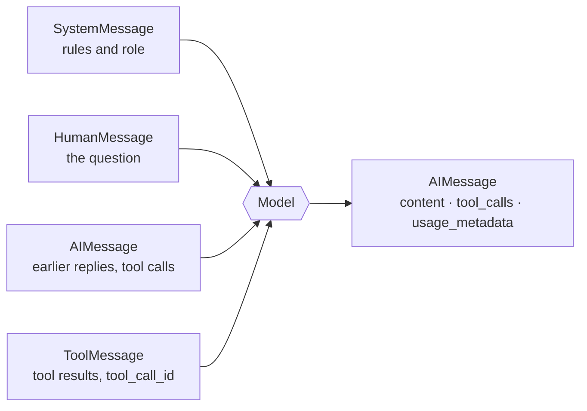

# Chapter 3: Models, messages and parameters

> [!NOTE]
> **📍 At a glance**
> - **You will build:** model calls with parameters, messages, streaming, batching and prompt templates
> - **Level:** beginner · **Time:** about 40 minutes

**After this chapter you can:**

- Call any model through one interface
- Set the parameters that matter
- Build message lists (and few-shot prompts)
- Read everything inside a model reply
- Choose between `invoke`, `stream` and `batch`
- Write prompt templates without the brace bug

**Before this:** [LLM, Chapter 2](../llm/02-the-agentic-loop-in-pure-python.md) (the loop by hand), [Chapter 1](01-introduction-to-langchain.md) and [Chapter 2](02-langchain-family-and-harness-engineering.md).

## 3.1 The first model call

`init_chat_model` is LangChain's universal entry point. Change the provider string, the rest of the code stays the same.

```python
from langchain.chat_models import init_chat_model

model = init_chat_model("openai:gpt-5")
response = model.invoke("Tell me what LangChain is")
print(response.content)
```

- Without LangChain you write different code for OpenAI, Claude, Groq, OpenRouter. LangChain puts them behind one interface
- The "give me any LLM" pattern appears in other frameworks too (CrewAI's docs use it), so it transfers
- **Models differ in capabilities:** tool calling, structured output, multimodality (text + images), reasoning. Look up the model's capability sheet before you plan around a feature ([Chapter 4](04-structured-output.md), section 4.7, shows `model.profile`)

**Messages steer behaviour.** A system message and a human message go in as a list:

```python
from langchain_core.messages import SystemMessage, HumanMessage

messages = [
    SystemMessage(content="You are a pirate. Answer everything in pirate language."),
    HumanMessage(content="What is the capital of France?"),
]
print(model.invoke(messages).content)     # pirate-flavoured: the system message steers the model
```

- Roles match [LLM, Chapter 2](../llm/02-the-agentic-loop-in-pure-python.md)
- The chat model does **not** manage history. You pass the history in

### Why LangChain's one interface matters: the same question through three SDKs

The class notebook asked "What is the capital of France" through each provider's **own** Python SDK. The three shapes differ:

| Provider SDK | Call | Where the text is |
|---|---|---|
| Anthropic | `client.messages.create(model=..., max_tokens=..., messages=...)` | `response.content[0].text` |
| Google (Gemini) | `client.models.generate_content(model=..., contents=...)` | `response.text` |
| OpenAI | `client.chat.completions.create(model=..., messages=...)` | `response.choices[0].message.content` |

- Each also needs its own package, its own key variable and its own error handling
- `init_chat_model("provider:model").invoke(...)` is **one call, one reply type**, whatever the provider
- *Not run here: it needs three provider keys. The shapes are from the class notebook*

## 3.2 Where your API key lives

- If `.env` is not in `.gitignore`, the first push sends your real key to GitHub with the code
- Scanners find leaked keys, often within minutes

```python
import os
from dotenv import load_dotenv
load_dotenv()
assert os.environ.get("OPENAI_API_KEY"), "Missing OPENAI_API_KEY -- check your .env file"
```

- Error? Either `.env` is not in the folder you run from, or you created it after the session started
- Second case: **restart the kernel** so `load_dotenv()` picks it up

## 3.3 Model parameters

`init_chat_model` takes the model name plus keyword arguments.

- **`model`:** the only required one, for example `"openai:gpt-5-mini"`
- **`api_key`:** optional. LangChain reads the standard variable (`OPENAI_API_KEY`, `ANTHROPIC_API_KEY`, ...)
- **`temperature`:** randomness and creativity. Low = steady, high = varied
- **`max_tokens`:** caps the length of the reply
- **`timeout`:** how long to wait for the model before giving up
- **`max_retries`:** how many times to retry (default 6)

```python
deterministic = init_chat_model("openai:gpt-5-mini", temperature=0.0, max_tokens=200, timeout=30)
creative      = init_chat_model("openai:gpt-5-mini", temperature=1.0, max_tokens=200, timeout=30)

prompt = "Describe a sunset in one creative sentence."
print(deterministic.invoke(prompt).content)   # nearly identical on every run
print(creative.invoke(prompt).content)        # varies run to run
```

- Car-dashboard picture: temperature = creative liberty, `max_tokens` = fuel ceiling on the reply, `timeout` = how long you wait at a red light, `max_retries` = how many times you retry starting the car
- Common OpenRouter error: reply longer than the allowed limit. Raise `max_tokens`
- OpenRouter's free router: `init_chat_model("openrouter/free")` once `OPENROUTER_API_KEY` is set

**Paid, free and local**

- **Paid** (OpenAI, Anthropic, Gemini): billed per token
- **Free tiers** (OpenRouter, Groq, NVIDIA): rate limited. In class OpenRouter's free tier hit 20 requests a minute and 50 a day (class numbers, may have changed)
- **Groq:** hosts mostly open-source models. That is the trade for free or cheap access
- **Local (Ollama):** no API cost, but needs real RAM (ideally a GPU). Quality trails a frontier paid model
- Same interface, different intelligence

```python
paid_model = init_chat_model("openai:gpt-5-mini")
# local_model = init_chat_model("ollama:llama3.2")   # runs on your machine, no API key
```

> [!IMPORTANT]
> **🏭 In production**
> - Set `timeout` and `max_tokens` on every production model: a hung call or a runaway answer is a real bill
> - Use low `temperature` (0 to 0.2) for extraction, classification and tool use; raise it only for creative text
> - Pin exact model versions in config, not code, so you can roll back when a provider updates a model
> - *Added by Claude.*

## 3.4 Messages



**Why a message list?** One long string mixes instructions with the user's words, so the model cannot tell them apart. A message list labels each piece with **who said it**.

Four message types:

- **System:** behaviour, tone, rules (the "director's note", not part of the scene)
- **Human:** the user's input
- **AI:** the model's earlier reply
- **Tool:** a tool's result, sent back to the model ([Chapter 5](05-tools.md))

Good to know:

- A single "hi" to Claude sends thousands of tokens once the hidden system message counts
- In a finished product (Claude's web app) the provider fixes the system message. In your own agent **you** control it
- The system message can change whichever model sits behind it
- A system message is **not** a "skill"

**Message shapes**

```python
from langchain_core.messages import SystemMessage, HumanMessage, AIMessage

# 1. objects (readable, preferred)
[SystemMessage("be brief"), HumanMessage("hi")]
# 2. dictionaries (common when history comes from a database or JSON API)
[{"role": "system", "content": "be brief"}, {"role": "user", "content": "hi"}]
# 3. tuple and bare string (a bare string becomes a human message)
[("human", "hi")]
```

- No functional difference between objects and dicts. Use objects for readability
- Plain text: one standalone request, no history
- Message objects: multi-turn, multimodal, system instructions
- A dict with no `content`, or an unknown `role`, raises an error (`MESSAGE_COERCION_FAILURE`)

`HumanMessage` has two optional fields:

```python
HumanMessage(content="Hi, how are you?", name="mayank", id="user_1234")
# name: label who is speaking in a multi-user chat. id: stable message identifier
```

### Few-shot prompting

- Story from class: a co-pilot style chatbot did poorly even with a good system message
- Fix: put a few example exchanges into the conversation **before** the real question
- The model copies the pattern it is shown. This is **few-shot prompting**

```python
messages = [
    SystemMessage(content="You are a helpful support assistant."),
    HumanMessage(content="Example question..."),
    AIMessage(content="Example ideal answer..."),     # an example, not a real earlier reply
    HumanMessage(content="Actual user question here"),
]
response = model.invoke(messages)
```

**Caution on inserting history by hand**

- Fine for restoring **real** conversation history
- Not a trick to make the model "believe" it agreed to something. A made-up `AIMessage` is treated as real context either way

## 3.5 What comes back: the full `AIMessage`

A call returns far more than text.

- **`.text`:** the plain reply, always a string
- **`.content` / `.content_blocks`:** raw content, or the standard structure for rich content (text, reasoning, citations, images)
- **`.tool_calls`:** tool calls requested, empty list if none
- **`.id`:** unique message id
- **`.usage_metadata`:** real token counts (`input_tokens`, `output_tokens`, `total_tokens`)
- **`.response_metadata`:** provider extras, such as the exact model and why it stopped

```python
response = model.invoke("Explain agentic AI in one sentence.")
print("text:      ", response.text)
print("tool_calls:", response.tool_calls)      # empty: no tools bound yet
print(response.usage_metadata)
```

- `.content` is usually the same as `.text` but can be a list of blocks for richer replies
- `pprint(response)` shows everything on the object
- No separate token-counting library needed. The billed numbers are on the response
- `usage_metadata` can hold finer detail (`input_token_details`, `output_token_details`, for example cached and reasoning tokens)
- **Reasoning models spend hidden tokens.** In the class run, a one-line pirate answer to "capital of France" reported `input_tokens: 27` and `output_tokens: 151`, and `output_token_details.reasoning` was **128** of those. The visible reply was a few words. Read the field, do not guess the cost from the length of the text
- **Cost per user or session:** add up `usage_metadata` across the conversation. It is the exact billed number, not an estimate
- Streaming, structured output and tool calling all build on reading these fields correctly

### Standard content blocks

- *Source: LangChain docs, `messages.mdx` (Message content, Standard content blocks).*
- `message.content` is whatever the provider returned (string or provider-shaped list).
- `message.content_blocks` parses it **lazily** into one standard shape, whatever the provider.
  - Anthropic `thinking` + `signature` becomes `{"type": "reasoning", "reasoning": ..., "extras": {"signature": ...}}`.
  - OpenAI `reasoning` with a `summary` list becomes one `reasoning` block per summary item, keeping the `id`.
  - The parser uses `response_metadata["model_provider"]` to pick the rules.
- You can also **build** a message from standard blocks:
```python
HumanMessage(content_blocks=[
    {"type": "text", "text": "Describe this"},
    {"type": "image", "url": "https://example.com/i.jpg"},
])
```
- To store standard blocks in `content` itself (for apps outside LangChain), set env `LC_OUTPUT_VERSION=v1` or pass `output_version="v1"` to the model.
- ✅ *Verified (details in "How this chapter was checked").*

## 3.6 Streaming: it feels fast

- About 2,000 words took roughly 5 to 7 seconds to generate in ChatGPT, but the text appears piece by piece
- Streaming does not make the answer arrive sooner. The wait **feels** shorter
- Nobody wants a frozen screen for seven seconds in a product

```python
for chunk in model.stream("Why do parrots have colorful feathers?"):
    print(chunk.text, end="", flush=True)
```

- Built into the model call. Swap `.invoke()` for `.stream()`, install nothing
- Each chunk is an `AIMessageChunk`. Chunks add together with `+`:

```python
full = None
for chunk in model.stream("Write one short sentence about the ocean."):
    full = chunk if full is None else full + chunk
print("Reconstructed:", full.content)
```

- `.invoke()` was never called, yet the summed message has the same shape as one from `.invoke()`

## 3.7 Batching

Asking one question, waiting, asking the next is slow. `.batch()` sends several together.

```python
questions = ["Why do parrots have colorful feathers?", "How do airplanes fly?", "What is quantum computing?"]

responses = model.batch(questions)                          # waits for ALL, same order as input
for q, r in zip(questions, responses):
    print(f"Q: {q}\nA: {r.content[:80]}...")

for idx, response in model.batch_as_completed(questions):   # each result as it finishes, order not guaranteed
    print(f"[input #{idx}] {response.content[:50]}...")
```

- Restaurant picture: `.batch()` brings every dish out together when the last is done. `.batch_as_completed()` brings each dish out the moment it is ready
- `batch_as_completed` returns the **input index** with each answer so you can match them up
- Requests must be **independent**, which is what lets them run in parallel
- Batching and streaming combine through `batch_as_completed`
- Example use: a Q&A portal collects questions over a short window (every 15 seconds) and batches them

**Does batching save tokens? No.**

- Every request still carries its own system message and context
- What it saves is **cost and time**, from two places:
  - Provider batch APIs (OpenAI's batch endpoint runs jobs asynchronously at roughly 50% lower cost, class figure, a pricing decision by the provider)
  - Fewer round trips and connections when a million calls are grouped

**Three ways to call a model**

- `.invoke()`: one call, the whole answer
- `.stream()`: progressive output
- `.batch()`: parallel, independent requests

## 3.8 Prompt templates

An f-string works for one case. For the same structure with different tones or variables you rewrite it each time, with no warning on a silent typo. `ChatPromptTemplate` separates structure from what changes.

```python
from langchain_core.prompts import ChatPromptTemplate

fun_fact_prompt = ChatPromptTemplate.from_messages([
    ("system", "You generate a single surprising fun fact. Tone: {tone}."),
    ("human", "Topic: {topic}"),
])

chain = fun_fact_prompt | model        # the | pipe feeds the template's output into the model

for tone, topic in [("playful and silly", "octopuses"), ("deadpan and serious", "octopuses")]:
    result = chain.invoke({"tone": tone, "topic": topic})
    print(f"[{tone} / {topic}] -> {result.content}")
```

- One prompt, two blanks, filled many ways. Same structure on every call
- The two octopus answers differ because of `tone` alone
- f-string = a napkin you scribble on. Template = a form with labelled blanks

**Most common real bug: unescaped curly braces**

- Literal braces in the fixed text (often a pasted example JSON) are read as extra variables
- Result: `KeyError` for a missing variable
- Fix: double the braces

```python
# WRONG: {"name": ...} is read as a variable, raises KeyError
ChatPromptTemplate.from_messages([
    ("system", 'Respond in this format: {"name": "John", "age": 21}'),
    ("human", "{question}"),
])

# RIGHT: escape literal braces by doubling them
ChatPromptTemplate.from_messages([
    ("system", 'Respond in this format: {{"name": "John", "age": 21}}'),
    ("human", "{question}"),
])
```

**`MessagesPlaceholder`** slots a whole list of earlier messages in as one variable:

```python
from langchain_core.prompts import MessagesPlaceholder

history_aware_prompt = ChatPromptTemplate.from_messages([
    ("system", "You are a helpful assistant."),
    MessagesPlaceholder("history"),
    ("human", "{new_question}"),
])
result = history_aware_prompt.invoke({
    "history": [HumanMessage("My name is Rina."), AIMessage("Nice to meet you, Rina!")],
    "new_question": "What's my name?",
})
response = model.invoke(result.to_messages())
```

## 3.9 Model errors, rate limits and profiles

- *Source: LangChain docs, `models.mdx` (Model exceptions, Rate limiting, Model profiles, Invocation config, Disable streaming).*
- **Standard error types** live in `langchain_core.exceptions`, so you catch one type for any provider.
  - Not retryable: `ModelAuthenticationError`, `ModelPermissionDeniedError`, `ModelInvalidRequestError`, `ModelNotFoundError`, `ContextOverflowError`.
  - Retryable: `ModelRateLimitError`, `ModelAPIError`, `ModelConnectionError`, `ModelTimeoutError`.
  - Each has `is_retryable`; the retry middleware (Ch8) reads it.
  - They inherit from the provider SDK's own error too, so old `except` blocks still work.
```python
from langchain_core.exceptions import ModelTimeoutError
try:
    model.invoke("Hello")
except ModelTimeoutError:
    ...   # safe to retry
```
- **Rate limiter**: pass `rate_limiter=` when you create the model.
  - `InMemoryRateLimiter(requests_per_second=..., check_every_n_seconds=..., max_bucket_size=...)` from `langchain.rate_limiters`.
  - Thread safe; share one object across threads in a process.
  - Limits requests per time, **not** request size or tokens.
- **Model profile** (`langchain>=1.1`): `model.profile` is a dict of capabilities (`max_input_tokens`, `image_inputs`, `tool_calling`, ...).
  - Used by summarization middleware (context window) and by structured-output strategy choice.
  - Data comes from the open-source models.dev project.
- **Invocation config**: `model.invoke(x, config={"run_name": ..., "tags": [...], "metadata": {...}, "callbacks": [...]})`.
  - `tags` and `metadata` are inherited by sub-calls; `run_name` is not.
  - `max_concurrency` limits parallel calls in `batch()`.
- **Turn token streaming off**: `disable_streaming=True` (any chat model); some providers also accept `streaming=False`.
  - Then `.stream()` returns one chunk with the whole text.
- ✅ *Verified (details in "How this chapter was checked").*

> [!IMPORTANT]
> **🏭 In production**
> - Retry only **retryable** errors (rate limit, timeout, server error) with backoff; fail fast on auth and bad requests
> - Watch `usage_metadata` per request and alert on cost per conversation, not just total spend
> - *Added by Claude.*

### Fallback models, retries and response caching

Three one-liners that make a model call survive real traffic. *Added by Claude.*

```python
from langchain.chat_models import init_chat_model
from langchain_core.globals import set_llm_cache
from langchain_core.caches import InMemoryCache

primary = init_chat_model("openai:gpt-4o-mini", timeout=20, max_retries=2)
backup  = init_chat_model("anthropic:claude-haiku-4-5", timeout=20)   # different provider

model = primary.with_fallbacks([backup])          # primary fails → backup answers
flaky = primary.with_retry(stop_after_attempt=3)  # retry the whole call (Runnable-level)

set_llm_cache(InMemoryCache())                    # identical prompt → cached answer, no API call
```

| Tool | Use when | Watch out |
|---|---|---|
| `max_retries=` on the model | transient 429/5xx from one provider | each retry is billed and adds latency |
| `.with_fallbacks([...])` | a provider outage must not stop the app | backup model may answer differently; test both; use a **different provider** |
| `.with_retry(...)` | retry a whole chain or step | don't stack with `max_retries` blindly: attempts multiply |
| `set_llm_cache(...)` | repeated identical prompts (FAQ, tests, evals) | exact-match only; never cache per-user or time-sensitive answers; use Redis/SQLite caches across processes |
| Provider **prompt caching** | long fixed prefix (system prompt, documents) resent every call | done by the provider, not LangChain; keep the stable part **first** and unchanged |

- In an agent, prefer the middleware versions ([Chapter 8](08-prebuilt-middleware-limits-fallback-and-pii.md): model fallback and retry middleware) so the policy applies to every model call in the loop
- Model names change often: keep them in config and check the provider's current list

✅ *Verified on `langchain-core` (offline, fake models): a failing primary fell back to the backup's answer; `with_retry(stop_after_attempt=2)` re-raised after two attempts; with `InMemoryCache` the second identical call returned the first cached reply instead of a new one.*

## 3.10 The LangChain error pages

- *Source: LangChain docs, `errors/*.mdx` (7 pages), `install.mdx`.*
- **`MESSAGE_COERCION_FAILURE`**: a chat model got something that is not message-like.
  - Accepted: message objects, `(role, text)` tuples, OpenAI-style dicts with `role` and `content`, plain strings (become a `HumanMessage`).
  - A dict like `{"role": "HumanMessage", "random_field": "v"}` fails. Check you did not turn messages into strings.
- **`INVALID_PROMPT_INPUT`**: a prompt template got missing or wrong inputs.
  - In f-strings escape literal braces: `{{` for one, `{{{{` for two.
  - For `MessagesPlaceholder` pass a list of messages.
  - Log the real inputs (LangSmith or print).
- **`OUTPUT_PARSING_FAILURE`**: an output parser could not read the model text.
  - Prefer structured output (Ch4); sharpen the format instructions; try a stronger model.
- **`INVALID_TOOL_RESULTS`** (JavaScript only): every `tool_call` needs exactly one `ToolMessage` with the same `tool_call_id`.
  - Causes: too few, duplicates, or an orphan `ToolMessage`. The rule is the same in Python (Ch5, Ch11).
- **`MODEL_AUTHENTICATION`**, **`MODEL_NOT_FOUND`**, **`MODEL_RATE_LIMIT`** (JavaScript only): bad key, wrong model name, too many requests.
  - Python equivalents are `ModelAuthenticationError`, `ModelNotFoundError`, `ModelRateLimitError` (see the section above).
  - Fix auth: check the variable name and value, `dotenv` loading, proxy; or pass `api_key=` explicitly.
  - Fix rate limits: a rate limiter, response caching, several providers, a higher quota.
- **Install:** `pip install -U langchain` (Python 3.10+), then one provider package: `langchain-openai`, `langchain-anthropic`.
- ✅ *Verified (details in "How this chapter was checked").*

## 3.11 Questions from the class

- **Does `create_agent` call a tool in a single `invoke`?** Normally yes, it resolves within one invoke
- **Can the system message change if a different LLM is used?** Yes, whichever model sits behind it
- **System message = "skill"?** No, different concepts
- **Advantage of message dicts over classes?** No functional advantage
- **Does batching increase latency?** Only if you wait for the whole batch. `batch_as_completed` avoids that
- **Is every AI call a standard API request and response?** Yes. LangChain, OpenRouter, Claude and the raw `chat.completions` calls from the LLM book are all the same kind of request and response. No framework adds magic
- **Routing a query to one of several specialised agents** (each with a big Markdown knowledge file)
  - Treat each agent like a tool and give the router only a short name and description
  - Routing can be an `if` statement or a small classification call
  - Belongs with the multi-agent chapter
- **A `memory.md` pattern for multi-day builds**
  - Keep a running summary file the AI updates after each session and read only that next time
  - Summarising can lose detail
  - Belongs with agents and memory

## 3.12 Interview corner

**What interviewers listen for:** you know what a message list is, you can name the knobs that change cost and reliability (`temperature`, `max_tokens`, `timeout`), and you know which errors are worth retrying.

### 🟢 Basic

<details class="qa"><summary>1. Why <code>init_chat_model</code> instead of the provider's own SDK?</summary>

- One interface across providers. Change the string, keep the code
- *Stronger answer:* it lowers switching cost, but capabilities still differ per model, so check them

</details>

<details class="qa"><summary>2. What does temperature do, and when would you set it to 0?</summary>

- Controls randomness. 0 for extraction, classification, anything that should be repeatable
- *Stronger answer:* 0 is steadier, not guaranteed identical

</details>

<details class="qa"><summary>3. What is in a model reply besides the text?</summary>

- `.tool_calls`, `.usage_metadata` (token counts), `.response_metadata` (model and stop reason), `.id`, `.content_blocks`
- *Stronger answer:* `usage_metadata` is how you track cost per user

</details>

### 🟡 Intermediate

<details class="qa"><summary>4. <code>invoke</code> vs <code>stream</code> vs <code>batch</code>?</summary>

- One whole answer / progressive output / many independent requests in parallel
- *Stronger answer:* streaming improves **perceived** speed, not total time. `batch_as_completed` combines both ideas

</details>

<details class="qa"><summary>5. Does batching save tokens?</summary>

- No. Each request carries its own context. It saves cost (provider batch pricing) and time (fewer round trips)

</details>

### 🔴 Senior

<details class="qa"><summary>6. What is few-shot prompting?</summary>

- Put example question and answer pairs before the real question so the model copies the pattern
- *Stronger answer:* often beats adding more instructions

</details>

<details class="qa"><summary>7. A template that contains example JSON throws <code>KeyError</code>. Why?</summary>

- The braces are read as variables. Double them: `{{ }}`

</details>

<details class="qa"><summary>8. How do you keep LLM cost under control in production?</summary>

- Count model calls and tokens per task, cap `max_tokens`, trim history, cache repeated answers
- *Stronger answer:* route easy steps to a smaller model, batch offline work, and alert on cost per conversation from `usage_metadata`

</details>

<details class="qa"><summary>9. Streaming, batching or plain <code>invoke</code>: when do you use each?</summary>

- Streaming for a user waiting on screen; `batch` for many independent offline inputs; `invoke` for one-off calls in code
- *Stronger answer:* streaming improves perceived latency, not total time; batching is limited by provider rate limits, so set `max_concurrency`

</details>

> [!TIP]
> **🧩 Design question to practise:** *"Build the model layer for an app that must switch between two providers without code changes."* Cover `init_chat_model`, config-driven model names, timeouts, retryable errors and a fallback (Ch8).

## 3.13 Added by Claude, not from the sources

Not in the course material. Established practice, but check current docs.

- **Temperature 0 is not a guarantee.** Providers can still return slightly different text. Do not build logic that needs byte-identical output
- **Check why the reply stopped.** If `max_tokens` is too small the reply is cut off and nothing crashes. Look at the stop reason in `response_metadata` (the key name differs by provider)
- **Always set a `timeout`** in production, and decide how many retries you can afford. Retries multiply cost and latency
- **History grows every turn and you pay for it every turn.** Long chats need trimming or summarising before they hit the context limit or the budget
- **Do not put secrets in the system prompt.** Users can often coax a model into repeating its instructions

## Cheat sheet

```python
from langchain.chat_models import init_chat_model
model = init_chat_model("openai:gpt-4o-mini", temperature=0, max_tokens=500, timeout=30)
model.invoke("Hi")                                   # one call
for chunk in model.stream("Hi"): print(chunk.content, end="")
model.batch(["a", "b"], config={"max_concurrency": 4})
msgs = [("system", "Be brief"), ("human", "Explain RAG")]
reply = model.invoke(msgs); reply.usage_metadata     # tokens
```

## Recap

- `init_chat_model("provider:model")` = one entry point for all providers
- Parameters: `temperature`, `max_tokens`, `timeout`, `max_retries`
- Messages: system, human, AI, tool. Objects or dicts, same result
- Few-shot = example exchanges before the real question
- A reply has text, tool calls, token usage and metadata
- `.stream()` = feels fast. `.batch()` = parallel and cheaper, **not** fewer tokens
- Templates separate structure from variables. Double literal braces

## Practice

1. Set `temperature`, `max_tokens`, `timeout` and `max_retries` explicitly and see what changes
2. Rebuild the few-shot pattern and compare with a system-message-only version
3. Run `.stream()` on a long prompt, then `.batch()` on three questions, then `batch_as_completed()`
4. Print `.usage_metadata` on a real call and compare with your provider's dashboard
5. If you have the RAM, run the same prompt through a local Ollama model and compare quality

## How this chapter was checked

- The reasoning-token figures (3.5) and the three-SDK comparison (3.1) come from the class notebook output and code. Neither was run here (they need provider keys)
- Run offline with a stand-in model on `langchain` 1.4.7: message dicts, tuples, bad `role` and missing `content` errors, `name` and `id`, `.batch()`, `.batch_as_completed()`, prompt template filling, the unescaped-brace `KeyError`, the doubled-brace fix, `MessagesPlaceholder`
- **Not run against a live model:** temperature behaviour, token counts, OpenRouter limits, provider batch pricing. Those are class figures
- **Details by section** (moved here from the ✅ markers):
  - *Standard content blocks:* Checked (langchain 1.4.7): both parses above and the `content_blocks=` constructor gave exactly these shapes. `output_version` was **not** run: it is not an argument of the installed `init_chat_model` signature, so treat it as docs-only.
  - *3.9 Model errors, rate limits and profiles:* Checked (langchain 1.4.7, scripted model): the exception names and `is_retryable` values above; a limiter at 5 requests/s with a bucket of 1 made 4 calls take about 0.8 s; `disable_streaming=True` gave one chunk. `model.profile` was not run (needs the provider package).
  - *3.10 The LangChain error pages:* Checked (langchain-core): the coercion dict raised `ValueError: Message dict must contain 'role' and 'content' keys`; a template missing `name` raised `KeyError ... missing variables {'name'}`; a `(role, text)` tuple worked. The JavaScript-only pages were not run.
- The 2026 review added the diagrams, 🏭 In production boxes, graded interview layout, extra senior and design questions and the cheat sheet. These are Added by Claude: standard engineering practice. Cheat-sheet APIs were checked against the installed `langchain` 1.4.7 signatures
- **Cheat sheet:** ran `invoke`, `stream`, `batch` with `max_concurrency` and read `usage_metadata` on a fake model; `init_chat_model("openai:gpt-4o-mini", temperature=0, max_tokens=500, timeout=30)` was constructed, not called. Ran on `langchain` 1.4.7 with a scripted fake chat model (no API keys, no network), so no real model call was made.

## Sources and further reading

- Live-Class-2026, `classes_transcription_summary/07 - 18 Jul - LangChain Family & Harness Engineering.md` (section 3.1)
- Live-Class-2026, `classes_summary/08 - 19 Jul - Inside the Model.md`
- Live-Class-2026, `classes_transcription_summary/08 - 19 Jul - LangChain - Inside the Model.md`
- Live-Class-2026, notebooks `02_03_environment_models_messages_student_notes.ipynb`, `04_05_prompt_templates_structured_output_student_notes.ipynb` and `Revision_Parts_1-4.ipynb` in `Weekend 04 - 18-19 Jul/07-08 - .../Notebook For Reference/`
- Section 3.13 is added by Claude and is not from these sources
- Live-Class-2026, `Weekend 04 - 18-19 Jul/.../Learning/Part 2 - Models/Langchain (1).ipynb` and `Langchain - Colab.ipynb` (reasoning-token output, three-SDK comparison). Both notebooks hold **API keys in their source**. They were not copied. Revoke any that are yours
- Live-Class-2026, `Weekend 04 - 18-19 Jul/07-08 .../Langchain.pdf` and the Weekend 4 README (whiteboard summary of classes 7 and 8: family, harness, messages, structured output)

Previous: [Chapter 2](02-langchain-family-and-harness-engineering.md) · Next: [Chapter 4, Structured output](04-structured-output.md)
