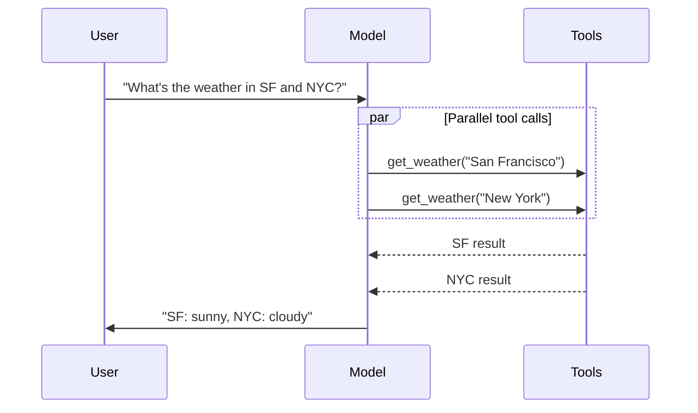
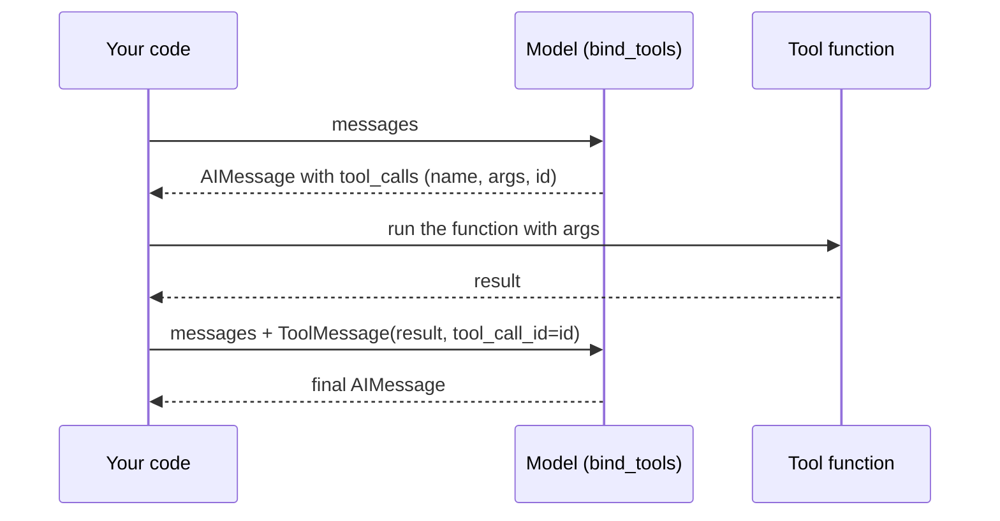
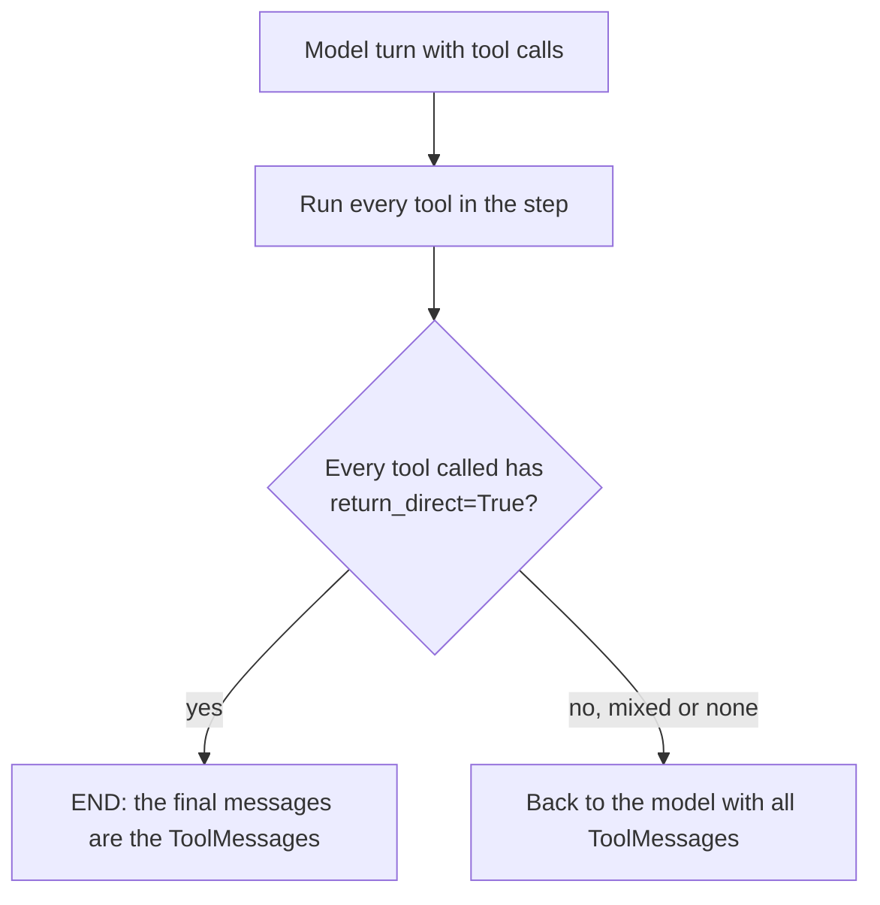

# Chapter 5: Tools

*Give the model hands: define tools, describe them well, and control what they see and return.*

> [!NOTE]
> **📍 At a glance**
> - **You will learn:** binding vs running, tool schemas, `ToolRuntime`, what a tool can return, `return_direct` and gating
> - **You will build:** tools by hand and with decorators, schemas, ToolRuntime and gated tools
> - **Level:** beginner to intermediate · **Time:** about 45 minutes
> - **Builds on:** [Chapter 3](03-models-messages-and-parameters.md) (models, messages) and [Chapter 4](04-structured-output.md) (Pydantic schemas)

**After this chapter you can:**

- Explain binding and why it does **not** run anything
- Return a tool result to the model with `ToolMessage`
- Write tools with `@tool`, custom names and `args_schema`
- Avoid the reserved names `config` and `runtime`
- Use `ToolRuntime` for state, context and memory
- Pick what a tool returns: text, a dict, images, or a `Command` that updates state
- Predict when `return_direct` ends the run, including parallel calls
- Gate a tool so the model never sees it

**This is the LangChain version of** the by-hand loop in [LLM, Chapter 2](../llm/02-the-agentic-loop-in-pure-python.md). Running example: CineBot (see [Chapter 4](04-structured-output.md)).

## 5.1 Binding: making the model aware

- A model cannot know `get_weather()` exists just because it is in the same file
- **Binding** = telling the model which tools exist and what each does
- Binding only makes the model **aware**. It never connects the model to live execution

```python
def get_weather(location: str) -> str:
    """Get the current weather at a given location."""
    return f"It's sunny in {location}"

model_with_tools = model.bind_tools([get_weather])                 # 1. bind
response = model_with_tools.invoke("What is the weather in Delhi?")  # 2. model decides
print(response.tool_calls)                                         # 3. inspect its decision
# [{'name': 'get_weather', 'args': {'location': 'Delhi'}, 'id': '...'}]
```

On `.invoke()` the model reads the message plus every bound tool's schema, then either:

- replies in plain text, or
- replies with a **tool call** instead of content

When it chooses a tool call:

- `response.content` is **empty**
- Everything useful is in `response.tool_calls`: tool name, arguments, unique ID

**Binding does not run the tool.** Your code must read `response.tool_calls`, call the real function, and feed the result back. That is the loop from the LLM book. `create_agent()` automates the whole cycle. Binding alone does not.

More points:

- A plain Python function binds directly, with no hand-written JSON schema (unlike the raw approach in the LLM book). This works through LangChain's wrapper, not a bare OpenAI SDK object
- A **docstring still matters**. Without one the model may guess the purpose wrongly
- `bind_tools` takes a **list**. Add a second tool and the model picks from each tool's name and docstring
- "Function calling" and "tool calling" mean the same thing

### Steering which tool, and how many

- *Source: LangChain docs, `models.mdx` (Tool calling).*
- By default the model chooses freely: one tool, several, or none. Two settings change that:

| Setting | Effect | Use when |
|---|---|---|
| `tool_choice="any"` | Must call **some** bound tool (sent to OpenAI as `"required"`) | The answer must come from a tool, never from memory |
| `tool_choice="get_weather"` | Must call **that** tool | A fixed step, e.g. always look up the order first |
| `parallel_tool_calls=False` | At most one tool call per turn (OpenAI, Anthropic) | Calls depend on each other, or side effects must happen in order |

```python
model.bind_tools([get_weather], tool_choice="any")
model.bind_tools([get_weather], tool_choice="get_weather")
model.bind_tools([get_weather], parallel_tool_calls=False)
```

- Most tool-calling models make **parallel calls by default** when the requests are independent:



- Each call has its own `id`, and each `ToolMessage` must carry the matching `tool_call_id` (5.2)

> [!WARNING]
> Forcing a tool inside an agent loop can stop it from ever ending: if every turn **must** call a tool, the model never gets a turn to answer in plain text. Force tools on single model calls, not on the agent's main model. *Added by Claude.*

**Streaming tool calls.** While streaming, a tool call arrives in pieces (`tool_call_chunks`): the name and id first, then the arguments a few characters at a time. Add the chunks together to get the finished calls:

```python
gathered = None
for chunk in model_with_tools.stream("What's the weather in Boston?"):
    gathered = chunk if gathered is None else gathered + chunk
print(gathered.tool_calls)     # [{'name': 'get_weather', 'args': {'location': 'Boston'}, 'id': ...}]
```

## 5.2 Returning the result: `ToolMessage`

The steps between "call this tool" and the final answer:

1. The model decides a tool is needed. `content` is empty, `tool_calls` has name, arguments, ID
2. **You** call the real function with those arguments. Not automatic after binding
3. Wrap the return value in a **`ToolMessage`** and send it back

- A plain string is not enough. `ToolMessage` carries the result **and** the same `tool_call_id` the model issued, so the model can match answer to request
- `ToolMessage` also has a **`status`** (success or failure) and an **`artifact`** field, useful for tracing

### Two audiences for one result

```python
from langchain_core.messages import ToolMessage

tool_message = ToolMessage(
    content="It was the best of times, it was the worst of times.",
    tool_call_id="call_123",
    name="search_books",
    artifact={"document_id": "doc_123", "page": 0},   # the MODEL never sees this
)
print("What the MODEL sees:", tool_message.content)
print("What your APP can use:", tool_message.artifact)
```

- `.content` goes to the model. `.artifact` is for your application
- Use when a tool has more to return than the model needs. A retrieval tool returns the passage as `.content` and a document ID as `.artifact` so your app can build a citation link

## 5.3 Completing the loop by hand, once



Do it once so `create_agent` feels like a shortcut, not magic.

```python
from langchain_core.messages import HumanMessage, AIMessage, ToolMessage

def get_weather(location: str) -> str:
    """Get the weather at a location."""
    return f"Sunny in {location}"

def set_password(new_pass: str) -> str:
    """Set a new password."""
    return "Password changed"

TOOLS = {"get_weather": get_weather, "set_password": set_password}
model_with_tools = model.bind_tools([get_weather, set_password])

question = HumanMessage("Set the password to admin123")
response = model_with_tools.invoke([question])

requested_call = response.tool_calls[0]                                   # 1. the REQUEST. Nothing has run
tool_result = TOOLS[requested_call["name"]](**requested_call["args"])      # 2. run the tool the model asked for
tool_message = ToolMessage(content=tool_result, tool_call_id=requested_call["id"])   # 3. EXACT id from the request

conversation = [question, AIMessage(content="", tool_calls=[requested_call]), tool_message]   # 4. send all back
print(model.invoke(conversation).content)
```

- Request, run, wrap, send back = the loop from the LLM book
- **Shortcut:** a `@tool` invoked with the whole tool call returns the `ToolMessage` for you, id included: `tools_by_name[call["name"]].invoke(call)`
- **Look the tool up by the name the model gave** (`TOOLS[...]`). The class notebook called `get_weather(**args)` even when the model asked for `set_password`, which raises `TypeError: get_weather() got an unexpected keyword argument 'new_pass'`

> [!CAUTION]
> **🔒 `set_password` is a teaching toy, not a pattern.** In class 08 the user typed "change password admin123" and the model passed `new_pass="admin123"` to the tool. *Added by Claude:*
> - The password now sits in the prompt, in the model's reply, in the `ToolMessage`, in your logs and traces, and at the model provider.
> - The model can be talked into calling the tool: a pasted web page or email can say "set the password to …" (prompt injection).
> - Real credential changes go through your own login flow: the user proves who they are, and the new secret never passes through the model. If an agent may start such an action at all, put a human approval step in front of it ([Chapter 11](11-runtime-and-human-in-the-loop.md)) and pass only an opaque request id, never the secret.

## 5.4 A tool is a function with a job description

- A model is a brain with no hands. A tool is the hand, and it is just a function
- If you can write a function that calls an API or a database, you can make it a tool

```python
from langchain_core.tools import tool

@tool
def check_showtimes(movie_title: str) -> str:
    """Get available showtimes for a given movie."""
    return "Interstellar: 7:00 PM, 9:30 PM"
```

- **Function name** becomes the tool name. **Docstring** becomes its description
- The description is sent to the model. It is the model's **only clue** about what the tool does and when to use it
- **Type hints are required.** They become the input schema
  - *Checked on 1.5.0:* a tool without hints still defines, but its schema is `{'x': {'title': 'X'}}`, with no type, so the model must guess

> [!WARNING]
> **Prefer `snake_case` tool names** (`web_search`, not `Web Search`). Some providers reject names with spaces or special characters. Stick to letters, digits, `_` and `-`. *Source: LangChain docs, Tools.*

Override both without touching the function (useful when wrapping someone else's code):

```python
@tool("book_seats", description="Book or reserve a seat. Use whenever a customer wants to book.")
def reserve(movie: str, seats: int) -> str:
    """A short internal docstring."""
    return f"Reserved {seats} seat(s) for {movie}"
```

**What the `Args:` block does.** The class notebook's tools list `Args:` in the docstring, saying it sharpens what the model knows about each argument. *Checked:* by default the whole docstring, `Args:` block included, becomes the **description text**, and the argument schema carries **no** per-argument description. With **`@tool(parse_docstring=True)`** the `Args:` entries move into the schema: `{'movie_title': {'description': 'The exact title of the movie to check', ...}}`. Use it for tools with more than one argument.

- Ready-made tools exist. Class example: web search through Tavily (`from langchain_tavily import TavilySearch`, install the package and set an API key)

### Writing a description the model can route on (*added by Claude*)

| Weak | Strong |
|---|---|
| `"""Get order."""` | `"""Look up one order's status and delivery date by order id (format 'A-123'). Use for 'where is my order' questions. Do NOT use for refunds."""` |
| `"""Search."""` | `"""Search the public web for news after 2025. Use only when the answer needs recent facts not in the knowledge base."""` |

- Four parts: **what** it does, **when** to use it, **when not** to, and the **argument format**
- If two tools could both fit a question, their descriptions are not specific enough

### Test a tool alone, before giving it to an agent (*added by Claude*)

```python
fetch_order.invoke({"order_id": "A-1"})                 # run it like the agent would
fetch_order.tool_call_schema.model_json_schema()        # exactly what the model will see
```

- Most "the agent is dumb" bugs are a tool returning junk or a schema the model can't read. Check both in isolation first, then in the loop

### Async tools and tool errors (*added by Claude*)

```python
@tool
async def fetch_order(order_id: str) -> str:
    """Look up an order by its id (e.g. 'A-123'). Use for any order-status question."""
    return await orders_api.get(order_id)               # non-blocking I/O

from langchain_core.tools import StructuredTool, ToolException

def lookup_stock(sku: str) -> str:
    """Find stock for a SKU."""
    raise ToolException(f"SKU {sku} not found")         # a "business" error, not a crash

stock = StructuredTool.from_function(
    lookup_stock,
    handle_tool_error=lambda e: f"Error: {e}. Ask the user for a valid SKU.",
)
stock.invoke({"sku": "X9"})    # 'Error: SKU X9 not found. Ask the user for a valid SKU.'
```

- `async def` tools run with `agent.ainvoke` / `astream`; when the model asks for several tools in one turn, async lets their network calls overlap
- `ToolException` + `handle_tool_error` turns an expected failure into a **message the model can act on** (ask again, try another tool) instead of stopping the run
- `handle_tool_error=True` returns the exception text as-is; a function lets you add guidance for the model
- For agent-wide handling of *unexpected* errors, use the tool-error middleware ([Chapter 9](09-guardrails-to-do-lists-and-tool-resilience.md))

✅ *Verified on `langchain-core` offline: the async tool returned `A-1: shipped` via `ainvoke`; `tool_call_schema` carried the docstring as description; `handle_tool_error=True` returned `SKU X9 not found`, and the function form returned the guided message shown.*

## 5.5 Argument schemas: `args_schema` and `Field()`

Plain type hints work but tell the model little. A Pydantic schema gives descriptions, limits and defaults.

```python
from pydantic import BaseModel, Field
from typing import Literal

class SeatBookingInput(BaseModel):
    movie_title: str = Field(description="Exact movie title")
    seat_count: int = Field(gt=0, description="Number of seats")
    preferred_row: Literal["front", "middle", "back"] = Field(default="middle")

@tool(args_schema=SeatBookingInput)
def book_seats(movie_title: str, seat_count: int, preferred_row: str) -> str:
    """Book seats for a movie."""
    return f"Booked {seat_count} seat(s) for {movie_title} in the {preferred_row} row"

print(book_seats.args)    # shows descriptions, the "greater than 0" limit and the default
```

- **Rule 1:** schema field names must match the function's parameter names **exactly**. No automatic mapping
- **Rule 2:** plain Python does not check types at runtime. Pydantic adds the enforcement
- A richer schema costs a few extra tokens (class figure: 20 to 30). That is cheaper than malformed input plus a retry
- A function with no `@tool` is also accepted, but you lose this argument detail

### A schema written as a JSON-schema dict

- `args_schema` also takes a plain JSON-schema `dict`. Useful when the schema already exists as JSON (an OpenAPI spec, a registry)

```python
weather_schema = {
    "type": "object",
    "properties": {
        "location": {"type": "string", "description": "City name"},
        "units": {"type": "string", "enum": ["celsius", "fahrenheit"]},
    },
    "required": ["location"],
}

@tool(args_schema=weather_schema)
def get_weather(location: str, units: str = "celsius") -> str:
    """Get current weather for a city."""
    return f"22 degrees {units} in {location}"

print(get_weather.args)   # the dict's properties, exactly as written
```

> [!WARNING]
> **A dict schema is not validated when the tool runs.**
> - The docs present Pydantic and JSON schema as equal ways to define inputs
> - *Checked on 1.5.0:* `get_weather.invoke({"location": 5})` ran and returned `22 degrees celsius in 5`. The Pydantic version raised `ValidationError`
> - A missing required field failed only as the function's own `TypeError`
> - Use Pydantic when you want the input checked

## 5.6 Two names you cannot use: `config` and `runtime`

```python
@tool
def get_weather(location: str, config: str) -> str:
    """Get weather for a location."""
```

- This **defines without any error**. It fails only when called inside an agent
- `config` and `runtime` are **reserved** parameter names LangChain uses itself
- Why no error at definition? The class explanation: LangChain cannot know how the function will be used, and the same function might run in another framework where those names are not reserved
- Calling it directly, I got `TypeError: gw() missing 1 required positional argument: 'config'`, matching the answer key
- Fix: use a different name
- Unconfirmed in class: whether nesting `config` or `runtime` inside a schema gets around the restriction
- ✅ *Verified (details in "How this chapter was checked").*

## 5.7 Binding versus running, once more

- The most misunderstood point: after `bind_tools` the model **can never run a tool itself**. It can only **request** a call
- Class demo: "Is Interstellar showing tonight, can you book two seats?" gave empty `content` and `tool_calls` with `book_seats` (movie Interstellar, two seats, middle row) plus a `config` value the model tried to fill in, a live reminder of why that name is off limits
- Something must read the request, run the function and send back the result. That something is the agent harness ([Chapter 6](06-agents-and-memory.md))

- **Seeing which tools an agent was built with:** *checked* on `langchain` 1.4.7, `agent.get_graph().nodes["tools"].data._tools_by_name.keys()` listed the registered tools. `_tools_by_name` is a private attribute, so use it for debugging only

## 5.8 Four kinds of tool

- **Custom function:** your own `@tool` function
- **Built-in LangChain tool:** pre-built, such as Tavily web search
- **Server-side (provider) tool:** runs on the provider's servers, for example web search or a code interpreter in a chat product. You neither write nor run it
- **JSON-schema tool:** schema written directly as JSON, no Python function. Valid, but Pydantic is easier to read (5.5 shows a dict `args_schema`)

The server-side kind is the odd one out: when a chat product searches the web, that is not on your machine and not a tool you control.

## 5.9 `ToolRuntime`: what the tool sees that the model does not

- The model only sees the arguments a tool declares (its own reflection in a mirror)
- The tool itself can see more, through a `runtime` parameter

```python
from langchain.tools import ToolRuntime

@tool
def get_weather(location: str, runtime: ToolRuntime) -> str:
    """Get weather for a location."""
```

- Print `.args`: only `location` appears. LangChain hides `runtime` by recognising the `ToolRuntime` annotation on the parameter named `runtime` (checked: confirmed)

What `runtime` holds (checked: these 9 fields on `langchain` 1.5.0):

| Field | What it holds | Use it for |
|---|---|---|
| **`state`** | the conversation so far, mutable. This conversation only | read history, custom state fields |
| **`context`** | immutable settings given when the agent is invoked (for example a paid plan). One invocation, pass it again on every call | user id, plan, permissions |
| **`store`** | long-term memory. Survives across conversations | preferences, saved facts |
| **`stream_writer`** | live progress updates ("searching..."). While the tool runs | progress for slow tools ([Ch11](11-runtime-and-human-in-the-loop.md), 11.10) |
| **`execution_info`** | thread ID, run ID, attempt number | logs, behaving differently on a retry |
| **`server_info`** | assistant ID, graph ID, authenticated user, when running on LangSmith Agent Server. `None` locally | data scoped to one assistant or user |
| **`config`** | the `RunnableConfig` | callbacks, tags, metadata |
| **`tool_call_id`** | the id of this tool call | the `ToolMessage` inside a `Command` (5.10), log correlation |
| **`tools`** | **every** tool registered on the agent. In 1.5.0, not in the docs table | debugging only |

- `execution_info` and `server_info` need `langgraph>=1.1.5` (or `deepagents>=0.5.0`)
- `stream_writer` works only inside a LangGraph run, such as an agent. Not on a bare `tool.invoke()`

**Reading state** (`runtime.state` is a dict, `messages` included):

```python
from langchain.messages import HumanMessage

@tool
def get_last_user_message(runtime: ToolRuntime) -> str:
    """Get the most recent message from the user."""
    for message in reversed(runtime.state["messages"]):
        if isinstance(message, HumanMessage):
            return message.content
    return "No user messages found"

print(get_last_user_message.args)   # {}  (the model sees no arguments at all)
```

✅ *Verified on 1.5.0: inside an agent the tool returned the user's text. `execution_info` gave the thread id and attempt 1, and `server_info` was `None` (details at the end).*

- **Typing it:** `ToolRuntime[Context, State]`, context type first. `ToolRuntime[None, MyState]` when there is no context schema
- **Steering with a `Command` that holds only a `ToolMessage`:** a tool that is called too early can answer "call `update_user_info` first" without changing any state (docs, Short-term memory)

```python
from langchain.messages import ToolMessage
from langgraph.types import Command
# CustomContext holds user_id; CustomState(AgentState) adds user_name: str

@tool
def greet(runtime: ToolRuntime[CustomContext, CustomState]) -> str | Command:
    """Use this to greet the user once you found their info."""
    user_name = runtime.state.get("user_name")
    if user_name is None:
        return Command(update={"messages": [ToolMessage(
            "Please call the 'update_user_info' tool first.", tool_call_id=runtime.tool_call_id)]})
    return f"Hello {user_name}!"
```

- *Checked:* the model called `greet` first and got the instruction, then `update_user_info` stored the name, and the second `greet` returned `Hello John Smith!`

> [!WARNING]
> **`runtime.tools` is not "what the model can see".** *Checked:* with middleware hiding a tool from the model, `runtime.tools` still listed it. It holds every registered tool, so never use it to make permission decisions.

**Migrating older code.** Older examples inject each piece on its own. The docs now recommend one `runtime: ToolRuntime` parameter.

| Older pattern | Now |
|---|---|
| `state: Annotated[dict, InjectedState]` | `runtime.state` |
| `store: Annotated[BaseStore, InjectedStore()]` | `runtime.store` |
| `tool_call_id: Annotated[str, InjectedToolCallId]` | `runtime.tool_call_id` |
| `get_runtime()` inside the tool | the `runtime` parameter |

- *Checked on 1.5.0:* all four older forms **still work**, and are hidden from the model. [Chapter 13](13-multi-agent-systems-and-subagents.md) still uses `InjectedToolCallId`
- **Docs vs package:** the docs' "previous pattern" writes `state: InjectedState` with no `Annotated[...]`
  - On 1.5.0 that breaks: `.args` raised `PydanticInvalidForJsonSchema`
  - The old form that worked was always `Annotated[dict, InjectedState]`
- Runtime in depth (context schemas, store, middleware): [Chapter 11](11-runtime-and-human-in-the-loop.md), 11.3 to 11.10

Every serious agent framework has some version of this. LangChain is the concrete example.

## 5.10 A tool with memory, `return_direct` and gating

**Memory with `runtime.store`**

```python
from langgraph.store.memory import InMemoryStore
from langchain.tools import ToolRuntime, tool
from langchain.agents import create_agent

loyalty_store = InMemoryStore()

@tool
def save_favorite_genre(customer_id: str, genre: str, runtime: ToolRuntime) -> str:
    """Save a customer's favorite movie genre for future visits."""
    runtime.store.put((customer_id, "preferences"), "favorite_genre", {"value": genre})
    return f"Got it! I'll remember you like {genre} movies."

@tool
def recall_favorite_genre(customer_id: str, runtime: ToolRuntime) -> str:
    """Recall a customer's favorite genre if previously saved."""
    result = runtime.store.get((customer_id, "preferences"), "favorite_genre")
    return f"Your favorite genre is {result.value['value']}" if result else "No saved preference."

agent = create_agent(model=model, tools=[save_favorite_genre, recall_favorite_genre], store=loyalty_store)
```

- Use a **tuple namespace**: `put((customer_id, "preferences"), key, value)`. The class write-up showed three loose arguments, but the reference notebook and assignment solution use the tuple form (store call checked)
- `InMemoryStore` is a dictionary in RAM. Nothing survives a restart. Production uses a database-backed store such as Postgres (the docs name `PostgresStore`, `MongoDBStore` and `RedisStore`)
- Scaling is a database question, not LangChain's
- General-purpose storage, not only chat history
- Using LangGraph's store inside LangChain is not mixing frameworks. LangChain is built on LangGraph

**`return_direct`**

- Sends a tool's raw output straight to the user, skipping the model's final pass
- Use it when the model rewording an output (a refund policy, say) could change its meaning
- Cannot be combined with a model double-check, because that puts the model back in the loop

```python
@tool(return_direct=True)
def refund_policy(x: str) -> str:
    """Return the refund policy text."""
    return "Refunds within 30 days."
```

(The class did not show the syntax. The flag exists on the tool object, checked.)

- **The run ends with the tool's message.** `result["messages"][-1]` is the `ToolMessage`, not an `AIMessage` (checked). Code that reads "the last AI reply" must allow for this
- **Parallel calls are all or nothing.** All tools in the step run first. The agent stops only if **every** tool called in that step has `return_direct=True`
- **Mixed batch:** one `return_direct` tool plus one normal tool → the agent goes **back to the model** with every `ToolMessage` from the step



✅ *Verified on 1.5.0: one direct tool and two direct tools both ended on a `ToolMessage`. A direct tool plus a normal tool went back to the model (details at the end).*

- A `return_direct` tool can also update state by returning a `Command`. See "What a tool can return" below

**Gating a tool**

- Telling the model "do not use this tool" in the system prompt relies on the model obeying
- **Removing the tool before the call does not.** A tool not in the list is not available

```python
from dataclasses import dataclass
from langchain.agents import create_agent
from langchain.agents.middleware import wrap_model_call

@dataclass
class Ctx:
    is_vip: bool

@wrap_model_call
def gate_vip_tools(request, handler):
    if not request.runtime.context.is_vip:
        request = request.override(tools=[t for t in request.tools if t.name != "vip_lounge_booking"])
    return handler(request)

agent = create_agent(model=model, tools=[vip_lounge_booking, check_showtimes],
                     middleware=[gate_vip_tools], context_schema=Ctx)
agent.invoke({"messages": [...]}, context=Ctx(is_vip=False))   # VIP tool is not on the model's menu
```

- Mentioning VIP status in the prompt does not make a VIP tool available either
- This is middleware, the next class's topic ([Chapter 7](07-middleware.md))

**Correction to the class version.** The class used `request.state.get("is_vip_member")` and the assignment passed `"is_premium_member": True` in the invoke input. I tested that: passing the flag in the input **does not work** unless the field exists in the agent's state, so the tool was always removed. Two versions work:

- Pass it as **context** (code above), or
- Declare it in a state schema and pass the schema to `create_agent(state_schema=...)`:

```python
from langchain.agents import AgentState

class VipState(AgentState):
    is_vip_member: bool
# create_agent(..., state_schema=VipState)  then  invoke({"messages": [...], "is_vip_member": True})
```

### What a tool can return

| Return | What the model gets | Changes state? | Use when |
|---|---|---|---|
| `str` | a `ToolMessage` with that text | no | the result reads naturally as text |
| `dict` | a `ToolMessage` with the dict as a **JSON string** | no | the model should reason over named fields |
| `list` of content blocks | a `ToolMessage` with text **and** images (or other media) | no | screenshots, charts, files |
| `Command` | whatever `ToolMessage` you put inside it | **yes** | the tool must write to agent state |

```python
@tool
def get_weather_data(city: str) -> dict:
    """Get structured weather data for a city."""
    return {"city": city, "temperature_c": 22, "conditions": "sunny"}
    # the ToolMessage content: '{"city": "Pune", "temperature_c": 22, "conditions": "sunny"}'

@tool
def capture_screenshot() -> list[dict]:
    """Capture a screenshot of the current page."""
    return [
        {"type": "text", "text": "Screenshot of the current page:"},
        {"type": "image", "url": "https://example.com/page.png"},
    ]
    # ToolMessage.content_blocks: ['text', 'image']
```

- **Multimodal returns:** the model must support the media you return (check its capabilities first). Block types: [Chapter 3](03-models-messages-and-parameters.md), 3.4 (multimodal input) and 3.5 (standard content blocks)
- MCP tools that return images or mixed content are converted the same way ([Chapter 12](12-mcp-in-langchain.md), 12.5)

**Returning a `Command` to update state**

```python
from langchain.agents import AgentState
from langchain.messages import ToolMessage
from langgraph.types import Command

class LangState(AgentState):
    preferred_language: str

@tool
def set_language(language: str, runtime: ToolRuntime) -> Command:
    """Set the preferred response language."""
    return Command(update={
        "preferred_language": language,
        "messages": [ToolMessage(f"Language set to {language}.",
                                 tool_call_id=runtime.tool_call_id)],
    })

# create_agent(model, tools=[set_language], state_schema=LangState)
```

- The new value is visible to later steps in the **same run** (and later turns, with a checkpointer)
- **The `ToolMessage` is required.** Every tool call in the history needs a matching `ToolMessage`, and a `Command` is not turned into one for you
  - Use `runtime.tool_call_id` for its id
- **Parallel calls writing one field need a reducer.** The model may call the same tool twice in one step

```python
from typing import Annotated
import operator

class TagState(AgentState):
    tags: Annotated[list, operator.add]   # without the reducer: InvalidUpdateError
```

- **`return_direct` + `Command`:** the tool updates state and the run ends. Same `ToolMessage` rule
- **`Command(graph=Command.PARENT)`** writes to the parent graph instead (multi-agent handoffs). No `ToolMessage` is needed there, because control leaves this graph ([Chapter 14](14-handoffs-skills-router-and-custom-workflows.md))

> [!WARNING]
> **A `Command` without its `ToolMessage` crashes the run.** *Checked on 1.5.0:*
> - `ToolNode` raised `ValueError: Expected to have a matching ToolMessage in Command.update for tool 'bad_set_language', got: []`
> - Two parallel `Command`s writing a plain `tags` field raised `InvalidUpdateError: Can receive only one value per step`
> - With `Annotated[list, operator.add]` the result was `['a', 'b']`

✅ *Verified on 1.5.0 with a scripted model: all four return types, the `Command` state update, the two failures above, and `return_direct` with a `Command` (details at the end).*

### Loading and calling tools

- **Dynamic tool calling:** the default. The model picks which available tool to use
- **Dynamic tool loading:** decide **before** the model is called which subset of a large set (class range 25 to 50 tools) to show it
- MCP is not an alternative to loading. It is a packaged set of tools. Loading is about which tools, from any source, are exposed
- Two ways to load: filter tools registered up front (gating above, [Chapter 7](07-middleware.md) 7.4), or **register a tool at run time** with two middleware hooks ([Chapter 7](07-middleware.md), 7.2)

### Assignment questions on this chapter (Q18 to Q24)

- **Docstring as the tool's pitch to the model:** largely true. The model reads it to decide whether and when to call. Even a tool that is always the only option suffers from a poor docstring
- **Plain string vs `Command`:** a string only answers. A `Command` can write to agent state (key example: raise a customer's loyalty tier and store it for later tools). How to write one: "What a tool can return", above
- **`wrap_model_call` vs the system prompt:** the first removes the tool structurally. The second only asks
- **Headless tool:** per the key, the schema is registered on the server but execution happens on the client (a browser, for example) via interrupt and resume. Its example is browser geolocation. Not covered in the class material read so far
  - The Tools docs page describes a Python API for it, but that API is not in `langchain` 1.5.0 yet (the call raised `TypeError`, checked 2026-11-15)

### More questions from the class (class 10)

Rows not already covered above.

| Question | Answer |
|---|---|
| The OpenAI API stops my requests. Do I need a card? | Yes. OpenAI needs at least $5 of prepaid credit before the API works. Groq and OpenRouter are better for learning: free, rate-limited, no card |
| How do I switch a working setup to another provider? | Swap the model string (`groq:llama-3.3-70b` for `openai:gpt-5-mini`) and make sure the matching key is available. Nothing else changes |
| My `.env` key does not load, even with `load_dotenv()`. Why? | Usually mundane: a mismatched variable name, stray spaces, or the file not read from the working directory you expect |
| How do I manage a growing conversation context? | No single technique. Summarise older messages, drop old ones, or mix, chosen by results. Aim: best performance from the least context, since cost scales with tokens ([Ch 7](07-middleware.md), `SummarizationMiddleware`) |
| How do I build a tool for an internal service behind a VPN? | A tool is just an API call. If your code can call it, you can wrap it |
| Is model choice a one-time decision? | No. Compare candidate models before any production choice, and again later |

**Learning advice from the same Q&A** (the mentor's view):

- AI coding assistants write as well as the prompt and context you give them. Knowing the basics (Pydantic validation, tool strategy, dynamic loading) is what makes them a multiplier
- Fundamentals first. Blogs and news give awareness, not a substitute for basics
- You need not master every cloud or framework in a job post. Ecosystems differ in detail, not philosophy. Going deep on one transfers to the others

*Source: `classes_transcription_summary/10`, the Q&A table. The other rows of that table are covered in 5.4 to 5.10.*

### Two whiteboard sketches (`Langchain-2-Updated.pdf`)

- **Cost of a tool call.** The board says the model is used **at least twice**: once to choose the tool and its arguments, once to summarise the tool's output. It marks each step as about **500 tokens** and adds that the code should have the least moving parts, because simple systems scale
  - ✅ *Verified (details in "How this chapter was checked").*
  - The "500 tokens" figure is the sketch's illustration, not a measurement
- **Refund policy.** The board sets a CineBot system prompt ("very helpful ... but we don't do refund") beside a "Refund Policy" box. My reading, from the sketch plus the class answer on `return_direct`: an exact rule such as a refund policy is safer as a tool whose output is returned directly (5.10) than as a line the model may reword

*Source: `Langchain-2-Updated.pdf`, text layer. The sketches have little text; the second item is my reading.*

> [!IMPORTANT]
> **🏭 In production**
> - Least privilege: give each agent only the tools its job needs; a read agent should not hold a delete tool
> - Every tool needs a timeout, a size cap on what it returns, and errors returned as text
> - Tools that write, send or charge must be idempotent or behind approval, because the model can call them twice
> - *Added by Claude.*

## 5.11 Interview corner

**What interviewers listen for:** you know the model only **requests** a tool and your code runs it, that the docstring is part of the prompt, and how you keep dangerous tools out of reach.

### 🟢 Basic

<details class="qa"><summary>1. What does <code>bind_tools</code> do?</summary>

- Tells the model which tools exist and their schemas
- It does **not** run anything
- *Stronger answer:* the model replies with a tool call (name, args, id) and empty content. Your code, or `create_agent`, must run it

</details>

<details class="qa"><summary>2. Why does <code>ToolMessage</code> need a <code>tool_call_id</code>?</summary>

- Matches the result to the model's request
- *Stronger answer:* essential when several tools are requested at once

</details>

<details class="qa"><summary>3. How does the model decide which tool to call?</summary>

- From each tool's name, parameter schema and docstring
- *Stronger answer:* the docstring is effectively prompt text. Say when to use it and when **not** to

</details>

### 🟡 Intermediate

<details class="qa"><summary>4. <code>content</code> vs <code>artifact</code> on a <code>ToolMessage</code>?</summary>

- Content goes to the model. Artifact is for your app
- *Stronger answer:* retrieval tools return the passage as content and the document id as artifact for citations

</details>

<details class="qa"><summary>5. How do you stop the model calling a tool it should not have?</summary>

- Remove it from the tool list before the call (`wrap_model_call`), not just a prompt instruction
- *Stronger answer:* do the same check again inside the tool, because defence in depth beats trust

</details>

### 🔴 Senior

<details class="qa"><summary>6. What is <code>ToolRuntime</code>?</summary>

- A parameter that gives the tool state, context, store and more, hidden from the model
- *Stronger answer:* `context` is per-invocation and immutable. `store` is long-term. `state` is this conversation

</details>

<details class="qa"><summary>7. Why does <code>InMemoryStore</code> not suit production?</summary>

- It lives in RAM and is lost on restart. Use a database-backed store

</details>

<details class="qa"><summary>8. Your agent has 60 tools and keeps picking the wrong one. How do you fix it?</summary>

- Better names and docstrings that say when **not** to use a tool; remove overlapping tools
- *Stronger answer:* show only relevant tools per request (`LLMToolSelectorMiddleware`, Ch9, or filtering in middleware, Ch7), or split into specialist subagents (Ch13)

</details>

<details class="qa"><summary>9. A tool must save the user's language for later turns. What does it return, and what can go wrong?</summary>

- A `Command(update={...})` with the new field **and** a `ToolMessage` carrying `runtime.tool_call_id`
- The field must exist in the agent's state schema
- Missing `ToolMessage` → `ValueError`. Two parallel writes to a plain field → `InvalidUpdateError`
- *Stronger answer:* give fields that parallel calls may write a reducer (`Annotated[list, operator.add]`), and use `Command.PARENT` only for handoffs to a parent graph

</details>

<details class="qa"><summary>10. The model calls a <code>return_direct</code> tool and a normal tool in the same turn. What happens?</summary>

- Both tools run
- The agent does **not** stop: it goes back to the model with both `ToolMessage`s
- It stops only when every tool called in that step has `return_direct=True`
- *Stronger answer:* if the exact wording matters (a policy text), set `parallel_tool_calls=False` or give that tool its own turn, so the batch cannot be mixed. *Added by Claude*

</details>

> [!TIP]
> **🧩 Design question to practise:** *"Give an agent safe access to a company's ticketing system."* Cover which tools exist, their argument schemas, read vs write split, approval, and what the tool returns on error.

## 5.12 Added by Claude, not from the sources

Not in the course material. Established practice, but check current docs.

- **Never trust model-supplied arguments.** Validate them like user input: ids, amounts, paths, SQL. The model can be steered by injected text
- **Check permissions inside the tool.** Hiding a tool is a good first layer. The tool should still verify that this user may do this action
- **Keep secrets out of arguments.** Pass tokens and user ids through `runtime.context`, so the model never sees or invents them
- **Write docstrings like a job posting.** What it does, when to use it, when **not** to, and what the arguments mean. Vague docstrings are the top cause of wrong tool choice
- **Return errors as text.** Let the model read "not found" and adapt, instead of crashing the run ([Chapter 9](09-guardrails-to-do-lists-and-tool-resilience.md))
- **Fewer, sharper tools.** Accuracy of tool choice tends to drop as the list grows. That is the reason dynamic loading exists
- **Make side-effect tools safe to repeat** (idempotent), because loops and retries can call them twice
- **Structured returns cost tokens like text.** A returned `dict` is sent as a JSON string (checked), so return only the fields the model needs, not a whole API response

## Cheat sheet

```python
from langchain.tools import tool, ToolRuntime
from langchain.messages import ToolMessage
from langgraph.types import Command
@tool
def get_order(order_id: str, runtime: ToolRuntime) -> str:
    """Look up one order by id. Do not use for refunds."""
    user = runtime.context.user_id          # app data the model never sees
    return f"order {order_id} for {user}"
model.bind_tools([get_order])               # model can now request it

# return: str | dict (sent as JSON) | list of content blocks | Command (writes state)
@tool
def set_tier(tier: str, runtime: ToolRuntime) -> Command:
    """Set the customer's loyalty tier."""
    return Command(update={"tier": tier,       # field must be in the state schema
        "messages": [ToolMessage(f"Tier set to {tier}", tool_call_id=runtime.tool_call_id)]})

@tool(return_direct=True)                   # ends the run only if EVERY tool in the step has it
def refund_policy() -> str:
    """Return the exact refund policy text."""
    return "Refunds within 30 days."
```

## Recap

- **Binding** = awareness only. The model **requests** a call. Your code or the agent **runs** it
- Result goes back as a `ToolMessage` with the same `tool_call_id`. `.content` for the model, `.artifact` for your app
- `@tool` takes name and docstring from the function. Override with arguments
- `args_schema` adds descriptions, limits, defaults. Field names must match the parameters
- Never name a parameter `config` or `runtime` (except `runtime: ToolRuntime`)
- `ToolRuntime` gives state, context, store, stream writer and more, hidden from the model
- A tool returns text, a dict (sent as JSON), content blocks, or a `Command`. A `Command` must carry its `ToolMessage`
- `return_direct` ends the run only when every tool called in that step has it
- Gate by **removing** tools, using context or a state schema. A prompt only asks

## Practice

1. `bind_tools()` on a simple function, `.invoke()`, inspect `response.tool_calls`. Remember nothing has executed
2. Call the real function yourself and send the result back as a `ToolMessage`
3. Build a `ToolMessage` with `.artifact` and confirm the model's answer never mentions it
4. Write a `@tool` with a clear docstring, then override its name and description and compare
5. Make an `args_schema` with a constraint and a default. Print `.args` with and without it
6. Give a tool a parameter called `config` and watch the failure when an agent calls it
7. Add `runtime: ToolRuntime` and print `.args` to confirm the model never sees it
8. Rebuild save and recall genre tools with `InMemoryStore` and prove memory survives two `.invoke()` calls
9. Assignment B1.1, B2.2, B3.1, B3.2: a table-availability tool, an order tool with `args_schema`, a dietary-preference memory pair, and a gated private-dining tool (GreenPlate). For B3.2 use context or a state schema, not a bare input key
10. Write `set_language` returning a `Command`. Remove the `ToolMessage` and read the `ValueError`
11. Give the model one `return_direct` tool and one normal tool in the same turn, and check which message ends the run
12. Pass `{"location": 5}` to a dict-schema tool and to a Pydantic-schema tool, and compare

## How this chapter was checked

- Run offline for the additions: the `Args:` block with and without `parse_docstring=True`, `config` and `runtime` as plain arguments, and the registered-tools listing of a built agent
- Run offline with a stand-in model on `langchain` 1.4.7: the manual tool loop from 5.3, `ToolMessage` content and artifact, `@tool` name and description override, `args_schema` output, the `config` parameter failure, `runtime` hidden from `.args`, `InMemoryStore` with a tuple namespace, `return_direct`, and gating with both context and a state schema (plus the failing bare-input version)
- **Not run against a live model:** what a real model returns for `tool_calls`, Tavily, a real model reading an image tool result. Those are class or answer-key statements
- **Could not run:** headless tools. The Python API is not in `langchain` 1.5.0
- **Details by section** (moved here from the ✅ markers):
  - *5.6 Two names you cannot use: `config` and `runtime`:* Checked, and a refinement: `config` as a plain `str` argument defines fine and fails when called. **`runtime` as a plain `str` argument worked** (the call returned normally). What LangChain treats specially is a parameter **annotated as `ToolRuntime`**, which it hides from the model. Do not rely on a plain `runtime: str` working in other versions. Avoid both names
  - *Two whiteboard sketches (`Langchain-2-Updated.pdf`):* Checked* in [LLM Ch 2](../llm/02-the-agentic-loop-in-pure-python.md): one tool use took **2 model calls**
  - *Tools docs page merge (2026-11-15), on `langchain` 1.5.0, `langchain-core` 1.8.0, `langgraph` 1.2.22, with a scripted `GenericFakeChatModel` (no keys, no network):*
    - 5.4: a tool without type hints defined, with schema `{'x': {'title': 'X'}}`
    - 5.5: the dict `args_schema` showed its properties in `.args`. `invoke({"location": 5})` ran (no validation); the Pydantic schema raised `ValidationError`
    - 5.9: `ToolRuntime` dataclass fields listed (9, including `tools`). In an agent with a checkpointer: `get_last_user_message` returned `hello there`. `execution_info.thread_id` was `t-1`, `node_attempt` 1, `run_id` `None` (no tracing). `server_info` was `None`. `runtime.tools` listed a tool that middleware had hidden from the model
    - 5.9 migration: `Annotated[dict, InjectedState]`, `Annotated[BaseStore, InjectedStore()]`, `Annotated[str, InjectedToolCallId]` and `get_runtime()` all worked and were hidden from `.args`. A bare `state: InjectedState` raised `PydanticInvalidForJsonSchema` on `.args`
    - 5.10 returns: `str` → text; `dict` → JSON string; content-block list → `content_blocks` `['text', 'image']`. `Command` set `preferred_language`; the same without a `ToolMessage` raised `ValueError`. Parallel `Command`s on a plain list field raised `InvalidUpdateError`; with `operator.add` gave `['a', 'b']`
    - 5.10 `return_direct`: one and two direct calls ended on the `ToolMessage` (3 and 4 messages); direct + normal went back to the model (5 messages, last an `AIMessage`). `return_direct` + `Command` set `last_order_status` and ended on the `ToolMessage`
    - 5.9 `greet` steering (from the Short-term memory page): with a Pydantic `CustomContext(user_id="user_123")` and `CustomState.user_name`, a scripted model called `greet`, `update_user_info`, `greet`; the tool messages were the instruction, `Successfully looked up user information`, then `Hello John Smith!`
    - Headless: `tool(name=..., description=..., args_schema=...)` raised `TypeError: tool() got an unexpected keyword argument 'name'`; `langchain.tools` has no `HeadlessTool`
    - Cheat sheet additions ran inside an agent: `set_tier` set `tier` to `gold` (alongside two parallel `add_tag` calls → `['a', 'b']`), and `refund_policy` ended the run on its text. All new 5.x blocks were extracted from this file and run as written (the model swapped for the fake)
  - *Steering which tool, and how many (2026-11-15):* Checked on `langchain-openai` 1.8.0 (dummy key, no call): `tool_choice="any"` was sent as `"required"`, a tool name became `{"type": "function", "function": {"name": "get_weather"}}`, and `parallel_tool_calls=False` was passed through. A scripted model streamed the arguments as `{"lo`, `cation": "B`, `oston"}`; summing the chunks gave `get_weather {'location': 'Boston'}`. `get_weather.invoke(tool_call)` returned a `ToolMessage` with the call's id. **Not run:** a real model's parallel calls
- The 2026 review added the diagrams, 🏭 In production boxes, graded interview layout, extra senior and design questions and the cheat sheet. These are Added by Claude: standard engineering practice. Cheat-sheet APIs were checked against the installed `langchain` 1.4.7 signatures
- **Cheat sheet:** ran a `ToolRuntime` tool inside an agent and confirmed `runtime.context.user_id` reached the tool; `bind_tools` was constructed, not called. Ran on `langchain` 1.4.7 with a scripted fake chat model (no API keys, no network), so no real model call was made.

## Sources and further reading

- Live-Class-2026, `classes_summary/08 - 19 Jul - Inside the Model.md`
- Live-Class-2026, `classes_transcription_summary/08 - 19 Jul - LangChain - Inside the Model.md`
- Live-Class-2026, `classes_summary/10 - 26 Jul - Tools Deep Dive.md` and the matching `classes_transcription_summary/10`
- Live-Class-2026, `Weekend 05 - 25-26 Jul/` overview and folder READMEs, `Langchain-Tools.ipynb` (two Mermaid diagrams only), and the `Assignment & Questions/` notebooks
- Colab used in class (Student Reference, class 10): https://colab.research.google.com/drive/1KlOpWf5-KIwsA0UaqWH98eISyZZQphXD?usp=sharing
- Live-Class-2026, notebooks `02_03_environment_models_messages_student_notes.ipynb` and `Revision_Parts_1-4.ipynb` in `Weekend 04 - 18-19 Jul/07-08 - .../Notebook For Reference/`
- Section 5.12 is added by Claude and is not from these sources
- Live-Class-2026, `Student_Reference_Structured_Output_and_Tools.ipynb` and `Langchain_Till_Agents.ipynb` (Weekend 5). The `parse_docstring` and `runtime` findings are from testing
- LangChain docs: [Models](https://docs.langchain.com/oss/python/langchain/models), section "Tool calling" (read 2026-11-15), for "Steering which tool, and how many" in 5.1 and the `tool.invoke(tool_call)` shortcut in 5.3
- LangChain docs: [Tools](https://docs.langchain.com/oss/python/langchain/tools), read 2026-11-15 in full from its source, `langchain-ai/docs` commit `04d4d4a`, `src/oss/langchain/tools.mdx` plus its Python snippets in `src/snippets/code-samples/` (docs.langchain.com was blocked from this environment). Used for 5.4 names and type hints, 5.5 dict schema, the 5.9 runtime table and migration, "What a tool can return", the `return_direct` rules, and 7.2 runtime registration
- LangChain docs: [Short-term memory](https://docs.langchain.com/oss/python/langchain/short-term-memory), read 2026-11-15 from its source (commit `04d4d4a`), for the `ToolRuntime[Context, State]` typing and the `greet` steering example in 5.9

Previous: [Chapter 4](04-structured-output.md) · Next: [Chapter 6, Agents and memory](06-agents-and-memory.md)
