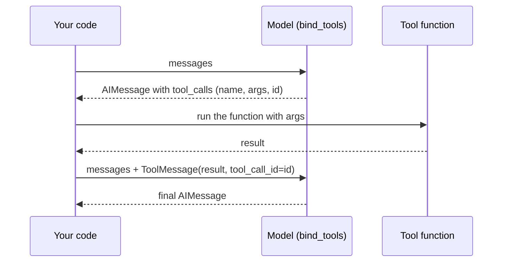

# Chapter 5: Tools

> [!NOTE]
> **📍 At a glance**
> - **You will build:** tools by hand and with decorators, schemas, ToolRuntime and gated tools
> - **Level:** beginner to intermediate · **Time:** about 35 minutes

## 5.1 Binding: making the model aware

- A model cannot know `get_weather()` exists just because it is in the same file
- **Binding** = telling the model which tools exist and what each does
- Binding only makes the model **aware**. It never connects the model to live execution

```python
def get_weather(location: str) -> str:
    """Get the current weather at a given location."""
    return f"It's sunny in {location}"

model_with_tools = model.bind_tools([get_weather])                 # 1. bind
response = model_with_tools.invoke("What is the weather in Delhi?")  # 2. model decides
print(response.tool_calls)                                         # 3. inspect its decision
# [{'name': 'get_weather', 'args': {'location': 'Delhi'}, 'id': '...'}]
```

On `.invoke()` the model reads the message plus every bound tool's schema, then either:

- replies in plain text, or
- replies with a **tool call** instead of content

When it chooses a tool call:

- `response.content` is **empty**
- Everything useful is in `response.tool_calls`: tool name, arguments, unique ID

**Binding does not run the tool.** Your code must read `response.tool_calls`, call the real function, and feed the result back. That is the loop from the LLM book. `create_agent()` automates the whole cycle. Binding alone does not.

More points:

- A plain Python function binds directly, with no hand-written JSON schema (unlike the raw approach in the LLM book). This works through LangChain's wrapper, not a bare OpenAI SDK object
- A **docstring still matters**. Without one the model may guess the purpose wrongly
- `bind_tools` takes a **list**. Add a second tool and the model picks from each tool's name and docstring

## 5.2 Returning the result: `ToolMessage`

The steps between "call this tool" and the final answer:

1. The model decides a tool is needed. `content` is empty, `tool_calls` has name, arguments, ID
2. **You** call the real function with those arguments. Not automatic after binding
3. Wrap the return value in a **`ToolMessage`** and send it back

- A plain string is not enough. `ToolMessage` carries the result **and** the same `tool_call_id` the model issued, so the model can match answer to request
- `ToolMessage` also has a **`status`** (success or failure) and an **`artifact`** field, useful for tracing

### Two audiences for one result

```python
from langchain_core.messages import ToolMessage

tool_message = ToolMessage(
    content="It was the best of times, it was the worst of times.",
    tool_call_id="call_123",
    name="search_books",
    artifact={"document_id": "doc_123", "page": 0},   # the MODEL never sees this
)
print("What the MODEL sees:", tool_message.content)
print("What your APP can use:", tool_message.artifact)
```

- `.content` goes to the model. `.artifact` is for your application
- Use when a tool has more to return than the model needs. A retrieval tool returns the passage as `.content` and a document ID as `.artifact` so your app can build a citation link

## 5.3 Completing the loop by hand, once



Do it once so `create_agent` feels like a shortcut, not magic.

```python
from langchain_core.messages import HumanMessage, AIMessage, ToolMessage

def get_weather(location: str) -> str:
    """Get the weather at a location."""
    return f"Sunny in {location}"

def set_password(new_pass: str) -> str:
    """Set a new password."""
    return "Password changed"

TOOLS = {"get_weather": get_weather, "set_password": set_password}
model_with_tools = model.bind_tools([get_weather, set_password])

question = HumanMessage("Set the password to admin123")
response = model_with_tools.invoke([question])

requested_call = response.tool_calls[0]                                   # 1. the REQUEST. Nothing has run
tool_result = TOOLS[requested_call["name"]](**requested_call["args"])      # 2. run the tool the model asked for
tool_message = ToolMessage(content=tool_result, tool_call_id=requested_call["id"])   # 3. EXACT id from the request

conversation = [question, AIMessage(content="", tool_calls=[requested_call]), tool_message]   # 4. send all back
print(model.invoke(conversation).content)
```

- Request, run, wrap, send back = the loop from the LLM book
- **Look the tool up by the name the model gave** (`TOOLS[...]`). The class notebook called `get_weather(**args)` even when the model asked for `set_password`, which raises `TypeError: get_weather() got an unexpected keyword argument 'new_pass'`

## 5.4 A tool is a function with a job description

- A model is a brain with no hands. A tool is the hand, and it is just a function
- If you can write a function that calls an API or a database, you can make it a tool

```python
from langchain_core.tools import tool

@tool
def check_showtimes(movie_title: str) -> str:
    """Get available showtimes for a given movie."""
    return "Interstellar: 7:00 PM, 9:30 PM"
```

- **Function name** becomes the tool name. **Docstring** becomes its description
- The description is sent to the model. It is the model's **only clue** about what the tool does and when to use it

Override both without touching the function (useful when wrapping someone else's code):

```python
@tool("book_seats", description="Book or reserve a seat. Use whenever a customer wants to book.")
def reserve(movie: str, seats: int) -> str:
    """A short internal docstring."""
    return f"Reserved {seats} seat(s) for {movie}"
```

**What the `Args:` block does.** The class notebook's tools list `Args:` in the docstring, saying it sharpens what the model knows about each argument. *Checked:* by default the whole docstring, `Args:` block included, becomes the **description text**, and the argument schema carries **no** per-argument description. With **`@tool(parse_docstring=True)`** the `Args:` entries move into the schema: `{'movie_title': {'description': 'The exact title of the movie to check', ...}}`. Use it for tools with more than one argument.

- Ready-made tools exist. Class example: web search through Tavily (`from langchain_tavily import TavilySearch`, install the package and set an API key)

## 5.5 Argument schemas: `args_schema` and `Field()`

Plain type hints work but tell the model little. A Pydantic schema gives descriptions, limits and defaults.

```python
from pydantic import BaseModel, Field
from typing import Literal

class SeatBookingInput(BaseModel):
    movie_title: str = Field(description="Exact movie title")
    seat_count: int = Field(gt=0, description="Number of seats")
    preferred_row: Literal["front", "middle", "back"] = Field(default="middle")

@tool(args_schema=SeatBookingInput)
def book_seats(movie_title: str, seat_count: int, preferred_row: str) -> str:
    """Book seats for a movie."""
    return f"Booked {seat_count} seat(s) for {movie_title} in the {preferred_row} row"

print(book_seats.args)    # shows descriptions, the "greater than 0" limit and the default
```

- **Rule 1:** schema field names must match the function's parameter names **exactly**. No automatic mapping
- **Rule 2:** plain Python does not check types at runtime. Pydantic adds the enforcement
- A richer schema costs a few extra tokens (class figure: 20 to 30). That is cheaper than malformed input plus a retry
- A function with no `@tool` is also accepted, but you lose this argument detail

## 5.6 Two names you cannot use: `config` and `runtime`

```python
@tool
def get_weather(location: str, config: str) -> str:
    """Get weather for a location."""
```

- This **defines without any error**. It fails only when called inside an agent
- `config` and `runtime` are **reserved** parameter names LangChain uses itself
- Why no error at definition? The class explanation: LangChain cannot know how the function will be used, and the same function might run in another framework where those names are not reserved
- Calling it directly, I got `TypeError: gw() missing 1 required positional argument: 'config'`, matching the answer key
- Fix: use a different name
- Unconfirmed in class: whether nesting `config` or `runtime` inside a schema gets around the restriction
- ✅ *Verified (details in "How this chapter was checked").*

## 5.7 Binding versus running, once more

- The most misunderstood point: after `bind_tools` the model **can never run a tool itself**. It can only **request** a call
- Class demo: "Is Interstellar showing tonight, can you book two seats?" gave empty `content` and `tool_calls` with `book_seats` (movie Interstellar, two seats, middle row) plus a `config` value the model tried to fill in, a live reminder of why that name is off limits
- Something must read the request, run the function and send back the result. That something is the agent harness ([Chapter 6](06-agents-and-memory.md))

- **Seeing which tools an agent was built with:** *checked* on `langchain` 1.4.7, `agent.get_graph().nodes["tools"].data._tools_by_name.keys()` listed the registered tools. `_tools_by_name` is a private attribute, so use it for debugging only

## 5.8 Four kinds of tool

- **Custom function:** your own `@tool` function
- **Built-in LangChain tool:** pre-built, such as Tavily web search
- **Server-side (provider) tool:** runs on the provider's servers, for example web search or a code interpreter in a chat product. You neither write nor run it
- **JSON-schema tool:** schema written directly as JSON, no Python function. Valid, but Pydantic is easier to read

The server-side kind is the odd one out: when a chat product searches the web, that is not on your machine and not a tool you control.

## 5.9 `ToolRuntime`: what the tool sees that the model does not

- The model only sees the arguments a tool declares (its own reflection in a mirror)
- The tool itself can see more, through a `runtime` parameter

```python
from langchain.tools import ToolRuntime

@tool
def get_weather(location: str, runtime: ToolRuntime) -> str:
    """Get weather for a location."""
```

- Print `.args`: only `location` appears. LangChain hides `runtime` by recognising the `ToolRuntime` annotation on the parameter named `runtime` (checked: confirmed)

What `runtime` holds:

- **`state`:** the conversation so far, mutable. This conversation only
- **`context`:** immutable settings given when the agent is invoked (for example a paid plan). One invocation, pass it again on every call
- **`store`:** long-term memory. Survives across conversations
- **`stream_writer`:** live progress updates ("searching..."). While the tool runs
- **execution info:** thread ID, run ID, attempt number
- **server info:** metadata when running on a LangGraph server

Every serious agent framework has some version of this. LangChain is the concrete example.

## 5.10 A tool with memory, `return_direct` and gating

**Memory with `runtime.store`**

```python
from langgraph.store.memory import InMemoryStore
from langchain.tools import ToolRuntime, tool
from langchain.agents import create_agent

loyalty_store = InMemoryStore()

@tool
def save_favorite_genre(customer_id: str, genre: str, runtime: ToolRuntime) -> str:
    """Save a customer's favorite movie genre for future visits."""
    runtime.store.put((customer_id, "preferences"), "favorite_genre", {"value": genre})
    return f"Got it! I'll remember you like {genre} movies."

@tool
def recall_favorite_genre(customer_id: str, runtime: ToolRuntime) -> str:
    """Recall a customer's favorite genre if previously saved."""
    result = runtime.store.get((customer_id, "preferences"), "favorite_genre")
    return f"Your favorite genre is {result.value['value']}" if result else "No saved preference."

agent = create_agent(model=model, tools=[save_favorite_genre, recall_favorite_genre], store=loyalty_store)
```

- Use a **tuple namespace**: `put((customer_id, "preferences"), key, value)`. The class write-up showed three loose arguments, but the reference notebook and assignment solution use the tuple form (store call checked)
- `InMemoryStore` is a dictionary in RAM. Nothing survives a restart. Production uses a database-backed store such as Postgres
- Scaling is a database question, not LangChain's
- General-purpose storage, not only chat history
- Using LangGraph's store inside LangChain is not mixing frameworks. LangChain is built on LangGraph

**`return_direct`**

- Sends a tool's raw output straight to the user, skipping the model's final pass
- Use it when the model rewording an output (a refund policy, say) could change its meaning
- Cannot be combined with a model double-check, because that puts the model back in the loop

```python
@tool(return_direct=True)
def refund_policy(x: str) -> str:
    """Return the refund policy text."""
    return "Refunds within 30 days."
```

(The class did not show the syntax. The flag exists on the tool object, checked.)

**Gating a tool**

- Telling the model "do not use this tool" in the system prompt relies on the model obeying
- **Removing the tool before the call does not.** A tool not in the list is not available

```python
from dataclasses import dataclass
from langchain.agents import create_agent
from langchain.agents.middleware import wrap_model_call

@dataclass
class Ctx:
    is_vip: bool

@wrap_model_call
def gate_vip_tools(request, handler):
    if not request.runtime.context.is_vip:
        request = request.override(tools=[t for t in request.tools if t.name != "vip_lounge_booking"])
    return handler(request)

agent = create_agent(model=model, tools=[vip_lounge_booking, check_showtimes],
                     middleware=[gate_vip_tools], context_schema=Ctx)
agent.invoke({"messages": [...]}, context=Ctx(is_vip=False))   # VIP tool is not on the model's menu
```

- Mentioning VIP status in the prompt does not make a VIP tool available either
- This is middleware, the next class's topic ([Chapter 7](07-middleware.md))

**Correction to the class version.** The class used `request.state.get("is_vip_member")` and the assignment passed `"is_premium_member": True` in the invoke input. I tested that: passing the flag in the input **does not work** unless the field exists in the agent's state, so the tool was always removed. Two versions work:

- Pass it as **context** (code above), or
- Declare it in a state schema and pass the schema to `create_agent(state_schema=...)`:

```python
from langchain.agents import AgentState

class VipState(AgentState):
    is_vip_member: bool
# create_agent(..., state_schema=VipState)  then  invoke({"messages": [...], "is_vip_member": True})
```

### Loading and calling tools

- **Dynamic tool calling:** the default. The model picks which available tool to use
- **Dynamic tool loading:** decide **before** the model is called which subset of a large set (class range 25 to 50 tools) to show it
- MCP is not an alternative to loading. It is a packaged set of tools. Loading is about which tools, from any source, are exposed

### Assignment questions on this chapter (Q18 to Q24)

- **Docstring as the tool's pitch to the model:** largely true. The model reads it to decide whether and when to call. Even a tool that is always the only option suffers from a poor docstring
- **Plain string vs `Command`:** a string only answers. A `Command` can write to agent state (key example: raise a customer's loyalty tier and store it for later tools). `Command` is not yet taught in the material processed, so treat this as an answer-key pointer
- **`wrap_model_call` vs the system prompt:** the first removes the tool structurally. The second only asks
- **Headless tool:** per the key, the schema is registered on the server but execution happens on the client (a browser, for example) via interrupt and resume. Its example is browser geolocation. Not covered in the class material read so far

### More questions from the class (class 10)

Rows not already covered above.

| Question | Answer |
|---|---|
| The OpenAI API stops my requests. Do I need a card? | Yes. OpenAI needs at least $5 of prepaid credit before the API works. Groq and OpenRouter are better for learning: free, rate-limited, no card |
| How do I switch a working setup to another provider? | Swap the model string (`groq:llama-3.3-70b` for `openai:gpt-5-mini`) and make sure the matching key is available. Nothing else changes |
| My `.env` key does not load, even with `load_dotenv()`. Why? | Usually mundane: a mismatched variable name, stray spaces, or the file not read from the working directory you expect |
| How do I manage a growing conversation context? | No single technique. Summarise older messages, drop old ones, or mix, chosen by results. Aim: best performance from the least context, since cost scales with tokens ([Ch 7](07-middleware.md), `SummarizationMiddleware`) |
| How do I build a tool for an internal service behind a VPN? | A tool is just an API call. If your code can call it, you can wrap it |
| Is model choice a one-time decision? | No. Compare candidate models before any production choice, and again later |

**Learning advice from the same Q&A** (the mentor's view):

- AI coding assistants write as well as the prompt and context you give them. Knowing the basics (Pydantic validation, tool strategy, dynamic loading) is what makes them a multiplier
- Fundamentals first. Blogs and news give awareness, not a substitute for basics
- You need not master every cloud or framework in a job post. Ecosystems differ in detail, not philosophy. Going deep on one transfers to the others

*Source: `classes_transcription_summary/10`, the Q&A table. The other rows of that table are covered in 5.4 to 5.10.*

### Two whiteboard sketches (`Langchain-2-Updated.pdf`)

- **Cost of a tool call.** The board says the model is used **at least twice**: once to choose the tool and its arguments, once to summarise the tool's output. It marks each step as about **500 tokens** and adds that the code should have the least moving parts, because simple systems scale
  - ✅ *Verified (details in "How this chapter was checked").*
  - The "500 tokens" figure is the sketch's illustration, not a measurement
- **Refund policy.** The board sets a CineBot system prompt ("very helpful ... but we don't do refund") beside a "Refund Policy" box. My reading, from the sketch plus the class answer on `return_direct`: an exact rule such as a refund policy is safer as a tool whose output is returned directly (5.10) than as a line the model may reword

*Source: `Langchain-2-Updated.pdf`, text layer. The sketches have little text; the second item is my reading.*

> [!IMPORTANT]
> **🏭 In production**
> - Least privilege: give each agent only the tools its job needs; a read agent should not hold a delete tool
> - Every tool needs a timeout, a size cap on what it returns, and errors returned as text
> - Tools that write, send or charge must be idempotent or behind approval, because the model can call them twice
> - *Added by Claude.*

## 5.11 Interview corner

**What interviewers listen for:** you know the model only **requests** a tool and your code runs it, that the docstring is part of the prompt, and how you keep dangerous tools out of reach.

### 🟢 Basic

<details class="qa"><summary>1. What does <code>bind_tools</code> do?</summary>

- Tells the model which tools exist and their schemas
- It does **not** run anything
- *Stronger answer:* the model replies with a tool call (name, args, id) and empty content. Your code, or `create_agent`, must run it

</details>

<details class="qa"><summary>2. Why does <code>ToolMessage</code> need a <code>tool_call_id</code>?</summary>

- Matches the result to the model's request
- *Stronger answer:* essential when several tools are requested at once

</details>

<details class="qa"><summary>3. How does the model decide which tool to call?</summary>

- From each tool's name, parameter schema and docstring
- *Stronger answer:* the docstring is effectively prompt text. Say when to use it and when **not** to

</details>

### 🟡 Intermediate

<details class="qa"><summary>4. <code>content</code> vs <code>artifact</code> on a <code>ToolMessage</code>?</summary>

- Content goes to the model. Artifact is for your app
- *Stronger answer:* retrieval tools return the passage as content and the document id as artifact for citations

</details>

<details class="qa"><summary>5. How do you stop the model calling a tool it should not have?</summary>

- Remove it from the tool list before the call (`wrap_model_call`), not just a prompt instruction
- *Stronger answer:* do the same check again inside the tool, because defence in depth beats trust

</details>

### 🔴 Senior

<details class="qa"><summary>6. What is <code>ToolRuntime</code>?</summary>

- A parameter that gives the tool state, context, store and more, hidden from the model
- *Stronger answer:* `context` is per-invocation and immutable. `store` is long-term. `state` is this conversation

</details>

<details class="qa"><summary>7. Why does <code>InMemoryStore</code> not suit production?</summary>

- It lives in RAM and is lost on restart. Use a database-backed store

</details>

<details class="qa"><summary>8. Your agent has 60 tools and keeps picking the wrong one. How do you fix it?</summary>

- Better names and docstrings that say when **not** to use a tool; remove overlapping tools
- *Stronger answer:* show only relevant tools per request (`LLMToolSelectorMiddleware`, Ch9, or filtering in middleware, Ch7), or split into specialist subagents (Ch13)

</details>

> [!TIP]
> **🧩 Design question to practise:** *"Give an agent safe access to a company's ticketing system."* Cover which tools exist, their argument schemas, read vs write split, approval, and what the tool returns on error.

## 5.12 Added by Claude, not from the sources

Not in the course material. Established practice, but check current docs.

- **Never trust model-supplied arguments.** Validate them like user input: ids, amounts, paths, SQL. The model can be steered by injected text
- **Check permissions inside the tool.** Hiding a tool is a good first layer. The tool should still verify that this user may do this action
- **Keep secrets out of arguments.** Pass tokens and user ids through `runtime.context`, so the model never sees or invents them
- **Write docstrings like a job posting.** What it does, when to use it, when **not** to, and what the arguments mean. Vague docstrings are the top cause of wrong tool choice
- **Return errors as text.** Let the model read "not found" and adapt, instead of crashing the run ([Chapter 9](09-guardrails-to-do-lists-and-tool-resilience.md))
- **Fewer, sharper tools.** Accuracy of tool choice tends to drop as the list grows. That is the reason dynamic loading exists
- **Make side-effect tools safe to repeat** (idempotent), because loops and retries can call them twice

## Cheat sheet

```python
from langchain.tools import tool, ToolRuntime
@tool
def get_order(order_id: str, runtime: ToolRuntime) -> str:
    """Look up one order by id. Do not use for refunds."""
    user = runtime.context.user_id          # app data the model never sees
    return f"order {order_id} for {user}"
model.bind_tools([get_order])               # model can now request it
```

## Sources and further reading

- Live-Class-2026, `classes_summary/08 - 19 Jul - Inside the Model.md`
- Live-Class-2026, `classes_transcription_summary/08 - 19 Jul - LangChain - Inside the Model.md`
- Live-Class-2026, `classes_summary/10 - 26 Jul - Tools Deep Dive.md` and the matching `classes_transcription_summary/10`
- Live-Class-2026, `Weekend 05 - 25-26 Jul/` overview and folder READMEs, `Langchain-Tools.ipynb` (two Mermaid diagrams only), and the `Assignment & Questions/` notebooks
- Colab used in class (Student Reference, class 10): https://colab.research.google.com/drive/1KlOpWf5-KIwsA0UaqWH98eISyZZQphXD?usp=sharing
- Live-Class-2026, notebooks `02_03_environment_models_messages_student_notes.ipynb` and `Revision_Parts_1-4.ipynb` in `Weekend 04 - 18-19 Jul/07-08 - .../Notebook For Reference/`
- Section 5.12 is added by Claude and is not from these sources
- Live-Class-2026, `Student_Reference_Structured_Output_and_Tools.ipynb` and `Langchain_Till_Agents.ipynb` (Weekend 5). The `parse_docstring` and `runtime` findings are from testing

Previous: [Chapter 4](04-structured-output.md) · Next: [Chapter 6, Agents and memory](06-agents-and-memory.md) (not written yet)
