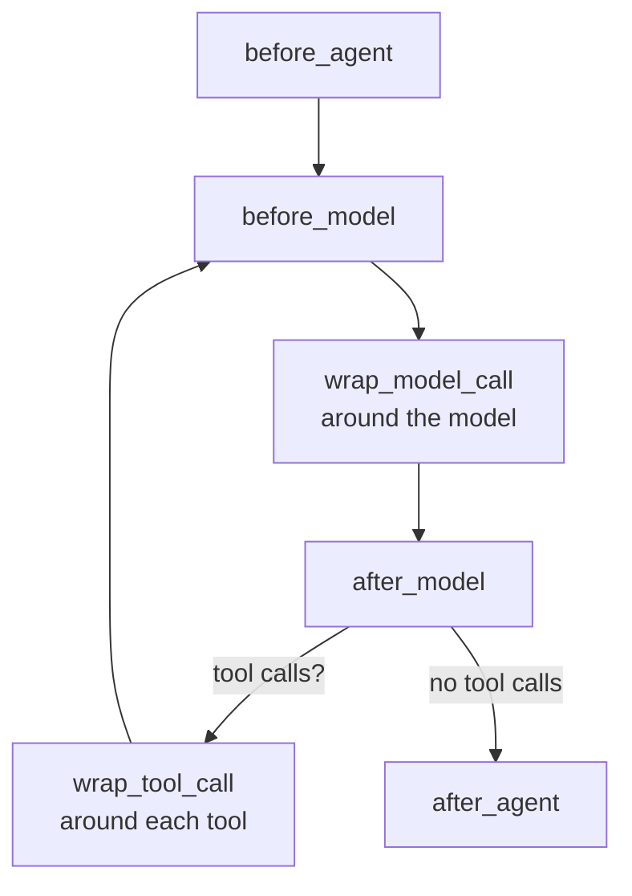
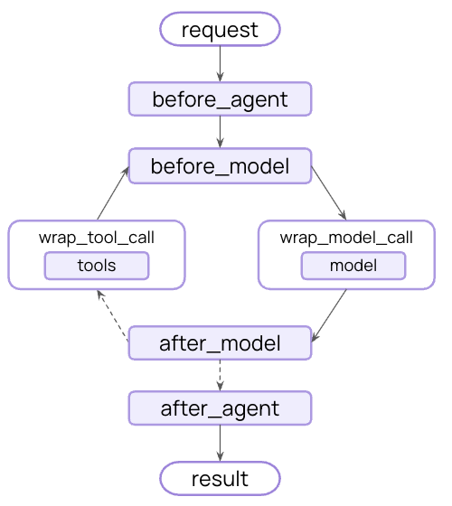
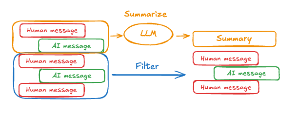

# Chapter 7: Middleware basics

> [!NOTE]
> **📍 At a glance**
> - **You will build:** middleware that filters tools per user, summarises history and asks for approval
> - **Level:** intermediate · **Time:** about 35 minutes
> - **Builds on:** [Chapter 5](05-tools.md) (tools, gating) and [Chapter 6](06-agents-and-memory.md) (agents, checkpointer, context). The prebuilt middlewares for limits, fallback and PII are in [Chapter 8](08-prebuilt-middleware-limits-fallback-and-pii.md). To-do lists, tool selection and tool resilience are in [Chapter 9](09-guardrails-to-do-lists-and-tool-resilience.md). [Chapter 11](11-runtime-and-human-in-the-loop.md) goes deeper on runtime and human-in-the-loop.

**After this chapter you can:**

- Explain why not every tool belongs to every user, and how dynamic tool loading solves it
- Name the six middleware hooks and where each sits in the agent loop
- Filter tools by state or by context
- Register a tool at run time with `wrap_model_call` plus `wrap_tool_call`
- Compress long conversations with `SummarizationMiddleware`
- Guard irreversible tools with `HumanInTheLoopMiddleware` and resume a paused run, even from another process
- Tell middleware apart from LangChain callbacks, and recognise the same hooks under other names (ADK callbacks, Claude Code hooks)

## 7.1 The problem: not every tool belongs to every user

- CineBot has a standard booking tool, a VIP lounge tool and an admin tool
- A regular, non-paying user asks for a VIP seat. What should happen?
- **Tempting fix 1: ask the user "are you a VIP?"** Useless. Everyone says yes
- **Tempting fix 2: remove the VIP tool.** Then a real VIP can no longer use it
- **The right fix:** change **which tools the agent can see**, per user, at run time
- **Menu analogy:** the menu reprints itself before you sit down. A VIP sees the full menu, a regular guest a shorter one. Not because they were told "please do not order that", but because the item is **not printed**
- **Real-world proof:** each connector in a chat product is just a collection of tools (a Gmail connector has write and delete tools, a Slack one has about 11)
  - A free-tier user will never be allowed to use them. Loading all of them anyway means sending unwanted tool tokens to the model **on every call**
  - Companies lose money on that every day

## 7.2 Dynamic tool loading

> With dynamic tool loading, the set of tools available to the agent is modified **at run time**, not defined all up front.

- All possible tools are defined once. A runtime check (state, permissions, feature flags) decides which ones the model sees
- **Two approaches**
  - **Filter pre-registered tools:** you know every tool at creation time. Register all, then filter what is exposed by state, permissions and context
  - **Register tools dynamically:** the full set is not known up front, for example tools arriving through MCP
- **Why not a plain Python `if/else` that picks one of two tool lists?**
  - Code outside the agent **cannot read the agent's live state or store**. For example, it cannot see the message count change mid-run
  - That visibility exists only **inside** the agent run, which is exactly what middleware gives you
- **Design warning:** if you have 1,000 tools "in public" and load all of them for an authenticated user, the design is wrong. Do not build 1,000 tools in the first place
- Not the same as dynamic tool **calling** (the model picking among the tools it sees). See [Chapter 5](05-tools.md), 5.10

### Registering a tool at run time

- Use it when tools appear during the run: loaded from an MCP server, built from user data, fetched from a registry
- It needs **two hooks** (7.3 shows where they sit):
  1. `wrap_model_call` adds the tool to the request, so the **model sees it**
  2. `wrap_tool_call` hands over the tool object when the model calls it, so the agent **can run it**

```python
from langchain.tools import tool
from langchain.agents import create_agent
from langchain.agents.middleware import AgentMiddleware, ModelRequest, ToolCallRequest

@tool
def calculate_tip(bill_amount: float, tip_percentage: float = 20.0) -> str:
    """Calculate the tip amount for a bill."""
    tip = bill_amount * (tip_percentage / 100)
    return f"Tip: ${tip:.2f}, Total: ${bill_amount + tip:.2f}"

class DynamicToolMiddleware(AgentMiddleware):
    def wrap_model_call(self, request: ModelRequest, handler):
        # in real code: load from an MCP server, a database, ...
        return handler(request.override(tools=[*request.tools, calculate_tip]))

    def wrap_tool_call(self, request: ToolCallRequest, handler):
        if request.tool_call["name"] == "calculate_tip":
            return handler(request.override(tool=calculate_tip))
        return handler(request)

agent = create_agent(
    model="openai:gpt-5-mini",
    tools=[get_weather],                  # only the static tools
    middleware=[DynamicToolMiddleware()],
)
agent.invoke({"messages": [("user", "Calculate a 20% tip on $85")]})
# tool result: "Tip: $17.00, Total: $102.00"
```

- **Without `wrap_tool_call`** the run fails at the first model call, before any tool runs: `ValueError: Middleware added tools that the agent doesn't know how to execute. Unknown tools: ['calculate_tip']`
- The error names a simpler fix for tools **known up front**: register them in `create_agent(tools=[...])`, or on the middleware's `tools` attribute, and filter (7.4)

> [!WARNING]
> **A pass-through `wrap_tool_call` turns that check off.**
> - The agent checks for unknown tools only when **no** middleware has a `wrap_tool_call` hook
> - *Checked on 1.5.0:* with an unrelated logging hook (`return handler(request)`) in the stack, there was no `ValueError`
> - The model called the tool and got back `Error: calculate_tip is not a valid tool, try one of [get_weather].`
> - If you add tools at run time, make sure some hook really supplies them

✅ *Verified on `langchain` 1.5.0 with a scripted model: both hooks → the tip result; model hook only → the `ValueError`; model hook plus a logging hook → the error `ToolMessage` (details at the end).*

## 7.3 Middleware: cutting into the loop





> Middleware provides a way to more tightly control what happens inside the agent.

- **Not a separate runtime** (docs): the hooks run inside the compiled LangGraph graph that `create_agent` returns
  - So they keep running when that agent becomes a node in a bigger graph ([Chapter 14](14-handoffs-skills-router-and-custom-workflows.md), 14.6)

- The loop is: request, model call, tool call, result. Middleware lets you **cut into the middle**: before the model, after the model, around a tool call
- It is a universal idea across frameworks, not a LangChain quirk
- The six hooks, in order, as drawn on the whiteboard:

```
Request
  → before_agent
  → before_model
  → wrap_model_call → [ Model Call ]
  → after_model
  → wrap_tool_call → [ Tool Executes ]
  → after_agent
  → Response
```

**Same idea, other names** (class 12 called them middleware, hooks or callbacks):

| Framework | Its name | Around the model call | Around a tool call | Around the whole run |
|---|---|---|---|---|
| LangChain | middleware hooks | `before_model`, `wrap_model_call`, `after_model` | `wrap_tool_call` | `before_agent`, `after_agent` |
| Google ADK | callbacks | `before_model_callback`, `after_model_callback` | `before_tool_callback`, `after_tool_callback` | `before_agent_callback`, `after_agent_callback` |
| Claude Code | hooks | (none) | `PreToolUse`, `PostToolUse` | `UserPromptSubmit`, `Stop`, `SessionStart`, `SessionEnd` |

- In ADK, returning a response from `before_model_callback` skips the model call, much like a LangChain hook that jumps to the end. A `PreToolUse` hook in Claude Code can block a tool call
- The mentor's point: this is what software engineers always did, repackaged. A `wrap_*` hook is Spring's "around advice": it receives the call (`handler`) and decides whether, how and how often to run it
- *Web-checked 2026-11-15: ADK's [Types of callbacks](https://adk.dev/callbacks/types-of-callbacks/) and Claude Code's [Hooks reference](https://code.claude.com/docs/en/hooks). Names only; not run*

> [!WARNING]
> **LangChain also has callbacks, and they are not middleware.**
> - Callbacks (`BaseCallbackHandler`, like the usage logger in [Chapter 3](03-models-messages-and-parameters.md), 3.3) **watch**: logs, traces, token counts
> - *Tested on 1.5.0:* a callback that raised in `on_chat_model_start` was only logged (`Error in Blocker.on_chat_model_start callback`), and the model was called anyway. With `raise_error = True` the exception stopped the run, but a callback still cannot change the request or answer in the model's place
> - Middleware **controls**: a `before_model` hook replied "Blocked before the model." and the model was never called
> - So rules, guardrails and limits go in middleware. Observation goes in callbacks

What middleware is used for (four groups):

- **Track behaviour:** logging, analytics, debugging
- **Transform:** prompts, tool selection, output formatting
- **Add resilience:** retries, fallbacks, early termination
- **Protect:** rate limits, guardrails, PII detection

Where the whiteboard places the main ideas:

- **Human in the loop**
- **Guardrails**
- **Summarization**
- **Dynamic tool loading**

Two kinds of middleware:

- **Prebuilt:** ready-made classes (summarization, HITL, PII, retries, limits...). Covered one by one from here on
- **Custom:** you write the hook yourself (class 12 onward)

## 7.4 Filtering tools in code

**By state.** Hide tools until the user is authenticated:

```python
from langchain.agents import create_agent, AgentState
from langchain.agents.middleware import wrap_model_call

class AuthState(AgentState):
    authenticated: bool                 # the agent must be told to track this field

@wrap_model_call
def only_public_tools_if_unauthenticated(request, handler):
    if not request.state.get("authenticated"):
        request = request.override(
            tools=[t for t in request.tools if t.name.startswith("public_")]
        )
    return handler(request)

agent = create_agent(
    model="openai:gpt-5-mini",
    tools=[public_search, account_details],
    middleware=[only_public_tools_if_unauthenticated],
    state_schema=AuthState,
)
agent.invoke({"messages": [("user", "Show my account")], "authenticated": False})
```

- Reads from `request.state`. If not authenticated, give only tools whose name starts with `public_`
- **Corrections to the class code:**
  - The class wrote `request.tools = [...]` and returned `request`. In current LangChain, assigning to `request.tools` still works but is **deprecated**. Use `request.override(tools=...)` and `return handler(request)`
  - The class snippets were simplified (a bare function). The real hook is decorated with `@wrap_model_call` and takes `(request, handler)`

**By context or store.** Use `request.runtime.context` (a user id, feature flags, a plan) instead of state. The VIP example is in [Chapter 5](05-tools.md), 5.10.

**The live bug in class.** The VIP middleware read `is_vip_member` from state, but passing `is_vip_member=True` into `invoke()` was ignored. It always read `False`.

- Why: the agent only tracks fields **it was told about**
- Fix: a **custom state schema** that adds `is_vip_member` next to the built-in fields (such as the message list), passed as `state_schema=`
- Once added, the same middleware read the flag and exposed the VIP tool. This is why "agents allow you to create a state"
- Remember the claim to prove: **at run time**, not at start-up, you can change which tools the agent has

## 7.5 `SummarizationMiddleware`

Long conversations keep growing the context. Summarization condenses the old part.

- **Why bother if the model's window is big enough?** (docs) Models still do worse over long contexts:
  - they get "distracted" by stale or off-topic content
  - responses get slower, and every call costs more
- Three ways to forget: **trim** (drop messages for the model call), **delete** (remove them from state for good, [Chapter 6](06-agents-and-memory.md) 6.4), **summarise** (replace old messages with a summary)



```python
from langchain.agents import create_agent
from langchain.agents.middleware import SummarizationMiddleware

agent = create_agent(
    model="openai:gpt-5-mini",
    tools=[save_trip_demo],
    middleware=[
        SummarizationMiddleware(
            model="gpt-5.4-mini",          # a separate, often cheaper model just for condensing
            trigger=("tokens", 4000),      # when to summarise
            keep=("messages", 10),         # how much recent history stays word for word
        )
    ],
)
```

- **`model`:** a separate (often cheaper) model that writes the summary
- **`trigger`:** when to start. Accepts `("tokens", n)`, `("messages", n)` or `("fraction", f)`
- **`keep`:** how many recent messages (or tokens) stay untouched
- **Whiteboard numbers:** a trigger at 4k tokens squeezes a large conversation, for example **100k down to about 10k**
- **Class demo:** `trigger=("tokens", 300)`, `keep=("messages", 1)`. After a multi-part request, the old messages were replaced by one message that began "Here is a summary of the conversation to date:"

What the summary looks like:

- It is a message in the history, marked in `additional_kwargs["lc_source"]` as `"summarization"`
- The default summary prompt asks for four sections:
  - **SESSION INTENT**
  - **SUMMARY**
  - **ARTIFACTS**
  - **NEXT STEPS**
- Recent messages kept by `keep` stay as they were. Older ones live only in the summary

More on the options:

- **`trigger`** can be an absolute token count, a message count, or a **fraction of the model's context length** (for example once the context is 80% full)
- **`keep`** can also be a fraction, a token count or a message count. Class example: keep the last 10 messages, summarise everything before
- You have already seen this in chat products: the "conversation has been compacted" behaviour is this mechanism. Claude Code's `/compact` command is a visible example, with a context-usage breakdown (system prompt, tools, custom instructions, messages)
- **The trade-off is real:** squeezing a long history into a short summary can lose information. That is part of why models seem to forget or hallucinate in very long chats
- **No way to guarantee zero loss.** If something must be kept, save it separately into long-term memory ([Chapter 6](06-agents-and-memory.md)), do not rely on the summary alone
- Summarization is a model call, so it adds some latency. It runs on its own separate text, not on the agent's main running context

**Text only.** Summarization compresses text. It does not shrink images, audio or video:

- Recent messages that `keep` retains still carry their original media
- Older media messages that get summarised survive only as text
- For image-heavy apps, store media in a file system or object store and pass **URLs or file references** through the history

> **Pitfall in the class notebook.** An early cell used `trigger=("token", 4000)`. That raises `ValueError: Unsupported context size type token`. The word is **`"tokens"`** (plural)

### More `SummarizationMiddleware` settings

From the docs page `middleware/built-in`. Everything marked *checked* was run with a scripted summariser model (`langchain` 1.4.7).

| Setting | Meaning |
|---|---|
| `trigger` | When to summarise. One tuple such as `("tokens", 4000)`, `("messages", 4)` or `("fraction", 0.8)`; a **dict** where **all** conditions must hold (AND); or a **list** where **any** one is enough (OR) |
| `keep` | What stays word for word: exactly one of `fraction`, `tokens` or `messages`. Default `("messages", 20)` |
| `token_counter` | A counting function. The default counts approximately, from characters |
| `summary_prompt` | A custom prompt template. It must contain the `{messages}` placeholder. Replaces the old `summary_prefix` |
| `trim_tokens_to_summarize` | The most tokens sent to the summariser. Default `4000` |

- ✅ *Verified (details in "How this chapter was checked").*
- ✅ *Verified (details in "How this chapter was checked").*
- ✅ *Verified (details in "How this chapter was checked").*
- The docs mark `summary_prefix`, `max_tokens_before_summary` and `messages_to_keep` as **deprecated**. *Checked:* the old names still worked (the summariser ran). Use `trigger` and `keep`
- The installed signature also has a `summarizer` argument (a callable or runnable in place of `model`). The docs page does not list it, so treat it as unverified

*Source: `langchain-ai/docs`, `src/oss/langchain/middleware/built-in.mdx` (Summarization section).*

### Cheaper alternative: trim instead of summarise (*added by Claude*)

Summarising costs an extra model call. When old turns don't matter (FAQ bots, task assistants), just drop them before each model call:

```python
from langchain.agents.middleware import before_model, AgentState
from langchain_core.messages import trim_messages, RemoveMessage
from langgraph.graph.message import REMOVE_ALL_MESSAGES

@before_model
def keep_recent(state: AgentState, runtime):
    msgs = state["messages"]
    if len(msgs) <= 20:
        return None
    kept = trim_messages(msgs, strategy="last", token_counter=len, max_tokens=20,
                         start_on="human", include_system=True)   # never start mid tool-call
    if not kept:            # no human message in the window (a long tool loop): leave history alone
        return None
    return {"messages": [RemoveMessage(id=REMOVE_ALL_MESSAGES), *kept]}
```

| | Trim | Summarise |
|---|---|---|
| Extra model call | none | one per trigger |
| Keeps old facts | no | yes, condensed |
| Predictable | fully | depends on summary quality |
| Use for | short tasks, FAQ, support triage | long projects, planning, tutoring |

- `start_on="human"` keeps the window from opening on an orphan `ToolMessage`, which most providers reject
- `token_counter=len` counts messages; pass the model (or a tokenizer function) to count real tokens
- Lasting facts belong in the **store** ([Chapter 6](06-agents-and-memory.md)), not in a long thread

✅ *Verified offline over five turns with a checkpointer: the model received 1, 3, 3, 3, 3 messages: the window stayed bounded instead of growing to 9.*

> [!WARNING]
> **Without the `if not kept` guard this hook can erase the thread.** *Checked on 1.5.0:*
> - In a run of five tool calls with a window of 4, the last 4 messages held no human message, so `trim_messages(start_on="human")` returned `[]`
> - `REMOVE_ALL_MESSAGES` then wiped everything, the user's question included. The saved thread ended as `['ai']`
> - With the guard, the history stayed intact (the trade-off: no trimming until the next human turn)
> - This guard was missing from an earlier version of this example

**The docs' hand-written version** (Short-term memory page): keep the first message plus a short recent window.

```python
from typing import Any
from langchain.agents.middleware import before_model, AgentState
from langchain.messages import RemoveMessage
from langgraph.graph.message import REMOVE_ALL_MESSAGES
from langgraph.runtime import Runtime

@before_model
def trim_messages(state: AgentState, runtime: Runtime) -> dict[str, Any] | None:
    """Keep only the last few messages to fit context window."""
    messages = state["messages"]
    if len(messages) <= 3:
        return None                                   # no changes needed
    first_msg = messages[0]
    recent_messages = messages[-3:] if len(messages) % 2 == 0 else messages[-4:]
    return {"messages": [RemoveMessage(id=REMOVE_ALL_MESSAGES), first_msg, *recent_messages]}
```

- Keeping `messages[0]` keeps the opening facts ("my name is bob") the model would otherwise lose
- **The `% 2` trick** picks 3 or 4 recent messages so the window still alternates human, AI, human after the first message. It assumes **strict** alternation
- *Checked:* plain chat stayed valid (`['human', 'ai', 'human', 'ai', 'human']`)
- **Name clash:** the docs call this hook `trim_messages`, the same name as the `langchain_core.messages` utility used in `keep_recent`
  - In one file the later one wins (checked: `TypeError: 'trim_messages' object is not callable`). Rename the hook

> [!WARNING]
> **The parity trick breaks with parallel tool calls.**
> - *Checked on 1.5.0:* after one AI message with two tool calls, the next model call got `['human', 'tool', 'ai', 'human']`
> - That is a `ToolMessage` without its AI tool call. Most providers reject it
> - For tool-using agents, use `trim_messages(..., start_on="human")` with the guard above

## 7.6 `HumanInTheLoopMiddleware`

When an agent can do something **irreversible**, a human should sign off first.

- CineBot's `book_seats` and `cancel_booking` carry the word "Irreversible" in their docstrings. That property is what makes them worth gating
- Whiteboard analogy: **Request → Brain → Tool**, with a human standing at the last arrow, captioned "Intern". An intern with a great brain still needs sign-off before doing something irreversible

The flow:

```
User: "Send an email asking for leave"
  → LLM decides to call your_send_email_tool
  → requires approval → INTERRUPT
        approve → send the email
        edit    → change the arguments, then send
        reject  → do not send
```

Why it applies only to **tool calls**:

- Everything before a tool call is just the model reasoning. A tool call is the "hands" changing something in the real world
- That is the moment worth pausing on, not the model's internal reasoning
- Motivating case: if an agent decided on its own to spend a large sum, should it be allowed to do that without checking? The user is the human in the loop

**HITL is not a transfer.** A support bot escalating to a human agent hands off the **whole conversation** and steps out. That is a transfer. Human-in-the-loop keeps the agent in the loop, **paused for a decision**, for example proposing a refund and asking a representative to approve or adjust the amount.

**Set it up**

```python
from langchain.agents import create_agent
from langchain.agents.middleware import HumanInTheLoopMiddleware
from langgraph.checkpoint.memory import InMemorySaver

guarded_agent = create_agent(
    model="openai:gpt-5-mini",
    tools=cinebot_tools,
    middleware=[
        HumanInTheLoopMiddleware(
            interrupt_on={
                "cancel_booking": {"allowed_decisions": ["approve", "edit", "reject", "respond"]},
                "check_showtimes": False,            # never interrupt this one
            }
        ),
    ],
    checkpointer=InMemorySaver(),    # REQUIRED: the run must pause and resume later
)
config = {"configurable": {"thread_id": "hitl-demo-live"}}
```

- **A checkpointer is required.** Without one you can still start the run, but `Command(resume=...)` raises `RuntimeError: Cannot use Command(resume=...) without checkpointer`
- `interrupt_on` maps a **tool name** to its allowed decisions. `False` means "never interrupt"

> [!WARNING]
> **The key is the tool's `.name`, not the Python function's name.**
> - `@tool` takes the name from the function, unless you give one: `@tool("notify_team") def notify(...)` is called `notify_team`
> - *Checked on 1.5.0:* with `interrupt_on={"notify": True}` there was **no** interrupt and the tool simply ran. With `{"notify_team": True}` it paused
> - A wrong key fails silently, so test that each guarded tool really pauses. `[t.name for t in tools]` shows the right keys

**Trigger the pause and look at it**

```python
result = guarded_agent.invoke({"messages": [("user", "Please cancel booking BK1042")]}, config=config)

request = result["__interrupt__"][0].value
print(request["action_requests"])      # tool name and arguments the model wants to run
print(request["review_configs"])       # which decisions are allowed

state = guarded_agent.get_state(config)
print(state.next)                      # ('HumanInTheLoopMiddleware.after_model',)
print(state.tasks[0])                  # the paused task
```

- The result holds an `__interrupt__` entry listing the proposed action and the allowed decisions
- `state.next` shows where the run is paused: here, the `after_model` hook of the middleware

**Resume with a decision**

```python
from langgraph.types import Command

resumed = guarded_agent.invoke(
    Command(resume={"decisions": [{"type": "approve"}]}),
    config=config,
)
```

- `decisions` has **one entry per interrupted tool call** (usually one)
- Each decision is a dict with a `"type"` and, for some types, extra data

| Decision | Shape | What happens |
|---|---|---|
| approve | `{"type": "approve"}` | Runs as proposed |
| edit | `{"type": "edit", "edited_action": {"name": "cancel_booking", "args": {"booking_id": "BK9999"}}}` | Runs with your changed arguments. The model is told a reviewer replaced its call |
| reject | `{"type": "reject", "message": "Reason"}` | Blocked. The reason goes back to the model as an **error** tool message |
| respond | `{"type": "respond", "message": "Which booking?"}` | Nothing runs. Your text becomes the tool result |

**Corrections to the class code (checked on `langchain` 1.4.7)**

- **Edit shape:** the class used `{"type": "edit", "args": {...}}`. That raises `KeyError: 'edited_action'`. The arguments go inside `edited_action`, together with the tool `name`. (In class the demo choice was reject, so the edit path never ran)
- **Disallowed decision:** sending a type that is not in `allowed_decisions` raises `ValueError`
- **A typo in notebook cell 39:** `print(guarded_agent.invoke(...), config=config)` passes `config` to `print`, not `invoke`. It raises `TypeError`

**An interactive demo** (class idea, with the edit fixed):

```python
def run_interactive_hitl_demo(agent, config):
    state = agent.get_state(config)
    if not state.next:
        print("Nothing is currently paused for approval.")
        return

    print("1) approve  2) edit  3) reject  4) respond")
    choice = input("Type 1, 2, 3, or 4: ").strip()

    if choice == "1":
        decision = {"type": "approve"}
    elif choice == "2":
        new_id = input("New booking_id to use instead: ").strip()
        decision = {"type": "edit",
                    "edited_action": {"name": "cancel_booking", "args": {"booking_id": new_id}}}
    elif choice == "3":
        decision = {"type": "reject", "message": input("Reason for rejecting: ").strip()}
    elif choice == "4":
        decision = {"type": "respond", "message": input("Your response to the agent: ").strip()}
    else:
        print("Not a valid choice.")
        return

    resumed = agent.invoke(Command(resume={"decisions": [decision]}), config=config)
    print("Agent's final response:", resumed["messages"][-1].content)
```

- In class, rejecting with "Don't want to cancel" made the agent report that the cancel was not accepted and offer next options (check status, show policy, retry, contact support)
- **In depth:** `version="v2"` (the current way to read interrupts), `description_prefix`, `respond` for question-only tools and conditional interrupts with `when=` are in [Chapter 11](11-runtime-and-human-in-the-loop.md)
- **No UI comes with it.** You resolve the interrupt in code with `Command(resume=...)`, or wire it to your own interface (a pop-up, an approve and reject button)
- **Two levels of sign-off** (for example manager then director) are not available out of the box. That needs custom middleware

**The run does not wait in memory** (class 12)

- The mentor said the agent "will wait" for the decision. In code, nothing waits: `invoke` **returns** as soon as the pause is hit, with `__interrupt__` in the result. The paused run is just a saved checkpoint
- So the decision can come **hours later, from another process**: a web request from the approval screen, handled by any worker. That worker builds the agent with the same checkpointer database and passes the same `thread_id`

```python
import sqlite3
from langgraph.checkpoint.sqlite import SqliteSaver   # one machine; across machines use PostgresSaver
from langgraph.types import Command

def build_agent():
    """Every worker builds the agent the same way, on the same checkpointer database."""
    saver = SqliteSaver(sqlite3.connect("approvals.db", check_same_thread=False))
    return create_agent(model="openai:gpt-5-mini", tools=[cancel_booking], checkpointer=saver,
                        middleware=[HumanInTheLoopMiddleware(interrupt_on={"cancel_booking": True})])

config = {"configurable": {"thread_id": "support-ticket-4711"}}

# worker 1: the chat request. It returns at once; nothing is left running
result = build_agent().invoke({"messages": [("user", "Cancel booking B100")]}, config)
pending = result["__interrupt__"][0].value["action_requests"]   # show these on the approval screen

# worker 2, hours later: the approver clicks "Approve"
agent = build_agent()                      # a new agent object, in another process
print(agent.get_state(config).next)        # ('HumanInTheLoopMiddleware.after_model',): still paused
agent.invoke(Command(resume={"decisions": [{"type": "approve"}]}), config)
```

✅ *Verified on 1.5.0 with two separate Python processes sharing one SQLite file (scripted model): process 1's `invoke` returned after 0.02 s with the pending `cancel_booking {'booking_id': 'B100'}`, and the tool had not run. Process 2, with a new agent object and a different process id, found the pause, resumed it, and the tool ran once. `state.next` was then `()`.*

- **`InMemorySaver` cannot do this.** Its pauses vanish when the process ends, and other workers never see them. Use a database saver once approvals cross requests ([Chapter 6](06-agents-and-memory.md), 6.5)
- Build the agent the same way in every worker (same tools, middleware and `interrupt_on`), so the resumed run continues in the same graph

> [!IMPORTANT]
> **🏭 In production**
> - Approval needs a UI and an owner: who approves, how fast, and what happens if nobody answers
> - Store every approval decision (who, when, what was edited) as an audit log
> - Keep a checkpointer on the agent, or a paused run cannot resume
> - *Added by Claude.*

## 7.7 Questions from the class

- **What if a tool fails or times out?** Recoverable failures are typically retried by the harness. A fatal error (for example no internet) makes the agent fail outright. Retry and error middleware are in [Chapter 9](09-guardrails-to-do-lists-and-tool-resilience.md)
- **Can an agent discover brand-new tools at run time?** Yes. This is where MCP and middleware meet
- **Why not a plain `if/else` for the tool list?** It cannot read the agent's live state or store (7.2)
- **Two levels of human approval?** Needs custom middleware (7.6)
- **Does summarization share the agent's main context?** No. It works on its own separate text
- **Does a support bot handing a chat to a human count as HITL?** No, that is a transfer (7.6)
- **Can it remember my decision ("always allow this tool")?** Not built in. That is custom middleware too, for example one that skips the interrupt for a tool the user already approved in this thread (class 12)
- **Is RLHF human in the loop?** No. RLHF is human feedback used to **train** a model. HITL is a person approving an action **while the agent runs** (class 12)
- **Does the agent wait for the approval?** Not in memory. `invoke` returns at the pause, and you resume later, even from another process (7.6)

## 7.8 Interview corner

**What interviewers listen for:** you can name the **hooks** and where each fires, you put security checks in code (middleware) rather than in the prompt, and you know approval needs persistence.

### 🟢 Basic

<details class="qa"><summary>1. What is middleware in an agent?</summary>

- Hooks that let you run code before or after the model call, and around tool calls
- *Stronger answer:* name the six hooks and give one use for each group (logging, transforming, resilience, protection)

</details>

<details class="qa"><summary>2. Why filter tools instead of telling the model "do not use the VIP tool"?</summary>

- A prompt only asks. A tool that is not on the list **cannot** be called
- *Stronger answer:* it also saves tokens, because tool schemas are sent on every model call

</details>

<details class="qa"><summary>3. Why not choose tools with a normal <code>if/else</code>?</summary>

- Code outside the agent cannot read the agent's live state or store

</details>

### 🟡 Intermediate

<details class="qa"><summary>4. Your middleware reads <code>is_vip_member</code> from state but always sees <code>False</code>. Why?</summary>

- The agent only tracks fields it knows about. Add a custom `state_schema`
- *Stronger answer:* or pass the flag as run `context`, which is the cleaner place for per-user data

</details>

<details class="qa"><summary>5. How do you make an irreversible tool safe?</summary>

- Human in the loop: interrupt, then approve, edit, reject or respond
- *Stronger answer:* it needs a checkpointer, because the run must pause and resume

</details>

### 🔴 Senior

<details class="qa"><summary>6. Is a support bot passing a chat to a human "human in the loop"?</summary>

- No. That is a **transfer**: the agent leaves. In HITL the agent stays, paused for a decision

</details>

<details class="qa"><summary>7. What does <code>SummarizationMiddleware</code> do, and what is lost?</summary>

- Replaces old messages with a generated summary when a trigger is hit
- *Stronger answer:* detail is lost, media is not compressed, the summary call costs tokens, and must-keep facts belong in long-term memory

</details>

<details class="qa"><summary>8. Where do you put an authorisation check: the prompt, middleware or the tool?</summary>

- Never only the prompt. Filter tools in middleware so the model cannot see them
- *Stronger answer:* check again inside the tool (defence in depth), because middleware can be misconfigured and tools can be reused elsewhere

</details>

<details class="qa"><summary>9. You trim history in a <code>before_model</code> hook. What can go wrong?</summary>

- The window can start on a `ToolMessage` whose AI tool call was cut off. Most providers reject it
- With `REMOVE_ALL_MESSAGES` the trim is **saved**: a bad window becomes permanent memory loss
- `trim_messages(start_on="human")` can return `[]` mid tool-loop and wipe the thread unless you guard it
- *Stronger answer:* to trim without losing history, cut only the call's input (`wrap_model_call` with `request.override(messages=...)`), keep lasting facts in the store, and test the hook on a tool-heavy transcript. *Added by Claude*

</details>

<details class="qa"><summary>10. The approval for a refund arrives three hours later, through a web request. How does the agent continue?</summary>

- Nothing was waiting: the first `invoke` returned at the interrupt, and the pause is a checkpoint
- The approval handler builds the agent (same tools and middleware) on the same database checkpointer, then calls `invoke(Command(resume={"decisions": [...]}), config)` with the same `thread_id`
- *Stronger answer:* use a shared database saver, not `InMemorySaver`; check the approver is allowed to decide for that thread; expire stale approvals; log the decision with the arguments that ran

</details>

<details class="qa"><summary>11. LangChain has callbacks and middleware. Where do you enforce a policy, and why?</summary>

- In middleware. It can change the request, filter tools, skip the model or end the run with its own reply
- Callbacks only observe. An exception inside one is logged and ignored unless the handler sets `raise_error = True`, and even then it can only stop the run, not answer
- *Stronger answer:* use both: middleware for rules (limits, guardrails, approvals), callbacks or tracing for audit and cost. Other frameworks name the same hooks differently: ADK callbacks, Claude Code hooks

</details>

> [!TIP]
> **🧩 Design question to practise:** *"An HR agent can read any employee record for HR staff but only your own for others."* Cover where the role comes from, which hook filters tools, the in-tool check, and logging.

## 7.9 Added by Claude, not from the sources

Not in the course material. Established practice, but check current docs.

**Human in the loop**

- **Show the reviewer the exact arguments**, not a paraphrase. The `action_requests` in the interrupt hold them. Log who approved what and when
- **Paused runs wait forever.** Decide how long an approval may stay open and what happens when it expires. Only let the **same authorised user** resume a thread

**Summarization and cost**

- **Summaries drop exact facts** (ids, amounts, dates). Keep must-not-lose facts in the system prompt, the state or the store
- **The summarising model sees the whole history**, so it also sees any personal data in it
- **Fewer tools per call means fewer input tokens per call.** Filtering tools is a cost control as well as a safety control
- **Gate twice.** Hide the tool with middleware, and check permission again inside the tool ([Chapter 5](05-tools.md), 5.12)

## Cheat sheet

```python
from langchain.agents.middleware import SummarizationMiddleware, HumanInTheLoopMiddleware
agent = create_agent(model, tools, checkpointer=InMemorySaver(), middleware=[
    SummarizationMiddleware(model="openai:gpt-4o-mini", trigger=("tokens", 4000), keep=("messages", 20)),
    HumanInTheLoopMiddleware(interrupt_on={"send_email": True}),
])
result = agent.invoke(inp, cfg)                    # returns at the pause: result["__interrupt__"]
agent.invoke(Command(resume={"decisions": [{"type": "approve"}]}), cfg)   # later, any worker, same DB saver + thread_id
```

## Recap

- Not every tool belongs to every user. **Change the tool list at run time**, do not ask the model to behave
- **Dynamic tool loading:** filter pre-registered tools, or register tools dynamically (MCP)
- Six hooks: `before_agent`, `before_model`, `wrap_model_call`, `after_model`, `wrap_tool_call`, `after_agent`
- Filter with `request.override(tools=...)`. Per-user flags need a **state schema** or **context**
- `SummarizationMiddleware`: `model`, `trigger=("tokens", n)`, `keep=("messages", n)`. Text only, and lossy
- `HumanInTheLoopMiddleware`: needs a **checkpointer**. Resume with `Command(resume={"decisions": [...]})`. Four decisions: approve, edit, reject, respond. It is **not** a transfer
- A paused run does not wait in memory: `invoke` returns, and any process with the same database checkpointer and `thread_id` can resume it
- Other frameworks call hooks callbacks (Google ADK) or hooks (Claude Code). LangChain's own callbacks only watch; middleware controls

## Practice

1. Recreate the VIP middleware. **Deliberately trigger the "state field not tracked" bug**, then fix it with a custom state schema
2. Write middleware from scratch that filters tools by `request.state`
3. Recreate `SummarizationMiddleware` with your own `trigger` and `keep`, and watch a long conversation compress
4. Build the `cancel_booking` HITL demo, run `run_interactive_hitl_demo()` yourself and try **all four** decisions
5. Open the whiteboard `Agent-Middleware-Architecture.excalidraw` in excalidraw.com and trace the full loop diagram by hand
6. Assignment 2 (NovaBank), the parts this chapter prepares you for. The assignment has no answer key:
   - A2 Q7: a realistic NovaBank `transfer_funds` situation for each of the four HITL decisions
   - B2.1: guard `transfer_funds` with all four decisions, resume with an `edit` that changes the amount, and confirm the edited amount was used (remember the `edited_action` shape)
7. Run the docs' `trim_messages` hook on a chat where the model makes two parallel tool calls, and find the orphan `ToolMessage`. Then switch to `keep_recent` with the guard
8. Pause a HITL run with `SqliteSaver` in one Python script, then approve it from a second script. Print `get_state(config).next` in both
9. Write a callback that raises in `on_chat_model_start` and see the run continue. Then block the same call with a `before_model` hook

## How this chapter was checked

- Run offline with a stand-in model on `langchain` 1.4.7:
  - tool filtering with state schema and with context, and the deprecated `request.tools` assignment
  - summarization: the summary message and its `lc_source`, the invalid `"token"` and the valid `"tokens"`
  - HITL: interrupt, `get_state`, approve, edit (both shapes), reject, respond, a disallowed decision, resume without a checkpointer
- **Not run against a live model:** the quality of a real summary and real tool-call choices. Class output was read from the notebook (cells 0 to 56)
- **Details by section** (moved here from the ✅ markers):
  - *7.6 `interrupt_on` key (2026-11-15):* `langchain` 1.5.0, scripted model calling `notify_team` (defined as `@tool("notify_team") def notify`). `interrupt_on={"notify": True}`: 0 interrupts, the `ToolMessage` was `notified`. `{"notify_team": True}`: 1 interrupt, the tool had not run
  - *7.5 trimming, from the Short-term memory docs page (2026-11-15):* run on `langchain` 1.5.0, `langgraph` 1.2.22 with a scripted model and `InMemorySaver`
    - The docs' `trim_messages` hook over four plain turns: the model saw `['human']`, `['human', 'ai', 'human']`, then `['human', 'ai', 'human', 'ai', 'human']` twice
    - The same hook after one AI message with two parallel tool calls: the next model call got `['human', 'tool', 'ai', 'human']`
    - `keep_recent` without the guard, window 4, five sequential tool calls: `trim_messages` returned `[]` twice and the saved thread ended as `['ai']`. With the guard: the thread kept all 12 messages
    - `keep_recent` with the guard (extracted from this file, window set to 3 for the test; the snippet uses 20), re-run on five plain turns: the model still received 1, 3, 3, 3, 3 messages. On five sequential tool calls it kept all 12 messages, starting with the user's question
    - Running the docs' hook and `keep_recent` from one file: `TypeError: 'trim_messages' object is not callable` (the hook's name hid the utility)
    - Interview Q9: a `wrap_model_call` hook with `request.override(messages=request.messages[-1:])` gave the model 1 message per call, while the checkpointer kept all 6
  - *7.2 Registering a tool at run time (2026-11-15):* run on `langchain` 1.5.0, `langgraph` 1.2.22 with a scripted `GenericFakeChatModel` that called `calculate_tip(bill_amount=85)`. Both hooks: the model saw `['get_weather', 'calculate_tip']` on both calls, the agent's tool node still held only `get_weather`, and the `ToolMessage` was `Tip: $17.00, Total: $102.00` (status `success`). `wrap_model_call` only: `ValueError` with "Unknown tools: ['calculate_tip'] / Registered tools: ['get_weather']" and the two fixes. `wrap_model_call` plus a pass-through `@wrap_tool_call`: no `ValueError`; the `ToolMessage` had status `error` and said `calculate_tip is not a valid tool`. The check lives in `langchain/agents/factory.py` (`DYNAMIC_TOOL_ERROR_TEMPLATE`, skipped when any `wrap_tool_call` exists)
  - *More `SummarizationMiddleware` settings:* Checked: `trigger=("messages", 4)` summarised once over three long turns. A **list** `[("tokens", 100000), ("messages", 4)]` also did (the second condition was enough). A **dict** `{"tokens": 10, "messages": 100}` did **not** (the second condition failed)
  - *More `SummarizationMiddleware` settings:* Checked: the default prompt is a long template. It starts "Context Extraction Assistant" and asks for four sections: `SESSION INTENT`, `SUMMARY`, `ARTIFACTS` and `NEXT STEPS`
  - *More `SummarizationMiddleware` settings:* Checked: with `summary_prompt="Summarise briefly:\n{messages}"`, the summariser received that text with the messages inserted as `<message type="human">...` blocks
  - *Class 12 recording (8 Aug), added 2026-11-15, `langchain` 1.5.0, `langgraph` 1.2.22, `langgraph-checkpoint-sqlite` 3.1.3, scripted fake chat models (no keys, no network):*
    - 7.6 resume from another process: `hitl_p1.py` built the agent on a `SqliteSaver` file and invoked it; it returned after 0.02 s with one pending `cancel_booking {'booking_id': 'B100'}`, `state.next` `('HumanInTheLoopMiddleware.after_model',)`, and no tool run. `hitl_p2.py`, a separate process, built a new agent on the same file, found 1 interrupt, resumed with approve, and the tool wrote `B100` once; `state.next` was then `()`. The 7.6 block is that code with the scripted model swapped for the model string
    - 7.3 callbacks: a `BaseCallbackHandler` raising `ValueError` in `on_chat_model_start` was logged as a warning and the run finished with the model's reply; with `raise_error = True` the run raised `ValueError: blocked by callback`; a `before_model(can_jump_to=["end"])` hook ended the run with its own message and the scripted model was never called
    - 7.3 names table: from the ADK and Claude Code docs (web search), not run
- The 2026 review added the diagrams, 🏭 In production boxes, graded interview layout, extra senior and design questions and the cheat sheet. These are Added by Claude: standard engineering practice. Cheat-sheet APIs were checked against the installed `langchain` 1.4.7 signatures
- **Cheat sheet:** ran both middleware in one agent; a `send_email` call paused with `__interrupt__`; the summarization trigger (4000 tokens) was constructed but not reached. Ran on `langchain` 1.4.7 with a scripted fake chat model (no API keys, no network), so no real model call was made.

## Sources and further reading

- Live-Class-2026, `classes_summary/11 - 01 Aug - Agents, Middleware & Memory.md` and `classes_summary/12 - 08 Aug - Mastering Middleware.md`
- Live-Class-2026, `classes_transcription_summary/11 - 01 Aug - LangChain - Agents, Memory, Middleware.md` and `classes_transcription_summary/12 - 08 Aug - LangChain - Mastering Middleware.md`
- Live-Class-2026, `MIddleware.ipynb` (cells 0 to 56), `Middleware-Architecture-Sketch.ipynb`, the whiteboards `Agent-Middleware-Architecture.pdf` and `Langchain-2-Updated.pdf`, and the folder README, all in `Weekend 06 - 1 Aug/11-12 - 1-8 Aug - Agents, Memory & Middleware/`
- `Assignment_2_Agents_and_Prebuilt_Middleware.ipynb` (questions only; the answers belong to later classes)
- Section 7.9 and the corrections in 7.4 to 7.6 are from testing, not from the class sources
- LangChain docs: [Middleware overview](https://docs.langchain.com/oss/python/langchain/middleware/overview), read in full 2026-11-15 from its source (`langchain-ai/docs` commit `04d4d4a`), for the hook diagram in 7.3 (`images/middleware_final.png`, copied from the page) and "not a separate runtime". The `interrupt_on` warning in 7.6 is from testing
- LangChain docs: [Short-term memory](https://docs.langchain.com/oss/python/langchain/short-term-memory), read in full 2026-11-15 from its source (`langchain-ai/docs` commit `04d4d4a`), for the 7.5 intro, the summary image (`images/summary.png`, copied from the page) and the hand-written trim pattern. The two trimming warnings are from testing
- LangChain docs: [Tools](https://docs.langchain.com/oss/python/langchain/tools), section "Dynamic tool selection" (read 2026-11-15 from its source, `langchain-ai/docs` commit `04d4d4a`), for "Registering a tool at run time" in 7.2. The pass-through pitfall is from testing
- Class 12 recording transcript (8 Aug 2026), uploaded by you; teaching part only (00:10–03:18; the doubt session after it was left out): other names for hooks, "middleware is what engineers always did", "the agent will wait", "remember my decision", RLHF vs HITL
- Google ADK docs: [Types of callbacks](https://adk.dev/callbacks/types-of-callbacks/); Claude Code docs: [Hooks reference](https://code.claude.com/docs/en/hooks) (web-checked 2026-11-15, for the names table in 7.3)
- Added by Claude: the callbacks warning in 7.3, the resume code and bullets in 7.6, and interview questions 10–11

Previous: [Chapter 6, Agents and memory](06-agents-and-memory.md) · Next: [Chapter 8, Prebuilt middleware: limits, fallback and PII](08-prebuilt-middleware-limits-fallback-and-pii.md)
