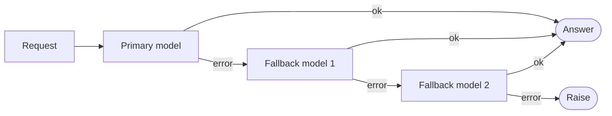

# Chapter 8: Prebuilt middleware: limits, fallback and PII

> [!NOTE]
> **📍 At a glance**
> - **You will build:** limits, fallbacks and PII protection with prebuilt middleware
> - **Level:** intermediate · **Time:** about 30 minutes
> - **Builds on:** [Chapter 7](07-middleware.md) (the hooks, summarization, human-in-the-loop). To-do lists, tool selection, tool errors, tool retry and tool emulation are in [Chapter 9](09-guardrails-to-do-lists-and-tool-resilience.md).

## 8.1 `ModelCallLimitMiddleware`

**Why:** cost. An agent that makes 100 model calls in one run costs real money, and there was no built-in cap.

- Same idea as the `max_turns` safeguard from the raw Python loop ([LLM book, Chapter 2](../llm/02-the-agentic-loop-in-pure-python.md)), formalised with better checks
- **Where to set the number** comes from domain knowledge, not a framework default. A web-search agent rarely needs more than 5 to 15 searches
- **Why not tell the model "do not call more than twice"?** A model can ignore it, and it breaks when you swap the model. A limit in code is specific and dependable

**Run limit vs thread limit** (whiteboard analogy: breakfast, lunch, dinner):

- **Run limit:** a cap on **one `.invoke()`**. "Chappatis allowed per meal"
- **Thread limit:** a cap **across all runs** of one conversation. "Chappatis allowed in total, across all meals"

```python
from langchain.agents import create_agent
from langchain.agents.middleware import ModelCallLimitMiddleware
from langgraph.checkpoint.memory import InMemorySaver

call_limited_agent = create_agent(
    model="openai:gpt-5-mini",
    tools=cinebot_tools,
    checkpointer=InMemorySaver(),        # needed for thread_limit to persist across calls
    middleware=[
        ModelCallLimitMiddleware(        # low values, just for the example
            thread_limit=5,              # across the WHOLE conversation
            run_limit=2,                 # per single .invoke() call
            exit_behavior="end",         # graceful stop, not an exception
        ),
    ],
)
```

- **`exit_behavior="end"`:** the run stops and the last message is an `AIMessage` such as `Model call limits exceeded: run limit (2/2)` or `... thread limit (5/5)`. The class notebook showed the thread version
- **`exit_behavior="error"`:** raises `ModelCallLimitExceededError` instead
- The run limit **resets on every `invoke`**. The thread limit does not
- **Without a checkpointer** the thread limit has nothing to remember between calls. In my test a thread limit of 1 never fired across two separate `invoke`s

> [!IMPORTANT]
> **🏭 In production**
> - Call limits are your cost circuit-breaker: set a per-run and a per-thread limit on every agent that faces users
> - Alert when a run hits its limit; it usually means a loop or a confusing tool
> - *Added by Claude.*

## 8.2 `ToolCallLimitMiddleware`

**Why:** tool calls add to context size and cost. An agent asked to "find the important emails" could keep digging through years of mail unless capped.

- Works **globally** or for **one named tool**. Use two instances together:

```python
from langchain.agents import create_agent
from langchain.agents.middleware import ToolCallLimitMiddleware
from langgraph.checkpoint.memory import InMemorySaver

tool_limited_agent = create_agent(
    model="openai:gpt-5-mini",
    tools=cinebot_tools,
    checkpointer=InMemorySaver(),
    middleware=[
        ToolCallLimitMiddleware(run_limit=8),                                              # global, this run
        ToolCallLimitMiddleware(tool_name="cancel_booking", thread_limit=2, run_limit=1),  # one tool, tighter
    ],
)
```

- Whiteboard numbers: **8** for the global run limit. For `cancel_booking`, **`run_limit=1`** and **`thread_limit=2`** (the conversation limit)
- The board traces bookings B100, B101, B102: the first two cancels go through (one per run, two in the whole thread). The third is blocked, because the thread limit is used up. A new run refreshes only the **run** counter
- Class demo: three separate `invoke`s asking to cancel B100, B101, B102. The third tool call was refused with the tool message `Tool call limit exceeded. Do not call 'cancel_booking' again.`
- **Default behaviour (`exit_behavior="continue"`):** the blocked call becomes an **error tool message**, and the model carries on and can explain. Other options: `"end"` and `"error"`
- A strict limit on one irreversible tool plus a looser overall limit is a common pairing (assignment question A2 Q10)
- **Run vs thread, class 13 wording:** a run limit of 4 caps the chapatis in one sitting, a thread limit of 10 caps the whole day however it is split. Another picture: the searches inside **one reply** are the run, the total across the **whole chat session** is the thread
- **A limit rejection is a tool message with an error status, not an interrupt.** An interrupt exists to ask a human for a decision. A limit needs no human input, so the call is refused and reported back as information the model can pass on to the user

### `ToolCallLimitMiddleware`: the exit behaviours and the error

- Settings from the docs: `tool_name` (one tool; without it the limit covers all tools), `run_limit`, `thread_limit` (needs a checkpointer) and `exit_behavior`. At least one limit is required
- `exit_behavior`: `'continue'` (default) blocks the extra calls with error messages and lets the model carry on. `'end'` stops gracefully. `'error'` raises **`ToolCallLimitExceededError`**
- ✅ *Verified (details in "How this chapter was checked").*

*Source: `langchain-ai/docs`, `src/oss/langchain/middleware/built-in.mdx` (Tool call limit).*

## 8.3 `ModelFallbackMiddleware`



**Why:** if the primary model provider has an outage, the app should not simply stop working.

```python
from langchain.agents import create_agent
from langchain.agents.middleware import ModelFallbackMiddleware

resilient_agent = create_agent(
    model="openai:gpt-5",                  # primary
    tools=cinebot_tools,
    middleware=[
        ModelFallbackMiddleware(
            "openai:gpt-5-mini",           # first fallback
            # "ollama:llama3.2",           # a further, fully local last resort
        ),
    ],
)
```

- Models are passed **positionally**, first fallback first, then more in order
- **What counts as a failure:** a hard error such as a 404 or an expired key
- **What it is not:** routing by speed or cost, or a smart dispatcher choosing the best model for a task. It only activates when the primary model genuinely fails
- The **full conversation history** goes to whichever model ends up answering. Nothing else changes
- Class demo: the primary name was one that does not exist, so without the middleware the call failed with a 404 `model_not_found` error. With the middleware it fell through to `gpt-5-mini`
- The whiteboard draws the symptom it prevents: **"AI -> I am unable to connect."**

> **Correction.** The class transcript wrote `ModelFallbackMiddleware(model="...")`. That raises `TypeError: unexpected keyword argument 'model'`. The notebook's positional form is the one that works

## 8.4 `PIIMiddleware`

**PII** (personally identifiable information): date of birth, phone number, email, government ID numbers, passwords. It generally should **not reach the model** at all.

```python
from langchain.agents import create_agent
from langchain.agents.middleware import PIIMiddleware

pii_agent = create_agent(
    model="openai:gpt-5-mini",
    tools=cinebot_tools,
    middleware=[
        PIIMiddleware("email", strategy="redact", apply_to_input=True),
        PIIMiddleware("credit_card", strategy="mask", apply_to_input=True),
    ],
)
```

Strategies (checked on `langchain` 1.4.7):

- **`redact`:** removes the value. `priya@example.com` becomes `[REDACTED_EMAIL]`
- **`mask`:** keeps a hint so the model can tell something was there. `priya@example.com` becomes `priya@****.com`
- **`hash`:** replaces it with a **deterministic** hash, for example `<email_hash:6bdb7e96>`. The same input always gives the same hash
  - Identity stays usable for analytics and debugging without exposing the value
  - Class analogy: telling an outsider a card is "AMZ1234ABC" reveals nothing, but the system that made the reference can still look it up
  - When a tool really needs the real value, the lookup that turns the hash back into it happens **separately, outside the model's view**. The model never sees it
- **`block`:** stops the run with a `PIIDetectionError`

Built-in types in this version: `email`, `credit_card`, `ip`, `mac_address`, `url`. Anything else is a **custom** type.

> **What really happened with the class card number.** The class text says the card `4111-1111-1111-1234` was masked. The notebook output shows it was **not**: only the email was redacted, and the model even warned the user about the card. The built-in card detector checks that the number is **valid** (a checksum, the Luhn check), and this made-up number fails it. A valid test number such as `4111-1111-1111-1111` is masked to `****-****-****-1111`. Class 13 found this live in the docs: the detector uses the **Luhn algorithm**, the standard checksum that real card numbers satisfy. A string of digits that fails it does not register as a card. So: **test with valid-looking numbers, and remember a detector can skip lookalikes**

What the class 13 run also showed:

- Instead of silently stripping the data, the agent's **reply warned the user** not to share full card numbers in chat. That is a better experience than a blunt rejection
- The message history confirmed the email was redacted **before** it reached the model
- **Why this matters beyond the reply:** even if the system prompt tells the model not to misuse personal data, sending that data to a third-party provider is itself a **compliance question**. A customer could ask why their information left your application at all. Audits increasingly ask this
- **Real payment details:** do not let card numbers pass through the model to complete a purchase. Use a **headless tool**, a secure payment page the user interacts with directly, outside the model's view ([Chapter 6](06-agents-and-memory.md), 6.7)

**Custom PII types.** Aadhaar and PAN (India-specific IDs) are named on the whiteboard as formats no framework can ship for every country. Supply your own detector, either as a **function** or as a **regex string**:

```python
import re
from langchain.agents import create_agent
from langchain.agents.middleware import PIIMiddleware

def detect_booking_code(content: str) -> list[dict]:
    """Detect CineBot's own booking code format: BK followed by 4 digits."""
    return [
        {"text": m.group(0), "start": m.start(), "end": m.end()}
        for m in re.finditer(r"BK\d{4}", content)
    ]

custom_pii_agent = create_agent(
    model="openai:gpt-5-mini",
    tools=cinebot_tools,
    middleware=[
        PIIMiddleware("booking_code", detector=detect_booking_code, strategy="mask"),
        PIIMiddleware("aadhaar", detector=r"\b\d{12}\b", strategy="mask"),     # regex as a STRING
    ],
)
# "my booking BK1044"    -> "my booking ****1044"
# "aadhaar 123456789012" -> "aadhaar ****9012"
```

> **Correction.** The class transcript passed a compiled pattern, `detector=re.compile(r"\b\d{12}\b")`. That raises `TypeError: 're.Pattern' object is not callable`. Pass the pattern as a **string**, or write a function that returns a list of matches

The function detector returns a list of dicts with `text`, `start` and `end`.

Class 13 used `strategy="hash"` for the booking codes. Checked: `BK1044` becomes `<booking_code_hash:94be15f9>`.

Three more switches (from the library signature, not explained in class 12):

- `apply_to_input` (default `True`): clean user messages before the model
- `apply_to_output` (default `False`): clean what the model replies
- `apply_to_tool_results` (default `False`): clean what tools return

> [!IMPORTANT]
> **🏭 In production**
> - Regex PII detection misses things (names, free-text addresses); for regulated data add a dedicated detector and keep raw data out of logs too
> - Decide where PII may go: masking before the model protects you only if traces and logs are masked as well
> - *Added by Claude.*

## 8.5 Guardrail vs middleware

> **A guardrail is the concept: protecting the agent from doing something undesirable. Middleware is the mechanism you use to implement it.**

- The whiteboard: "Guardrails is a way to control the AI agent behaviour." PII detection is one concrete guardrail, implemented with `PIIMiddleware`
- They are **not two competing systems**. Middleware is one **mechanism** for a guardrail. Class 12 put it as "guardrails are applied as middleware". Class 13 adds that careful system-prompt instructions and third-party libraries are other mechanisms
- **Highway analogy (class 13):** a barrier on a mountain road keeps a car from going over the edge. A barrier on a highway keeps it from swerving into oncoming traffic. An agent's output is unpredictable by default, so something must bound what it can say or do
- Working definition: "a guardrail is a way to control the AI agent's behaviour, that's it"
- **Built-in guardrails you can see:** a chat product refuses a request for something dangerous and deflects a request for its raw system message. The tighter the guardrail, the harder it is to work around. Gaps make a system easier to push past
- **Even a tool call limit is a guardrail.** It is a deliberate constraint on behaviour
- **"Compliance" is not defined by the framework.** It is defined outside it, by company policy, regulation or certification (HIPAA, GDPR, SOC 2)
- Examples the board gives: the user talks rudely or gives personal info, and the agent flags it
- This came up repeatedly in class and is a **common interview question**

Where these patterns show up in real work (from the notebook):

- **Fintech fraud detection:** a `wrap_tool_call` hook around every transaction tool, flagging or blocking by velocity, amount or pattern
- **Healthcare assistants:** PII redaction is often a legal requirement (HIPAA in the US), not optional polish
- **Customer support:** approval gates before refunds or account changes (human in the loop)
- **Internal tools:** audit logging via `wrap_tool_call`, anywhere "who did what, when" needs an answer

## 8.6 Several middlewares, and LangChain vs LangGraph

**Several middlewares on one agent**

- Pass them as a **list**. No need for a separate agent per concern
- Order is **not random**. Either a defined priority applies, or they run in **declaration order**. They are designed not to collide
- My test: two `before_model` hooks ran in the order they were listed
- **Latency:** a middleware that calls a model (summarization) adds some. Pure code (a call-limit check) adds almost none

**When to stay in LangChain and when to drop to LangGraph**

- Middleware exists in LangGraph too. It is not unique to LangChain
- LangChain sits on top of LangGraph and gives a more convenient, somewhat abstracted interface to the same machinery
- **Stay in LangChain + middleware** for most agents, including a simple RAG chatbot (which may not even need middleware)
- **Go to LangGraph** when you need precise, deterministic control of state, checkpointer internals, stores or interrupts
- Other tools use other names for the same idea: Google's Agent Development Kit says "callbacks", Claude Code and Cursor say "hooks"
- Agents built only from MCP connections and instructions (no framework) are usually local developer tools, not deployable services

**Observability:** there is no universal best choice. LangFuse integrates easily with the LangChain family. For RAG, test dedicated evaluation tools. Early results are often deceptively easy, so real quality needs more testing than the basics.

## 8.8 Interview corner

**What interviewers listen for:** you treat limits as **cost guardrails**, you know fallback covers provider failure, and you know PII masking has to cover logs and traces too.

### 🟢 Basic

<details class="qa"><summary>1. Run limit vs thread limit?</summary>

- Run limit: one `invoke`. Thread limit: the whole conversation, which needs a checkpointer
- *Stronger answer:* you can limit one tool tightly and the whole run loosely. Set the numbers from domain knowledge

</details>

<details class="qa"><summary>2. What does model fallback do, and what does it not do?</summary>

- It switches to another model when the primary hard-fails (404, bad key, outage)
- It does **not** route by cost, speed or task. The full history goes to the fallback

</details>

### 🟡 Intermediate

<details class="qa"><summary>3. Redact vs mask vs hash vs block for PII?</summary>

- Redact removes it, mask hides part, hash replaces it with a hash, block stops the run
- *Stronger answer:* masking an id your tool needs breaks the tool call. Pick the strategy per field

</details>

<details class="qa"><summary>4. Guardrail vs middleware?</summary>

- A guardrail is the goal of keeping the agent from undesirable behaviour. Middleware is the mechanism that implements it
- *Stronger answer:* give an example, such as PII protection implemented with `PIIMiddleware`

</details>

### 🔴 Senior

<details class="qa"><summary>5. When would you leave LangChain for LangGraph?</summary>

- When you need precise, deterministic control of state, checkpointer internals, stores or interrupts
- *Stronger answer:* for most agents, including a simple RAG chatbot, LangChain with middleware is enough

</details>

<details class="qa"><summary>6. Your main LLM provider has an outage. How does your system keep working?</summary>

- `ModelFallbackMiddleware` to a second provider, plus retries with backoff for short blips (Ch9)
- *Stronger answer:* test the fallback path regularly, keep prompts portable across providers, and alert when fallback traffic rises

</details>

> [!TIP]
> **🧩 Design question to practise:** *"A health-insurance chatbot must never send member identifiers to the model provider."* Cover PII detection and strategy, inputs vs outputs vs tool results, logging, and a fallback that respects the same rule.

## 8.9 Added by Claude, not from the sources

Not in the course material. Established practice, but check current docs.

**Limits and fallback**

- **Limits stop runaway cost, not bad behaviour.** Keep the run limit comfortably above what a normal task needs, and add a time limit too
- **A thread limit needs a persistent checkpointer** to survive restarts
- **Log when a fallback fires.** It can hide an outage, and the fallback model may follow your prompt and tools differently. Re-test your prompts on it, and do not fall back to a weaker model silently for safety-critical work

**PII**

- **Masking an identifier your tools need breaks the tool call.** After `BK1044` becomes `****1044`, the model cannot pass the real code to a tool. Mask what the **model** must not see, and fetch the real value in code
- **Regex detectors guess.** A 12-digit pattern matches any 12-digit number, and misses numbers written with spaces. A PAN pattern is more specific (five letters, four digits, one letter):

```python
PIIMiddleware("pan", detector=r"\b[A-Z]{5}[0-9]{4}[A-Z]\b", strategy="mask")
```

- **PII middleware is one layer.** Logs, traces and your own database may still hold the raw text. Check what each of them records

## Cheat sheet

```python
from langchain.agents.middleware import (ModelCallLimitMiddleware, ToolCallLimitMiddleware,
    ModelFallbackMiddleware, PIIMiddleware)
middleware = [
    ModelCallLimitMiddleware(run_limit=10, thread_limit=50),
    ToolCallLimitMiddleware(tool_name="search", run_limit=3),
    ModelFallbackMiddleware("openai:gpt-4o-mini", "anthropic:claude-sonnet-4-6"),
    PIIMiddleware("email", strategy="redact", apply_to_input=True),
]
```

## Sources and further reading

- Live-Class-2026, `classes_summary/12 - 08 Aug - Mastering Middleware.md` and `classes_summary/13 - 09 Aug - Guardrails, Todo Lists & Tool Resilience.md` (tool call limit, guardrails and PII parts)
- Live-Class-2026, `classes_transcription_summary/12 - 08 Aug - LangChain - Mastering Middleware.md` and `classes_transcription_summary/13 - 09 Aug - LangChain - Middlware & Tools.md` (the same parts)
- Live-Class-2026, `MIddleware.ipynb` (cells 57 to 97), the whiteboard `Agent-Middleware-Architecture.pdf` and the folder README in `Weekend 06 - 1 Aug/11-12 - 1-8 Aug - Agents, Memory & Middleware/`
- Live-Class-2026, `Weekend 07 - 8-9 Aug/README.md` (the other files in that folder are copies of Weekend 06 files)
- Section 8.9 and the corrections in 8.3 and 8.4 are from testing, not from the class sources

Previous: [Chapter 7, Middleware basics](07-middleware.md) · Next: [Chapter 9, Guardrails, to-do lists and tool resilience](09-guardrails-to-do-lists-and-tool-resilience.md)
