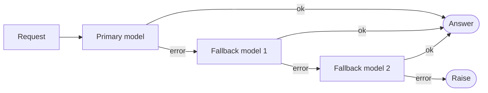
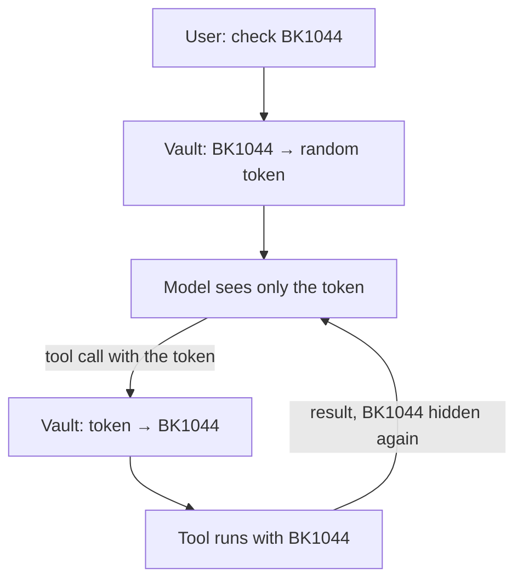

# Chapter 8: Prebuilt middleware: limits, fallback and PII

> [!NOTE]
> **📍 At a glance**
> - **You will build:** limits, fallbacks and PII protection with prebuilt middleware
> - **Level:** intermediate · **Time:** about 30 minutes
> - **Builds on:** [Chapter 7](07-middleware.md) (the hooks, summarization, human-in-the-loop). To-do lists, tool selection, tool errors, tool retry and tool emulation are in [Chapter 9](09-guardrails-to-do-lists-and-tool-resilience.md).

**After this chapter you can:**

- Cap cost with model call and tool call limits (run vs thread)
- Survive a provider outage with model fallback, without letting it hide a typo or a bad key
- Keep personal data away from the model with `PIIMiddleware`, including custom detectors
- Explain why a hash is one-way, and give a tool the real value through a token vault
- Explain the difference between a guardrail and middleware
- Combine several middlewares and decide between LangChain and LangGraph

## 8.1 `ModelCallLimitMiddleware`

**Why:** cost. An agent that makes 100 model calls in one run costs real money, and there was no built-in cap.

- Same idea as the `max_turns` safeguard from the raw Python loop ([LLM book, Chapter 2](../llm/02-the-agentic-loop-in-pure-python.md)), formalised with better checks
- **Where to set the number** comes from domain knowledge, not a framework default. A web-search agent rarely needs more than 5 to 15 searches
- **Why not tell the model "do not call more than twice"?** A model can ignore it, and it breaks when you swap the model. A limit in code is specific and dependable

**Run limit vs thread limit** (whiteboard analogy: breakfast, lunch, dinner):

- **Run limit:** a cap on **one `.invoke()`**. "Chappatis allowed per meal"
- **Thread limit:** a cap **across all runs** of one conversation. "Chappatis allowed in total, across all meals"

```python
from langchain.agents import create_agent
from langchain.agents.middleware import ModelCallLimitMiddleware
from langgraph.checkpoint.memory import InMemorySaver

call_limited_agent = create_agent(
    model="openai:gpt-5-mini",
    tools=cinebot_tools,
    checkpointer=InMemorySaver(),        # needed for thread_limit to persist across calls
    middleware=[
        ModelCallLimitMiddleware(        # low values, just for the example
            thread_limit=5,              # across the WHOLE conversation
            run_limit=2,                 # per single .invoke() call
            exit_behavior="end",         # graceful stop, not an exception
        ),
    ],
)
```

- **`exit_behavior="end"`:** the run stops and the last message is an `AIMessage` such as `Model call limits exceeded: run limit (2/2)` or `... thread limit (5/5)`. The class notebook showed the thread version
- **`exit_behavior="error"`:** raises `ModelCallLimitExceededError` instead
- The run limit **resets on every `invoke`**. The thread limit does not
- **Without a checkpointer** the thread limit has nothing to remember between calls. In my test a thread limit of 1 never fired across two separate `invoke`s

> [!IMPORTANT]
> **🏭 In production**
> - Call limits are your cost circuit-breaker: set a per-run and a per-thread limit on every agent that faces users
> - Alert when a run hits its limit; it usually means a loop or a confusing tool
> - *Added by Claude.*

## 8.2 `ToolCallLimitMiddleware`

**Why:** tool calls add to context size and cost. An agent asked to "find the important emails" could keep digging through years of mail unless capped.

- Works **globally** or for **one named tool**. Use two instances together:

```python
from langchain.agents import create_agent
from langchain.agents.middleware import ToolCallLimitMiddleware
from langgraph.checkpoint.memory import InMemorySaver

tool_limited_agent = create_agent(
    model="openai:gpt-5-mini",
    tools=cinebot_tools,
    checkpointer=InMemorySaver(),
    middleware=[
        ToolCallLimitMiddleware(run_limit=8),                                              # global, this run
        ToolCallLimitMiddleware(tool_name="cancel_booking", thread_limit=2, run_limit=1),  # one tool, tighter
    ],
)
```

- Whiteboard numbers: **8** for the global run limit. For `cancel_booking`, **`run_limit=1`** and **`thread_limit=2`** (the conversation limit)
- The board traces bookings B100, B101, B102: the first two cancels go through (one per run, two in the whole thread). The third is blocked, because the thread limit is used up. A new run refreshes only the **run** counter
- Class demo: three separate `invoke`s asking to cancel B100, B101, B102. The third tool call was refused with the tool message `Tool call limit exceeded. Do not call 'cancel_booking' again.`
- **Default behaviour (`exit_behavior="continue"`):** the blocked call becomes an **error tool message**, and the model carries on and can explain. Other options: `"end"` and `"error"`
- A strict limit on one irreversible tool plus a looser overall limit is a common pairing (assignment question A2 Q10)
- **Run vs thread, class 13 wording:** a run limit of 4 caps the chapatis in one sitting, a thread limit of 10 caps the whole day however it is split. Another picture: the searches inside **one reply** are the run, the total across the **whole chat session** is the thread
- **A limit rejection is a tool message with an error status, not an interrupt.** An interrupt exists to ask a human for a decision. A limit needs no human input, so the call is refused and reported back as information the model can pass on to the user

### `ToolCallLimitMiddleware`: the exit behaviours and the error

- Settings from the docs: `tool_name` (one tool; without it the limit covers all tools), `run_limit`, `thread_limit` (needs a checkpointer) and `exit_behavior`. At least one limit is required
- `exit_behavior`: `'continue'` (default) blocks the extra calls with error messages and lets the model carry on. `'end'` stops gracefully. `'error'` raises **`ToolCallLimitExceededError`**
- ✅ *Verified (details in "How this chapter was checked").*

*Source: `langchain-ai/docs`, `src/oss/langchain/middleware/built-in.mdx` (Tool call limit).*

## 8.3 `ModelFallbackMiddleware`



**Why:** if the primary model provider has an outage, the app should not simply stop working.

```python
from langchain.agents import create_agent
from langchain.agents.middleware import ModelFallbackMiddleware

resilient_agent = create_agent(
    model="openai:gpt-5",                  # primary
    tools=cinebot_tools,
    middleware=[
        ModelFallbackMiddleware(
            "openai:gpt-5-mini",           # first fallback
            # "ollama:llama3.2",           # a further, fully local last resort
        ),
    ],
)
```

- Models are passed **positionally**, first fallback first, then more in order
- **What counts as a failure:** a hard error such as a 404 or an expired key
- **What it is not:** routing by speed or cost, or a smart dispatcher choosing the best model for a task. It only activates when the primary model genuinely fails
- The **full conversation history** goes to whichever model ends up answering. Nothing else changes
- Class demo: the primary name was one that does not exist, so without the middleware the call failed with a 404 `model_not_found` error. With the middleware it fell through to `gpt-5-mini`
- The whiteboard draws the symptom it prevents: **"AI -> I am unable to connect."**

> **Correction.** The class transcript wrote `ModelFallbackMiddleware(model="...")`. That raises `TypeError: unexpected keyword argument 'model'`. The notebook's positional form is the one that works

### A fallback can hide a typo (class 12)

- The class 12 demo's primary model was `openai:gpt-5.5-haiku`, a name that does not exist. With the middleware the answer simply came from `gpt-5-mini`. The mentor: "it didn't give me an error"
- That is the hazard. The middleware cannot tell an outage from a mistake in your own config
- *Tested on 1.5.0* (stand-in OpenAI server): the 404 `model_not_found` and a 401 bad key both fell back **silently**. No warning, no log line at any level. The installed `ModelFallbackMiddleware` catches every `Exception` and logs nothing when it switches
- So a typo, an expired key or a retired model can run on the backup for weeks, at a different quality and cost, and nobody notices

How to catch it:

- **Check who answered.** `reply.response_metadata["model_name"]` read `gpt-5-mini-2025-08-07` on the typo run. Compare it with the model you configured, and alert on a mismatch
- **Fall back only on outages** (*added by Claude*):

```python
import logging
from langchain.agents import create_agent
from langchain.agents.middleware import wrap_model_call
from langchain.chat_models import init_chat_model
from langchain_core.exceptions import ModelAPIError, ModelConnectionError, ModelRateLimitError, ModelTimeoutError

log = logging.getLogger("llm.fallback")
OUTAGE = (ModelRateLimitError, ModelAPIError, ModelConnectionError, ModelTimeoutError)   # 429, 5xx, network, timeout

def fallback_on_outage(backup):
    @wrap_model_call
    def fallback(request, handler):
        try:
            return handler(request)
        except OUTAGE as e:                      # a real outage: switch, and say so
            log.warning("primary model failed (%s); using the backup", type(e).__name__)
            return handler(request.override(model=backup))
        # ModelNotFoundError (typo) and ModelAuthenticationError (bad key) are not caught: the run fails loudly
    return fallback

def check_models(*models):
    """Run at startup or deploy: a typo or a bad key fails here, not behind a fallback."""
    for m in models:
        m.invoke("Reply with OK")

primary = init_chat_model("openai:gpt-5-mini")
backup = init_chat_model("anthropic:claude-sonnet-4-6")    # another provider, so it survives an OpenAI outage
check_models(primary, backup)
agent = create_agent(model=primary, tools=cinebot_tools, middleware=[fallback_on_outage(backup)])
```

✅ *Verified on 1.5.0 with `ChatOpenAI` objects pointed at a stand-in server: a 429 and a 503 fell back, each with a `WARNING llm.fallback` line; the typo raised `OpenAIModelNotFoundError` (404) and the bad key `OpenAIAuthenticationError` (401). `check_models` raised the same 404 for the typo at once (and the 429 and 503 for the outages).*

- These error classes are **provider-neutral** (`langchain_core.exceptions`). In the installed versions `langchain-openai`, `langchain-anthropic` and `langchain-google-genai` raise subclasses of them. Other provider packages may raise only their own SDK's errors, so check yours
- `check_models` also fails while a provider is down (tested: 429 and 503 raised too). Run it at deploy, and retry the deploy, not on every request
- Keep the SDK's own retries on the primary (`max_retries`): a short burst of 429s often clears within seconds, and retrying is cheaper than switching models
- The class's rule of thumb: **more than five fallbacks is a smell.** One backup from another provider is usually enough, plus a local model if you need to work offline

### Refusals: `ModelRefusalMiddleware`

- **The problem:** providers report a refusal (a safety-policy "I can't help with that") as a **successful** response
  - *Checked:* without this middleware the run ended normally, and the final answer was the `refusal` block itself
- `ModelRefusalMiddleware` (needs `langchain>=1.4.9`) raises **`ModelRefusalError`** instead, so your app can react
- It looks for a `refusal` content block (OpenAI, Anthropic and Gemini produce one), and for refusals that fail to parse under `response_format`
  - It does **not** catch refusals the model writes as ordinary text

```python
from langchain.agents import create_agent
from langchain.agents.middleware import (
    ModelFallbackMiddleware, ModelRefusalMiddleware, ModelResponse, wrap_model_call,
)
from langchain.messages import AIMessage
from langchain_core.exceptions import ModelRefusalError

@wrap_model_call
def reply_on_refusal(request, handler):
    try:
        return handler(request)
    except ModelRefusalError:                          # every model refused
        return ModelResponse(result=[AIMessage("I cannot help with that request.")])

agent = create_agent(
    model="claude-sonnet-5-5",
    tools=[],
    middleware=[
        reply_on_refusal,                              # outermost: the last resort
        ModelFallbackMiddleware("gpt-6.1-sol"),        # a refusal moves on to the next model
        ModelRefusalMiddleware(),                      # innermost: turns a refusal into an error
    ],
)
```

- **Order matters:** list the refusal middleware **after** the fallback, so the fallback sees the error
  - *Checked:* in that order a refusing primary fell back to the backup's answer. Reversed, `ModelRefusalError` reached the caller
- **No fallback?** Catch `ModelRefusalError` around `invoke`. The thread stays usable
  - *Checked:* the refused AI reply was **not** saved, but the user's message was. The next turn held two human messages in a row, then the answer
- `ModelRetryMiddleware` does **not** retry refusals (checked: one model call). A retry on the same prompt rarely changes the answer anyway
- **Streaming:** text the model sends before it refuses can reach the client before the error is raised
- **Other handling** (save the refusal in state, or `interrupt()` to ask a person): skip this middleware and check for `refusal` blocks in your own middleware ([Chapter 10](10-shell-tools-and-custom-middleware.md))
- Refusals outside agents (`with_structured_output`): [Chapter 4](04-structured-output.md), 4.9

### Choosing the model per run: `ModelRouterMiddleware` (beta)

- Fallback only acts when a model **fails**. A router **picks** a model up front, by the task
- Before the run, a **decision model** reads the latest human message and picks one of your named `ModelChoice` entries
  - That model then serves **every** model call in the run. The pick is saved in state as `model_route`
- Beta: needs `langchain>=1.5.0`, raises a `LangChainBetaWarning`, and the API may change

```python
from langchain.agents import create_agent
from langchain.agents.middleware import ModelChoice, ModelRouterMiddleware
from langchain_typesafe import TypeSafeClassifier      # the docs' decision model

router = ModelRouterMiddleware(
    classifier=TypeSafeClassifier(),
    choices={
        "fast": ModelChoice(
            model="openai:gpt-6-luna",
            criteria="Direct lookups, extraction, and localized changes with explicit targets.",
        ),
        "powerful": ModelChoice(
            model="openai:gpt-6.1-sol",
            criteria="Architecture, novel root-cause reasoning, and high-stakes decisions.",
        ),
    },
    instructions="Choose the least costly model that can complete the task safely.",
)
agent = create_agent("openai:gpt-6-luna", middleware=[router])
```

- **What a decision model is:** a `BaseDecisionModel` (`langchain_core.decisions`) that answers typed questions with probabilities: a yes/no question, a choice between labels, a score
  - The docs use `TypeSafeClassifier` from `langchain_typesafe` (not installed here). `langchain-openai` ships an `OpenAIClassifier`. Any subclass works
- *Checked with a scripted decision model:* it picked `powerful`, only the `powerful` model was called, and `result["model_route"].choice` was `"powerful"`
- Auto mode uses the same kind of decision model to block risky tool calls ([Chapter 9](09-guardrails-to-do-lists-and-tool-resilience.md), 9.1)

## 8.4 `PIIMiddleware`

**PII** (personally identifiable information): date of birth, phone number, email, government ID numbers, passwords. It generally should **not reach the model** at all.

```python
from langchain.agents import create_agent
from langchain.agents.middleware import PIIMiddleware

pii_agent = create_agent(
    model="openai:gpt-5-mini",
    tools=cinebot_tools,
    middleware=[
        PIIMiddleware("email", strategy="redact", apply_to_input=True),
        PIIMiddleware("credit_card", strategy="mask", apply_to_input=True),
    ],
)
```

Strategies (checked on `langchain` 1.4.7):

- **`redact`:** removes the value. `priya@example.com` becomes `[REDACTED_EMAIL]`
- **`mask`:** keeps a hint so the model can tell something was there. `priya@example.com` becomes `priya@****.com`
- **`hash`:** replaces it with a **deterministic** hash, for example `<email_hash:6bdb7e96>`. The same input always gives the same hash
  - Identity stays usable for analytics and debugging without exposing the value: the same customer gets the same hash in every log
  - Class analogy: telling an outsider a card is "AMZ1234ABC" reveals nothing, but the system that made the reference can still look it up. That only works if the system **kept a record** of which value made which reference
  - A hash cannot be turned back into the value, so a tool that needs the real value gets nothing from it. The pattern for that case is a token vault ("Hashing is one-way", end of 8.4)
- **`block`:** stops the run with a `PIIDetectionError`

Built-in types in this version: `email`, `credit_card`, `ip`, `mac_address`, `url`. Anything else is a **custom** type.

> **What really happened with the class card number.** The class text says the card `4111-1111-1111-1234` was masked. The notebook output shows it was **not**: only the email was redacted, and the model even warned the user about the card. The built-in card detector checks that the number is **valid** (a checksum, the Luhn check), and this made-up number fails it. A valid test number such as `4111-1111-1111-1111` is masked to `****-****-****-1111`. Class 13 found this live in the docs: the detector uses the **Luhn algorithm**, the standard checksum that real card numbers satisfy. A string of digits that fails it does not register as a card. So: **test with valid-looking numbers, and remember a detector can skip lookalikes**

What the class 13 run also showed:

- Instead of silently stripping the data, the agent's **reply warned the user** not to share full card numbers in chat. That is a better experience than a blunt rejection
- The message history confirmed the email was redacted **before** it reached the model
- **Why this matters beyond the reply:** even if the system prompt tells the model not to misuse personal data, sending that data to a third-party provider is itself a **compliance question**. A customer could ask why their information left your application at all. Audits increasingly ask this
- **Real payment details:** do not let card numbers pass through the model to complete a purchase. Use a **headless tool**, a secure payment page the user interacts with directly, outside the model's view ([Chapter 6](06-agents-and-memory.md), 6.7)

**Custom PII types.** Aadhaar and PAN (India-specific IDs) are named on the whiteboard as formats no framework can ship for every country. Supply your own detector, either as a **function** or as a **regex string**:

```python
import re
from langchain.agents import create_agent
from langchain.agents.middleware import PIIMiddleware

def detect_booking_code(content: str) -> list[dict]:
    """Detect CineBot's own booking code format: BK followed by 4 digits."""
    return [
        {"text": m.group(0), "start": m.start(), "end": m.end()}
        for m in re.finditer(r"BK\d{4}", content)
    ]

custom_pii_agent = create_agent(
    model="openai:gpt-5-mini",
    tools=cinebot_tools,
    middleware=[
        PIIMiddleware("booking_code", detector=detect_booking_code, strategy="mask"),
        PIIMiddleware("aadhaar", detector=r"\b\d{12}\b", strategy="mask"),     # regex as a STRING
    ],
)
# "my booking BK1044"    -> "my booking ****1044"
# "aadhaar 123456789012" -> "aadhaar ****9012"
```

> **Correction.** The class transcript passed a compiled pattern, `detector=re.compile(r"\b\d{12}\b")`. That raises `TypeError: 're.Pattern' object is not callable`. Pass the pattern as a **string**, or write a function that returns a list of matches
>
> **Docs vs package.**
> - The docs' PII section also shows a compiled pattern ("Method 2: Compiled regex pattern")
> - On `langchain` 1.5.0 the middleware is **created** without complaint, but the **first run** raises that same `TypeError` (checked). The correction above still holds

The function detector returns a list of dicts with `text`, `start` and `end`.

- The docs type this as **`PIIMatch`** (`from langchain.agents.middleware import PIIMatch`) with the keys `type`, `value`, `start` and `end`
- *Checked on 1.5.0:* a detector returning `value` and one returning `text` both redacted `123-45-6789`. Follow `PIIMatch`

Class 13 used `strategy="hash"` for the booking codes. Checked: `BK1044` becomes `<booking_code_hash:94be15f9>`. What that hash can and cannot do is at the end of 8.4.

Three more switches (from the library signature, not explained in class 12):

- `apply_to_input` (default `True`): clean user messages before the model
- `apply_to_output` (default `False`): clean what the model replies
  - It also cleans the **live stream** (needs `langchain>=1.3.2`), via a stream transformer
  - That covers text deltas, tool-call args, tool outputs and state snapshots, before readers of `stream_events(version="v3")` see them ([Chapter 6](06-agents-and-memory.md), 6.8)
  - Why it matters: `after_model` redaction happens after the model finishes, but streamed tokens reach the reader **while** it is still writing
  - *Checked on 1.5.0:* with `PIIMiddleware("email", strategy="redact", apply_to_output=True)`, the streamed deltas read `Contact me at [REDACTED_EMAIL] today`. Without the flag the raw address streamed out
  - **How it catches a match split across deltas** (docs): it holds back the last **128 characters** of each text block, tool-call argument and tool output, then checks the held text plus the new delta
  - So keep custom detector matches **at most 128 characters**: the start of a longer match can go out before the rest arrives
- `apply_to_tool_results` (default `False`): clean what tools return

> [!IMPORTANT]
> **🏭 In production**
> - Regex PII detection misses things (names, free-text addresses); for regulated data add a dedicated detector and keep raw data out of logs too
> - Decide where PII may go: masking before the model protects you only if traces and logs are masked as well
> - *Added by Claude.*

### Hashing is one-way: when a tool needs the real value (class 13)

- In class 13 the mentor said he could "unhash" a value to get it back. A hash does not work that way: there is no key, and nothing to decrypt
- *Checked on 1.5.0:* `PIIMiddleware` keeps no record of what it replaced; its only attributes are its settings. With `strategy="hash"`, the model passed `<booking_code_hash:94be15f9>` to a `lookup_booking` tool, which answered "No booking found"
- The opposite risk: a short, unsalted hash of a **small set of values** is easy to reverse by trying them all
  - The middleware keeps the first 8 hex characters of a plain SHA-256
  - Trying every code from `BK0000` to `BK9999` found `BK1044` from `94be15f9` in 9 ms
  - Plain Python on this machine hashed about 2.2 million values a second, so every 10-digit phone number would take about 1.3 hours on one core
- So `hash` is for **telling records apart** (analytics, logs), not for hiding a value someone can guess

**When a tool needs the real value: a token vault** (*added by Claude*)



```python
import re, secrets
from langchain.agents.middleware import AgentMiddleware
from langchain.messages import HumanMessage, ToolMessage

BOOKING = re.compile(r"\bBK\d{4}\b")
TOKEN = re.compile(r"<booking:[0-9a-f]{8}>")

class BookingVault(AgentMiddleware):
    """Real booking codes never reach the model. Random tokens go in; tools get the real value back."""

    def __init__(self):
        super().__init__()
        self.real, self.token_of = {}, {}   # token -> value, value -> token. Production: encrypted, per user, with a TTL

    def hide(self, text: str) -> str:
        def swap(m):
            if m.group() not in self.token_of:                   # same code, same token
                token = f"<booking:{secrets.token_hex(4)}>"      # random: nothing to reverse
                self.token_of[m.group()], self.real[token] = token, m.group()
            return self.token_of[m.group()]
        return BOOKING.sub(swap, text)

    def reveal(self, text: str) -> str:
        return TOKEN.sub(lambda m: self.real.get(m.group(), m.group()), text)

    def before_model(self, state, runtime):
        last = state["messages"][-1]
        if isinstance(last, HumanMessage) and BOOKING.search(last.text):
            return {"messages": [HumanMessage(content=self.hide(last.text), id=last.id)]}  # same id: replaces it
        return None

    def wrap_tool_call(self, request, handler):
        args = {k: self.reveal(v) if isinstance(v, str) else v for k, v in request.tool_call["args"].items()}
        result = handler(request.override(tool_call={**request.tool_call, "args": args}))   # the tool sees BK1044
        if isinstance(result, ToolMessage) and isinstance(result.content, str):
            result.content = self.hide(result.content)                                    # the model does not
        return result
```

```python
from langchain.agents import create_agent
from langchain.tools import tool
from langgraph.checkpoint.memory import InMemorySaver

@tool
def lookup_booking(code: str) -> str:
    """Look up a booking by its code."""
    bookings = {"BK1044": "Interstellar, 2 seats, 7 pm"}          # stands in for your database
    return f"Booking {code}: {bookings[code]}" if code in bookings else f"No booking found for {code}."

vault = BookingVault()
agent = create_agent(model="openai:gpt-5-mini", tools=[lookup_booking], middleware=[vault],
                     checkpointer=InMemorySaver())
config = {"configurable": {"thread_id": "t1"}}
result = agent.invoke({"messages": [("user", "Please check booking BK1044")]}, config)
print(vault.reveal(result["messages"][-1].content))     # reveal only when you show the reply
```

✅ *Verified on 1.5.0 with a stand-in OpenAI server that logged every request: the model saw `Please check booking <booking:95afe136>` and called `lookup_booking` with that token; the tool received `BK1044`; its result went back to the model as `Booking <booking:95afe136>: Interstellar, 2 seats, 7 pm`; `vault.reveal` turned the reply into `… Booking BK1044: …`. "BK1044" appeared in neither request the provider received, nor in the saved thread.*

- **The tokens are random,** so there is nothing to reverse. Only the vault can map them back
- **Reveal at display time, not in the agent's state.** If the real value goes back into the messages, the next turn sends it to the model
- **Production:** keep the vault in your own database, encrypted, with a time limit, and **one vault per user or thread**. A shared vault lets one user's token open another user's booking, so the tool must still check that the booking belongs to the user
- Card numbers are the extreme case: payment processors issue their own tokens, and card data should not reach the model at all (the payment page above)

## 8.5 Guardrail vs middleware

> **A guardrail is the concept: protecting the agent from doing something undesirable. Middleware is the mechanism you use to implement it.**

- The whiteboard: "Guardrails is a way to control the AI agent behaviour." PII detection is one concrete guardrail, implemented with `PIIMiddleware`
- They are **not two competing systems**. Middleware is one **mechanism** for a guardrail. Class 12 put it as "guardrails are applied as middleware". Class 13 adds that careful system-prompt instructions and third-party libraries are other mechanisms
- **Highway analogy (class 13):** a barrier on a mountain road keeps a car from going over the edge. A barrier on a highway keeps it from swerving into oncoming traffic. An agent's output is unpredictable by default, so something must bound what it can say or do
- Working definition: "a guardrail is a way to control the AI agent's behaviour, that's it"
- **Built-in guardrails you can see:** a chat product refuses a request for something dangerous and deflects a request for its raw system message. The tighter the guardrail, the harder it is to work around. Gaps make a system easier to push past
- **Even a tool call limit is a guardrail.** It is a deliberate constraint on behaviour
- **"Compliance" is not defined by the framework.** It is defined outside it, by company policy, regulation or certification (HIPAA, GDPR, SOC 2)
- Examples the board gives: the user talks rudely or gives personal info, and the agent flags it
- This came up repeatedly in class and is a **common interview question**

Where these patterns show up in real work (from the notebook):

- **Fintech fraud detection:** a `wrap_tool_call` hook around every transaction tool, flagging or blocking by velocity, amount or pattern
- **Healthcare assistants:** PII redaction is often a legal requirement (HIPAA in the US), not optional polish
- **Customer support:** approval gates before refunds or account changes (human in the loop)
- **Internal tools:** audit logging via `wrap_tool_call`, anywhere "who did what, when" needs an answer

## 8.6 Several middlewares, and LangChain vs LangGraph

**Several middlewares on one agent**

- Pass them as a **list**. No need for a separate agent per concern
- Order is **not random**. Either a defined priority applies, or they run in **declaration order**. They are designed not to collide
- My test: two `before_model` hooks ran in the order they were listed
- **Latency:** a middleware that calls a model (summarization) adds some. Pure code (a call-limit check) adds almost none

**When to stay in LangChain and when to drop to LangGraph**

- Middleware exists in LangGraph too. It is not unique to LangChain
- LangChain sits on top of LangGraph and gives a more convenient, somewhat abstracted interface to the same machinery
- **Stay in LangChain + middleware** for most agents, including a simple RAG chatbot (which may not even need middleware)
- **Go to LangGraph** when you need precise, deterministic control of state, checkpointer internals, stores or interrupts
- Other tools use other names for the same idea: Google's Agent Development Kit says "callbacks", Claude Code and Cursor say "hooks"
- Agents built only from MCP connections and instructions (no framework) are usually local developer tools, not deployable services

**Observability:** there is no universal best choice. LangFuse integrates easily with the LangChain family. For RAG, test dedicated evaluation tools. Early results are often deceptively easy, so real quality needs more testing than the basics.

### A production starter stack (*added by Claude*)

One agent with the middleware from Chapters 7 to 11 combined. Order matters: the list runs **top to bottom on the way in** (before hooks) and wraps from the outside in.

```python
from langchain.agents.middleware import (
    PIIMiddleware, ModelCallLimitMiddleware, ToolCallLimitMiddleware, ModelRetryMiddleware,
    ModelFallbackMiddleware, ToolRetryMiddleware, SummarizationMiddleware, HumanInTheLoopMiddleware)

agent = create_agent(
    model="openai:gpt-4o-mini",
    tools=[search_orders, send_email],
    checkpointer=saver,                                                    # needed for HITL + memory
    middleware=[
        PIIMiddleware("email", strategy="redact", apply_to_input=True),   # 1 clean input first
        ModelCallLimitMiddleware(thread_limit=50, run_limit=10, exit_behavior="end"),  # 2 cost cap
        ToolCallLimitMiddleware(run_limit=20),
        ModelRetryMiddleware(max_retries=2),                               # 3 transient errors
        ModelFallbackMiddleware("anthropic:claude-haiku-4-5"),             # 4 provider outage
        ToolRetryMiddleware(max_retries=2),
        SummarizationMiddleware(model="openai:gpt-4o-mini",
                                trigger=("tokens", 8000), keep=("messages", 20)),  # 5 long chats
        HumanInTheLoopMiddleware(interrupt_on={"send_email": True}),       # 6 risky actions
    ],
)
```

| Layer | Protects against |
|---|---|
| PII redaction | personal data reaching the model, logs and traces |
| Call limits | runaway loops and surprise bills |
| Retry → fallback | rate limits, timeouts, provider outages |
| Summarisation | context overflow and growing cost per turn |
| Human approval | irreversible actions done wrongly |

- Start with this, then remove what a use case doesn't need; add tracing ([Chapter 15](15-testing-agents-and-tracing.md)) on top
- Model names are examples; put them in config

✅ *Verified offline with scripted models: the stack built and ran; the stored user message read `mail me at [REDACTED_EMAIL]`.*

## 8.7 Questions from the class

- **Why not just prompt "do not call the tool more than twice"?** A prompt is not reliable. A limit in code is (8.1)
- **Does middleware add latency?** Only if it calls a model, or does heavy work (8.6)
- **Is PII a guardrail or middleware?** The guardrail is the goal, middleware is how you implement it (8.5)
- **Can I attach several middlewares?** Yes, as a list (8.6)
- **Do they run in a random order?** No. A defined priority applies, or declaration order (8.6)
- **LangChain + middleware or LangGraph?** See 8.6
- **Does the fallback tell you the primary model name is wrong?** No. In class 12 the misspelled model fell back without an error. Tested: no warning and no log line (8.3)
- **Should every agent have a fallback?** The mentor: yes, providers do have outages. Also true: fall back only on outages, alert when it happens, and re-test your prompts on the backup. For safety-critical work, a silent switch to a weaker model is itself a risk (8.3, 8.9)
- **Can a hashed value be "unhashed"?** No. A hash is one-way. To get values back you keep your own token-to-value record, a vault (8.4)

## 8.8 Interview corner

**What interviewers listen for:** you treat limits as **cost guardrails**, you know fallback covers provider failure, and you know PII masking has to cover logs and traces too.

### 🟢 Basic

<details class="qa"><summary>1. Run limit vs thread limit?</summary>

- Run limit: one `invoke`. Thread limit: the whole conversation, which needs a checkpointer
- *Stronger answer:* you can limit one tool tightly and the whole run loosely. Set the numbers from domain knowledge

</details>

<details class="qa"><summary>2. What does model fallback do, and what does it not do?</summary>

- It switches to another model when the primary hard-fails (404, bad key, outage)
- It does **not** route by cost, speed or task. The full history goes to the fallback

</details>

### 🟡 Intermediate

<details class="qa"><summary>3. Redact vs mask vs hash vs block for PII?</summary>

- Redact removes it, mask hides part, hash replaces it with a hash, block stops the run
- *Stronger answer:* masking an id your tool needs breaks the tool call. Pick the strategy per field

</details>

<details class="qa"><summary>4. Guardrail vs middleware?</summary>

- A guardrail is the goal of keeping the agent from undesirable behaviour. Middleware is the mechanism that implements it
- *Stronger answer:* give an example, such as PII protection implemented with `PIIMiddleware`

</details>

### 🔴 Senior

<details class="qa"><summary>5. When would you leave LangChain for LangGraph?</summary>

- When you need precise, deterministic control of state, checkpointer internals, stores or interrupts
- *Stronger answer:* for most agents, including a simple RAG chatbot, LangChain with middleware is enough

</details>

<details class="qa"><summary>6. Your main LLM provider has an outage. How does your system keep working?</summary>

- `ModelFallbackMiddleware` to a second provider, plus retries with backoff for short blips (Ch9)
- *Stronger answer:* test the fallback path regularly, keep prompts portable across providers, and alert when fallback traffic rises

</details>

<details class="qa"><summary>7. The model refuses a request. What does your agent do by default, and how do you change that?</summary>

- By default nothing special: the refusal comes back as a normal, "successful" final answer
- `ModelRefusalMiddleware` turns it into `ModelRefusalError`; list it **after** `ModelFallbackMiddleware` so the next model gets a try
- An outer `wrap_model_call` can catch the error when every model refuses and reply politely
- *Stronger answer:* retries don't help (`ModelRetryMiddleware` skips refusals); log refusals as a metric; and remember text-only refusals and tokens already streamed slip past it

</details>

<details class="qa"><summary>8. Fallback, refusal handling and a model router: how do they differ?</summary>

- Fallback reacts to **errors**: the next model gets the same request
- Refusal handling reacts to a **refusal** block, and can feed into the fallback
- A router **chooses before** the run, from the request, using a decision model (beta)
- *Stronger answer:* stack them deliberately: router to pick the cheapest capable model, fallback for outages, refusal last, and log `model_route` to see the cost split

</details>

<details class="qa"><summary>9. Your backup model has been answering for a week and nobody noticed. How did that happen, and how do you prevent it?</summary>

- `ModelFallbackMiddleware` catches every exception and switches without a warning, so a typo in the model name, an expired key or a retired model looks like success
- Prevent it: fall back only on outages (rate limit, 5xx, network, timeout) and let 404 and 401 fail; log every switch; smoke-test each configured model at deploy
- *Stronger answer:* alert when `response_metadata["model_name"]` differs from the configured model, track the fallback rate on a dashboard, and re-run your evals on the backup so you know what quality you get when it fires

</details>

<details class="qa"><summary>10. A tool needs the customer's real booking code, but the code must never reach the model provider. Design it.</summary>

- `strategy="hash"` is not enough: a hash cannot be turned back, so the tool gets nothing, and a short hash of a small code space is guessable by trying every code
- Use a vault: replace codes with random tokens before the model, keep token to value on your side, swap the real value in inside `wrap_tool_call`, and hide it again in the tool's result
- *Stronger answer:* one vault per user or thread, encrypted, with an expiry; the tool still checks ownership; reveal only when displaying the reply; and make sure logs and traces see tokens, not values

</details>

> [!TIP]
> **🧩 Design question to practise:** *"A health-insurance chatbot must never send member identifiers to the model provider."* Cover PII detection and strategy, inputs vs outputs vs tool results, logging, and a fallback that respects the same rule.

## 8.9 Added by Claude, not from the sources

Not in the course material. Established practice, but check current docs.

**Limits and fallback**

- **Limits stop runaway cost, not bad behaviour.** Keep the run limit comfortably above what a normal task needs, and add a time limit too
- **A thread limit needs a persistent checkpointer** to survive restarts
- **Log when a fallback fires.** The installed middleware does not (8.3). It can hide an outage, and the fallback model may follow your prompt and tools differently. Re-test your prompts on it, and do not fall back to a weaker model silently for safety-critical work

**PII**

- **Masking an identifier your tools need breaks the tool call.** After `BK1044` becomes `****1044`, the model cannot pass the real code to a tool. Mask what the **model** must not see, and fetch the real value in code
- **Regex detectors guess.** A 12-digit pattern matches any 12-digit number, and misses numbers written with spaces. A PAN pattern is more specific (five letters, four digits, one letter):

```python
PIIMiddleware("pan", detector=r"\b[A-Z]{5}[0-9]{4}[A-Z]\b", strategy="mask")
```

- **PII middleware is one layer.** Logs, traces and your own database may still hold the raw text. Check what each of them records

## Cheat sheet

```python
from langchain.agents.middleware import (ModelCallLimitMiddleware, ToolCallLimitMiddleware,
    ModelFallbackMiddleware, PIIMiddleware)
middleware = [
    ModelCallLimitMiddleware(run_limit=10, thread_limit=50),
    ToolCallLimitMiddleware(tool_name="search", run_limit=3),
    ModelFallbackMiddleware("openai:gpt-4o-mini", "anthropic:claude-sonnet-4-6"),
    PIIMiddleware("email", strategy="redact", apply_to_input=True),
]
fallback_on_outage(backup)               # 8.3: switch on 429 / 5xx / network / timeout only, and log it
reply.response_metadata["model_name"]    # who really answered: alert if it is not the model you configured
BookingVault()                           # 8.4: random tokens to the model, real values only inside tools
```

## Recap

- **Model call limit:** `run_limit` (one invoke) and `thread_limit` (whole conversation, needs a checkpointer). **Tool call limit:** global or per tool
- **Model fallback:** models passed positionally, only on hard failure, full history passed on
- **PII:** redact, mask, hash or block. Custom detector = function or regex **string**. The card checksum can skip fake numbers
- `ModelFallbackMiddleware` switches silently on **any** error, a typo included. Fall back only on outages, log it, and smoke-test model names at deploy
- A hash is one-way, and a short hash of a small code space is guessable. When a tool needs the real value, use a token vault
- **Guardrail = goal, middleware = mechanism**
- Several middlewares go in one list and run in declaration order

## Practice

1. Set both a `run_limit` and a `thread_limit` on one agent and trigger each one independently
2. Add a model call limit and a tool call limit to an existing agent and deliberately trigger both
3. Configure `ModelFallbackMiddleware` and force the primary model to fail (an intentionally wrong model name or key) to confirm the fallback fires. Notice that nothing told you. Then swap in `fallback_on_outage` and watch the same typo fail loudly
4. Write your own custom `PIIMiddleware` detector (with `re`) for an ID format from your own country or use case
5. Explain the difference between a guardrail and middleware in your own words, out loud
6. Assignment 2 (NovaBank), the parts this chapter prepares you for. The assignment has no answer key:
   - A2 Q10: a strict `ToolCallLimitMiddleware` on one tool with a looser `ModelCallLimitMiddleware` overall
   - B2.2: a custom detector for `NB-` plus 8 digits, attached with `strategy="mask"`
   - B3.1 (partly): `SummarizationMiddleware`, `ToolCallLimitMiddleware` and `ModelCallLimitMiddleware` together on one agent
   - (Q6, Q9, Q11 to Q15, B2.3, B3.2, B3.3 and the capstone use the middlewares in Chapter 9)
7. Hash `BK1044` with `strategy="hash"`, then recover it from the hash by trying every code from `BK0000` to `BK9999`. Then build the `BookingVault` and check the provider never sees the code

## How this chapter was checked

- Run offline with a stand-in model on `langchain` 1.4.7:
  - model call limit: run limit, thread limit, `"end"` and `"error"`, and no thread limit without a checkpointer
  - tool call limit: global plus per tool, the blocked third cancel
  - model fallback: a failing primary, the fallback seeing the same message, and the keyword `model=` `TypeError`
  - PII: redact, mask, hash and block, the card checksum, the function detector with `hash`, the regex string, the compiled-regex `TypeError`, the PAN pattern, and declaration order of two hooks
- **Not run against a live model:** a real provider outage and real tool-call choices. Class output was read from the notebook (cells 57 to 101)
- The middlewares for to-do lists, tool selection, tool errors, tool retry and tool emulation are in [Chapter 9](09-guardrails-to-do-lists-and-tool-resilience.md)
- **Details by section** (moved here from the ✅ markers):
  - *8.4 `apply_to_output` on the stream (2026-11-15):* `langchain` 1.5.0, a scripted streaming model replying `Contact me at bob@example.com today`. Deltas read through `stream.interleave("messages", "values")`: with the flag `Contact me at [REDACTED_EMAIL] today` (final state the same), without it the raw address. Tool-call args, tool outputs and snapshots were not checked separately
  - *Built-in middleware page merge (2026-11-15), `langchain` 1.5.0, `langchain-core` 1.8.0, scripted models (no keys, no network):*
    - Refusals: a fake model replied with `[{'type': 'refusal', 'refusal': "I can't help with that."}]`. Without the middleware that was the final answer. With it: `ModelRefusalError` ("Model refused to produce the requested output: ..."); the thread then held only the user message, and the next turn worked. `[fallback, refusal]` gave the backup's answer; `[refusal, fallback]` raised. `reply_on_refusal` + fallback + refusal, both models refusing: `I cannot help with that request.`. `ModelRetryMiddleware(max_retries=2)` + refusal: 1 model call
    - Router: a scripted `BaseDecisionModel` subclass answering the `model_route` choice with `powerful`; a spy middleware saw only the `powerful` model; `result["model_route"].choice` was `powerful`; `LangChainBetaWarning` on construction. The docs' `TypeSafeClassifier` was not installed, so the docs' snippet itself was not run
    - PII: `re.compile(...)` detector built fine and raised `TypeError: 're.Pattern' object is not callable` on the first `invoke`; function detectors returning `value` or `text` both redacted `123-45-6789`. The 128-character hold-back is a docs statement, not tested
  - *`ToolCallLimitMiddleware`: the exit behaviours and the error:* Checked* with `tool_name="t1"`, `run_limit=1` and a model that asked twice: `continue` gave a final model answer; `end` ended with the message `'t1' tool call limit reached: run limit exceeded (2/1 calls).`; `error` raised `ToolCallLimitExceededError` with the same text
  - *Class 12 and 13 recordings (8–9 Aug), added 2026-11-15, `langchain` 1.5.0, `langchain-core` 1.8.0, `langchain-openai` 1.8.0, with a local stand-in for the OpenAI API (404 for `gpt-5.5-haiku`, 401 for a bad key, 429 and 503 for outages, every request body logged):*
    - 8.3 typo: no fallback raised `OpenAIModelNotFoundError` (404, `model_not_found`). With `ModelFallbackMiddleware(gpt-5-mini)` the run answered `answer from gpt-5-mini`, `response_metadata["model_name"]` `gpt-5-mini-2025-08-07`, 0 warnings, 0 log lines at WARNING or above and none mentioning a fallback at any level. A 401 primary also fell back silently. The source: `model_fallback.py` catches `Exception` (re-raising only `GraphBubbleUp`) and has no log call on the switch
    - 8.3 `fallback_on_outage` (the 8.3 block, `ChatOpenAI` objects swapped in for `init_chat_model`): 429 and 503 fell back with one `WARNING llm.fallback` line each; 404 raised `OpenAIModelNotFoundError`, 401 `OpenAIAuthenticationError`; `check_models` raised the 404 at once, and also the 429 and 503. The `langchain-openai` error classes subclass both the `openai` ones and `langchain_core.exceptions` ones (`OpenAIRateLimitError` → `ModelRateLimitError`, `OpenAIAPIError` → `ModelAPIError` for 5xx). `langchain-anthropic` 1.7.10 references all six classes used here; `langchain-google-genai` 4.5.0 references four (not connection or timeout). Only OpenAI was run
    - 8.4 hash: the middleware's attributes were `_resolved_rule, apply_to_input, apply_to_output, apply_to_tool_results, detector, pii_type, strategy`; the user message became `Please check booking <booking_code_hash:94be15f9>`; the tool received the hash and answered `No booking found for <booking_code_hash:94be15f9>.`. The source keeps `sha256(value).hexdigest()[:8]`. Brute force over `BK0000`–`BK9999`: `['BK1044']` in 9 ms. Speed: 2.2 million SHA-256 per second in one Python process
    - 8.4 vault: the 8.4 blocks run as written with the stand-in model; results in the ✅ line, 2 model calls, vault size 1 (one token reused for the same code)
    - **Not run:** a real provider's 404, 401, 429 or 503 (the error classes come from the installed packages); Anthropic or Google models
- The 2026 review added the diagrams, 🏭 In production boxes, graded interview layout, extra senior and design questions and the cheat sheet. These are Added by Claude: standard engineering practice. Cheat-sheet APIs were checked against the installed `langchain` 1.4.7 signatures
- **Cheat sheet:** ran all four middleware in one agent; the email address was redacted from the stored input; the call limits and the model fallback were constructed but not triggered. Ran on `langchain` 1.4.7 with a scripted fake chat model (no API keys, no network), so no real model call was made.

## Sources and further reading

- Live-Class-2026, `classes_summary/12 - 08 Aug - Mastering Middleware.md` and `classes_summary/13 - 09 Aug - Guardrails, Todo Lists & Tool Resilience.md` (tool call limit, guardrails and PII parts)
- Live-Class-2026, `classes_transcription_summary/12 - 08 Aug - LangChain - Mastering Middleware.md` and `classes_transcription_summary/13 - 09 Aug - LangChain - Middlware & Tools.md` (the same parts)
- Live-Class-2026, `MIddleware.ipynb` (cells 57 to 97), the whiteboard `Agent-Middleware-Architecture.pdf` and the folder README in `Weekend 06 - 1 Aug/11-12 - 1-8 Aug - Agents, Memory & Middleware/`
- Live-Class-2026, `Weekend 07 - 8-9 Aug/README.md` (the other files in that folder are copies of Weekend 06 files)
- Section 8.9 and the corrections in 8.3 and 8.4 are from testing, not from the class sources
- LangChain docs: [Built-in middleware](https://docs.langchain.com/oss/python/langchain/middleware/built-in), read in full 2026-11-15 from its source (`langchain-ai/docs` commit `04d4d4a`, `src/oss/langchain/middleware/built-in.mdx`; docs.langchain.com was blocked from this environment). Used for "Refusals" and "Choosing the model per run" in 8.3 and the PII additions in 8.4
- LangChain docs: [Event streaming](https://docs.langchain.com/oss/python/langchain/event-streaming), "Register transformers on middleware" (read 2026-11-15 from its source, commit `04d4d4a`), for `apply_to_output` on the live stream in 8.4
- Class recording transcripts, 8 Aug 2026 (class 12, teaching part 00:10–03:18) and 9 Aug 2026 (class 13, teaching part 00:00–03:11), uploaded by you; the doubt sessions after them were left out: the misspelled fallback demo, "more than five fallbacks", "every agent should have a fallback", the hash strategy and "I can unhash it"
- Added by Claude: `fallback_on_outage`, `check_models` and the bullets around them in 8.3 (except the class's five-fallbacks rule), the token vault in 8.4, and interview questions 9–10

Previous: [Chapter 7, Middleware basics](07-middleware.md) · Next: [Chapter 9, Guardrails, to-do lists and tool resilience](09-guardrails-to-do-lists-and-tool-resilience.md)
