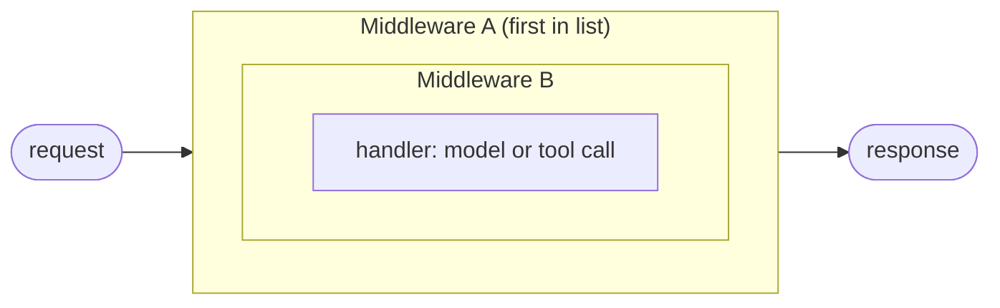

# Chapter 10: Shell tools and custom middleware

> [!NOTE]
> **📍 At a glance**
> - **You will build:** a shell-tool agent and your own middleware with hooks, jumps and ordering
> - **Level:** intermediate to advanced · **Time:** about 45 minutes
> - **Builds on:** [Chapter 7](07-middleware.md) (the hooks and the loop), [Chapter 8](08-prebuilt-middleware-limits-fallback-and-pii.md) and [Chapter 9](09-guardrails-to-do-lists-and-tool-resilience.md) (the prebuilt middlewares). Runtime and human-in-the-loop in depth are in [Chapter 11](11-runtime-and-human-in-the-loop.md).

## 10.1 `ShellToolMiddleware`: build your own "Claude Code"

**The question:** how do Claude Code, Cursor or GitHub Copilot create and edit real files on your machine?

- **The trick: access to a terminal.** Anyone who can run shell commands can create, edit and delete files and run scripts
- That is the whole mechanism behind "AI that edits your code": a capable model plus real shell access

```python
from langchain.agents import create_agent
from langchain.agents.middleware import ShellToolMiddleware, HostExecutionPolicy

cinebot_shell_agent = create_agent(
    model=model,
    tools=[],
    middleware=[
        ShellToolMiddleware(
            workspace_root="/content/cinebot_workspace",   # a real Colab path
            execution_policy=HostExecutionPolicy(),
        ),
    ],
)
```

**Tool or middleware?** Both, honestly.

- It behaves like a tool: it exposes a **persistent shell session** the agent sends commands through
- LangChain files it under middleware. That is a framework design choice, not a deep distinction
- Checked: the middleware adds one tool named `shell`, with two arguments, `command` and `restart`

**Where does the agent actually run?**

- **Not on a LangChain server.** On the machine that runs your code
- Google Colab is a real Linux machine, with its file system rooted at `/content`
- The model provider only supplies the **brain**: it decides *which* command to run. Execution happens where your agent's code runs, with whatever shell access you gave it
- `workspace_root` tells the agent where to work. It is the starting folder, **not a jail** (see 10.14)

**Execution policies**

- **`HostExecutionPolicy()`:** full, direct access to the host machine. For trusted places such as a personal notebook or a dev sandbox
- **`DockerExecutionPolicy`:** an isolated container for the agent run, so nothing touches the host directly
- **`CodexSandboxExecutionPolicy`:** reuses an existing Codex CLI sandbox for extra isolation
- Whichever you pick, the mechanism is the same: the agent may run real shell commands somewhere

**Settings worth knowing** (from the library, checked on `langchain` 1.4.7):

- `startup_commands` and `shutdown_commands`: run when the shell opens and closes. *Checked:* `startup_commands=["export GREETING=from_startup"]` made `$GREETING` available to the agent's commands
- `tool_name` (default `"shell"`), `env`, `shell_command`, `redaction_rules`
- Policy limits: `command_timeout` (default **30 seconds**), `max_output_lines` (default **100**). *Checked:* a `sleep 3` with `command_timeout=1.0` came back as `Error: Command timed out after 1.0 seconds.` and the shell restarted
- `DockerExecutionPolicy`: image `python:3.12-alpine3.19` by default, and **network off** by default

**The live demos** (each followed the same pattern: the model requests a command, the tool runs it, the result returns as a tool message, the model summarises):

- "Create a reports folder if it does not already exist" → a real folder appeared in the file browser
- "Do research on the NBA and save it in `nba_research.txt`" → the file landed **in the workspace**. Asking a chat product the same thing gives a file that exists only in *its* sandbox and can never reach your machine
- "Create `Hello_world.py` with one print line" → the message history showed: the human message, an AI message with the tool call (`cat > Hello_world.py << ...`), a tool message confirming the write, and a final AI message. The same command in a real terminal gave an identical file
- "Write a script that creates two folders, run it, then delete it" → a full write, execute, clean-up cycle in one flow
- "Create and run a simple calculator app" → the same pattern scales to small working programs

My offline check of the same cycle (a stand-in model sent the commands): the tool ran `mkdir`, wrote `Hello_world.py` and ran it, and a second run deleted it. The files appeared and disappeared on disk.

**Remote machines.** Can an agent run commands on a secured remote machine (a Kubernetes cluster you reach by SSH)? Yes. Put the SSH connection in the shell tool's **startup commands**. Once your own machine is connected, the agent inherits that access.

**Related tools, for the Deep Agents module:** a filesystem middleware with just four scoped operations (not full shell access), and sub-agent orchestration. Full depth comes with Deep Agents.

> [!IMPORTANT]
> **🏭 In production**
> - Never run a shell tool on a real server or laptop: use a throwaway container or sandbox with no secrets and limited network
> - `workspace_root` is a starting folder, not a jail; isolation must come from the sandbox
> - Log every command the agent runs, and require approval for anything that writes outside the workspace
> - *Added by Claude.*

## 10.2 Why custom middleware

- Every prebuilt middleware is **generic**. It has to be, because LangChain cannot know your business rules
- CineBot examples no prebuilt middleware can know:
  - no customer books more than two movies in one session
  - flag it if the bot ever names a competing cinema chain
  - log every cancellation in a very specific internal audit format
- Custom middleware closes that gap
- Same relationship as Pydantic to plain Python: Python has no field validation built in, so a dedicated layer was added on top

## 10.3 Hooks: six points to intercept execution

> Hooks are extension points in custom middleware that let you intercept, inspect or modify agent execution at specific stages of the lifecycle.

You write a small function and tell LangChain **where** in the run it should execute.

```
Request
  → before_agent                       (once)
  → before_model          ┐
  → wrap_model_call → [ Model ]        │  every pass through
  → after_model           │  the agentic loop
  → wrap_tool_call → [ Tool ]          │
  ↺ back to before_model if more tool calls are needed
  → after_agent                        (once)
```

- **`before_agent` and `after_agent` run exactly once per invocation**: the very start and the very end
- Everything in between (`before_model`, `wrap_model_call`, `after_model`, `wrap_tool_call`) can run **many times**, once per loop pass
- Checked: with one tool call, `before_model` fired twice and the two agent hooks once each
- LangChain builds the execution graph and calls each hook at its declared point. Your code does not decide when

**Why no `before_tool` and `after_tool`?**

- A LangChain design choice, not a universal rule. Google's Agent Development Kit does have separate tool callbacks
- LangChain folds that into **`wrap_tool_call`**, which can do the same job
- Frameworks make different trade-offs, like languages: Python needed Pydantic added for validation, while C++ and Java have it built in

**`before_model` vs `wrap_model_call`**

- **`before_model`:** gives you the agent's **state and runtime**. Good for observing and logging, not for rewriting the outgoing request
- **`wrap_model_call`:** gives you the **actual request object**. You can swap the model, remove tools or change messages, then hand control to the handler
- Restaurant picture: `before_model` is being seated before the meal, you can observe and set a few things. `wrap_model_call` wraps the whole experience: you set the exact order, down to "no onions"

## 10.4 Decorator-based middleware

The simplest way to define a hook is a decorator on a function.

```python
from typing import Any
from langchain.agents import create_agent, AgentState
from langchain.agents.middleware import before_model, before_agent, after_agent
from langgraph.runtime import Runtime

@before_model
def log_before_model(state: AgentState, runtime: Runtime) -> dict[str, Any] | None:
    """Log every call about to be made to the model."""
    print(f"[LOG] About to call model with {len(state['messages'])} messages so far")
    return None          # None means "observed, nothing to change"

@before_agent
def connecting_to_DB(state: AgentState, runtime: Runtime) -> dict[str, Any] | None:
    print("I have connected to DB")
    return None

@after_agent
def disconnecting_to_DB(state: AgentState, runtime: Runtime) -> dict[str, Any] | None:
    print("I have disconnected to DB")
    return None

logged_agent = create_agent(
    model=model, tools=[],
    middleware=[connecting_to_DB, log_before_model, disconnecting_to_DB],
)
logged_agent.invoke({"messages": [("user", "How are you?")]})
# connected to DB -> [LOG] About to call model... -> disconnected to DB
```

- **Return `None`:** "I observed this, I change nothing"
- **Return a dict:** it **updates the state**. *Checked:* returning `{"messages": [SystemMessage(...)]}` from `before_model` added that message to the conversation
- **`before_agent` is the natural place to set up** (open a database connection, load what the run needs), because it fires once at the start. **`after_agent` is the natural place to tear down**
- **You do not pass `state` and `runtime` yourself.** LangChain calls your function with them. A hook must accept the parameters its type provides. A hook defined with **no parameters** fails with `TypeError: bad() takes 0 positional arguments but 2 were given` (shown live, checked)

**Why "before model" is its own hook and not just "before agent"**

- Imagine the user's first message holds personal information: a name, an email, a booking id
- Redact it at `before_agent`, before it enters the system? Or at `before_model`, just before the brain sees it?
- The class point: tools such as `get_booking` or `cancel_booking` might need the **real** id, so stripping too early breaks them. The model does not need the raw value
- Separate hook points exist so you can act at the exact stage you mean
- **A caveat from testing:** the built-in PII middleware writes the masked text **into the state**. Later steps, including the model's own tool arguments, then carry the masked value. If a tool needs the real id, keep it somewhere the tool can read it (the run `context`, the store or a state field), not only in the chat text

## 10.5 `wrap_model_call`: gating and dynamic model selection

`wrap_model_call` was used once already for VIP gating ([Chapter 7](07-middleware.md), 7.4 and [Chapter 5](05-tools.md), 5.10). Here is a second, genuinely new use:

```python
from langchain.chat_models import init_chat_model
from langchain.agents import create_agent
from langchain.agents.middleware import wrap_model_call

advanced_model = init_chat_model("anthropic:claude-sonnet-4-6")
basic_model = init_chat_model("anthropic:claude-haiku-4-5-20251001")

@wrap_model_call
def dynamic_model_selection(request, handler):
    """Use a cheap model for short conversations, a capable one once it gets complex."""
    message_count = len(request.state["messages"])
    chosen_model = advanced_model if message_count > 10 else basic_model
    return handler(request.override(model=chosen_model))

cost_aware_agent = create_agent(
    model=basic_model, tools=cinebot_tools, middleware=[dynamic_model_selection],
)
```

- A short, simple exchange does not need the most expensive model. Past a length threshold (here, more than 10 messages) it is upgraded automatically
- It is the same idea as the automatic model routing in chat products
- `wrap_model_call` is the right hook because it hands you **the exact request object**, so you can override the model before the call goes out. `before_model` cannot do that
- ✅ *Verified (details in "How this chapter was checked").*
- **What you can change on the request:** `model`, `messages`, `system_message`, `tool_choice`, `tools`, `response_format`, `state`, `runtime` and `model_settings`
- **In real client work,** two patterns are what actually gets used: automatic model selection by conversation complexity, and dynamic tool loading. The class examples are the real thing, not edge cases

## 10.6 Decorator or class?

- **Decorator-based**
  - Best for **one hook** and quick prototyping
  - One implementation only (sync or async)
  - Re-decorate each time you reuse it
- **Class-based**
  - Best for **several hooks**, more complex or reusable configuration
  - Can define **both sync and async** versions of a hook (the base class has `abefore_model`, `awrap_model_call` and so on)
  - Define once, instantiate and reuse across projects

```python
from langchain.agents.middleware import AgentMiddleware

class CallCounterMiddleware(AgentMiddleware):
    def __init__(self, warn_after: int = 3):
        super().__init__()
        self._num_calls = 0
        self.warn_after = warn_after

    def before_model(self, state, runtime):
        self._num_calls += 1
        if self._num_calls > self.warn_after:
            print("That's a lot of calls. Keep your credit card ready.")
        return None
```

- A class can hold its **own state** (`self._num_calls`) across calls of the same hook. A bare function cannot do that as cleanly
- Class-based is the usual production choice once a middleware needs more than one hook, internal state, or reuse
- A method with the exact hook name is picked up automatically. You do not need decorator syntax inside a class
- **Each middleware needs a unique name.** By default the name is the **class name**. *Checked:* attaching two instances of one class raises `AssertionError: Please remove duplicate middleware instances`. The built-in limit and PII middlewares give each instance its own name (`PIIMiddleware[email]`, `ToolCallLimitMiddleware[cancel_booking]`), which is why you can attach several. For your own class, override `name` or give each class a different name
- **Pitfall (checked):** the state lives on the **instance**. The counter was 4 after four separate `invoke`s, and one instance attached to two agents counted calls from both. For per-run data, use agent state, not `self`

## 10.7 Extending a prebuilt middleware

Can you extend `PIIMiddleware` instead of replacing it? Yes, with plain Python inheritance.

```python
from langchain.agents.middleware import PIIMiddleware

class MyPIIMiddleware(PIIMiddleware):
    def wrap_model_call(self, request, handler):     # a hook the parent never used
        print("[MyPII] outer ran")
        return handler(request)
```

- **Overriding a hook replaces it.** If you override `before_model` or `after_model`, the parent's behaviour for that hook is gone. Copy the original logic first, then add to it
- ✅ *Verified (details in "How this chapter was checked").*
- **Adding a new hook type is fine.** `wrap_model_call` above runs alongside the parent's `before_model`. *Checked:* the email was still redacted and the new hook ran
- The class version returned an `ExtendedModelResponse` with a `Command(update=...)` to change state from a wrap hook:

```python
from langgraph.types import Command
from langchain_core.messages import SystemMessage
from langchain.agents.middleware import ExtendedModelResponse, PIIMiddleware

class MyPIIMiddleware(PIIMiddleware):
    def wrap_model_call(self, request, handler):
        response = handler(request)
        return ExtendedModelResponse(
            model_response=response,
            command=Command(update={
                "trace_layer": "outer",
                "messages": [SystemMessage(content="[Outer ran]")],
            }),
        )
```

- ✅ *Verified (details in "How this chapter was checked").*

## 10.8 Execution order



With several middlewares, each with several hooks, order matters. Cooking analogy: tasting while you cook is one middleware with **two hook points**, once after adding salt and once right before serving.

**The rule:**

- Every **`before_*`** hook runs in the **declared order**
- Every **`after_*`** hook runs in **reverse**: the last middleware's `after_model` and `after_agent` fire first
- **`wrap_*`** hooks **nest**: the first middleware is outermost. It is entered first and exits last
- Why reverse? Whichever connection opens first should close last. It is a **stack** (last in, first out), not a queue

Checked with three middlewares `A, B, C`, one loop pass shown:

```
A.before_agent   B.before_agent   C.before_agent
A.before_model   B.before_model   C.before_model
A.wrap_model_call:enter  B:enter  C:enter   (model runs)   C:exit  B:exit  A:exit
C.after_model    B.after_model    A.after_model
A.wrap_tool_call:enter   B:enter  C:enter   (tool runs)    C:exit  B:exit  A:exit
   ... loop again from before_model ...
C.after_agent    B.after_agent    A.after_agent
```

- The class said `wrap_tool_call` does **not** reverse. That is true for **entering**: it starts in the declared order. As a wrapper it still exits in reverse, like every wrap hook
- If the first middleware opens a database connection in `before_agent`, it is also the **last** to close it in `after_agent`
- This is also why the middleware that must see a raw exception sits **inside** ([Chapter 9](09-guardrails-to-do-lists-and-tool-resilience.md), 9.6)

**One middleware, two hooks.** A good PII middleware needs two hook points: mask the input at `before_model` so the brain never sees it, **and** check the model's own output at `after_model`, in case the model itself produces something sensitive (such as a made-up Aadhaar number).

To see the rule yourself, give every hook a `print` and attach three middlewares:

```python
from langchain.agents import create_agent
from langchain.agents.middleware import AgentMiddleware

def make(name):
    class MW(AgentMiddleware):
        def before_agent(self, state, runtime):   print(f"{name}.before_agent");   return None
        def before_model(self, state, runtime):   print(f"{name}.before_model");   return None
        def after_model(self, state, runtime):    print(f"{name}.after_model");    return None
        def after_agent(self, state, runtime):    print(f"{name}.after_agent");    return None
    MW.__name__ = name          # each middleware needs a unique name (see 10.6)
    return MW()

agent = create_agent(model=model, tools=[], middleware=[make("A"), make("B"), make("C")])
agent.invoke({"messages": [("user", "Hi")]})
```

## 10.9 Best practices

- Keep each middleware focused on **one thing**
- **Handle errors inside** the middleware. Its own bug should not be what crashes the agent
- Choose the hook deliberately: node-style (`before_model`, ...) to **observe**, wrap-style (`wrap_model_call`, `wrap_tool_call`) when the **request must change**
- **Document** any custom state a middleware relies on or adds
- **Test** middleware on its own where you can, not only inside a full agent run
- **Default to a prebuilt middleware** whenever one already covers the need. Write your own only for a genuinely business-specific rule

## 10.10 Custom middleware examples

- *Source: LangChain docs, `middleware/custom.mdx` (Examples) and its snippets `middleware-dynamic-*`, `middleware-tool-call-monitoring-*` in `src/snippets/code-samples`.*
- **`request.system_message` is always a `SystemMessage`**, even when you passed `system_prompt="text"`.
  - Use `.content_blocks` to read it as a list, append blocks, build a new `SystemMessage`, then `request.override(system_message=...)`.
- **Prompt caching (Anthropic):** append a block with `"cache_control": {"type": "ephemeral"}`; everything up to that block is cached.
```python
@wrap_model_call
def add_cached_context(request, handler):
    blocks = list(request.system_message.content_blocks) + [
        {"type": "text", "text": "<document>...</document>",
         "cache_control": {"type": "ephemeral"}}]
    return handler(request.override(system_message=SystemMessage(content=blocks)))
```
- **Select tools per call:** `handler(request.override(tools=subset))`.
  - Benefits: shorter prompts, better accuracy, permission control.
  - Register **all** tools in `create_agent(tools=...)`; adding an unregistered tool raises `ValueError: Middleware added tools that the agent doesn't know how to execute`.
- You may also pass a `SystemMessage` straight to `create_agent(system_prompt=...)`.
- **Dynamic model:** pick a model per call from the state, for example a bigger one after ten messages.
```python
@wrap_model_call
def dynamic_model(request, handler):
    model = complex_model if len(request.messages) > 10 else simple_model
    return handler(request.override(model=model))
```
- **Tool call monitoring:** `@wrap_tool_call` wraps each tool run; log before, call `handler(request)`, log success, and **re-raise** on failure.
```python
@wrap_tool_call
def monitor_tool(request, handler):
    print(request.tool_call["name"], request.tool_call["args"])
    try:
        return handler(request)
    except Exception as e:
        print("failed:", e); raise
```
- ✅ *Verified (details in "How this chapter was checked").*
- ✅ *Verified (details in "How this chapter was checked").*

## 10.11 Agent jumps, tracing and state composition

From `middleware/custom.mdx`. *Checked* with `langchain` 1.4.7 and a scripted model.

**Agent jumps**

- A node-style hook can leave the normal flow by returning a dict with `jump_to`. Targets: `'end'` (the end of the run, or the first `after_agent` hook), `'tools'` (the tools node) and `'model'` (the model node, or the first `before_model` hook)
- Declare the targets a hook may use with `@hook_config(can_jump_to=["end"])`

```python
@after_model
@hook_config(can_jump_to=["end"])
def check_blocked(state: AgentState, runtime: Runtime):
    if "BLOCKED" in str(state["messages"][-1].content):
        return {"messages": [AIMessage("I cannot respond to that request.")], "jump_to": "end"}
```

- ✅ *Verified (details in "How this chapter was checked").*
- ✅ *Verified (details in "How this chapter was checked").*
- A class version puts `@hook_config(...)` on the method of an `AgentMiddleware` subclass

**Configure tracing**

- Needs `langchain>=1.3.15`. Hook spans record their inputs and outputs by default. Set `trace_policy = TracePolicy(process_inputs=omit_payload)` on a middleware to leave the input out of its trace
- `configure_trace_policy(TracePolicy(...))` sets a global default, and `configure_trace_policy(None)` clears it. A middleware's own policy overrides the global one
- ✅ *Verified (details in "How this chapter was checked").*

**State updates from wrap hooks**

- Node-style hooks return a dict. A wrap hook returns an `ExtendedModelResponse` with a `Command`, and the update goes through the graph's reducers (messages add up)
- The docs say that with several layers, commands apply inner first then outer, **the outer one wins** on a plain (non-reducer) field, and commands from an earlier retry are discarded
- *Not reproduced:* two middleware each returning `Command(update={"tag": ...})` for the same plain field raised `InvalidUpdateError` ("Can receive only one value per step"). Use a field with a reducer (an `Annotated` key) when more than one layer writes it

**Custom stream transformers**

- Middleware can register stream transformers through a `transformers` class attribute (needs `langchain>=1.3.2`). They are part of the event-streaming page and are not covered here

**The docs' best practices:** keep each middleware focused; handle errors gracefully; use node-style hooks for sequential logic (logging, validation) and wrap-style hooks for control flow (retry, fallback, caching); document custom state; unit test each on its own; remember execution order; prefer built-in middleware

*Source: `langchain-ai/docs`, `src/oss/langchain/middleware/custom.mdx` (Agent jumps, Configure tracing, State updates, Custom stream transformers, Best practices).*

## 10.13 Interview corner

**What interviewers listen for:** you know the six hooks and the **onion** order of wrap hooks, when to write a class vs a decorator, and that a shell tool needs a sandbox, not trust.

### 🟢 Basic

<details class="qa"><summary>1. How do coding assistants edit files on your machine?</summary>

- They have access to a terminal. A model decides the command, the shell tool runs it on the machine where the agent runs
- *Stronger answer:* the execution policy decides how much damage a bad command can do (host, Docker, sandbox)

</details>

<details class="qa"><summary>2. Name the six hooks and say which run once.</summary>

- `before_agent`, `before_model`, `wrap_model_call`, `after_model`, `wrap_tool_call`, `after_agent`
- `before_agent` and `after_agent` run once per invocation. The rest run on every loop pass
- *Stronger answer:* there is no `before_tool` or `after_tool`. `wrap_tool_call` does that job

</details>

<details class="qa"><summary>3. <code>before_model</code> vs <code>wrap_model_call</code>?</summary>

- `before_model` gives state and runtime, to observe or update state. `wrap_model_call` gives the whole request, so you can change the model, tools or messages
- *Stronger answer:* use wrap-style when the **request itself** must change, node-style to observe

</details>

### 🟡 Intermediate

<details class="qa"><summary>4. When would you write a class instead of a decorated function?</summary>

- More than one hook, internal state, async support, or reuse across projects
- *Stronger answer:* instance state is shared across runs and agents, so per-run data belongs in agent state

</details>

<details class="qa"><summary>5. In what order do hooks run for three middlewares?</summary>

- `before_*` in declared order, `after_*` in reverse, `wrap_*` nested with the first outermost
- *Stronger answer:* it is stack order: the first to open is the last to close

</details>

### 🔴 Senior

<details class="qa"><summary>6. You override <code>before_model</code> in a <code>PIIMiddleware</code> subclass and PII stops being redacted. Why?</summary>

- Overriding a hook **replaces** the parent's version. Copy the original logic, then add yours, or use a different hook

</details>

<details class="qa"><summary>7. Give two real uses of <code>wrap_model_call</code>.</summary>

- Dynamic model selection by conversation complexity, and dynamic tool loading

</details>

<details class="qa"><summary>8. Design a custom middleware that enforces a per-tenant rate limit.</summary>

- A class middleware with `before_model` (or `wrap_model_call`) that reads the tenant from runtime context and checks a shared counter
- *Stronger answer:* keep the counter outside the process (Redis), return a friendly message or jump to the end instead of raising, and trace the decision

</details>

> [!TIP]
> **🧩 Design question to practise:** *"Build a coding agent that can run tests in a repo."* Cover the shell middleware, the sandbox, which commands need approval, output size limits and how you stop runaway loops.

## 10.14 Added by Claude, not from the sources

Not in the course material. Established practice, but check current docs. Items marked *checked* were tested on `langchain` 1.4.7.

**Shell safety**

- **`workspace_root` is not a jail.** *Checked:* under `HostExecutionPolicy` the agent ran `cd / && ls` and listed the whole file system. Treat the host policy as full access to the machine and the user it runs as
- **Prompt injection becomes command injection.** If an agent reads untrusted text (a web page, an email) and has a shell, that text can try to make it run commands. Do not combine the two without isolation
- **Use isolation for anything untrusted.** `DockerExecutionPolicy` runs in a container with the network off by default. Mount only what the agent needs
- **Put a human in the loop on the shell tool.** *Checked:* `HumanInTheLoopMiddleware(interrupt_on={"shell": ...})` paused the run before the command ran. The file did not exist before approval or after a reject ([Chapter 7](07-middleware.md), 7.6)
- **Mind the limits.** Output is capped (100 lines by default) and commands time out (30 seconds by default). Long jobs need a different approach

**Custom middleware**

- **Keep run data out of `self`.** A class instance can serve many users and threads at once. A counter on `self` mixes them up. Put per-run data in agent state or `context`
- **Declare custom state fields.** An update to a field the agent does not know about is dropped without an error (the `trace_layer` case in 10.7)
- **Test hooks with a stand-in model,** as the chapters in this book do. A scripted model makes order and state changes easy to assert
- **A hook that raises stops the run.** Wrap risky work (a database call) in `try/except` and decide what to return

## Cheat sheet

```python
from langchain.agents.middleware import before_model, wrap_tool_call, AgentMiddleware
@before_model
def log_calls(state, runtime): print(len(state["messages"]))
@wrap_tool_call
def time_tools(request, handler):
    return handler(request)                    # code before = pre, after = post
class Guard(AgentMiddleware):
    def wrap_model_call(self, request, handler): return handler(request)
agent = create_agent(model, tools, middleware=[log_calls, time_tools, Guard()])
```

## Sources and further reading

- Live-Class-2026, `classes_summary/14 - 16 Aug - Shell Tools & Custom Middleware.md`
- Live-Class-2026, `classes_transcription_summary/14 - 16 Aug - LangChain - Shell Tools & Custom Middleware.md`
- Live-Class-2026, `Weekend 08 - 15-16 Aug/README.md`
- `Assignment_2_Agents_and_Prebuilt_Middleware.ipynb` (questions only)
- Section 10.14 and the corrections marked *checked* are from testing, not from the class sources

Previous: [Chapter 9, Guardrails, to-do lists and tool resilience](09-guardrails-to-do-lists-and-tool-resilience.md) · Next: [Chapter 11, Runtime and human-in-the-loop](11-runtime-and-human-in-the-loop.md)
