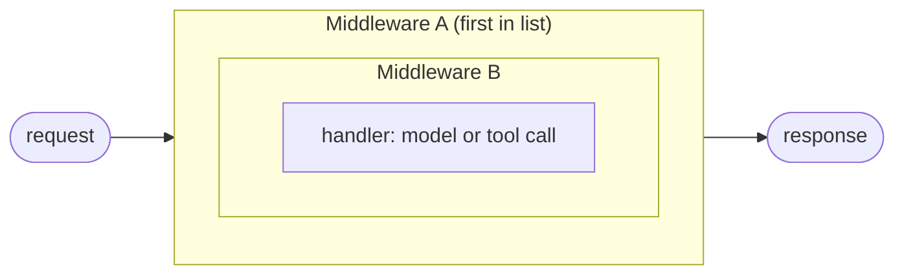

# Chapter 10: Shell tools and custom middleware

> [!NOTE]
> **📍 At a glance**
> - **You will build:** a shell-tool agent and your own middleware with hooks, jumps and ordering
> - **Level:** intermediate to advanced · **Time:** about 45 minutes
> - **Builds on:** [Chapter 7](07-middleware.md) (the hooks and the loop), [Chapter 8](08-prebuilt-middleware-limits-fallback-and-pii.md) and [Chapter 9](09-guardrails-to-do-lists-and-tool-resilience.md) (the prebuilt middlewares). Runtime and human-in-the-loop in depth are in [Chapter 11](11-runtime-and-human-in-the-loop.md).

**After this chapter you can:**

- Explain how coding assistants edit real files, and wire a shell into an agent
- Choose an execution policy and know what each one does and does not protect
- Name the six hooks, and say which run once and which run on every loop
- Write custom middleware with decorators and with a class
- Switch models at run time with `wrap_model_call`
- Extend a prebuilt middleware by subclassing
- Predict the order in which several middlewares run
- Stop dangerous shell commands, and explain why a blocklist is not enough
- Turn business rules into one class-based middleware with its own state

## 10.1 `ShellToolMiddleware`: build your own "Claude Code"

**The question:** how do Claude Code, Cursor or GitHub Copilot create and edit real files on your machine?

- **The trick: access to a terminal.** Anyone who can run shell commands can create, edit and delete files and run scripts
- That is the whole mechanism behind "AI that edits your code": a capable model plus real shell access

```python
from langchain.agents import create_agent
from langchain.agents.middleware import ShellToolMiddleware, HostExecutionPolicy

cinebot_shell_agent = create_agent(
    model=model,
    tools=[],
    middleware=[
        ShellToolMiddleware(
            workspace_root="/content/cinebot_workspace",   # a real Colab path
            execution_policy=HostExecutionPolicy(),
        ),
    ],
)
```

**Tool or middleware?** Both, honestly.

- It behaves like a tool: it exposes a **persistent shell session** the agent sends commands through
- LangChain files it under middleware. That is a framework design choice, not a deep distinction
- Checked: the middleware adds one tool named `shell`, with two arguments, `command` and `restart`

**Where does the agent actually run?**

- **Not on a LangChain server.** On the machine that runs your code
- Google Colab is a real Linux machine, with its file system rooted at `/content`
- The model provider only supplies the **brain**: it decides *which* command to run. Execution happens where your agent's code runs, with whatever shell access you gave it
- `workspace_root` tells the agent where to work. It is the starting folder, **not a jail** (see 10.14)

**Execution policies**

- **`HostExecutionPolicy()`:** full, direct access to the host machine. For trusted places such as a personal notebook or a dev sandbox
- **`DockerExecutionPolicy`:** an isolated container for the agent run, so nothing touches the host directly
- **`CodexSandboxExecutionPolicy`:** reuses an existing Codex CLI sandbox for extra isolation
- Whichever you pick, the mechanism is the same: the agent may run real shell commands somewhere

**Settings worth knowing** (from the library, checked on `langchain` 1.4.7):

- `startup_commands` and `shutdown_commands`: run when the shell opens and closes. *Checked:* `startup_commands=["export GREETING=from_startup"]` made `$GREETING` available to the agent's commands
- `tool_name` (default `"shell"`), `env`, `shell_command`, `redaction_rules`
  - **Redaction runs after the command** (docs). It cleans what the model sees, but on the host policy it does **not** stop a command from sending a secret somewhere else
- Policy limits: `command_timeout` (default **30 seconds**), `max_output_lines` (default **100**). *Checked:* a `sleep 3` with `command_timeout=1.0` came back as `Error: Command timed out after 1.0 seconds.` and the shell restarted
- `DockerExecutionPolicy`: image `python:3.12-alpine3.19` by default, and **network off** by default

**The live demos** (each followed the same pattern: the model requests a command, the tool runs it, the result returns as a tool message, the model summarises):

- "Create a reports folder if it does not already exist" → a real folder appeared in the file browser
- "Do research on the NBA and save it in `nba_research.txt`" → the file landed **in the workspace**. Asking a chat product the same thing gives a file that exists only in *its* sandbox and can never reach your machine
  - The "research" came from the model's own memory: the agent had no search tool. Treat such a file as the model's recollection, not research
- "Create `Hello_world.py` with one print line" → the message history showed: the human message, an AI message with the tool call (`cat > Hello_world.py << ...`), a tool message confirming the write, and a final AI message. The same command in a real terminal gave an identical file
- "Write a script that creates two folders, run it, then delete it" → a full write, execute, clean-up cycle in one flow
- "Create and run a simple calculator app" → the same pattern scales to small working programs
  - Running it **timed out**: the calculator waited for keyboard input that never comes, so the tool gave up and restarted the shell ("Programs that wait for input", below)
- "Delete all files and folders inside your workspace" → it did, at once. That demo was the class's case for the Docker policy, and for the guards at the end of 10.1

My offline check of the same cycle (a stand-in model sent the commands): the tool ran `mkdir`, wrote `Hello_world.py` and ran it, and a second run deleted it. The files appeared and disappeared on disk.

**Why the shell tool has `before_agent` and `after_agent` hooks** (asked in class 14 and left for later; answered from the installed code)

- `before_agent` starts a new `/bin/bash` process and runs `startup_commands`. `after_agent` runs `shutdown_commands` and ends that process
- So the "persistent" session lasts **one `invoke`**, not one chat. *Tested on 1.5.0*, one thread with a checkpointer:
  - message 1 ran `export GREETING=from_run1; mkdir -p sub; cd sub; echo hi > note.txt` (shell process 376)
  - message 2 found `$GREETING` empty and the working folder back at `workspace_root`, but `sub/note.txt` still there (shell process 384)
- Files survive between messages. Variables, `cd` and running processes do not. Write anything the next message needs to a file
- Without `workspace_root`, each run works in a new temporary folder (`/tmp/langchain-shell-…`) that is deleted when the run ends (tested). Set it whenever files must outlive the run

**Programs that wait for input**

```text
python3 -c "n = input('Enter a number: ')"        →  Error: Command timed out after 1.0 seconds.   (shell restarted)
echo 21 | python3 -c "print(int(input()) * 2)"     →  42
```

- The agent cannot type into a running program. A program that asks for input just waits until `command_timeout` (30 seconds by default), then the shell is restarted and its variables are lost
- So run programs non-interactively: arguments, piped input, `--yes` flags
- ✅ *Verified on 1.5.0 with `command_timeout=1.0`: both lines above, as shown.*

**Windows**

- The class: "Windows does not have shell access, so we will have to control that"
- From the installed code: after each command the tool sends `printf '<marker> %s\n' $?` to read the exit code. That is POSIX shell syntax, and the default shell is `/bin/bash`
- So on Windows, point `shell_command` at a POSIX shell (WSL or Git Bash). PowerShell and `cmd` would not understand the marker. *Read from the source; not tested on Windows*

**Remote machines.** Can an agent run commands on a secured remote machine (a Kubernetes cluster you reach by SSH)? Yes. Put the SSH connection in the shell tool's **startup commands**. Once your own machine is connected, the agent inherits that access.

**Related tools, for the Deep Agents module:** a filesystem middleware with just four scoped operations (not full shell access), and sub-agent orchestration. Full depth comes with Deep Agents.

> [!IMPORTANT]
> **🏭 In production**
> - Never run a shell tool on a real server or laptop: use a throwaway container or sandbox with no secrets and limited network
> - `workspace_root` is a starting folder, not a jail; isolation must come from the sandbox
> - Log every command the agent runs, and require approval for anything that writes outside the workspace
> - *Added by Claude.*

### Stopping dangerous commands (class 14)

The last question of the class: how do you stop the agent deleting folders without permission? The class answer: check the command in `after_model`, when the model proposes it. `wrap_tool_call` works too; the two stop at different points:

| Gate | What it sees | When it blocks |
|---|---|---|
| `after_model` | every command the model proposes in that turn, before any of them runs | the turn ends with your message |
| `wrap_tool_call` | one command, just before it runs | the model gets an error tool message and can try something else |

```python
import re
from langchain.agents.middleware import after_model, wrap_tool_call
from langchain.messages import AIMessage, ToolMessage

DANGEROUS = re.compile(r"\brm\s+-\w*[rf]|\bmkfs\b|\bdd\s+if=|\bshutdown\b|\breboot\b")

@wrap_tool_call
def block_dangerous_shell(request, handler):
    """Last gate: checked right before each shell command runs."""
    command = request.tool_call["args"].get("command") or ""
    if request.tool_call["name"] == "shell" and DANGEROUS.search(command):
        return ToolMessage(content=f"Blocked by policy: {command!r}. Ask a human to do this.",
                           tool_call_id=request.tool_call["id"], name="shell", status="error")
    return handler(request)

@after_model(can_jump_to=["end"])
def refuse_dangerous_plan(state, runtime):
    """Earlier gate: checked when the model proposes the commands, before any of them runs."""
    last = state["messages"][-1]
    bad = [c["args"].get("command") for c in last.tool_calls
           if c["name"] == "shell" and DANGEROUS.search(c["args"].get("command") or "")]
    if bad:
        return {"messages": [AIMessage(content=f"I won't run {bad[0]!r} without a human's approval.", id=last.id)],
                "jump_to": "end"}
    return None
```

✅ *Verified on 1.5.0 (scripted model, host policy, a scratch workspace): without a guard, `rm -rf ./*` emptied the workspace, as in class. With `block_dangerous_shell` the files stayed and the model got the "Blocked by policy" message. With `refuse_dangerous_plan` nothing ran and the run ended with "I won't run 'rm -rf ./*' without a human's approval."*

> [!CAUTION]
> **A blocklist is not a safety boundary.**
> - *Tested:* `find . -mindepth 1 -delete` and a one-line `python3 -c "…shutil.rmtree…"` both passed `block_dangerous_shell` and emptied the workspace
> - There are endless ways to delete a file, and a refused model may simply try another one: the error message invites it
> - Treat a blocklist as a speed bump, never as the protection

An allowlist is stricter: only named commands, and no shell tricks (*added by Claude*):

```python
import re
from langchain.agents.middleware import wrap_tool_call
from langchain.messages import ToolMessage

ALLOWED = {"ls", "cat", "pwd", "head", "wc", "grep", "pytest"}   # read-only plus the test runner
SHELL_TRICKS = re.compile(r"[;&|`$<>()\\\n]")                    # chaining, pipes, redirects, substitution

def is_allowed(command: str) -> bool:
    words = command.split()
    return bool(words) and words[0] in ALLOWED and not SHELL_TRICKS.search(command)

@wrap_tool_call
def allow_listed_shell(request, handler):
    command = request.tool_call["args"].get("command") or ""
    if request.tool_call["name"] == "shell" and not is_allowed(command):
        return ToolMessage(content=f"Not allowed: {command!r}. Allowed commands: {', '.join(sorted(ALLOWED))}.",
                           tool_call_id=request.tool_call["id"], name="shell", status="error")
    return handler(request)
```

✅ *Verified: `ls -la` and `cat a.txt` were allowed. `rm -rf ./*`, `find . -mindepth 1 -delete`, `ls; rm -rf .`, `cat a.txt > /dev/null`, `echo $(rm -rf .)` and `python3 -c 'print(1)'` were refused. In an agent run, `find … -delete` was refused and the workspace kept its files.*

- An allowlist narrows what the agent can **ask for**. It cannot limit what an allowed program **does**: `pytest` runs whatever code the tests contain, and `cat` reads any path, because `workspace_root` is not a jail
- The layers, weakest first: blocklist → allowlist → human approval for anything that writes (10.14) → a sandbox that limits what any command can touch (`DockerExecutionPolicy`, network off)
- For edits, give the agent narrow file tools (read, write and edit inside one folder, as Deep Agents' filesystem middleware does) and keep the shell for commands

## 10.2 Why custom middleware

- Every prebuilt middleware is **generic**. It has to be, because LangChain cannot know your business rules
- CineBot examples no prebuilt middleware can know:
  - no customer books more than two movies in one session
  - flag it if the bot ever names a competing cinema chain
  - log every cancellation in a very specific internal audit format
- Custom middleware closes that gap
- Same relationship as Pydantic to plain Python: Python has no field validation built in, so a dedicated layer was added on top
- All three rules are built in 10.10 ("CineBot's three rules, built"). The first one also has a prebuilt answer, if "two movies" means two bookings

## 10.3 Hooks: six points to intercept execution

> Hooks are extension points in custom middleware that let you intercept, inspect or modify agent execution at specific stages of the lifecycle.

You write a small function and tell LangChain **where** in the run it should execute.

```
Request
  → before_agent                       (once)
  → before_model          ┐
  → wrap_model_call → [ Model ]        │  every pass through
  → after_model           │  the agentic loop
  → wrap_tool_call → [ Tool ]          │
  ↺ back to before_model if more tool calls are needed
  → after_agent                        (once)
```

- **`before_agent` and `after_agent` run exactly once per invocation**: the very start and the very end
- Everything in between (`before_model`, `wrap_model_call`, `after_model`, `wrap_tool_call`) can run **many times**, once per loop pass
- Checked: with one tool call, `before_model` fired twice and the two agent hooks once each
- LangChain builds the execution graph and calls each hook at its declared point. Your code does not decide when
- **Same idea, other names:** Google ADK calls them callbacks, Claude Code calls them hooks. The table is in [Chapter 7](07-middleware.md), 7.3
- **A hook is not a webhook** (class 14). A hook runs inside your agent's own loop, at a point you choose. A webhook is an HTTP request that another service sends to you when something happens
- **Middleware is not a gateway either** (class question). An API gateway sits in front of services at the network edge: auth, rate limits and routing for every request. Middleware runs inside one agent's loop and can read its state
  - An **LLM gateway**, a proxy in front of the model providers ([Chapter 3](03-models-messages-and-parameters.md), 3.3), can centralise keys, fallbacks and cost logs for every app at once. Keep in middleware what needs the agent's state *(added by Claude)*

**Why no `before_tool` and `after_tool`?**

- A LangChain design choice, not a universal rule. Google's Agent Development Kit does have separate tool callbacks
- LangChain folds that into **`wrap_tool_call`**, which can do the same job
- Frameworks make different trade-offs, like languages: Python needed Pydantic added for validation, while C++ and Java have it built in

**`before_model` vs `wrap_model_call`**

- **`before_model`:** gives you the agent's **state and runtime**. Good for observing and logging, not for rewriting the outgoing request
- **`wrap_model_call`:** gives you the **actual request object**. You can swap the model, remove tools or change messages, then hand control to the handler
- Restaurant picture: `before_model` is being seated before the meal, you can observe and set a few things. `wrap_model_call` wraps the whole experience: you set the exact order, down to "no onions"

## 10.4 Decorator-based middleware

The simplest way to define a hook is a decorator on a function.

```python
from typing import Any
from langchain.agents import create_agent, AgentState
from langchain.agents.middleware import before_model, before_agent, after_agent
from langgraph.runtime import Runtime

@before_model
def log_before_model(state: AgentState, runtime: Runtime) -> dict[str, Any] | None:
    """Log every call about to be made to the model."""
    print(f"[LOG] About to call model with {len(state['messages'])} messages so far")
    return None          # None means "observed, nothing to change"

@before_agent
def connecting_to_DB(state: AgentState, runtime: Runtime) -> dict[str, Any] | None:
    print("I have connected to DB")
    return None

@after_agent
def disconnecting_to_DB(state: AgentState, runtime: Runtime) -> dict[str, Any] | None:
    print("I have disconnected to DB")
    return None

logged_agent = create_agent(
    model=model, tools=[],
    middleware=[connecting_to_DB, log_before_model, disconnecting_to_DB],
)
logged_agent.invoke({"messages": [("user", "How are you?")]})
# connected to DB -> [LOG] About to call model... -> disconnected to DB
```

- **Return `None`:** "I observed this, I change nothing"
- **Return a dict:** it **updates the state**. *Checked:* returning `{"messages": [SystemMessage(...)]}` from `before_model` added that message to the conversation
- **`before_agent` is the natural place to set up** (open a database connection, load what the run needs), because it fires once at the start. **`after_agent` is the natural place to tear down**
- **"Once" means once per `invoke`, and a chat calls `invoke` once per user message.** *Tested:* `before_agent` ran 3 times for 3 messages in one thread. A connect in `before_agent` and a disconnect in `after_agent` cost a new connection on every message
- So open shared resources **once, when the app starts** (a connection pool), and pass them in `context`. Keep `before_agent` for per-run setup, such as loading this user's profile *(added by Claude)*:

```python
import sqlite3
from dataclasses import dataclass
from langchain.agents import create_agent
from langchain.tools import tool, ToolRuntime
from langgraph.checkpoint.memory import InMemorySaver

@dataclass
class AppContext:
    user_id: str
    db: sqlite3.Connection          # opened once at app start; in production, a connection pool

@tool
def get_booking(booking_id: str, runtime: ToolRuntime[AppContext]) -> str:
    """Look up one of the current user's bookings."""
    row = runtime.context.db.execute(
        "SELECT movie, seats FROM bookings WHERE id = ? AND user_id = ?",
        (booking_id, runtime.context.user_id)).fetchone()
    return f"{row[0]}, {row[1]} seats" if row else "No such booking for this user."

db = sqlite3.connect("cinebot.db", check_same_thread=False)     # once, when the app starts
agent = create_agent(model, tools=[get_booking], context_schema=AppContext, checkpointer=InMemorySaver())
for text in ["Show booking BK1044", "And BK2000?"]:                # every message reuses the same connection
    agent.invoke({"messages": [("user", text)]}, {"configurable": {"thread_id": "chat-1"}},
                 context=AppContext(user_id="u1", db=db))
```

✅ *Verified on 1.5.0 (scripted model): one connection served both messages, and `BK2000`, which belongs to another user, came back as "No such booking for this user."*

- Typing the argument as `ToolRuntime[AppContext]`, not a bare `ToolRuntime`, also removes the Pydantic serializer warning seen in class 11 ([Chapter 6](06-agents-and-memory.md), 6.6). *Tested:* bare, 2 warnings; typed, none
- **You do not pass `state` and `runtime` yourself.** LangChain calls your function with them. A hook must accept the parameters its type provides. A hook defined with **no parameters** fails with `TypeError: bad() takes 0 positional arguments but 2 were given` (shown live, checked)
- **Decorators take arguments** (docs): `state_schema=` adds the middleware's own state fields; `can_jump_to=` declares jump targets (same as stacking `@hook_config`, 10.11)

```python
from typing_extensions import NotRequired

class CustomState(AgentState):
    model_call_count: NotRequired[int]
    user_id: NotRequired[str]

@before_model(state_schema=CustomState, can_jump_to=["end"])
def check_call_limit(state: CustomState, runtime: Runtime) -> dict[str, Any] | None:
    if state.get("model_call_count", 0) > 10:
        return {"jump_to": "end"}
    return None

@after_model(state_schema=CustomState)
def increment_counter(state: CustomState, runtime: Runtime) -> dict[str, Any] | None:
    return {"model_call_count": state.get("model_call_count", 0) + 1}

agent = create_agent(model, tools=[], middleware=[check_call_limit, increment_counter])   # no state_schema here
agent.invoke({"messages": [("user", "Hello")], "model_call_count": 0, "user_id": "user-123"})
```

- The agent's state becomes the agent schema **plus** every middleware's `state_schema`. So a middleware can bring its own fields
  - *Checked (limit lowered to 1):* the count stopped at 2, the run ended, and `user_id` came back in the result

**Why "before model" is its own hook and not just "before agent"**

- Imagine the user's first message holds personal information: a name, an email, a booking id
- Redact it at `before_agent`, before it enters the system? Or at `before_model`, just before the brain sees it?
- The class point: tools such as `get_booking` or `cancel_booking` might need the **real** id, so stripping too early breaks them. The model does not need the raw value
- Separate hook points exist so you can act at the exact stage you mean
- **A caveat from testing:** the built-in PII middleware writes the masked text **into the state**. Later steps, including the model's own tool arguments, then carry the masked value. If a tool needs the real id, keep it somewhere the tool can read it (the run `context`, the store or a state field), not only in the chat text

## 10.5 `wrap_model_call`: gating and dynamic model selection

`wrap_model_call` was used once already for VIP gating ([Chapter 7](07-middleware.md), 7.4 and [Chapter 5](05-tools.md), 5.10). Here is a second, genuinely new use:

```python
from langchain.chat_models import init_chat_model
from langchain.agents import create_agent
from langchain.agents.middleware import wrap_model_call

advanced_model = init_chat_model("anthropic:claude-sonnet-4-6")
basic_model = init_chat_model("anthropic:claude-haiku-4-5-20251001")

@wrap_model_call
def dynamic_model_selection(request, handler):
    """Use a cheap model for short conversations, a capable one once it gets complex."""
    message_count = len(request.state["messages"])
    chosen_model = advanced_model if message_count > 10 else basic_model
    return handler(request.override(model=chosen_model))

cost_aware_agent = create_agent(
    model=basic_model, tools=cinebot_tools, middleware=[dynamic_model_selection],
)
```

- A short, simple exchange does not need the most expensive model. Past a length threshold (here, more than 10 messages) it is upgraded automatically
- It is the same idea as the automatic model routing in chat products
  - **How the products do it** (reported): ChatGPT's GPT-5 used a trained "real-time router" that picks a fast or a reasoning model from the conversation type, its complexity, the tools it needs and explicit intent ("think hard"). Manual Auto, Fast and Thinking modes were added later
  - A message count is a crude stand-in for that. For a model that makes the choice, see `ModelRouterMiddleware` ([Chapter 8](08-prebuilt-middleware-limits-fallback-and-pii.md), 8.3)
  - *Web-checked 2026-11-15 (Fortune, TechCrunch; secondary reporting, see Sources)*
- `wrap_model_call` is the right hook because it hands you **the exact request object**, so you can override the model before the call goes out. `before_model` cannot do that
- ✅ *Verified (details in "How this chapter was checked").*
- **What you can change on the request:** `model`, `messages`, `system_message`, `tool_choice`, `tools`, `response_format`, `state`, `runtime` and `model_settings`
- **In real client work,** two patterns are what actually gets used: automatic model selection by conversation complexity, and dynamic tool loading. The class examples are the real thing, not edge cases

**You decide how often the handler runs** (docs): **zero** times to short-circuit, **once** for the normal flow, **several** times to retry.

```python
@wrap_model_call
def cached(request, handler):                       # 0 times on a cache hit
    key = request.messages[-1].content
    if key in cache:
        return ModelResponse(result=[AIMessage(cache[key])])
    response = handler(request)                     # 1 time otherwise
    cache[key] = response.result[-1].content
    return response

@wrap_model_call
def retry_model(request, handler):                  # up to 3 times
    for attempt in range(3):
        try:
            return handler(request)
        except Exception as e:
            if attempt == 2:
                raise
            print(f"Retry {attempt + 1}/3 after error: {e}")
```

- *Checked:* the second identical question was answered from the cache; the scripted model had only one reply, so a second model call would have failed
- For real retries, prefer the built-in `ModelRetryMiddleware` (backoff, jitter, `retry_on`; [Chapter 9](09-guardrails-to-do-lists-and-tool-resilience.md), 9.9)

## 10.6 Decorator or class?

- **Decorator-based**
  - Best for **one hook** and quick prototyping
  - One implementation only (sync or async)
  - Re-decorate each time you reuse it
- **Class-based**
  - Best for **several hooks**, more complex or reusable configuration
  - Can define **both sync and async** versions of a hook (the base class has `abefore_model`, `awrap_model_call` and so on)
  - Define once, instantiate and reuse across projects

```python
from langchain.agents.middleware import AgentMiddleware

class CallCounterMiddleware(AgentMiddleware):
    def __init__(self, warn_after: int = 3):
        super().__init__()
        self._num_calls = 0
        self.warn_after = warn_after

    def before_model(self, state, runtime):
        self._num_calls += 1
        if self._num_calls > self.warn_after:
            print("That's a lot of calls. Keep your credit card ready.")
        return None
```

- A class can hold its **own state** (`self._num_calls`) across calls of the same hook. A bare function cannot do that as cleanly
- Class-based is the usual production choice once a middleware needs more than one hook, internal state, or reuse
- A method with the exact hook name is picked up automatically. You do not need decorator syntax inside a class
- **Each middleware needs a unique name.** By default the name is the **class name**. *Checked:* attaching two instances of one class raises `AssertionError: Please remove duplicate middleware instances`. The built-in limit and PII middlewares give each instance its own name (`PIIMiddleware[email]`, `ToolCallLimitMiddleware[cancel_booking]`), which is why you can attach several. For your own class, override `name` or give each class a different name
- **Pitfall (checked):** the state lives on the **instance**. The counter was 4 after four separate `invoke`s, and one instance attached to two agents counted calls from both. For per-run data, use agent state, not `self`

**What a class can declare** (docs; picked up when the agent is built):

- **`state_schema`:** the middleware's own state fields (the per-run alternative to `self`). Also type the class: `AgentMiddleware[CustomState]`
- **`tools`:** tools that ship with the middleware, as `TodoListMiddleware` ships `write_todos`
- **`transformers`:** stream projections (10.11)

```python
class CallLimitMiddleware(AgentMiddleware[CustomState]):
    state_schema = CustomState                     # per-run counter, saved with the thread
    tools = [write_note]                           # registered on the agent automatically

    @hook_config(can_jump_to=["end"])               # needed for a jump from before_model (10.11)
    def before_model(self, state: CustomState, runtime) -> dict[str, Any] | None:
        return {"jump_to": "end"} if state.get("model_call_count", 0) > 10 else None

    def after_model(self, state: CustomState, runtime) -> dict[str, Any] | None:
        return {"model_call_count": state.get("model_call_count", 0) + 1}
```

- *Checked:* a middleware with `tools = [write_note]` put `write_note` on the agent's tool node, and the model's call to it ran

**Async hooks** (class 14)

```python
import asyncio
from langchain.agents.middleware import AgentMiddleware

class LoadProfile(AgentMiddleware):
    async def abefore_agent(self, state, runtime):
        await asyncio.sleep(0.3)            # stands in for an async database or HTTP call
        return None

agent = create_agent(model, tools=[], middleware=[LoadProfile()])
asyncio.run(agent.ainvoke({"messages": [("user", "Hi")]}))     # agent.invoke(...) raises TypeError
```

- In class, an async hook was said to run without waiting for the one before it to finish. *Tested on 1.5.0:* two middlewares with async `abefore_agent` (0.3 s and 0.1 s) ran strictly in order under `ainvoke`: A from 0.00 to 0.30 s, then B from 0.30 to 0.40 s
- Each hook is a step of the graph, and a step finishes before the next one starts. What async buys you is that the server can serve **other** requests while a hook waits on I/O, not overlap inside one run
- A middleware with only async hooks fails under plain `invoke`: `TypeError: No synchronous function provided to "abefore_agent". Either initialize with a synchronous function or invoke via the async API (ainvoke, astream, etc.)` (tested; the same for an `async def` with `@before_agent`). Define both versions, or call the agent with `ainvoke`

## 10.7 Extending a prebuilt middleware

Can you extend `PIIMiddleware` instead of replacing it? Yes, with plain Python inheritance.

```python
from langchain.agents.middleware import PIIMiddleware

class MyPIIMiddleware(PIIMiddleware):
    def wrap_model_call(self, request, handler):     # a hook the parent never used
        print("[MyPII] outer ran")
        return handler(request)
```

- **Overriding a hook replaces it.** If you override `before_model` or `after_model`, the parent's behaviour for that hook is gone. Copy the original logic first, then add to it
- ✅ *Verified (details in "How this chapter was checked").*
- **Adding a new hook type is fine.** `wrap_model_call` above runs alongside the parent's `before_model`. *Checked:* the email was still redacted and the new hook ran
- The class version returned an `ExtendedModelResponse` with a `Command(update=...)` to change state from a wrap hook:

```python
from langgraph.types import Command
from langchain_core.messages import SystemMessage
from langchain.agents.middleware import ExtendedModelResponse, PIIMiddleware

class MyPIIMiddleware(PIIMiddleware):
    def wrap_model_call(self, request, handler):
        response = handler(request)
        return ExtendedModelResponse(
            model_response=response,
            command=Command(update={
                "trace_layer": "outer",
                "messages": [SystemMessage(content="[Outer ran]")],
            }),
        )
```

- ✅ *Verified (details in "How this chapter was checked").*

## 10.8 Execution order



With several middlewares, each with several hooks, order matters. Cooking analogy: tasting while you cook is one middleware with **two hook points**, once after adding salt and once right before serving.

**The rule:**

- Every **`before_*`** hook runs in the **declared order**
- Every **`after_*`** hook runs in **reverse**: the last middleware's `after_model` and `after_agent` fire first
- **`wrap_*`** hooks **nest**: the first middleware is outermost. It is entered first and exits last
- Why reverse? Whichever connection opens first should close last. It is a **stack** (last in, first out), not a queue

Checked with three middlewares `A, B, C`, one loop pass shown:

```
A.before_agent   B.before_agent   C.before_agent
A.before_model   B.before_model   C.before_model
A.wrap_model_call:enter  B:enter  C:enter   (model runs)   C:exit  B:exit  A:exit
C.after_model    B.after_model    A.after_model
A.wrap_tool_call:enter   B:enter  C:enter   (tool runs)    C:exit  B:exit  A:exit
   ... loop again from before_model ...
C.after_agent    B.after_agent    A.after_agent
```

- The class said `wrap_tool_call` does **not** reverse. That is true for **entering**: it starts in the declared order. As a wrapper it still exits in reverse, like every wrap hook
- If the first middleware opens a database connection in `before_agent`, it is also the **last** to close it in `after_agent`
- This is also why the middleware that must see a raw exception sits **inside** ([Chapter 9](09-guardrails-to-do-lists-and-tool-resilience.md), 9.6)

**One middleware, two hooks.** A good PII middleware needs two hook points: mask the input at `before_model` so the brain never sees it, **and** check the model's own output at `after_model`, in case the model itself produces something sensitive (such as a made-up Aadhaar number).

To see the rule yourself, give every hook a `print` and attach three middlewares:

```python
from langchain.agents import create_agent
from langchain.agents.middleware import AgentMiddleware

def make(name):
    class MW(AgentMiddleware):
        def before_agent(self, state, runtime):   print(f"{name}.before_agent");   return None
        def before_model(self, state, runtime):   print(f"{name}.before_model");   return None
        def after_model(self, state, runtime):    print(f"{name}.after_model");    return None
        def after_agent(self, state, runtime):    print(f"{name}.after_agent");    return None
    MW.__name__ = name          # each middleware needs a unique name (see 10.6)
    return MW()

agent = create_agent(model=model, tools=[], middleware=[make("A"), make("B"), make("C")])
agent.invoke({"messages": [("user", "Hi")]})
```

## 10.9 Best practices

- Keep each middleware focused on **one thing**
- **Put critical middleware first** in the list (docs): it is the outermost wrapper and sees `before_*` first (10.8)
- **Handle errors inside** the middleware. Its own bug should not be what crashes the agent
- Choose the hook deliberately: node-style (`before_model`, ...) to **observe**, wrap-style (`wrap_model_call`, `wrap_tool_call`) when the **request must change**
- **Document** any custom state a middleware relies on or adds
- **Test** middleware on its own where you can, not only inside a full agent run
- **Default to a prebuilt middleware** whenever one already covers the need. Write your own only for a genuinely business-specific rule

## 10.10 Custom middleware examples

- *Source: LangChain docs, `middleware/custom.mdx` (Examples) and its snippets `middleware-dynamic-*`, `middleware-tool-call-monitoring-*` in `src/snippets/code-samples`.*
- **`request.system_message` is always a `SystemMessage`**, even when you passed `system_prompt="text"`.
  - Use `.content_blocks` to read it as a list, append blocks, build a new `SystemMessage`, then `request.override(system_message=...)`.
- **Prompt caching (Anthropic):** append a block with `"cache_control": {"type": "ephemeral"}`; everything up to that block is cached.
```python
@wrap_model_call
def add_cached_context(request, handler):
    blocks = list(request.system_message.content_blocks) + [
        {"type": "text", "text": "<document>...</document>",
         "cache_control": {"type": "ephemeral"}}]
    return handler(request.override(system_message=SystemMessage(content=blocks)))
```
- **Select tools per call:** `handler(request.override(tools=subset))`.
  - Benefits: shorter prompts, better accuracy, permission control.
  - Register **all** tools in `create_agent(tools=...)`; adding an unregistered tool raises `ValueError: Middleware added tools that the agent doesn't know how to execute`.
- You may also pass a `SystemMessage` straight to `create_agent(system_prompt=...)`.
- **Dynamic model:** pick a model per call from the state, for example a bigger one after ten messages.
```python
@wrap_model_call
def dynamic_model(request, handler):
    model = complex_model if len(request.messages) > 10 else simple_model
    return handler(request.override(model=model))
```
- **Tool call monitoring:** `@wrap_tool_call` wraps each tool run; log before, call `handler(request)`, log success, and **re-raise** on failure.
```python
@wrap_tool_call
def monitor_tool(request, handler):
    print(request.tool_call["name"], request.tool_call["args"])
    try:
        return handler(request)
    except Exception as e:
        print("failed:", e); raise
```
- ✅ *Verified (details in "How this chapter was checked").*

### CineBot's three rules, built (class 14)

Class 14 opened custom middleware with three rules no prebuilt middleware can know (10.2). One class covers all three, with two hooks and its own state (*added by Claude*: the class named the rules but did not code them):

```python
import json, logging, operator, time
from typing import Annotated
from typing_extensions import NotRequired
from langchain.agents import AgentState
from langchain.agents.middleware import AgentMiddleware
from langchain.messages import ToolMessage
from langgraph.types import Command

audit = logging.getLogger("cinebot.audit")
RIVALS = ("StarScreen", "MegaPlex")              # stand-in names for rival chains

class CineBotState(AgentState):
    booked_movies: NotRequired[Annotated[list[str], operator.add]]   # reducer: updates add up

class CineBotRules(AgentMiddleware[CineBotState]):
    """CineBot's own business rules: one middleware, two hooks, its own state."""
    state_schema = CineBotState

    def __init__(self, max_movies: int = 2):
        super().__init__()
        self.max_movies = max_movies

    def wrap_tool_call(self, request, handler):
        call = request.tool_call
        if call["name"] == "book_seats":                 # rule 1: at most two different movies per session
            booked = request.state.get("booked_movies", [])
            movie = call["args"]["movie_title"]
            if movie not in booked and len(booked) >= self.max_movies:
                return ToolMessage(content=f"Limit reached: at most {self.max_movies} different movies per session.",
                                   tool_call_id=call["id"], name=call["name"], status="error")
            result = handler(request)
            if movie in booked or getattr(result, "status", "success") == "error":
                return result
            return Command(update={"messages": [result], "booked_movies": [movie]})   # remember it
        if call["name"] == "cancel_booking":             # rule 3: our own audit line for every cancellation
            start, status = time.monotonic(), "error"
            try:
                result = handler(request)
                status = getattr(result, "status", "success")
                return result
            finally:
                audit.info(json.dumps({"event": "cancel", "user": request.runtime.context.user_id,
                                       "args": call["args"], "status": status,
                                       "ms": round((time.monotonic() - start) * 1000)}))
        return handler(request)

    def after_model(self, state, runtime):               # rule 2: flag any rival chain the bot names
        named = [r for r in RIVALS if r.lower() in state["messages"][-1].text.lower()]
        if named:
            audit.warning(json.dumps({"event": "rival_mention", "names": named}))
        return None
```

```python
from dataclasses import dataclass
from langgraph.checkpoint.memory import InMemorySaver

@dataclass
class Ctx:
    user_id: str                                   # set by your app from login, never by the model

agent = create_agent(model, tools=[book_seats, cancel_booking], middleware=[CineBotRules()],
                     context_schema=Ctx, checkpointer=InMemorySaver())    # a session = one thread
agent.invoke({"messages": [("user", "Book 2 seats for Oppenheimer")]},
             {"configurable": {"thread_id": "session-1"}}, context=Ctx(user_id="u1"))
```

✅ *Verified on 1.5.0 (scripted model, one thread): Oppenheimer and Dune were booked; Oppenheimer again was fine (same movie); Interstellar got "Limit reached: at most 2 different movies per session." The cancellation logged `{"event": "cancel", "user": "u1", "args": {"booking_id": "BK1044"}, "status": "success", "ms": 1}`. A failing cancellation was still logged, with `"status": "error"`, and its exception still reached the caller. A reply naming StarScreen logged a `rival_mention` warning.*

- **Why one class:** two hooks, its own `state_schema` and a setting (`max_movies`). Those are the cases where 10.6 says to prefer a class
- **The booked list lives in state, not on `self`,** so it is per session and saved with the thread (the 10.6 pitfall). The `operator.add` reducer lets updates add up
- **Rule 1 has a prebuilt answer if it means bookings:** `ToolCallLimitMiddleware(tool_name="book_seats", thread_limit=2)` ([Chapter 8](08-prebuilt-middleware-limits-fallback-and-pii.md), 8.2). *Tested:* it also blocked a second booking for a movie already booked. "Two **different** movies" needs the custom version
  - The class: no prebuilt middleware can know these rules. The docs: prefer a built-in middleware when one fits (10.9). Check before you write one
- **Rule 2 flags, it does not block.** To block, return the reply replaced (same `id`), as `refuse_dangerous_plan` does in 10.1
- **Rule 3 logs in `finally`,** so a failed cancellation is logged too. The user comes from `runtime.context`, never from the model

> [!WARNING]
> **Parallel tool calls slip past a state-based limit.**
> - *Tested:* one model turn that asked to book A, B and C at once booked all three. Every call in a turn sees the same state, so none of them saw the others
> - Enforce the hard limit where the booking is written: the booking service or a database constraint. The middleware is the early, friendly check
> - Or allow one tool call per turn with `request.override(model_settings={**request.model_settings, "parallel_tool_calls": False})` in a `wrap_model_call` hook. *Checked:* the request sent `"parallel_tool_calls": false`. That is OpenAI's setting; other providers name it differently

**The "10 million tokens" guard** (class 14's other example: should you process a giant request at all?)

```python
from langchain.agents.middleware import before_agent
from langchain.messages import AIMessage, HumanMessage
from langchain_core.messages.utils import count_tokens_approximately

MAX_INPUT_TOKENS = 8_000

@before_agent(can_jump_to=["end"])
def reject_huge_input(state, runtime):
    """Refuse an oversized message before any model call, and keep it out of the saved thread."""
    last = state["messages"][-1]
    n = count_tokens_approximately([last])
    if n > MAX_INPUT_TOKENS:
        return {"messages": [
                    HumanMessage(content=f"[message of about {n:,} tokens removed: too long]", id=last.id),  # same id: replaces it
                    AIMessage(content="That message is too long. Please shorten it or upload it as a file.")],
                "jump_to": "end"}
    return None
```

✅ *Verified on 1.5.0 (scripted model, with a checkpointer): a 50,000-word message (about 62,504 tokens) got the refusal with 0 model calls. The saved thread held the placeholder and the refusal, and the next message worked normally. A guard that only replied, without replacing the message, sent all 250,010 characters to the model on the next turn.*

- **Replace the message, don't just answer it.** The input is already in the thread when `before_agent` runs; left there, every later turn re-sends it
- Replace it with a short placeholder rather than deleting it: some providers reject a history that starts with an AI message ([Chapter 6](06-agents-and-memory.md), 6.4)
- `count_tokens_approximately` is a fast estimate. Use the provider's own counter when the number must be exact

### Cost tracking per run (*added by Claude*)

Every model reply carries `usage_metadata`; an `after_model` hook can add it up, so you see cost per user or conversation instead of only the monthly bill.

```python
from langchain.agents.middleware import after_model, AgentState
from langgraph.runtime import Runtime

PRICE_PER_M = {"in": 0.15, "out": 0.60}            # $/million tokens: check your model's price

@after_model
def track_tokens(state: AgentState, runtime: Runtime):
    u = state["messages"][-1].usage_metadata or {}
    tin, tout = u.get("input_tokens", 0), u.get("output_tokens", 0)
    cost = tin / 1e6 * PRICE_PER_M["in"] + tout / 1e6 * PRICE_PER_M["out"]
    log.info("tokens_in=%d tokens_out=%d cost_usd=%.5f", tin, tout, cost)
    return None                                     # observe only; change nothing

agent = create_agent(model, tools=tools, middleware=[track_tokens])
```

- Add a `user_id` or `thread_id` from `runtime.context` to the log line, then sum per user in your log tool
- Pair it with the call-limit middleware ([Chapter 8](08-prebuilt-middleware-limits-fallback-and-pii.md)): tracking shows the cost, limits cap it
- LangSmith shows the same numbers per trace if tracing is on ([Chapter 15](15-testing-agents-and-tracing.md))

✅ *Verified offline: with a fake model reporting 12 input and 3 output tokens, the hook recorded exactly `in=12, out=3`.*

## 10.11 Agent jumps, tracing and state composition

From `middleware/custom.mdx`. *Checked* with `langchain` 1.4.7 and a scripted model.

**Agent jumps**

- A node-style hook can leave the normal flow by returning a dict with `jump_to`. Targets: `'end'` (the end of the run, or the first `after_agent` hook), `'tools'` (the tools node) and `'model'` (the model node, or the first `before_model` hook)
- Declare the targets a hook may use with `@hook_config(can_jump_to=["end"])`

```python
@after_model
@hook_config(can_jump_to=["end"])
def check_blocked(state: AgentState, runtime: Runtime):
    if "BLOCKED" in str(state["messages"][-1].content):
        return {"messages": [AIMessage("I cannot respond to that request.")], "jump_to": "end"}
```

- ✅ *Verified (details in "How this chapter was checked").*
- ✅ *Verified (details in "How this chapter was checked").*
- A class version puts `@hook_config(...)` on the method of an `AgentMiddleware` subclass

> [!WARNING]
> **Declare `can_jump_to`, or a `before_model` jump is ignored.**
> - *Checked on 1.5.0:* `{"jump_to": "end"}` from `before_model` **without** the declaration was dropped: the agent made all 4 model calls. With `@hook_config(can_jump_to=["end"])` it stopped after 1
> - From `after_model` the jump to `"end"` worked either way (as found on 1.4.7, below)
> - The docs' class example (`CallCounterMiddleware`, custom state schema) leaves the declaration out, so its limit never triggers. Always declare

**Configure tracing**

- Needs `langchain>=1.3.15`. Hook spans record their inputs and outputs by default. Set `trace_policy = TracePolicy(process_inputs=omit_payload)` on a middleware to leave the input out of its trace
- `configure_trace_policy(TracePolicy(...))` sets a global default, and `configure_trace_policy(None)` clears it. A middleware's own policy overrides the global one
- ✅ *Verified (details in "How this chapter was checked").*

**State updates from wrap hooks**

- Node-style hooks return a dict. A wrap hook returns an `ExtendedModelResponse` with a `Command`, and the update goes through the graph's reducers (messages add up)
- The docs say that with several layers, commands apply inner first then outer, **the outer one wins** on a plain (non-reducer) field, and commands from an earlier retry are discarded
- *Not reproduced with a plain field:* two middleware each returning `Command(update={"tag": ...})` for the same plain field raised `InvalidUpdateError` ("Can receive only one value per step"). Use a field with a reducer (an `Annotated` key) when more than one layer writes it
  - **Resolved:** the docs' own example gives the field a **last-wins reducer** (`trace_layer: NotRequired[Annotated[str, _last_wins]]`, where `_last_wins(a, b)` returns `b`)
  - *Checked with that reducer:* `trace_layer` ended as `"outer"`, and the messages arrived inner first, then outer (`[Inner ran]`, `[Outer ran]`)
  - So "outer wins" needs that reducer; a plain field still raises
- **Retry-safe** (docs, checked): an outer middleware that called the handler twice kept only the second inner command (`['inner call 2']`)

**Custom stream transformers**

- Middleware can register stream transformers through a `transformers` class attribute (needs `langchain>=1.3.2`)
- **What a transformer is:** an object that watches the raw events of a v3 stream ([Chapter 6](06-agents-and-memory.md), 6.8) and builds a **projection** that isn't built in: retrieval progress, artifacts, domain events
- Its projection appears under `stream.extensions["<key>"]`

**A minimal one** (*added by Claude*: the docs use `ToolActivityTransformer` but don't define it, so this one is built from the installed `langgraph.stream.StreamTransformer` base class):

```python
from langgraph.stream import StreamTransformer, StreamChannel

class ToolActivityTransformer(StreamTransformer):
    """One line per tool start and finish, on stream.extensions["tool_activity"]."""
    required_stream_modes = ("tools",)          # ask the run to emit tool events

    def __init__(self, scope=()):
        super().__init__(scope)                  # scope: () at the root, non-empty in a subgraph
        self._log = StreamChannel()

    def init(self):
        return {"tool_activity": self._log}      # key → stream.extensions["tool_activity"]

    def process(self, event):
        if event["method"] == "tools" and event["params"]["namespace"] == list(self.scope):
            d = event["params"]["data"]
            if d["event"] == "tool-started":
                self._log.push(f"started {d['tool_name']} {d['input']}")
            elif d["event"] == "tool-finished":
                self._log.push(f"finished {d['tool_call_id']}")
        return True                              # True = keep the event for other projections
```

**Three ways to register it** (all three checked: each gave `["started get_weather {'city': 'Boston'}", 'finished c1']`):

```python
# 1. for one run
stream = agent.stream_events(input, version="v3", transformers=[ToolActivityTransformer])

# 2. on a middleware, so every run of agents using it gets the projection
class ToolActivityMiddleware(AgentMiddleware):
    transformers = (ToolActivityTransformer,)

# 3. on the agent
agent = create_agent(model, tools=[get_weather], transformers=[ToolActivityTransformer])

stream = agent.stream_events(input, version="v3")     # with 2 or 3, no transformers= needed here
for activity in stream.extensions["tool_activity"]:
    print(activity)
```

- **What you register is a factory**, called as `factory(scope)`. A class works, because `ToolActivityTransformer(scope)` builds a fresh one per call. Fresh per call keeps each subgraph's projection separate
- **Order on the compiled agent** (docs): the built-in `ToolCallTransformer` first, then middleware factories in middleware order, then `create_agent(transformers=...)`
  - Built-in tool-call tracking stays in front; your own entries get the final word
- The built-in `PIIMiddleware` uses this hook to redact the live stream ([Chapter 8](08-prebuilt-middleware-limits-fallback-and-pii.md), 8.4)
- The full transformer contract (async lane, `before_builtins`, `finalize`) is on the LangGraph "Build your own projection" docs page, which these notes have not read yet. The basics above are from the installed base class's docstring

**The docs' best practices:** keep each middleware focused; handle errors gracefully; use node-style hooks for sequential logic (logging, validation) and wrap-style hooks for control flow (retry, fallback, caching); document custom state; unit test each on its own; remember execution order; prefer built-in middleware

*Source: `langchain-ai/docs`, `src/oss/langchain/middleware/custom.mdx` (Agent jumps, Configure tracing, State updates, Custom stream transformers, Best practices), and `event-streaming.mdx` (Custom updates, Register transformers on middleware), read 2026-11-15.*

## 10.12 Questions from the class

- **What can `wrap_model_call` change?** Anything on the outgoing request: model, messages, system message, tool choice, tools, response format, state, runtime, settings (10.5)
- **Is LangChain's execution graph a DAG?** No. The loop can cycle (model, tool, model again). LangGraph exposes that graph and lets you control it. LangChain builds and runs it for you
- **Does my code or LangChain decide hook order?** LangChain. It builds the graph and calls each hook at its declared point (10.8)
- **Should I mix LangChain, LangGraph and other frameworks in one project?** Generally no. Pick one framework and build several agents in it. Connect truly separate systems with A2A (agent to agent) or a plain API
- **Multi-agent: LangChain or LangGraph?** The end user sees the same agent. LangGraph gives deeper control of the graph, for example custom state changes. LangChain already supports multi-agent setups
- **Parallel child agents lose data when they report to a coordinator.** Use a **shared memory store** (in-memory, Postgres or any database) that every agent can read and write. Do not rely on data passing implicitly between agent calls. Whether parent and child state is shared natively was left to confirm
- **Should an agent validate a user's login or session?** No. That is plain code. Reserve agents for points that need intelligence or tool access
- **Can a browser app get the terminal access Claude Code has?** No. Browsers are deliberately sandboxed. You need an installed application (a VS Code extension) or an access layer such as MCP, never raw browser automation
- **Does every step cost tokens?** No. Tokens are used **only when the model is called**. Your own Python logic costs none. A tool run triggered by a model decision adds no holding cost, and prompt caching reduces cost
- **Is it safe for an agent to read a one-time password from email or SMS?** Only through an explicit, legitimate integration (an MCP connection or a messaging tool) with the user's knowledge. Never by simulated browser or screen automation. That is a serious security anti-pattern
- **Testing changes across many microservices without shell or browser access?** Use containers (Docker) or Kubernetes sandboxes. Do not build an app that asks for broad shell or browser access just to validate changes
- **After I edited a transfer amount and approved it, why did the agent ask for approval again?** That second request came from the **model**. It saw a partial transfer completed and reasoned that a balance remained. It is the model's judgement, not scripted by `HumanInTheLoopMiddleware`
- **Does memory depend on which LLM I use?** No. The checkpointer and thread memory are LangChain mechanisms, independent of the model. Inconsistent remembering is more likely a setup issue, so re-test
- **Why does my Groq/Llama agent call a `BraveSearch` tool I never defined?** Likely a model-specific quirk: some open models expect a particular search tool. Switching model or providing that tool fixed it. Not a bug in your code
- **Why does the shell tool have `before_agent` and `after_agent` hooks?** It starts its shell in one and ends it in the other, so the session lasts one `invoke` (10.1)
- **Does a terminal window need to be open?** No. The middleware starts its own `/bin/bash` process for each run (10.1)
- **Can it run on Windows?** The class: Windows has no shell access, so it needs handling. The tool needs a POSIX shell: use WSL or Git Bash through `shell_command` (10.1)
- **How do I stop the agent deleting folders without permission?** A check in `after_model` or `wrap_tool_call`, but a blocklist is easy to get around. Use an allowlist, approval and a sandbox (10.1)
- **Is there such a thing as "middleware state"?** The class: no, the agent owns the state and middleware changes it. The docs (tested in 10.4): a middleware can declare a `state_schema`, and its fields are merged into the agent's state. Both hold: there is one state, and a middleware can add fields to it
- **Can a middleware stop the model call?** (left open in class) Yes. Return `{"jump_to": "end"}` from `before_model` with `can_jump_to` declared (10.11), or return your own response from `wrap_model_call` without calling `handler` (10.5)
- **Is middleware the same as a gateway?** No (10.3)
- **Is Docker the same as a virtual machine?** No. A container shares the host's kernel; a VM runs its own. That makes containers lighter, and it is why untrusted code often runs in stronger sandboxes, such as gVisor or microVMs like Firecracker *(added by Claude)*
- **Do async hooks run at the same time?** No. Each hook finishes before the next starts (10.6)
- **Can I put everything in `before_agent`, PII masking included?** No. A tool may need the real value; mask before the **model** (10.4)

## 10.13 Interview corner

**What interviewers listen for:** you know the six hooks and the **onion** order of wrap hooks, when to write a class vs a decorator, and that a shell tool needs a sandbox, not trust.

### 🟢 Basic

<details class="qa"><summary>1. How do coding assistants edit files on your machine?</summary>

- They have access to a terminal. A model decides the command, the shell tool runs it on the machine where the agent runs
- *Stronger answer:* the execution policy decides how much damage a bad command can do (host, Docker, sandbox)

</details>

<details class="qa"><summary>2. Name the six hooks and say which run once.</summary>

- `before_agent`, `before_model`, `wrap_model_call`, `after_model`, `wrap_tool_call`, `after_agent`
- `before_agent` and `after_agent` run once per invocation. The rest run on every loop pass
- *Stronger answer:* there is no `before_tool` or `after_tool`. `wrap_tool_call` does that job

</details>

<details class="qa"><summary>3. <code>before_model</code> vs <code>wrap_model_call</code>?</summary>

- `before_model` gives state and runtime, to observe or update state. `wrap_model_call` gives the whole request, so you can change the model, tools or messages
- *Stronger answer:* use wrap-style when the **request itself** must change, node-style to observe

</details>

### 🟡 Intermediate

<details class="qa"><summary>4. When would you write a class instead of a decorated function?</summary>

- More than one hook, internal state, async support, or reuse across projects
- *Stronger answer:* instance state is shared across runs and agents, so per-run data belongs in agent state

</details>

<details class="qa"><summary>5. In what order do hooks run for three middlewares?</summary>

- `before_*` in declared order, `after_*` in reverse, `wrap_*` nested with the first outermost
- *Stronger answer:* it is stack order: the first to open is the last to close

</details>

### 🔴 Senior

<details class="qa"><summary>6. You override <code>before_model</code> in a <code>PIIMiddleware</code> subclass and PII stops being redacted. Why?</summary>

- Overriding a hook **replaces** the parent's version. Copy the original logic, then add yours, or use a different hook

</details>

<details class="qa"><summary>7. Give two real uses of <code>wrap_model_call</code>.</summary>

- Dynamic model selection by conversation complexity, and dynamic tool loading

</details>

<details class="qa"><summary>8. Design a custom middleware that enforces a per-tenant rate limit.</summary>

- A class middleware with `before_model` (or `wrap_model_call`) that reads the tenant from runtime context and checks a shared counter
- *Stronger answer:* keep the counter outside the process (Redis), return a friendly message or jump to the end instead of raising, and trace the decision

</details>

<details class="qa"><summary>9. Your middleware returns <code>{"jump_to": "end"}</code> from <code>before_model</code>, but the agent keeps going. Why?</summary>

- The hook did not declare its targets: add `@hook_config(can_jump_to=["end"])`, or `@before_model(can_jump_to=["end"])`
- Without it the jump is dropped from `before_model` (checked on 1.5.0), though `after_model` happens to honour `"end"`
- Also check the counter field is declared in the middleware's `state_schema`, or it is never saved
- *Stronger answer:* write a unit test that runs the agent with a scripted model and asserts the number of model calls, because this failure is silent

</details>

<details class="qa"><summary>10. Your coding agent must never delete anything outside its project folder. How do you make sure?</summary>

- Not with the prompt, and not with `workspace_root`: it is a starting folder, not a jail
- A blocklist is easy to get around (`find -delete` and a Python one-liner passed one in testing). An allowlist is stricter but still trusts every allowed program
- Run commands in a sandbox that can only see the project folder (Docker, network off), and require human approval for anything that writes
- *Stronger answer:* layer them: allowlist plus approval plus sandbox, with an audit log of every command and a timeout on each. Remember that text the agent reads (a web page, an issue) can try to inject commands

</details>

<details class="qa"><summary>11. A business rule says "at most two different movies per session". Where does it go, and what can go wrong?</summary>

- A class-based middleware: `wrap_tool_call` on the booking tool, with the booked movies in the middleware's own `state_schema`, saved per thread
- If the rule were "two bookings", `ToolCallLimitMiddleware(thread_limit=2)` already does it. Check for a built-in first
- What goes wrong: parallel tool calls in one turn all see the same state and can pass together; and state on `self` would be shared by every user
- *Stronger answer:* enforce the hard limit in the booking service or database too, switch off parallel tool calls for this agent if needed, and unit test the middleware with a scripted model, including a parallel-call turn

</details>

<details class="qa"><summary>12. The agent ran <code>cd build</code> and set a variable, but in the next message both were gone. Why?</summary>

- `ShellToolMiddleware` starts a new shell in `before_agent` and ends it in `after_agent`, so each `invoke`, each user message, gets a fresh shell
- Files on disk survive; variables, `cd` and running processes do not. A human-approval pause resets the shell too (10.14)
- *Stronger answer:* make each command self-contained (`cd build && make`), keep what must last in files or in the agent's state, and set `workspace_root` so the files are not in a temporary folder that is deleted after the run

</details>

> [!TIP]
> **🧩 Design question to practise:** *"Build a coding agent that can run tests in a repo."* Cover the shell middleware, the sandbox, which commands need approval, output size limits and how you stop runaway loops.

## 10.14 Added by Claude, not from the sources

Not in the course material. Established practice, but check current docs. Items marked *checked* were tested on `langchain` 1.4.7.

**Shell safety**

- **`workspace_root` is not a jail.** *Checked:* under `HostExecutionPolicy` the agent ran `cd / && ls` and listed the whole file system. Treat the host policy as full access to the machine and the user it runs as
- **Prompt injection becomes command injection.** If an agent reads untrusted text (a web page, an email) and has a shell, that text can try to make it run commands. Do not combine the two without isolation
- **Use isolation for anything untrusted.** `DockerExecutionPolicy` runs in a container with the network off by default. Mount only what the agent needs
- **Put a human in the loop on the shell tool.** *Checked:* `HumanInTheLoopMiddleware(interrupt_on={"shell": ...})` paused the run before the command ran. The file did not exist before approval or after a reject ([Chapter 7](07-middleware.md), 7.6)
  - **But the session does not survive the pause** (docs: persistent shell sessions do not yet work with interrupts)
  - *Checked on 1.5.0:* after an approved `export GREETING=hi`, the next approved command printed an empty `$GREETING`. Files on disk survived; shell state (variables, `cd`) did not. Without HITL the variable carried over
  - So with HITL, make each command self-contained (`cd /app && VAR=x ./run.sh`) and keep state in files
- **Mind the limits.** Output is capped (100 lines by default) and commands time out (30 seconds by default). Long jobs need a different approach

**Custom middleware**

- **Keep run data out of `self`.** A class instance can serve many users and threads at once. A counter on `self` mixes them up. Put per-run data in agent state or `context`
- **Declare custom state fields.** An update to a field the agent does not know about is dropped without an error (the `trace_layer` case in 10.7)
- **Test hooks with a stand-in model,** as the chapters in this book do. A scripted model makes order and state changes easy to assert
- **A hook that raises stops the run.** Wrap risky work (a database call) in `try/except` and decide what to return

## Cheat sheet

```python
from langchain.agents.middleware import before_model, wrap_tool_call, AgentMiddleware
@before_model
def log_calls(state, runtime): print(len(state["messages"]))
@wrap_tool_call
def time_tools(request, handler):
    return handler(request)                    # code before = pre, after = post
class Guard(AgentMiddleware):
    def wrap_model_call(self, request, handler): return handler(request)
agent = create_agent(model, tools, middleware=[log_calls, time_tools, Guard()])

from langchain.agents.middleware import before_agent, wrap_model_call
class Rules(AgentMiddleware[MyState]):         # a business rule: several hooks, its own state (10.10)
    state_schema = MyState
@before_agent(can_jump_to=["end"])             # input guard: replace the giant message, reply, jump to end
def guard(state, runtime): return None
@wrap_model_call                               # one tool call per turn (OpenAI setting)
def one_call(request, handler):
    return handler(request.override(model_settings={**request.model_settings, "parallel_tool_calls": False}))
# shell: one bash per invoke (files persist; variables and cd do not). Blocklists leak: allowlist + sandbox
```

## Recap

- Shell access is the trick behind coding assistants. The agent runs commands **where its code runs**. The model only decides which command
- Policies: host (full access), Docker (isolated), Codex sandbox. `workspace_root` is a starting folder, not a jail
- Six hooks. `before_agent` and `after_agent` run **once**. The other four run on every loop pass. There is no `before_tool`, use `wrap_tool_call`
- `before_model` observes state and runtime. `wrap_model_call` receives and can rewrite the **request**
- Return `None` to change nothing, or a dict to update state. Hooks must accept `state` and `runtime`
- Decorators for one hook, classes for several hooks, state, async and reuse. Class state lives on the instance
- Subclassing: an overridden hook **replaces** the parent's
- Order: `before_*` declared order, `after_*` reversed, `wrap_*` nested. A stack, last in, first out
- The shell tool starts a fresh shell for every `invoke`. Programs that wait for input time out. It needs a POSIX shell
- Blocklists are easy to get around. Use an allowlist, approval and a sandbox
- `before_agent` runs once per `invoke`, so once per user message. Share connections through `context`
- Async hooks still run one after another. Async-only hooks need `ainvoke`
- Business rules belong in a class-based middleware with its own state, and hard limits also in the system of record

## Practice

1. Recreate the `ShellToolMiddleware` demo: create a file, run a script, clean up. Read the message history and map each step
2. Write a `before_agent` and `after_agent` pair that simulates connecting to and disconnecting from a resource. Confirm the print order
3. Build `dynamic_model_selection` with your own two models and your own threshold
4. Convert a decorator-based middleware into a class-based `AgentMiddleware` and add internal state (a call counter)
5. Subclass `PIIMiddleware` and add one new hook it did not have. Then override one of its existing hooks and watch what you lose
6. Attach three middlewares with a `print` in every hook and verify "before in order, after reversed, wrap nested"
7. Put `HumanInTheLoopMiddleware` on the shell tool so every command needs approval
8. Assignment 2 (NovaBank), the part this chapter now lets you answer. The assignment has no answer key:
   - A2 Q6: the exact rule for how `before_*`, `after_*` and `wrap_*` hooks order themselves when combined, and why `before_*` and `after_*` differ (10.8)
   - (A1 Q4 and Q5, Q8, Q9, Q12 to Q15 and the capstone still need later material)
9. Give the shell agent `block_dangerous_shell`, then get around it with `find . -delete`. Replace it with the allowlist and try again
10. Build `CineBotRules`, book three different movies in one session, then book two in a single turn with parallel tool calls. Explain the result
11. Send a 50,000-word message to an agent with `reject_huge_input` and a checkpointer. Print the saved thread

## How this chapter was checked

- Run offline with a stand-in model on `langchain` 1.4.7:
  - shell tool: its tool schema, a write, run and delete cycle on disk, `cd /` working under the host policy, `startup_commands`, the command timeout, and `HumanInTheLoopMiddleware` pausing the shell before it ran
  - decorators: the connect and disconnect order, `before_model` once per loop pass, returning a dict, and the no-parameter `TypeError`
  - `dynamic_model_selection` switching models after 10 messages
  - the class-based counter, and one instance shared by two agents
  - subclassing `PIIMiddleware` (a new hook, an overridden hook, and `ExtendedModelResponse` with an undeclared state key)
  - the execution order for three middlewares, including the nesting of `wrap_*`
  - two instances of one custom class raising the duplicate-name `AssertionError`, and a `name` override fixing it
  - the `ModelRequest` fields and the list of hook methods on `AgentMiddleware`
- **Not run:** a real model choosing shell commands, a Docker or Codex sandbox, an SSH session, or a Colab environment. Those are class statements
- Class 14 has no code folder in the repo. The `custom_middleware.py` file the transcript mentions is not there
- The class's Colab notebook (linked from the Weekend 08 README) is on Google Drive, which this environment's network blocks, so the class code was taken from the recording transcript
- **Details by section** (moved here from the ✅ markers):
  - *Custom middleware page re-read (2026-11-15), `langchain` 1.5.0, `langgraph` 1.2.22, scripted models:*
    - 10.4: `@before_model(state_schema=..., can_jump_to=["end"])` + `@after_model(state_schema=...)` with the limit set to 1: `model_call_count` 2, the run ended, `user_id` returned; no `state_schema` on `create_agent`
    - 10.5: the cache hook answered the second identical question without a model call (the scripted model had one reply); the retry hook is the docs' code
    - 10.6: a class with `tools = [write_note]`: the tool node listed `write_note` and the call returned `saved: hi`
    - 10.11 jumps: a class `before_model` returning `jump_to` at count 2: 4 model calls without `@hook_config`, 1 with it; the same in `after_model`: 2 calls either way
    - 10.11 state updates: the docs' `OuterMiddleware` / `InnerMiddleware` with the `_last_wins` reducer gave `trace_layer='outer'` and `[Inner ran]` before `[Outer ran]`; with a plain field, `InvalidUpdateError`. An outer middleware calling the handler twice kept only `['inner call 2']`
    - Docs slip, not reproduced as a test: the class version of the dynamic-prompt snippet uses `SystemMessage` without importing it
  - *Shell tool with HITL (2026-11-15):* `langchain` 1.5.0, `HostExecutionPolicy`, scripted model. With `HumanInTheLoopMiddleware(interrupt_on={"shell": True})` and `InMemorySaver`: command 1 `export GREETING=hi; echo step1 > a.txt; echo $GREETING` → `hi`; command 2 `echo $GREETING; cat a.txt` → an empty line then `step1`. The same two commands without HITL → `hi` then `hi\nstep1`
  - *10.5 `wrap_model_call`: gating and dynamic model selection:* Checked: with two stand-in models, the basic one answered up to 10 messages of history and the advanced one answered from 12
  - *10.7 Extending a prebuilt middleware:* Checked: a subclass whose `before_model` just returns `None` **left the email unredacted**
  - *10.7 Extending a prebuilt middleware:* Checked: the `messages` update was applied. The `"trace_layer"` key was **silently dropped**, because no state field with that name was declared. Declare custom state fields with `state_schema` ([Chapter 7](07-middleware.md), 7.4)
  - *10.10 Custom middleware examples:* Checked (scripted model): the monitor logged `('ok','ok')` then `('bad','failed:nope')` and the `ValueError` still reached the caller; a three-message history picked the second model and a one-message history picked the first.
  - *10.10 Custom middleware examples:* Checked earlier (scripted model): the type was `SystemMessage` for a string prompt; the override with a subset sent only `a_tool`; the unregistered-tool case raised the `ValueError`. The `cache_control` block itself was built but not sent to Anthropic.
  - *10.11 Agent jumps, tracing and state composition:* Checked: a reply containing `BLOCKED` ended the run with the replacement message after **1** model call. After a tool turn it ended after **2** calls
  - *10.11 Agent jumps, tracing and state composition:* Checked: the same hook **without** `can_jump_to` also ended the run for `'end'`. The docs still ask you to declare it, and the other targets need it, so declare it
  - *10.11 Agent jumps, tracing and state composition:* Checked: `TracePolicy`, `omit_payload` and `configure_trace_policy` import from `langchain.agents.middleware`, a class with `trace_policy` builds, and the global set and clear run. Whether the trace really omits the payload needs LangSmith and was **not** checked
  - *10.11 Custom stream transformers (2026-11-15):* `langchain` 1.5.0, `langgraph` 1.2.22, a scripted streaming chat model that called `get_weather(city="Boston")`. `ToolActivityTransformer` (extracted from this file) passed to `stream_events(transformers=...)`, set on a middleware's `transformers`, and passed to `create_agent(transformers=...)`: each gave `["started get_weather {'city': 'Boston'}", 'finished c1']` on `stream.extensions["tool_activity"]`. The ordering rule is the docs' statement, not tested
  - *Class 14 recording (16 Aug), added 2026-11-15, `langchain` 1.5.0, `langgraph` 1.2.22, scripted fake chat models (no keys, no network), host policy in scratch folders:*
    - 10.1 session: two messages on one thread; message 2 saw `GREETING=[]`, the workspace root as `pwd`, `sub/note.txt` present, and a new shell process (376, then 384). Source: `shell_tool.py`, `before_agent` creates the session resources, `after_agent` runs the shutdown commands and releases them. No `workspace_root`: the run used `/tmp/langchain-shell-…`, gone after the run
    - 10.1 input: with `command_timeout=1.0`, the `input()` command returned `Error: Command timed out after 1.0 seconds.` and the shell restarted; the piped version printed `42`
    - 10.1 Windows: from the source only (the `printf` marker in `execute`, default shell `/bin/bash`); not run on Windows
    - 10.1 guards (blocks run as written): no guard, `rm -rf ./*` left the workspace empty; `block_dangerous_shell` kept `a.txt`, `b.txt` and `reports`; `find . -mindepth 1 -delete` and the `python3 -c` one-liner each emptied it; `refuse_dangerous_plan` ran nothing. Allowlist: the eight commands in the ✅ line, then an agent run refusing `find … -delete`
    - 10.4: `before_agent` ran 3 times for 3 messages on one thread. The `pool_block` code run as written: 1 connection opened for 2 messages; tool results `Interstellar, 2 seats` and `No such booking for this user.`. `ToolRuntime` bare gave 2 Pydantic serializer warnings, `ToolRuntime[Ctx]` none
    - 10.6 async: `ainvoke` order `A start 0.00, A end 0.30, B start 0.30, B end 0.40`; plain `invoke` with an async-only hook, and with an `async def` under `@before_agent`, raised the `TypeError` quoted in 10.6
    - 10.10 `CineBotRules` run as written: the ✅ results; three parallel bookings in one turn all succeeded (`booked_movies` `['A', 'B', 'C']`); `ToolCallLimitMiddleware(tool_name="book_seats", thread_limit=2)` blocked the third and fourth bookings, including Oppenheimer again. `parallel_tool_calls` override: checked in the request body sent to a local stand-in OpenAI server
    - 10.10 input guard run as written: the ✅ results; an earlier version that deleted the message left the saved thread starting with an AI message, so it was changed to a placeholder
    - **Not run:** a real model choosing commands, Docker or Codex sandboxes, Windows, the ChatGPT router (web reports only)
- The 2026 review added the diagrams, 🏭 In production boxes, graded interview layout, extra senior and design questions and the cheat sheet. These are Added by Claude: standard engineering practice. Cheat-sheet APIs were checked against the installed `langchain` 1.4.7 signatures
- **Cheat sheet:** ran `before_model`, `wrap_tool_call` and an `AgentMiddleware` subclass together in one agent with a tool call. Ran on `langchain` 1.4.7 with a scripted fake chat model (no API keys, no network), so no real model call was made.

## Sources and further reading

- Live-Class-2026, `classes_summary/14 - 16 Aug - Shell Tools & Custom Middleware.md`
- Live-Class-2026, `classes_transcription_summary/14 - 16 Aug - LangChain - Shell Tools & Custom Middleware.md`
- Live-Class-2026, `Weekend 08 - 15-16 Aug/README.md`
- `Assignment_2_Agents_and_Prebuilt_Middleware.ipynb` (questions only)
- Section 10.14 and the corrections marked *checked* are from testing, not from the class sources
- LangChain docs: [Custom middleware](https://docs.langchain.com/oss/python/langchain/middleware/custom), re-read in full 2026-11-15 from its source (`langchain-ai/docs` commit `04d4d4a`, `custom.mdx` and its six Python snippet files), for the decorator arguments (10.4), handler call counts (10.5), class attributes (10.6), the jump warning and the state-update resolution (10.11)
- LangChain docs: [Built-in middleware](https://docs.langchain.com/oss/python/langchain/middleware/built-in), section "Shell tool" (read 2026-11-15 from its source, commit `04d4d4a`), for the interrupt limitation and the redaction warning
- LangChain docs: [Event streaming](https://docs.langchain.com/oss/python/langchain/event-streaming), "Custom updates" and "Register transformers on middleware" (read 2026-11-15 from its source, `langchain-ai/docs` commit `04d4d4a`), for "Custom stream transformers" in 10.11. The transformer class itself is Claude's, built on the installed `StreamTransformer`
- Class 14 recording transcript (16 Aug 2026), uploaded by you; teaching part only (00:04–03:14; the doubt session after it was left out): the shell demos, the Windows remark, the business rules, hooks vs webhooks, async hooks, "middleware state", and the closing question on stopping deletes
- ChatGPT's model router (10.5), secondary reporting: [Fortune](https://fortune.com/2025/08/12/openai-gpt-5-model-router-backlash-ai-future/) and [TechCrunch](https://techcrunch.com/2025/08/12/chatgpts-model-picker-is-back-and-its-complicated), web-checked 2026-11-15
- Added by Claude: the guards and the allowlist in 10.1, the connection-in-context code in 10.4, `CineBotRules` and the input guard in 10.10, the gateway and Docker notes, and interview questions 10–12

Previous: [Chapter 9, Guardrails, to-do lists and tool resilience](09-guardrails-to-do-lists-and-tool-resilience.md) · Next: [Chapter 11, Runtime and human-in-the-loop](11-runtime-and-human-in-the-loop.md)
