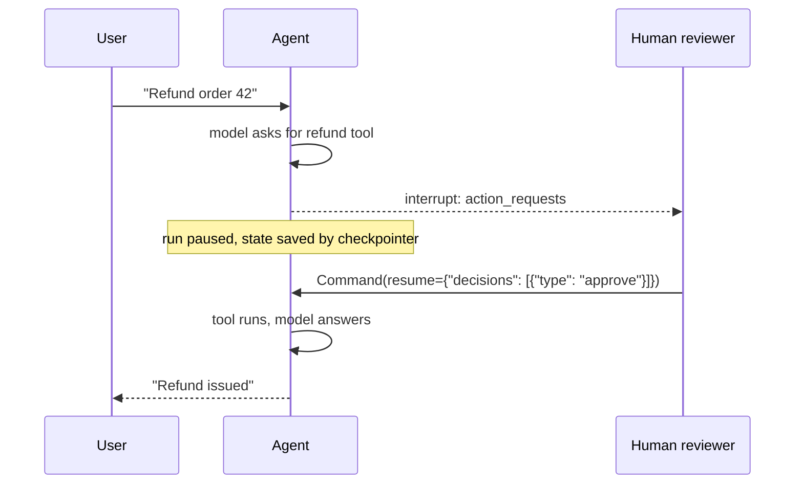

# Chapter 11: Runtime and human-in-the-loop

> [!NOTE]
> **📍 At a glance**
> - **You will build:** context-aware tools and prompts, and a full human-in-the-loop approval flow
> - **Level:** intermediate to advanced · **Time:** about 50 minutes
> - **Builds on:** [Chapter 6](06-agents-and-memory.md) (checkpointer, store, context basics), [Chapter 7](07-middleware.md) (hooks, first look at HITL) and [Chapter 10](10-shell-tools-and-custom-middleware.md) (hook signatures). MCP, the next topic in the course, starts in the MCP book.

**After this chapter you can:**

- Explain what runtime is and name its five components
- Pass per-run data with `context_schema` and `context=`
- Read context and long-term memory inside tools with `ToolRuntime`
- Say exactly what state, runtime and tool runtime each hold, and who receives what
- Build a personalised system prompt with `dynamic_prompt`
- Pause an agent for a human with `HumanInTheLoopMiddleware`, read the interrupt and resume it
- Interrupt only when it matters, with a condition on the tool call's arguments

## 11.1 The problem runtime solves

- CineBot needs facts that are **not part of the conversation**: which customer is talking, whether they are a VIP, which cinema location this session belongs to
- A chat product clearly knows your tier, name and preferences, and you never type them in
- **Hospital wristband analogy:** a patient's wristband lets every department read who they are and their history without re-explaining. That information is not part of any one conversation. It travels with the patient
- **Runtime = information that is not conversation history but must travel with the agent everywhere:** into every tool call and every middleware hook

## 11.2 Quick recap: agent state

- **State** is the agent's working record. In LangChain it is `AgentState`, a typed dictionary
- It holds the **conversation history** (the `messages` field, there by default) plus **any custom fields** you add by inheriting from `AgentState`
- Node-style hooks (`before_model`, `after_model`) receive state and can return updates to it
- Many learners mix state and runtime up. The rest of this chapter pins the difference down

## 11.3 The five components of runtime

- **`context`:** static, per-run data (user id, database connections, config)
- **`store`:** long-term memory that survives across separate sessions
- **`stream_writer`:** a channel for custom progress updates during a run
- **`execution_info`:** identity of this execution: thread id, run id, retry attempt
- **`server_info`:** metadata, only when running on a LangGraph server (assistant id, authenticated user)

Good to know:

- `create_agent` runs on **LangGraph's runtime**. LangChain exposes what LangGraph already maintains
- Every framework has some equivalent under another name. The idea transfers
- ✅ *Verified (details in "How this chapter was checked").*
- ✅ *Verified (details in "How this chapter was checked").*

## 11.4 Context: `context_schema` and `context=`

```python
from dataclasses import dataclass
from langchain.agents import create_agent

@dataclass(frozen=True)              # frozen: see the pitfall below
class CineBotContext:
    user_name: str
    # geo_state: str  (for example Delhi, Bangalore, Chennai)

agent_with_context = create_agent(
    model="openai:gpt-5-mini",
    tools=[],
    context_schema=CineBotContext,       # declares the SHAPE of context the agent expects
)

result = agent_with_context.invoke(
    {"messages": [{"role": "user", "content": "What's my name?"}]},
    context=CineBotContext(user_name="Priya"),     # injected at invocation time
)
```

- `context_schema` is a skeleton: the shape of the per-run information, defined once as a dataclass
- `context=` injects it **without it appearing in the conversation**
- **Passing context does not make the agent use it.** That link is made on purpose, for example with `dynamic_prompt` (11.8)

> **Pitfall (checked).** The class said context "stays fixed and unchangeable". A plain `@dataclass` is **not** protected. A tool that set `runtime.context.user_id = ...` changed the value for the **next tool call in the same run**, and even changed the object the caller passed in. Use `@dataclass(frozen=True)` and a change raises `FrozenInstanceError`

## 11.5 Runtime inside tools: `ToolRuntime`

```python
from dataclasses import dataclass
from langchain.agents import create_agent
from langchain.tools import tool, ToolRuntime
from langgraph.store.memory import InMemoryStore

@dataclass(frozen=True)
class CustomerContext:
    user_id: str

loyalty_store = InMemoryStore()
loyalty_store.put(("users",), "mayank123", {"preferences": "Horror, Thriller"})

@tool
def fetch_customer_preferences(runtime: ToolRuntime[CustomerContext]) -> str:
    """Fetch the customer's saved preferences from long-term memory."""
    user_id = runtime.context.user_id
    memory = runtime.store.get(("users",), user_id) if runtime.store else None
    return memory.value["preferences"] if memory else "No preferences"

pref_agent = create_agent(
    model="openai:gpt-5-mini",
    tools=[fetch_customer_preferences],
    context_schema=CustomerContext,
    store=loyalty_store,
)
pref_agent.invoke({"messages": [("user", "What do I like?")]}, context=CustomerContext(user_id="mayank123"))
```

The class's loyalty store, as a picture of what is stored:

```
mayank, mayank123  ----> Horror, Thriller
priya,  priya1234  ----> Romance, Thriller
priya,  priya2222  ----> RomCom, Horror
```

- The id travels through `runtime.context.user_id`. The tool reads long-term preferences from the store. The user **never states either in the chat**
- This is how a chat product "remembers" your name or preferences across sessions: it lives in a store, reached through runtime, separate from message history
- **Why `ToolRuntime` and not a raw runtime?** LangChain decided that tools do not get a loose reference to a shared object. A tool gets a **`ToolRuntime` parameter, deliberately passed**. It bundles the five components plus tool extras: **state, config and the tool call id**. There is no shortcut to "get the store directly". A tool sees only what it is handed
- The `runtime` parameter is **hidden from the model**. The tool's visible arguments stay empty (checked, see [Chapter 5](05-tools.md), 5.9)

> **Pitfall (checked).** The class code wrote `runtime.store.get(("users"), user_id)`. `("users")` is **just a string**, not a tuple. With data stored under `("users",)` the lookup quietly returned `None`, and the tool answered "No preferences". A namespace must be a **tuple**: `("users",)`

## 11.6 Who gets what: state, runtime and tool runtime

The most repeated idea of the class.

- **State:** conversation history (`messages`) plus custom fields
- **Runtime:** the five components
- **Tools:** get **both**, bundled as `ToolRuntime`, plus the tool call id and config
- **Node-style hooks** (`before_model`, `after_model`): receive **`state` and `runtime` as two separate parameters**
- **Wrap-style hooks** (`wrap_model_call`): receive **one `request`** (a `ModelRequest`) that holds state and runtime inside it. In code: `request.state`, `request.runtime`

None of this is optional. It is how LangChain calls your function:

- A hook defined with **zero parameters** fails at once: `TypeError: ... takes 0 positional arguments but 2 were given`. State and runtime are always sent
- **Parameter names do not matter. Position and count do.** Catching them as `a, b` works exactly like `state, runtime` (checked: the hook received a dict and a `Runtime`)
- **Names of the function:** for **decorator-based** middleware any function name works, because the decorator registers the hook. For **class-based** middleware the method name **must match the hook** (`before_model`) so the framework knows which hook you are replacing ([Chapter 10](10-shell-tools-and-custom-middleware.md), 10.6)

## 11.7 State or context? Mutability and persistence

Two properties decide it.

- **State:** **mutable**, and **persists across invocations** in the same conversation (same thread). Use it for anything that changes over time, such as a running call count
- **Context:** meant to be **fixed for one run**. Use it for static values: a user id, database credentials
- **Inside one invocation, only state reliably carries forward** between tool calls. Tool arguments and tool-specific values are fresh on every call, whichever way you access them

The class mixed these up once, then corrected it. Here is what a test shows:

- A tool that updated a `call_count` **state** field returned `Command(update={"call_count": n, ...})`. The count was 1, then 2 in the same run, and **3 on the next invoke of the same thread**
- Context given on the next invoke was a **new object** (it did not carry anything over)
- A plain-dataclass context **can** be changed mid-run (see the pitfall in 11.4). Freeze it if you want the rule enforced

How this answers "thread_id vs context" (assignment A1 Q3):

- **`thread_id`** (in the config) says **which conversation** to continue. It belongs to the checkpointer
- **Context** carries **facts for this run**: who the user is, their plan
- Swap them and you get real bugs: a user id used as `thread_id` merges everything that user ever said into one conversation, and a thread id used as context tells your tools nothing about the user

## 11.8 Dynamic prompting with runtime

```python
from langchain.agents import create_agent
from langchain.agents.middleware import dynamic_prompt, ModelRequest

@dynamic_prompt
def personalize_the_prompt(request: ModelRequest):
    user_name = request.runtime.context.user_name
    return f"You are CineBot. Always address the user as {user_name}."

agent = create_agent(
    model="openai:gpt-5-mini",
    tools=[],
    middleware=[personalize_the_prompt],
    context_schema=CineBotContext,
)
agent.invoke({"messages": [("user", "What's my name?")]}, context=CineBotContext(user_name="Priya"))
```

- This is the concrete mechanism behind a chat assistant that greets a returning user by name, with the name never typed into the current chat
- The system prompt is **rebuilt on every call** from values in runtime context
- ✅ *Verified (details in "How this chapter was checked").*
- The class notebook cell built the prompt from names that were not defined (`Claude_Instructions`). The version above is the working idea

### Context engineering: the framework

From `context-engineering.mdx`. The idea: agents usually fail not because the model is weak but because the **right context was not passed**. Context engineering is giving the model the right information and tools in the right format.

| Context type | What you control | Transient or persistent |
|---|---|---|
| **Model context** | what goes into a model call: instructions, message history, tools, model, response format | transient |
| **Tool context** | what tools read and write (state, store, runtime context) | persistent |
| **Life-cycle context** | what happens between steps: summarisation, guardrails, logging | persistent |

| Data source | Also called | Scope |
|---|---|---|
| Runtime context | static configuration (user id, keys, permissions) | one conversation |
| State | short-term memory (messages, files, tool results) | one conversation |
| Store | long-term memory (preferences, insights) | across conversations |

- Middleware is the mechanism: it updates context and can jump to another step ([Ch 10](10-shell-tools-and-custom-middleware.md))
- ✅ *Verified (details in "How this chapter was checked").*
- ✅ *Verified (details in "How this chapter was checked").*
- Where each kind lives in these notes: system prompt and dynamic prompt ([11.8](11-runtime-and-human-in-the-loop.md)), messages and summarisation ([Ch 7](07-middleware.md)), tools and gating ([Ch 5](05-tools.md), [Ch 7](07-middleware.md)), response format ([Ch 4](04-structured-output.md)), runtime, state and store (11.3 to 11.7)

*Source: `langchain-ai/docs`, `src/oss/langchain/context-engineering.mdx` (Overview). The page's many examples were compared by identifier only; every identifier is already in these notes.*

## 11.9 Using runtime in middleware: an authorisation gate

```python
from langchain.agents import AgentState
from langchain.agents.middleware import before_model
from langgraph.runtime import Runtime

@before_model
def auth_gate(state: AgentState, runtime: Runtime) -> dict | None:
    """Block unauthenticated users."""
    if runtime.server_info is not None:
        raise ValueError("Unauthenticated user")
    print(f"[AUTH] Passed for user {runtime.context.user_name}, thread {runtime.execution_info.thread_id}")
    return None
```

- It pulls `execution_info.thread_id` and `server_info` together to build gating logic before a model call may proceed
- **Corrections:**
  - The class notebook cell failed with `NameError: name 'Runtime' is not defined`. The import above fixes it
  - As written, the check raises **whenever `server_info` is present**, and `server_info` is exactly what a LangGraph server provides (it carries the authenticated user). On a server this would block everyone. Treat it as a demonstration of reading the components, not as a real gate. A real gate checks the **identity** inside `server_info`, or uses your own auth layer

## 11.10 `stream_writer`: progress updates from a tool

The class listed `stream_writer` but did not demo it. Checked:

```python
from langchain.tools import tool, ToolRuntime

@tool
def slow_search(q: str, runtime: ToolRuntime) -> str:
    """Search with progress updates."""
    write = runtime.stream_writer
    write("searching...")
    write("found 3 results")
    return "done"

# for chunk in agent.stream({"messages": [("user", "go")]}, stream_mode="custom"):
#     print(chunk)        # 'searching...' then 'found 3 results'
```

- Whatever you write arrives in the **`custom`** stream. A UI can show it live

## 11.11 Human-in-the-loop, in depth



> Agents run in a loop, the agentic loop you built by hand in raw Python. Human-in-the-loop is the moment a human is deliberately brought **into** that loop.

**The motivating problem**

```python
from langchain.agents import create_agent

unguarded_agent = create_agent(model="openai:gpt-5-mini", tools=[cancel_booking])
unguarded_agent.invoke({"messages": [("user", "Cancel my booking BK1042")]})
```

- Run as is, it cancels the booking **immediately**
- **Anyone** who can talk to this agent can cancel **anyone's** booking, with no authorisation
- Some actions are too consequential to let an agent finish without a human confirming first
- Needs memory first: it must **pause and resume later**, so it needs `InMemorySaver` and a `thread_id` ([Chapter 6](06-agents-and-memory.md), 6.4)

**Set it up**

```python
from langchain.agents import create_agent
from langchain.agents.middleware import HumanInTheLoopMiddleware
from langgraph.checkpoint.memory import InMemorySaver
from langgraph.types import Command

guarded_agent = create_agent(
    model="openai:gpt-5-mini",
    tools=[cancel_booking, send_booking_confirmation],
    middleware=[
        HumanInTheLoopMiddleware(
            interrupt_on={
                "cancel_booking": True,                # all four decisions allowed
                "send_booking_confirmation": False,    # safe: never pauses
            },
            description_prefix="CineBot action pending your approval",
        ),
    ],
    checkpointer=InMemorySaver(),        # REQUIRED
)

config = {"configurable": {"thread_id": "hitl-demo-111"}}
result = guarded_agent.invoke(
    {"messages": [("user", "Cancel booking BK1042")]},
    config=config,
    version="v2",        # the current pattern for reading interrupts
)
print(result.interrupts)
```

- **`True`** allows **all four** decisions (checked: `approve`, `edit`, `reject`, `respond`). **`False`** means the tool never pauses. You can also pass a dict to limit the decisions ([Chapter 7](07-middleware.md), 7.6)
- **`description_prefix`** sets the heading of the approval text. Checked: the request's description started with `CineBot action pending your approval`
- **`version="v2"`** makes `invoke` return a **`GraphOutput`** with `.value` (the usual result dict) and `.interrupts`
  - Without it you get a plain **dict**. Then `result.interrupts` fails with `AttributeError: 'dict' object has no attribute 'interrupts'` (this happened in the class notebook). The interrupt is in the dict under the key `__interrupt__`
- `result.interrupts` holds an **action request**: the tool's name, its arguments, a description, and the allowed decisions

**Answer the interrupt with `Command`**

```
User → Agent: "Cancel booking BK1042"
Agent: cancel_booking requested
Agent → User: ⏸ interrupt, awaiting a decision
User → Agent: Command(resume={"decisions": [{"type": "approve"}]})
Agent: tool runs
Agent → User: "Booking BK1042 has been cancelled."
```

```python
resumed = guarded_agent.invoke(
    Command(resume={"decisions": [{"type": "approve"}]}),
    config=config,            # the SAME thread id resumes the paused run
    version="v2",
)
print(resumed.value["messages"][-1].content)
```

**The four decisions** (whiteboard wording; shapes are in [Chapter 7](07-middleware.md), 7.6):

- **`approve`:** execute with the original arguments
- **`edit`:** modify the arguments before executing. Shape: `{"type": "edit", "edited_action": {"name": "cancel_booking", "args": {...}}}`
- **`reject`:** skip entirely. The **feedback is sent to the agent**: `{"type": "reject", "message": "Cancellations require manager sign-off first. Ask the customer to call support."}`
- **`respond`:** the human's message is returned **as the tool result** and the tool never runs

**`respond` is different in kind.** It is for tools that really just **ask the user something**:

```python
@tool
def ask_customer(question: str) -> str:
    """Ask the customer a clarifying question and wait for their reply."""
    return "placeholder -- never reached, respond intercepts this"

ask_agent = create_agent(
    model="openai:gpt-5-mini",
    tools=[ask_customer],
    middleware=[HumanInTheLoopMiddleware(interrupt_on={"ask_customer": {"allowed_decisions": ["respond"]}})],
    checkpointer=InMemorySaver(),
)
# resume with:
# Command(resume={"decisions": [{"type": "respond", "message": "It's booking BK1042, for the movie Interstellar"}]})
```

- Nothing is approved, edited or rejected. It is a two-way conversation: the tool result is skipped and the human's words come back **as if the tool said them**
- Checked: the tool message the model received was exactly the human's text
- It is the behaviour you see when a chat assistant pauses to ask you a question instead of guessing. The human supplies **missing information**

### Per-call interrupt mode

From the docs page `human-in-the-loop`. Needs `langchain>=1.4.6`. *Checked* on 1.4.7 with a scripted model: three tools, `read_data` ungated, `write_file` and `execute_sql` gated.

| | `interrupt_mode="batched"` (default) | `interrupt_mode="per_call"` |
|---|---|---|
| Interrupts | one per model turn, listing every gated call | one per gated call, raised as the call starts |
| Answer | a list of decisions in the same order | one decision per **interrupt ID** |
| Ungated tools | *checked:* ran only after the resume | *checked:* `read_data` ran **immediately** |
| Schema | none | each interrupt carries a `response_schema` |

- The docs advise per-call mode for new agents and say LangChain plans to make it the default in the next major release
- ✅ *Verified (details in "How this chapter was checked").*
- ✅ *Verified (details in "How this chapter was checked").*

```python
HumanInTheLoopMiddleware(
    interrupt_on={"write_file": True,
                  "execute_sql": {"allowed_decisions": ["approve", "reject"]},
                  "read_data": False},
    interrupt_mode="per_call",
    edit_notice=None,            # optional: drop the note shown to the model after an edit
)
```

- **Edit:** `{"type": "edit", "edited_action": {"name": "write_file", "args": {...}}}`. The name must stay the same and the args must fit the tool's schema. *Checked:* the edited call ran with the new path, and the model received a note that "a human reviewer replaced this tool call" before the result. With `edit_notice=None` the model saw only `Wrote 1 characters to e.csv`
- **Reject:** `{"type": "reject", "message": "use SELECT"}`. *Checked:* the model received `User rejected the tool call for `execute_sql` with reason: use SELECT`
- **Respond:** `{"type": "respond", "message": "..."}` skips the tool and answers in its place. The message is required, and the model gets it as a **successful** result, so use `reject` to deny
- **One at a time:** an unanswered interrupt stays pending. *Checked:* after answering only `write_file`, `execute_sql` was still pending and had not run
- **Invalid answers:** the answer is checked against the schema before it is saved. *Checked:* an edit missing `content` raised a `ValidationError`, nothing was saved, and a corrected answer to the **same ID** was accepted. The docs warn that if several answers are sent together and one is invalid, the others' tools can run while their interrupts still show as pending, and answering again runs them twice. Check answers first or send them one at a time
- **Order of middleware:** list `HumanInTheLoopMiddleware` **before** `ToolRetryMiddleware` and `ToolErrorMiddleware`, so a retried call does not ask the reviewer again. Middleware listed before it runs again up to the pause on resume, so it must have no side effects before it calls its handler

*Source: `langchain-ai/docs`, `src/oss/langchain/human-in-the-loop.mdx` (Set the interrupt mode, Pause once per tool call).*

> [!IMPORTANT]
> **🏭 In production**
> - Approvals can wait hours: the checkpointer must be a real database, and the UI must show the exact action and arguments
> - Decide what happens to unanswered approvals (expire, remind, cancel) before launch
> - Use runtime **context** for who the user is; never let the model choose the user id
> - *Added by Claude.*

## 11.12 Conditional interrupts

Not every action needs a human. Interview-style case: an e-commerce company wants a human only when an order value crosses a threshold.

```python
from langchain.tools import tool
from langchain.agents.middleware import HumanInTheLoopMiddleware, ToolCallRequest

@tool
def cancel_booking_priced(booking_id: str, amount: float) -> str:
    """Cancel a booking with a refund amount."""
    return f"Booking {booking_id} cancelled, ${amount:.2f} refunded."

def is_large_refund(request: ToolCallRequest) -> bool:
    amount = request.tool_call["args"].get("amount", 0)
    return amount > 100

conditional_agent = create_agent(
    model="openai:gpt-5-mini",
    tools=[cancel_booking_priced],
    middleware=[
        HumanInTheLoopMiddleware(
            interrupt_on={
                "cancel_booking_priced": {
                    "allowed_decisions": ["approve", "edit", "reject"],
                    "when": is_large_refund,
                },
            },
        ),
    ],
    checkpointer=InMemorySaver(),
)
```

- **`ToolCallRequest`** is the same object that sits under `wrap_tool_call`. It carries `tool_call`, `tool`, `state` and `runtime`. Your function can inspect the **actual arguments** and decide on the fly
- Confirmed live and again by my test: a **$25** refund ran with **no interrupt**, a **$500** refund on the **same tool and same middleware** paused for approval
- **Real-world framing from the whiteboard:** a user asks to cancel booking `BK1011`, worth $101, with a refund. The request goes through the agentic loop, hits the cancel tool behind the HITL middleware and **pauses for an executive, not the customer**. That is how a refund-approval workflow routes an above-threshold request to a human reviewer instead of the requester
- The saved notebook cell has the real check **commented out** and `return True`. The saved outputs match the real check, so treat the commented lines as the intent

## 11.13 The interactive HITL loop

```python
def run_interactive_hitl(agent, config):
    """A real, interactive HITL loop."""
    result = agent.invoke({"messages": [("user", "Cancel booking BK1042")]}, config=config, version="v2")
    if not result.interrupts:
        print("Nothing paused for review.")
        return

    print("CineBot wants to cancel booking BK1042. Choose a decision:")
    print("  1) approve")
    print("  2) edit     -- cancel a DIFFERENT booking ID instead")
    print("  3) reject")
    choice = input("Type 1, 2, or 3: ").strip()

    if choice == "1":
        decision = {"type": "approve"}
    elif choice == "2":
        new_id = input("Booking ID to cancel instead: ").strip()
        decision = {"type": "edit", "edited_action": {"name": "cancel_booking", "args": {"booking_id": new_id}}}
    elif choice == "3":
        reason = input("Reason: ").strip()
        decision = {"type": "reject", "message": reason}
    else:
        print("Not a valid choice.")
        return

    resumed = agent.invoke(Command(resume={"decisions": [decision]}), config=config, version="v2")
    print("Final:", resumed.value["messages"][-1].content)
```

- **The loop is always: invoke, check for interrupts, collect a decision, resume with a `Command`**
- A real UI replaces `input()` with buttons (as chat products do). The loop underneath is the same in every framework
- Approve, reject, edit and respond appear under other names in other frameworks. The practice differs a little, the concept does not
- This class used the **correct `edited_action` shape**. The class 11 demo used `args` directly, which raises an error (checked in [Chapter 7](07-middleware.md), 7.6)

## 11.14 Questions from the class

- **State vs runtime context?** Mutability and persistence (11.7). State is mutable and persists across invocations in a conversation. Context is for static per-run values. The mentor first answered this the wrong way round and corrected it after the break
- **Does a change persist the same way inside a tool and inside `wrap_tool_call`?** Only **state** changes carry forward across tool calls in one invocation. Context stays fixed
- **Can I name my decorated middleware functions anything?** Decorator-based, yes. Class-based, no: the method name must match the hook
- **Does declaration order of several middlewares matter?** Yes. `before_*` and `wrap_*` in declared order, `after_*` reversed ([Chapter 10](10-shell-tools-and-custom-middleware.md), 10.8)
- **Retry and error middleware: does order matter?** The class said to declare retry first. **My test says the opposite.** See 11.16
- **Why is every reply in my structured format, even "hi", when I set `response_format` and tools?** Expected. Once structured output is set, the agent always tries to shape its final answer that way. It is separate from a tool's `return_direct`, which sends a tool's raw result past the model
- **MCP vs defining tools in LangChain?** In a simple sense the same: MCP is a collection of tools in a standard protocol. The "agent calls a tool" mechanic does not change. MCP changes how tools are packaged, discovered and shared
- **When LangGraph instead of LangChain?** When LangChain's default control is not enough. Every `create_agent` already builds a LangGraph graph. LangGraph lets you reach into that graph
- **How does Google's ADK compare?** Near-identical once names are stripped away: multi-agent, human-in-the-loop, graph workflows, models. The same is true of AutoGen. Evaluating another framework is mostly a vocabulary exercise
- **Is RAG always used for agent memory?** No. For retrieving documents by meaning, RAG fits. For persisting and looking up structured data, a plain database works just as well
- **Keep an on-premise model current with changing company policy: fine-tune or RAG?** RAG. Fine-tuning is slow, expensive and will not track fast-changing policy
- **Voice-driven document editor?** Build voice-to-text directly. For light workloads, free long-context models are enough
- **What does the mentor look for when hiring for agentic AI roles?** Software engineering fundamentals and real problem-solving over memorised framework syntax. You should be able to explain **why** code does what it does, including basics such as what Pydantic is for
- **How do I cut token use in a long-running conversation?** Use long-term memory (the `store`, through runtime). Retrieve only the memories relevant to the current message instead of resending the whole history. Whether to load all, load some or summarise is your design choice. LangChain does not do it for you

## 11.15 Interview corner

**What interviewers listen for:** you separate **state** (changes during a run) from **context** (fixed per run), you know a pause needs a checkpointer, and you can describe the approve / edit / reject / respond flow.

### 🟢 Basic

<details class="qa"><summary>1. What is runtime, and what are its five components?</summary>

- Information that is not conversation history but travels with the agent into every tool and hook
- `context`, `store`, `stream_writer`, `execution_info`, `server_info`
- *Stronger answer:* it is LangGraph's runtime, exposed by LangChain

</details>

<details class="qa"><summary>2. State vs runtime?</summary>

- State: `messages` plus custom fields, mutable, persists across invocations of a thread
- Runtime: the five components, with context fixed for the run
- *Stronger answer:* tools get both as `ToolRuntime`. Node hooks get `state` and `runtime`. Wrap hooks get one `request`

</details>

<details class="qa"><summary>3. <code>thread_id</code> vs context?</summary>

- `thread_id` picks the conversation (checkpointer). Context carries facts for this run
- *Stronger answer:* freeze the context dataclass, otherwise a tool can change it mid-run

</details>

### 🟡 Intermediate

<details class="qa"><summary>4. How do you give a tool the current user and their saved preferences without the user typing them?</summary>

- User id in `context`, preferences in the `store`, both read through `ToolRuntime`
- *Stronger answer:* namespaces are tuples and should be scoped per user

</details>

<details class="qa"><summary>5. What does <code>version="v2"</code> change for HITL?</summary>

- `invoke` returns a `GraphOutput` with `.value` and `.interrupts` instead of a dict

</details>

<details class="qa"><summary>6. What are the four HITL decisions, and which one is not about an action?</summary>

- approve, edit, reject, respond. `respond` returns the human's message as the tool result and skips the tool. Use it for tools that only ask a question

</details>

### 🔴 Senior

<details class="qa"><summary>7. How would you ask for approval only for refunds above $100?</summary>

- `interrupt_on={"tool": {"allowed_decisions": [...], "when": fn}}` where `fn` receives a `ToolCallRequest` and inspects its arguments
- *Stronger answer:* make the function fail closed: if the amount is missing, interrupt

</details>

<details class="qa"><summary>8. Why does HITL need a checkpointer?</summary>

- The run must pause and resume later. Without one `Command(resume=...)` raises an error

</details>

<details class="qa"><summary>9. State or context: where do user id, role and cart items belong?</summary>

- User id and role: **context** (fixed, from your app, trusted). Cart items: **state** (changes as the run goes)
- *Stronger answer:* context cannot be changed by the model, which is exactly why identity and permissions belong there

</details>

> [!TIP]
> **🧩 Design question to practise:** *"An agent books meetings for executives but a human assistant must approve anything over 1 hour."* Cover the conditional interrupt, what the reviewer sees, edit vs reject, and persistence.

## 11.16 Added by Claude, not from the sources

Not in the course material. Established practice, but check current docs. Items marked *checked* were tested on `langchain` 1.4.7.

**Runtime and context**

- **Freeze your context dataclass** with `@dataclass(frozen=True)`. *Checked:* otherwise a tool can change it mid-run and the change leaks into the caller's object
- **Scope the store per user.** Namespace by user as well, for example `("users", user_id)`, so one user's keys cannot collide with another's
- **Never put secrets in the chat for a tool to use.** Put tokens in `context` and read them from `runtime.context`. The model never sees them

**Human in the loop**

- **Fail closed in `when`.** The class function uses `.get("amount", 0) > 100`. If the model renames or omits `amount`, the default 0 means **no human is asked**. Default to interrupting, for example treat a missing or unparseable amount as large
- **HITL is not authentication.** It asks *someone* to approve. Check that the approver is the right person, and that only an authorised user can resume a thread
- **Show the approver the real arguments** and record who decided what
- **The model may ask again after a decision.** In class, after an edited, partial transfer was approved, the **model** asked for approval again because it saw a balance left. That is the model's own judgement, not scripted by the middleware. Design the flow so a second request is safe
- **Retry and error order (from my test, 11.14).** *Checked:* with `ToolRetryMiddleware` listed **first** and `ToolErrorMiddleware` second, a failing `ConnectionError` tool ran **once** and the model got the safe message. With **error first, retry second** it ran **3 times** (1 + 2 retries). The first middleware in the list is outermost, so the one that must see the raw exception has to be **inside**. With the retry default `on_failure="continue"`, retry already turns its own last failure into a message, so the error middleware has little left to do ([Chapter 9](09-guardrails-to-do-lists-and-tool-resilience.md), 9.6)

**Cost**

- **Retrieve, do not resend.** For long-running chats keep facts in the store and fetch only what the current message needs. Combine it with summarization ([Chapter 7](07-middleware.md), 7.5) for the recent chat

## Cheat sheet

```python
from dataclasses import dataclass
@dataclass
class Ctx: user_id: str
agent = create_agent(model, tools, context_schema=Ctx, checkpointer=InMemorySaver(),
    middleware=[HumanInTheLoopMiddleware(interrupt_on={"refund": True})])
cfg = {"configurable": {"thread_id": "t1"}}
r = agent.invoke(inp, cfg, context=Ctx(user_id="u1"))
r["__interrupt__"]                                  # paused
agent.invoke(Command(resume={"decisions": [{"type": "approve"}]}), cfg, context=Ctx("u1"))
```

## Recap

- **Runtime** = what travels with the agent but is not conversation: `context`, `store`, `stream_writer`, `execution_info`, `server_info`
- **State** = `messages` plus custom fields, mutable, persists across invocations of a thread
- Tools get `ToolRuntime` (runtime + state + config + tool call id). Node hooks get `state` and `runtime`. Wrap hooks get one `request`
- Pass per-run data with `context_schema` and `context=`. **Freeze** the dataclass. Namespaces in the store are **tuples**
- `dynamic_prompt` rebuilds the system prompt from context on every call
- **HITL:** needs a checkpointer. `version="v2"` gives `.interrupts` and `.value`. Resume with `Command(resume={"decisions": [...]})` on the same thread
- `True` = all four decisions, `False` = never pause. `respond` returns the human's words as the tool result
- **Conditional interrupts:** `"when": fn(ToolCallRequest) -> bool`. Make it fail closed

## Practice

1. Recreate `CineBotContext` and confirm `context=` at invocation is readable without being part of the conversation
2. Build `fetch_customer_preferences` with `ToolRuntime` and a real `InMemoryStore`. Confirm the preferences persist across separate `invoke()` calls. Then use the string namespace `("users")` and see the silent miss
3. Define a hook with zero parameters and see the error. Then catch the arguments as `a, b` and see it work
4. Build the `dynamic_prompt` example and confirm the system prompt changes with the context
5. Recreate `unguarded_agent` vs `guarded_agent`: one cancels at once, the other pauses
6. Practise all four decisions (`approve`, `edit`, `reject`, `respond`) against the same agent
7. Build `is_large_refund` and show a small amount sails through and a large one interrupts. Then make it fail closed
8. Test mutability: try changing `runtime.context` mid-run (with and without `frozen=True`), then change a state field and see it persist across tool calls and across invokes
9. Assignment 2 (NovaBank), the parts this chapter prepares you for. The assignment has no answer key:
   - A1 Q3: `thread_id` vs `context`, one example of data for each, and why swapping them causes a real bug (11.7)
   - B1.2: a `context_schema` with `account_tier` read by a tool through `runtime.context` ([Chapter 6](06-agents-and-memory.md))
   - A2 Q7 and B2.1: the four HITL decisions for `transfer_funds` ([Chapter 7](07-middleware.md))
10. Set up VS Code ahead of the MCP module. It is taught there, not in Colab

## How this chapter was checked

- Run offline with a stand-in model on `langchain` 1.4.7 and `langgraph` 1.2.19:
  - `context_schema` with `dynamic_prompt` (the system message, and the name absent from the saved messages)
  - a tool with `ToolRuntime[...]` reading context and the store, the string vs tuple namespace, and `runtime` hidden from the tool's arguments
  - hook parameter names (`a, b`), the members of the `Runtime` object and the fields of `execution_info`
  - state vs context: a counter in state persisting across tool calls and invokes, a mutable context changing mid-run, and a frozen one raising `FrozenInstanceError`
  - `stream_writer` with `stream_mode="custom"`
  - HITL: the unguarded agent, a dict result vs `version="v2"`, `.interrupts` and `.value`, `True` and `False` in `interrupt_on`, `description_prefix`, `respond` with a question-only tool, `when=` with $25 and $500, and the interactive loop with approve, edit and reject
  - retry and error middleware in both orders with the default `on_failure`
- **Not run:** a real LangGraph server (so `server_info` and `run_id` were `None`), real model behaviour, a persistent checkpointer or store
- Class 15 has no code folder beyond the notebook and diagram. The Colab link in the README is not in the repo
- **Details by section** (moved here from the ✅ markers):
  - *11.3 The five components of runtime:* Checked: the runtime object also has other members (for example `override`, `merge`, `heartbeat`). The five above are the ones to learn
  - *11.3 The five components of runtime:* Checked: `execution_info` carries `thread_id`, `run_id`, `node_attempt`, `checkpoint_id`, `checkpoint_ns` and `task_id`. Outside a server, `run_id` and `server_info` are `None`
  - *11.8 Dynamic prompting with runtime:* Checked: the model's first message was `You are CineBot. Always address the user as Priya.` and the name did **not** appear in the saved messages
  - *Per-call interrupt mode:* Checked, batched: 1 interrupt holding both `write_file` and `execute_sql`; no tool ran before the resume
  - *Per-call interrupt mode:* Checked, per call: 2 interrupts; each value has `type: "tool_approval"`, `tool_call_id`, `name`, `args` and `description`. Resume with `Command(resume={interrupt_id: decision, ...})`
  - *Context engineering: the framework:* Checked, transient: a `wrap_model_call` that replaced the system message changed what the model saw, and the state kept only `human, ai`. A `dynamic_prompt` that read `request.state` did the same and left no system message in state
  - *Context engineering: the framework:* Checked, persistent: a `before_model` hook returning `{"messages": [SystemMessage(...)]}` put the note into **state**, and it stayed after the run
- The 2026 review added the diagrams, 🏭 In production boxes, graded interview layout, extra senior and design questions and the cheat sheet. These are Added by Claude: standard engineering practice. Cheat-sheet APIs were checked against the installed `langchain` 1.4.7 signatures

## Sources and further reading

- Live-Class-2026, `classes_summary/15 - 22 Aug - Runtime & Human-in-the-Loop.md`
- Live-Class-2026, `classes_transcription_summary/15 - 22 Aug - LangChain - Runtime & Human-in-loop.md`
- Live-Class-2026, `Runtime_and_HITL.ipynb` and the whiteboard `Runtime-HITL.pdf` (text and page images) in `Weekend 09 - 22-23 Aug/22nd Aug - Runtime & HITL/`
- Live-Class-2026, `Weekend 09 - 22-23 Aug/README.md` and `22nd Aug - Runtime & HITL/README.md`
- `Assignment_2_Agents_and_Prebuilt_Middleware.ipynb` (questions only)
- Section 11.16 and the corrections marked *checked* are from testing, not from the class sources

Previous: [Chapter 10, Shell tools and custom middleware](10-shell-tools-and-custom-middleware.md) · Next: [Chapter 12, MCP in LangChain](12-mcp-in-langchain.md) (not written yet)
