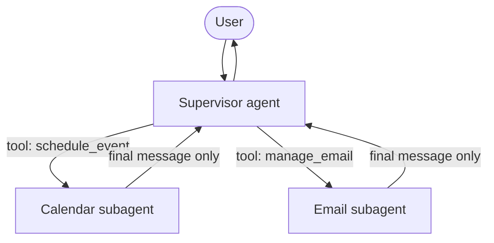

# Chapter 13: Multi-agent systems and subagents

> [!NOTE]
> **📍 At a glance**
> - **You will build:** a supervisor that delegates to specialist subagents
> - **Level:** advanced · **Time:** about 40 minutes
> - **Builds on:** [Chapter 5](05-tools.md) (tools), [Chapter 6](06-agents-and-memory.md) (checkpointer), [Chapter 11](11-runtime-and-human-in-the-loop.md) (`ToolRuntime`, human-in-the-loop) and [Chapter 12](12-mcp-in-langchain.md) (tools from MCP servers). **Next:** [Chapter 14](14-handoffs-skills-router-and-custom-workflows.md) covers the other four patterns.

## 13.1 Why one agent is not enough

- The simplest setup: **one agent with a pile of tools** (email, calendar, search, a spreadsheet)
- It works until a request touches several tools at once
- Class example: "reply to Sarah confirming Thursday at 2 p.m." With fifteen or more tools competing for attention, the agent may reply "sounds good" **without checking the calendar** it had access to
- A real company splits work into teams for the same reason: it is faster, better, and easier on each person's context
- The notebook's three reasons to go multi-agent:
  - **Context management:** specialised knowledge without overwhelming one context window
  - **Distributed development:** different teams own different capabilities
  - **Parallelisation:** specialised workers run subtasks at the same time
- **Default to one agent first.** Add more only when tools, context, teams or latency really demand it
- In LangChain v1 the idea is `Agent = Model + Harness`. A multi-agent system is **several agent objects wired in one of a few well-understood shapes**

> [!IMPORTANT]
> **🏭 In production**
> - Start with one agent; add subagents only when you can show context bloat or tool confusion. Every extra agent multiplies model calls, cost and latency
> - Trace the whole tree: a wrong answer usually starts in a subagent's last message
> - *Added by Claude.*

## 13.2 Context bloat and context isolation

**The live demo (class 23).** A visualiser called **Agent Flow** reads a Claude Code session's local files through hooks and draws agents, tools and token use. It makes **no model calls of its own**. It needs Claude Code, which needs a subscription.

1. **Analyse a codebase in the main agent.** A fresh session started near **5K** tokens. Reading file after file, the context climbed through 8K, 15K, 71K, 85K and 101K, and ended near **178K**
2. **The bill keeps coming.** Even an unrelated follow-up started from about 178K, so every later call carried the whole codebase
3. **The same job through a sub-agent.** A fresh session (about 5K): "start a separate sub-agent, analyse the code there, return only a summary." The main agent stayed around **10 to 11K**

- **Context bloat:** the context fills with material no longer needed. Thousands of file contents sit in the history where a one-paragraph summary would do. Class picture: every book stays on the table instead of one summary
- **Context isolation:** the sub-agent does spend tokens reading, but the parent only ever sees the **summary**, so every later call is cheap
- It is like handing a ten-day task to an intern and reading their summary instead of thousands of files
- The drop came from **architecture, not from smaller models**
- Summaries lose detail. In the long run this still beats a bloated agent, and the original files can be re-read on demand
- **Why not just compress the main chat?** If about 170K of the context is code, the summary is dominated by code and can crowd out the earlier conversation. With a sub-agent the chat and the code summary stay in proportion
- *These token numbers are the class demonstration. They were not reproduced here*

**Other benefits**

- **Distribution and parallelisation:** independent tasks run together
- **The right model for each job:** a strong model for the main agent, a cheap one for code analysis, or even another provider. The class prompt example: Haiku for summaries, Opus for design, Sonnet for implementation. A developer must design that split with sub-agents that each use the intended model
- **Multi-agent is not automatically cheaper.** More agents can use more tokens, depending on how they are written
- **Nothing is lossless.** The answer is sending the **relevant** context, not everything. Models also favour the start and end of a long context, like a person recalling a long meeting

## 13.3 The common shapes, with no framework

Multi-agent just means **more than one agent**. They can be combined in any shape.

| Shape | How it works | When it fits |
|---|---|---|
| **Chain** | One agent's output is the next agent's input | Steps that depend on each other |
| **Parallel** | The same request goes to several agents at once, then results merge (often just async code you write) | Independent tasks, such as research split into questions |
| **Controller or router** | One agent's only job is to decide who handles a request. The result does **not** come back | Sorting requests to specialists |
| **Reactive or feedback loop** | A worker does the job and an evaluator checks it, looping | Work that needs review |
| **Hierarchical** | An orchestrator delegates to sub-agents **and uses their results** | The most common shape in practice |
| **Planner and executor** | A planner splits a job into subtasks that other agents carry out | Larger jobs divisible into steps |

- **Router against hierarchical:** the difference is whether **control returns to the top agent**. A router hands off and is done. An orchestrator gets the result back and uses it
- **Multi-agent** means several agents. **Hierarchical** means agents living underneath another agent. Class: sub-agent and hierarchical are largely the same idea, an "agent as a tool"
- **A2A** is a separate topic: a protocol for agents built in **different frameworks** (say LangChain and ADK) to talk to each other. A dedicated discussion was planned
- **How an orchestrator chooses** is the same as tool choice. Each agent has a **name and description**, and the model decides from them
  - **Routing quality equals description quality.** Overlapping agents ("secondary school maths" and "high school maths") get confused
  - It can still be wrong. Tell it to ask a follow-up when unsure, sharpen the descriptions, and catch mistakes as a developer
  - A request that matches no agent may go to the closest one, which says it cannot help, and the orchestrator then tells the user it is unsupported
- **Router agent against LLM router:** the same idea with different words. **OpenRouter** is a catalogue of many models, not a router in this sense

## 13.4 LangChain's five patterns

| Pattern | Core mechanism | Best fit |
|---|---|---|
| **Subagents** | A supervisor agent calls other agents **as tools** | Distinct domains with their own tools and prompts, centralised control |
| **Handoffs** | State decides which prompt and tools are active | A sequence of stages, or agents trading control |
| **Skills** | One agent **loads specialist prompt content on demand** | Many specialisations, loaded only when needed |
| **Router** | A classification step fans out to agents **in parallel**, then synthesises | Independent knowledge verticals |
| **Custom workflow** | A hand-built LangGraph graph of any shape | Anything else, or a mix |

- LangChain's own wording maps to the class shapes: **subagents** are the hierarchical shape, **handoffs** resemble routing, and a **custom workflow** is left open
- **Patterns combine.** A subagent system can have a sub-agent that is itself a router. A handoff stage can use skills to manage its context. Pick **per sub-problem**, not once for the whole system
- This chapter covers **subagents**. [Chapter 14](14-handoffs-skills-router-and-custom-workflows.md) covers the other four, and a comparison table

## 13.5 Testing without an API key

The class repository's notebook runs every pattern for real with a **scripted stand-in model**. Everything around the model is real: the loop, tools, `Command` objects, graph state and checkpoints. Only the words are scripted.

```python
from langchain_core.language_models.fake_chat_models import FakeMessagesListChatModel
from langchain_core.messages import AIMessage

class ScriptedToolModel(FakeMessagesListChatModel):
    """Plays back `responses` in order, one per model call."""
    def bind_tools(self, tools, **kwargs):
        return self          # lets create_agent accept it

model = ScriptedToolModel(responses=[
    AIMessage(content="", tool_calls=[{"name": "check_showtimes",
                                       "args": {"movie_title": "Interstellar"}, "id": "c1"}]),
    AIMessage(content="Interstellar is showing at 7:00 PM and 10:15 PM."),
])
```

- ✅ *Verified (details in "How this chapter was checked").*
- **Why it matters:** the interesting parts (wiring, state changes, tool dispatch, handoffs) do not depend on what a real model says
- **Limit:** it cannot tell you whether a real model **chooses** the right agent. Test that separately with a real model and good descriptions
- The class notebooks each have a "production wiring" cell with `model="openai:gpt-5-mini"`. Those need your own key and were **not** run here

## 13.6 Pattern 1: subagents



A **supervisor** agent calls sub-agents **as tools**. It decides which to call, with what input, and how to combine the results.

- Sub-agents are **stateless by default**. They do not remember past calls. All conversation memory lives in the supervisor
- Sub-agents return results **to the supervisor**, not to the user
- The supervisor can call **several in one turn**, even in parallel
- **Use it when:** several distinct domains, each with its own tools or logic, and you want centralised control. With just a few tools, one agent is enough

### The mechanism

```python
from langchain.tools import tool
from langchain.agents import create_agent

@tool
def check_showtimes(movie_title: str) -> str:
    """Check available showtimes for a movie."""
    return {"interstellar": "7:00 PM and 10:15 PM"}.get(movie_title.lower(), "No showtimes found.")

showtimes_subagent = create_agent(model, tools=[check_showtimes])

@tool("showtimes", description="Check movie showtimes")
def call_showtimes_agent(query: str) -> str:
    result = showtimes_subagent.invoke({"messages": [{"role": "user", "content": query}]})
    return result["messages"][-1].content           # only the final message goes back

main_agent = create_agent(model, tools=[call_showtimes_agent])
```

- **Wrap each sub-agent as a tool. That is the entire mechanism.** Nothing more exotic
- ✅ *Verified (details in "How this chapter was checked").*
- The tool's **name and description** are what the supervisor reads to choose

### The three layers (the personal assistant project)

| Layer | Holds | Job |
|---|---|---|
| Bottom | `create_calendar_event`, `send_email`, `get_available_time_slots` | Rigid, exact-format API tools |
| Middle | `calendar_agent`, `email_agent` | Turn natural language into structured calls, and back |
| Top | `supervisor_agent` | Route to high-level capabilities, combine results |

- The supervisor sees `schedule_event` and `manage_email`, **never** the low-level API tools
- A new domain (restaurant booking, say) means a **new specialist and a new wrapper tool**. The supervisor and existing specialists do not change
- Each layer can be tested and improved alone. Test a specialist on its own before wiring it in
- *A multi-domain request* ("schedule a meeting and email a reminder") made the model issue **two tool calls in the same turn**, and the runtime executed both
- **A common failure:** a sub-agent calls its tools correctly but does not restate the result in its final message. Tell every specialist to **confirm what happened** in its final response, because the supervisor only sees that

### Sync and async

| | Sync (default) | Async |
|---|---|---|
| Behaviour | The main agent waits for the sub-agent | The main agent carries on while the sub-agent runs in the background |
| Best for | The next step needs the result, or failure should block | Independent work the user should not wait for |
| Cost | Simple, but blocks | Needs a job system |

- **This "async" is not Python `async` and `await`.** It means a background job in a separate process or service
- **Three-tool pattern:** `start_job` (returns a job id), `check_status` (pending, running, completed, failed) and `get_result`. When a job finishes, send a message such as "check job_123 and summarise" back into the conversation
- Not run here. It needs a job system

### Tool per agent, or one dispatch tool

| | Tool per agent | Single dispatch tool |
|---|---|---|
| Best for | A few sub-agents you tune one by one | Many agents, or teams publishing independently |
| Trade-off | More setup, most control | Simpler, less per-agent customisation |

```python
SUBAGENTS = {"research": research_agent, "writer": writer_agent}

@tool
def task(agent_name: str, description: str) -> str:
    """Launch an ephemeral subagent for a task.

    Available agents:
    - research: Research and fact-finding
    - writer: Content creation and editing
    """
    result = SUBAGENTS[agent_name].invoke({"messages": [{"role": "user", "content": description}]})
    return result["messages"][-1].content
```

- ✅ *Verified (details in "How this chapter was checked").*
- When the sub-agent has the **same abilities** as the main agent, the point of calling it is **context isolation**: it works in its own window and returns a concise summary

**How the supervisor learns which agents exist:**

| Method | Best for | Trade-off |
|---|---|---|
| **List them in the system prompt** | Fewer than about 10, rarely changing | Needs a prompt edit when agents change |
| **An `Enum` on the tool argument** | Fewer than about 10, rarely changing | Type-safe, needs a code change |
| **A discovery tool** (`list_agents(query)`) | More than about 10, or a changing registry | Flexible, adds complexity |

- ✅ *Verified (details in "How this chapter was checked").*
- Under about 10 static agents, the simplest option wins

### What the subagent receives: isolated or forked

| Mode | Subagent receives | Best for | Trade-off |
|---|---|---|---|
| **Isolated** (default) | Only the task description | Focused work needing little prior context | Re-derives what the parent already knows |
| **Forked** | The parent's message history plus the new task | Continuing something the parent started | Bigger prompt, less isolation |

```python
from langchain.tools import tool, ToolRuntime
from langchain.agents import AgentState

class CustomState(AgentState):
    pass

@tool("recommendations", description="Recommend movies, with full conversation context")
def call_recs_forked(query: str, runtime: ToolRuntime[None, CustomState]) -> str:
    forked = list(runtime.state["messages"]) + [{"role": "user", "content": query}]
    return recs_subagent.invoke({"messages": forked})["messages"][-1].content
```

- ✅ *Verified (details in "How this chapter was checked").*
- **Look at that empty message.** It is the parent's own pending tool-call message. A real provider expects every tool call to be followed by its result, so sending a pending tool call into a fresh sub-agent can be rejected. This was not tested against a live API. Drop that last message before forking
- The notebook mentions **Deep Agents**, a LangChain library that names these modes `isolated` and `fork` and does forking for you. With plain `create_agent` you build it yourself
- **Same idea for the project:** pass more context in when a request says "same time as yesterday"

```python
@tool
def schedule_event_with_context(request: str, runtime: ToolRuntime) -> str:
    """Schedule calendar events using natural language, with the original request as context."""
    original = next(m for m in runtime.state["messages"] if m.type == "human")
    prompt = f"You are assisting with this user inquiry:\n\n{original.text}\n\nYour sub-request:\n\n{request}"
    return plain_calendar_agent.invoke({"messages": [{"role": "user", "content": prompt}]})["messages"][-1].content
```

### What the supervisor gets back

1. **Prompt the sub-agent** to put everything the supervisor needs in its **final message**. Simplest, usually enough
2. **Format in code.** Return structured data, or pass extra state back with a `Command`:

```python
from typing import Annotated
from langchain.tools import tool, InjectedToolCallId
from langchain.messages import ToolMessage
from langgraph.types import Command

@tool("research2", description="Research a topic and return findings plus a confidence score")
def call_research(query: str, tool_call_id: Annotated[str, InjectedToolCallId]) -> Command:
    result = research_subagent.invoke({"messages": [{"role": "user", "content": query}]})
    return Command(update={
        "last_research_confidence": 0.92,
        "messages": [ToolMessage(content=result["messages"][-1].content, tool_call_id=tool_call_id)],
    })
```

- ✅ *Verified (details in "How this chapter was checked").*
- The notebook ran this tool's `.func` directly, which only shows the `Command` it builds. The graph run above is the real test
- Use a `Command` only when you need **structured** data (a score, a status, a list of ids) tracked separately from the conversation

### Human approval inside nested subagents

- Add `HumanInTheLoopMiddleware` to the **specialists** for sensitive tools (create an event, send an email), and give only the **top-level supervisor** a checkpointer
- A **checkpointer is required** on the top-level agent so a paused run can resume. Without it a paused run has nowhere to resume from

```python
calendar_agent = create_agent(model, tools=[create_calendar_event, get_available_time_slots],
    system_prompt=CALENDAR_AGENT_PROMPT,
    middleware=[HumanInTheLoopMiddleware(interrupt_on={"create_calendar_event": True},
                                         description_prefix="Calendar event pending approval")])
supervisor_agent = create_agent(model, tools=[schedule_event, manage_email],
                                system_prompt=SUPERVISOR_PROMPT, checkpointer=InMemorySaver())
```

*Checked with scripted models:* the supervisor called both tools in one turn, and **two interrupts** came back together, one from each sub-agent. Each had its own id.

```python
resume = {}
for interrupt_ in result["__interrupt__"]:
    action = interrupt_.value["action_requests"][0]
    if action["name"] == "send_email":
        edited = action.copy()
        edited["args"] = dict(edited["args"])
        edited["args"]["subject"] = "Mockups reminder"
        resume[interrupt_.id] = {"decisions": [{"type": "edit", "edited_action": edited}]}
    else:
        resume[interrupt_.id] = {"decisions": [{"type": "approve"}]}
result = supervisor_agent.invoke(Command(resume=resume), config)
```

- ✅ *Verified (details in "How this chapter was checked").*
- The `edited_action` shape is the one from [Chapter 11](11-runtime-and-human-in-the-loop.md)
- **Calling a human-in-the-loop sub-agent directly**, outside a checkpointed supervisor run, would try to interrupt with nowhere to resume. The notebook uses a plain calendar agent for its other examples for this reason

### Checkpointing and state inspection

- By default a sub-agent starts **fresh on each call**, supports `interrupt()`, and is safe to run in parallel
- A sub-agent that must remember its own conversation across calls is compiled with `checkpointer=True`
- Sub-agents run **inside tool functions**, so LangGraph cannot see them statically. `get_state(..., subgraphs=True)` on the main graph will not show their state. To inspect nested state during an interrupt, call the sub-agent from a **node** in a custom graph ([Chapter 14](14-handoffs-skills-router-and-custom-workflows.md))
- Not run here

### What the supervisor gets back

- *Source: LangChain docs, `multi-agent/subagents-personal-assistant.mdx` (sections 7-8).*
- A wrapper tool decides what flows each way.
  - **Down:** by default the sub-agent sees only the `request` string. Add `runtime: ToolRuntime` to the tool and read `runtime.state["messages"]` to pass the original user message too.
  - **Up:** return only `result["messages"][-1].text`, or `json.dumps({"status": ..., "event_id": ..., "summary": ...})` for structured data.
- Tell each sub-agent in its prompt that its **last message must carry all the facts**: the supervisor sees nothing else.
- Rule from the page: use a supervisor for several distinct domains; for a few tools use one agent.
- *Not re-run:* these patterns reuse the wrapper-tool and `ToolRuntime` mechanics already checked above.

### Subagent design decisions

- *Source: LangChain docs, `multi-agent/index.mdx` and `subagents.mdx`.*
- **Why multi-agent at all:** context management, distributed development (teams own parts), parallelism. A single agent with the right tools is often enough.
- **Five decisions** you make:
  - **Sync or async.** Sync: the main agent waits (simple, but the user waits). Async: start a background job and keep talking. "Async" here means a background job, not Python `async`/`await`.
    - Async uses three tools: **start job** (returns an id), **check status** (pending, running, completed, failed), **get result**.
    - When it finishes, the app must tell the user, for example by sending a `HumanMessage` like "Check job_123 and summarise".
  - **Tool per agent** (fine control) or **one dispatch tool** (many agents, teams add agents without changing the coordinator).
  - **Subagent specs:** how the main agent learns what exists. A prompt list or an `Enum` for under about 10 fixed agents; a `list_agents` search tool for many or changing ones.
  - **Inputs:** *isolated* (only the task text, the default) or *forked* (the parent's history too).
  - **Outputs:** only the final message, or extra state keys through a `Command`.
- **Outputs, two ways:** tell the subagent exactly what its last message must contain; or return a `Command` with a state update plus the `ToolMessage`:
```python
return Command(update={
    "found": result["found"],
    "messages": [ToolMessage(content=result["messages"][-1].content, tool_call_id=tool_call_id)]})
```
- **Subagents by default** use the inherited checkpointer: fresh state each call, interrupts work, parallel calls are safe. LangGraph cannot see them statically, so `get_state(subgraphs=True)` will not list them.
- **Supervisor vs router:** the supervisor is a full agent that keeps the conversation and decides turn by turn; a router is a classification step.
- **Subagents do not talk to the user directly** (use an interrupt inside one if you must).
- ✅ *Verified (details in "How this chapter was checked").*

## 13.8 Interview corner

**What interviewers listen for:** you can explain **context isolation**, you start with a single agent, and you know a subagent is just a tool that wraps another agent.

### 🟢 Basic

<details class="qa"><summary>1. Why use more than one agent?</summary>

- Context management, distributed ownership and parallelism. A single agent with dozens of tools picks badly and carries too much context
- *Stronger answer:* start with one agent and split only when a real limit appears

</details>

<details class="qa"><summary>2. What is context isolation?</summary>

- A sub-agent does the heavy reading in its own window and returns a short summary, so the parent's context stays small for every later call
- *Stronger answer:* the demo went from about 178K to about 11K tokens, from architecture and not from a smaller model

</details>

<details class="qa"><summary>3. Router or hierarchical?</summary>

- A router hands the request off and is done. An orchestrator gets the sub-agent's result back and uses it
- *Stronger answer:* a LangChain router is usually a classification step, not a full agent, and has no multi-turn state

</details>

### 🟡 Intermediate

<details class="qa"><summary>4. How do you build a subagent in LangChain?</summary>

- Wrap an agent in a tool whose body calls `agent.invoke` and returns the final message
- *Stronger answer:* return only the final message, and tell the sub-agent to restate its results in it

</details>

<details class="qa"><summary>5. How does a supervisor know which sub-agents exist?</summary>

- Tool descriptions, a prompt list, an `Enum`, or a discovery tool for large registries
- *Stronger answer:* routing quality equals description quality

</details>

<details class="qa"><summary>6. What does a forked subagent see that an isolated one does not?</summary>

- The parent's message history. It gets more context at the price of a larger prompt and less isolation
- *Stronger answer:* drop the parent's pending tool-call message before forking

</details>

### 🔴 Senior

<details class="qa"><summary>7. How do you approve a risky action inside a subagent?</summary>

- Put human-in-the-loop middleware on the specialist and a checkpointer on the top-level agent. Resume with decisions keyed by interrupt id

</details>

<details class="qa"><summary>8. Sync or async subagents?</summary>

- Sync when the next step needs the result. Async, with a job system and start, status and result tools, when the user should not wait

</details>

<details class="qa"><summary>9. When is a multi-agent system the wrong choice?</summary>

- When one agent with good tools fits in context, when steps are fixed (use a workflow), or when latency matters more than quality
- *Stronger answer:* multi-agent multiplies calls and failure points; prove the gain with an eval before adding agents

</details>

> [!TIP]
> **🧩 Design question to practise:** *"A research assistant searches the web, reads PDFs and writes a report."* Decide single agent vs supervisor with subagents, what each subagent receives and returns, and how you cap cost.

## 13.9 Added by Claude, not from the sources

Items marked *checked* were run with `langchain` 1.4.7 and `langgraph` 1.2.19, using a scripted stand-in model.

- **Declare every state key a tool writes.** *Checked:* an undeclared key was silently dropped
- **Give the dispatch tool a helpful error.** *Checked:* an unknown agent name raised `KeyError`. Return "Unknown agent. Available: research, writer" so the model can recover
- **Trim the history before forking.** *Checked:* the forked sub-agent received an empty pending tool-call message
- **Keep a short list of what each specialist may return.** A sub-agent's final message is the only evidence the supervisor has. Ask for the facts, ids and status the supervisor needs
- **Evaluate descriptions, not only code.** Run a set of example requests through a real model and check which agent is chosen. The scripted model cannot do this
- **Watch cost.** Sub-agents add model calls. Measure tokens before and after
- **Set `recursion_limit` sensibly** for supervisors that loop ([Chapter 1](01-introduction-to-langchain.md))

## Cheat sheet

```python
research_agent = create_agent(model, [search], system_prompt="Return all facts in your final message.")
@tool
def research(query: str) -> str:
    """Research a question and return the findings."""
    return research_agent.invoke({"messages": [("user", query)]})["messages"][-1].text
supervisor = create_agent(model, [research], checkpointer=InMemorySaver())
```

## Sources and further reading

- Live-Class-2026, `classes_transcription_summary/23 - 27 Sep - MCP In LangChain.md` (second half: why multi-agent, context isolation, patterns, Q&A)
- Live-Class-2026, `Weekend 14 - Oct 3 & Oct 4/Multi Agents in Langchain/`: `README.md`, `00_Multi_Agent_Overview.ipynb`, `01_Subagents_Personal_Assistant.ipynb`, `LangChain_MultiAgent_Patterns_VSCode.ipynb`, and `test.py` (a scratch router snippet that calls undefined tools)
- Sections marked *checked* and 13.9 are from testing

Previous: [Chapter 12, MCP in LangChain](12-mcp-in-langchain.md) · Next: [Chapter 14, Handoffs, skills, router and custom workflows](14-handoffs-skills-router-and-custom-workflows.md)
