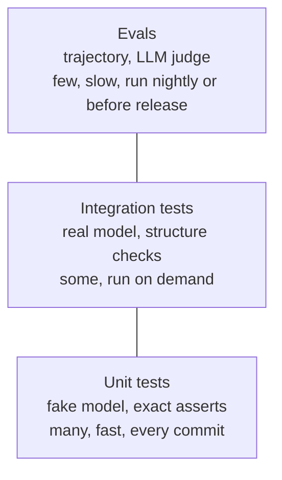
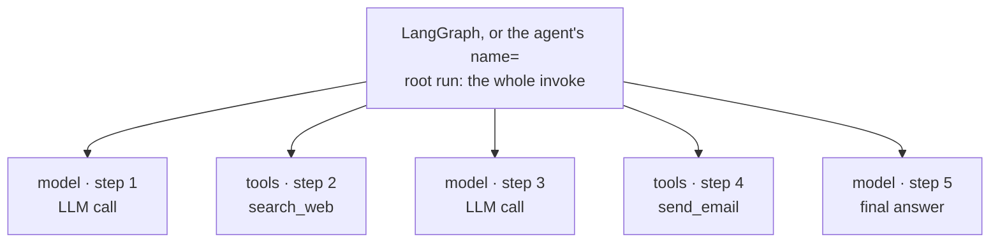

# Chapter 15: Testing agents and tracing

> [!NOTE]
> **📍 At a glance**
> - **You will build:** unit tests with fake models, integration tests, trajectory evals and tracing
> - **Level:** intermediate · **Time:** about 40 minutes
> - **Builds on:** [Chapter 6](06-agents-and-memory.md) (agents, checkpointer), [Chapter 13](13-multi-agent-systems-and-subagents.md) (scripted models).

**After this chapter you can:**

- Unit test an agent with a fake model and no API calls
- Keep slow, paid tests out of the default test run
- Assert on structure, not on exact words
- Check an agent's tool-call trajectory with `agentevals`, and know what each match mode lets through
- Record and replay model calls with cassettes, and make a stale cassette fail
- Grade a trajectory with an LLM judge and log evals to LangSmith
- Turn on LangSmith tracing with environment variables
- Route, tag and redact traces, and spot the settings that silently drop them

## 15.1 Three layers of testing



- A model decides its own next step, so exact outputs change between runs
- **Unit tests:** small, deterministic pieces, with an in-memory fake instead of the model
- **Integration tests:** real network calls, to check keys, schemas and wiring
- **Evals:** score the **trajectory** (the sequence of messages and tool calls), by matching or by an LLM judge
- Agent apps lean on integration tests more, since many parts are chained and flaky
- To run evals at scale, track results over time and compare experiments, the docs point to LangSmith (15.4)
- *Source: LangChain docs, `test/index.mdx`.*

## 15.2 Unit tests with a fake model

- Swap the real LLM for an in-memory **fake** (a fixture) and script its exact replies: text and tool calls
- Fast, free and repeatable. No API keys, no network

### The scripted model: `GenericFakeChatModel`

- `GenericFakeChatModel` takes an **iterator** of replies, one per call
- Each reply is an `AIMessage` or a plain string. It works with `invoke` and with streaming

```python
from langchain_core.language_models.fake_chat_models import GenericFakeChatModel
from langchain.messages import AIMessage, ToolCall

model = GenericFakeChatModel(messages=iter([
    AIMessage(content="", tool_calls=[ToolCall(name="foo", args={"bar": "baz"}, id="call_1")]),
    "bar"
]))

model.invoke("hello")
# AIMessage(content='', ..., tool_calls=[{'name': 'foo', 'args': {'bar': 'baz'}, 'id': 'call_1', 'type': 'tool_call'}])
model.invoke("hello, again!")
# AIMessage(content='bar', ...)   the next item; a plain string becomes an AIMessage
```

- *Tested:* a third call raised `StopIteration`. Inside an agent, the same thing surfaces as `RuntimeError: generator raised StopIteration`

### Plain text only: `FakeListChatModel`

- `FakeListChatModel` takes a **list of strings** and **cycles** back to the first when it runs out
```python
from langchain_core.language_models import FakeListChatModel
m = FakeListChatModel(responses=["Paris", "Tower"])
[m.invoke("x").content for _ in range(3)]   # ['Paris', 'Tower', 'Paris']
```
- No `AIMessage` objects to build. Use `GenericFakeChatModel` when you need exact control of each turn, such as tool calls

### Test a tool-calling loop

- To script a tool loop, give two replies: a tool call, then the final answer
- `GenericFakeChatModel` has **no `bind_tools`**, and `create_agent` calls it when tools are passed. Subclass it:

```python
from langchain.agents import create_agent
from langchain.messages import AIMessage, HumanMessage, ToolCall
from langchain.tools import tool
from langchain_core.language_models.fake_chat_models import GenericFakeChatModel


class FakeToolCallingModel(GenericFakeChatModel):
    def bind_tools(self, tools, **kwargs):
        return self


@tool
def get_weather(city: str) -> str:
    """Get the weather for a city."""
    return f"72°F and sunny in {city}"


def test_agent_calls_tool_then_answers():
    model = FakeToolCallingModel(messages=iter([
        # Turn 1: the model calls the tool
        AIMessage(
            content="",
            tool_calls=[ToolCall(name="get_weather", args={"city": "Tokyo"}, id="call_1")],
        ),
        # Turn 2: the model answers using the tool result
        AIMessage(content="It is 72°F and sunny in Tokyo."),
    ]))
    agent = create_agent(model, tools=[get_weather])

    result = agent.invoke({"messages": [HumanMessage(content="Weather in Tokyo?")]})

    tool_call_messages = [
        m for m in result["messages"] if isinstance(m, AIMessage) and m.tool_calls
    ]
    assert len(tool_call_messages) == 1
    assert tool_call_messages[0].tool_calls[0]["name"] == "get_weather"
    assert "Tokyo" in result["messages"][-1].text
```

- The asserts check **exactly one** tool-call turn, the **tool name**, and the **final answer**
- The fake returns fixed text, so here an exact-text assert is safe. With a real model it is not (15.3)

### Share fake models with pytest fixtures

```python
import pytest

@pytest.fixture
def weather_model():
    return FakeToolCallingModel(messages=iter([
        AIMessage(
            content="",
            tool_calls=[ToolCall(name="get_weather", args={"city": "Tokyo"}, id="call_1")],
        ),
        AIMessage(content="It is 72°F and sunny in Tokyo."),
    ]))


def test_tool_is_called(weather_model):
    agent = create_agent(weather_model, tools=[get_weather])
    result = agent.invoke({"messages": [HumanMessage(content="Weather in Tokyo?")]})
    tool_call_messages = [
        m for m in result["messages"] if isinstance(m, AIMessage) and m.tool_calls
    ]
    assert tool_call_messages[0].tool_calls[0]["name"] == "get_weather"


def test_final_response(weather_model):
    agent = create_agent(weather_model, tools=[get_weather])
    result = agent.invoke({"messages": [HumanMessage(content="Weather in Tokyo?")]})
    assert "Tokyo" in result["messages"][-1].text
```

- An iterator is used up. Build a **new fake per test** (a pytest fixture that returns a fresh one)

> [!NOTE]
> **Keep the fixture at the default `function` scope.** It then builds a fresh model for each test. A `module` or `session` scope shares one iterator, so later tests fail once it runs out.
> *Tested:* a `module`-scoped fake with two replies, used by three tests: two passed, the third failed with `RuntimeError: generator raised StopIteration`.

### Several turns with `InMemorySaver`

- For several turns, add `checkpointer=InMemorySaver()` and reuse one `thread_id`

```python
from langgraph.checkpoint.memory import InMemorySaver
from langchain.agents import create_agent
from langchain.messages import HumanMessage

agent = create_agent(
    model,                     # any fake from above
    tools=[],
    checkpointer=InMemorySaver()
)

# First invocation
agent.invoke(
    {"messages": [HumanMessage(content="I live in Sydney, Australia")]},
    config={"configurable": {"thread_id": "session-1"}}
)

# Second invocation: the first message is persisted (Sydney location), so the model returns GMT+10 time
agent.invoke(
    {"messages": [HumanMessage(content="What's my local time?")]},
    config={"configurable": {"thread_id": "session-1"}}
)
```

- *Tested:* on turn 2 the model received `['I live in Sydney, Australia', 'Noted.', "What's my local time?"]`, so turn 1 was carried over
- ✅ *Verified (details in "How this chapter was checked").*
- *Source: LangChain docs, `test/unit-testing.mdx`.*

## 15.3 Integration tests

- Real network calls: the components work together, credentials are valid, latency is acceptable
- LLM replies vary between runs, so these tests need different habits from ordinary software tests

### Separate unit and integration tests

- They are slower and need credentials. Run unit tests on every change; keep integration tests for CI or pre-deploy checks
- **Keep them apart** with a marker, and exclude it by default:

```python
import pytest
from langchain.agents import create_agent
from langchain.messages import HumanMessage

@pytest.mark.integration
def test_agent_with_real_model():
    agent = create_agent("claude-sonnet-4-6", tools=[get_weather])
    result = agent.invoke({
        "messages": [HumanMessage(content="What's the weather in SF?")]
    })
    assert len(result["messages"]) > 1
```

```ini
[pytest]
markers =
    integration: tests that call real LLM APIs
addopts = -m "not integration"
```

- The same in `pyproject.toml`:

```toml
[tool.pytest.ini_options]
markers = [
  "integration: tests that call real LLM APIs"
]
addopts = "-m 'not integration'"
```

- Run them on purpose: `pytest -m integration`

### Manage API keys

- **Keys:** read from environment variables, so they stay out of source control
- A `conftest.py` fixture checks the key and skips the test when it is missing:

```python
import os
import pytest

@pytest.fixture(autouse=True)
def check_api_keys():
    if not os.environ.get("OPENAI_API_KEY"):
        pytest.skip("OPENAI_API_KEY not set")
```

- For local development, keep keys in `.env` and load them with `python-dotenv`:

```bash
# .env
OPENAI_API_KEY=sk-...
```

```python
# conftest.py
from dotenv import load_dotenv

load_dotenv()
```

> [!WARNING]
> - Put `.env` in `.gitignore`. In CI, inject keys through your provider's secret store (for example GitHub Actions secrets)
> - **Found in testing:** `autouse=True` in a top-level `conftest.py` runs that fixture for **every** test. With no key set, the plain unit test was skipped too (`1 skipped, 1 deselected`), so a laptop run silently tested nothing
> - Fix (*added by Claude*, tested: the unit test then passed and only the integration test skipped):
> ```python
> @pytest.fixture(autouse=True)
> def check_api_keys(request):
>     if request.node.get_closest_marker("integration") and not os.environ.get("OPENAI_API_KEY"):
>         pytest.skip("OPENAI_API_KEY not set")
> ```
> - Or put the docs' fixture in a `conftest.py` inside the folder that holds only integration tests

### Assert on structure, not content

- **Assert on structure, not content:** the right tool was called, the last message is an `AIMessage`, it is not empty
- Check message types, tool-call names, argument shapes and message count. Never an exact answer string

```python
from langchain.agents import create_agent
from langchain.messages import AIMessage, HumanMessage

def test_agent_calls_weather_tool():
    agent = create_agent("claude-sonnet-4-6", tools=[get_weather])
    result = agent.invoke({
        "messages": [HumanMessage(content="What's the weather in SF?")]
    })

    messages = result["messages"]
    tool_calls = [
        tc
        for msg in messages
        if hasattr(msg, "tool_calls")
        for tc in (msg.tool_calls or [])
    ]

    assert any(tc["name"] == "get_weather" for tc in tool_calls)
    assert isinstance(messages[-1], AIMessage)
    assert len(messages[-1].content) > 0
```

- For looser trajectory checks (`unordered`, `superset`), use the `agentevals` evaluators in 15.4

### Reduce cost and latency

- **Smaller models:** `gemini-3.1-flash-lite` or similar, when the test only checks tool calling and response shape
- **Cap output tokens** on the chat model, so no test pays for a long answer
- **One behaviour per test.** Avoid long multi-call scenarios when a single turn proves the point
- **Run selectively:** only in CI or before deploy, using the marker above

```python
from langchain.agents import create_agent
from langchain.chat_models import init_chat_model

model = init_chat_model("google_genai:gemini-3.1-flash-lite", max_tokens=256)

agent = create_agent(model, tools=[get_weather])
```

- **Docs then and now:** this chapter used to show `model_kwargs={"max_tokens": 256}` (older docs). The current docs pass `max_tokens=256` directly
  - *Tested on `ChatOpenAI` (`langchain-openai` 1.8.0):* both forms set `max_tokens=256`, and both sent `max_completion_tokens: 256` in the request. Prefer the named argument
  - Not tested: the Gemini model in the docs' snippet (no Google package or key here)

### Record and replay HTTP calls

- `vcrpy` records each HTTP request and response into a YAML **cassette**. The `pytest-recording` plugin wires it into pytest
- First run: real calls, cassette saved. Later runs: replayed from the file, with no network and no cost

```mermaid
flowchart LR
    T[Test run] --> Q{Cassette for<br/>this test?}
    Q -->|no| R[Real API call<br/>save to tests/cassettes/]
    Q -->|yes| M{Request matches<br/>a recorded one?}
    M -->|yes| P[Replay the saved response<br/>no network, no cost]
    M -->|no| F[Test fails<br/>delete the cassette, re-record]
```



- `conftest.py`: replace secrets in the cassettes before they are written

```python
import pytest

@pytest.fixture(scope="session")
def vcr_config():
    return {
        "filter_headers": [
            ("authorization", "XXXX"),
            ("x-api-key", "XXXX"),
        ],
        "filter_query_parameters": [
            ("api_key", "XXXX"),
            ("key", "XXXX"),
        ],
    }
```

- Register the marker and the record mode (`pyproject.toml` works the same way, as above):

```ini
[pytest]
markers =
    vcr: record/replay HTTP via VCR
addopts = --record-mode=once
```

- `--record-mode=once`: record on the first run, replay on later runs
- Decorate the test:

```python
import pytest
from langchain.agents import create_agent
from langchain.messages import HumanMessage

@pytest.mark.vcr()
def test_agent_trajectory():
    agent = create_agent("claude-sonnet-4-6", tools=[get_weather])
    result = agent.invoke({
        "messages": [HumanMessage(content="What's the weather in SF?")]
    })
    assert any(
        tc["name"] == "get_weather"
        for msg in result["messages"]
        if hasattr(msg, "tool_calls")
        for tc in (msg.tool_calls or [])
    )
```

- The cassette lands in `tests/cassettes/`. *Tested:* one file per test, in a folder per module: `tests/cassettes/test_traj/test_agent_trajectory.yaml`
- **Record and replay:** delete cassettes when prompts, tools or expected steps change, then re-record

> [!WARNING]
> **Docs vs package: a stale cassette may still pass.**
> - The docs say old cassettes make your tests **fail** after a prompt, tool or trajectory change
> - *Tested* (`vcrpy` 9.4.2, `pytest-recording` 0.14.1): by default a request matches on method, scheme, host, port, path and query, **not the body**. After the prompt changed, the old answer was replayed and the test **passed**
> - Add the body to the match list (*added by Claude*). The changed prompt then failed with `CannotOverwriteExistingCassetteException`, and the unchanged one still replayed:
> ```python
> "match_on": ["method", "scheme", "host", "port", "path", "query", "body"],
> ```

> [!CAUTION]
> **🔒 Security: check cassettes before you commit them**
> - *Tested:* the API key sent as `Authorization: Bearer ...` was not in the cassette; both recorded requests held `XXXX`
> - The filter covers only the headers and query names you list. A provider that sends its key under another name needs that name added
> - Response bodies are stored as they are, including any personal data in prompts and answers
> - *Added by Claude.*

- ✅ *Verified (details in "How this chapter was checked").*
- *Source: LangChain docs, `test/integration-testing.mdx`.*

## 15.4 Evals: scoring the trajectory

- An eval scores the agent's **trajectory**: the messages and tool calls it produced
- Integration tests check basic correctness. Evals score behaviour against a **reference** or a **rubric**, which catches regressions when prompts, tools or models change
- An evaluator is a function: it takes the outputs (and maybe a reference) and returns a score

```python
def evaluator(*, outputs: dict, reference_outputs: dict):
    output_messages = outputs["messages"]
    reference_messages = reference_outputs["messages"]
    score = compare_messages(output_messages, reference_messages)   # your comparison
    return {"key": "evaluator_score", "score": score}
```

- A filled-in version (*added by Claude*): the agent must call the same tools, in the same order, as the reference

```python
def same_tools(*, outputs: dict, reference_outputs: dict):
    def names(msgs):
        return [tc["name"] for m in msgs for tc in (getattr(m, "tool_calls", None) or [])]
    return {"key": "same_tools", "score": names(outputs["messages"]) == names(reference_outputs["messages"])}
```

- The `agentevals` package has ready-made trajectory evaluators. Two approaches:

| Approach | Needs a reference? | Cost | When to use |
|---|---|---|---|
| Trajectory match | Yes | Free, deterministic, fast | You know the expected tool calls |
| LLM as judge | Optional | One model call per eval | You want overall quality and reasoning without a fixed path |

- Install `agentevals`: `pip install -U agentevals` or `uv add agentevals`

### Trajectory match: four modes

| Mode | What it checks | Use case |
|---|---|---|
| `strict` | Same messages and tool calls, same order (the text may differ) | A required sequence, such as a policy lookup before authorising |
| `unordered` | Same tool calls, any order | Information gathering where order does not matter |
| `subset` | The agent calls **no tool outside** the reference | The agent must not exceed its expected scope |
| `superset` | The agent calls **at least** the reference tools (extras allowed) | Minimum required actions were taken |

- Shared setup for the examples:

```python
from langchain.agents import create_agent
from langchain.tools import tool
from langchain.messages import HumanMessage, AIMessage, ToolMessage
from agentevals.trajectory.match import create_trajectory_match_evaluator


@tool
def get_weather(city: str):
    """Get weather information for a city."""
    return f"It's 75 degrees and sunny in {city}."

agent = create_agent("claude-sonnet-4-6", tools=[get_weather])
```

**Strict**

```python
evaluator = create_trajectory_match_evaluator(
    trajectory_match_mode="strict",
)

def test_weather_tool_called_strict():
    result = agent.invoke({
        "messages": [HumanMessage(content="What's the weather in San Francisco?")]
    })

    reference_trajectory = [
        HumanMessage(content="What's the weather in San Francisco?"),
        AIMessage(content="", tool_calls=[
            {"id": "call_1", "name": "get_weather", "args": {"city": "San Francisco"}}
        ]),
        ToolMessage(content="It's 75 degrees and sunny in San Francisco.", tool_call_id="call_1"),
        AIMessage(content="The weather in San Francisco is 75 degrees and sunny."),
    ]

    evaluation = evaluator(
        outputs=result["messages"],
        reference_outputs=reference_trajectory
    )
    # {'key': 'trajectory_strict_match', 'score': True, 'comment': None}
    assert evaluation["score"] is True
```

- *Tested:* the run's tool-call id (`zz9`) and final text differed from the reference, and it still scored `True`. Ids and wording are ignored
- *Tested:* `{"city": "SF"}` against the reference's `"San Francisco"` scored `False`. Arguments must match **exactly** by default (see "Tuning how arguments match")
- The result in 0.0.9 also has `'metadata': None`

**Unordered**

```python
@tool
def get_events(city: str):
    """Get events happening in a city."""
    return f"Concert at the park in {city} tonight."

agent = create_agent("claude-sonnet-4-6", tools=[get_weather, get_events])

evaluator = create_trajectory_match_evaluator(
    trajectory_match_mode="unordered",
)

def test_multiple_tools_any_order():
    result = agent.invoke({
        "messages": [HumanMessage(content="What's happening in SF today?")]
    })

    reference_trajectory = [
        HumanMessage(content="What's happening in SF today?"),
        AIMessage(content="", tool_calls=[
            {"id": "call_1", "name": "get_events", "args": {"city": "SF"}},
            {"id": "call_2", "name": "get_weather", "args": {"city": "SF"}},
        ]),
        ToolMessage(content="Concert at the park in SF tonight.", tool_call_id="call_1"),
        ToolMessage(content="It's 75 degrees and sunny in SF.", tool_call_id="call_2"),
        AIMessage(content="Today in SF: 75 degrees and sunny with a concert at the park tonight."),
    ]

    evaluation = evaluator(
        outputs=result["messages"],
        reference_outputs=reference_trajectory,
    )
    assert evaluation["score"] is True
```

- *Tested:* `True` both when the agent made the two calls in one turn in reverse order, and when it made them one per turn

**Subset and superset**

```python
@tool
def get_detailed_forecast(city: str):
    """Get detailed weather forecast for a city."""
    return f"Detailed forecast for {city}: sunny all week."

agent = create_agent("claude-sonnet-4-6", tools=[get_weather, get_detailed_forecast])

evaluator = create_trajectory_match_evaluator(
    trajectory_match_mode="superset",
)

def test_agent_calls_required_tools_plus_extra():
    result = agent.invoke({
        "messages": [HumanMessage(content="What's the weather in Boston?")]
    })

    # Reference only requires get_weather, but agent may call additional tools
    reference_trajectory = [
        HumanMessage(content="What's the weather in Boston?"),
        AIMessage(content="", tool_calls=[
            {"id": "call_1", "name": "get_weather", "args": {"city": "Boston"}},
        ]),
        ToolMessage(content="It's 75 degrees and sunny in Boston.", tool_call_id="call_1"),
        AIMessage(content="The weather in Boston is 75 degrees and sunny."),
    ]

    evaluation = evaluator(
        outputs=result["messages"],
        reference_outputs=reference_trajectory,
    )
    assert evaluation["score"] is True
```

- *Tested:* the same reference (only `get_weather`), scored in all four modes against two runs:

| Mode | Run calls `get_weather` + `get_detailed_forecast` | Run calls no tool |
|---|---|---|
| `strict` | False | False |
| `unordered` | False | False |
| `subset` | False | **True** |
| `superset` | True | False |

> [!WARNING]
> **`subset` passes an agent that did nothing.** Calling no tool is "no tool outside the reference". Pair `subset` with `superset`, or with a check on the final answer. *(Found in testing; the docs do not say this.)*

### Tuning how arguments match

- By default, two tool calls are equal only with the same tool and the **same arguments**
- `tool_args_match_mode`: `"exact"` (default), `"ignore"`, `"subset"` or `"superset"`
- `tool_args_match_overrides`: per tool, a mode, a list of argument names to compare, or a function `(a, b) -> bool`

```python
CITY = {"sf": "san francisco"}

def same_city(a: dict, b: dict) -> bool:
    norm = lambda c: CITY.get(c.lower(), c.lower())
    return norm(a["city"]) == norm(b["city"])

evaluator = create_trajectory_match_evaluator(
    trajectory_match_mode="strict",
    tool_args_match_overrides={"get_weather": same_city},
)
```

- *Tested:* `"SF"` against `"San Francisco"` scored `True` with this override, and with `tool_args_match_mode="ignore"`. The override function is *added by Claude*; the option names come from the docs and the 0.0.9 signature

### LLM as judge

- `create_trajectory_llm_as_judge` asks a model to grade the trajectory. No reference is needed, but you can give one

```python
from agentevals.trajectory.llm import create_trajectory_llm_as_judge, TRAJECTORY_ACCURACY_PROMPT

evaluator = create_trajectory_llm_as_judge(
    model="openai:gpt-5.4-mini",
    prompt=TRAJECTORY_ACCURACY_PROMPT,
)

def test_trajectory_quality():
    result = agent.invoke({
        "messages": [HumanMessage(content="What's the weather in Seattle?")]
    })

    evaluation = evaluator(
        outputs=result["messages"],
    )
    assert evaluation["score"] is True
```

- With a reference trajectory, use the prebuilt `TRAJECTORY_ACCURACY_PROMPT_WITH_REFERENCE`:

```python
from agentevals.trajectory.llm import create_trajectory_llm_as_judge, TRAJECTORY_ACCURACY_PROMPT_WITH_REFERENCE

evaluator = create_trajectory_llm_as_judge(
    model="openai:gpt-5.4-mini",
    prompt=TRAJECTORY_ACCURACY_PROMPT_WITH_REFERENCE,
)
evaluation = evaluator(
    outputs=result["messages"],
    reference_outputs=reference_trajectory,
)
```

- *Tested offline* by passing a scripted chat model as `judge=` instead of `model=`:
  - The judge was offered one `score` tool with two fields, `reasoning` (text) and `score` (boolean)
  - The result was `{'key': 'trajectory_accuracy', 'score': True, 'comment': '<the reasoning>'}`
- **Always pass `prompt=`.** In 0.0.9 the default prompt is `TRAJECTORY_ACCURACY_PROMPT_WITH_REFERENCE`, which expects a reference
- The 0.0.9 signature also has `continuous`, `choices`, `use_reasoning` and `few_shot_examples`. Details are in the `agentevals` repository (not read for these notes)

### Async evaluators

- Every evaluator has an async version: put `async` after `create_`

```python
from agentevals.trajectory.llm import create_async_trajectory_llm_as_judge, TRAJECTORY_ACCURACY_PROMPT
from agentevals.trajectory.match import create_async_trajectory_match_evaluator

async_judge = create_async_trajectory_llm_as_judge(
    model="openai:gpt-5.4-mini",
    prompt=TRAJECTORY_ACCURACY_PROMPT,
)

async_evaluator = create_async_trajectory_match_evaluator(
    trajectory_match_mode="strict",
)

async def test_async_evaluation():
    result = await agent.ainvoke({
        "messages": [HumanMessage(content="What's the weather?")]
    })

    evaluation = await async_judge(outputs=result["messages"])
    assert evaluation["score"] is True
```

### Run evals in LangSmith

- Log evaluator results to LangSmith to track experiments over time. Set the keys first:

```bash
export LANGSMITH_API_KEY="your_langsmith_api_key"
export LANGSMITH_TRACING="true"
```

- **Option 1, the pytest integration:** mark the test and log inputs, outputs and the reference

```python
import pytest
from langsmith import testing as t
from agentevals.trajectory.llm import create_trajectory_llm_as_judge, TRAJECTORY_ACCURACY_PROMPT

trajectory_evaluator = create_trajectory_llm_as_judge(
    model="openai:gpt-5.4-mini",
    prompt=TRAJECTORY_ACCURACY_PROMPT,
)

@pytest.mark.langsmith
def test_trajectory_accuracy():
    result = agent.invoke({
        "messages": [HumanMessage(content="What's the weather in SF?")]
    })

    reference_trajectory = [
        HumanMessage(content="What's the weather in SF?"),
        AIMessage(content="", tool_calls=[
            {"id": "call_1", "name": "get_weather", "args": {"city": "SF"}},
        ]),
        ToolMessage(content="It's 75 degrees and sunny in SF.", tool_call_id="call_1"),
        AIMessage(content="The weather in SF is 75 degrees and sunny."),
    ]

    t.log_inputs({})
    t.log_outputs({"messages": result["messages"]})
    t.log_reference_outputs({"messages": reference_trajectory})

    trajectory_evaluator(
        outputs=result["messages"],
        reference_outputs=reference_trajectory
    )
```

- Run it with `pytest test_trajectory.py --langsmith-output`
- **Option 2, `evaluate` on a dataset.** The LangSmith dataset needs two fields per example:
  - **input:** `{"messages": [...]}`, the messages to call the agent with
  - **output:** `{"messages": [...]}`, the expected message history. For trajectory evals you can keep only the assistant messages

```python
from langsmith import Client
from agentevals.trajectory.llm import create_trajectory_llm_as_judge, TRAJECTORY_ACCURACY_PROMPT

client = Client()

trajectory_evaluator = create_trajectory_llm_as_judge(
    model="openai:gpt-5.4-mini",
    prompt=TRAJECTORY_ACCURACY_PROMPT,
)

def run_agent(inputs):
    return agent.invoke(inputs)["messages"]

experiment_results = client.evaluate(
    run_agent,
    data="your_dataset_name",
    evaluators=[trajectory_evaluator]
)
```

- *Not run:* both LangSmith options (they need an account and a key). Only the imports were checked
- ✅ *Verified (details in "How this chapter was checked").*
- *Source: LangChain docs, `test/evals.mdx`.*

> [!IMPORTANT]
> **🏭 In production**
> - Turn real failures from traces into eval cases; your eval set should grow with every incident
> - Run evals in CI before a prompt, model or tool change ships, and block the merge if the score drops
> - Track cost and latency per eval run next to accuracy, so a "better" prompt that doubles cost is visible
> - *Added by Claude.*

### Your first eval set, with no extra library (*added by Claude*)

Start here before adopting `agentevals` or LangSmith datasets: a list of real questions, the tool each **should** use, and one fact the answer must contain.

```python
CASES = [
    {"q": "Weather in Tokyo?", "tool": "get_weather", "must_contain": "22"},
    {"q": "Hi!",               "tool": None,          "must_contain": "hello"},
]

def run_case(agent, case) -> bool:
    msgs = agent.invoke({"messages": [{"role": "user", "content": case["q"]}]})["messages"]
    called = [tc["name"] for m in msgs for tc in getattr(m, "tool_calls", [])]
    ok_tool = (case["tool"] in called) if case["tool"] else not called   # right tool, or none
    ok_text = case["must_contain"].lower() in msgs[-1].content.lower()
    return ok_tool and ok_text

results = [run_case(agent, c) for c in CASES]
print(f"pass rate: {sum(results)}/{len(results)}")
```

- **Two checks per case:** the trajectory (right tool, or no tool) and the outcome (key fact present). Most regressions show up in one of them
- Grow `CASES` from real traces: every bug report becomes a case
- Run it before every prompt, model or tool change; a falling pass rate blocks the change
- Later, swap the checks for `agentevals` trajectory matching or an LLM judge for open-ended answers, and log runs to LangSmith

✅ *Verified offline with scripted fake models: both cases passed (`pass rate: 2/2`).*

## 15.5 Tracing with LangSmith

- Agents built with `create_agent` support tracing through **LangSmith** out of the box: a platform to capture, debug, evaluate and monitor agent behaviour
- A trace records every step: model calls, tool calls, inputs and outputs
  - From the user's input to the final response, including every decision point
  - Use it to debug issues, evaluate across different inputs, and monitor usage in production
- You need a LangSmith account and an API key



- *Tested:* this is the tree the quickstart below sent to a local stand-in for the LangSmith server
  - One root run per `invoke`, named `LangGraph`, or the `name=` given to `create_agent`
  - A `model` or `tools` child per step, and under each the LLM call or the tool run

### Turn it on

- **No code change.** Set environment variables and run the agent as usual:
```bash
export LANGSMITH_TRACING=true
export LANGSMITH_API_KEY=<your-api-key>
export LANGSMITH_AGENT_ID="<your-agent-id>"
export LANGSMITH_AGENT_ENVIRONMENT="local"
```
- In an agent-based workspace, create the agent in LangSmith once before sending traces
- The docs' quickstart: plain functions as tools, nothing tracing-specific in the code

```python
from langchain.agents import create_agent


def send_email(to: str, subject: str, body: str):
    """Send an email to a recipient."""
    # ... email sending logic
    return f"Email sent to {to}"

def search_web(query: str):
    """Search the web for information."""
    # ... web search logic
    return f"Search results for: {query}"

agent = create_agent(
    model="gpt-6.1-sol",
    tools=[send_email, search_web],
    system_prompt="You are a helpful assistant that can send emails and search the web."
)

# Run the agent - all steps will be traced automatically
response = agent.invoke({
    "messages": [{"role": "user", "content": "Search for the latest AI news and email a summary to john@example.com"}]
})
```

- Traces appear in the destination you configured (next sections)

> [!WARNING]
> **A settings mistake drops traces silently.** *(Found in testing with `langsmith` 0.14.17; the docs do not say this.)*
> - `LANGSMITH_AGENT_ENVIRONMENT` must be `local`, `development`, `staging` or `production`. With `prod`, nothing was sent
> - `LANGSMITH_AGENT_ID` without `LANGSMITH_AGENT_ENVIRONMENT`: nothing was sent
> - `LANGSMITH_PROJECT` **and** the two agent variables together: nothing was sent
> - An unreachable LangSmith server: nothing was sent
> - Each time the agent still ran and answered. The only sign was `Error in LangChainTracer...` lines in the log
> - After any settings change, check that one trace actually arrives

### Trace only some calls

- **Trace only some calls:** wrap them in LangSmith's `tracing_context`. Calls outside it are not traced if `LANGSMITH_TRACING` is unset

```python
import langsmith as ls

# This WILL be traced
with ls.tracing_context(enabled=True):
    agent.invoke({"messages": [{"role": "user", "content": "Send a test email to alice@example.com"}]})

# This will NOT be traced (if LANGSMITH_TRACING is not set)
agent.invoke({"messages": [{"role": "user", "content": "Send another email"}]})
```

- *Tested:* one trace arrived, for the first call only
- The reverse also works: `tracing_context(enabled=False)` sent nothing even with `LANGSMITH_TRACING=true` (tested)

### Choose where traces go

- **Choose where traces go:** `LANGSMITH_AGENT_ID` and `LANGSMITH_AGENT_ENVIRONMENT`; older project-based workspaces use `LANGSMITH_PROJECT` instead
  - The same holds for self-hosted LangSmith
  - An integration that needs a `project_name` in an agent-based workspace: pass the environment's `tracer_session_name` as a compatibility value
- **Per request, in code:** pass an agent address. The docs page only links to this; the call below is from the `langsmith` 0.14.17 SDK

```python
import langsmith as ls

with ls.tracing_context(address=ls.agent_address("billing-bot", "production")):
    agent.invoke({"messages": [{"role": "user", "content": "Refund order 42"}]})
```

- *Tested:*
  - The run arrived addressed to `lrn:agents/billing-bot/environments/production`, overriding the `email-bot` / `local` env vars
  - `LANGSMITH_PROJECT=my-project` alone sent the run to project `my-project`
  - `project_name=` and `address=` in the same `tracing_context` raised `LangSmithUserError` before the agent ran
- Which setting wins, per the SDK's own notes (highest first): `tracing_context`, then `langsmith_extra`, then `@traceable` / `trace` arguments, then `configure`, then the env vars

### Add tags and metadata

- **Add tags and metadata** through `config`:

```python
response = agent.invoke(
    {"messages": [{"role": "user", "content": "Send a welcome email"}]},
    config={
        "tags": ["production", "email-assistant", "v1.0"],
        "metadata": {
            "user_id": "user_123",
            "session_id": "session_456",
            "environment": "production"
        }
    }
)
```

- Or pass `tags=` and `metadata=` to `tracing_context`:

```python
with ls.tracing_context(
    enabled=True,
    tags=["production", "email-assistant", "v1.0"],
    metadata={"user_id": "user_123", "session_id": "session_456", "environment": "production"}):
    response = agent.invoke(
        {"messages": [{"role": "user", "content": "Send a welcome email"}]}
    )
```

- *Tested:* with both forms, the three tags and the metadata arrived on the root run **and** on every child run, so you can filter on any step

> [!CAUTION]
> **🔒 Security: a trace stores everything the agent saw**
> - *Tested:* the quickstart's `john@example.com` appeared in the inputs or outputs of **9 runs** of one trace
> - Put ids in metadata (`user_id`), never names, emails or account numbers
> - `LANGSMITH_HIDE_INPUTS=true` and `LANGSMITH_HIDE_OUTPUTS=true` keep inputs and outputs out of every run. *Tested:* 0 copies of the email were sent; runs still arrived, with `{}` as inputs and outputs
> - For partial redaction, `langsmith.Client(hide_inputs=...)` also takes a function (in the 0.14.17 signature; not tested)
> - Set a retention period in LangSmith that matches your privacy policy
> - *Added by Claude.*

- More on debugging, evaluating and monitoring with traces: the LangSmith observability docs (not read for these notes)
- ✅ *Verified (details in "How this chapter was checked").*
- *Source: LangChain docs, `observability.mdx` and its two snippets.*

## 15.6 Questions from the class

- None in the class material for this chapter. It comes from the LangChain docs only

## 15.7 Interview corner

**What interviewers listen for:** you test the **plumbing offline**, assert on structure not words, and have an eval set that gates releases.

### 🟢 Basic

<details class="qa"><summary>1. Why test agents differently from ordinary code?</summary>

- The model chooses the next step, so output text varies. Test structure and trajectory, not exact strings
- *Stronger answer:* push as much as possible down to deterministic unit tests with a fake model

</details>

<details class="qa"><summary>2. How do you unit test an agent with no API?</summary>

- Script a fake chat model that returns a tool call and then an answer, and subclass it to add `bind_tools`
- *Stronger answer:* a fresh fake per test, since the iterator runs out

</details>

### 🟡 Intermediate

<details class="qa"><summary>3. How do you keep paid tests out of the normal run?</summary>

- A pytest marker plus `addopts = -m "not integration"`; run them with `-m integration`

</details>

<details class="qa"><summary>4. What is a trajectory evaluator?</summary>

- It compares the sequence of messages and tool calls to a reference, in strict, unordered, subset or superset mode
- *Stronger answer:* `subset` checks nothing extra was called; `superset` checks nothing required was missed

</details>

### 🔴 Senior

<details class="qa"><summary>5. When would you use an LLM judge?</summary>

- When there is no fixed expected path and you want a quality score
- *Stronger answer:* it costs tokens and varies, so keep it for evals, not every commit

</details>

<details class="qa"><summary>6. You change the system prompt. How do you know nothing broke?</summary>

- Re-run unit tests, then the eval set (trajectory match and an LLM judge), comparing against the last release
- *Stronger answer:* the eval set is built from real traces, runs in CI, and tracks cost and latency too; ship behind a flag and watch production traces

</details>

<details class="qa"><summary>7. Your integration suite is slow, costs money and fails at random. What do you change?</summary>

- Assert on structure (tool names, message types), never exact text
- Small model, capped `max_tokens`, one behaviour per test, marker so it runs only in CI
- Record and replay with `vcrpy` cassettes for the tests that run often
- *Stronger answer:* match cassettes on the request **body**, or a prompt change replays the old answer and still passes; filter auth headers and review cassettes before committing

</details>

<details class="qa"><summary>8. A refund agent must look up the policy before it refunds, and must never call <code>send_payment</code> on its own. Which trajectory checks?</summary>

- `strict` for the required order: policy lookup, then refund
- `subset` so no tool outside the reference is called
- *Stronger answer:* `subset` alone passes an agent that called nothing, so pair it with `superset` or a final-answer check; loosen only noisy arguments with `tool_args_match_overrides`

</details>

<details class="qa"><summary>9. Tracing is "on", but no traces show up. What do you check?</summary>

- `LANGSMITH_TRACING=true` and a valid `LANGSMITH_API_KEY`, and the server reachable
- Both `LANGSMITH_AGENT_ID` and `LANGSMITH_AGENT_ENVIRONMENT` set, with the environment one of `local`, `development`, `staging`, `production`
- Not `LANGSMITH_PROJECT` and the agent variables together
- *Stronger answer:* every one of these failed silently in testing (the agent still answered; only `LangChainTracer` errors in the log), so add a startup check that sends one trace, and watch the log in CI

</details>

> [!TIP]
> **🧩 Design question to practise:** *"Set up quality checks for a support agent that 5 engineers change every week."* Cover unit, integration and eval layers, where each runs, the dataset, and the release gate.

## 15.8 Added by Claude, not from the sources

- **Test the plumbing offline first.** A scripted model proves your tools, state and middleware work. It does not prove a real model chooses well
- **Pick the mode to match the risk.** Use `subset` when an extra call is dangerous (a payment tool), `superset` when a missing step is the risk
- **A trajectory score of `True` does not mean a good answer.** Add an assertion on the final message or a judge
- **Never record cassettes with real secrets.** Check the filter list before committing cassette files
- **Treat traces as personal data.** Ids in metadata, `LANGSMITH_HIDE_INPUTS` / `HIDE_OUTPUTS` or a redaction function where needed, and a retention period
- **Give every eval case a second check.** `subset` passes an empty run and `superset` passes extra calls; a final-answer check or a judge catches what each lets through

## Cheat sheet

```python
class FakeToolModel(GenericFakeChatModel):
    def bind_tools(self, tools, **kw): return self
# pytest.ini: markers = integration: real APIs ;  addopts = -m "not integration"
from agentevals.trajectory.match import create_trajectory_match_evaluator
ev = create_trajectory_match_evaluator(trajectory_match_mode="superset")
ev(outputs=result["messages"], reference_outputs=reference)["score"]
model = init_chat_model("openai:gpt-4o-mini", max_tokens=256)        # cheap integration tests
# vcr_config: filter_headers=[("authorization", "XXXX")], match_on=[..., "body"]
judge = create_trajectory_llm_as_judge(model="openai:gpt-5.4-mini", prompt=TRAJECTORY_ACCURACY_PROMPT)
with ls.tracing_context(enabled=True, tags=["v1.0"], metadata={"user_id": "u1"}):   # trace one block
    agent.invoke(inp)          # route per call: tracing_context(address=ls.agent_address(id, "production"))
```

## Recap

- Three layers: unit (fake model), integration (real model, marked and excluded by default), evals (trajectory)
- `GenericFakeChatModel` needs a `bind_tools` subclass for agents; a fresh fake per test
- Assert structure, not words; cap tokens; use small models
- `agentevals` modes: strict, unordered, subset, superset; or an LLM judge
- Tracing is on with environment variables, no code change
- One trace per `invoke`: a root run, then a `model` or `tools` child per step. Tags and metadata reach every run
- A bad agent environment, a missing variable or project-plus-agent settings drop traces silently
- Keys: skip only integration tests when a key is missing, never the whole suite
- Cassettes replay model calls for free; match on the body so a prompt change fails
- `subset` passes an agent that called nothing. Pair modes, or add an answer check
- LLM judge: pass `prompt=` explicitly; log results with LangSmith's pytest plugin or `client.evaluate`

## Practice

1. Write a fake-model test that proves your agent calls a tool once. Run it twice with a reused fake and read the error
2. Add the `integration` marker and `pytest.ini`. Show that the default run skips it
3. Build a reference trajectory and score a run in all four modes. Add an extra tool call and see which modes fail
4. Add a `check_api_keys` fixture that skips when a key is missing
5. Run the whole suite with no key set. Does your unit test still run? Fix the fixture until it does
6. Record a cassette, change the prompt and re-run. Then add `"body"` to `match_on` and re-run again
7. Score a run with no tool calls in all four modes and explain the `subset` result
8. Trace one call with `tracing_context(enabled=True, tags=..., metadata=...)`, find it in LangSmith, and filter by the tag. Then set `LANGSMITH_HIDE_INPUTS=true` and compare

## How this chapter was checked

- Run offline: the fake models, the pytest marker setup, and the four trajectory modes (with `agentevals` installed from the package registry)
- **Not run:** a real LangSmith account (tracing was checked against a local stand-in server), LangSmith eval logging, a real LLM judge, any real model
- Everything else comes from the LangChain docs pages named in each section
- **Details by section** (moved here from the ✅ markers):
  - *15.2 Unit tests with a fake model:* Checked: the list model cycled; the subclass ran the tool once and answered; the plain class raised `NotImplementedError`; reusing a finished fake raised `RuntimeError`
  - *15.3 Integration tests:* Checked: with the `pytest.ini` above, the default run deselected the integration test and `-m integration` ran it. Not run: `vcrpy` (not installed), real model calls
  - *15.4 Evals: scoring the trajectory:* Checked (scripted agent, `agentevals` installed): a one-tool run against a one-tool reference scored `True` in all four modes; a run with one **extra** tool scored `False` in `strict`, `unordered` and `subset`, and `True` in `superset`. Not run: the LLM judge and LangSmith logging (need keys)
  - *15.5 Tracing with LangSmith:* Checked: `langsmith.tracing_context(enabled=False, tags=..., metadata=...)` runs as a context manager. *Not run:* actual tracing (no LangSmith account here)
  - *Update from the Observability docs page (2026-11-15), `langchain` 1.5.0, `langsmith` 0.14.17, scripted model:* `LANGSMITH_ENDPOINT` pointed at a local stand-in server that recorded every `/runs/multipart` upload; the uploads were parsed into run trees
    - Quickstart, as written: one root `LangGraph` run with 5 step children (`model`, `tools`, `model`, `tools`, `model`), the LLM and tool runs under them, all addressed `lrn:agents/email-bot/environments/local` from the env vars. With `name="email_assistant"` the root took that name
    - `tracing_context(enabled=True)` with `LANGSMITH_TRACING` unset: 1 trace, the second call nothing. `enabled=False` with tracing on: nothing
    - Tags and metadata, via `config` and via `tracing_context`: on the root and on every child run
    - `tracing_context(address=ls.agent_address("billing-bot", "production"))` overrode the env vars. `LANGSMITH_PROJECT` alone set the project. Project plus address in one `tracing_context` raised `LangSmithUserError`
    - Silent loss: environment `prod`, agent id without environment, project plus agent env vars, and an unreachable server each sent nothing while the agent still answered
    - The email address appeared in 9 runs; with `LANGSMITH_HIDE_INPUTS=true` and `LANGSMITH_HIDE_OUTPUTS=true`, 0 copies were sent
    - Not checked: `tracer_session_name`, the LangSmith UI, `Client(hide_inputs=<function>)`
  - *Update from the four Test docs pages (2026-11-15), `langchain` 1.5.0, `langchain-openai` 1.8.0, `agentevals` 0.0.9, `pytest` 9.2.0, `vcrpy` 9.4.2, `pytest-recording` 0.14.1 (no keys):*
    - 15.2: the docs' six unit tests ran as a pytest file and passed. `GenericFakeChatModel` turned the string `"bar"` into an `AIMessage`; a third call raised `StopIteration`. A `module`-scoped fake failed the third of three tests. The `InMemorySaver` turn 2 carried turn 1
    - 15.3 markers: both the `pytest.ini` and the `pyproject.toml` form deselected the integration test by default; `-m integration` ran it
    - 15.3 keys: the docs' `autouse` fixture skipped the unit test as well when no key was set; the marker-aware version skipped only the integration test
    - 15.3 tokens: `init_chat_model("openai:gpt-4o-mini", max_tokens=256)` and `model_kwargs={"max_tokens": 256}` both gave `max_tokens=256` and `max_completion_tokens: 256` in the request payload
    - 15.3 cassettes, for real: `ChatOpenAI` pointed at a local fake OpenAI server, the docs' `vcr_config` and test. Run 1 recorded 2 requests; the key was not in the file (`XXXX` twice). With the server stopped, run 2 replayed and passed. A changed prompt **also passed** by default; with `"body"` in `match_on` it failed with `CannotOverwriteExistingCassetteException`
    - 15.4 match: the docs' strict, unordered and superset examples against scripted agents, plus the four-mode table, the argument findings, the override function and `same_tools`. Async strict scored `True`; dict-form `outputs={"messages": ...}` also worked
    - 15.4 judge: a scripted `judge=` model returned `score=True` with its reasoning as `comment`. The default `prompt` equals `TRAJECTORY_ACCURACY_PROMPT_WITH_REFERENCE`
    - Imports checked: `langsmith.testing` (`log_inputs`, `log_outputs`, `log_reference_outputs`) and `langsmith.Client.evaluate`
    - **Not run:** Gemini, a real judge model, LangSmith logging and datasets, `python-dotenv` loading (a library call)
- The 2026 review added the diagrams, 🏭 In production boxes, graded interview layout, extra senior and design questions and the cheat sheet. These are Added by Claude: standard engineering practice. Cheat-sheet APIs were checked against the installed `langchain` 1.4.7 signatures
- **Cheat sheet:** defined `FakeToolModel` and ran the `agentevals` trajectory evaluator in `superset` mode on a matching trajectory (score passed); the `pytest.ini` line was not run. Ran on `langchain` 1.4.7 with a scripted fake chat model (no API keys, no network), so no real model call was made.

## Sources and further reading

- LangChain docs, `src/oss/langchain/test/` (`index`, `unit-testing`, `integration-testing`, `evals`) and `observability.mdx` (github.com/langchain-ai/docs, MIT, commit 433a92c)
- LangChain docs: [Test](https://docs.langchain.com/oss/python/langchain/test/index), [Unit testing](https://docs.langchain.com/oss/python/langchain/test/unit-testing), [Integration testing](https://docs.langchain.com/oss/python/langchain/test/integration-testing) and [Evals](https://docs.langchain.com/oss/python/langchain/test/evals), re-read in full 2026-11-15 from their source (`langchain-ai/docs` commit `04d4d4a`, plus the `integration-testing-max-tokens-py` snippet; docs.langchain.com was blocked from this environment). Used for 15.1 to 15.4
- LangChain docs: [LangSmith Observability](https://docs.langchain.com/oss/python/langchain/observability), re-read in full 2026-11-15 from its source (`langchain-ai/docs` commit `04d4d4a`, `src/oss/langchain/observability.mdx` with `snippets/oss/observability-py.mdx` and `snippets/langsmith/agent-tracing-prerequisite.mdx`). Used for 15.5. `agent_address` and the precedence order come from the `langsmith` 0.14.17 SDK
- Added by Claude in 15.5: the 🔒 trace box, interview question 9; the ⚠️ silent-loss box comes from testing
- Added by Claude in 15.2 to 15.4: the marker-aware key fixture, the `match_on` body fix, the 🔒 cassette box, `same_tools`, the `same_city` override, and interview questions 7 and 8. The ⚠️ findings come from testing
- `agentevals`: github.com/langchain-ai/agentevals

Previous: [Chapter 14, Handoffs, skills, router and custom workflows](14-handoffs-skills-router-and-custom-workflows.md) · Next: [Chapter 16, Build-along tutorials](16-tutorials-knowledge-base-sql-and-voice.md)
