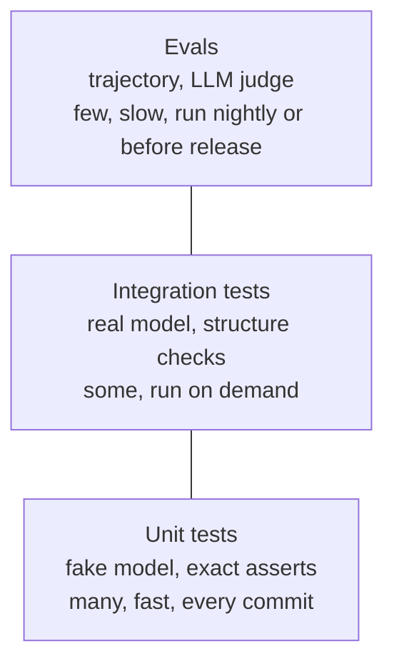

# Chapter 15: Testing agents and tracing

> [!NOTE]
> **📍 At a glance**
> - **You will build:** unit tests with fake models, integration tests, trajectory evals and tracing
> - **Level:** intermediate · **Time:** about 20 minutes
> - **Builds on:** [Chapter 6](06-agents-and-memory.md) (agents, checkpointer), [Chapter 13](13-multi-agent-systems-and-subagents.md) (scripted models).

**After this chapter you can:**

- Unit test an agent with a fake model and no API calls
- Keep slow, paid tests out of the default test run
- Assert on structure, not on exact words
- Check an agent's tool-call trajectory with `agentevals`
- Turn on LangSmith tracing with environment variables

## 15.1 Three layers of testing



- A model decides its own next step, so exact outputs change between runs
- **Unit tests:** small, deterministic pieces, with an in-memory fake instead of the model
- **Integration tests:** real network calls, to check keys, schemas and wiring
- **Evals:** score the **trajectory** (the sequence of messages and tool calls), by matching or by an LLM judge
- Agent apps lean on integration tests more, since many parts are chained and flaky
- *Source: LangChain docs, `test/index.mdx`.*

## 15.2 Unit tests with a fake model

- `GenericFakeChatModel` takes an **iterator** of replies, one per call
- `FakeListChatModel` takes a **list of strings** and **cycles** back to the first when it runs out
```python
from langchain_core.language_models import FakeListChatModel
m = FakeListChatModel(responses=["Paris", "Tower"])
[m.invoke("x").content for _ in range(3)]   # ['Paris', 'Tower', 'Paris']
```
- To script a tool loop, give two replies: a tool call, then the final answer
- `GenericFakeChatModel` has **no `bind_tools`**, and `create_agent` calls it when tools are passed. Subclass it:
```python
class FakeToolCallingModel(GenericFakeChatModel):
    def bind_tools(self, tools, **kwargs):
        return self

model = FakeToolCallingModel(messages=iter([
    AIMessage(content="", tool_calls=[ToolCall(name="get_weather", args={"city": "Tokyo"}, id="c1")]),
    AIMessage(content="It is 72°F and sunny in Tokyo."),
]))
agent = create_agent(model, tools=[get_weather])
```
- An iterator is used up. Build a **new fake per test** (a pytest fixture that returns a fresh one)
- For several turns, add `checkpointer=InMemorySaver()` and reuse one `thread_id`
- ✅ *Verified (details in "How this chapter was checked").*
- *Source: LangChain docs, `test/unit-testing.mdx`.*

## 15.3 Integration tests

- **Keep them apart** with a marker, and exclude it by default:
```ini
[pytest]
markers =
    integration: tests that call real LLM APIs
addopts = -m "not integration"
```
- Run them on purpose: `pytest -m integration`
- **Keys:** read from environment variables. A fixture can `pytest.skip(...)` when the key is missing. Put `.env` in `.gitignore`; in CI use the secret store
- **Assert on structure, not content:** the right tool was called, the last message is an `AIMessage`, it is not empty
- **Cost and speed:** a small model, a token cap (`model_kwargs={"max_tokens": 256}`), one behaviour per test, run them selectively
- **Record and replay:** `vcrpy` saves HTTP calls into cassette files (`--record-mode=once`). Filter `authorization` and `x-api-key` headers from them. Delete cassettes when prompts, tools or expected steps change
- ✅ *Verified (details in "How this chapter was checked").*
- *Source: LangChain docs, `test/integration-testing.mdx`.*

## 15.4 Evals: scoring the trajectory

- An evaluator is a function: it takes the outputs (and maybe a reference) and returns a score
- Install `agentevals` (`pip install agentevals`)
- **Trajectory match**, four modes:
  - `strict`: same messages and tool calls, same order (the text may differ)
  - `unordered`: same tool calls, any order
  - `subset`: the agent calls **no tool outside** the reference
  - `superset`: the agent calls **at least** the reference tools
```python
from agentevals.trajectory.match import create_trajectory_match_evaluator
ev = create_trajectory_match_evaluator(trajectory_match_mode="strict")
ev(outputs=result["messages"], reference_outputs=reference_trajectory)["score"]   # True / False
```
- `tool_args_match_mode` and `tool_args_match_overrides` tune how arguments are compared
- **LLM as judge:** `create_trajectory_llm_as_judge(model=..., prompt=TRAJECTORY_ACCURACY_PROMPT)`, with or without a reference. Use it for overall quality when there is no fixed expected path
- Async versions: put `async` after `create_` (`create_async_trajectory_match_evaluator`)
- **LangSmith:** log results with the `pytest` plugin (`@pytest.mark.langsmith`) or `client.evaluate(...)` on a dataset
- ✅ *Verified (details in "How this chapter was checked").*
- *Source: LangChain docs, `test/evals.mdx`.*

> [!IMPORTANT]
> **🏭 In production**
> - Turn real failures from traces into eval cases; your eval set should grow with every incident
> - Run evals in CI before a prompt, model or tool change ships, and block the merge if the score drops
> - Track cost and latency per eval run next to accuracy, so a "better" prompt that doubles cost is visible
> - *Added by Claude.*

### Your first eval set, with no extra library (*added by Claude*)

Start here before adopting `agentevals` or LangSmith datasets: a list of real questions, the tool each **should** use, and one fact the answer must contain.

```python
CASES = [
    {"q": "Weather in Tokyo?", "tool": "get_weather", "must_contain": "22"},
    {"q": "Hi!",               "tool": None,          "must_contain": "hello"},
]

def run_case(agent, case) -> bool:
    msgs = agent.invoke({"messages": [{"role": "user", "content": case["q"]}]})["messages"]
    called = [tc["name"] for m in msgs for tc in getattr(m, "tool_calls", [])]
    ok_tool = (case["tool"] in called) if case["tool"] else not called   # right tool, or none
    ok_text = case["must_contain"].lower() in msgs[-1].content.lower()
    return ok_tool and ok_text

results = [run_case(agent, c) for c in CASES]
print(f"pass rate: {sum(results)}/{len(results)}")
```

- **Two checks per case:** the trajectory (right tool, or no tool) and the outcome (key fact present). Most regressions show up in one of them
- Grow `CASES` from real traces: every bug report becomes a case
- Run it before every prompt, model or tool change; a falling pass rate blocks the change
- Later, swap the checks for `agentevals` trajectory matching or an LLM judge for open-ended answers, and log runs to LangSmith

✅ *Verified offline with scripted fake models: both cases passed (`pass rate: 2/2`).*

## 15.5 Tracing with LangSmith

- A trace records every step: model calls, tool calls, inputs and outputs
- **No code change.** Set environment variables and run the agent as usual:
```bash
export LANGSMITH_TRACING=true
export LANGSMITH_API_KEY=<your-api-key>
export LANGSMITH_AGENT_ID="<your-agent-id>"
export LANGSMITH_AGENT_ENVIRONMENT="local"
```
- You need a LangSmith account and an API key
- **Trace only some calls:** `with ls.tracing_context(enabled=True): agent.invoke(...)`; calls outside are not traced if `LANGSMITH_TRACING` is unset
- **Choose where traces go:** `LANGSMITH_AGENT_ID` and `LANGSMITH_AGENT_ENVIRONMENT`; older project-based workspaces use `LANGSMITH_PROJECT` instead
- **Add tags and metadata:** `agent.invoke(input, config={"tags": ["production"], "metadata": {"user_id": "u1"}})`, or pass `tags=` and `metadata=` to `tracing_context`
- In an agent-based workspace, create the agent in LangSmith once before sending traces
- ✅ *Verified (details in "How this chapter was checked").*
- *Source: LangChain docs, `observability.mdx`.*

## 15.6 Questions from the class

- None in the class material for this chapter. It comes from the LangChain docs only

## 15.7 Interview corner

**What interviewers listen for:** you test the **plumbing offline**, assert on structure not words, and have an eval set that gates releases.

### 🟢 Basic

<details class="qa"><summary>1. Why test agents differently from ordinary code?</summary>

- The model chooses the next step, so output text varies. Test structure and trajectory, not exact strings
- *Stronger answer:* push as much as possible down to deterministic unit tests with a fake model

</details>

<details class="qa"><summary>2. How do you unit test an agent with no API?</summary>

- Script a fake chat model that returns a tool call and then an answer, and subclass it to add `bind_tools`
- *Stronger answer:* a fresh fake per test, since the iterator runs out

</details>

### 🟡 Intermediate

<details class="qa"><summary>3. How do you keep paid tests out of the normal run?</summary>

- A pytest marker plus `addopts = -m "not integration"`; run them with `-m integration`

</details>

<details class="qa"><summary>4. What is a trajectory evaluator?</summary>

- It compares the sequence of messages and tool calls to a reference, in strict, unordered, subset or superset mode
- *Stronger answer:* `subset` checks nothing extra was called; `superset` checks nothing required was missed

</details>

### 🔴 Senior

<details class="qa"><summary>5. When would you use an LLM judge?</summary>

- When there is no fixed expected path and you want a quality score
- *Stronger answer:* it costs tokens and varies, so keep it for evals, not every commit

</details>

<details class="qa"><summary>6. You change the system prompt. How do you know nothing broke?</summary>

- Re-run unit tests, then the eval set (trajectory match and an LLM judge), comparing against the last release
- *Stronger answer:* the eval set is built from real traces, runs in CI, and tracks cost and latency too; ship behind a flag and watch production traces

</details>

> [!TIP]
> **🧩 Design question to practise:** *"Set up quality checks for a support agent that 5 engineers change every week."* Cover unit, integration and eval layers, where each runs, the dataset, and the release gate.

## 15.8 Added by Claude, not from the sources

- **Test the plumbing offline first.** A scripted model proves your tools, state and middleware work. It does not prove a real model chooses well
- **Pick the mode to match the risk.** Use `subset` when an extra call is dangerous (a payment tool), `superset` when a missing step is the risk
- **A trajectory score of `True` does not mean a good answer.** Add an assertion on the final message or a judge
- **Never record cassettes with real secrets.** Check the filter list before committing cassette files

## Cheat sheet

```python
class FakeToolModel(GenericFakeChatModel):
    def bind_tools(self, tools, **kw): return self
# pytest.ini: markers = integration: real APIs ;  addopts = -m "not integration"
from agentevals.trajectory.match import create_trajectory_match_evaluator
ev = create_trajectory_match_evaluator(trajectory_match_mode="superset")
ev(outputs=result["messages"], reference_outputs=reference)["score"]
```

## Recap

- Three layers: unit (fake model), integration (real model, marked and excluded by default), evals (trajectory)
- `GenericFakeChatModel` needs a `bind_tools` subclass for agents; a fresh fake per test
- Assert structure, not words; cap tokens; use small models
- `agentevals` modes: strict, unordered, subset, superset; or an LLM judge
- Tracing is on with environment variables, no code change

## Practice

1. Write a fake-model test that proves your agent calls a tool once. Run it twice with a reused fake and read the error
2. Add the `integration` marker and `pytest.ini`. Show that the default run skips it
3. Build a reference trajectory and score a run in all four modes. Add an extra tool call and see which modes fail
4. Add a `check_api_keys` fixture that skips when a key is missing

## How this chapter was checked

- Run offline: the fake models, the pytest marker setup, and the four trajectory modes (with `agentevals` installed from the package registry)
- **Not run:** `vcrpy`, the LLM judge, LangSmith tracing and logging, any real model
- Everything else comes from the LangChain docs pages named in each section
- **Details by section** (moved here from the ✅ markers):
  - *15.2 Unit tests with a fake model:* Checked: the list model cycled; the subclass ran the tool once and answered; the plain class raised `NotImplementedError`; reusing a finished fake raised `RuntimeError`
  - *15.3 Integration tests:* Checked: with the `pytest.ini` above, the default run deselected the integration test and `-m integration` ran it. Not run: `vcrpy` (not installed), real model calls
  - *15.4 Evals: scoring the trajectory:* Checked (scripted agent, `agentevals` installed): a one-tool run against a one-tool reference scored `True` in all four modes; a run with one **extra** tool scored `False` in `strict`, `unordered` and `subset`, and `True` in `superset`. Not run: the LLM judge and LangSmith logging (need keys)
  - *15.5 Tracing with LangSmith:* Checked: `langsmith.tracing_context(enabled=False, tags=..., metadata=...)` runs as a context manager. *Not run:* actual tracing (no LangSmith account here)
- The 2026 review added the diagrams, 🏭 In production boxes, graded interview layout, extra senior and design questions and the cheat sheet. These are Added by Claude: standard engineering practice. Cheat-sheet APIs were checked against the installed `langchain` 1.4.7 signatures
- **Cheat sheet:** defined `FakeToolModel` and ran the `agentevals` trajectory evaluator in `superset` mode on a matching trajectory (score passed); the `pytest.ini` line was not run. Ran on `langchain` 1.4.7 with a scripted fake chat model (no API keys, no network), so no real model call was made.

## Sources and further reading

- LangChain docs, `src/oss/langchain/test/` (`index`, `unit-testing`, `integration-testing`, `evals`) and `observability.mdx` (github.com/langchain-ai/docs, MIT, commit 433a92c)
- `agentevals`: github.com/langchain-ai/agentevals

Previous: [Chapter 14, Handoffs, skills, router and custom workflows](14-handoffs-skills-router-and-custom-workflows.md) · Next: [Chapter 16, Build-along tutorials](16-tutorials-knowledge-base-sql-and-voice.md)
