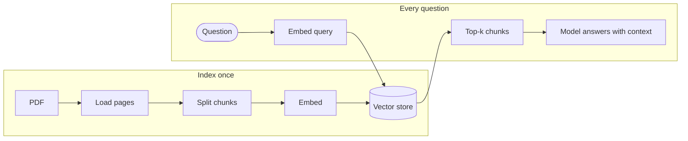

# Chapter 16: Build-along tutorials: knowledge base, SQL agent, voice agent

> [!NOTE]
> **📍 At a glance**
> - **You will build:** a semantic search engine, a SQL agent with approval, and a voice pipeline
> - **Level:** intermediate to advanced · **Time:** about 20 minutes
> - **Builds on:** [Chapter 5](05-tools.md) (tools), [Chapter 6](06-agents-and-memory.md) (agents, streaming), [Chapter 11](11-runtime-and-human-in-the-loop.md) (human-in-the-loop).

## 16.1 Knowledge base: semantic search over a PDF



- *Source: LangChain docs, `knowledge-base.mdx`.*
- The pipeline: **load, split, embed, store, search, wrap as retriever**
- `Document` has `page_content`, `metadata` (a dict) and an optional `id`
```python
from langchain_core.documents import Document
Document(page_content="Cats are independent.", metadata={"source": "pets"})
```
- **Load a PDF** page by page (the page's own helper uses `pypdf`; `PyPDFLoader` is the packaged option):
```python
import pypdf
def load_pdf_pages(fp):
    return [Document(page_content=p.extract_text() or "", metadata={"source": fp, "page": i})
            for i, p in enumerate(pypdf.PdfReader(fp).pages)]
```
- **Split** so a passage is not drowned by its page:
```python
from langchain_text_splitters import RecursiveCharacterTextSplitter
splitter = RecursiveCharacterTextSplitter(chunk_size=1000, chunk_overlap=200, add_start_index=True)
splits = splitter.split_documents(docs)   # each chunk keeps a start_index
```
- **Embed:** `embeddings.embed_query(text)` gives a vector; every vector has the same length
- **Store and search:**
```python
ids = vector_store.add_documents(splits)
vector_store.similarity_search("When was Nike incorporated?")          # list of Documents
vector_store.similarity_search_with_score("...")                       # (Document, score)
vector_store.similarity_search_by_vector(embeddings.embed_query("..."))
await vector_store.asimilarity_search("...")                           # async
```
  - Scores differ by provider. In the page's example the score is a distance, so lower means closer
  - MMR search balances similarity with variety
- **Retrievers are Runnables, vector stores are not.** Get one with `vector_store.as_retriever(search_type="similarity", search_kwargs={"k": 1})`, then `.invoke`, `.batch`
  - `search_type`: `"similarity"` (default), `"mmr"`, `"similarity_score_threshold"`
  - Or wrap any function with `@chain` to make a retriever
- ✅ *Verified (details in "How this chapter was checked").*

> [!IMPORTANT]
> **🏭 In production**
> - Retrieval quality decides answer quality: build a small set of real questions with known answer passages and measure hit rate before tuning prompts
> - Hybrid search (keywords + vectors) and a re-ranker often beat a bigger model
> - Store source and page metadata so every answer can cite where it came from
> - *Added by Claude.*

## 16.2 SQL agent

- *Source: LangChain docs, `sql-agent.mdx` and its code snippets (`sql-agent-*.mdx`).*
- The agent: list tables, pick relevant ones, read their schemas, write a query, check it, run it, fix errors, answer
- **Warning on the page:** you run model-written SQL. Use read-only credentials and narrow permissions. The tools are demo wrappers, not production safe
- **Three tools**, built with `@tool` on `sqlite3`:
  - `sql_db_list_tables()`: names of tables (skips `sqlite_` internals)
  - `sql_db_schema(table_names)`: `CREATE TABLE` text plus 3 sample rows per table; unknown names return an error string
  - `sql_db_query(query)`: runs SQL, returns rows as text, **errors as text** so the model can retry
- **System prompt** (key lines): create a correct `{dialect}` query; limit to `{top_k}` rows unless told otherwise; never select all columns; **double check before running**; **no INSERT, UPDATE, DELETE, DROP**; always look at the tables first
```python
agent = create_agent(model, tools, system_prompt=system_prompt)
```
- **Human approval before each query:**
```python
agent = create_agent(
    model, tools, system_prompt=system_prompt,
    middleware=[HumanInTheLoopMiddleware(
        interrupt_on={"sql_db_query": True},
        description_prefix="Tool execution pending approval")],
    checkpointer=InMemorySaver(),
)
```
- Run with `agent.stream_events(input, config, version="v3")`, read with `stream.interleave("messages", "tool_calls")`
  - A paused run has `stream.interrupted == True` and `stream.interrupts[0].value["action_requests"]` (each has a `description`)
  - Resume with `Command(resume={"decisions": [{"type": "approve"}]})` on the same `thread_id`
- ✅ *Verified (details in "How this chapter was checked").*

> [!IMPORTANT]
> **🏭 In production**
> - Connect the SQL agent with a read-only database user and a row limit in code; prompts are not permissions
> - Log every generated query with the user and question for audit
> - *Added by Claude.*

## 16.3 Voice agent: the sandwich

- *Source: LangChain docs, `voice-agent.mdx`.*
- Every voice agent must **listen, think, speak**
- **Sandwich (STT, agent, TTS):** three parts you can swap
  - Good: control of each part, newest text models, clear boundaries
  - Bad: more services to run; speech to text loses tone and emotion
- **Speech to speech:** one multimodal model takes audio and returns audio
  - Good: simpler, often lower delay, keeps tone
  - Bad: fewer models, more lock-in, less control
- The page builds the sandwich: browser microphone over a **WebSocket**, then Python: AssemblyAI (speech to text), a LangChain agent, Cartesia (text to speech)
- Each stage is an **async generator** that passes upstream events through and adds its own, so work overlaps
- **Speech to text events:** `stt_chunk` (partial) and `stt_output` (final, triggers the agent). Audio is sent while transcripts arrive (producer-consumer)
- **Agent stage:** on `stt_output`, stream the reply with `astream_events(..., version="v3")` and yield each token from `stream.messages`
  - One `thread_id` per call, plus a checkpointer, gives memory across turns
  - The prompt says: no emojis, special characters or markdown, because a speech engine reads the text
- **Text to speech stage:** merge two concurrent streams (events going to the TTS service, audio coming back)
- **Chain them:**
```python
pipeline = (RunnableGenerator(stt_stream)
            | RunnableGenerator(agent_stream)
            | RunnableGenerator(tts_stream))
async for event in pipeline.atransform(audio_stream): ...
```
- ✅ *Verified (details in "How this chapter was checked").*

## 16.5 Interview corner

**What interviewers listen for:** you can draw the **index vs query** pipeline, you know retrieval quality must be measured, and you lock down the database rather than trusting the prompt.

### 🟢 Basic

<details class="qa"><summary>1. What is the difference between a vector store and a retriever?</summary>

- A vector store adds and searches documents; a retriever is a Runnable that takes a query and returns documents
- *Stronger answer:* a retriever can wrap anything, even an API; `as_retriever` wraps a vector store

</details>

<details class="qa"><summary>2. Why split documents before indexing?</summary>

- A page is too coarse; small chunks with overlap keep a passage from being diluted by its surroundings
- *Stronger answer:* `add_start_index` keeps the position so you can find the source text

</details>

### 🟡 Intermediate

<details class="qa"><summary>3. How do you make a SQL agent safer?</summary>

- Read-only credentials, a prompt that forbids writes, a check before running, and human approval on `sql_db_query`
- *Stronger answer:* the prompt is not enforcement; the database permission is

</details>

<details class="qa"><summary>4. Why return SQL errors as text?</summary>

- The model reads the error and rewrites the query, which is the repair loop

</details>

### 🔴 Senior

<details class="qa"><summary>5. Sandwich or speech to speech?</summary>

- Sandwich for control and newest models; speech to speech for simplicity and tone, at the cost of lock-in

</details>

<details class="qa"><summary>6. Your RAG answers are wrong although the documents contain the answer. Where do you look?</summary>

- Retrieval first: is the right chunk in the top-k? Check chunk size, overlap, embeddings and filters
- *Stronger answer:* measure hit rate on a labelled set, add hybrid search or re-ranking, then fix the prompt; only then try a bigger model

</details>

> [!TIP]
> **🧩 Design question to practise:** *"Build a policy Q&A bot over 2,000 internal PDFs that must cite sources."* Cover loading, chunking, metadata, the vector store, evaluation of retrieval, and keeping the index fresh.

## 16.6 Added by Claude, not from the sources

- **Limit rows in code, not only in the prompt.** Add `LIMIT` or a row cap inside `sql_db_query`
- **Open the database read-only.** `sqlite3.connect("file:Chinook.db?mode=ro", uri=True)` stops writes however the model behaves
- **Do not judge retrieval with fake embeddings.** Use a real model and a few known question and answer pairs
- **Keep chunk size a tested choice.** Try two sizes on your own questions
- **A voice reply should be short.** Long text means long audio; say so in the prompt

## Cheat sheet

```python
splits = RecursiveCharacterTextSplitter(chunk_size=1000, chunk_overlap=200,
                                        add_start_index=True).split_documents(docs)
store = InMemoryVectorStore(embeddings); store.add_documents(splits)
retriever = store.as_retriever(search_type="mmr", search_kwargs={"k": 4})
retriever.invoke("question")
```

## Sources and further reading

- LangChain docs, `src/oss/langchain/knowledge-base.mdx`, `sql-agent.mdx`, `voice-agent.mdx` and `src/snippets/code-samples/sql-agent-*.mdx` (github.com/langchain-ai/docs, MIT, commit 433a92c)
- Reference app: github.com/langchain-ai/voice-sandwich-demo

Previous: [Chapter 15, Testing agents and tracing](15-testing-agents-and-tracing.md) · Next: [Chapter 17, Interview questions](17-interview-questions.md)
