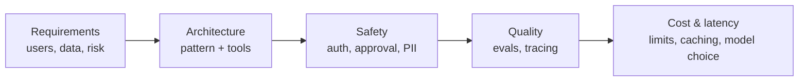

# Chapter 17: Interview questions

> [!NOTE]
> **📍 At a glance**
> - **What this is:** the whole-book question bank, from basics to system design
> - **How to use it:** read the question, answer aloud, then click to reveal. Each answer links to the chapter that teaches it
> - **Level:** all levels · **Time:** about 60 minutes for one full pass
> - **Also see:** the 🟢🟡🔴 interview corner at the end of every chapter

**How to use this chapter**

- The course's researched question file (21 questions and an 8-question warm-up) answered in short bullets
- Each answer points to the chapter that teaches it. Say it aloud first, then check
- Where I could test a claim, it is marked ✅. Where the test or a source adds to the file, that is shown
- Chapters 1 to 16 each end with their own interview corner. This one adds the **production and senior** questions, and the ones the file raises that no chapter had

**About the source file.** Its author says every question is grounded in documentation, practitioner writing or reported incidents, and that two kinds of claim were **left out** on purpose: single-source anecdotes with exact percentages, and an exact "about 15 tool calls" degradation threshold. Treat anything like that, wherever you meet it, as one person's experience.

## 17.1 Foundations

Q1. What is LangChain, and what problem does it solve?

- An open-source framework for building applications on language models: a standard interface for models, prompts, tools and memory, plus many integrations
- You do not hand-roll provider switching, tool-dispatch loops or retrieval pipelines for every project
- Chapters [1](01-introduction-to-langchain.md) and [2](02-langchain-family-and-harness-engineering.md)

Q2. Chain or agent?

- A **chain** is a deterministic sequence of steps wired before run time. It runs the same way each time
- An **agent** is non-deterministic: the model decides at run time which tool to call next, looping until it decides it is done
- *Stronger answer:* an agent needs a safety limit, such as a recursion limit or a call limit ([Chapter 1](01-introduction-to-langchain.md), [Chapter 8](08-prebuilt-middleware-limits-fallback-and-pii.md))

Q3. What is the ReAct pattern?

- **Reasoning plus Acting.** The model alternates a thought, an action (usually a tool call) and an observation (the tool result), and repeats until it gives a final answer
- Chapters [1](01-introduction-to-langchain.md) and [6](06-agents-and-memory.md)

Q4. What is <code>AgentExecutor</code>, and why might an interviewer ask?

- LangChain's original runtime for the agent loop: tool dispatch, intermediate steps, iteration limits
- Since **LangChain v1.0 (October 2025)** it is legacy. The recommended path is **`create_agent`**, built on LangGraph, which exposes state at every step for inspection and human approval
- The question often checks that you know the framework has moved on ([Chapter 2](02-langchain-family-and-harness-engineering.md))

Q5. What does <code>.as_retriever()</code> do?

- Turns any vector store into a retriever (a runnable). It takes a `search_type` (the file lists `"similarity"`, `"mmr"` and `"similarity_score_threshold"`) and `search_kwargs`
- Every vector store shares the interface, so swapping the database is a one-line change
- **Not taught in this book yet.** Retrieval comes with the RAG material later. The class notebooks used `InMemoryVectorStore(...).as_retriever(search_kwargs={"k": 2})` ([Chapter 14](14-handoffs-skills-router-and-custom-workflows.md), 14.6)
- **Inconsistency in the file:** Q5 names **three** search types, and the quick-fire list asks for "two of the **four**". Check the current documentation for the real list

## 17.2 Structured output

Q6. Why is <code>with_structured_output()</code> more reliable than "please reply in JSON"?

- Plain prompting relies on the model choosing to comply. It can add commentary or produce invalid JSON
- A schema is validated by Pydantic (or a `TypedDict` or JSON Schema) before the result reaches your code ([Chapter 4](04-structured-output.md))

Q7. <code>BaseModel</code> or <code>TypedDict</code>?

- `BaseModel` **validates types at run time** and raises on a wrong type. A plain `TypedDict` or dataclass has the same shape but **no run-time validation**
- Quick-fire Q6 (when to choose `TypedDict`): speed and a lighter weight, when you trust the input and nothing downstream depends on strict validation

Q8. <code>ToolStrategy</code> or <code>ProviderStrategy</code>?

- Both enforce structure at the **agent** level through `create_agent(response_format=...)`
- **`ProviderStrategy`** uses the provider's native feature. Fast, but only where supported. **`ToolStrategy`** forces structure through a synthetic tool call and works on any tool-calling model, at a small cost
- With neither named, LangChain picks from the model's **capability profile**
- *Checked:* the raw model's `with_structured_output` takes `method=` (`json_schema` default, `function_calling`, `json_mode`) and **refuses** a `ProviderStrategy` object with `ValueError: Unsupported function`. The strategies belong to `create_agent` ([Chapter 4](04-structured-output.md), 4.2)

Q9. What happens when the output breaks a constraint such as a number range?

- The validation error is **fed back to the model as a message** and it retries, through the normal agent loop, with no retry code from you. Configure it with `handle_errors`
- *Checked with a scripted model* that first asked for 15 tickets (limit 1 to 10), then 10:
  - default and custom-string settings: two model calls, final value 10
  - `handle_errors=False`: raises `StructuredOutputValidationError` at once
  - `handle_errors=ValueError` does **not** catch it, because LangChain wraps the error in its own type, which is not a `ValueError`. Use `StructuredOutputValidationError`
- *Stronger answer:* the retry picked a valid value, not necessarily what the user wanted. Keep hard business rules in the schema and add a human check for anything consequential

Q10. How do you design for one of several intents (book, cancel, modify)?

- A **`Union` of separate Pydantic schemas** as the `response_format`. The model decides which fits, and your code checks which one it got with `isinstance()`
- *Checked with a scripted model:* a cancellation request returned a `CancelBooking` object, and `isinstance(result, CancelBooking)` was `True`

## 17.3 Tools and agents

Q11. What makes a good tool docstring?

- It is the **main text the model reads** to decide whether and when to call the tool, not documentation for the next engineer
- Vague means never used or used at the wrong moment. Precise means reliable choice
- *Checked:* by default the whole docstring is the description. `@tool(parse_docstring=True)` moves the `Args:` entries into per-argument descriptions in the schema ([Chapter 5](05-tools.md))

Q12. Binding a tool against executing it?

- `.bind_tools()` only makes the model **aware** and lets it **request** a call. It runs nothing
- Running the tool and feeding the result back is `create_agent`'s job ([Chapter 5](05-tools.md))

Q13. What does <code>ToolRuntime</code> give a tool, and why is it hidden from the model?

- Access to **state** (this conversation), **context** (immutable per-run data) and **store** (long-term memory across sessions)
- LangChain recognises the `ToolRuntime` annotation and leaves it out of the schema the model sees, so the model never tries to fill it
- *Checked:* a tool taking `runtime: ToolRuntime` reported an **empty** argument schema (`{}`) ([Chapter 11](11-runtime-and-human-in-the-loop.md))

Q14. <code>thread_id</code> against <code>context</code>?

- **`thread_id`** scopes conversation history. It persists across calls that share the id, through a **checkpointer**
- **`context`** carries per-run data (a user id, session details) and must be **passed fresh on every invocation**. It does not carry over like history
- Mixing them up is a common bug once an app has several users ([Chapters 6](06-agents-and-memory.md) and [11](11-runtime-and-human-in-the-loop.md))

Q15. How do you restrict a tool to certain users, and why is a system-prompt instruction not enough?

- A prompt instruction depends on the model choosing to obey. Phrasing can get round it
- Stronger: **`wrap_model_call` middleware filters the tool list** before the model sees it, from run-time state. The tool is not merely discouraged, it is not an option
- *Checked:* with the filter, a non-VIP request offered only `standard_booking`. **A VIP request still got no VIP tool until `state_schema` declared the `is_vip_member` key**, because an undeclared key in the input is dropped ([Chapter 5](05-tools.md), 5.10 and [Chapter 7](07-middleware.md))

Q16. What is a multi-tool agent, and what is the risk of too many tools?

- It has several tools and picks per query. Too many available tools can **degrade the model's choices**
- That is a real reason multi-agent patterns exist: specialists with narrower toolsets ([Chapter 13](13-multi-agent-systems-and-subagents.md))
- The file says the evidence is practitioner discussion and the exact threshold varies by task and model. **No number is given here on purpose**

## 17.4 Production and senior level

Q17. When would you not reach for LangChain?

- A simple, single-step task with no chaining or memory
- When raw latency matters more than developer convenience
- When a **narrower purpose-built model** beats an LLM outright. Classification such as sentiment analysis or named-entity recognition is the commonly cited case, where a small encoder model wins on speed, cost and accuracy
- This is a judgement answer. It was not tested

Q18. What is LangSmith, and what does tracing give you that print statements do not?

- A full, timestamped trace of every model call, tool call and, with middleware, every hook, for a given run
- Print statements show only what you thought to check. A trace shows what actually happened, often the only way to diagnose a **non-deterministic** failure ([Chapter 2](02-langchain-family-and-harness-engineering.md))

Q19. What is RAGAS?

- An evaluation framework for RAG. It scores several independent things, commonly: whether the answer addresses the question, whether every claim is **grounded** in retrieved text (a proxy for hallucination), and whether retrieval surfaced the **right passages**
- Several metrics, not one accuracy number, because a RAG system can fail in different ways
- **Not taught in this book yet** (retrieval comes later)

Q20. There is a real disclosed vulnerability in <code>langchain-core</code>. Do you know it?

- **CVE-2025-68664**, disclosed **23 December 2025**, rated **critical (CVSS 9.3** in one vendor advisory), nicknamed **"LangGrinch"** by Microsoft's security blog
- A **serialization injection** in `dumps()` and `dumpd()`. They did not escape dictionaries containing the reserved key **`lc`**. Such data, which can come from user input or from model output steered by prompt injection (for example `additional_kwargs`), was treated as a trusted LangChain object when loaded again. That could expose environment-variable secrets and instantiate classes
- **Affected:** `langchain-core` **below 0.3.81**, and **1.0.0 up to below 1.2.5**. **Patched:** **0.3.81** and **1.2.5**
- **The patch changed defaults.** One vendor advisory lists `secrets_from_env` now defaulting to `False` and a new `allowed_objects` option defaulting to the core package. Expect breaking changes when you upgrade
- **What to do:** upgrade, and rotate secrets that were reachable by the application
- *Checked:* the environment used for these notes has `langchain-core` **1.7.3**, above 1.2.5
- *Checked against search results from several independent sources* (the GitHub security advisory text, NVD-derived pages, and security vendor write-ups). I did not read the advisories on their own sites
- An interviewer asks this to see whether you **track security advisories** for what you ship

Q21. How do you debug a production agent that seems to hang?

- Look at **tracing** first, and find the last completed step
- If it is truly stuck, the common causes are a **tool blocked on a slow or unresponsive external call with no timeout**, or an agent with **no stopping condition** because no iteration cap was set
- The hardened fix: an explicit **tool-call ceiling** through middleware ([Chapter 8](08-prebuilt-middleware-limits-fallback-and-pii.md)) and **real timeouts** on external calls, set before an incident, not during one
- Related: model and tool retry with backoff ([Chapter 9](09-guardrails-to-do-lists-and-tool-resilience.md), 9.5 and 9.9)

## 17.5 Quick-fire round

One or two sentences each, with the chapter that explains it.

1. **`.invoke()`, `.stream()`, `.batch()`?** One reply, a stream of chunks, many inputs together ([Chapter 3](03-models-messages-and-parameters.md))
2. **Why does `init_chat_model("provider:model")` matter?** One call and one reply type for any provider, so switching is a string change ([Chapter 3](03-models-messages-and-parameters.md))
3. **`with_structured_output` against `create_agent(response_format=...)`?** The first is on a raw model and knows nothing of tools. The second works **with the tool loop** and returns `result["structured_response"]` ([Chapter 4](04-structured-output.md))
4. **Two retriever `search_type` options?** From the file: `"similarity"` and `"mmr"`, with `"similarity_score_threshold"` also named. Not taught here yet
5. **Short-term against long-term memory?** Short-term is the conversation in state, kept by a checkpointer per `thread_id`. Long-term is a store that survives across sessions ([Chapter 6](06-agents-and-memory.md))
6. **Why `TypedDict` over `BaseModel`?** Lighter and faster when you do not need run-time validation ([Chapter 4](04-structured-output.md))
7. **What does a checkpointer do, and what breaks without one?** It saves state per thread. Without one, each call starts empty and the agent forgets, and a paused human-in-the-loop run cannot resume ([Chapters 6](06-agents-and-memory.md) and [11](11-runtime-and-human-in-the-loop.md))
8. **What can `ToolMessage.artifact` carry that `.content` should not?** Structured or large data for your code, such as ids, page numbers or an image, which the model does not need to read ([Chapter 5](05-tools.md), and structured MCP data in [Chapter 12](12-mcp-in-langchain.md))

## Assignments: the questions left out of earlier chapters

Two class assignments (`Assignment_LangChain_Fundamentals_...` with its solutions file, and `Assignment_2_Agents_and_Prebuilt_Middleware`). Their other questions are answered in the chapters named in the master. These are the ones that were not.

### Assignment 1 (GreenPlate): concepts, Q1 to Q11

Q1. "An agent is a model calling tools in a loop until done. A harness is everything around that loop." What is in the harness?

- The system prompt, the tools the model can reach, and middleware that shapes each step. `create_agent` *is* the harness ([Ch 1](01-introduction-to-langchain.md), [Ch 2](02-langchain-family-and-harness-engineering.md))

Q2. The four Lang products, and which differs in kind?

- LangGraph: low-level orchestration, the foundation. LangChain (`create_agent`): a configurable harness on LangGraph. Deep Agents: a batteries-included harness on top (planning, files, subagents)
- LangSmith differs in kind: an observability platform that watches agents via traces. You do not build with it. Runtime decisions cannot be read from code alone

Q3. A 2026 tutorial uses <code>AgentExecutor</code> or <code>initialize_agent</code>.

- It predates v1.0 (October 2025). Those are the legacy pattern, now in `langchain-classic`. Use `create_agent`

Q4. Why a <code>.env</code> file?

- It keeps a real key out of the notebook. A hardcoded key is exposed the moment the notebook is committed or shared, and automated scanners find leaked keys quickly

Q5. Plain text, message objects, dictionaries: when each?

- Plain text: one standalone request, no history. Message objects: multi-turn chats, multimodal content, explicit system instructions. Dicts: the same as message objects, natural when the data comes from a database or JSON API ([Ch 3](03-models-messages-and-parameters.md))

Q6. Four things an <code>AIMessage</code> carries besides <code>.content</code>.

- `.tool_calls` (tool requests), `.usage_metadata` (real token counts), `.id`, `.response_metadata` (provider extras such as the exact model). `.content_blocks` also counts

Q7. Why <code>AIMessageChunk</code> and not string pieces?

- A partial reply must be combinable into a whole. Chunks add with `+` into a full `AIMessage` and can carry tool-call fragments and metadata that a plain string cannot

Q8. <code>.batch()</code> versus <code>.batch_as_completed()</code>.

- `.batch()` waits for all and returns in input order. `.batch_as_completed()` yields each result as soon as it finishes, tagged with its input index. Use it to start handling whichever independent request returns first

Q9. <code>ToolMessage</code> <code>.content</code> versus <code>.artifact</code>.

- `.content` is what the model reads. `.artifact` is for the application and is never sent to the model. A RAG tool uses it for a document id or citation link without bloating the model's input ([Ch 5](05-tools.md))

Q10. A literal <code>{"status": "ok"}</code> in a <code>ChatPromptTemplate</code>.

- The braces are read as template variables and the call fails (`INVALID_PROMPT_INPUT`). Double them: `{{` and `}}`

Q11. What does <code>MessagesPlaceholder</code> do?

- It injects a whole **list** of messages as one variable. A string variable can hold only one string, not a structured history

*Source: the assignment's solutions notebook (Part A). Part B and the capstone there are open-ended; the exercises are covered by [Ch 4](04-structured-output.md), [Ch 5](05-tools.md), [Ch 6](06-agents-and-memory.md) and [Ch 7](07-middleware.md).*

### Assignment 2 (NovaBank): the questions that needed later chapters

These were **not taught in the class sources read**. The answers below come from the installed library (`langchain` 1.4.7, its docstrings and signatures) and the earlier chapters, and are my answers, not the class's.

Q4. The practical <code>stream_mode</code> options.

- The installed `StreamMode` values are `values`, `updates`, `messages`, `custom`, `debug`, `tasks` and `checkpoints`
- Practical three: `values` (the whole state after each step), `updates` (only what each step changed), `messages` (model tokens as they arrive, for chat UIs). `custom` carries your own progress events from `stream_writer` ([Ch 11](11-runtime-and-human-in-the-loop.md))

Q5. Why does naming an agent (<code>name=</code>) cost nothing now but matter later?

- The `create_agent` docstring: the name is used when the agent is added to another graph as a subgraph node. It matters for multi-agent systems and for readable traces ([Ch 13](13-multi-agent-systems-and-subagents.md))

Q8. <code>SummarizationMiddleware</code> or <code>ContextEditingMiddleware</code> for very long, chatty conversations with few simple tools?

- `SummarizationMiddleware`. The bulk is conversation turns, which summarising condenses. `ContextEditingMiddleware` (with `ClearToolUsesEdit`) clears old **tool results**, which helps when tools return big outputs ([Ch 7](07-middleware.md), [Ch 9](09-guardrails-to-do-lists-and-tool-resilience.md))

Q9. Three distinct "retry" mechanisms, and when each.

- The library has `ToolRetryMiddleware` (a tool call fails: a flaky balance API), `ModelRetryMiddleware` (the model call fails: a timeout or rate limit), and `ModelFallbackMiddleware` (the primary model is down for good: switch to another model). All three share backoff ideas except fallback
- My reading: the question's "three" is most likely these. Structured-output self-correction ([Ch 4](04-structured-output.md)) is a fourth, related loop

Q12. Three PII <code>apply_to</code> flags for account numbers.

- Signature: `apply_to_input=True`, `apply_to_output=False`, `apply_to_tool_results=False`
- `apply_to_input`: a customer types their account number; clean it before the model sees it
- `apply_to_output`: the model might repeat a number from earlier context; clean its reply before the user or logs
- `apply_to_tool_results`: a balance tool returns a full number; clean the tool result before the model reads it
- For account numbers, set all three. *Checked:* a custom regex detector for `NB-` plus 8 digits with `strategy="mask"` turned `NB-12345678` into `****5678`; `redact` gave `[REDACTED_NB_ACCOUNT]`, `hash` gave `<nb_account_hash:...>`, and `block` raised `PIIDetectionError` ([Ch 8](08-prebuilt-middleware-limits-fallback-and-pii.md))

Q13. The <code>LLMToolEmulator</code> <code>model</code> discrepancy.

- Its docstring says the default is `anthropic:claude-sonnet-4-5-20250929`, which needs `langchain-anthropic` installed, and that relying on the implicit default is **deprecated**: pass `model` explicitly. The signature itself shows `model=None`
- Good habit for any middleware with its own model: an implicit default adds a hidden provider dependency, a hidden cost and a model that may be retired

Q14. <code>LLMToolSelectorMiddleware</code> versus <code>ProviderToolSearchMiddleware</code> (15 tools).

- Selector: a model reads the query and picks a subset (`max_tools`, `always_include`) before the main call. Works with any provider, costs an extra model call
- Provider tool search: marks chosen tools as deferred and lets the **provider's own server-side tool search** fetch schemas when needed. Fewer tokens, no extra call from you
- Constraint: only providers with server-side tool search, currently **Anthropic and OpenAI**. If a tool is deferred and the provider cannot be identified or lacks it, the model call raises `ValueError`

Q15. A production NovaBank stack from built-ins (no single right answer).

- `PIIMiddleware` on input, output and tool results (account numbers)
- `ModelRetryMiddleware` then `ModelFallbackMiddleware` for model failures
- `ToolErrorMiddleware` as the **outer** and `ToolRetryMiddleware(on_failure="error")` as the **inner**, for flaky balance lookups. *Checked:* this gave 3 attempts and a safe message with no raw exception text. Reversed, it gave 1 attempt ([Ch 9](09-guardrails-to-do-lists-and-tool-resilience.md), 9.6)
- `ToolCallLimitMiddleware` tight on `transfer_funds`; `ModelCallLimitMiddleware` looser overall
- `HumanInTheLoopMiddleware` on `transfer_funds` with all four decisions
- `SummarizationMiddleware` for long chats
- Order: hooks before the model run in declared order, so put PII first

*Checked, composition:* with only `ToolRetryMiddleware(on_failure="continue")`, the final tool message **leaked** the raw exception text (`secret internal detail ...`). Adding `ToolErrorMiddleware` outside it removed the leak. Excluding `ValueError` from retries (`retry_on`) gave 1 attempt for a bad-input error that retrying cannot fix.

### Capstones

- **GreenPlate (Assignment 1):** the key's solution combines six ideas: a `ReservationRequest` schema with a `Literal` time slot and a party-size range; two tools; long-term dietary memory through `ToolRuntime.store`; short-term memory with a checkpointer and `thread_id`; `book_private_dining_room` gated by `wrap_model_call` for premium members; and a `context_schema` carrying the restaurant location
  - Its own reflection: `InMemoryStore` and `InMemorySaver` lose everything on restart (swap for Postgres-backed versions), and `book_table` has no human approval
- **NovaBank (Assignment 2):** pick six of eight features. A sound choice: a structured request with a constraint, three tools, HITL on transfer, PII masking, a tool retry, and call limits. Justify each in one line, then build it from the Q15 stack

*Source: the two assignment notebooks. Assignment 2 has no solutions file here.*

## 17.6 System design round

In senior interviews you get one open problem and 30 to 45 minutes. Use the same skeleton every time.

> [!TIP]
> **The skeleton:** clarify the users and the risk → pick the simplest pattern that works (single agent first) → list tools with read/write split → memory (thread vs store) → safety (context for identity, approval for writes, PII) → quality (evals in CI, traces) → cost (limits, smaller models, caching).

D1. Customer-support agent that can look up orders and issue refunds

- Single agent, tools: `get_order` (read), `issue_refund` (write, approval over a threshold)
- Identity from runtime **context**, not the model; one thread per conversation, database checkpointer
- `ModelCallLimitMiddleware` + `ToolCallLimitMiddleware("issue_refund", run_limit=1)`, PII masking on outputs
- Evals: trajectory `subset` (no unexpected refunds), traced in production ([Ch7](07-middleware.md), [Ch8](08-prebuilt-middleware-limits-fallback-and-pii.md), [Ch11](11-runtime-and-human-in-the-loop.md))

D2. Policy Q&A over 2,000 internal PDFs with citations

- RAG: load, split with metadata, embed, vector store; retriever as a tool or a fixed retrieve-then-answer workflow
- Measure retrieval hit rate on a labelled set; hybrid search or re-ranking before a bigger model
- Answers must cite source and page; refuse when nothing relevant is found ([Ch16](16-tutorials-knowledge-base-sql-and-voice.md), [Ch14](14-handoffs-skills-router-and-custom-workflows.md))

D3. Analytics assistant that answers questions from a SQL database

- Three tools (list tables, schema, query), prompt forbids writes, **read-only DB user** and a row limit in code
- Approval on `sql_db_query` for sensitive tables; every query logged with user and question
- Errors returned as text so the model repairs its query ([Ch16](16-tutorials-knowledge-base-sql-and-voice.md))

D4. Internal assistant across GitHub, Notion and Slack

- Router: classify with structured output, `Send` to each source agent in parallel, reducer to merge, then synthesise
- Wrap the router as a tool of a conversational agent for memory; MCP servers for each source with per-user tokens
- Cap fan-out and cache tool lists ([Ch12](12-mcp-in-langchain.md), [Ch14](14-handoffs-skills-router-and-custom-workflows.md))

D5. Coding agent that edits a repo and runs tests

- Shell and file tools inside a **sandbox container**, no secrets, limited network
- Planning with a to-do list, approval for anything outside the workspace, output size caps
- Call limits against loops; evals on a fixed set of tasks ([Ch9](09-guardrails-to-do-lists-and-tool-resilience.md), [Ch10](10-shell-tools-and-custom-middleware.md))

D6. The provider is down and costs doubled last month: harden the platform

- Resilience: model retry for blips, fallback to a second provider, call limits as a circuit-breaker
- Cost: count calls per task, summarise long threads, route easy steps to a smaller model, cache stable tool results
- Watch: cost and latency per conversation from traces, alerts on fallback rate ([Ch3](03-models-messages-and-parameters.md), [Ch8](08-prebuilt-middleware-limits-fallback-and-pii.md), [Ch9](09-guardrails-to-do-lists-and-tool-resilience.md))

## 17.6b Debugging round: "the agent is broken, what do you check?" (*added by Claude*)

Interviewers increasingly give a symptom and watch how you narrow it down. Answer in this order: **read the trace → isolate the layer (model, tool, memory, middleware) → fix → add an eval case.**

1. The agent never calls the search tool; it answers from memory.

- Trace: no `tool_calls` in any `AIMessage`
- Causes: vague tool description; system prompt doesn't say when to search; model too weak for tool use
- Fix: description with when/when-not ([Ch 5](05-tools.md)), an explicit rule in the prompt, test the tool schema alone; add a case to the eval set ([Ch 15](15-testing-agents-and-tracing.md))

2. Runs hit <code>GraphRecursionError</code> after many tool calls.

- Trace: the same tool called repeatedly with similar args
- Causes: tool returns an error or empty result the model can't use; no "stop if not found" rule
- Fix: make the tool return a clear, actionable message; add tool/model call limits ([Ch 8](08-prebuilt-middleware-limits-fallback-and-pii.md)); don't just raise the limit

3. Users say the bot "forgot" what they said two messages ago.

- Check: is there a checkpointer, and is the **same `thread_id`** sent each turn? Did summarisation or trimming drop it ([Ch 7](07-middleware.md))?
- Fix: stable thread id from the session; tune `keep`; move lasting facts to the store ([Ch 6](06-agents-and-memory.md))

4. Cost per conversation doubled after a release.

- Break down tokens per step (traces or a usage middleware, [Ch 10](10-shell-tools-and-custom-middleware.md))
- Usual suspects: longer system prompt, more tools in every call, extra loop turns, retries, a pricier model, summarisation not triggering
- Fix the cause, then add cost to the eval dashboard so the next regression is caught before release

5. Structured output fails 10% of the time in production.

- Log the raw reply and the validation error `type` per field
- Causes: required fields the input often lacks (model invents or fails), deep nesting, provider strategy unsupported for the model
- Fix: optional fields + "null if missing", `Literal` sets, flatter schema, `ToolStrategy` with retry ([Ch 4](04-structured-output.md))

6. One user saw another user's data.

- Severity one: check thread ids (shared or guessable?), store namespaces (keyed by authenticated user?), MCP or tool credentials (shared service account?) ([Ch 12](12-mcp-in-langchain.md))
- Fix: user identity only from `context` set by your auth layer, never from the model; per-user namespaces and tokens; a regression test that two users can't cross

## Revision map: one line per chapter

| Ch | Remember this |
|---|---|
| 1 | Agent = model + harness; result = Human → AI(tool call) → Tool(same id) → AI |
| 2 | Layers, not rivals; drop to LangGraph for custom flows; trace everything |
| 3 | `init_chat_model`; `timeout`, `max_tokens`, low temperature; retry only retryable errors |
| 4 | Provider vs tool strategy; validation errors go back for a retry |
| 5 | The model requests, your code runs; docstring = prompt; least privilege |
| 6 | Thread (checkpointer) vs store; one thread per conversation |
| 7 | Six hooks; security in middleware and in the tool, not the prompt |
| 8 | Limits = cost guardrail; fallback = outage plan; mask PII in logs too |
| 9 | Retry idempotent tools only; to-do list for long tasks; tool selector for many tools |
| 10 | Wrap hooks nest like an onion; shell tools need a sandbox |
| 11 | Context = fixed and trusted; state = changes; approvals need a checkpointer |
| 12 | MCP tools are untrusted; per-user auth; gate destructive hints |
| 13 | Start single-agent; a subagent is a tool; only the last message returns |
| 14 | Match the pattern to the problem; most real systems are custom workflows |
| 15 | Fake models for units, markers for integration, evals in CI |
| 16 | Measure retrieval first; read-only DB for SQL agents; sandwich for voice |

## 17.7 Added by Claude, not from the sources

Items marked ✅ were run with `langchain` 1.4.7 and `langgraph` 1.2.19.

- **Quote versions when you answer.** Several answers changed between releases while these notes were written. "On version X I tested Y" is a strong answer
- **Be ready to draw three things:** the agent loop, the middleware hook order, and a handoff or router graph. Interviewers often ask for a sketch
- **Prepare one story per production topic:** a retry that saved a run, a limit that stopped a runaway, a guardrail that blocked a bad request. Use the examples in Chapters 8 and 9
- **Know your limits.** A candidate who says "I did not test that with a real model" and explains how they would is more convincing than one who guesses
- **Separate fact from folklore.** The file itself leaves out percentages and thresholds it could not verify. Do the same
- **Retrieval and evaluation are missing from the book so far.** Q5 and Q19 need that material before you can answer them in depth

## Recap

- Chain is fixed, agent decides. `create_agent` replaced `AgentExecutor` in v1.0
- Structured output: schema as a contract. `method=` on a model, strategies on an agent. Validation errors feed back and retry. Catch `StructuredOutputValidationError`, not `ValueError`
- Tools: the docstring is the pitch. Bind is a request, the agent runs it. `ToolRuntime` is hidden from the model. Filter tools in middleware, and declare the state key
- `thread_id` is history, `context` is per-run data
- Tracing, tool-call ceilings and timeouts are how you debug a hang
- CVE-2025-68664: serialization injection through the `lc` key, fixed in 0.3.81 and 1.2.5

## Practice

1. Answer Q1 to Q21 aloud in under a minute each, then compare
2. Run the `handle_errors` check: a scripted model that asks for 15 then 10, with each setting
3. Build the VIP filter with and without the state key and note what the model is offered
4. Check your own `langchain-core` version against the CVE
5. Draw the middleware hook order from memory
6. Write a two-sentence answer to "when would you not use LangChain?" from your own work

## How this chapter was checked

- Run for the assignment answers (`langchain` 1.4.7, scripted model): a custom-regex `PIIMiddleware` with four strategies; `ToolErrorMiddleware` and `ToolRetryMiddleware` in both orders, alone, and with `retry_on`. Library signatures and docstrings were read for stream modes, `name=`, the PII flags, `LLMToolEmulator` and `ProviderToolSearchMiddleware`
- Run: the `handle_errors` settings and `Union` with a scripted model; a tool with `ToolRuntime`; the VIP tool filter with and without a declared state key; `method=` and the `ProviderStrategy` refusal on a raw model; and the installed `langchain-core` version
- Checked through web search results: the facts of CVE-2025-68664 (date, affected and fixed versions, the `lc` key, the changed defaults, the nickname)
- **Not run:** any real model, retrieval, RAGAS, LangSmith, the hanging-agent scenario, and the claims on when not to use LangChain
- The question file is the source for every question and for the short answers marked as from it

## Sources and further reading

- Live-Class-2026, `Weekend 05 - 25-26 Jul/09-10 .../Assignment & Questions/LangChain_Interview_Questions_Researched.md.pdf`
- The CVE-2025-68664 advisory material seen in search results: GitHub security advisory GHSA-c67j-w6g6-q2cm, the Microsoft Security blog on "LangGrinch", and write-ups by SentinelOne, Upwind and Geordie
- Sections marked ✅ and 17.7 are from testing

Previous: [Chapter 16, Build-along tutorials](16-tutorials-knowledge-base-sql-and-voice.md)
