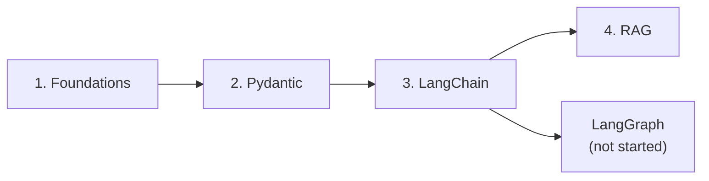

# The Agentic AI library
> lead: Study notes for the Agentic AI 3.0 course, split into books you read in order: foundations first, then Pydantic, then LangChain, then RAG.
meta: Start here | 4 books

## The books, in reading order

| Book | What it teaches | Open |
| --- | --- | --- |
| **1. Python and Agent Foundations** | Setup, LLM basics, what an agent is, an agent in plain Python | [Start](#foundations-home) |
| **2. Pydantic** | Models, validators, settings, FastAPI, validating LLM output | [Start](#pydantic-home) |
| **3. Agentic AI with LangChain** | `create_agent`, tools, memory, middleware, runtime, MCP, multi-agent, the Meridian capstone | [Start](#agentic-ai-home) |
| **4. RAG** | Embeddings, ingestion, retrieval, advanced variants, costs | [Start](#rag-home) |

:::note Coming later
A LangGraph book will be added when those classes start. Nothing is created for it ahead of time.
:::

## How the library works

- **One topic per book.** Craft pages, instructor sites and project ideas sit beside the chapter they support, not in a separate section.
- **Each chapter has the same shape:** why it matters, core ideas, common mistakes, an interview corner with tap-to-reveal answers, a tickable revision list and links to the exact course files.
- **Quiz me** appears in each book and collects that book's interview questions.
- Use the book switcher at the top to move between books. Your reading progress is remembered per chapter on this device.

## Source

All books are built from the course repository, [mayank953/Live-Class-2026](https://github.com/mayank953/Live-Class-2026), the Meridian learner repo, and the instructor's Craft page and sites. Pages marked **From the docs** come from LangChain documentation read in full.
