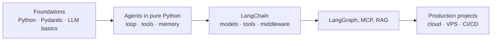

# Chapter 1: Roadmap, golden rules and setup

*Where each topic lives in these books, the four rules for judging an agent in production, and the one-time setup.*

> [!NOTE]
> **📍 At a glance**
> - **You will learn:** the study order, the four golden rules and their metrics, and the setup every code folder needs
> - **Level:** beginner · **Time:** about 10 minutes
> - **Leads to:** [Python Ch 1](../python/01-setup-and-api-basics.md)

---

## 1.1 Study map



| Phase | Where in these notes |
|---|---|
| Foundations | [Python](../python/01-setup-and-api-basics.md), [Pydantic](../pydantic/01-why-pydantic-and-basemodel.md), [LLM Ch 3](03-inside-the-model.md) |
| Agents in pure Python | [Python Ch 3](../python/03-anatomy-of-an-agent.md), [LLM Ch 2](02-the-agentic-loop-in-pure-python.md) |
| LangChain | [Langchain book](../langchain/01-introduction-to-langchain.md) |
| MCP, checkpointing, RAG | [MCP book](../mcp/01-why-mcp-exists.md), Langchain Ch 6, [Projects Ch 3](../projects/03-meridian-ai-learner.md) |
| Production projects | [Projects book](../projects/01-cinebot.md) |

- Later course topics: A2A (agent-to-agent protocol), coding agents (Claude Code), Claude Agent SDK / ADK, cloud AI platforms (Azure AI Foundry, Bedrock, Vertex AI), **AgentOps** (deploy and monitor)

## 1.2 The four golden rules

| Rule | Metric | Where you see it |
|---|---|---|
| **Cost** | Tokens and money per task | Provider usage, traces |
| **Failure rate** | % runs that error, time out or retry | Logs, traces, alerts |
| **Latency** | Time to first token, p95 total | Traces, dashboards |
| **Quality** | Pass rate on a fixed real test set | Evals on every change |

- **"Simple is scalable":** fewest LLM/API hops that solve the problem; each hop adds cost, latency and a failure point
- Start with one model call; add tools, loops or more agents only when a test shows the need
- Use several LLMs only for a reason (failover, cheap model for easy steps); never in parallel by default
- The rules trade off: a stronger model raises quality *and* cost. **Measure all four before optimising**

## 1.3 One-time setup

1. **Python 3.10+** (projects pin 3.13 in `.python-version`)
2. **uv:** `curl -LsSf https://astral.sh/uv/install.sh | sh`
3. **VS Code** for real projects; Colab only for exploring
4. **One API key:** Groq or OpenRouter (free tiers), OpenAI or Anthropic (paid)
5. **The `.env` workflow** in every folder:

```bash
uv sync
cp .env.example .env      # paste a real key, e.g. GROQ_API_KEY=...
uv run main.py
```

- `.env` is git-ignored; only `.env.example` ships. Check with `git check-ignore .env`
- **A leaked key must be revoked at the provider**, not just deleted from the repo

| Git problem | Fix |
|---|---|
| `Filename too long` (Windows) | `git config --global core.longpaths true` |
| Local changes block `pull` | `git stash -u`, `git pull`, `git stash pop` |
| Folder missing on GitHub | It has its own `.git` from `uv init`; delete it or use `uv init --vcs none` |

## Interview corner

<details class="qa"><summary>1. How do you judge an agent in production?</summary>

- Cost per task, failure rate, p95 latency, pass rate on a test set, all four together

</details>

<details class="qa"><summary>2. Quality is fine but cost tripled. How do you investigate?</summary>

- Break cost down per step from traces; usual causes are growing history, extra loop turns, a model switch or retries; fix with trimming, caching, a cheaper model for easy steps, budget alerts

</details>

<details class="qa"><summary>3. What is AgentOps?</summary>

- Running agents in production: tracing, evals, cost tracking, alerts, safe rollout of new prompts and models

</details>

> [!TIP]
> **🧩 Design question:** "Build an AI agent for HR policy questions." Start with one call over retrieved policy text, a real test set and the four metrics; add tools or agents only when a test fails.

---

*Source: Live-Class-2026 class 00 (induction), `PREREQUISITES.md`, root `README.md`; metrics table added by Claude.*

Next: [Chapter 2, The agentic loop in pure Python](02-the-agentic-loop-in-pure-python.md)
