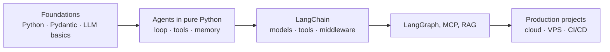
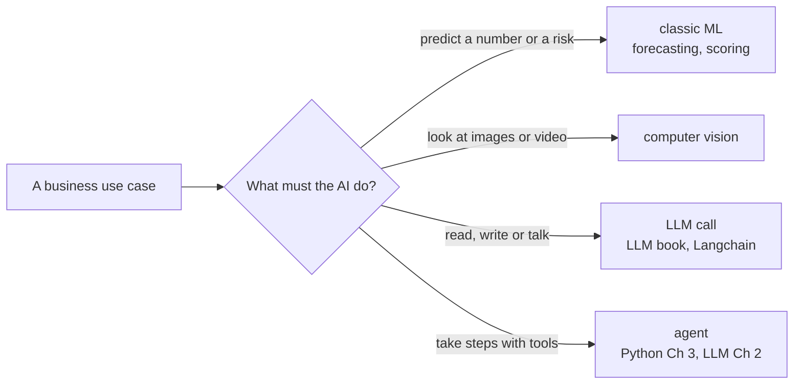

# Chapter 1: Roadmap, golden rules and setup

*Where each topic lives in these books, the four rules for judging an agent in production, and the one-time setup.*

> [!NOTE]
> **📍 At a glance**
> - **You will learn:** the study order, the four golden rules and their metrics, the setup every code folder needs, and where AI is used across industries
> - **You will build:** a small script that turns run logs into the four golden-rule numbers
> - **Level:** beginner · **Time:** about 30 minutes
> - **Leads to:** [Python Ch 1](../python/01-setup-and-api-basics.md)

**After this chapter you can:**

- Place each topic of the course in these books
- Judge an agent by cost, failure rate, latency and quality, and compute them from logs
- Set up a project folder with `uv` and `.env` safely
- Say which industry AI use cases are classic machine learning and which are LLM agents
- Separate checked facts from marketing claims about the AI market

---

## 1.1 Study map



| Phase | Where in these notes |
|---|---|
| Foundations | [Python](../python/01-setup-and-api-basics.md), [Pydantic](../pydantic/01-why-pydantic-and-basemodel.md), [LLM Ch 3](03-inside-the-model.md) |
| Agents in pure Python | [Python Ch 3](../python/03-anatomy-of-an-agent.md), [LLM Ch 2](02-the-agentic-loop-in-pure-python.md) |
| LangChain | [Langchain book](../langchain/01-introduction-to-langchain.md) |
| MCP, checkpointing, RAG | [MCP book](../mcp/01-why-mcp-exists.md), Langchain Ch 6, [Projects Ch 3](../projects/03-meridian-ai-learner.md) |
| Production projects | [Projects book](../projects/01-cinebot.md) |

- Later course topics: A2A (agent-to-agent protocol), coding agents (Claude Code), Claude Agent SDK / ADK, cloud AI platforms (Azure AI Foundry, Bedrock, Vertex AI), **AgentOps** (deploy and monitor)

## 1.2 The four golden rules

| Rule | Metric | Where you see it |
|---|---|---|
| **Cost** | Tokens and money per task | Provider usage, traces |
| **Failure rate** | % runs that error, time out or retry | Logs, traces, alerts |
| **Latency** | Time to first token, p95 total | Traces, dashboards |
| **Quality** | Pass rate on a fixed real test set | Evals on every change |

- **"Simple is scalable":** fewest LLM/API hops that solve the problem; each hop adds cost, latency and a failure point
- Start with one model call; add tools, loops or more agents only when a test shows the need
- Use several LLMs only for a reason (failover, cheap model for easy steps); never in parallel by default
- The rules trade off: a stronger model raises quality *and* cost. **Measure all four before optimising**
- The four numbers from a list of run records (*added by Claude*):

```python
import statistics

runs = [  # one record per agent run, e.g. from your logs or traces
    {"cost": 0.012, "ok": True,  "latency_s": 2.1, "passed": True},
    {"cost": 0.015, "ok": True,  "latency_s": 2.8, "passed": False},
    {"cost": 0.030, "ok": False, "latency_s": 9.5, "passed": False},
    {"cost": 0.011, "ok": True,  "latency_s": 1.9, "passed": True},
]

cost_per_task = sum(r["cost"] for r in runs) / len(runs)
failure_rate = sum(not r["ok"] for r in runs) / len(runs)
p95_latency = statistics.quantiles([r["latency_s"] for r in runs], n=20, method="inclusive")[-1]
quality = sum(r["passed"] for r in runs) / len(runs)
print(f"${cost_per_task:.4f}/task · {failure_rate:.0%} failed · p95 {p95_latency:.1f}s · {quality:.0%} passed")
# $0.0170/task · 25% failed · p95 8.5s · 50% passed
```

- *Found in testing:* without `method="inclusive"`, `statistics.quantiles` uses its default "exclusive" method, which **extrapolates** with few data points. Here it reported a p95 of 14.5 s, slower than any run (the slowest took 9.5 s). Use `"inclusive"` or a real metrics tool, and collect enough runs for a p95 to mean something

## 1.3 One-time setup

1. **Python 3.10+** (projects pin 3.13 in `.python-version`)
2. **uv:** `curl -LsSf https://astral.sh/uv/install.sh | sh`
3. **VS Code** for real projects; Colab only for exploring
4. **One API key:** Groq or OpenRouter (free tiers), OpenAI or Anthropic (paid)
5. **The `.env` workflow** in every folder:

```bash
uv sync
cp .env.example .env      # paste a real key, e.g. GROQ_API_KEY=...
uv run main.py
```

- `.env` is git-ignored; only `.env.example` ships. Check with `git check-ignore .env`
- **A leaked key must be revoked at the provider**, not just deleted from the repo

| Git problem | Fix |
|---|---|
| `Filename too long` (Windows) | `git config --global core.longpaths true` |
| Local changes block `pull` | `git stash -u`, `git pull`, `git stash pop` |
| Folder missing on GitHub | It has its own `.git` from `uv init`; delete it or use `uv init --vcs none` |

## 1.4 AI across industries: the class handbook

- Weekend 01 shipped a 22-page PDF, the *Industry-Ready AI Handbook* (2026 edition), a companion to an ET masterclass for business professionals
- It is marked **"Not for redistribution"**, so these notes summarise its ideas in my own words and repeat none of its figures. Facts about the market below were **checked on the web** and are cited
- Its shape: ten industries plus a fashion bonus; for each, what AI does today, example companies, and one question for your business. Then India's AI position, AI by job role, a tool list and a 30-day plan

### What AI does, by industry

| Industry | Typical uses in the handbook | Mostly which kind of AI (*added by Claude*) |
|---|---|---|
| Manufacturing, automotive | predictive maintenance, visual quality checks, generative design, supply-chain forecasting | classic ML, computer vision |
| Healthcare | reading X-rays and scans, early screening, clinical note-taking, patient-risk scores | computer vision, ML; LLMs for notes |
| Banking, finance | fraud detection, credit scoring on alternative data, KYC, voice agents in Indian languages, reading regulatory circulars | ML; LLM agents for voice and documents |
| E-commerce, retail | recommendations, visual search, dynamic pricing, demand forecasting, support bots, route optimisation | ML; LLM agents for support |
| Hotels, hospitality | revenue management, guest personalisation, concierge chat, energy and staffing | ML; LLM agents for chat |
| FMCG, D2C brands | demand sensing, AI product images, sentiment analysis, personalised marketing | ML, image generation, LLMs |
| Real estate, construction | valuations, quantities from blueprints, virtual staging, title due diligence, lead qualification | ML, vision, LLM document review |
| Media, marketing | content and ad generation, audience segments, performance prediction | LLMs, image and video generation |
| IT, consulting | code generation, agentic research, proposals, knowledge search | **LLM agents** (this course) |
| Oil, energy | predictive maintenance, grid balancing, safety cameras, battery management | classic ML, vision |



- A developer's reading (*added by Claude*): many headline uses are forecasting or vision, not LLMs. The agent-shaped ones are support and voice agents, document review, research, knowledge search and code generation, which is what this course builds
- Apply the golden rules: the handbook's closing question, "what is one costly problem?", is also where a first agent should start

### India's AI moment, checked

| Claim (paraphrased from the handbook) | What public sources say (web-checked 2026-11-15) |
|---|---|
| A ₹10,000-crore national AI mission | The Union Cabinet approved the **IndiaAI Mission** on 7 March 2024 with an outlay of **₹10,371.92 crore**, including public compute of 10,000+ GPUs |
| India hosted a global AI summit in February 2026 with about $200 billion in commitments | The **India AI Impact Summit** ran in New Delhi on 16–21 February 2026. Ministers cited **$200–250 billion** of expected investment; these are pledges, not spending |
| Sarvam AI built a 105-billion-parameter model | Sarvam launched **Sarvam-30B and Sarvam-105B** at the summit (mixture-of-experts; the 105B uses about 9B active parameters) and later released them openly. Benchmark wins are company claims |
| Krutrim was India's first AI unicorn | Krutrim reached a **$1 billion valuation** in January 2024 after a $50 million round |
| India's AI market will reach about $17 billion by 2027 | A **Nasscom–BCG** report (February 2024) projected **$17 billion by 2027**, growing 25–35% a year |

- **Not repeated here:** company impact numbers (savings, accuracy, revenue) are vendor marketing. One example: "recommendations drive 35% of Amazon's revenue" traces to a 2013 McKinsey estimate whose original source and wording could not be confirmed; Amazon has never published it

### Roles and tools

- The handbook lists the top AI uses for ten roles. Three examples: a **CFO** gets automated variance analysis; **HR** gets CV screening and attrition prediction; a **CTO** gets code generation and security anomaly detection
- Its tool list, by job (checked where marked):

| Need | Tools named | Checked |
|---|---|---|
| General assistant | Claude, ChatGPT, Gemini | well known |
| Research over your own documents | NotebookLM | yes: answers with citations, Audio Overviews, Mind Maps |
| Web research with citations | Perplexity | no |
| Images | Nano Banana, Midjourney, Adobe Firefly | yes for Nano Banana: Google's name for its Gemini image models (first Gemini 2.5 Flash Image, August 2025; now Nano Banana 2) |
| Video | Runway | no |
| Voice | VAPI (voice agents), ElevenLabs (voices) | no |
| Personal agent | OpenClaw | yes: a free, open-source agent that runs on your own machine and works through chat apps (earlier names Clawdbot, Moltbot) |
| Workflow automation | n8n, Make.com | no |

### The 30-day starter plan

| Week | The handbook's step, paraphrased |
|---|---|
| 1 | Give one weekly, 2-hour task to an AI assistant and measure the time saved |
| 2 | Load your most important document set into a research tool and question it for 30 minutes |
| 3 | Generate five versions of one customer-facing message and test which works best |
| 4 | Show two colleagues what worked; adoption spreads best peer to peer |

- For a developer, the same plan is the golden rules in miniature: one use case, measured, then shared

## Questions from the class (class 00)

| Question | Answer |
|---|---|
| Is the course useful across experience levels? | Yes: fundamentals for beginners, system-design depth for architects and seniors |
| Do I need paid tools? | No. Free and open-source tools come first; paid ones are optional and only demoed |
| How do projects work for busy professionals? | Concepts and mini-projects live, then full code and explanations, so you can run first and deepen later |
| Will Azure and Microsoft tools be covered? | Yes: dedicated sessions on Azure, Bedrock, Vertex AI and Foundry |
| I have zero Python. What now? | A Python playlist is shared as preparation |

- Action items from the session: install the academy's mobile app, use its in-app **Messages** tab as the only communication channel, block the weekend slots, watch the Python playlist if new, post a first learning update after class 1

*Source: `classes_transcription_summary/00`, Q&A and action items. Platform rules are left out as admin, not teaching.*

## 1.5 Added by Claude, not from the sources

- **Pick the simplest AI that fits.** If the task is "predict a number", an LLM agent is usually the wrong tool
- **Treat market numbers as pledges or projections**, and vendor results as marketing, until you see a primary source
- **Every industry example is a test-set idea.** Collect 30 real cases before building anything
- **Re-check tool lists every quarter.** Names, owners and features change fast (one tool on the list was renamed twice in three months)

## Interview corner

**What interviewers listen for:** you judge agents by numbers, you know where LLM agents fit among other kinds of AI, and you don't repeat unverified market claims.

### 🟢 Basic

<details class="qa"><summary>1. How do you judge an agent in production?</summary>

- Cost per task, failure rate, p95 latency, pass rate on a test set, all four together
- *Stronger answer:* compute them from run records on a fixed test set, before and after every change

</details>

### 🟡 Intermediate

<details class="qa"><summary>2. Quality is fine but cost tripled. How do you investigate?</summary>

- Break cost down per step from traces; usual causes are growing history, extra loop turns, a model switch or retries; fix with trimming, caching, a cheaper model for easy steps, budget alerts
- *Stronger answer:* look at output tokens first; they cost several times more than input

</details>

<details class="qa"><summary>3. What is AgentOps?</summary>

- Running agents in production: tracing, evals, cost tracking, alerts, safe rollout of new prompts and models
- *Stronger answer:* the same discipline as DevOps, plus evals, because a prompt change can break quality without any error

</details>

### 🔴 Senior

<details class="qa"><summary>4. A bank asks for "an AI agent" to cut fraud and speed up loan approvals. What do you build?</summary>

- Fraud scoring and credit risk are prediction problems: classic ML on transaction and repayment data
- The agent parts are around them: reading documents for KYC, answering customers, explaining a decision to a loan officer
- *Stronger answer:* keep the decision in an auditable model with a human in the loop; use the LLM to gather, summarise and explain, never to approve

</details>

> [!TIP]
> **🧩 Design question:** "Build an AI agent for HR policy questions." Start with one call over retrieved policy text, a real test set and the four metrics; add tools or agents only when a test fails.

## Cheat sheet

```python
cost_per_task = total_cost / runs           # golden rule 1
failure_rate  = failed / runs               # golden rule 2
p95_latency   = statistics.quantiles(lat, n=20, method="inclusive")[-1]   # golden rule 3
quality       = passed / runs               # golden rule 4: fixed real test set
# predict a number → ML · images → vision · read/write/talk → LLM · act with tools → agent
```

## Recap

- Study order: foundations, agents in pure Python, LangChain, MCP and RAG, production projects
- Judge every agent on cost, failure rate, latency and quality; measure before optimising
- Setup: Python 3.10+, `uv`, VS Code, one API key, `.env` never committed
- Industry AI is often forecasting or vision; agents fit reading, writing, talking and acting with tools
- Market figures are pledges and projections; verify before repeating

## Practice

1. Add five made-up runs to `runs` and recompute the four numbers. Which one moves most?
2. Pick one industry from 1.4 and classify each of its uses as ML, vision, LLM or agent
3. Follow week 1 of the starter plan with a real task of your own, and write down the time saved
4. Find a primary source for one market number you have seen quoted, or mark it unverified

## How this chapter was checked

- **1.1 to 1.3:** from the 2026 review (sources below); not re-read in this pass
- **1.2 code:** run with Python 3.13; printed `$0.0170/task · 25% failed · p95 8.5s · 50% passed`. The default quantile method gave 14.5 s, which led to the warning
- **1.4:** the handbook `AI_Industry_Handbook_2026.pdf` re-read in full (22 pages). Every row of "India's AI moment, checked" and the tool notes were web-checked on 2026-11-15; the sources are listed below. The industry table is my summary of the handbook, with the "kind of AI" column added by Claude
- **Not checked:** the handbook's company-level figures (left out on purpose) and the tools marked "no"

## Sources and further reading

- Live-Class-2026: class 00 (induction), `PREREQUISITES.md`, root `README.md` (earlier batches)
- Live-Class-2026: `Weekend 01 - 27-28 Jun/AI_Industry_Handbook_2026.pdf` (re-read in full 2026-11-15; not for redistribution)
- IndiaAI Mission: [PMIndia](https://www.pmindia.gov.in/en/news_updates/cabinet-approves-ambitious-indiaai-mission-to-strengthen-the-ai-innovation-ecosystem/), [PIB](https://pib.gov.in/PressReleasePage.aspx?PRID=2012355)
- India AI Impact Summit 2026: [PIB](https://pib.gov.in/PressReleasePage.aspx?PRID=2238195), [Business Today](https://www.businesstoday.in/amp/technology/news/story/india-ai-impact-summit-draws-250-billion-in-infrastructure-pledges-says-it-minister-ashwini-vaishnaw-517347-2026-02-20), [Fortune](https://fortune.com/2026/02/23/indias-ai-impact-summit-closes-with-the-new-delhi-declaration-and-a-200-billion-boost/)
- Sarvam-30B and Sarvam-105B: [YourStory](https://yourstory.com/2026/02/sarvam-ai-unveils-two-new-large-language-models), [Open Source For You](https://www.opensourceforu.com/2026/03/sarvam-releases-30b-and-105b-llms-under-apache-2-0/)
- Krutrim: [TechCrunch](https://techcrunch.com/2024/01/26/ola-founder-ai-startup-krutrim-unicorn-in-50m-funding), [Bloomberg](https://www.bloomberg.com/news/articles/2024-01-26/ola-founder-s-krutrim-becomes-first-1-billion-indian-ai-startup)
- India AI market: [The Week on the Nasscom–BCG report](https://www.theweek.in/news/biz-tech/2024/02/20/india-ai-market-to-touch-dollar17-billion-by-2027-nasscom-bcg-report.html)
- The Amazon 35% figure: [Clerk.io on its 2013 McKinsey origin](https://clerk.io/blog/product-recommendations-statistics)
- Tools: [NotebookLM features](https://workspaceupdates.googleblog.com/2025/03/new-features-available-in-notebooklm.html?m=1), [Gemini 2.5 Flash Image](https://developers.googleblog.com/en/introducing-gemini-2-5-flash-image/), [OpenClaw](https://openclaw.ai/)
- Added by Claude: the 1.2 code, the "kind of AI" column and diagram in 1.4, 1.5, interview question 4

Next: [Chapter 2, The agentic loop in pure Python](02-the-agentic-loop-in-pure-python.md)
