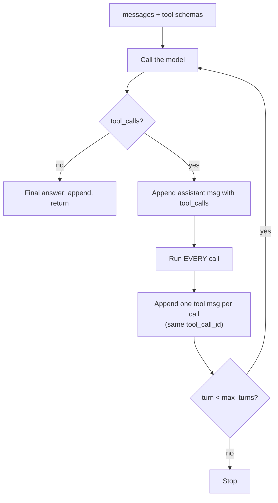

# Chapter 2: The agentic loop in pure Python

*Every agent framework runs one small loop underneath. Write it once by hand and LangChain, LangGraph and CrewAI stop being magic.*

> [!NOTE]
> **📍 At a glance**
> - **You will learn:** tool schemas, the agentic loop, several tool calls per reply, and a loop that never crashes on bad model output
> - **Level:** intermediate · **Time:** about 25 minutes
> - **Builds on:** [Python Ch 3](../python/03-anatomy-of-an-agent.md) and [Chapter 3](03-inside-the-model.md) · **Leads to:** [Langchain Ch 1](../langchain/01-introduction-to-langchain.md), where `create_agent` runs this loop for you

---

## 2.1 The three facts the loop rests on

- **The model is stateless.** It sees only the `messages` you send on this call, so the list is the agent's whole memory
- **The model never runs code.** It returns a *request* (tool name plus JSON arguments); your code runs the function
- **The model chooses from the schema, not the function.** Name and description are all it reads

| Role | Holds |
|---|---|
| `system` | Rules and behaviour (optional, recommended) |
| `user` | The person's input |
| `assistant` | The model's reply, **or** its `tool_calls` |
| `tool` | A tool result, tagged with the `tool_call_id` it answers |

## 2.2 Tool = plain function + schema

```python
def get_weather(city: str) -> str:
    data = SAMPLE_WEATHER.get(city.lower())
    return f"No weather data for {city!r}." if data is None else f"{city.title()}: {data['celsius']}C"

get_weather_schema = {
    "type": "function",
    "function": {
        "name": "get_weather",
        "description": "Get current weather for a city. Use whenever the user asks about "
                       "weather, temperature or conditions in a specific place.",
        "parameters": {                      # must sit INSIDE "function"
            "type": "object",
            "properties": {"city": {"type": "string", "description": "City name, e.g. 'Tokyo'"}},
            "required": ["city"],
        },
    },
}
```

- **Description = routing logic.** Say when to use it *and* when not to
- **Names must be unambiguous:** `drop_user` could mean delete a DB row or something worse; the model only has the words
- **Return errors as strings** ("No weather data for 'Oslo'"), so the model can read and react
- With no matching tool, a good model answers in text instead of inventing a call
- A model **may return several calls in one reply** (and sometimes wrong ones), so the loop must handle a list

## 2.3 The loop



```python
def run_agent(messages: list, max_turns: int = 5) -> str:
    for _ in range(max_turns):
        msg = client.chat.completions.create(
            model=MODEL, max_tokens=300, messages=messages, tools=TOOL_SCHEMAS
        ).choices[0].message

        if not msg.tool_calls:                                   # done
            messages.append({"role": "assistant", "content": msg.content})
            return msg.content

        messages.append({"role": "assistant", "content": msg.content, "tool_calls": [
            {"id": c.id, "type": "function",
             "function": {"name": c.function.name, "arguments": c.function.arguments}}
            for c in msg.tool_calls]})

        for c in msg.tool_calls:                                 # every call
            messages.append({"role": "tool", "tool_call_id": c.id, "content": run_tool(c)})

    return "Reached max_turns without a final answer."
```

- **Why call the model again?** It does not know the tool ran; it sees the result only when you append it and resend
- **Why append the assistant `tool_calls` message?** The `tool` messages answer it; without it, most APIs reject the next request
- **Memory in a UI:** a terminal chat keeps one list; Streamlit keeps it in `st.session_state.messages` because the script re-runs on every click

What the history looks like after one tool turn:

```json
[
  {"role": "user", "content": "What is the weather in Tokyo"},
  {"role": "assistant", "content": null,
   "tool_calls": [{"id": "9x47", "type": "function",
                   "function": {"name": "get_weather", "arguments": "{\"city\":\"Tokyo\"}"}}]},
  {"role": "tool", "tool_call_id": "9x47", "content": "Tokyo: 22C, partly cloudy"},
  {"role": "assistant", "content": "It is 22°C and partly cloudy in Tokyo."}
]
```

## 2.4 Hardening: never let bad model output crash the loop

```python
def run_tool(call) -> str:
    fn = TOOLS_BY_NAME.get(call.function.name)
    if fn is None:
        return f"Error: unknown tool {call.function.name!r}. Available: {sorted(TOOLS_BY_NAME)}"
    try:
        args = json.loads(call.function.arguments or "{}")
    except json.JSONDecodeError as e:
        return f"Error: arguments were not valid JSON ({e.msg}). Send a JSON object."
    try:
        return str(fn(**args))
    except TypeError as e:
        return f"Error: wrong arguments: {e}"
    except Exception as e:
        return f"Error: {type(e).__name__}: {e}"
```

| Failure | Naive loop | Hardened |
|---|---|---|
| Unknown tool | `KeyError` | error listing real tools |
| Bad JSON | `JSONDecodeError` | asks for a JSON object |
| Wrong argument name | `TypeError` | names the bad argument |
| Tool raises | crash | error with exception type |
| Never stops | `max_turns` | `max_turns` + token/cost budget |
| Tool hangs | blocks | per-tool timeout |

- **`eval` is unsafe even with a character allow-list:** `9**9**9` passes and hangs; use a maths parser

> [!IMPORTANT]
> **🏭 In production**
> - Log every step (model call, tool, args, duration, tokens) under one trace id
> - Run independent tool calls in parallel
> - Gate risky tools (pay, email, delete) behind approval ([Langchain Ch 11](../langchain/11-runtime-and-human-in-the-loop.md))
> - Keep error strings short: enough to self-correct, never stack traces or secrets
> - Every turn resends the whole history, so trim or summarise long chats ([Chapter 3](03-inside-the-model.md))

## Interview corner

<details class="qa"><summary>1. Explain an agent loop in three steps.</summary>

- Send history + schemas; text back means done; tool calls mean run them, append results, repeat
- *Stronger:* it is a `while` loop around a stateless model; `messages` is the entire state

</details>

<details class="qa"><summary>2. Why must every tool call in a reply get a result?</summary>

- Each needs a `tool` message with its `tool_call_id`; a missing one makes the next request invalid

</details>

<details class="qa"><summary>3. The model calls a non-existent tool with broken JSON. What happens?</summary>

- Return an error as the tool result, listing valid tools or the expected format, so it self-corrects; track the rate as a quality metric

</details>

<details class="qa"><summary>4. How do you make this loop production-ready?</summary>

- Safe tool runner, turn + cost caps, timeouts, tracing, parallel calls, retries with backoff, approval for risky tools, history trimming, evals on recorded runs

</details>

> [!TIP]
> **🧩 Design question:** a travel assistant that can book flights. Cover: clear schemas, read-only vs booking tools, human approval before booking, parallel lookups, hardened runner, caps and traces.

## Cheat sheet

- Model **asks**, code **runs**; schema description = routing
- Append assistant `tool_calls` msg, then one `tool` msg per call with the same id
- Loop until no `tool_calls` or `max_turns`
- Errors go back as tool results, never as exceptions

## Practice

1. Ask a question that triggers two tools at once and inspect `msg.tool_calls`
2. Trace `run_agent` by hand for one tool turn
3. Replace `eval` in a calculator tool with a safe parser

---

*Source: Live-Class-2026, class 05 "The Agentic Loop" (summary, transcript, whiteboard) and the `Project 0` files `_05`–`_07`; production and hardening sections added by Claude, tested against a local stand-in API.*

Previous: [Chapter 1](01-course-roadmap-and-prerequisites.md) · Next: [Chapter 3, Inside the model](03-inside-the-model.md)
