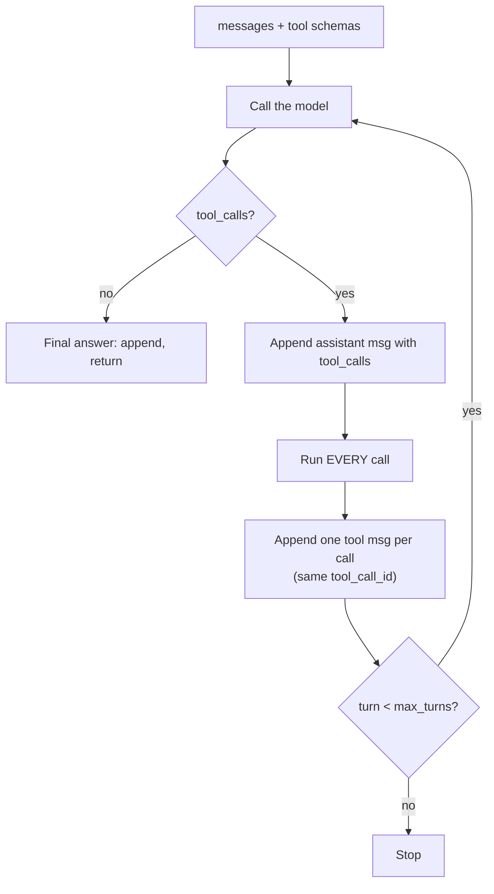
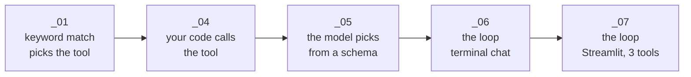

# Chapter 2: The agentic loop in pure Python

*Every agent framework runs one small loop underneath. Write it once by hand and LangChain, LangGraph and CrewAI stop being magic.*

> [!NOTE]
> **📍 At a glance**
> - **You will learn:** tool schemas, the agentic loop, several tool calls per reply, and a loop that never crashes on bad model output
> - **You will build:** `run_agent` from scratch, the class's Project Zero terminal chat, and its three-tool Streamlit app
> - **Level:** intermediate · **Time:** about 50 minutes
> - **Builds on:** [Python Ch 3](../python/03-anatomy-of-an-agent.md) and [Chapter 3](03-inside-the-model.md) · **Leads to:** [Langchain Ch 1](../langchain/01-introduction-to-langchain.md), where `create_agent` runs this loop for you

**After this chapter you can:**

- Write a tool schema, and explain why the model never sees your function
- Write the agent loop without a framework, including several tool calls in one reply
- Explain why the model is called again after a tool runs
- Make the loop survive unknown tools, bad JSON, wrong arguments and crashing tools
- Trace the class's build from a keyword router to a model that chooses, and fix its bugs
- Keep chat memory in a terminal list and in Streamlit's `session_state`

---

## 2.1 The three facts the loop rests on

- **The model is stateless.** It sees only the `messages` you send on this call, so the list is the agent's whole memory
- **The model never runs code.** It returns a *request* (tool name plus JSON arguments); your code runs the function
- **The model chooses from the schema, not the function.** Name and description are all it reads

| Role | Holds |
|---|---|
| `system` | Rules and behaviour (optional, recommended) |
| `user` | The person's input |
| `assistant` | The model's reply, **or** its `tool_calls` |
| `tool` | A tool result, tagged with the `tool_call_id` it answers |

## 2.2 Tool = plain function + schema

```python
def get_weather(city: str) -> str:
    data = SAMPLE_WEATHER.get(city.lower())
    return f"No weather data for {city!r}." if data is None else f"{city.title()}: {data['celsius']}C"

get_weather_schema = {
    "type": "function",
    "function": {
        "name": "get_weather",
        "description": "Get current weather for a city. Use whenever the user asks about "
                       "weather, temperature or conditions in a specific place.",
        "parameters": {                      # must sit INSIDE "function"
            "type": "object",
            "properties": {"city": {"type": "string", "description": "City name, e.g. 'Tokyo'"}},
            "required": ["city"],
        },
    },
}
```

- **Description = routing logic.** Say when to use it *and* when not to
- **Names must be unambiguous:** `drop_user` could mean delete a DB row or something worse; the model only has the words
- **Return errors as strings** ("No weather data for 'Oslo'"), so the model can read and react
- With no matching tool, a good model answers in text instead of inventing a call
- A model **may return several calls in one reply** (and sometimes wrong ones), so the loop must handle a list

## 2.3 The loop



```python
def run_agent(messages: list, max_turns: int = 5) -> str:
    for _ in range(max_turns):
        msg = client.chat.completions.create(
            model=MODEL, max_tokens=300, messages=messages, tools=TOOL_SCHEMAS
        ).choices[0].message

        if not msg.tool_calls:                                   # done
            messages.append({"role": "assistant", "content": msg.content})
            return msg.content

        messages.append({"role": "assistant", "content": msg.content, "tool_calls": [
            {"id": c.id, "type": "function",
             "function": {"name": c.function.name, "arguments": c.function.arguments}}
            for c in msg.tool_calls]})

        for c in msg.tool_calls:                                 # every call
            messages.append({"role": "tool", "tool_call_id": c.id, "content": run_tool(c)})

    return "Reached max_turns without a final answer."
```

- **Why call the model again?** It does not know the tool ran; it sees the result only when you append it and resend
- **Why append the assistant `tool_calls` message?** The `tool` messages answer it; without it, most APIs reject the next request
- **Memory in a UI:** a terminal chat keeps one list; Streamlit keeps it in `st.session_state.messages` because the script re-runs on every click

What the history looks like after one tool turn:

```json
[
  {"role": "user", "content": "What is the weather in Tokyo"},
  {"role": "assistant", "content": null,
   "tool_calls": [{"id": "9x47", "type": "function",
                   "function": {"name": "get_weather", "arguments": "{\"city\":\"Tokyo\"}"}}]},
  {"role": "tool", "tool_call_id": "9x47", "content": "Tokyo: 22C, partly cloudy"},
  {"role": "assistant", "content": "It is 22°C and partly cloudy in Tokyo."}
]
```

## 2.4 Hardening: never let bad model output crash the loop

```python
def run_tool(call) -> str:
    fn = TOOLS_BY_NAME.get(call.function.name)
    if fn is None:
        return f"Error: unknown tool {call.function.name!r}. Available: {sorted(TOOLS_BY_NAME)}"
    try:
        args = json.loads(call.function.arguments or "{}")
    except json.JSONDecodeError as e:
        return f"Error: arguments were not valid JSON ({e.msg}). Send a JSON object."
    try:
        return str(fn(**args))
    except TypeError as e:
        return f"Error: wrong arguments: {e}"
    except Exception as e:
        return f"Error: {type(e).__name__}: {e}"
```

| Failure | Naive loop | Hardened |
|---|---|---|
| Unknown tool | `KeyError` | error listing real tools |
| Bad JSON | `JSONDecodeError` | asks for a JSON object |
| Wrong argument name | `TypeError` | names the bad argument |
| Tool raises | crash | error with exception type |
| Never stops | `max_turns` | `max_turns` + token/cost budget |
| Tool hangs | blocks | per-tool timeout |

- **`eval` is unsafe even with a character allow-list:** `9**9**9` passes and hangs; use a maths parser

> [!IMPORTANT]
> **🏭 In production**
> - Log every step (model call, tool, args, duration, tokens) under one trace id
> - Run independent tool calls in parallel
> - Gate risky tools (pay, email, delete) behind approval ([Langchain Ch 11](../langchain/11-runtime-and-human-in-the-loop.md))
> - Keep error strings short: enough to self-correct, never stack traces or secrets
> - Every turn resends the whole history, so trim or summarise long chats ([Chapter 3](03-inside-the-model.md))

## 2.5 How the class got here: from a keyword match to the model choosing



- **Class 04 starts naive** (`Project 0/_01`): the "agent" picks a tool if its name appears in the question

```python
class Agent:
    def __init__(self, tools: dict[str, callable]) -> None:
        self.history: list[dict] = []
        self.tools = tools

    def decide_tool(self, question: str) -> str | None:
        for name in self.tools:
            if name in question.lower():      # a KEYWORD match -- deliberately naive
                return name
        return None
```

- *Tested:* "What's the weather like today?" matched `weather`; "What's the capital of France?" fell through to the mock model
- The file says so itself: a keyword match is *"NOT how real decision-making works"*. "Is it raining?" contains no tool name at all
- **`_04` still decides in code:** the model only extracts a city ([Pydantic Ch 5](../pydantic/05-validating-llm-output.md)), then *your* code calls `get_weather`
- **`_05` hands the decision to the model:** send the question **with the tool schemas**; the reply may hold `tool_calls` instead of text
- Real replies kept in `_05`'s comments:
  - "Hi How are you ?" came back as text, with no tool call
  - "what is the weather like in Tokyo right now?" came back as one `get_weather` call, `{"city":"Tokyo"}`
  - "What is 2 times 2?" came back as a `calculator` call, `{"expression":"2 * 2"}`
  - "What is the capital of Japan?" came back as **three** `get_capital` calls: `Japan`, `Tokyo` and `Delhi`. Several calls per reply are normal, and two of these were nonsense

> [!WARNING]
> **Two bugs in `_05`, reproduced against a local fake OpenAI server:**
> - **The weather schema it sends is mis-nested.** In `get_weather_schema`, `parameters` sits beside `function`, not inside it. *Tested:* the request carried a tool whose `function` held only `name` and `description`, so the model never saw the `city` parameter. The file's own `get_complete_weather_schema` is correct, but it isn't the one sent
> - **Every call is run as `get_weather`.** *Tested:* for the capital question, `get_weather(**{"country": "Japan"})` raised `TypeError: got an unexpected keyword argument 'country'`. Dispatch by name, as `run_tool` in 2.4 does

## 2.6 Project Zero in the terminal

- `_06_project_zero_agent.py` wraps `run_agent` (2.3) in a chat. **One growing list is the whole memory:**

```python
def chat() -> None:
    conversation_memory: list[dict] = []
    print("Type a question (Ctrl+C to quit).")
    while True:
        try:
            user_input = input("You: ")
        except (KeyboardInterrupt, EOFError):
            break
        conversation_memory.append({"role": "user", "content": user_input})
        answer = run_agent(conversation_memory)     # appends replies and tool turns
        print(f"Agent: {answer}\n")
    print(conversation_memory)                      # the memory, on exit
```

- The folder's `output` file is that list after a real class chat (shown in 2.3): the model knew "Mayank" on turn 2 only because turn 1 was resent
- *Tested:* "Hi I am Mayank", then "who am I ?" was answered "You are Mayank." from the list

> [!WARNING]
> **`_06` crashes the first time the model asks for a tool.** A practice line builds `{"type": function, ...}` with no quotes, and `function` is not defined. *Tested:* the third question, about Tokyo's weather, raised `NameError: name 'function' is not defined`. Also:
> - `get_currency` is defined twice; the second is just `pass`, so it returns `None` (tested). It is in `TOOLS_BY_NAME` but not in `TOOL_SCHEMAS`, so the model is never told it exists
> - Leftovers to delete: `from email import message`, the `l1`/`l2` exercise, empty loops at module level, and `call_tools_async`, which isn't asynchronous
> - Fix: use the 2.3 loop with `run_tool` from 2.4. *Tested:* the fixed version answered the weather question with the tool's result

## 2.7 The Streamlit app: three tools

- `_07_streamlit_app.py` runs the same loop behind a chat page

| Tool | Data |
|---|---|
| `get_weather` | sample data, no network |
| `calculator` | a character check, then `eval()` |
| `convert_currency` | **live** Frankfurter API: tools can mix live and static data |

- Streamlit **re-runs the whole script on every click**, which would wipe a normal variable. Memory lives in `st.session_state`:

```python
if "messages" not in st.session_state:
    st.session_state.messages = []      # this app's memory: survives re-runs

for message in st.session_state.messages:          # redraw the chat
    if message["role"] in ("user", "assistant") and message.get("content"):
        with st.chat_message(message["role"]):
            st.write(message["content"])

user_input = st.chat_input("Ask about the weather, do some maths, or convert a currency...")
if user_input:
    st.session_state.messages.append({"role": "user", "content": user_input})
    with st.chat_message("user"):
        st.write(user_input)
    with st.chat_message("assistant"):
        with st.spinner("Thinking..."):
            answer = run_agent(st.session_state.messages)
        st.write(answer)
```

- The redraw loop shows only user and assistant text: tool calls and tool results stay in memory, hidden from the page
- *Tested with Streamlit's `AppTest`* (the real script, re-run per input, against a local fake model): five questions left **16** messages in `session_state` and **10** chat bubbles on the page. The weather and calculator results came back (`Tokyo: 22C, partly cloudy`, `14`); the currency call failed as text, because the API is blocked here; no exceptions
- A second `AppTest` started with an empty list: memory is per browser session and is gone when the session ends
- The calculator's filtered `eval` lets `9**9**9` hang the process ([Python Ch 1](../python/01-setup-and-api-basics.md), 1.4)
- Run it: `uv run streamlit run _07_streamlit_app.py` (needs `GROQ_API_KEY`, `OPENROUTER_API_KEY` or `OPENAI_API_KEY` in `.env`; the README says there is no offline stand-in)

## 2.8 Questions from the class

| Question | Answer |
|---|---|
| Why call the model again after the tool ran? | It is stateless. It sees the result only if you append it and resend |
| Can the model return several tool calls at once? | Yes, depending on model and provider |
| Is the reply format handled by custom code or a framework here? | By hand-written code. LangChain does it natively from the next class |
| Why Pydantic and not just JSON in the prompt? | Reuse, defaults, validation, cleaner code |
| Is the system message required? | No. Optional, good practice |
| Do all providers return the same structure? | No. OpenAI, Groq and Anthropic differ slightly |

## 2.9 Added by Claude, not from the sources

- **Dispatch by name, always.** Never assume the model called the tool you expected
- **Validate arguments with Pydantic before running a tool** ([Pydantic Ch 5](../pydantic/05-validating-llm-output.md), 5.2)
- **Hide tool turns in the UI, keep them in memory.** The model needs them; the user doesn't
- **`session_state` is per browser session.** For real users, store history per user in a database, and never in a module-level list shared by every visitor
- **Fail loudly when no key is set**, as Project Zero's provider picker does, instead of silently answering with a fake model

## Interview corner

**What interviewers listen for:** the model only **asks** for tools and your code runs them; every result goes back with its `tool_call_id`; the loop has caps and never crashes on bad model output.

### 🟢 Basic

<details class="qa"><summary>1. Explain an agent loop in three steps.</summary>

- Send history + schemas; text back means done; tool calls mean run them, append results, repeat
- *Stronger:* it is a `while` loop around a stateless model; `messages` is the entire state

</details>

<details class="qa"><summary>2. Why must every tool call in a reply get a result?</summary>

- Each needs a `tool` message with its `tool_call_id`; a missing one makes the next request invalid
- *Stronger answer:* run them all before calling the model again; independent calls can run in parallel

</details>

### 🟡 Intermediate

<details class="qa"><summary>3. The model calls a non-existent tool with broken JSON. What happens?</summary>

- Return an error as the tool result, listing valid tools or the expected format, so it self-corrects; track the rate as a quality metric
- *Stronger answer:* the class's own `_05` and `_06` crash on exactly these cases; a safe runner turns each into a message instead

</details>

### 🔴 Senior

<details class="qa"><summary>4. How do you make this loop production-ready?</summary>

- Safe tool runner, turn + cost caps, timeouts, tracing, parallel calls, retries with backoff, approval for risky tools, history trimming, evals on recorded runs
- *Stronger answer:* start with the runner and the caps; they turn crashes and runaway costs into logged, recoverable events

</details>

<details class="qa"><summary>5. Your Streamlit agent forgets everything when the page reloads, and a teammate proposes a global list. What do you do?</summary>

- `st.session_state` lives only for one browser session, so a reload starts empty
- A module-level list would be shared by **every** visitor: one user's chat leaks into another's
- *Stronger answer:* key history by user and thread in a database (or a LangGraph checkpointer), load it into `session_state` on start, and trim it before each call

</details>

> [!TIP]
> **🧩 Design question:** a travel assistant that can book flights. Cover: clear schemas, read-only vs booking tools, human approval before booking, parallel lookups, hardened runner, caps and traces.

## Cheat sheet

```python
for _ in range(max_turns):
    msg = client.chat.completions.create(model=m, messages=messages, tools=SCHEMAS).choices[0].message
    if not msg.tool_calls:                                   # model asks, code runs
        messages.append({"role": "assistant", "content": msg.content}); return msg.content
    messages.append({"role": "assistant", "content": msg.content, "tool_calls": [...]})
    for c in msg.tool_calls:                                 # every call, same id back
        messages.append({"role": "tool", "tool_call_id": c.id, "content": run_tool(c)})
# schema description = routing · errors go back as tool results · st.session_state = UI memory
```

## Recap

- The model is stateless, never runs code, and chooses from schemas
- The loop: call, run every requested tool, append results with their ids, call again, until text or `max_turns`
- A safe runner turns unknown tools, bad JSON, wrong arguments and crashes into messages
- The class build: keyword match → your code calls → the model chooses → the loop → a UI
- Terminal memory is one list; Streamlit memory is `st.session_state`, per session

## Practice

1. Ask a question that triggers two tools at once and inspect `msg.tool_calls`
2. Trace `run_agent` by hand for one tool turn
3. Replace `eval` in a calculator tool with a safe parser
4. Fix `_05` so it sends the correct schema and dispatches by name, then ask the capital question
5. Fix `_06`'s crash, add a real `get_currency` with a schema, and chat with it
6. Run `_07` and print `st.session_state.messages` in the sidebar after each question

## How this chapter was checked

- **Class files run as written** against a local fake OpenAI server (`OPENAI_BASE_URL` pointed at it, so no code was changed), Python 3.13, `openai` 3.51.0, `streamlit` 1.67.0:
  - `_01`: the keyword match and the mock answers shown in 2.5
  - `_05`: the mis-nested schema seen in the recorded request; the capital question's three calls; `TypeError` when run as `get_weather`
  - `_06`: two plain turns, with the name remembered; `NameError` on the first tool call; `get_currency` returned `None`
  - `_07`: driven with `streamlit.testing.v1.AppTest` for five inputs, results as stated in 2.7
- **2.3, 2.4:** the loop and `run_tool` from the 2026 review (unknown tool, bad JSON, wrong argument and a raising tool each came back as `Error: ...`); re-run in this pass inside the fixed `_06`
- **Not run:** a real model, the live currency API (blocked here)

## Sources and further reading

- Live-Class-2026, `Weekend 02 - 4-5 Jul/04-05 - 5 Jul & 11 Jul - Anatomy of an Agent & The Agentic Loop/`: `README.md`, `Project 0/README.md`, `_01` to `_07`, `output` (re-read in full 2026-11-15)
- Live-Class-2026, class 05 summary and transcription summary (the Questions from the class table; earlier batch)
- [Streamlit: session state](https://docs.streamlit.io/develop/concepts/architecture/session-state), [app testing](https://docs.streamlit.io/develop/concepts/app-testing)
- Added by Claude: 2.4 hardening, 2.9, the fixes in 2.5 and 2.6, interview question 5

Previous: [Chapter 1](01-course-roadmap-and-prerequisites.md) · Next: [Chapter 3, Inside the model](03-inside-the-model.md)
