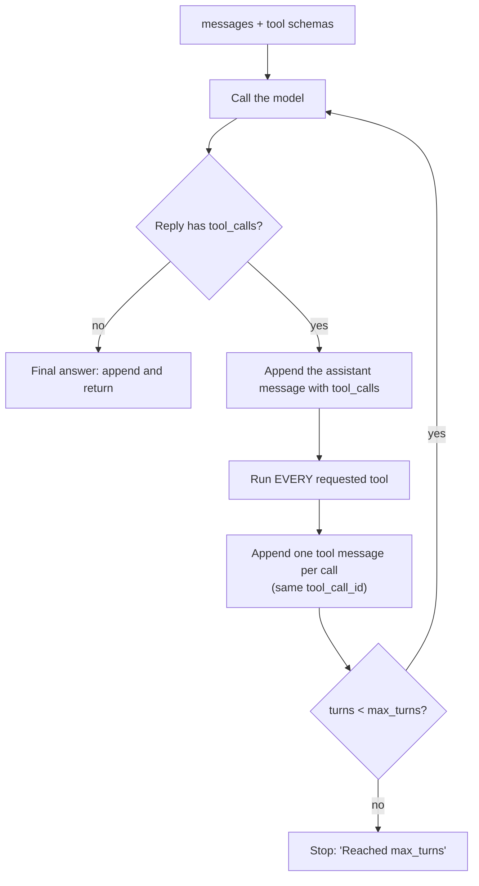

# Chapter 2: The agentic loop in pure Python

*Every agent framework runs one small loop underneath. Write it by hand once and frameworks stop being magic.*

> [!NOTE]
> **📍 At a glance**
> - **You will learn:** message roles, tool schemas, the agentic loop, running several tool calls in one reply, and how to make the loop survive bad model output
> - **You will build:** `run_agent` from scratch, a terminal chat, and a three-tool Streamlit app
> - **Level:** intermediate · **Time:** about 60 minutes
> - **Builds on:** [Python Ch 3](../python/03-anatomy-of-an-agent.md) (stateless calls, three layers, providers, a manual tool call) and [Chapter 3](03-inside-the-model.md). **Leads to:** [Langchain Ch 1](../langchain/01-introduction-to-langchain.md), where `create_agent` runs this loop for you

**After this chapter you can:**

- Say what an agent loop does in three steps, and write it without a framework
- Write a tool schema and explain why the model never sees your function
- Explain why the model is called again after a tool runs
- Run the loop with several tool calls in one reply and a turn cap
- Make the loop survive unknown tool names, bad arguments, tool crashes and runaway loops

- Every framework (LangChain, LangGraph, CrewAI) runs this same loop underneath

## 2.1 What the model needs to know first

### Message roles

| Role | What it holds |
|---|---|
| System | Rules and behaviour. Optional, good practice |
| User | What the person typed |
| Assistant | What the model said earlier |

- All of them are sent on **every** call, because the model is stateless
- A single "hi" still sent three messages when inspected in a playground
- The doubt-solving chatbot works the same way: its custom instructions are a system message ("explain through analogies")

### Knowledge cutoff

- A model knows nothing after its training date. Every model card lists it
- Asked about a recent result, a model said honestly it had no real-time access
- A raw API call cannot browse. The ChatGPT web app adds browsing on top
- This gap is why agents need tools

### The raw response and `max_tokens`

```python
client.chat.completions.create(model=..., max_tokens=200, messages=[...])
```

- The response has an `id`, the `model`, `choices[0].message.content`, and `usage` (`prompt_tokens`, `completion_tokens`, `total_tokens`)
- The counts matched the provider dashboard
- Groq (free, not Elon Musk's Grok) uses the same code with a different `base_url` and key
- The whiteboard sorts providers:
  - closed models you pay for (OpenAI, Claude): load credits in dollars
  - Groq and OpenRouter: some free credit, host open models, cheaper
- Mentor's line: every AI model is, for you, **just an API call**
- Providers differ slightly in response shape. Check each one
- `max_tokens` caps **output** length. It also limits runaway cost if a key leaks
- Provider calls: [Python Ch 3](../python/03-anatomy-of-an-agent.md), 3.4

*Source: `classes_summary/05`, `classes_transcription_summary/05`.*

## 2.2 Structured output: why plain text is not enough

- Would you rather parse "Today weather is 25 degrees" or receive `{"temperature": 25}`?
- Free text makes parsing fragile. A structured reply is usable directly
- Two ways, as taught:
  1. **Prompt instruction.** Ask for "only a JSON object in this exact shape", then parse the string. This is what the class built by hand
  2. **A Pydantic schema.** Define a `BaseModel` once (for example `WeatherQuery` with `city` and `wants_fahrenheit`) and reuse it. You get reuse, defaults and validation. Code: [Pydantic Ch 5](../pydantic/05-validating-llm-output.md)
- Providers also have a native mode: pass the schema as `response_format`. LangChain makes it easy: [Langchain Ch 4](../langchain/04-structured-output.md)

*Source: `classes_transcription_summary/05`.*

## 2.3 Letting the model choose a tool

- In the manual version, your code decided to call the tool. Now the **model** decides
- You do not give it the function. You give it a **tool schema**: name, description, parameters
- The description's wording is what tells the model when the tool is relevant
- The tool itself is a plain function that knows nothing about AI. Sample data keeps the demo off the network:

```python
SAMPLE_WEATHER = {
    "tokyo": {"celsius": 22, "conditions": "partly cloudy"},
    "delhi": {"celsius": 34, "conditions": "clear skies"},
    "london": {"celsius": 15, "conditions": "light rain"},
}

def get_weather(city: str) -> str:
    data = SAMPLE_WEATHER.get(city.lower())
    if data is None:
        return f"No weather data for {city!r}."
    return f"{city.title()}: {data['celsius']}C, {data['conditions']}"
```

The schema, the "menu" handed to the model:

```python
get_weather_schema = {
    "type": "function",
    "function": {
        "name": "get_weather",
        "description": "Get the current weather for a city. Use this whenever the user asks "
                       "about weather, temperature, or conditions in a specific place.",
        "parameters": {
            "type": "object",
            "properties": {"city": {"type": "string", "description": "The city name, e.g. 'Tokyo'."}},
            "required": ["city"],
        },
    },
}

response = client.chat.completions.create(
    model=model, max_tokens=300,
    messages=[{"role": "user", "content": question}],
    tools=[get_weather_schema],            # the menu goes in with the question
)
message = response.choices[0].message
```

- The reply may hold a `tool_calls` list instead of text
- That list is the model's **decision to call**, not a result. Your code runs the function

**Real replies kept in the file's comments:**

- "Hi How are you ?" came back as plain text, `tool_calls=None`
- "what is the weather like in Tokyo right now?" came back with `content=None` and one `get_weather` call, `{"city":"Tokyo"}`
- "What is 2 times 2?" came back as a `calculator` call, `{"expression":"2 * 2"}`
- With no matching tool (a currency question, no currency tool), the model answered in text and did not invent a call

**Several calls in one reply.**

- Asked "What is the capital of Japan?", the model returned three `get_capital` calls at once, with `country` set to `Japan`, `Tokyo` and `Delhi`
- So a model can ask for more than one call per reply. The loop must handle every call in the list
- This answer was also wrong: two of the three were nonsense

**Tool names must be unambiguous.**

- The class 05 whiteboard draws a `drop_user` tool meaning "drop a user from a table", with a joke that the model might send a robot to drop a user from a building
- The slide has no written explanation. My reading: name and description must say exactly what the tool does, because the model decides from them
- The board shows the fork: a normal question gets a normal reply; a question that needs a tool gets a call with parameters

**Source quirk.** In `_05`, `get_weather_schema` is nested wrongly: `parameters` sits **beside** `function`, not inside it.

- ✅ *Verified:* the keys are `type`, `function`, `parameters`, and inside `function` only `name` and `description`
- The model would not receive the parameters. `get_complete_weather_schema` later in the file is correct and matches the code above

- The file needs an OpenAI-compatible provider (Groq, OpenRouter or OpenAI). Anthropic's tool response has a different shape (a later module)

*Source: `classes_summary/05`, `Project 0/_05_teaching_it_to_choose.py`. Run against a local stand-in server.*

## 2.4 The agentic loop

- The core idea, and the one most worth knowing cold
- The three steps:
  1. Send the message history **and** the tool schemas to the model
  2. Plain text back: that is the final answer. Return it
  3. A tool request: run it with the model's arguments, **append the result**, go to step 1
- The model decides each time whether it has enough or needs another tool
- A cap stops runaway loops. The class pseudo-code called it `max_iterations` (4). The files call it `max_turns`



```python
def run_agent(messages: list, max_turns: int = 5) -> str:
    client, model = get_client_and_model()

    for _ in range(max_turns):
        response = client.chat.completions.create(
            model=model, max_tokens=300, messages=messages, tools=TOOL_SCHEMAS
        )
        message = response.choices[0].message

        if not message.tool_calls:                       # plain text: we are done
            messages.append({"role": "assistant", "content": message.content})
            return message.content

        messages.append({                                # remember what the model asked for
            "role": "assistant", "content": message.content,
            "tool_calls": [{"id": call.id, "type": "function",
                            "function": {"name": call.function.name,
                                         "arguments": call.function.arguments}}
                           for call in message.tool_calls],
        })

        for call in message.tool_calls:                  # run EVERY requested tool
            arguments = json.loads(call.function.arguments)
            result = TOOLS_BY_NAME[call.function.name](**arguments)
            messages.append({"role": "tool", "tool_call_id": call.id, "content": str(result)})

    return "Reached max_turns without a final answer."
```

**Why call the model again after the tool ran?**

- The model is stateless. It does not know the tool ran
- Its output reaches it only when you append it as a message and send everything back
- Each result carries the `tool_call_id` of the request it answers, so the model can match them

*✅ *verified** (the `_07` loop, real OpenAI client, local stand-in server):

- One call: history was user, assistant (`content` empty plus `tool_calls`), `tool` (`Tokyo: 22C, partly cloudy`, same id), then the final assistant text. **2 model calls**
- Three calls in one reply (two weather, one calculator): one assistant message, then **three tool messages in order**, then the final answer
- A model that kept asking every turn: stopped after **5 model calls** and returned "Reached max_turns without a final answer."

*Source: `classes_summary/05`, `classes_transcription_summary/05`, `Project 0/_07_streamlit_app.py`.*

### What the saved memory looks like

The folder's `output` file is a saved memory after a short chat (valid JSON, 8 messages):

```json
[
  {"role": "user", "content": "Hi I am Mayank"},
  {"role": "assistant", "content": "It's nice to meet you, Mayank. ..."},
  {"role": "user", "content": "who am I ?"},
  {"role": "assistant", "content": "You are Mayank, ..."},
  {"role": "user", "content": "What is the weather in Tokyo"},
  {"role": "assistant", "content": null,
   "tool_calls": [{"id": "9x47zy7j9", "type": "function",
                   "function": {"name": "get_weather", "arguments": "{\"city\":\"Tokyo\"}"}}]},
  {"role": "tool", "tool_call_id": "9x47zy7j9", "content": "Tokyo: 22C, partly cloudy"},
  {"role": "assistant", "content": "The current weather in Tokyo is partly cloudy ... 22 degrees Celsius."}
]
```

- It knew the name only because the first messages were sent again
- The tool-call turn has empty `content` and a `tool_calls` list
- The `tool` message repeats the same id

*Source: `Project 0/output`.*

## 2.5 A terminal chat: one list is the whole memory

`_06_project_zero_agent.py` wraps `run_agent` in a terminal chat. The memory is one growing list:

```python
def chat() -> None:
    conversation_memory: list[dict] = []
    while True:
        try:
            user_input = input("You: ")
        except (KeyboardInterrupt, EOFError):
            break
        conversation_memory.append({"role": "user", "content": user_input})
        answer = run_agent(conversation_memory)
        print(f"Agent: {answer}\n")
    print(conversation_memory)     # shows the memory on exit
```

**Source quirks in `_06`** (all *checked*):

1. **It crashes the first time the model asks for a tool.** A scratch line writes `"type": function` with no quotes. `function` is undefined, so Python raises `NameError`. A reply with no tool call works. The `_07` loop has no such line, so use that one
2. **`get_currency` is defined twice.** The second is just `pass` and wins, so calling it returns `None`. It is in `TOOLS_BY_NAME` but **not** in `TOOL_SCHEMAS`, so the model is never told it exists
3. Other leftovers: `from email import message`, a list-comprehension exercise (`l1`, `l2`), empty nested loops at module level, and `call_tools_async`, which is not asynchronous
4. `_06` has `max_turns=4`. `_07` has `5`

*Source: `Project 0/_06_project_zero_agent.py`, run with a local stand-in server.*

## 2.6 The Streamlit app: three tools

`_07_streamlit_app.py` runs the same loop behind a chat page:

| Tool | What it does |
|---|---|
| `get_weather` | Sample data, not a live API |
| `calculator` | Checks the characters, then `eval()` |
| `convert_currency` | A live call to the Frankfurter API. Tools can mix live and static data |

```python
def calculator(expression: str) -> str:
    allowed_characters = set("0123456789+-*/(). ")
    if not set(expression) <= allowed_characters:
        return f"Rejected -- expression contains disallowed characters: {expression!r}"
    try:
        return str(eval(expression))
    except Exception as exc:
        return f"Could not evaluate: {exc}"
```

- The rejection comes back as the tool **result**, so the model can read it and react
- ✅ *Verified:* `2 * (3 + 4)` gave `14`; `1; import os` and `__import__('os')` were rejected; `1/0` gave "Could not evaluate: division by zero"
- ✅ *Verified:* with the network down, `convert_currency` returned "Currency service unavailable: offline" and did not crash

**Memory in a web page.**

- Streamlit re-runs the script on every interaction, which would wipe an ordinary variable
- The app keeps memory in `st.session_state.messages`, which survives re-runs:

```python
if "messages" not in st.session_state:
    st.session_state.messages = []

user_input = st.chat_input("Ask about the weather, do some maths, or convert a currency...")
if user_input:
    st.session_state.messages.append({"role": "user", "content": user_input})
    with st.chat_message("assistant"):
        with st.spinner("Thinking..."):
            answer = run_agent(st.session_state.messages)
        st.write(answer)
```

- Run: `uv run streamlit run _07_streamlit_app.py`
- The page itself was not run here (no Streamlit). The loop above it was

*Source: `classes_summary/05`, `Project 0/_07_streamlit_app.py`.*

## 2.7 The Project Zero files

Built across classes 04 and 05. Each file runs on its own.

| File | Contents | In these notes |
|---|---|---|
| `_01_ai_model_vs_chatbot_vs_agent.py` | Model, chatbot, agent. No API calls | Python Ch 3, 3.2 |
| `_02_calling_the_ai_paid_and_free.py` | Real calls: OpenAI, Anthropic, Groq, OpenRouter | Python Ch 3, 3.4 |
| `_03_structuring_with_pydantic.py` | Structured JSON, validated | Pydantic Ch 5, 5.4 |
| `_04_giving_it_a_tool.py` | A weather tool, called manually | Python Ch 3, 3.6 |
| `_05_teaching_it_to_choose.py` | Tool schema, the model chooses | 2.3 |
| `_06_project_zero_agent.py` | The loop, terminal chat, one tool | 2.5 |
| `_07_streamlit_app.py` | The loop with Streamlit, three tools | 2.6 |

```bash
uv sync
cp .env.example .env      # at least one key; GROQ_API_KEY is free and fastest
uv run _01_ai_model_vs_chatbot_vs_agent.py
uv run streamlit run _07_streamlit_app.py
```

- Unlike the class 02-03 files, these **need a real API key**. The README says there is no offline stand-in

*Source: `Project 0/README.md` and the folder's overview README.*

## 2.8 Questions from the class

| Question | Answer |
|---|---|
| Why call the model again after the tool ran? | It is stateless. It sees the result only if you append it and resend |
| Can the model return several tool calls at once? | Yes, depending on model and provider |
| Is the reply format handled by custom code or a framework here? | By hand-written code. LangChain does it natively from the next class |
| Why Pydantic and not just JSON in the prompt? | Reuse, defaults, validation, cleaner code |
| Is the system message required? | No. Optional, good practice |
| Do all providers return the same structure? | No. OpenAI, Groq and Anthropic differ slightly |

*Source: `classes_transcription_summary/05`.*

## 2.9 Hardening the loop

The class loop crashes on three kinds of bad model output (2.10). Production loops turn every failure into a message the model can read and fix.

```python
import json

def run_tool(call) -> str:
    """Run one tool call. Never raise: return an error the model can act on."""
    name = call.function.name
    fn = TOOLS_BY_NAME.get(name)
    if fn is None:
        return f"Error: unknown tool {name!r}. Available tools: {sorted(TOOLS_BY_NAME)}"
    try:
        args = json.loads(call.function.arguments or "{}")
    except json.JSONDecodeError as e:
        return f"Error: arguments were not valid JSON ({e.msg}). Send a JSON object."
    try:
        return str(fn(**args))
    except TypeError as e:
        return f"Error: wrong arguments for {name}: {e}"
    except Exception as e:
        return f"Error: {name} failed: {type(e).__name__}: {e}"
```

- In `run_agent`, replace the two lines that parse and call with `result = run_tool(call)`
- ✅ *Verified: an unknown tool, invalid JSON, a wrong argument name and a tool that raises all came back as `Error: ...` strings; a good call returned the tool's result.*

| Failure | Plain loop | Hardened loop |
|---|---|---|
| Unknown tool name | `KeyError`, run stops | Error message listing real tools |
| Bad JSON arguments | `JSONDecodeError` | Error asking for a JSON object |
| Wrong argument name | `TypeError` | Error naming the bad argument |
| Tool raises | exception escapes | Error with the exception type |
| Model never stops | `max_turns` | `max_turns` **plus** a token or cost budget |
| Tool hangs | blocks the turn | a timeout per tool ([Python Ch 1](../python/01-setup-and-api-basics.md), 1.7) |

> [!IMPORTANT]
> **🏭 In production**
> - **Log every step** (model call, tool name, arguments, duration, tokens) under one trace id. The `messages` list is the whole agent state
> - **Run independent tool calls in parallel** when a reply asks for several ([Python Ch 2](../python/02-python-refresher.md), 2.9)
> - **Gate risky tools** (payments, emails, deletes) behind an allow-list and human approval ([Langchain Ch 11](../langchain/11-runtime-and-human-in-the-loop.md))
> - **Keep error messages short and safe:** enough for the model to fix its call, never stack traces or secrets
>
> *Added by Claude.*

## 2.10 Added by Claude, not from the sources

Items marked *checked* were run against a local stand-in for the OpenAI API, with the real `openai` client.

- **The loop crashes on three kinds of bad model output.** ✅ *verified* on the `_07` loop:
  - Unknown tool name (`book_flight`): `KeyError`
  - Arguments that are not valid JSON: `JSONDecodeError`
  - Wrong argument name (`town` for `city`): `TypeError`
  - Fix: wrap the call in `try`, and return the error text as the `tool` message so the model can correct itself
- **A wrong city does not crash.** `get_weather("Oslo")` returned "No weather data for 'Oslo'." and the model answered from that. ✅ *verified*
- **`eval` with `*` allowed can hang.** The character check lets `9**9**9` through, and it did not finish in 3 seconds when run (killed). Limit exponents, or use a maths parser instead of `eval`
- **Add a timeout and a call budget.** `max_turns` limits loops, but one slow tool can still stall a turn
- **Log the history.** The full `messages` list is the whole agent state. Printing it is the best debugging tool
- **Mind the cost.** Every loop turn resends the whole history (see [Chapter 3](03-inside-the-model.md), 3.8)

## 2.11 Interview corner

**What interviewers listen for:** the model only **asks** for tools, your code runs them; every result goes back with its `tool_call_id`; and the loop has caps and never crashes on bad model output.

### 🟢 Basic

<details class="qa"><summary>1. What is an agent loop, in three steps?</summary>

- Send history and tool schemas; if the reply is text, return it; if it asks for tools, run them, append results, repeat
- *Stronger answer:* it is a `while` loop around a stateless model; the `messages` list is the entire state

</details>

<details class="qa"><summary>2. Does the model run the tool?</summary>

- No. It returns a request (name and JSON arguments); your code runs the function and sends the result back

</details>

<details class="qa"><summary>3. What is a tool schema, and why does the description matter?</summary>

- Name, description and parameters, sent to the model
- *Stronger answer:* the model chooses tools from the description alone, so say exactly when to use it and when not to

</details>

### 🟡 Intermediate

<details class="qa"><summary>4. Why must the loop run every tool call in a reply?</summary>

- A model can ask for several at once; each needs a `tool` message with its `tool_call_id`
- *Stronger answer:* a missing result makes most APIs reject the next request

</details>

<details class="qa"><summary>5. Why does the assistant message with <code>tool_calls</code> go into the history?</summary>

- The `tool` messages answer those requests; without them the history is inconsistent

</details>

<details class="qa"><summary>6. What stops an infinite loop?</summary>

- `max_turns`
- *Stronger answer:* plus a token or cost budget and per-tool timeouts, because one turn can still be slow or expensive

</details>

<details class="qa"><summary>7. Where does this loop live in LangChain? How does Streamlit keep memory?</summary>

- Inside `create_agent`; Streamlit keeps it in `st.session_state` because the script re-runs on every click

</details>

### 🔴 Senior

<details class="qa"><summary>8. The model calls a tool that does not exist, with broken JSON. What should happen?</summary>

- Return an error as the tool result, not raise
- *Stronger answer:* list the valid tools or the expected format so the model can self-correct on the next turn; count these errors as a quality metric

</details>

<details class="qa"><summary>9. How would you make this loop production-ready?</summary>

- Error-safe tool runner, caps, timeouts, logging
- *Stronger answer:* tracing per step, parallel independent calls, retries with backoff on the model API, approval for risky tools, memory trimming, and evaluations on recorded conversations

</details>

> [!TIP]
> **🧩 Design question**
> - *"Build a travel assistant with tools for flights, hotels and weather, which may book things."*
> - Talk about: schemas with clear descriptions, read-only vs booking tools, human approval before booking, parallel lookups, a hardened tool runner, turn and cost caps, and traces for every run

## Cheat sheet

```python
for _ in range(max_turns):
    msg = client.chat.completions.create(model=m, messages=messages, tools=TOOL_SCHEMAS).choices[0].message
    if not msg.tool_calls:
        messages.append({"role": "assistant", "content": msg.content}); break
    messages.append({"role": "assistant", "content": msg.content, "tool_calls": [
        {"id": c.id, "type": "function", "function": {"name": c.function.name, "arguments": c.function.arguments}}
        for c in msg.tool_calls]})
    for c in msg.tool_calls:                                            # every call
        messages.append({"role": "tool", "tool_call_id": c.id, "content": run_tool(c)})
```

## Recap

- The loop: send history and schemas, run requested tools, append results, repeat until text
- The model asks; your code runs. A schema is a menu the model reads
- Run **every** tool call in a reply. Match each result to its `tool_call_id`
- `max_turns` caps the loop. Memory is just a list
- Bugs to know in the class files: `_05` schema nesting, `_06` `NameError` and double `get_currency`
- Bad model output (unknown tool, bad JSON, wrong args) crashes the plain loop. `run_tool` turns every failure into a readable message

## Practice

1. Run `_05` and ask a question that could trigger two tools at once. Inspect `message.tool_calls`
2. Trace `run_agent` by hand: what is appended on a tool-call turn and on a final-answer turn?
3. Run the Streamlit app and use all three tools in one conversation
4. Explain, without notes, why the loop calls the model again after a tool runs
5. Fix the `_05` schema nesting and the `_06` crash
6. Add a `try` around the tool call so an unknown tool returns an error message to the model
7. Replace `eval` in the calculator with a safe parser

## How this chapter was checked

- **Run** (real `openai` client, local stand-in server, no key):
  - the `_07` loop: one tool call, three in one reply, the turn cap, an unknown tool, bad JSON, a wrong argument, an unknown city
  - the calculator with eight inputs, and the currency tool with the network down
  - `_06`: a reply with no tool call, the first tool call (the `NameError`), the schemas versus the callable tools, and the default `max_turns`
  - `_05`: the schema keys, `ask_ai_to_choose` with a tool reply and a casual reply
  - the `output` file parses as JSON with 8 messages
- **Run in the 2026 review:** `run_tool` with five scripted calls; the cheat-sheet loop with a scripted client (two tool calls, then text)
- 2.9, the diagram, the production box and the graded interview were added in the 2026 review (Added by Claude)
- **Not run:** a real model or provider, the Streamlit page, files `_01` to `_04`, the Frankfurter API
- The class summaries are the source for everything not marked *checked*. They were not re-opened in this rewrite; the text comes from the earlier version of the chapter

## Sources and further reading

- Live-Class-2026, `classes_summary/05 - 11 Jul - The Agentic Loop.md`
- Live-Class-2026, `classes_transcription_summary/05 - 11 Jul - The Agentic Loop (Pure Python).md`
- Live-Class-2026, whiteboard `Weekend 03 - 11-12 Jul/06 - .../Agentic-Python.pdf` (class 05 board)
- Live-Class-2026, code folder `Weekend 02 - 4-5 Jul/04-05 - 5 Jul & 11 Jul - .../Project 0/` (`_05` to `_07`, `README.md`, `output`) and its overview `README.md`

Previous: [Chapter 1](01-course-roadmap-and-prerequisites.md) · Next: [Chapter 3, Inside the model](03-inside-the-model.md)
