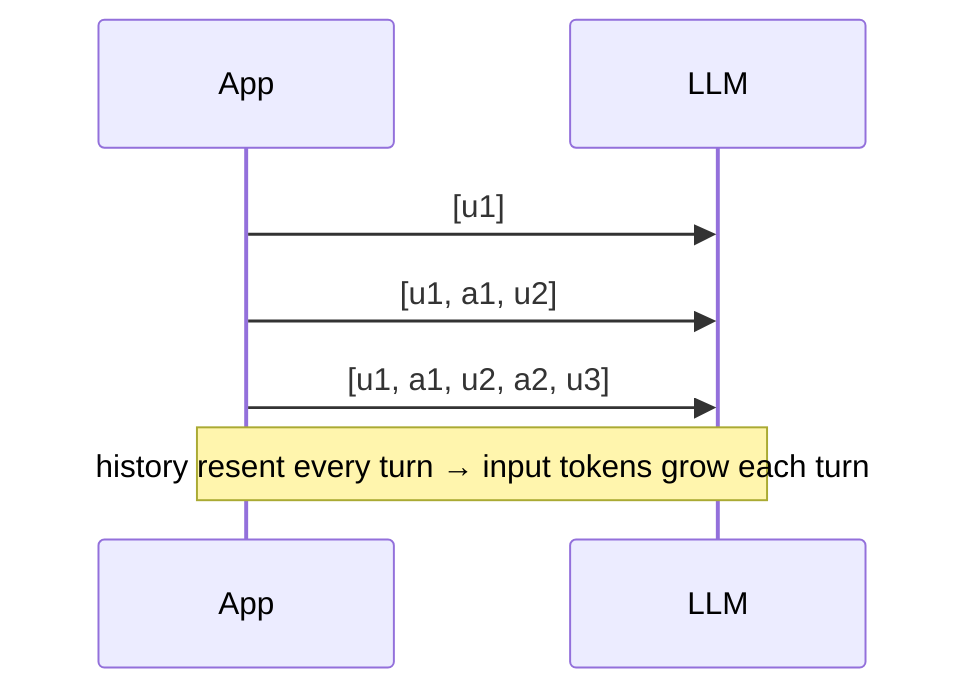
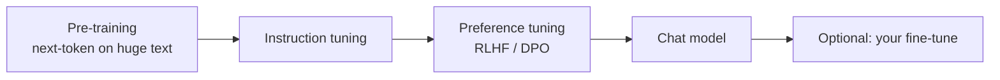

# Chapter 3: Inside the model

*Only what a Gen AI developer needs: what you pay for, why the model forgets, why it makes things up, how to steer it, and how to pick one.*

> [!NOTE]
> **📍 At a glance**
> - **You will learn:** tokens, embeddings, context window, statelessness and cost, training stages, prompting vs RAG vs fine-tuning, temperature, hallucination, model selection
> - **Level:** beginner · **Time:** about 20 minutes
> - **Used by:** [Chapter 2](02-the-agentic-loop-in-pure-python.md), [Python Ch 3](../python/03-anatomy-of-an-agent.md)

---

## 3.1 Five terms

| Term | Developer meaning |
|---|---|
| **LLM** | Predicts the next **token**, one at a time, by probability |
| **Token** | The billing unit, ≈ ¾ of an English word; counts differ per tokenizer |
| **Embedding** | Text as a vector; similar meaning = close vectors (cosine similarity) |
| **Context window** | Max tokens one call can see (input + output); **not memory** |
| **Parameters** | Fixed learned weights; what the model *is*, not what flows through it |

- **Billing:** input **and** output tokens; output costs several times more (generated one by one)
- **Embedding model ≠ chat model.** Index and query must use the **same** embedding model
- Use the provider's `usage` field for cost, never a word count

## 3.2 Stateless calls: why chats get expensive

- The app resends the whole history each call; the model remembers nothing
- 10 turns × 100 tokens/message ≈ **10,000** input tokens billed, not 1,000 (roughly quadratic)
- When the window fills, old turns drop and the model never knew them
- **Fixes:** trim or summarise old turns, cache the stable prefix (prompt caching), new thread per task
- **Bigger window ≠ free:** costs more per call and loses detail in the middle (below)

## 3.3 How the model was made, and what you can change

- Knowledge stops at a **cutoff**; rare or recent facts are where it guesses
- **Reasoning models** spend hidden "thinking" tokens: better at maths, code, planning; slower and pricier

| Need | Use |
|---|---|
| Change behaviour or format fast | **Prompting** (+ few-shot) |
| Answer from your/fresh documents with citations | **RAG** |
| Take actions, live data, exact maths | **Tools** ([Chapter 2](02-the-agentic-loop-in-pure-python.md)) |
| Consistent narrow format at scale, or a cheaper small model | **Fine-tuning** |

- Try them in that order. Fine-tuning teaches **how** to answer, poorly **what** is true

## 3.4 Steering generation

| Setting | Effect | Use |
|---|---|---|
| `temperature` | Low = top token; high = variety | 0–0.3 extraction, code, classification; 0.7–1 writing, ideas |
| `top_p` | Sample from the top tokens summing to `p` | Change this **or** temperature, not both |
| `max_tokens` | Hard cap on output and its cost | Always set |
| `stop` | Ends generation at a string | Cut after a tag or line |

- Temperature reshapes the softmax: scores (2, 1, 0.1) → 0.99/0.01/0.00 at T=0.2, 0.66/0.24/0.10 at T=1
- **T=0 is not guaranteed deterministic;** validate structured outputs anyway
- Code: [Langchain Ch 3](../langchain/03-models-messages-and-parameters.md)

## 3.5 Hallucination

- The model produces **plausible** text with no built-in fact check
- Most likely on rare/recent facts, false premises, exact values (numbers, citations, names)
- **Lost in the middle:** long prompts use the start and end best; put key instructions and evidence there

| Reduce it with | Why it works |
|---|---|
| RAG + citations | Answer comes from supplied, checkable text |
| Tools for facts and maths | Compute or look up instead of recall |
| Allow "I don't know" | Gives a valid alternative to guessing |
| Structured output + validation ([Pydantic Ch 5](../pydantic/05-validating-llm-output.md)) | Rejects malformed answers |
| Low temperature | Fewer creative detours |
| Evals on a fixed test set | Measures whether a change helped |

> [!IMPORTANT]
> **🏭 In production:** never let an unverified answer trigger an irreversible action; show sources; track a groundedness metric and re-run it on every prompt or model change.

## 3.6 Choosing a model

| Criterion | Ask |
|---|---|
| Capability | Does it pass **your** 30–50 real test cases? (leaderboards are a start only) |
| Cost | $/M input and output tokens × expected volume |
| Latency | Time to first token, total time |
| Context | Do documents + history + answer fit? |
| Features | Tool calling, structured output, vision, streaming, caching |
| Data | Where is data processed? Need open weights you host? |

- **Two-model pattern:** small/fast model for routing, classification, extraction; strong model for hard reasoning, often several times cheaper overall
- **API vs chat app:** the API is per-token, shows usage, and is what you build on; aggregators like OpenRouter give many providers behind one key
- Keep the model id in config; re-run evals before switching (names and prices change every few months)

## Interview corner

1. Why does a long chat get slow and expensive?

- Stateless model, so the whole history is resent each turn; trim/summarise, cache the prefix, new thread per task

2. Why does output cost more than input?

- Output is generated token by token; input is processed in parallel

3. RAG or fine-tuning for an internal policy assistant?

- RAG: policies change and answers need citations; fine-tune only if format/tone still fails after good prompting

4. How do you reduce hallucination in a customer bot?

- Ground with retrieval + citations, tools for facts, allow "I don't know", validate outputs, groundedness evals, human check before irreversible actions

5. How do you pick a model for a new product?

- Real test set; compare quality, cost, latency, features, data rules; often a cheap + strong pair; model id in config

> [!TIP]
> **🧩 Design question:** a bank chatbot over 400 product documents, tight budget, must be correct. Cover: RAG with citations, embedding model + vector index, small router + strong answerer, low temperature, "I don't know", groundedness evals, data residency.

## Cheat sheet

- Cost = in tokens × in price + out tokens × out price; chat cost grows every turn
- Window = per call, not memory; same embedding model for index and query
- Prompt → RAG → tools → fine-tune
- Low temperature for facts and code; validate anyway
- Choose models on your own test set

## Practice

1. Run a 5-turn chat and log `usage.prompt_tokens` per turn
2. Compute cosine similarity of two embeddings from any embedding API
3. For one of your use cases, pick prompting, RAG, tools or fine-tuning and justify it

---

*Source: Live-Class-2026, classes 03–04 (summaries, transcripts, `Class-3-4.pdf` whiteboard); 3.3–3.6 added by Claude from standard industry practice. Further reading: Liu et al., [Lost in the Middle](https://arxiv.org/abs/2307.03172) (2023); Ouyang et al., [InstructGPT](https://arxiv.org/abs/2203.02155) (2022).*

Previous: [Chapter 2](02-the-agentic-loop-in-pure-python.md) · Next: [Chapter 4, Glossary](04-glossary.md)
