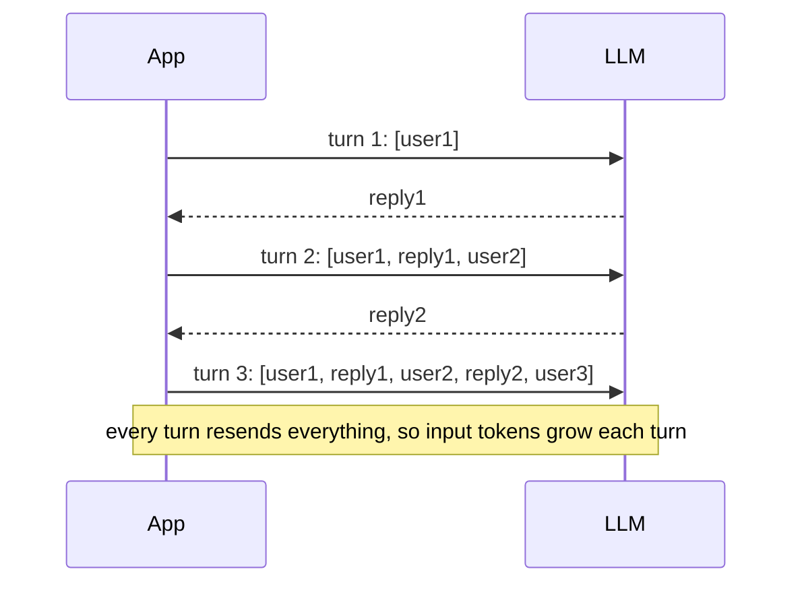
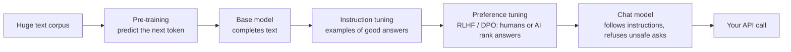

# Chapter 3: Inside the model

*What a model actually is, what you pay for, why it forgets, why it makes things up, and how to choose one.*

> [!NOTE]
> **📍 At a glance**
> - **You will learn:** the five core terms (LLM, token, embedding, context window, parameters), why calls are stateless, how models are trained, how temperature works, why models hallucinate, and how to pick a model
> - **You will build:** a cost estimate for a chat, a cosine-similarity check, and a model-selection table for a real use case
> - **Level:** beginner · **Time:** about 50 minutes
> - **Builds on:** [Chapter 1](01-course-roadmap-and-prerequisites.md) (setup and API keys). **Used by:** [Chapter 2](02-the-agentic-loop-in-pure-python.md), [Python Ch 3](../python/03-anatomy-of-an-agent.md)

**After this chapter you can:**

- Define LLM, token, embedding, context window and parameters in one line each
- Explain why a chat model is stateless and why every turn costs more
- Say the difference between a chat web app and the API, and use OpenRouter to read token counts
- Explain pre-training, instruction tuning and preference tuning, and choose between prompting, RAG and fine-tuning
- Set temperature for the task, and explain what reduces hallucination
- Choose a model on capability, cost, latency, context size and data rules

## 3.1 Five terms to know cold

| Term | One-line mental model |
|---|---|
| **LLM** | Predicts the next *token*, not the next word. Completes patterns |
| **Token** | The billing unit. About three quarters of a word |
| **Vector embedding** | A word as coordinates. Similar meanings sit close together |
| **Context window** | A whiteboard of fixed size. Oldest content is erased first |
| **Parameters** | Billions of fixed weights set in training. Not tokens |

*Source: Live-Class-2026, `classes_summary/03` and `classes_transcription_summary/03`.*

### LLM

- Trained on a huge amount of text. Learns which token usually comes next
- Generates one token at a time, by probability
- Class analogy: a friend who has read every book but was never told what any of it means
  - They have seen "thank you for" followed by "your business" millions of times
- ChatGPT, Claude and Gemini are LLMs. OpenAI, Anthropic and Google are LLM providers
- The slide draws the LLM as a box: input on one side, a next-token prediction on the other

### Tokens

- The model sees tokens, never raw words. A token is more like a Lego brick: "unbelievable" can split into three
- You are billed per token, on **input and output**, like a phone plan billed per minute
- **Output costs more** than input, because the model has to generate it
- Input is charged too: every token must be processed, so an uploaded PDF costs tokens
- Slide example: a short input measured as 5 tokens
- Slide price card: a model labelled "5.5" at $5 input and $30 output. The card does not state the unit
  - It also writes "output pricing is 6 times the input"
  - Prices change. Check current ones before relying on the ratio
- Slide's summary: tokens are the currency of AI

*Source: `Class-3-4.pdf`.*

### Vector embeddings

- A word becomes a list of numbers: a point in a high-dimensional space
- "Puppy" lands near "dog". "Happy" lands far from both
- The class showed a 10,000-word, 200-dimension space. Searching "guitar" surfaced music neighbours
- The number of dimensions is **your design choice**. More separate meaning better but need more hardware
- Dimensions are not hand-labelled categories
- Embeddings come from classic NLP, not only modern AI
- The LLM and the embedding model are **different** models. No embedding model is best for everything
- Closeness is measured with **cosine similarity**
- "Vector" and "embedding" are used interchangeably here

### Context window

- A whiteboard of fixed size. When full, the oldest content is erased
- Analogy: your window as a student is about three hours, so six hours of teaching erases hour one
- A "400K" model holds about 400,000 tokens before older content drops
- It is **not memory**. Memory is a separate, lasting mechanism (a later class)

### Parameters

- Billions of tiny values set during training. Like a mixing console with billions of sliders
- No single one means anything alone. The capability comes from the combination
- Fixed once training ends. They change only with a new model version
- **Not tokens.** Parameters are what the model *is*. Tokens are what flows in and out
- More parameters usually means more potential, never a guarantee for one question

## 3.2 Calls are stateless, so the history is resent

- An LLM keeps **no state** between calls
- A chat seems to remember because the app sends the **whole history** each time
- Message 2 carries message 1 and reply 1. So **each turn costs more**
- Class demo with a toy 40-token window: earlier messages greyed out as new ones pushed them out
- Once a message falls out, the model has no idea it existed
- A new chat resets the cost



```python
history.append({"role": "user", "content": question})
reply = client.chat.completions.create(model=model, messages=history)   # the whole list, every time
history.append({"role": "assistant", "content": reply.choices[0].message.content})
```

*Source: `classes_transcription_summary/04`, `classes_summary/04`.*

## 3.3 Web app versus API

| | Chat web app | API |
|---|---|---|
| Pricing | Flat subscription ("controlled buffet") | Per token ("à la carte") |
| Usage visible | No | Yes, in full |
| Models | The app's own | Many, through one account |
| For building software | No | **Yes** |

- A student question on the slide, with no written answer: what happens to the context window if you switch between two models in the same chat?

*Source: `Class-3-4.pdf`.*

**OpenRouter**

- One API key for models from many providers (OpenAI, Anthropic, Google, Mistral and others)
- The class made a key, called a free model, and read the exact input and output token counts in the dashboard

## 3.4 How an LLM is built



| Stage | What it adds | Who does it |
|---|---|---|
| Pre-training | Language, facts and patterns up to a **knowledge cutoff** | The provider, at huge cost |
| Instruction tuning | Follows instructions and chat format | The provider |
| Preference tuning (RLHF, DPO) | Helpful, honest, safe style | The provider |
| Fine-tuning (optional) | Your format, tone or narrow skill | You, on your examples |

- **Reasoning models** spend extra hidden "thinking" tokens before answering: better on maths, code and planning; slower and more expensive per answer
- The model learns **patterns**, not a database. Facts after the cutoff, or rare facts, are where it guesses (3.6)

### Prompting, RAG or fine-tuning?

| Need | Use | Why |
|---|---|---|
| Change behaviour or format quickly | **Prompting** (and few-shot examples) | Free, instant, easy to change |
| Answer from your own or fresh documents | **RAG** (retrieve, then answer) | Facts stay current and citable; no retraining |
| Consistent narrow style or format at scale, or a smaller cheaper model | **Fine-tuning** | Bakes behaviour in; needs good examples and evaluation |
| Take actions or read live data | **Tools** ([Chapter 2](02-the-agentic-loop-in-pure-python.md)) | The model asks; your code acts |

- Industry order: prompt first, add RAG for knowledge, add tools for actions, fine-tune last
- Fine-tuning teaches **how** to answer much better than **what** is true; it is a poor way to add facts

## 3.5 Controlling generation: temperature and friends

The model produces a score for every possible next token; settings decide how one is picked.

| Setting | What it does | Typical use |
|---|---|---|
| `temperature` | Low: almost always the top token. High: more variety | 0–0.3 extraction, classification, code; 0.7–1 brainstorming, writing |
| `top_p` | Only sample from the most likely tokens whose probabilities add up to `p` | Usually change temperature **or** top_p, not both |
| `max_tokens` | Hard cap on output length (and output cost) | Always set it |
| `stop` | Text that ends generation | Cut off after a closing tag or line |

How temperature reshapes the same three scores (2.0, 1.0, 0.1):

| Temperature | Probabilities of the three tokens |
|---|---|
| 0.2 | 0.993, 0.007, 0.000 |
| 1.0 | 0.659, 0.242, 0.099 |
| 2.0 | 0.502, 0.304, 0.194 |

- ✅ *Verified by computing the softmax.*
- Temperature 0 is **close to** deterministic, not guaranteed: providers may still return different answers for the same request
- Code for these settings in LangChain: [Langchain Ch 3](../langchain/03-models-messages-and-parameters.md)

## 3.6 Hallucination, and what actually reduces it

- A model generates **plausible** text. It has no built-in fact check, so a confident wrong answer looks exactly like a right one
- Most likely when: the fact is rare or after the cutoff, the question has a false premise, or the answer must be exact (numbers, citations, names)

| Technique | How it helps |
|---|---|
| Retrieval (RAG) with citations | The answer is built from text you supplied, and a reader can check the source |
| Tools for facts and maths | Look up or compute instead of recalling |
| "If you do not know, say so" in the prompt, plus a way to say it | Gives the model a valid alternative to guessing |
| Structured output + validation ([Pydantic Ch 5](../pydantic/05-validating-llm-output.md)) | Rejects malformed or out-of-range answers |
| Lower temperature for factual tasks | Fewer creative detours |
| Evaluations on real questions | Measures the rate, so you know whether a change helped |

- **Long context has blind spots:** models tend to use information at the start and end of a long prompt better than the middle ("lost in the middle"). Put key instructions and evidence near the start or end

> [!IMPORTANT]
> **🏭 In production**
> - **Never let an unverified model answer trigger an irreversible action** (payment, deletion, email to a customer) without a check or a human
> - **Show sources** for factual answers; users and auditors trust what they can verify
> - **Track a hallucination or groundedness metric** on a fixed test set and re-run it on every prompt or model change
>
> *Added by Claude.*

## 3.7 Choosing a model

| Criterion | Questions to ask |
|---|---|
| Capability | Does it pass **your** test questions? Public leaderboards are only a starting point |
| Cost | Price per million input and output tokens × your expected volume |
| Latency | Time to first token and total time; matters for chat and voice |
| Context window | Do your documents and history fit, with room for the answer? |
| Features | Tool calling, structured output, vision, streaming, prompt caching |
| Data and deployment | Where is data processed and stored? Is an open-weight model you host required? |

- **Use more than one model:** a small, fast model for routing, classification and extraction; a strong model for hard reasoning. This alone often cuts cost several times over
- **Open-weight vs hosted:** open weights give control and data residency, but you run the GPUs; hosted APIs are simpler and usually ahead on capability
- **Model names and prices change every few months.** Keep the model id in configuration and re-run your evaluation set before switching

> [!WARNING]
> **⚠️ Pitfall: choosing by benchmark alone**
> - A model that tops a public leaderboard can still fail your format, language or domain
> - Build 30–50 real examples from your use case first; they decide the model

## 3.8 Added by Claude, not from the sources

Each item marked *checked* was calculated or run.

- **Cost grows with the length of the chat.** ✅ *Verified:* five requests to a local stand-in server carried 1, 3, 5, 7 and 9 messages
  - With 100 tokens per message, 10 turns bill **10,000** input tokens, not 1,000. The growth is roughly quadratic
- **Example price calculation.** If the card meant dollars per million tokens (the slide does not say): 1,000 in and 500 out costs 1,000 × 5/1,000,000 + 500 × 30/1,000,000 = **$0.02**. ✅ *verified* by arithmetic
- **Cosine similarity, small example.** ✅ *Verified:* `dog = [0.9, 0.1]`, `puppy = [0.85, 0.2]`, `happy = [0.05, 0.95]` give cosine **0.993** for dog and puppy and **0.163** for dog and happy
  - Cosine ignores vector length: `[1, 0]` and `[2, 0]` score 1.0 while their dot product is 2
- **Embedding models are a separate choice.** A vector search index must use the **same** embedding model to index and to query (see [Projects Ch 3](../projects/03-meridian-ai-learner.md))
- **Token counts differ by model.** The same text gives different counts under different tokenisers. Use the provider's usage figures for billing, not a word count
- **Bigger window is not free.** A larger context costs more per call and can still lose detail in the middle. Send only what the task needs

## 3.9 Interview corner

**What interviewers listen for:** clean definitions, the cost consequence of statelessness, and practical judgement: prompting vs RAG vs fine-tuning, temperature per task, and how you reduce hallucination.

### 🟢 Basic

<details class="qa"><summary>1. Why is an LLM called stateless? How does a chatbot still remember you?</summary>

- Each call is independent; the app resends the full history every time
- *Stronger answer:* so every turn costs more, and old turns eventually fall out of the context window

</details>

<details class="qa"><summary>2. What is a token, and why does output cost more than input?</summary>

- A piece of a word, about three quarters of one on average in English
- *Stronger answer:* output is generated one token at a time; input is processed in parallel, so it is cheaper per token

</details>

<details class="qa"><summary>3. Parameters vs tokens? Context window vs memory?</summary>

- Parameters are fixed learned weights; tokens are the text flowing in and out
- *Stronger answer:* the window is what one call can see; memory is your app storing and re-supplying information across calls

</details>

### 🟡 Intermediate

<details class="qa"><summary>4. What is an embedding, and what is cosine similarity for?</summary>

- A vector that represents meaning; cosine similarity scores how close two meanings are
- *Stronger answer:* index and query must use the same embedding model, or the vectors are not comparable

</details>

<details class="qa"><summary>5. What temperature would you use for extraction, and for brainstorming?</summary>

- Low (0–0.3) for extraction; higher (0.7–1) for brainstorming
- *Stronger answer:* even at 0, outputs are not guaranteed identical, so validate structured results

</details>

<details class="qa"><summary>6. A long chat gets slow and costly. Why, and what do you do?</summary>

- The whole history is resent each turn
- *Stronger answer:* trim or summarise old turns, cache the stable prefix, and start new threads for new tasks

</details>

### 🔴 Senior

<details class="qa"><summary>7. RAG or fine-tuning for a company's internal policy assistant?</summary>

- RAG: policies change, answers need citations, and no retraining is needed
- *Stronger answer:* fine-tuning only if a consistent format or tone still fails after good prompting; it does not reliably add facts

</details>

<details class="qa"><summary>8. How do you reduce hallucination in a customer-facing bot?</summary>

- Ground answers in retrieved documents with citations, use tools for facts, allow "I don't know"
- *Stronger answer:* add validation, a groundedness evaluation on a fixed test set, and a human check before any irreversible action

</details>

<details class="qa"><summary>9. How do you pick a model for a new product?</summary>

- Build a test set from real cases; compare quality, cost, latency and features
- *Stronger answer:* often two models: a cheap one for routing and extraction, a strong one for hard cases; keep the id in config and re-evaluate on every switch

</details>

> [!TIP]
> **🧩 Design question**
> - *"A bank wants a chatbot that answers questions about its 400 product documents. Budget is tight and answers must be correct."*
> - Talk about: RAG with citations, an embedding model and vector index, a small model for routing and a stronger one for answers, low temperature, "I don't know" handling, a test set with a groundedness metric, and data residency

## Cheat sheet

| Term or rule | Remember |
|---|---|
| Token | ≈ ¾ of an English word; billed on input **and** output |
| Cost of one call | input tokens × input price + output tokens × output price |
| Chat cost | grows with every turn: the history is resent |
| Context window | per call, fixed; not memory |
| Embedding | meaning as a vector; compare with cosine similarity |
| Temperature | low for facts and code, higher for ideas |
| Hallucination | ground with RAG and tools, validate, evaluate |
| Prompt → RAG → tools → fine-tune | the usual order to try |

## Recap

- LLM: predicts the next token. Token: the billing unit. Embedding: meaning as coordinates
- Context window: fixed whiteboard, oldest content erased first. Parameters: fixed weights
- Calls are stateless. The history is resent, so each turn costs more
- API: pay per token, many models, usable from code. Web app: flat fee, no visible token cost
- OpenRouter: one key, many providers, exact token counts
- Built in stages: pre-training, instruction tuning, preference tuning. Prompt, then RAG, then tools, then fine-tune
- Temperature low for facts, higher for ideas. Hallucination is reduced by grounding, tools, validation and evaluation
- Choose models on your own test set; use a cheap and a strong model together

## Practice

1. Explain the five terms to someone else without notes
2. Explain the whiteboard analogy for the context window in your own words
3. Create a free OpenRouter key and call a model outside the web UI. Read the token counts
4. Make a chat of 5 turns against any model and count the messages in each request
5. Compute the cosine similarity of two vectors you choose
6. Compute the softmax of three scores at temperatures 0.2, 1 and 2
7. For a use case you know, decide: prompting, RAG, tools or fine-tuning, and say why
8. Write five questions that would catch a hallucinating support bot

## How this chapter was checked

- **Run:** five-turn history growth against a local stand-in API with the real OpenAI client; the token and price arithmetic; the cosine examples
- **Not run:** a real model, OpenRouter, any provider dashboard
- The slide price card and the "400K" figure are as the class showed them. Prices were not looked up
- **Run in the 2026 review:** the temperature table (softmax arithmetic)
- **Not run:** a tokenizer (its data could not be downloaded here), any model
- 3.4 to 3.7, the diagrams, the boxes, the graded interview and the cheat sheet were added in the 2026 review (Added by Claude: standard industry knowledge, not from the class). The two papers in Sources are listed as further reading; I did not re-read them in this review
- The class summaries and slides were not re-opened in this rewrite; 3.1 to 3.3 come from the earlier version of the chapter

## Sources and further reading

- Live-Class-2026, `classes_summary/03 - 4 Jul - Pydantic Deep Dive.md` (vocabulary table)
- Live-Class-2026, `classes_transcription_summary/03 - 4 Jul - Pydantic Deep Dive.md`
- Live-Class-2026, `classes_transcription_summary/04 - 5 Jul - Anatomy of an Agent.md`
- Live-Class-2026, whiteboard `Class-3-4.pdf` in the class 02-03 folder
- Liu et al., [Lost in the Middle: How Language Models Use Long Contexts](https://arxiv.org/abs/2307.03172) (2023)
- Ouyang et al., [Training language models to follow instructions with human feedback](https://arxiv.org/abs/2203.02155) (2022)

Class 08 (parameters, streaming, tools, structured output) is in the Langchain book, [Chapters 3 to 5](../langchain/03-models-messages-and-parameters.md), because its code uses LangChain.

Previous: [Chapter 2](02-the-agentic-loop-in-pure-python.md) · Next: [Chapter 4, Glossary](04-glossary.md)
