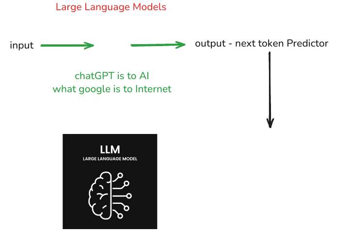
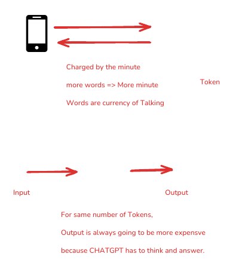
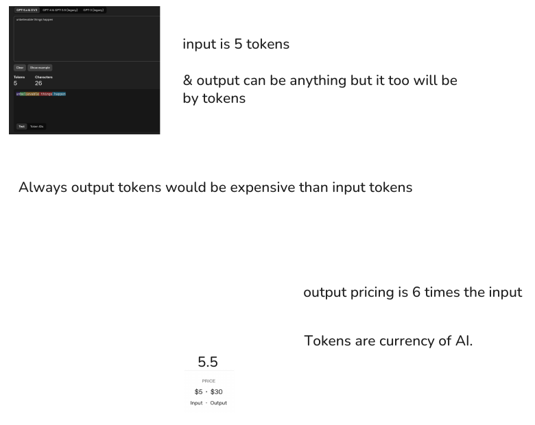
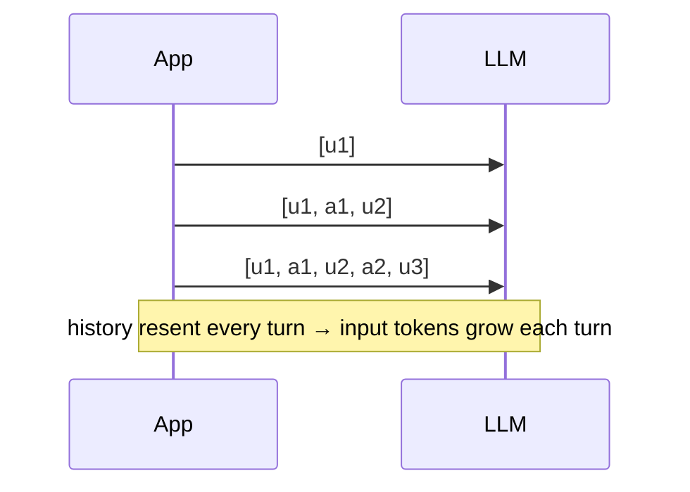
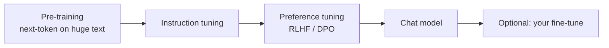
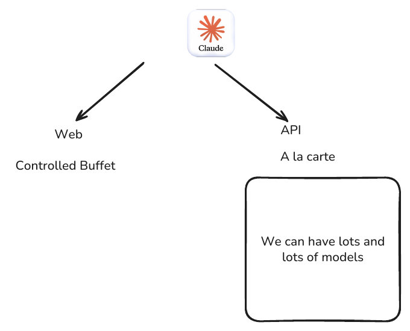

# Chapter 3: Inside the model

*Only what a Gen AI developer needs: what you pay for, why the model forgets, why it makes things up, how to steer it, and how to pick one.*

> [!NOTE]
> **📍 At a glance**
> - **You will learn:** tokens, embeddings, context window, statelessness and cost, training stages, prompting vs RAG vs fine-tuning, temperature, hallucination, model selection
> - **You will build:** small calculators for call cost, chat cost per turn, temperature and cosine similarity
> - **Level:** beginner · **Time:** about 35 minutes
> - **Used by:** [Chapter 2](02-the-agentic-loop-in-pure-python.md), [Python Ch 3](../python/03-anatomy-of-an-agent.md)

**After this chapter you can:**

- Explain an LLM as a next-token predictor, and price a call from its input and output tokens
- Show why a chat's cost grows every turn, and name three fixes
- Pick prompting, RAG, tools or fine-tuning for a need
- Set temperature and other generation settings on purpose
- Reduce hallucination, and choose a model on your own test set

---

## 3.1 Five terms



- The class's one-line model: an LLM is a **next-token predictor**. It writes one token, then the next, until it stops

| Term | Developer meaning |
|---|---|
| **LLM** | Predicts the next **token**, one at a time, by probability |
| **Token** | The billing unit, ≈ ¾ of an English word; counts differ per tokenizer |
| **Embedding** | Text as a vector; similar meaning = close vectors (cosine similarity) |
| **Context window** | Max tokens one call can see (input + output); **not memory** |
| **Parameters** | Fixed learned weights; what the model *is*, not what flows through it |

- **Billing:** input **and** output tokens; output costs several times more (generated one by one)



- The class's analogy: an old phone plan **charged by the minute**. Words were the currency of talking; **tokens are the currency of AI**



- The whiteboard's price card is GPT-5.5: **$5 per million input tokens, $30 per million output**, 6× more for output. *Web-checked:* that is the standard API rate OpenAI announced on 23 April 2026 (cached input $0.50; batch half price). Prices change; check the provider's page before quoting
- The tokenizer screenshot counts "unbelievable things happen" as **5 tokens** for 26 characters. *Not checked here:* the tokenizer files could not be downloaded in this environment

```python
def call_cost(in_tokens: int, out_tokens: int, in_per_m: float, out_per_m: float) -> float:
    """Dollar cost of one call, from token counts and per-million prices."""
    return in_tokens / 1e6 * in_per_m + out_tokens / 1e6 * out_per_m

call_cost(2_000, 500, in_per_m=5, out_per_m=30)    # 0.025: the 500 output tokens cost 1.5x the 2,000 input tokens
```
- **Embedding model ≠ chat model.** Index and query must use the **same** embedding model
- The class's definition: embeddings are **numerical representations of language**, words or documents mapped to points in a high-dimensional space, so models can compare meaning with maths
- "Close" is usually measured with cosine similarity (*code added by Claude*):

```python
import math

def cosine(a: list[float], b: list[float]) -> float:
    dot = sum(x * y for x, y in zip(a, b))
    return dot / (math.sqrt(sum(x * x for x in a)) * math.sqrt(sum(y * y for y in b)))

cosine([1, 2, 3], [2, 4, 6])     # 1.0: same direction, same "meaning"
cosine([1, 0], [0, 1])           # 0.0: unrelated
```
- Use the provider's `usage` field for cost, never a word count

## 3.2 Stateless calls: why chats get expensive



- The app resends the whole history each call; the model remembers nothing. The class's line: **LLM calls are stateless**
- 10 turns × 100 tokens/message ≈ **10,000** input tokens billed, not 1,000 (roughly quadratic)

```python
def input_tokens_per_turn(turns: int, tokens_per_message: int = 100) -> list[int]:
    """Turn k resends k user messages and k-1 replies."""
    return [(2 * k - 1) * tokens_per_message for k in range(1, turns + 1)]

per_turn = input_tokens_per_turn(10)   # [100, 300, 500, ..., 1900]
sum(per_turn)                          # 10000
```
- When the window fills, old turns drop and the model never knew them
- **Fixes:** trim or summarise old turns, cache the stable prefix (prompt caching), new thread per task
- **Bigger window ≠ free:** costs more per call and loses detail in the middle (below)

## 3.3 How the model was made, and what you can change

*Sections 3.3 to 3.6 are added by Claude from standard industry practice; the class covers the terms in 3.1 and 3.2.*



- Knowledge stops at a **cutoff**; rare or recent facts are where it guesses
- **Reasoning models** spend hidden "thinking" tokens: better at maths, code, planning; slower and pricier

| Need | Use |
|---|---|
| Change behaviour or format fast | **Prompting** (+ few-shot) |
| Answer from your/fresh documents with citations | **RAG** |
| Take actions, live data, exact maths | **Tools** ([Chapter 2](02-the-agentic-loop-in-pure-python.md)) |
| Consistent narrow format at scale, or a cheaper small model | **Fine-tuning** |

- Try them in that order. Fine-tuning teaches **how** to answer, poorly **what** is true

## 3.4 Steering generation

| Setting | Effect | Use |
|---|---|---|
| `temperature` | Low = top token; high = variety | 0–0.3 extraction, code, classification; 0.7–1 writing, ideas |
| `top_p` | Sample from the top tokens summing to `p` | Change this **or** temperature, not both |
| `max_tokens` | Hard cap on output and its cost | Always set |
| `stop` | Ends generation at a string | Cut after a tag or line |

- Temperature reshapes the softmax: scores (2, 1, 0.1) → 0.99/0.01/0.00 at T=0.2, 0.66/0.24/0.10 at T=1

```python
import math

def softmax(scores: list[float], temperature: float) -> list[float]:
    exps = [math.exp(s / temperature) for s in scores]
    return [round(e / sum(exps), 2) for e in exps]

softmax([2, 1, 0.1], 0.2)   # [0.99, 0.01, 0.0]  near-greedy
softmax([2, 1, 0.1], 1.0)   # [0.66, 0.24, 0.1]  more variety
```
- **T=0 is not guaranteed deterministic;** validate structured outputs anyway
- Code: [Langchain Ch 3](../langchain/03-models-messages-and-parameters.md)

## 3.5 Hallucination

- The model produces **plausible** text with no built-in fact check
- Most likely on rare/recent facts, false premises, exact values (numbers, citations, names)
- **Lost in the middle:** long prompts use the start and end best; put key instructions and evidence there

| Reduce it with | Why it works |
|---|---|
| RAG + citations | Answer comes from supplied, checkable text |
| Tools for facts and maths | Compute or look up instead of recall |
| Allow "I don't know" | Gives a valid alternative to guessing |
| Structured output + validation ([Pydantic Ch 5](../pydantic/05-validating-llm-output.md)) | Rejects malformed answers |
| Low temperature | Fewer creative detours |
| Evals on a fixed test set | Measures whether a change helped |

> [!IMPORTANT]
> **🏭 In production:** never let an unverified answer trigger an irreversible action; show sources; track a groundedness metric and re-run it on every prompt or model change.

## 3.6 Choosing a model

| Criterion | Ask |
|---|---|
| Capability | Does it pass **your** 30–50 real test cases? (leaderboards are a start only) |
| Cost | $/M input and output tokens × expected volume |
| Latency | Time to first token, total time |
| Context | Do documents + history + answer fit? |
| Features | Tool calling, structured output, vision, streaming, caching |
| Data | Where is data processed? Need open weights you host? |

- **Two-model pattern:** small/fast model for routing, classification, extraction; strong model for hard reasoning, often several times cheaper overall
- **API vs chat app:** the API is per-token, shows usage, and is what you build on; aggregators like OpenRouter give many providers behind one key



- The class's picture: the chat app is a **controlled buffet** (a fixed plan, chosen dishes); the API is **à la carte** (pick any model, pay per token)
- Keep the model id in config; re-run evals before switching (names and prices change every few months)

## 3.7 Questions from the class

<details class="qa"><summary>"If I flip between Sonnet and Opus in the same chat, will my context window keep shifting?"</summary>

- The whiteboard records the question but not the answer. An answer (*added by Claude*):
- Each call is stateless, so on every turn the app sends the **whole** conversation to whichever model you picked
- The limit that applies is the **current** model's window. If the two windows are the same size, nothing shifts; if you switch to a smaller one, the history must fit it or be trimmed
- *Web-checked:* Anthropic's model pages list a 1M-token window for both Claude Opus 5.5 and Claude Sonnet 5.5, while older models such as Sonnet 4.5 have 200K

</details>

<details class="qa"><summary>A student: "AI agents figure out the steps for a task and do them, not just answer questions." Right?</summary>

- Yes. That is the brain + memory + tools picture ([Python Ch 3](../python/03-anatomy-of-an-agent.md)), run in a loop ([Chapter 2](02-the-agentic-loop-in-pure-python.md))
- The model plans the next step, a tool does it, and the result comes back for the next decision

</details>

## 3.8 Added by Claude, not from the sources

- **Log `usage` on every call** and turn it into money with a function like `call_cost`; per-task cost is the number that matters
- **Reasoning models bill their hidden thinking as output tokens**, the expensive kind
- **Same embedding model, same version**, for indexing and querying; re-embed everything when you change it
- **Prices and windows change every few months**: keep them in config, not in code

## Interview corner

**What interviewers listen for:** you can price a request, explain why chats get expensive, and choose between prompting, RAG, tools and fine-tuning.

### 🟢 Basic

<details class="qa"><summary>1. Why does a long chat get slow and expensive?</summary>

- Stateless model, so the whole history is resent each turn; trim/summarise, cache the prefix, new thread per task
- *Stronger answer:* input grows every turn, so total input tokens grow roughly with the square of the number of turns

</details>

<details class="qa"><summary>2. Why does output cost more than input?</summary>

- Output is generated token by token; input is processed in parallel
- *Stronger answer:* example rates of $5 in and $30 out per million make 500 output tokens cost more than 2,000 input tokens

</details>

### 🟡 Intermediate

<details class="qa"><summary>3. RAG or fine-tuning for an internal policy assistant?</summary>

- RAG: policies change and answers need citations; fine-tune only if format/tone still fails after good prompting
- *Stronger answer:* fine-tuning teaches style, not facts; a policy changed yesterday is only correct with retrieval

</details>

<details class="qa"><summary>4. How do you reduce hallucination in a customer bot?</summary>

- Ground with retrieval + citations, tools for facts, allow "I don't know", validate outputs, groundedness evals, human check before irreversible actions
- *Stronger answer:* measure it: a groundedness score on a fixed test set, re-run on every prompt or model change

</details>

### 🔴 Senior

<details class="qa"><summary>5. How do you pick a model for a new product?</summary>

- Real test set; compare quality, cost, latency, features, data rules; often a cheap + strong pair; model id in config
- *Stronger answer:* compare cost per **task**, not per token: a pricier model that needs fewer turns or retries can be cheaper overall

</details>

<details class="qa"><summary>6. After switching to a "better" model with the same prompts, the bill doubled. Why?</summary>

- Higher per-token prices, especially for output
- More output tokens: longer answers, or hidden reasoning tokens billed as output
- *Stronger answer:* compare `usage` per call before and after on the same test set, then cap `max_tokens`, shorten answers, or route easy steps to the cheaper model

</details>

> [!TIP]
> **🧩 Design question:** a bank chatbot over 400 product documents, tight budget, must be correct. Cover: RAG with citations, embedding model + vector index, small router + strong answerer, low temperature, "I don't know", groundedness evals, data residency.

## Cheat sheet

```python
cost = in_tokens / 1e6 * in_price + out_tokens / 1e6 * out_price   # per call; read tokens from `usage`
chat_input = sum((2 * k - 1) * msg_tokens for k in range(1, turns + 1))   # history resent every turn
# window = per call, not memory · same embedding model for index and query
# prompt → RAG → tools → fine-tune · low temperature for facts and code, validate anyway
```

## Recap

- An LLM predicts the next token; tokens are the currency of AI, and output tokens cost more
- Embeddings turn meaning into vectors; compare them with cosine similarity
- Calls are stateless: the app resends history, so chat cost grows every turn
- Try prompting, then RAG, then tools, then fine-tuning
- Temperature reshapes the probabilities; low for facts and code
- Hallucination needs grounding, tools, "I don't know" and evals
- Pick models on your own test set; the API is à la carte, the chat app a controlled buffet

## Practice

1. Run a 5-turn chat and log `usage.prompt_tokens` per turn
2. Compute cosine similarity of two embeddings from any embedding API
3. For one of your use cases, pick prompting, RAG, tools or fine-tuning and justify it
4. Price a 20-turn chat at 150 tokens per message with `input_tokens_per_turn` and `call_cost`
5. Run `softmax([2, 1, 0.1], t)` for t = 0.1, 0.5, 1, 2 and describe the trend

## How this chapter was checked

- **Code:** every Python block in this chapter run offline with Python 3.13: `call_cost` → 0.025; cosine 1.0 and 0.0; turn-by-turn input summing to 10,000; the softmax values shown
- **Web-checked (2026-11-15):** GPT-5.5 standard API pricing ($5 / $30 per million, released 23 April 2026); Claude Opus 5.5 and Sonnet 5.5 context windows (1M) and older Sonnet 4.5 (200K)
- **Not checked:** the tokenizer count on the whiteboard (tokenizer files blocked here)
- 3.3 to 3.6 come from the 2026 review; their claims are standard practice, not re-tested in this pass

---

## Sources and further reading

- Live-Class-2026, classes 03–04 (summaries, transcripts) and the `Class-3-4.pdf` whiteboard in `Weekend 01 - 27-28 Jun/` (four figures in `images/`, re-read 2026-11-15)
- GPT-5.5 pricing: OpenAI's announcement, as reported in [this pricing breakdown](https://dev.to/hassann/gpt-55-pricing-full-breakdown-of-api-codex-and-chatgpt-costs-april-2026-14id) and [implicator.ai](https://www.implicator.ai/openai-gpt-5-5-by-the-numbers-higher-prices-disputed-benchmarks/); check [OpenAI pricing](https://openai.com/api/pricing/) for current rates
- Claude context windows: [Claude Opus 5.5](https://platform.claude.com/docs/en/models/opus-5-5/overview), [Claude Sonnet 5.5](https://platform.claude.com/docs/en/models/sonnet-5-5/overview), [release notes](https://platform.claude.com/docs/en/release-notes/overview)
- Further reading: Liu et al., [Lost in the Middle](https://arxiv.org/abs/2307.03172) (2023); Ouyang et al., [InstructGPT](https://arxiv.org/abs/2203.02155) (2022)
- Added by Claude: 3.3 to 3.6, 3.8, the code in 3.1, 3.2 and 3.4, the answers in 3.7, interview question 6

Previous: [Chapter 2](02-the-agentic-loop-in-pure-python.md) · Next: [Chapter 4, Glossary](04-glossary.md)
