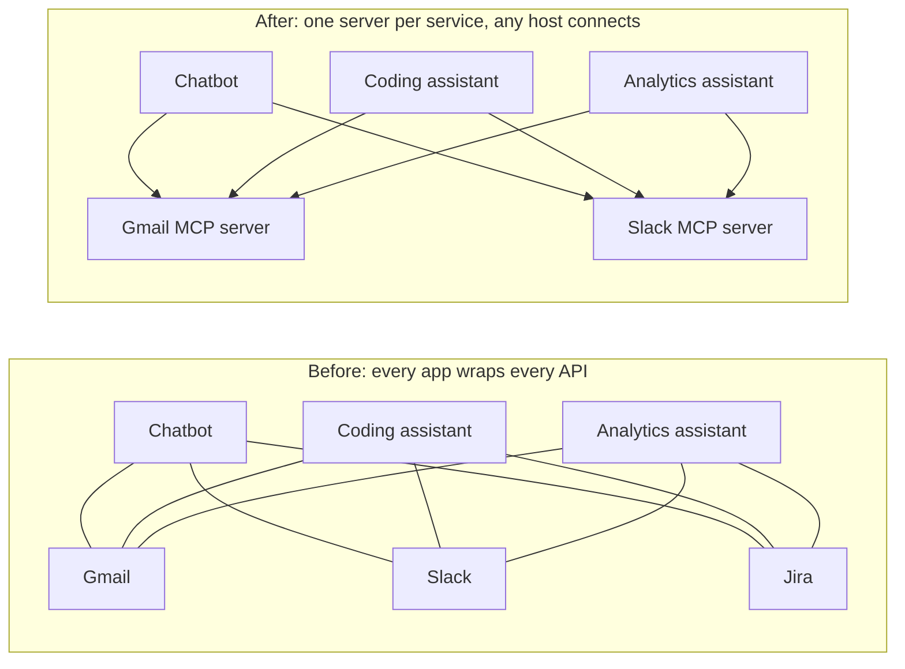

# Chapter 1: Why MCP exists

*MCP gives a model no new intelligence. It gives every AI app one standard way to reach the same tools.*

> [!NOTE]
> **📍 At a glance**
> - **You will learn:** the path from "a brain with no hands" to function calling to MCP, the scaling problem MCP solves, what it is and is not, and when you need it
> - **You will build:** nothing yet: a decision you can defend on whether a project needs MCP
> - **Level:** beginner · **Time:** about 25 minutes
> - **Builds on:** tool calling ([Langchain Ch 5](../langchain/05-tools.md), [LLM Ch 2](../llm/02-the-agentic-loop-in-pure-python.md)). **Leads to:** [Chapter 2](02-primitives-and-architecture.md)

**After this chapter you can:**

- Tell the story from "a brain with no hands" to MCP in order
- Explain the scaling problem that function calling created
- Say what MCP is, and what it is not
- Compare life before and after MCP
- Decide whether you need MCP for a given project
- Answer the common "why MCP?" interview questions

**Before this:** how tool calling works. See [Langchain, Chapter 5](../langchain/05-tools.md) (binding) and [LLM, Chapter 2](../llm/02-the-agentic-loop-in-pure-python.md) (the loop by hand). MCP is taught here **independent of any framework**. How LangChain uses it is in the Langchain book.

## 1.1 From black box to hands

- **ChatGPT launched on 30 November 2022.** About **1 million users in a week**, about **100 million within a few months**
- It was a new way to interact with machines. Before it, machines mostly understood fixed inputs such as buttons. Now natural language went in and natural language came out
- Underneath, the first ChatGPT was an **LLM: a next-word (next-token) predictor**
- A useful picture: an LLM at that stage is **"just a brain"**
  - It could write a great sick-leave email
  - It had **no hands**. It could not **send** it
  - Likewise it could write code, but could not run it on your machine
- That gap, a brain without hands, started everything that follows

## 1.2 What "context" means

- **Context is everything the model can see when it answers your question**
- That is why the word is in the name: **M**odel **C**ontext **P**rotocol
- The model, the context and the protocol that makes sharing context standard
- One line to hold on to:

> MCP is not about giving the LLM more intelligence. It is about giving it an ability to see more.

## 1.3 Step 1: function calling (mid-2023)

- OpenAI let you **bind tools (functions)** to a model: describe an action ("send email") and the model tells you **which function to call and with what arguments**
- In code it is `llm.bind_tools(...)` ([Langchain, Chapter 5](../langchain/05-tools.md))
- **The model never executes anything.** It only requests the call
- It felt like magic: no more copy-pasting between a chat and your inbox
- Fine for a hobby project

## 1.4 Step 2: the scaling problem

- Past a hobby project the cracks show. Example: a company with **three AI assistants** (a general chatbot, a coding assistant, an analytics assistant), each touching about **20 tools** across several applications
- That is dozens of tools. Each has:
  - its own **authentication**
  - its own **data format**
  - its own **error handling**
  - its own **risk of breaking** when the underlying API changes
- Whiteboard arithmetic: **4 applications × 6 actions = 24 tools** to write and maintain



- Before: apps × services wrappers, each with its own auth and upkeep. After: one server per service, maintained by its owner
- Now multiply by every company doing the same integration work separately
- The class put it this way: we found a shorter way, but now we need a whole structure to keep the shortcut running
- **Function calling solved the problem for one person and recreated it as a maintenance problem for a company**

## 1.5 Step 3: a protocol

- Anthropic's answer was **a protocol, not another wrapper**: a shared language, the way **HTTP** is a shared language for the web
- An application says **once**: "here are my tools, resources and prompts". **Any** AI host can then talk to it the same way
- That protocol is **MCP, the Model Context Protocol**

```
ChatGPT: an LLM as a black box
  → function calling: bind tools straight to the LLM
  → scaling problem: duplicate code, auth and upkeep in every team
  → MCP: a shared protocol. The provider maintains the server, any AI host connects a client
```

## 1.6 What MCP is

- An **open-source standard for connecting AI applications to external systems**: data sources, local files, databases, tools, search engines, calculators, workflows, specialised prompts
- **An MCP server is mostly a collection of tools.** The class said about **99%** of real use. It wraps APIs that **already existed**
- Plus two other pieces. Together the three are the **MCP primitives**: **tools, resources, prompts** ([Chapter 2](02-primitives-and-architecture.md))
- The class **avoided the "USB-C port" analogy** because it oversimplifies
- **Not a paid product.** It is a free, open specification. Since December 2025 it is governed by the **Agentic AI Foundation (AAIF)** under the Linux Foundation, founded with Anthropic, OpenAI, Block and others
- **Not an orchestrator.** It is a connection and communication protocol between a host and external tools. It does not plan or sequence agent behaviour
- **Not RAG.** RAG retrieves text and injects it into a prompt. MCP lets a model call tools and actions on external systems. Different mechanisms

> [!IMPORTANT]
> **🏭 In production: where MCP stands (checked November 2026)**
> - In December 2025 the Linux Foundation launched the Agentic AI Foundation, with Anthropic's MCP, OpenAI's AGENTS.md and Block's goose as its first projects
> - The Linux Foundation reported more than 10,000 published MCP servers, and adoption in Claude, ChatGPT, Gemini, Microsoft Copilot, VS Code and Cursor
> - In practice: if you build an integration for AI agents today, an MCP server is the format most hosts can use without extra code
>
> *Added by Claude; sources listed at the end.*

## 1.7 Before and after MCP

**Defining an integration**

- Before: easy for one API. Any model can write a Gmail wrapper quickly
- After: easy to **connect**. Point your host at the server

**Maintenance**

- Before: every team writes and maintains its own wrapper. That breaks the **DRY** rule at scale
- After: the upkeep sits with **whoever runs the server**, usually the provider

**When the API changes**

- Before: if Gmail changes its API, **every integrator** updates their own code
- After: the server absorbs the change. Connected clients do not touch anything

**Security**

- Before: every tool has its own auth, owned by you
- After: auth is still needed, but it is **centralised at the server**

**The core trade-off:** at 500 teams all wrapping the same "send email" API, you have not saved effort, you have **moved** it. MCP's value is not a new capability. It is **who is responsible** for keeping the integration working.

The whiteboard's plus and minus list:

- **Before:** super easy to define and understand. But duplicate code in every project, redundant and prone to failure or change, and just a wrapper around APIs
- **After:** easy to define and access, scalable, no redundant code, access to all common tools and applications, less prone to failure. But a little complex at first, many servers can run locally, and you see less of the implementation (which was the goal)

## 1.8 Do I need MCP?

- **Small project, one app, a handful of tools, nobody else reusing them?** Plain function calling is genuinely fine
- **MCP pays for itself once more than one app, or more than one team, needs the same tool**
- **Function calling already works. Why learn MCP?** The crack only appears once you pass one app and one tool, which happens faster than most teams expect. Learning it now saves relearning your integration approach later
- **Why not one great function-calling library instead of a protocol?** That is what MCP is, except the key word is **agreed**. A library works only if everyone adopts one company's library. A protocol is a shared agreement co-governed by several companies. That is why OpenAI and Google support MCP although Anthropic built it first
- **A company already has 25 to 30 working APIs. Why add MCP servers?** AI hosts speak MCP natively. Without a server, every team that wants AI to use those APIs writes and maintains its own wrapper, the exact duplication MCP removes
- **How is MCP different from calling a REST API directly?** The end result can be the same, but with a raw API **you** maintain the wrapper, auth and error handling in every project. With MCP the server owner maintains it once
- **Is MCP a REST client?** At a very high level you can think of it that way. It is a distinct protocol built on **JSON-RPC 2.0**, not REST ([Chapter 2](02-primitives-and-architecture.md), 2.5)

## 1.9 Added by Claude, not from the sources

Not in the course material. Established practice, but check current docs. Items marked *checked* were tested with `fastmcp` 4.1.4.

- **MCP sits on top of function calling, it does not replace it.** The host turns the tool list it got from an MCP server into the tool schemas it sends to the model. The model still just "requests a call". MCP standardises **where the tools come from and how they run**
- **Every server you connect widens the trust surface.** A server's tools run with your permissions, and what a tool returns is text the model will read. Text from an untrusted source can try to steer the model (prompt injection). Connect only servers you trust, and keep human approval on tools with side effects ([Langchain, Chapter 7](../langchain/07-middleware.md), 7.6)
- **A rule of thumb for building a server:** build one when at least two apps or teams need the same tools, or when you want third parties to use yours. Otherwise keep plain functions
- **Seeing it for yourself.** ✅ *Verified:* a client that launches a small server and asks for its tools gets the tool names, descriptions and input schemas back. [Chapter 2](02-primitives-and-architecture.md), 2.8 has the code

## 1.10 Interview corner

**What interviewers listen for:** you frame MCP as a **maintenance and standardisation** answer (not a smarter model), know when plain function calling is enough, and name the new security risks

### 🟢 Basic

<details class="qa"><summary>1. What problem does MCP solve?</summary>

- Function calling works for one app, but at company scale every team rewrites and maintains the same tool wrappers, with their own auth and error handling
- MCP is a shared protocol: the provider builds one server, any host connects a client
- *Stronger answer:* it moves the maintenance burden to whoever owns the service. It is not a new capability for the model

</details>

<details class="qa"><summary>2. MCP vs calling a REST API directly?</summary>

- Same end result. With a raw API you maintain the wrapper everywhere. With MCP the server owner does it once

</details>

<details class="qa"><summary>3. Is MCP the same as RAG or an orchestrator?</summary>

- No. RAG injects retrieved text into a prompt. An orchestrator plans agent steps. MCP is a protocol for a host to reach external tools

</details>

### 🟡 Intermediate

<details class="qa"><summary>4. Why a protocol and not a library?</summary>

- A library needs everyone to adopt one company's code. A protocol is an agreement several companies co-govern

</details>

<details class="qa"><summary>5. When would you not use MCP?</summary>

- One app, a few tools, no reuse. Plain function calling is simpler

</details>

<details class="qa"><summary>6. Is MCP free?</summary>

- Yes. It is an open specification, governed by a multi-company foundation

</details>

### 🔴 Senior

<details class="qa"><summary>7. Your company has 30 internal APIs. Do you wrap each one as an MCP server?</summary>

- No: start with the APIs that two or more AI apps or teams actually need
- *Stronger answer:* group related operations into a few servers by domain, expose only the actions agents need (least privilege), and add auth, logging and rate limits at the server once

</details>

<details class="qa"><summary>8. What new risks does MCP introduce?</summary>

- Every connected server runs tools with your permissions, and its outputs are text the model reads
- *Stronger answer:* malicious or compromised servers, prompt injection through tool results or descriptions, and over-broad tokens; mitigate with trusted sources, pinned versions, least-privilege credentials and approval for side effects

</details>

> [!TIP]
> **🧩 Design question**
> - *"Three internal AI assistants all need CRM, ticketing and email access. Design the integration."*
> - Talk about: one MCP server per system owned by that system's team, shared auth (OAuth or service tokens), read vs write tools separated, approval on writes, logging and rate limits at the server, and versioning so hosts do not break

## Cheat sheet

| Question | One-line answer |
|---|---|
| What is MCP? | An open protocol for AI hosts to reach tools, resources and prompts |
| What problem? | Apps × services custom wrappers → one server per service |
| What it is not | Not a model upgrade, not RAG, not an orchestrator |
| Runs on | JSON-RPC 2.0 over STDIO or Streamable HTTP |
| Governed by | Agentic AI Foundation (Linux Foundation), since Dec 2025 |
| Use it when | Two or more apps or teams need the same tools, or third parties will |
| Skip it when | One app, a few tools, no reuse: plain function calling |

## Recap

- ChatGPT (Nov 2022) = an LLM, **a brain with no hands**
- **Function calling** (mid 2023) gave it requests for actions. The model never runs them
- At scale that became **duplicate wrappers, auth and upkeep** in every team
- **MCP** is the shared **protocol**, like HTTP for the web. Provider builds the server, any host connects
- MCP is **free and open**, not an orchestrator, not RAG. A server is mostly **tools**
- Value = **who maintains the integration**, not a new capability
- **Small project? Plain function calling.** Many apps or teams? MCP

## Practice

1. Draw the story from "brain with no hands" to MCP from memory, with one sentence per step
2. Write down your own project. How many apps need the same tools? Would MCP pay for itself yet?
3. Explain in two sentences why a protocol beats a library
4. Answer out loud: "MCP vs a REST API?" and "MCP vs RAG?"

## How this chapter was checked

- Everything about the history, the arguments and the FAQ comes from the class notes. Nothing here was run, except the check in section 1.9
- Dates and user numbers in 1.1 are class figures
- **Web-checked in the 2026 review:** the foundation, donation date, server count and adopting hosts in the 1.6 bullet and the production box (sources below)
- The diagram, production box, graded interview and cheat sheet were added in the 2026 review (Added by Claude)

## Sources and further reading

- Live-Class-2026, `classes_summary/16 - 23 Aug - MCP Introduction.md`
- Live-Class-2026, `classes_transcription_summary/16 - 23 Aug - MCP Introduction.md`
- Live-Class-2026, `Weekend 09 - 22-23 Aug/23rd Aug - MCP/Complete MCP/Why MCP Had to Exist.txt` (the questions and answers) and the whiteboard `Complete-MCP.pdf`
- Section 1.9 is added by Claude and is not from these sources
- [IT Brief: Linux Foundation unveils Agentic AI standards group](https://itbrief.co.uk/story/linux-foundation-unveils-agentic-ai-standards-group) (18 December 2025), read in full for the 2026 review

Previous: [MCP book introduction](README.md) · Next: [Chapter 2, Primitives and architecture](02-primitives-and-architecture.md)
