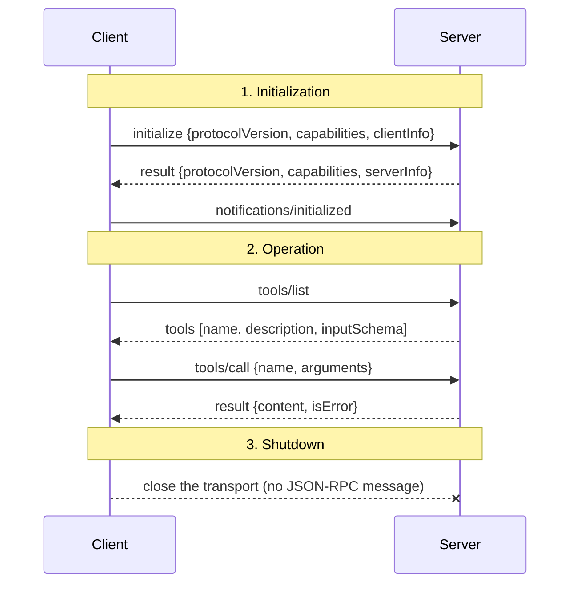

# Chapter 3: Lifecycle, JSON-RPC and capability negotiation

*Every MCP connection follows the same script: shake hands, agree on a version and abilities, then work.*

> [!NOTE]
> **📍 At a glance**
> - **You will learn:** who triggers each primitive, the protocol call behind each, the three lifecycle phases, JSON-RPC 2.0, the initialization handshake, version and capability negotiation, and elicitation
> - **You will build:** a server with all three primitives, and a "wiretap" that shows the real messages
> - **Level:** intermediate · **Time:** about 60 minutes
> - **Builds on:** [Chapter 2](02-primitives-and-architecture.md). **Leads to:** [Chapter 4](04-operation-transports-and-shutdown.md)

**After this chapter you can:**

- Add a resource and a prompt to a tools-only server, and list and read them
- Say who triggers each primitive: the model, the application or the user
- Name the protocol calls behind each primitive (`tools/list`, `resources/read`, `prompts/get` and so on)
- Explain the three lifecycle phases in order
- Read a JSON-RPC request, response, notification and error
- Explain why MCP uses JSON-RPC and not plain REST
- Walk through the three-step initialization handshake and version negotiation
- Say what capability negotiation declares, and why `tools/list` is still needed after it
- Explain elicitation, and why it is not human-in-the-loop

**Builds on:** [Chapter 2](02-primitives-and-architecture.md). The operation phase, the transports and shutdown are in [Chapter 4](04-operation-transports-and-shutdown.md).

## 3.1 Who starts each primitive?

- **Tool:** the **model** decides, in the middle of a conversation
  - It is the one primitive where the AI "holds the wheel"
- **Resource:** the **application** (the host) decides to read it and feeds the content in as context
  - Example: a team style guide on a drive, read up front so every answer follows house style
- **Prompt:** offered to the **user** (through the host) to pick **before** the conversation starts
- A resource never changes anything. It is something to look at
- **Resources and prompts are optional.** GitHub's official MCP server ships **tools only**, and that is a valid, common design

## 3.2 The protocol calls behind each primitive

| Primitive | Discover | Use | Example |
|---|---|---|---|
| Tools | `tools/list` | `tools/call` | GitHub `create_issue` |
| Resources | `resources/list` | `resources/read` | a shared style guide |
| Prompts | `prompts/list` | `prompts/get` | `structured_escalation` |

- A client calls the `list` calls **first**. That is how a host learns what a server offers before using any of it
- **Resources have more:** **templates** (one resource pattern answers for a whole family, such as every customer record) and **subscriptions** (the client is told when a resource changes, instead of re-reading on a timer)
  - Templates are built and tested just below. Subscriptions are only named here
- The handout whiteboard also lists the prompts functions as `list` and `get`, tools as `list` and `call`, and resources as `list`, `get`, template/list and listen

### Resource templates: one pattern, many resources

Class 17's example: a travel company keeps a visa checklist per destination. That is one pattern with a blank, not one resource per country.

```python
from fastmcp import FastMCP

mcp = FastMCP("Travel Docs")

@mcp.resource("visa://{country}/checklist")          # {country} makes this a template
def visa_checklist(country: str) -> str:
    """Visa checklist for one destination country."""
    return f"Visa checklist for {country}: passport valid 6 months, photo, bank statement."
```

```python
import asyncio
from fastmcp import Client

async def main():
    async with Client(mcp) as client:                  # in-memory: no process, no network
        print(await client.list_resources())                                   # []
        print([t.uri_template for t in await client.list_resource_templates()])
        print((await client.read_resource("visa://uae/checklist"))[0].text)

asyncio.run(main())
```

✅ *Verified (`fastmcp` 4.2.0): `list_resources()` returned `[]`, the template listed as `visa://{country}/checklist`, and reading `visa://uae/checklist` returned the UAE text.*

- A template is listed by **`resources/templates/list`**, not by `resources/list`. A client that only calls `resources/list` never sees it
- The client fills the blank and reads a concrete URI with `resources/read`. The `{country}` part arrives as the function's argument
- Use a template when the set of documents is open-ended (every country, every customer); use a plain resource for one fixed document
- In Python the field is `uri_template` (MCP SDK v2). Older code that reads `uriTemplate` still works in `fastmcp` 4.2.0, with a deprecation warning

### How a client learns that the tools changed

- The class: "a subscription kind of thing; it regularly checks"
- The protocol: a server that declared `tools: {listChanged: true}` sends **`notifications/tools/list_changed`** when its tools change. The client then calls `tools/list` again. No polling
- Added to the same server, a tool that switches on another tool and announces it:

```python
from fastmcp import Context
from mcp.types import ToolListChangedNotification

@mcp.tool
async def enable_hotels(ctx: Context) -> str:
    """Turn on hotel booking for this server."""
    @mcp.tool
    def book_hotel(city: str) -> str:
        """Book a hotel in a city."""
        return f"Booked a hotel in {city}"
    await ctx.send_notification(ToolListChangedNotification(method="notifications/tools/list_changed"))
    return "Hotel booking is on."
```

```python
async def on_message(message):
    print("server says:", getattr(message, "method", message))

async def main():
    async with Client(mcp, message_handler=on_message) as client:
        print([t.name for t in await client.list_tools()])
        await client.call_tool("enable_hotels", {})
        await asyncio.sleep(0.1)                         # let the notification arrive
        print([t.name for t in await client.list_tools()])

asyncio.run(main())
```

✅ *Verified (`fastmcp` 4.2.0): the client printed `['enable_hotels']`, then `server says: notifications/tools/list_changed`, then `['enable_hotels', 'book_hotel']`.*

- **Don't count on it by default.** Tested: `fastmcp` 4.2.0 declared `listChanged: false`, and adding a tool without the explicit `send_notification` line sent nothing. The new tool only appeared on the client's next `tools/list`
- So a client should also re-list after reconnecting, and a server that changes its tools should declare `listChanged` and send the notice

## 3.3 Tools, resources and prompts in one server

The class built this from the Chapter 2 warm-up server. **Two more decorators** is the whole difference.

```python
from fastmcp import FastMCP

mcp = FastMCP("Warm-Up Server")

@mcp.tool
def greet(name: str) -> str:
    """Greet someone by name."""
    return f"Hello, {name}! Welcome to MCP."

@mcp.resource("file://server-notes")
def server_notes() -> str:
    """Read-only notes about this server, straight from a local file."""
    with open("server-notes.txt") as f:
        return f.read()

@mcp.tool
def add(a: int, b: int) -> int:
    """Add two numbers together."""
    return a + b

@mcp.prompt
def structured_escalation(issue_summary: str, what_was_tried: str, customer_sentiment: str) -> str:
    """Guides the AI to log a customer escalation with every required field, in order."""
    return f"""Log this customer escalation with the following structure:
Issue Summary: {issue_summary}
What Was Already Tried: {what_was_tried}
Customer Sentiment: {customer_sentiment}
Recommended Next Action: [determine this from the details above]
"""

if __name__ == "__main__":
    mcp.run()
```

Create the file the resource reads, next to `server.py`:

```bash
printf 'This server was built across Parts 2 and 4A of the MCP crash course.\nIt demonstrates all three primitives: tools, resources, and prompts.' > server-notes.txt
```

- In the Inspector: `greet` and `add` under **Tools**, `file://server-notes` under **Resources**, `structured_escalation` under **Prompts**
- The prompt asks for exactly its three arguments. Filled in, it gives the same structure every time:

```
Issue Summary: Order #4521 arrived damaged
What Was Already Tried: Customer emailed support once, no reply in 3 days
Customer Sentiment: Frustrated, considering a refund request
Recommended Next Action: Escalate to logistics team, offer expedited replacement
```

- The model did not change. Only a form was added
- The `Recommended Next Action` line is left for the **model** to fill in
- Most tutorials stop at tools because tools are the easiest to demo

### Checked: what the code really does

*Checked on `fastmcp` 4.1.4.*

- The server lists **one resource, one prompt and two tools**. The prompt's three arguments are all required
- **The server reports the resource URI as `file://server-notes/`, with a trailing slash.** Reading it by raw JSON-RPC with the slash works. Without the slash it fails with error `-32602`, "Resource not found". The FastMCP `Client` accepts both
  - Rule: **use the URI exactly as `resources/list` returned it**
- **The relative path breaks when the working directory changes.** `open("server-notes.txt")` is relative to the process's working directory
  - Launched from another folder, the read fails with `FileNotFoundError`. A host that starts your server from its own folder will hit this
  - Fix: build the path from the script's own location, as in the snippet below
- `prompts/get` returns a message with role `user` whose text is the filled template

```python
from pathlib import Path

NOTES = Path(__file__).with_name("server-notes.txt")

@mcp.resource("file://server-notes")
def server_notes() -> str:
    """Read-only notes about this server, straight from a local file."""
    return NOTES.read_text()
```

## 3.4 The three lifecycle phases



- Every MCP connection goes through three phases, **always in this order**:
  1. **Initialization:** the handshake. Meet for the first time, agree on a version, declare capabilities
  2. **Operation:** the real work. Discover and use tools, resources and prompts
  3. **Shutdown:** the connection ends, cleanly or by force
- Picture: handshake and introduction, then the conversation, then saying goodbye. You cannot start the conversation before anyone is introduced
- The handout's sequence: `initialize` request, `initialize` response, `initialized` notification, normal protocol operations, shutdown, disconnect, connection closed
- **Why a connector shows a warning icon before you use it:** at start-up the host initializes a connection to **every** configured server. If the handshake fails, the host already knows
- Operation and shutdown get their own chapter

## 3.5 JSON-RPC 2.0

- **JSON-RPC 2.0** is the shared language between client and server. It sits in the **data layer**: the rules for how client and server exchange data
- **JSON:** the familiar text data format
- **RPC (remote procedure call):** run a function on another machine as if it were local, hiding the network details
  - Instead of spelling out low-level steps, the client says "query the database with these arguments"
- **JSON-RPC is not an MCP invention.** It is an existing, general specification that MCP adopted

**The shape of every message:**

```json
{ "jsonrpc": "2.0", "id": 1, "method": "tools/list", "params": {} }
{ "jsonrpc": "2.0", "id": 1, "result": { "tools": [ ] } }
```

- **`jsonrpc`:** always `"2.0"`
- **`id`:** ties a response to its request. The handout types it as a string or a number
  - Responses may arrive **out of order**, so the id is the only way to match them
- **`method`, `params`:** what is being asked. `params` is optional
- A response holds **either** `result` **or** `error`, never both
- **Notification:** a message with **no `id`**. "Fire this and expect nothing back"

*Checked, by talking to a real server over STDIO:*

- An unknown **method** returns a JSON-RPC error: code `-32601`, "Method not found"
- An unknown **tool** does **not**. It returns a normal `result` with `"isError": true` and the text "Unknown tool". Tool failures travel in the result so the model can read them
- Two requests sent back to back came back with their own ids (99 then 98 here). Match by id, not by position

**Two rules MCP adds to the `id`** (from the specification, web-checked):

- It is **never `null`**, which plain JSON-RPC allows
- It is **never reused** while it could be confused: in the 2025-03-26 spec, not within the same session; in the 2026-07-28 spec, not while a response to an earlier request with that id is still awaited

**Batches: gone**

- The class: a client can batch several requests into one message. JSON-RPC allows that, and MCP's 2025-03-26 spec added it. The next spec, 2025-06-18, **removed** it
- *Tested (`fastmcp` 4.2.0, STDIO):* a batch of two requests got **no reply at all** within 3 seconds, and the next normal request was answered. A client that batches can hang waiting
- Send separate requests instead. They can all be in flight at once; the ids keep them apart

## 3.6 Why JSON-RPC and not plain REST?

Flagged in class as an interview-depth question.

- **Lightweight:** plain, readable JSON with none of the headers and overhead of a typical REST or XML call
- **Transport-agnostic:** the same messages work locally (STDIO) and remotely (HTTP)
- **Genuinely two-way:** in a normal HTTP API only the client calls and the server replies. In JSON-RPC **either side can start a request**
  - Useful for long tasks: the server can report progress itself, so the client does not poll
- **Notifications built in:** a message with no `id` expects no reply
- **Standard error codes:** inherited, like HTTP's 404 and 500

**Two things that are not the same as two-way:**

- **Not the same as asynchronous.** Async means the client sends a request, carries on and gets the answer later. The server still never starts anything
- **Not the same as a WebSocket.** A WebSocket is a permanent open connection. Two-way is a property of the protocol, not of keeping a socket open

**"Why JSON-RPC and not HTTP?"** (named in class 18 as an interview question)

- The question mixes two layers. **HTTP is a transport**, and MCP does run over it (Streamable HTTP, [Chapter 4](04-operation-transports-and-shutdown.md), 4.9). **JSON-RPC is the message format**, carried over STDIO or HTTP
- A strong answer names both: JSON-RPC for the messages (the five points above), STDIO or HTTP to carry them. The real comparison is with REST-style endpoints, one URL per operation

## 3.7 The initialization handshake

Three steps, in this order:

```
Client → Server : 1. initialize  (id 1: protocol version, capabilities, client info)
Server → Client : 2. response    (id 1: protocol version, capabilities, server info)
Client → Server : 3. initialized (notification: no id, no reply)
                  ... normal operation can begin
```

- The **client speaks first**. It sends its latest supported protocol version, its capabilities and basic client info
- The **server answers with the same id**: its protocol version, its capabilities (tools? resources? prompts?) and its name
- The client sends `initialized` as a **notification**. This is the "notifications built in" idea in practice
- **Two ordering rules:** before the server answers `initialize`, the client sends nothing except pings. Before the server receives `initialized`, it sends nothing except pings
- In class this was shown live in Claude Desktop's MCP log on macOS (`~/Library/Logs/Claude/mcp.log`), against a real local server (Apple Notes over STDIO)
- On Windows the same logs are in `%APPDATA%\Claude\logs`. `mcp.log` holds connection events; `mcp-server-<name>.log` holds each server's standard error *(from the MCP debugging docs, web-checked)*

✅ *Verified:* a real server answered `initialize` with its version, the capabilities `logging`, `prompts`, `resources` and `tools`, and its name. The client then sent `{"jsonrpc":"2.0","method":"notifications/initialized"}` with no id.

## 3.8 Version negotiation

- The client sends **only the latest** version it supports. Never a list of everything it has ever supported
- **Server supports that version:** it answers with the same one
- **Server does not:** it answers with the latest version **it** supports. The client checks that against its own supported list
  - In the handout flowchart, `SUPPORTED_PROTOCOL_VERSIONS` is checked **exactly once**
  - Match: send `initialized` and go on. No match: **disconnect**, send nothing further
- **Class 17's recording put it differently:** if they don't agree, "they send the list of versions which they support" and check again
  - The handout has **one** answer and **one** check, and the real server below answered with **one** version, not a list
  - A list does appear in the modern `server/discover` answer: `supportedVersions` (below)
- Analogy from class: Windows and a game agreeing on DirectX. They settle on the highest version both share
- Real consequence: a serious client, such as one built for a company, must decide **which historical versions it supports** and handle each difference in behaviour. "Connect to whatever URL I am given" is not enough. Class flagged this as interview depth

✅ *Verified:* asking a real server for version `2099-01-01` made it answer with `2025-11-25`, its own latest.
- **Modern clients try a newer call first.** ✅ *Verified with `mcp` 2.3.0:* the client's first message to a server was **`server/discover`** (version `2026-07-28`), not `initialize`
  - A server that answered "Method not found" made the client **fall back** to the old handshake: `initialize` with version `2025-11-25`
  - A current `fastmcp` 4.1.4 server answered `server/discover` directly, with `supportedVersions` and its capabilities
  - This is the "newer discovery call, then fall back" that class 18 saw in a debugging tool. The legacy and modern handshakes get their own chapter ([Chapter 7](07-legacy-vs-modern-mcp.md))
  - The 3.7 handshake is the **legacy** pattern, still what most servers use. Class estimate for the ecosystem to move: **8 months to a year**, with only the most actively maintained servers moving in the first couple of months

## 3.9 Capability negotiation

- Class picture: **both sides hand over an honest menu before anyone orders**
- Each side declares what it **can** do, not what it is about to do. Nothing is used until it is needed later
- **Client can declare** (class 18):
  - `roots`: it can expose file-system access
  - `sampling`: it can handle an LLM sampling request
  - `elicitation`: it can ask the user for information on the server's behalf
  - `tasks`, and `experimental` (non-standard features)
- **Server can declare:**
  - `tools`, `resources`, `prompts`: the three primitives
  - `logging`
  - `completions`: argument auto-completion
  - `experimental`
- **The two lists differ between sources.** The class 17 handout showed a shorter list (client: roots, sampling, experimental; server: tools, resources, prompts, logging) and noted that roots, sampling and logging are being **deprecated** in the newest spec revision. Class 18 showed the longer list above. Treat both as snapshots and check the current specification
- **"Deprecated" does not mean "unused".** Most servers in the wild still run the older pattern

**Capability negotiation is not discovery:**

- Negotiation says a **category** exists ("this server has tools")
- Discovery (`tools/list`) says **which** tools, their names, descriptions and argument schemas
- A client therefore still calls `tools/list` after the handshake (class 18 student question)

✅ *Verified:* a real server's answer listed the capabilities `logging`, `prompts`, `resources` and `tools`, and no `completions`. A server only declares what it has. In the newer `server/discover` answer each capability carried flags such as `listChanged` and `subscribe` (all `false` here).

### Elicitation

- **Elicitation:** the server asks for **more information from the user, through the client, in the middle of a task**
  - It is the two-way nature of JSON-RPC made concrete: the server reaches out, instead of only replying
- How a framework surfaces it is up to the framework. For LangChain, see [Langchain, Chapter 12](../langchain/12-mcp-in-langchain.md), 12.7
- **Not the same as human-in-the-loop (HITL):**
  - HITL is a safety layer in the AI application: approve, edit or reject a tool call ([Langchain, Chapter 11](../langchain/11-runtime-and-human-in-the-loop.md))
  - Elicitation is a native MCP request from a **server** for information it is missing
- Not run in these notes. It needs a client with an elicitation handler

> [!IMPORTANT]
> **🏭 In production**
> - **Check capabilities before you use a feature.** Call `resources/subscribe` or send elicitation only if the other side declared it; otherwise expect an error
> - **Log the negotiated protocol version** for every connection. Version mismatches are a common cause of "works locally, fails in production"
> - **Pin SDK versions** for client and server together, and upgrade them deliberately
>
> *Added by Claude.*

## 3.10 Seeing the real messages: the wiretap

- **The problem:** from a Claude Desktop update on 26 June 2026, its own log files stopped writing the full JSON body of each message. They keep only a short summary (method, id, whether params or a result are present)
- **The idea:** a small script that sits **between** the host and the real server, relays every byte unchanged, and prints a pretty copy of each message
- **Wiring:** in the host's config, point `command` and `args` at the wiretap script instead of the real server. Everything after `--` is the real command that used to be there
  - The host never knows the difference
- A sanitised sample config from the class shows two servers: a filesystem server run **through** the wiretap with a `--log` file, and a plain FastMCP server

```json
{
  "mcpServers": {
    "demo-filesystem-wiretapped": {
      "command": "python3",
      "args": [
        "/path/to/mcp_wiretap.py", "--log", "/path/to/wiretap-live.log", "--",
        "npx", "-y", "@modelcontextprotocol/server-filesystem", "/path/to/directory"
      ]
    }
  }
}
```

- **Restart the host fully**, then use it normally. The terminal or the log file shows the handshake, capability discovery, every tool call and shutdown
- Replace the `/path/to/...` values with your own. Do not copy someone else's machine paths
- **The script, read and run:** `mcp_wiretap.py` (165 lines, standard library only)
  - Usage: `python3 mcp_wiretap.py [--log FILE] [--no-color] -- <real command> [args...]`
  - It starts the real server as a sub-process, then two threads relay lines: host stdin to server, and server stdout to host
  - Each message is printed pretty and coloured to **stderr**, never stdout. stdout is the protocol channel, and anything extra there would break the connection
  - `--log FILE` appends the same text to a file. It writes the **colour codes too**, meant for `tail -f` in a terminal
  - `--no-color` is for plain text editors. `mcp_wiretap_no_color.py` is the same tool with colour removed from the code (4.5 KB against 6.7 KB)
  - When the real server exits, it prints and logs `real server exited with code N`
- ✅ *Verified:* I put it in front of the RecipeBox server and sent `initialize`, `initialized` and a `tools/call`. The replies came back unchanged
  - Log: 3 client-to-server and 2 server-to-client banners (the `initialized` notification has no reply)
  - Colour codes were in stderr and log by default. With `--no-color`, and in the `no_color` file, there were none
- **Limits:** it reads **line by line**, so it fits STDIO servers that send one JSON message per line. It does not tap HTTP servers
- The class folder holds two copies of each script, byte-identical

**Another way to watch: an inspector app** (class 18)

- The class used **MCPJam Inspector**, an open-source (Apache 2.0) tool for testing MCP servers
  - It connects over STDIO or HTTP, shows the **raw JSON-RPC** of every message, and has an LLM playground for trying a server with a model
- Start it with `npx @mcpjam/inspector@latest`
- In class its client sent the newer `server/discover` call first, got an error from the older server, then fell back to `initialize` (3.8)
- *Web-checked 2026-11-15; not run here (it needs `npx` and a download)*

## 3.11 Project: AI updates, with no code

A whiteboard project from the handout. Aim: **MCP concepts without writing a line of code**, using Claude Desktop **connectors**, which are MCP servers.

- **Flow (as drawn):**
  - The user asks for an **AI update email**
  - Several **search** steps run in parallel. The whiteboard labels them as internet search with **Tavily**
  - The results are combined into a **readable letter**
  - Outputs: **save as a draft** in Gmail, a **calendar meeting** to read it every day at 8 am, and a **LinkedIn post saved in Apple Notes**
  - A **schedule** is added so it repeats
- **Homework on the board:** a stock recommendation, plus buying
- **Class 18 built it live** with four connectors switched on as MCP servers: **Gmail, Google Calendar, Tavily, Apple Notes**
  - Claude turned the rough diagram into a structured **system prompt**
  - The flow: research AI news with Tavily, categorise it, draft an HTML email, create a recurring calendar reminder, produce a LinkedIn post and a Substack-style article
- **"Brain decides, tools act."** The model decides which tool, with what arguments, and how to read a result. Data moves only through tool calls
  - A search tool does not write the story. The model assembles the results into one
- **Lesson from the live run:** with no instruction on how many headlines per category, the model made its **own assumption** and quietly dropped real stories
  - Fix: say exactly how much detail you want per category, then test
- The boxes on the whiteboard are unlabelled and the brain icons mark the steps where the model works. The detail of the steps was not written on the page

**More from the live run** (class 18 recording):

- **Turning the diagram into a prompt:** Claude asked clarifying questions first, each with multiple-choice answers
  - Which news categories, what voice for the LinkedIn post and the article, and whether to set up one recurring calendar event instead of one per run
  - Read the generated prompt before running it: it had left out the Apple Notes folder
- 🔒 **Keep personal details out:** the class added a line to the prompt telling Claude to keep all personal information out of the outputs. The same Claude account holds context from other work
- **Permission prompts are human-in-the-loop:** "Allow once" and "Always allow" on each tool are the host asking a human before an action
- **The homework, live:** stock ideas from the news through **Alpha Vantage**, added as a custom connector (its sign-in step asked for a free API key)
  - Third-party servers can be free or paid, with usage limits. When you connect a server, look at the tools it offers
- **Buying is a different risk class:** a broker connector (the class named Zerodha) can place real orders. The class advice: don't, or only with tiny amounts. *Added by Claude:* put any tool that places orders behind a human approval step
- **Scheduling:** asked to run daily at 7 am, Claude pointed to Claude Cowork for scheduled tasks
- **Check the output format:** the LinkedIn post and the article came back as Markdown, which Apple Notes does not render
  - In an online Markdown viewer they read fine. The class left the fix as a prompt change: ask for a format the target app shows

## 3.12 Class questions

- **Can one MCP server call another?** Yes. A server can act as a client to another server inside it
- **Is FastMCP the only way?** No. The official MCP SDK is the base. FastMCP is the popular layer on top, like Keras over TensorFlow
- **Why bother with MCP if we have REST and a chatbot?** Integration count. N apps and M tool sets need about **N times M** custom integrations. With a shared protocol it is about **N plus M**. It also makes access usable by non-technical people. The class admitted it can feel like extra abstraction for a pure API call
- **How does a client know which server to connect to?** The address or URL is given when the client is configured. It is not discovered at connect time
- **How does a server tell which client a request came from?** The transport layer keeps session details once connected
- **My own email domain: how do I make it MCP compatible?** You do not make a domain compatible. You **build an MCP server** for it
- **Why call `tools/list` if negotiation already said the server has tools?** Negotiation names the category. Discovery fetches the actual tools (3.9)
- **How is elicitation different from HITL?** Elicitation is the server asking for missing information. HITL approves, edits or rejects tool calls (3.9)
- **Logs used to show full JSON-RPC and now do not. Did the protocol version change?** No. The class's answer: Anthropic's own client changed how much it writes to disk. It is unrelated to the MCP specification and to version negotiation
- **Who builds what for Gmail?** The service provider builds the **server**. The host builds the **client**. Claude's Gmail client is Anthropic's work
- **Reference server from the class:** `Link.txt` points to a Gmail MCP server on GitHub (`theposch/gmail-mcp`). It was shared as a reference and not read for these notes
- **Does the server run the tool, or the agent?** The **server** runs it
  - The model picks the tool and its arguments, the host's client sends `tools/call`, and the server runs the function and returns the result
  - The class: "host tells the client, client calls the tool"
- **How does the server send a request to the client? Is there a callback URL?** No callback URL. It uses the connection that is already open
  - STDIO: it writes the request to its output. Streamable HTTP: it sends it on an event stream the client holds open (spec; [Chapter 4](04-operation-transports-and-shutdown.md), 4.9)
  - The class answered "JSON-RPC and MCP protocol": the message format, not the route
- **How does a client learn that the tools changed?** Through `notifications/tools/list_changed`, if the server sends it (3.2)
- **Does the client cache the tool list?** The class gave two answers
  - Class 17: "in the latest version, it does". Class 18: "I'm not sure that by default, MCP caches anything"
  - The protocol's answer is the change notice: a client can keep its list until the server says it changed. Tested: `fastmcp` 4.2.0 does not send that notice by itself (3.2)
- **Can I batch several requests in one message?** Not any more. Batching was removed in the 2025-06-18 spec (3.5)
- **Prompts or skills?** The class: "skills are just some predefined instructions", for work you repeat, so "skills are just prompts"
  - In MCP terms: a prompt is a template a **server** offers, and the user picks it. For skills inside agents, see [Langchain, Chapter 14](../langchain/14-handoffs-skills-router-and-custom-workflows.md)

## 3.13 Added by Claude, not from the sources

Not in the course material. Items marked *checked* were tested with `fastmcp` 4.1.4.

- **Read resources by the URI the server lists.** ✅ *Verified:* the server normalised `file://server-notes` to `file://server-notes/`, and the raw request without the slash failed
- **Never rely on the working directory in a server.** ✅ *Verified:* a relative path failed when the server was started from another folder. Use `Path(__file__)`
- **Two kinds of failure, two shapes.** ✅ *Verified:* a protocol problem (unknown method) is a JSON-RPC `error`. A tool problem (unknown tool) is a `result` with `isError: true`. Handle both in a client
- **Match responses by id.** Never assume replies arrive in the order you sent requests
- **Watch the wire with a model-free client.** The raw STDIO test below needs no host and no model. It is the fastest way to see the real messages
- **Check the current specification.** Version dates and which features are deprecated change. The version strings above come from the test, not from this chapter's sources

A minimal raw client that you can run against any STDIO server:

```python
import subprocess, json, sys

p = subprocess.Popen([sys.executable, "server.py"], stdin=subprocess.PIPE,
                     stdout=subprocess.PIPE, stderr=subprocess.DEVNULL,
                     text=True, bufsize=1)

def send(msg): p.stdin.write(json.dumps(msg) + "\n"); p.stdin.flush()
def recv(): return json.loads(p.stdout.readline())

send({"jsonrpc": "2.0", "id": 1, "method": "initialize",
      "params": {"protocolVersion": "2025-06-18", "capabilities": {},
                 "clientInfo": {"name": "raw-test", "version": "0"}}})
print(recv()["result"]["protocolVersion"])            # step 2: the server's answer
send({"jsonrpc": "2.0", "method": "notifications/initialized"})   # step 3: no id
send({"jsonrpc": "2.0", "id": 2, "method": "prompts/list"})
print([x["name"] for x in recv()["result"]["prompts"]])
p.terminate()
```

## 3.14 Interview corner

**What interviewers listen for:** the three phases in order, what a JSON-RPC request, response, notification and error look like, and why both version and capabilities are negotiated

### 🟢 Basic

<details class="qa"><summary>1. Who decides when a tool, a resource and a prompt are used?</summary>

- The model decides tools. The application decides resources. The user picks prompts
- *Stronger answer:* a resource never changes anything, and resources and prompts are optional

</details>

<details class="qa"><summary>2. What are the three lifecycle phases?</summary>

- Initialization, operation, shutdown, always in that order

</details>

<details class="qa"><summary>3. Walk me through the handshake.</summary>

- Client sends `initialize` with a version, capabilities and info. Server replies with the same id. Client sends an `initialized` notification
- *Stronger answer:* before each side hears the other, only pings are allowed

</details>

<details class="qa"><summary>4. Why JSON-RPC and not REST?</summary>

- Lightweight, transport-agnostic, two-way, notifications built in, standard error codes
- *Stronger answer:* two-way means the server can start a request, which suits progress on long tasks. It is not the same as async or a WebSocket

</details>

### 🟡 Intermediate

<details class="qa"><summary>5. What is the <code>id</code> for? What if it is missing?</summary>

- It matches a response to its request, since responses can arrive out of order
- A message with no id is a notification and gets no reply

</details>

<details class="qa"><summary>6. How does version negotiation work?</summary>

- Client sends its latest version. Server answers with that or its own latest. Client accepts or disconnects
- *Stronger answer:* a real client must decide which historical versions it supports

</details>

<details class="qa"><summary>7. Is JSON-RPC an MCP invention?</summary>

- No. It is a general existing specification that MCP adopted

</details>

<details class="qa"><summary>8. Why does the client call <code>tools/list</code> if negotiation said the server has tools?</summary>

- Negotiation names a category. Discovery fetches the names, descriptions and schemas

</details>

<details class="qa"><summary>9. What is elicitation, and is it human-in-the-loop?</summary>

- A server asking the user for missing information through the client, mid-task. No. HITL is an application-side approval layer on tool calls

</details>

### 🔴 Senior

<details class="qa"><summary>10. A client connects to an old server. What happens?</summary>

- ✅ *Verified:* a modern client tries `server/discover` first. On "Method not found" it falls back to `initialize`. A serious client supports both

</details>

<details class="qa"><summary>11. Client and server support different protocol versions. What happens?</summary>

- The client proposes its version; the server answers with that version if supported, otherwise with its own latest
- *Stronger answer:* if the client cannot use the server's version it should disconnect cleanly; log the negotiated version to debug mismatches

</details>

<details class="qa"><summary>12. Why is MCP stateful, and what does that cost when you scale?</summary>

- A session starts with a handshake and keeps negotiated capabilities
- *Stronger answer:* behind a load balancer you need session affinity or a stateless server mode, and reconnect logic; the modern 2026-07-28 spec removes the handshake and sessions entirely ([Chapter 7](07-legacy-vs-modern-mcp.md))

</details>

<details class="qa"><summary>13. Your client sends several requests in one JSON-RPC batch and then hangs. Why?</summary>

- Batching was added in the 2025-03-26 spec and removed in 2025-06-18. A current server may simply not answer a batch (tested: no reply within 3 seconds)
- Send the requests separately. They can all be in flight at once, matched by id
- *Stronger answer:* pin the protocol versions your client implements, give every request a timeout, and test against servers of each version you support

</details>

<details class="qa"><summary>14. "Why does MCP use JSON-RPC and not HTTP?"</summary>

- The question mixes layers. HTTP is one of MCP's transports (Streamable HTTP); JSON-RPC is the message format carried over STDIO or HTTP
- Against REST-style endpoints, JSON-RPC gives two-way requests, notifications, one message shape for every operation, and transport independence
- *Stronger answer:* show both layers in one example: an `initialize` request as a JSON-RPC message, sent as one line on STDIO or as a POST body over HTTP

</details>

> [!TIP]
> **🧩 Design question**
> - *"You must expose a reporting system to AI hosts that may be older or newer than your server. How do you handle compatibility?"*
> - Talk about: version negotiation, declaring only capabilities you implement, feature checks before optional calls, contract tests against two client versions, and a deprecation policy

## Cheat sheet

```json
{"jsonrpc": "2.0", "id": 1, "method": "initialize",
 "params": {"protocolVersion": "2025-06-18", "capabilities": {}, "clientInfo": {"name": "me", "version": "1"}}}
{"jsonrpc": "2.0", "method": "notifications/initialized"}
{"jsonrpc": "2.0", "id": 2, "method": "tools/list"}
{"jsonrpc": "2.0", "id": 3, "method": "tools/call", "params": {"name": "add", "arguments": {"a": 2, "b": 3}}}
{"jsonrpc": "2.0", "id": 3, "error": {"code": -32601, "message": "Method not found"}}
```

| Message | Has `id`? | Expects a reply? |
|---|---|---|
| Request | yes | yes |
| Response (`result` or `error`) | same `id` as the request | no |
| Notification | no | no |

- This is the **legacy (2025-11-25)** handshake the chapter teaches. The modern 2026-07-28 spec drops it and sends version and capabilities in `_meta` on every request ([Chapter 7](07-legacy-vs-modern-mcp.md))

## Recap

- **Tool:** model decides. **Resource:** application reads. **Prompt:** user picks. Resources and prompts are optional
- Calls: `tools/list` and `tools/call`, `resources/list` and `resources/read`, `prompts/list` and `prompts/get`
- Two decorators (`@mcp.resource`, `@mcp.prompt`) turn a tools-only server into a three-primitive one
- Lifecycle: **initialization, operation, shutdown**, in that order
- JSON-RPC 2.0: `jsonrpc`, `id`, `method`, `params`; a response has `result` or `error`; no `id` means notification
- Chosen over REST: lightweight, transport-agnostic, two-way, notifications, standard errors. It is not an MCP invention
- Handshake: `initialize`, response, `initialized` notification. Version: client proposes its latest, server answers, client accepts or disconnects
- Capability negotiation is a two-way menu: it names categories, `tools/list` names the tools. Elicitation lets a server ask the user for missing information
- A modern client tries `server/discover` first and falls back to `initialize`
- The wiretap sits between host and server and prints the real messages. MCPJam Inspector shows them in an app
- Resource templates (`resources/templates/list`) cover open-ended families of documents. `notifications/tools/list_changed` tells a client to re-list tools, if the server sends it
- Ids are never `null` and never reused while pending. JSON-RPC batches were removed in the 2025-06-18 spec

## Practice

1. Add `server_notes` and `structured_escalation` to your warm-up server. Confirm all three primitives in the Inspector
2. Move the notes path to `Path(__file__)` and start the server from a different folder
3. Run the raw client from 3.13. Add `resources/list`, `resources/read` and `prompts/get`
4. Trigger an unknown method and an unknown tool. Compare the two reply shapes
5. Find the three handshake messages in your own host's MCP log
6. Write by hand a JSON-RPC request and response for a hypothetical `send_email` tool, with a matching `id`
7. Say out loud why JSON-RPC was chosen over REST
8. For a service you use daily, list what would be a tool, a resource and a prompt
9. Open a real server's published capabilities (GitHub's or Gmail's) and check whether it ships tools only
10. Add a free, no-auth server such as Context7 in VS Code and watch the tools appear before you ask anything
11. Build the no-code AI-news project with three or more connectors. State how many items per category you want
12. Add the `visa://{country}/checklist` template to your server, then list templates and read two countries
13. Add `enable_hotels` and watch the client receive `notifications/tools/list_changed`. Then remove the `send_notification` line and see what changes
14. Send a two-request batch with the raw client in 3.13 and see what comes back

## How this chapter was checked

- **2026 review:** the lifecycle diagram, the production box, the graded interview and the cheat sheet were added (Added by Claude). The cheat-sheet messages follow the shapes already checked in 3.5 and 3.10
- Run with `fastmcp` 4.1.4: the full three-primitive server from the class notebook; `resources/list`, `resources/read`, `prompts/list` and `prompts/get` over raw JSON-RPC on STDIO; the `initialize` answer and capabilities; the `initialized` notification; an unknown method and an unknown tool; two back-to-back requests; a future protocol version; the first message a current client sends (`server/discover`) and its fallback to `initialize`; the trailing-slash URI behaviour; and the working-directory failure with a read from a different folder
- **Not run:** elicitation, the Inspector in a browser, Claude Desktop and its log files, the wiretap scripts, the Tavily and Gmail project, resource subscriptions, MCPJam
- *Class 17 and 18 recordings (5–6 Sep), added 2026-11-15, `fastmcp` 4.2.0 (the code blocks run as printed, in memory through `fastmcp.Client`):*
  - 3.2 template: `list_resources()` `[]`; `list_resource_templates()` gave `visa://{country}/checklist`; reading `visa://uae/checklist` returned the UAE text
  - 3.2 change notice: tools `['enable_hotels']`, then the notification `notifications/tools/list_changed`, then `['enable_hotels', 'book_hotel']`. Without the explicit notification, nothing arrived and the second list still showed `book_hotel`; the server's `tools` capability printed `list_changed=False` (`listChanged: false` on the wire)
  - The template client first read `t.uriTemplate`, which `fastmcp` 4.2.0 flags as deprecated (renamed `uri_template` in MCP SDK v2). The block now reads `uri_template` and was run again
  - 3.5 batch: over STDIO, after a normal handshake, a JSON array of a `tools/call` and a `tools/list` got no reply within 3 seconds; a following single `tools/call` returned `5`
  - Web-checked: the 2025-06-18 changelog (batching removed), the id rules in the 2025-03-26 and 2026-07-28 base protocol pages, the log paths in the MCP debugging docs, and MCPJam Inspector's README
- The class write-ups, notebook and handouts are the source for everything not marked *checked*. The three handout PDFs are whiteboard images, read as text and as images

## Sources and further reading

- Live-Class-2026, `classes_transcription_summary/18 - 6 Sep - MCP Capability Negotiation.md` (capability negotiation, elicitation, the no-code project, class Q&A)
- Live-Class-2026, `classes_summary/17 - 6 Sep - MCP Primitives, Architecture & Wiretap.md`
- Live-Class-2026, `classes_transcription_summary/17 - 5 Sep - MCP Deep Dive — Primitives, Lifecycle & JSON-RPC.md`
- Live-Class-2026, `Weekend 10 - 5-6 Sep/README.md`, and under `06 Sep - MCP Primitives & Architecture/`: `README.md`, `v4a_primitives_notebook.ipynb`, `MCP-Lifecycle.pdf`, `MCP-Primitives.pdf`, `AI-Updater-Project.pdf`, `claude_desktop_config.example.json`, `Link.txt`
- Sections 3.3 (Checked), 3.5 and 3.7 to 3.8 (the *checked* lines) and 3.13 are from testing, not from the class sources
- Class recording transcripts, uploaded by you: 5 Sep 2026 (class 17, teaching part 00:00–02:57) and 6 Sep 2026 (class 18, teaching part 00:00–03:10). The doubt sessions after them were left out
  - Used for: the visa-document example, the change-notice, batching, caching and callback questions, the JSON-RPC interview question, MCPJam, and the live AI-updates run
- MCP specification: [2025-06-18 changelog](https://modelcontextprotocol.io/specification/2025-06-18/changelog), base protocol [2025-03-26](https://modelcontextprotocol.io/specification/2025-03-26/basic) and [2026-07-28](https://modelcontextprotocol.io/specification/2026-07-28/basic); [MCP debugging docs](https://modelcontextprotocol.io/docs/tools/debugging) (log paths); [MCPJam Inspector](https://mcpservers.org/servers/MCPJam/inspector). Web-checked 2026-11-15
- Added by Claude: the template and change-notice code in 3.2, the batch test in 3.5, and interview questions 13–14

Previous: [Chapter 2, Primitives and architecture](02-primitives-and-architecture.md) · Next: [Chapter 4, Operation, transports and shutdown](04-operation-transports-and-shutdown.md)
