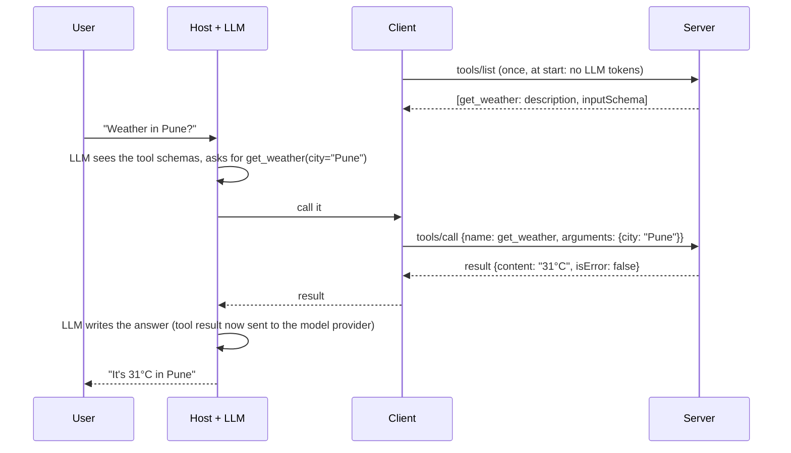
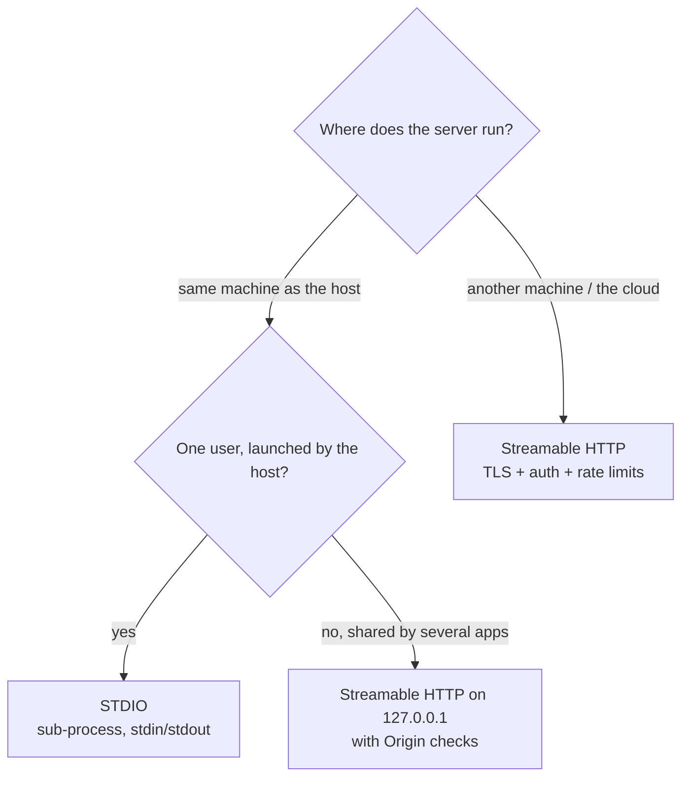

# Chapter 4: Operation, transports and shutdown

*Discover, call, and close cleanly, over a local pipe or over HTTP, without leaking data you did not mean to send.*

> [!NOTE]
> **📍 At a glance**
> - **You will learn:** the two steps of operation, what a tool looks like to the model, failed calls, what leaves your machine, STDIO vs Streamable HTTP, shutdown on each, and how to harden a transport
> - **You will build:** watch operation live, talk to a server over raw HTTP, and run a client against a STDIO server
> - **Level:** intermediate · **Time:** about 55 minutes
> - **Builds on:** [Chapter 3](03-lifecycle-json-rpc-and-capability-negotiation.md). **Leads to:** [Chapter 5](05-building-mcp-servers.md)

**After this chapter you can:**

- Describe the operation phase: discovery, then calling
- Explain what a tool schema is and why its description matters
- Say what a failed call looks like on the wire
- Explain the privacy cost of sending tool results to a model
- Describe STDIO and Streamable HTTP, and when to pick each
- Explain how shutdown works on each transport, and why JSON-RPC is not involved

**Builds on:** [Chapter 3](03-lifecycle-json-rpc-and-capability-negotiation.md) (handshake, JSON-RPC). **Next:** [Chapter 5](05-building-mcp-servers.md) builds real servers.

## 4.1 The operation phase: two steps



- After the handshake, operation has exactly two steps:
  - **Discovery:** `tools/list` (and `resources/list`, `prompts/list`)
  - **Calling:** `tools/call`

```
Handshake complete
Client → Server : tools/list                       (automatic, before any question)
Server → Client : [list_notes, get_note_content, add_note, update_note_content]
      ... later the user asks "list my Apple Notes in Personal" ...
Client → Server : tools/call  list_notes {"folder": "Personal"}
Server → Client : note titles, ids, dates
Client → Host   : result, turned into an answer by the model
```

- **Discovery fires by itself** the moment the handshake ends, before the user asks anything
  - It costs **no LLM tokens**. No model is involved. The client asks, the server answers
- **Calling** happens only when a request needs a tool. It always needs two things: the tool's **name** and its **arguments**
- A tool call by itself is a plain client-to-server exchange. Tokens are spent only when the **model** reasons or writes
- *Capability negotiation says a category exists. Discovery says which tools.* ([Chapter 3](03-lifecycle-json-rpc-and-capability-negotiation.md), 3.9)

## 4.2 What a tool looks like to the model

- Every tool on every server (Gmail, Calendar, Apple Notes) has the **same shape**: a **name**, a **description** and an **input schema**
- Live class example, from Claude Desktop's own log: Apple Notes `list_notes`
  - `folder`: string, optional, "filter notes by folder"
  - `limit`: number, default 20
  - The class folder keeps this schema as `Untitled-1.json` (a copy of `list_notes`: `folder` as an optional string, `limit` as a number with default 20). It is a scratch file, not part of a server
- Asking for the "Personal" folder sent `folder: "Personal"` with no `limit`, so the server's default of 20 applied
- **The description decides whether the model picks the right tool.** Write it for the model
- The model only learns a tool exists through discovery. It cannot call something it was never told about

## 4.3 When a call goes wrong

- A bad request does not fail silently. It comes back as an error
- Class claim: a wrong tool name returns a "method not found"-style JSON-RPC error
- *Checked on `fastmcp` 4.1.4, and different from the class claim:*
  - A wrong **method** (`does/notexist`) returns a JSON-RPC `error`, code `-32601`
  - A wrong **tool name** returns a normal `result` with `"isError": true` and the text "Unknown tool"
  - A **tool that raises** (RecipeBox `get_recipe("999")`) reaches the client as a `ToolError` that carries the Python `KeyError` text
- So a client must handle **both**: protocol `error` objects and results flagged `isError`
- The tool-error and retry middleware in LangChain exists for exactly this point ([Langchain, Chapter 9](../langchain/09-guardrails-to-do-lists-and-tool-resilience.md))

## 4.4 What leaves your machine

A student asked: "so with MCP, we are exposing our data to the LLM?" The class answer: **yes.**

- Whatever a tool returns goes from the client to the host, and the host sends it to the **model provider**
- It is real information flow, so there are real ways to limit it:
  - **Restrict what the connection can see.** Demonstrated live: a locked Apple Notes note is invisible to every MCP call
  - **Middleware** on your own side: PII detection and custom guardrails before a model call ([Langchain, Chapter 8](../langchain/08-prebuilt-middleware-limits-fallback-and-pii.md))
  - **Build your own server.** For a locked-down enterprise, class advice: a **custom, self-hosted MCP server**, possibly in its own container, so data never passes through a third-party connector
- **Per-user tool access** (read-only vs read-write) is not an MCP feature. The class called it ordinary software engineering, solved with middleware such as guardrails and dynamic tool loading
- **Caching:** not built in, as far as the class could confirm live. Build it yourself if you need it

## 4.5 Watching operation live

Three live demonstrations from class:

- **VS Code with Context7:** adding the server shows connect and tool discovery happening **before any request**
  - Context7 is free, needs no authentication and returns the **latest documentation** for a library. Class named it among the most-used servers
  - It fixes the lag between a model's training data and a library's current API
- **Claude Desktop with Apple Notes:** the tool list `list_notes`, `get_note_content`, `add_note`, `update_note_content` was visible before any note question
- **MCPJam Inspector**, an open-source inspector app ([Chapter 3](03-lifecycle-json-rpc-and-capability-negotiation.md), 3.10), on a two-tool time server (`getCurrentTime`, `convertTime`). The request "convert current Indian time to Chicago time" produced:
  1. an LLM call to understand the request
  2. `tools/call getCurrentTime`
  3. an LLM call to read that result
  4. `tools/call convertTime`
  5. a final LLM call to write the answer
  - The exact JSON-RPC bodies were visible at every step. **The `id` kept increasing across every call**, whatever the primitive
- **Why none of this is hand-written:** it is built into the protocol. Learn the steps anyway, because production failures happen at exactly these steps
- **Why Claude's own logs were not enough:** see the wiretap in [Chapter 3](03-lifecycle-json-rpc-and-capability-negotiation.md), 3.10

## 4.6 Why shutdown needs transports first

- Shutdown is not about what is said. It is about **how the connection closes**, and that depends on **how the two were connected**
- Class analogy: on WhatsApp, closing the connection means closing your internet. On a phone call, closing your internet does nothing, you hang up
- **JSON-RPC is the language and grammar. The transport is how the two sides are physically connected to say it**
- **No JSON-RPC messages are exchanged during shutdown.** The transport layer does all of it

## 4.7 Transport 1: STDIO

- **STDIO** is standard input and output. The same thing behind `#include <stdio.h>` in a C program

**The class demo:**

```python
name = input("Please tell me your name: ")
print(name)
print("Hello Mayank from Python file")
```

- Run it from a terminal. The **terminal is the client**, the Python file is started as a **sub-process** and is the **server**
- What the terminal sends becomes the file's input. What the file prints is what the terminal shows
- **Every STDIO MCP connection is this pattern:** launch a sub-process, send in on `stdin`, read out on `stdout`. Only the content is JSON-RPC
- ✅ *Verified:* the script, given `Mayank` on standard input, printed the prompt, the name and the greeting

**Benefits:**

- **Fast:** same machine, no network round trip
- **Secure:** nothing is exposed outside the machine
- **Simple:** no address, no network setup. Only a command

**Trade-off:** both sides must run on the **same machine**. It does not serve "anyone on the internet". By default STDIO needs the parent and sub-process relationship on one machine

**The rules on the wire** (the class's transport page; the specification, web-checked):

- **One message per line.** Each JSON-RPC message is a single line and must not contain a newline
- **`stdout` carries only MCP messages.** Logs go to `stderr`, which the client may show, store or ignore (4.8)
- **No login step.** The server runs as your own process. Secrets reach it as **environment variables** that the host sets
- **It sees only the variables it is given.** The MCP debugging docs: STDIO servers "inherit only a limited subset of environment variables automatically". Pass more with an `env` block in the host's config

```python
# env_server.py
import os
from fastmcp import FastMCP

mcp = FastMCP("Env Check")

@mcp.tool
def key_status() -> dict:
    """Report which settings this server can see (never the values)."""
    return {name: name in os.environ for name in ("WEATHER_API_KEY", "SHELL_ONLY")}

if __name__ == "__main__":
    mcp.run(show_banner=False)
```

```python
import asyncio, os, sys
from fastmcp import Client
from fastmcp.client.transports import StdioTransport

os.environ["SHELL_ONLY"] = "set-in-the-parent-only"

async def main():
    for env in (None, {"WEATHER_API_KEY": "demo-key"}):
        transport = StdioTransport(command=sys.executable, args=["env_server.py"], env=env)
        async with Client(transport) as client:
            print(env, (await client.call_tool("key_status", {})).data)

asyncio.run(main())
```

✅ *Verified (`fastmcp` 4.2.0): without `env` the server saw neither variable; with `env` it saw only `WEATHER_API_KEY`. The parent's own variable never reached it.*

- In Claude Desktop's config the same idea is an `env` block next to `command` and `args` ([Chapter 5](05-building-mcp-servers.md), 5.6)
- This is also why a command that works in your terminal can fail when a host starts it: the host's environment is not your terminal's

**Seen live (class 19): a filesystem server over STDIO**

- In MCPJam the local filesystem server showed its file tools. A `tools/call` to `list_directory` with a folder path returned that folder's files
- In Claude Desktop, "what files are in my MCP folder?" made Claude ask permission for `list_allowed_directories`, then for `list_directory`
- 🔒 It can only reach the folders named in its start command (the config in [Chapter 3](03-lifecycle-json-rpc-and-capability-negotiation.md), 3.10). Name a project folder, not your home folder. The class advice: keep folders with personal information out

## 4.8 STDIO shutdown

Almost always started by the **client**, in this order:

1. **Stop sending input** (close the server's `stdin`)
2. Send a **terminate** signal
3. Send **kill**, as a last resort

- **Server-initiated** shutdown is rare: the server closes its own output stream and exits
- Closing Claude Desktop just tells its servers' processes to stop. No JSON-RPC is involved

*Checked on a real FastMCP server over STDIO:*

| Action | Result |
|---|---|
| Close `stdin` | Server exited by itself, code 0 |
| Terminate (SIGTERM) | Exit code -15 |
| Kill (SIGKILL) | Exit code -9 |

**Standard output is the protocol channel.** Never write your own text there from a hand-written server. Log to standard error. ✅ *Verified:* `fastmcp` 4.1.4 sent a stray `print()` from inside a tool to standard error and the call still worked. Other libraries may not do this. That case was not tested

## 4.9 Transport 2: Streamable HTTP

- Built on ordinary **HTTP**. Because HTTP already works across the internet, a client can reach a server **anywhere**, not only on the same machine
- The client sends a **POST** to a single endpoint, almost always **`/mcp`**, with the JSON-RPC message as the request **body**
- Normal HTTP tools apply: headers, and standard auth such as OAuth or an API key
- It **replaces the older HTTP + SSE** (server-sent events) transport, now deprecated. Most existing servers still use the old one
- Live in class, with an Excalidraw MCP server:
  - `initialize` was a real POST call, then an `initialized` notification, then a `tools/list` POST that returned 5 tools, then a `resources/list` POST
  - The very first call was the newer `server/discover`, before the classic handshake ([Chapter 3](03-lifecycle-json-rpc-and-capability-negotiation.md), 3.8)
  - The class's own LangChain MCP server URL also ended in `/mcp`

**Checked, by hand with `httpx` against a FastMCP server on `http://127.0.0.1:8765/mcp`:**

```python
import httpx, json
u = "http://127.0.0.1:8765/mcp"
H = {"Accept": "application/json, text/event-stream", "Content-Type": "application/json"}
r = httpx.post(u, headers=H, json={"jsonrpc": "2.0", "id": 1, "method": "initialize",
     "params": {"protocolVersion": "2025-06-18", "capabilities": {},
                "clientInfo": {"name": "t", "version": "0"}}})
sid = r.headers["mcp-session-id"]                      # the server hands out a session id
H["mcp-session-id"] = sid
httpx.post(u, headers=H, json={"jsonrpc": "2.0", "method": "notifications/initialized"})   # 202, empty
httpx.post(u, headers=H, json={"jsonrpc": "2.0", "id": 2, "method": "tools/list"})
```

- The `initialize` reply came back as `text/event-stream`: a line `event: message` and a line `data: {...JSON-RPC...}`. **Even a plain POST is answered in that format**
- The server returned a **`mcp-session-id`** header. The client sends it on every later request
- The `initialized` notification got **HTTP 202** with an empty body (a notification expects no reply)
- `tools/list` then `tools/call` for `add(2, 3)` worked. Structured result: `{'result': 5}`
- A plain `GET /mcp` without the right `Accept` header: **406**. A wrong path: **404**
- `DELETE /mcp` with the session id: **200**, ending the session
- **The messages are the same JSON-RPC as over STDIO.** Only the carrier changed. That is what "transport-agnostic" means

**What the GET is for** (a class question left open: "I see a GET call in the log. What is it?")

- A client may send `GET /mcp` to open an **event stream**. The server can then send requests and notifications without waiting for a POST (specification)
- It is the route for server-to-client messages over HTTP, such as an elicitation request ([Chapter 3](03-lifecycle-json-rpc-and-capability-negotiation.md), 3.12)
- ✅ *Verified (`fastmcp` 4.2.0): `GET /mcp` with the session id and `Accept: text/event-stream` returned **200** with `text/event-stream`.* A server that offers no stream answers **405** (specification)

## 4.10 Streamable HTTP shutdown

- Simply **close the HTTP connection**. Like closing a browser tab or turning off Wi-Fi to end a chat
- **If a server closes unexpectedly**, something went wrong on its side. A well-built client should **try to reconnect**, not fail silently

**How an HTTP session ends** (specification, web-checked; ✅ *verified* on `fastmcp` 4.2.0):

| What happens | The server answers | The client then |
|---|---|---|
| Client sends `DELETE /mcp` with its session id | 200 (405 if the server does not allow it) | Is done. That id now gets 404 |
| Server has ended or forgotten the session (restart, idle timeout) | **404** "Session not found" | Must start again: a new `initialize` with **no** session id |
| A request other than `initialize` with no session id | **400** "Missing session ID" | Has a bug: it dropped the header |

- Each client's session is separate. ✅ After one client's `DELETE`, a second client's session kept working (200)
- With this, all three lifecycle phases are covered: **initialization, operation, shutdown**

## 4.11 Choosing a transport



| | STDIO | Streamable HTTP |
|---|---|---|
| Where the server runs | Same machine, as a sub-process | Anywhere with a URL |
| Setup | Only the command | URL, plus auth |
| Clients per server | Typically one | Many at once |
| Shutdown | Close input, terminate, kill | Close the connection |
| Typical use | Local tools, personal setups | Hosted and shared servers |

## 4.12 Class questions

- **Does STDIO only work on one machine?** Yes, by default, unless something proxies it
- **Why would an LLM call `list_recipes` before `get_recipe`?** It only knows `get_recipe` exists through discovery. At real scale there are thousands of records, not three
- **Is one tool needed per read operation on a database?** Yes, one tool per meaningful operation, and the model decides which fits
- **How does an LLM know what kind of file a resource holds?** Through the resource's declared **MIME type**
- **Does language matter (Python or Node)?** No. The protocol does not care. It is a team stack choice
- **Should I name FastMCP in an interview?** Concepts first: why MCP is built the way it is, and the legacy-versus-modern history. Class remark: about 90% can define an MCP server but cannot explain what happens underneath
- **Can I create an MCP server inside Claude?** No. You can **connect** your server to Claude. You do not build or host it there
- **Are connectors the same as MCP servers?** Yes. Claude uses friendlier words for a general audience
- **Is a "production-grade" project claim on a resume fine if it was not deployed at scale?** Describe it honestly and frame it around the problem solved. Shallow claims get exposed
- **Do MCP clients use WebSockets?** No (class 19). The specification defines two standard transports, STDIO and Streamable HTTP, and allows custom ones that keep the same JSON-RPC messages. ✅ `mcp` 2.3.0 has no WebSocket module
- **Is there a "streamable STDIO"?** No. "Streamable" belongs to the HTTP transport
- **Where is JSON-RPC in the `input()` demo?** Nowhere. The demo shows only the connection. JSON-RPC is what MCP sends over it (4.6)
- **Ten clients on one HTTP server: how does it tell them apart?** Each `initialize` gets its own session id, sent on every later request. ✅ Two clients got two different ids
- **Can a host use a STDIO server and an HTTP server at once?** Yes. One client per server, each on its own transport ([Chapter 2](02-primitives-and-architecture.md), 2.2)
- **If the connection drops, how long does the server wait?** That is a timeout setting (class answer). FastMCP's HTTP app has `session_idle_timeout` (4.13)
- **Is it safe to give Claude a folder of personal files?** The class: not if it holds personal information. Allow only the folders a task needs (4.7)

## 4.13 Hardening a transport

| Risk | Where | What to do |
|---|---|---|
| Stray output corrupts the protocol | STDIO | Never write anything but MCP messages to `stdout`; send logs to `stderr` |
| A web page talks to your local server (DNS rebinding) | local HTTP | Bind to `127.0.0.1`, not `0.0.0.0`; validate the `Origin` and `Host` headers |
| Anyone on the internet can call your tools | remote HTTP | TLS, authentication (the spec's OAuth-based flow, or an API key behind a gateway), per-user tokens, rate limits |
| Sessions break behind a load balancer | remote HTTP | Sticky sessions, or a stateless HTTP mode; reconnect when a session is lost |
| Secrets in logs | both | Never log `Authorization` headers or tool arguments that hold personal data |

- ✅ *Verified (`fastmcp` 4.1.4): a STDIO server that printed to `stdout`, at start-up and inside a tool, still worked with FastMCP's own client.* The specification still forbids non-MCP output on `stdout`, and other clients may fail on it, so treat it as a rule
- ✅ *Verified (`fastmcp` 4.1.4): `FastMCP.http_app()` accepts `stateless_http`, `host_origin_protection`, `allowed_hosts`, `allowed_origins` and `session_idle_timeout`.* Their behaviour was not exercised here

> [!CAUTION]
> **🔒 Security**
> - A local HTTP server bound to `0.0.0.0` is reachable by your whole network; one with no `Origin` check can be reached from a browser tab
> - Tool results go to the model provider (4.4): never return secrets or more personal data than the task needs
>
> *Added by Claude.*

## 4.14 Added by Claude, not from the sources

Items marked *checked* were tested with `fastmcp` 4.1.4 and `mcp` 2.3.0. Check current documentation.

- **Use the session id.** ✅ *Verified:* over HTTP the server issued `mcp-session-id`. A client that drops it on later requests loses its session
- **Send the `Accept` header with both types.** The client in 4.9 asks for `application/json, text/event-stream`. A plain GET without it got 406
- **A mounted app redirects `/mcp` to `/mcp/`.** ✅ *verified* on the TimeTrack app ([Chapter 5](05-building-mcp-servers.md)): `POST /mcp` returned **307** to `/mcp/`. Clients that do not follow redirects on POST will fail. Configure the URL with the trailing slash
- **Pass an explicit transport to the FastMCP client.** ✅ *Verified:* `Client("server.py")` printed a deprecation warning that string inference will go in FastMCP 5. Use `StdioTransport` or a `Path`
- **STDIO sub-process rule:** the working directory and the environment belong to the **host** that launched the server. See the relative-path failure in Chapter 3, 3.3
- **Treat tool output as untrusted input to the model.** A tool that returns text from a web page or an email can carry instructions. Add guardrails before the model sees it. This is general practice, not from the sources

## 4.15 Interview corner

**What interviewers listen for:** discovery vs calling, what data leaves the machine, when to pick STDIO or Streamable HTTP, and how each is shut down and secured

### 🟢 Basic

<details class="qa"><summary>1. What are the two steps of the operation phase?</summary>

- Discovery (`tools/list` and friends), then calling (`tools/call` with a name and arguments)
- *Stronger answer:* discovery is automatic and uses no LLM tokens

</details>

<details class="qa"><summary>2. Does MCP send my data to the model?</summary>

- Yes. Tool results go to the host, then to the model provider. Restrict access, add middleware, or self-host your server

</details>

<details class="qa"><summary>3. Why does shutdown depend on the transport?</summary>

- No JSON-RPC messages are exchanged at shutdown. Closing is done by the transport

</details>

<details class="qa"><summary>4. How does a STDIO server shut down?</summary>

- Client closes input, then sends terminate, then kill. Server-initiated shutdown is rare
- *Stronger answer:* the three signals were tested: close gives exit 0, terminate -15, kill -9

</details>

### 🟡 Intermediate

<details class="qa"><summary>5. How does a request travel over Streamable HTTP?</summary>

- A POST to `/mcp` with the JSON-RPC body. The server returns a session id header. The reply is in event-stream format

</details>

<details class="qa"><summary>6. STDIO or Streamable HTTP?</summary>

- STDIO for local and personal. Streamable HTTP for remote, shared, hosted. Same JSON-RPC either way

</details>

<details class="qa"><summary>7. What does a tool failure look like to a client?</summary>

- An `error` object for protocol failures, and a result flagged `isError` for tool failures. Handle both

</details>

<details class="qa"><summary>8. How would you give a locked-down company an MCP integration?</summary>

- Build a custom, self-hosted server, possibly containerised, so data stays inside the organisation

</details>

### 🔴 Senior

<details class="qa"><summary>9. You must run one MCP server for 1,000 users. Which transport, and what else?</summary>

- Streamable HTTP behind TLS, with authentication and per-user authorisation
- *Stronger answer:* stateless mode or sticky sessions for scaling, rate limits, audit logs, health checks, and short-lived tokens; STDIO is only for local, single-user servers

</details>

<details class="qa"><summary>10. A STDIO server works in one client but breaks in another. First thing you check?</summary>

- Whether the server writes anything other than MCP messages to `stdout` (print statements, banners)
- *Stronger answer:* move all logging to `stderr`, then compare the negotiated protocol versions and capabilities

</details>

<details class="qa"><summary>11. A client gets HTTP 404 on a request that carries a session id. What happened, and what must it do?</summary>

- The server ended or forgot that session: a restart, an idle timeout, or an earlier `DELETE`
- The specification says the client **must** start a new session: a fresh `initialize` with no session id
- *Stronger answer:* make re-initialisation automatic, but replay only idempotent calls. If 404s are frequent behind a load balancer, add sticky sessions or a stateless mode

</details>

<details class="qa"><summary>12. A STDIO server finds its API key when you run it in a terminal, but not when Claude Desktop starts it. Why?</summary>

- A host starts STDIO servers with a limited environment, not your terminal's. Your shell's variables do not reach the server
- Put the key in the server's `env` block in the host's config
- *Stronger answer:* prove it by starting the server with an empty environment in a test (4.7). Keep keys out of shared files and repositories; use a narrow key per server

</details>

> [!TIP]
> **🧩 Design question**
> - *"Your company wants Claude Desktop on employee laptops to use an internal HR database through MCP. Design it."*
> - Talk about: a remote Streamable HTTP server (not a copy on every laptop), SSO-based OAuth, read-only tools by default, row-level access per employee, PII minimisation in results, audit logs, and a policy on which model providers may see the data

## Cheat sheet

| | STDIO | Streamable HTTP |
|---|---|---|
| Runs | sub-process of the host | any web server, local or remote |
| Messages | `stdin` / `stdout` lines | `POST /mcp`, event-stream replies, `mcp-session-id` |
| Auth | inherits the user's machine | TLS + OAuth or API key |
| Shutdown | close stdin, terminate, kill | close the connection or `DELETE /mcp` |
| Logs go to | `stderr` only | normal server logs |
| Secrets | `env` block in the host's config | `Authorization` header |
| Session lost | the process exits | **404**, then a new `initialize` |

```python
from pathlib import Path
from fastmcp import Client
async with Client(Path("server.py")) as c:      # STDIO: launches the server as a sub-process
    tools = await c.list_tools()                 # discovery
    r = await c.call_tool("add", {"a": 2, "b": 3})   # calling; r.data == 5
```

## Recap

- Operation = **discovery** (automatic, free) then **calling** (name plus arguments)
- A tool is a name, a description and an input schema. The description decides whether it is chosen
- Failures: a JSON-RPC `error`, or a result with `isError`. Handle both
- Tool results reach the model provider. Limit with access controls, middleware or a self-hosted server
- **Shutdown depends on the transport.** No JSON-RPC at shutdown
- **STDIO:** sub-process, `stdin` and `stdout`, local, fast, simple. Shutdown: close input, terminate, kill
- **Streamable HTTP:** POST to `/mcp`, session id, event-stream replies, works anywhere. Shutdown: close the connection, reconnect if unexpected
- Same JSON-RPC on both transports. HTTP + SSE is deprecated but still widespread
- STDIO: one message per line, and the server sees only the environment the host passes. Put keys in the config's `env`
- HTTP sessions: `GET /mcp` opens a stream for server messages. 404 means the session is gone, so start again; 400 means the session id was missing

## Practice

1. Recreate the `input()` and `print()` demo. Say aloud which part is the client and which is the server
2. Start a FastMCP server with `mcp.run(transport="http", port=8765)` and repeat the `httpx` calls in 4.9. Note the session id and the status codes
3. Connect Context7 in VS Code and watch discovery happen
4. Close `stdin` of a STDIO server, then try terminate and kill. Compare exit codes
5. Trigger an unknown tool and a tool that raises. Write down the two reply shapes
6. In any inspector, trace one multi-step request and count the LLM calls and the tool calls
7. Find the three shutdown steps for STDIO and say why there is no JSON-RPC in them
8. Run the `key_status` server in 4.7 with and without `env`. Then set your own variable in the parent and confirm the server cannot see it
9. Send `DELETE /mcp`, then reuse the session id. Read the status code, then start a new session
10. Open `GET /mcp` with `Accept: text/event-stream` and your session id. What comes back?

## How this chapter was checked

- **2026 review:** the diagrams, 4.13, the security box, the graded interview and the cheat sheet were added (Added by Claude). The cheat-sheet client ran against the Chapter 2 cheat-sheet server with `fastmcp` 4.1.4 (`r.data == 5`); the `stdout` and `http_app` checks are described in 4.13
- Run: the `input()` demo; a RecipeBox server through a FastMCP client; an unknown method, an unknown tool and a raising tool; the STDIO shutdown ladder (close input, SIGTERM, SIGKILL); a FastMCP server over Streamable HTTP with raw POST, GET and DELETE calls; the `mcp-session-id` header; and the `print()` inside a tool on STDIO
- **Not run:** Context7, Apple Notes, Claude Desktop, MCPJam Inspector, the Excalidraw server, reconnect after an unexpected close, MIME types, the old HTTP + SSE transport
- The class material is the source for everything not marked *checked*. Where the class and the test disagree (4.3), both are shown
- *Class 18 recording (6 Sep), added 2026-11-15:* the inspector in 4.5 is named from the recording. The time-server steps there match it. Nothing new was run for this chapter
- *Class 19 recording (12 Sep), added 2026-11-15, `fastmcp` 4.2.0 and `mcp` 2.3.0:*
  - 4.7: the `key_status` blocks, run as printed: with no `env` both values were `False`; with `env` only `WEATHER_API_KEY` was `True`
  - 4.9: `GET /mcp` with a session id and `Accept: text/event-stream` gave 200 and `text/event-stream`
  - 4.10: two `initialize` calls gave two different session ids. `DELETE` gave 200 and that id then got 404 "Session not found". An unknown id got 404. A request with no id got 400 "Bad Request: Missing session ID". The other session still got 200
  - 4.12: `mcp` 2.3.0 has no `mcp.client.websocket` or `mcp.server.websocket` module
  - Web-checked 2026-11-15: the 2025-11-25 transports page (newline rule, `stderr`, the GET stream, the 400, 404 and `DELETE` rules, custom transports, no WebSocket transport)
  - Also the MCP debugging docs (limited environment, `env` key). Both were read from the documentation's GitHub source, because the site was blocked from this machine
  - Not run: the filesystem server, MCPJam, Claude Desktop

## Sources and further reading

- Live-Class-2026, `classes_transcription_summary/18 - 6 Sep - MCP Capability Negotiation.md` (operation phase, privacy, live demos)
- Live-Class-2026, `classes_transcription_summary/19 - 12 Sep - MCP - Shutdown, Transport Layer.md` (shutdown, STDIO, Streamable HTTP, questions)
- Sections marked *checked* and 4.14 are from testing, not from the class sources
- Class recording transcript, 6 Sep 2026 (class 18, teaching part 00:00–03:10), uploaded by you: the inspector's name in 4.5
- Class recording transcript, 12 Sep 2026 (class 19, teaching part 00:08–03:11), uploaded by you. The doubt session after it was left out
  - Used for: the transport rules, the filesystem and Excalidraw runs, and the class questions added to 4.12
- MCP specification 2025-11-25, [Transports](https://modelcontextprotocol.io/specification/2025-11-25/basic/transports); [MCP debugging docs](https://modelcontextprotocol.io/docs/tools/debugging) (environment variables). Read from [the GitHub source](https://github.com/modelcontextprotocol/modelcontextprotocol), 2026-11-15
- Added by Claude: the `key_status` test in 4.7, the session table in 4.10, interview questions 11–12

Previous: [Chapter 3, Lifecycle, JSON-RPC and capability negotiation](03-lifecycle-json-rpc-and-capability-negotiation.md) · Next: [Chapter 5, Building MCP servers](05-building-mcp-servers.md)
