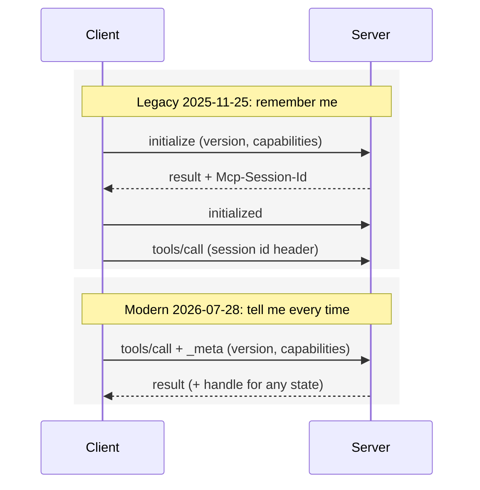

# Chapter 7: Legacy vs modern MCP

*The 2026 spec turns "remember me" into "tell me every time". Know both, because you will meet both.*

> [!NOTE]
> **📍 At a glance**
> - **You will learn:** the real spec timeline, the one idea behind the 2026-07-28 changes, what was removed or deprecated, and how a current client behaves
> - **You will build:** a modern request with `_meta`, and a client that works with the current library
> - **Level:** intermediate to advanced · **Time:** about 45 minutes
> - **Builds on:** [Chapter 3](03-lifecycle-json-rpc-and-capability-negotiation.md) (the legacy handshake). **Leads to:** [Chapter 8](08-interview-questions.md)

**After this chapter you can:**

- Say what changed between the legacy spec (2025-11-25) and the modern spec (2026-07-28), and the one idea behind every change
- Explain why everything built so far still works
- Tell **removed** from **deprecated**, and say what replaces each deprecated feature
- Read a modern request, with no handshake and `_meta` on every call
- Choose a client connection mode: `auto` or `legacy`
- Explain what happens to elicitation, sampling, ping and timeouts in a modern client

**Builds on:** the handshake in [Chapter 3](03-lifecycle-json-rpc-and-capability-negotiation.md) (3.7 to 3.9), transports in [Chapter 4](04-operation-transports-and-shutdown.md), the client loop in [Chapter 6](06-deployment-and-building-a-client.md).

## 7.1 The real timeline

- **Everything built in this course still runs.** Nothing was wasted
- **Legacy spec:** version **2025-11-25**. This is what the course has taught so far
- **Modern spec:** version **2026-07-28**, published on 28 July 2026
- **Adoption is opt-in.** Nothing forced existing servers to change on that date. There is no blanket migration deadline
- **Only named features have a clock.** Anything marked deprecated gets a **minimum of twelve months** before it can be removed. Class: earliest removal is July 2027
- Most real servers, local and hosted, still run the legacy architecture. Rewriting a working system is real engineering work
- *Confirmed against the official changelog:* it lists the changes since 2025-11-25 and defines a feature lifecycle (Active, Deprecated, Removed) with a **minimum twelve-month deprecation window**

## 7.2 The one idea: from "remember me" to "tell me every time"

- **Legacy:** a handshake once, and the server **remembers** you for the whole session
- **Modern:** **no handshake.** Every message carries everything about itself
- Class analogy, a co-working space:
  - One building: the same receptionist waves you through because she knows your face. That is the legacy **`Mcp-Session-Id`**
  - Another building: everyone taps a badge at every door. A bit more tapping, but **any door** works, on any day, whoever is on shift
- **Why give up memory?** A server that must remember you can only be handled by whoever met you first. A server that reads a badge each time can be **any** server behind a load balancer
- Support-call analogy: a call connects you to one agent who remembers you, and if it drops you start again. A **ticket** holds everything, so any agent can pick it up
- The cost is a little more data per request. The gain is scaling out without anyone remembering a client
- Every other change below follows from this idea

*Checked on a legacy HTTP server:* the `initialize` reply carried an `mcp-session-id` header, which is what the class showed with `curl`.



## 7.3 What changed, side by side

| | Legacy (2025-11-25) | Modern (2026-07-28) |
|---|---|---|
| Opening | `initialize`, reply, `initialized` | No handshake. An optional `server/discover` |
| Version and capabilities | Sent once in the handshake | In **`_meta` on every request** |
| Session | `Mcp-Session-Id` header | None |
| Server asks the user mid-task | Server sends its own request (elicitation) | Only while answering a request the client sent |
| Cross-call state | Held by the session | Tools return a **handle** you pass back |
| Routing | Server reads the body | `Mcp-Method` and `Mcp-Name` headers |
| Caching | Nothing built in | `ttlMs` and `cacheScope` on results |
| Liveness | `ping` | Removed |
| Log level | `logging/setLevel` | Removed |

**A modern request over STDIO** (checked, below):

```json
{"jsonrpc": "2.0", "id": 1, "method": "tools/list",
 "params": {"_meta": {
   "io.modelcontextprotocol/protocolVersion": "2026-07-28",
   "io.modelcontextprotocol/clientInfo": {"name": "t", "version": "0"},
   "io.modelcontextprotocol/clientCapabilities": {}}}}
```

*Checked on `fastmcp` 4.1.4 over STDIO, with no `initialize` and no `initialized`:*

- `tools/list` and `tools/call` both worked straight away
- Results carried `resultType: "complete"`, and the list carried **`ttlMs`** (0) and **`cacheScope`** (`private`)
- The same call **without `_meta`** was refused with error `-32602`: `params._meta` must carry the protocol version and client capabilities. So `_meta` is not optional
- `server/discover` returned `supportedVersions` and the server's capabilities (see [Chapter 3](03-lifecycle-json-rpc-and-capability-negotiation.md), 3.8)

**Limit of this test:** the same library's **HTTP** server did **not** accept modern requests. Over HTTP, `server/discover` got `400 Missing session ID` (stateful) or `Method not found` (stateless flag). So in this version HTTP served the legacy protocol. A modern client falls back, as in 7.6. Why, or whether a setting changes it, was not found out

### Asking mid-task: the restaurant rule

- If nothing is remembered, how does a server ask "how spicy do you want it?"
- A kitchen can send a waiter back **while your order is being cooked**. It cannot walk up to an empty table and start asking
- **Rule 1, "already cooking":** a server may ask only while handling something the client already requested
- **Rule 2, "real question":** the reply must hold an actual question, never a vague "something is needed"
- Class example: a TimeTrack tool asked to log 14 hours comes back with "that seems unusually high, do you want to log it?"
- Official name for this pattern: **Multi Round-Trip Requests (MRTR)**. It replaces server-initiated requests such as `roots/list`, `sampling/createMessage` and `elicitation/create`

### The OTP pattern: confirm and continue

- The app asks for a code. You fetch it, come back, and submit it **with your order reference**
- A **different backend server** can finish the order, because the ticket carries everything
- The assistant that asked is free to do other work meanwhile. Whoever is free when the answer arrives picks it up

### The small stuff

- **Faster routing:** `Mcp-Method` and `Mcp-Name` in the HTTP headers, like a coloured tag on a boarding pass. A load balancer reads just those two labels. Not tested here
- **Smarter caching:** `ttlMs` says how long an answer stays fresh. `cacheScope` says whether it is safe to **share across users** or **private to one**. Checked: both appeared in results
- **Finding what broke:** tracing built on the W3C standard. One tracking context follows a request across systems, like a parcel number. The changelog names `traceparent`, `tracestate` and `baggage` in `_meta`
- **Extensions:** optional features beyond the core protocol, advertised in a new `extensions` field of the capabilities (changelog)
  - Each has an identifier `{vendor-prefix}/{extension-name}`. A company uses its reversed domain, such as `com.example/`, so two vendors never clash (MCP docs, web-checked; the class said the same)
  - Experimental tasks moved out of the core into one: `io.modelcontextprotocol/tasks` (changelog)
- **MCP Apps** (`io.modelcontextprotocol/ui`): a server can return "interactive HTML interfaces (data visualizations, forms, dashboards) that render directly in the chat" (MCP docs)
  - Class analogy: you use apps on Android, not Android itself. MCP becomes the console underneath; people use the apps built on it
  - Class view: very new, so wait for adoption before building on it

### Who can talk to whom

The 2026-07-28 versioning page's compatibility matrix (web-checked; the class showed it). **Dual-era** means a client or server that speaks both.

| Client | Server | Outcome |
|---|---|---|
| Modern | Modern | Works. `server/discover` is optional; a version mismatch returns `UnsupportedProtocolVersionError` and the client retries |
| Modern | Legacy | Fails. The server may reject the request, stay silent, or read it with legacy meaning |
| Dual-era | Modern | Works, and stays modern |
| Dual-era | Legacy | Works. The client falls back to `initialize` |
| Legacy | Modern | Fails. The server rejects `initialize` |
| Legacy | Dual-era | Works, on the legacy revision |

- FastMCP's `mode="auto"` client is dual-era: it probes, then falls back (7.5)
- The class advice: a server you build now should answer both kinds of client

## 7.4 Removed or deprecated?

- **Removed** (gone): the old handshake, `ping`, `logging/setLevel`, the session header (class). The changelog also names `notifications/roots/list_changed`
- **Deprecated** (still works, with a clock): **Roots, Sampling, Logging**, and the **HTTP + SSE** transport
- **Policy:** a minimum of twelve months from announcement, started July 2026. It is a **floor**, not a countdown to breakage
- **A library can drop code sooner.** The twelve months is the spec's promise. FastMCP removed its sampling support already (7.5)

| Deprecated | Suggested replacement |
|---|---|
| Roots | Pass paths as tool parameters |
| Sampling | Call the LLM provider's API directly |
| Logging | OpenTelemetry, or standard error |
| HTTP + SSE | Streamable HTTP |
| Dynamic Client Registration | Client ID Metadata Documents |

- The first four match the official changelog's suggested migrations. **Dynamic Client Registration** comes from the course interview file and a secondary article. It was **not** confirmed in the official page text I could read
  - *Now confirmed (web-checked 2026-11-15, the changelog's GitHub source):* it deprecates "the OAuth 2.0 Dynamic Client Registration Protocol (RFC7591) as a client registration mechanism in favor of Client ID Metadata Documents"
- **The changelog's own words** on Roots, Sampling and Logging: they "remain fully functional during the deprecation window but new implementations should not add support for them"
  - Its suggested migrations: pass paths "via tool parameters, resource URIs, or server configuration"; "integrate directly with LLM provider APIs"; "log to `stderr` (stdio) or use OpenTelemetry"
- The class listed ping as removed. The official changelog confirms it

*Checked on `fastmcp` 4.1.4:*

- `logging/setLevel`: legacy connection returned an empty success. A modern request returned **"Method not found"**
- `ping`: legacy `True`. A modern connection: "Method not found"

## 7.5 A client that works with the current library

Every client does five things: **start, handshake, call, use the response, clean up.**

- `try`/`finally` and `async with client` are two ways to write the same five steps
- `async with` **guarantees step 5** whatever happens. That is why the course uses it

### Connection modes

*From the installed library's own documentation of the `mode` option of `Client` (version 4.1.4):*

- **`"auto"`** (default): probes `server/discover`, and falls back to the `initialize` handshake for any server that is not clearly modern. Safe against a mix of old and new servers
- **`"legacy"`**: forces the `initialize` handshake, as before version 4
- **A version string** such as `"2026-07-28"`: adopts that version without probing
- This is the "newer call first, then fall back" behaviour from [Chapter 3](03-lifecycle-json-rpc-and-capability-negotiation.md), 3.8

### The official SDK's raw client

Class 22 first built a client with the official SDK, so every step is visible. FastMCP's `Client` does the same inside `async with`.

```python
import asyncio, sys
from mcp import ClientSession, StdioServerParameters
from mcp.client.stdio import stdio_client

server = StdioServerParameters(command=sys.executable, args=["server.py"])

async def main():
    async with stdio_client(server) as (read, write):          # 1. start the server, open the pipes
        async with ClientSession(read, write) as session:      # 2. wrap a session around them
            init = await session.initialize()                  # 3. the handshake, by hand
            print(init.server_info.name, init.protocol_version)
            tools = await session.list_tools()                 # 4. discovery
            print([t.name for t in tools.tools])
            result = await session.call_tool("add", {"a": 2, "b": 3})   # 5. a call
            print(result.content[0].text)

asyncio.run(main())
```

✅ *Verified (`mcp` 2.3.0, a FastMCP server over STDIO): the handshake reported version `2025-11-25`, three tools were listed, and `add(2, 3)` returned `5.0`.*

- `server.py` is any STDIO server with an `add` tool. The class used the TimeTrack server
- Leaving the `async with` blocks closes the session and stops the server: the clean-up step, guaranteed
- `mcp` 2.x also has a high-level `Client` that does steps 1 to 3 for you, like FastMCP's

### Pointing a client at servers

```python
import sys
from fastmcp import Client
from fastmcp.client.transports import StdioTransport
from server import mcp                                           # the server object itself

stdio_client  = Client(StdioTransport(command=sys.executable, args=["server.py"]))
http_client   = Client("http://127.0.0.1:8000/mcp")             # a URL: Streamable HTTP
memory_client = Client(mcp)                                      # in-process: tests, no port
config_client = Client({"mcpServers": {
    "local":  {"command": sys.executable, "args": ["server.py"]},
    "remote": {"url": "http://127.0.0.1:8000/mcp", "transport": "http"},
}})
```

✅ *Verified (`fastmcp` 4.2.0): the first three listed the same three tools. The config client listed six, prefixed by server name (`local_add`, `remote_add` and so on), and `remote_add` returned `5.0`.*

- **One client, many servers:** the prefix keeps two servers' `add` tools apart. FastMCP builds a small in-process proxy for this, and says so in its log
- A config entry can also carry `env` and a `timeout` in milliseconds (FastMCP docs)

### Sampling: genuinely removed

- **Sampling:** a server borrows the **client's** model, so a light server needs no model key of its own
- **Modern way:** the tool calls an LLM provider **directly**, with its own key. This is also the spec's suggested migration
- Class proof: the old sampling pattern fails on the current library. Class's `summarize_week` tool was rewritten to call a provider
- ✅ *Verified:* the server `Context` class in `fastmcp` 4.1.4 has **no `sample` method**, but does have `elicit` and `report_progress`. The `Client` still accepts a `sampling_handler` argument. A full sampling run was not tested
- Whether a tool needs a completion is decided by **the tool's own code**. The framework does not call one for you
- **Why it went** (class view): a server that borrows your model also spends your tokens, and you cannot predict how many. And a stateless protocol has no back channel for the request
- Now the server's owner pays, with the server's own key. The client's bill no longer depends on what a server decides to do (class)

### Elicitation: only on a legacy connection

```python
client = Client(transport, elicitation_handler=elicitation_handler, mode="legacy")

async def elicitation_handler(message, response_type, params, context):
    print(f"Server is asking: {message}")
    return input("Type Y to confirm: ").strip().lower() == "y"
```

*The class showed only the client. This is the server tool I wrote to test it:*

```python
@mcp.tool
async def log_time(employee: str, hours: float, ctx: Context) -> str:
    """Log hours. Asks for confirmation above 10 hours."""
    if hours > 10:
        result = await ctx.elicit(f"{hours:g} hours in one day is unusually high, log it anyway?",
                                  response_type=bool)
        if result.action != "accept" or not result.data:
            return "cancelled, not confirmed by user"
    return f"logged {hours:g}h for {employee}"
```

*Checked, matching the class demo:*

- 4 hours: **no question**, logged
- 14 hours with the handler answering yes: the question was asked, then logged
- 14 hours with the handler answering no: `cancelled, not confirmed by user`
- The tool has a `Context` parameter. That is its channel back to the client
- On a **default (modern) connection**, the same tool failed with: *elicitation via server-initiated requests is unavailable on 2026-07-28 connections.* So the class statement holds. Modern elicitation goes through MRTR, which was not tested here

### Ping, timeout and cancellation

- **Ping** asks "are you still there?". Removed in the strict modern sense, since nothing persistent is left to ping. In legacy mode `client.ping()` returned `True` in class
  - ✅ *Verified:* `True` in `legacy`, and "Method not found" in `auto`
- **Timeout and cancellation:** a deliberately slow tool (5 seconds) against a client timeout of 1 second was cancelled with a clear error. A longer timeout let it finish
  - ✅ *Verified:* `Client(..., timeout=1)` and a 5-second tool gave `Request 'tools/call' timed out` after 1.0 seconds. With `timeout=10` and a 2-second tool it returned normally
  - **Rule:** every sent request should have a timeout. A cancellation notification stops waiting. A progress notification can reset the clock while the server is still working. Progress reporting was not tested
  - *Tested since:* see Progress below. In `fastmcp` 4.2.0, progress did **not** reset the clock

### Progress: report long work

Class 22's slow tool reported each step, and the client printed them.

```python
import asyncio
from fastmcp import FastMCP, Context

mcp = FastMCP("TimeTrack Demo")

@mcp.tool
async def slow_tool(steps: int, ctx: Context) -> str:
    """A long job that reports progress after each step."""
    for step in range(1, steps + 1):
        await asyncio.sleep(0.4)
        await ctx.report_progress(progress=step, total=steps, message=f"step {step} of {steps}")
    return f"done: {steps} steps"
```

```python
from fastmcp import Client

async def show_progress(progress, total, message):
    print(f"progress {progress:g} of {total:g}: {message}")

async def main():
    async with Client(mcp, progress_handler=show_progress) as client:
        print((await client.call_tool("slow_tool", {"steps": 5})).data)
        try:
            await client.call_tool("slow_tool", {"steps": 5}, timeout=1)   # a limit on one call
        except Exception as e:
            print(type(e).__name__, e)

asyncio.run(main())
```

✅ *Verified (`fastmcp` 4.2.0): five updates, then `done: 5 steps`. With `timeout=1`, two updates arrived and the call stopped at 1.0 s with "Request 'tools/call' timed out"; the session stayed usable. The same over STDIO in both `auto` and `legacy` mode.*

- The tool asks for a `Context`, as for elicitation. The client opts in with a `progress_handler`. Without one, the updates are simply dropped (class: "99% of people don't know")
- **Progress did not extend the timeout.** The specification lets a client reset its clock on progress ("MAY"), but says it "SHOULD always enforce a maximum timeout". FastMCP's `timeout` is that maximum
- Progress still works on a modern connection. It is not on the deprecated list

> [!IMPORTANT]
> **🏭 In production: living through a spec change**
> - **Support both for a while:** hosts upgrade at different speeds. Check what each client sends and answer accordingly
> - **Watch the lifecycle labels:** a Deprecated feature still works for at least twelve months; a Removed one does not. Plan migrations from the changelog, not from blog posts
> - **Stateless requests scale more simply:** any replica can answer any request, so load balancers need no sticky sessions
> - **Pin SDK versions** and run contract tests against an old and a new client before upgrading
>
> *Added by Claude.*

## 7.6 How LangChain fits in

- When LangChain is the host, **its agent is the host**. LangChain creates the MCP client itself using the **LangChain MCP Adapters** package, which is built on FastMCP
- `MultiServerMCPClient` with a config dictionary goes through the **same handshake and discovery** as any client. LangChain builds the harness for you ([Chapter 6](06-deployment-and-building-a-client.md), 6.7)
- **Every MCP server, whatever library wrote it, rests on the same official protocol.** FastMCP is an abstraction that makes writing it easier
- For an agent framework, MCP is "a connection to a set of tools", sourced from a standard protocol instead of hand-written functions
- LangChain's MCP support **consumes** servers. It does not build them. Building stays with MCP and FastMCP
- **Other frameworks do the same.** The class opened the MCP pages of CrewAI, AutoGen and the Claude Agent SDK. Each connects a client, lists the server's tools and hands them to its agent
- Next: [Langchain, Chapter 12](../langchain/12-mcp-in-langchain.md)

## 7.7 Follow-ups from class 22

- A **hard-coded database path** silently failed once deployed to Vercel. Fix: read the path from an environment variable ([Chapter 6](06-deployment-and-building-a-client.md), 6.3)
- **Homework:** make database calls asynchronous, and move from a local SQLite file to a hosted database. The class demoed **filess.io**, a free hosted SQL database of about 10 MB with ready-made connection code. Not tried here
- Class roadmap: this was the **last dedicated MCP class**, followed by multi-agent systems in LangChain and a project

## 7.8 Class questions

- **Do I need to master every previous version?** No. Adoption will take time, and knowing legacy is what makes modern make sense
- **Is sampling controlled in code or called automatically?** By the tool's own code
- **Are sampling and elicitation MCP ideas, or FastMCP's?** MCP's. A framework only implements them
- **Does the same handshake apply when LangChain is the host?** Yes, underneath
- **Does LangChain's MCP support create servers?** No, only consumes them
- **Can an OpenRouter key replace a provider key in the client exercises?** Yes, with a small change to the endpoint and model name
- **Is elicitation human-in-the-loop?** Not by itself (class 22). HITL needs an agent loop; elicitation is an MCP feature that works with no AI at all. Inside an agent it is one way to do HITL ([Chapter 3](03-lifecycle-json-rpc-and-capability-negotiation.md), 3.9)
- **Must a server run around the clock?** Yes, if requests can arrive at any time (class)
- **If the server calls a model itself, who pays?** The server's owner. With sampling, the client's model and bill did the work (class)

## 7.9 Added by Claude, not from the sources

Items marked *checked* were run with `fastmcp` 4.1.4 and `mcp` 2.3.0.

- **A "legacy mode" client against a modern-only server will fail,** and the reverse is handled by `auto`. Keep `auto` unless you have a reason to pin
- **Check what your library really speaks.** ✅ *Verified:* this version's HTTP server spoke legacy only, while its STDIO server spoke both. Do not assume modern means HTTP
- **The class's "elicitation behind `mode="legacy"`" is one library's behaviour.** The spec's own answer is MRTR. Learn both names
- **Treat library and spec versions separately.** Several class commands changed between FastMCP 3 and 4 ([Chapter 2](02-primitives-and-architecture.md), 2.8)
- **Plan migration by risk:** list which servers use sampling, roots, logging, sessions or HTTP + SSE, then migrate those first
- **Official source to keep open:** the MCP specification's changelog page for 2026-07-28

## 7.10 Interview corner

**What interviewers listen for:** the **one idea** (stateless requests), what replaced sessions (handles, `_meta`), and the difference between Deprecated and Removed

### 🟢 Basic

<details class="qa"><summary>1. What is the single idea behind the modern spec?</summary>

- Stateless requests: no handshake and no session. Every message carries its version and capabilities
- *Stronger answer:* the gain is that any replica can serve any request, so no sticky routing

</details>

<details class="qa"><summary>2. Removed or deprecated?</summary>

- Removed: the old handshake, ping, `logging/setLevel`, the session header. Deprecated: Roots, Sampling, Logging, HTTP + SSE
- *Stronger answer:* deprecated has a twelve-month minimum, and a library may drop code sooner

</details>

<details class="qa"><summary>3. What replaces sampling?</summary>

- The tool calls an LLM provider directly with its own key

</details>

<details class="qa"><summary>4. How can a stateless server ask the user a question?</summary>

- Only while handling a request the client sent. In the spec this is MRTR
- *Stronger answer:* a server never contacts a client out of nowhere

</details>

### 🟡 Intermediate

<details class="qa"><summary>5. A client meets an old server. What does it do?</summary>

- In `auto` mode it tries `server/discover`, and on failure falls back to `initialize`
- ✅ *Verified:* a modern client really does this

</details>

<details class="qa"><summary>6. Why does every request now carry <code>_meta</code>?</summary>

- Because nobody remembers the client. The version and capabilities travel with each call
- ✅ *Verified:* a request without it was refused

</details>

<details class="qa"><summary>7. How do you keep state without sessions?</summary>

- Return a handle from a tool (such as a `basket_id`) and pass it back as an argument

</details>

<details class="qa"><summary>8. Will my legacy server break?</summary>

- No. Adoption is opt-in. Plan to support both, and watch the deprecated list

</details>

### 🔴 Senior

<details class="qa"><summary>9. Your hosted MCP server must serve both old and new clients during the migration. How?</summary>

- Detect the style per request: a legacy `initialize`/session, or a modern request with `_meta`
- *Stronger answer:* keep both paths behind one tool layer, log which style each client uses, and set a removal date for the legacy path once traffic drops

</details>

<details class="qa"><summary>10. Why did the spec move to stateless requests?</summary>

- Sessions tied a client to one server process, which made scaling and recovery hard
- *Stronger answer:* stateless requests let any replica answer, survive restarts, and cache results (`ttlMs`, `cacheScope`); state lives in explicit handles instead

</details>

<details class="qa"><summary>11. One client points at three servers through a config. What does the model see, and why does it matter?</summary>

- One tool list from every server, each name prefixed with the server's key (`local_add`, `remote_add`; tested)
- The prefix keeps two servers' `search` or `add` tools apart
- *Stronger answer:* the names and descriptions are all the model chooses from. Enable only the servers a task needs, set a timeout per server, and test the combined list

</details>

<details class="qa"><summary>12. A long tool reports progress, yet your client still times out. Why?</summary>

- The specification lets a client reset its timeout on progress, but does not require it, and says to keep a maximum
- ✅ In `fastmcp` 4.2.0 the timeout is a hard limit: two updates arrived and the call still stopped at 1.0 s
- *Stronger answer:* size the timeout for the slowest honest run, show progress to the user, and turn long work into a task the client can poll (the tasks extension)

</details>

> [!TIP]
> **🧩 Design question**
> - *"Plan the upgrade of ten internal MCP servers to the 2026-07-28 spec."*
> - Talk about: an inventory of features each server uses against the Removed and Deprecated lists, SDK upgrades behind feature flags, dual-mode support, contract tests with old and new clients, staged rollout, and monitoring of errors by client version

## Cheat sheet

| | Legacy 2025-11-25 | Modern 2026-07-28 |
|---|---|---|
| Opening | `initialize` → reply → `initialized` | none (optional `server/discover`) |
| Version and capabilities | once, in the handshake | `_meta` on every request |
| Session | `Mcp-Session-Id` | none; state via returned **handles** |
| Server asks the user | its own request (elicitation) | only while answering a client request |
| Routing | body | `Mcp-Method`, `Mcp-Name` headers |
| Caching | none | `ttlMs`, `cacheScope` |
| `ping`, `logging/setLevel` | present | removed |
| Deprecated vs Removed | | still works ≥ 12 months vs gone |

## Recap

- Legacy 2025-11-25 and modern 2026-07-28 coexist. Adoption is opt-in. Nothing you built breaks
- One idea: **remember me** became **tell me every time**. No handshake, no session, `_meta` on every request
- Servers may ask mid-task only while answering a request (MRTR). State moves into handles returned by tools
- Removed: handshake, ping, `logging/setLevel`, session header. Deprecated: Roots, Sampling, Logging, HTTP + SSE. Minimum twelve months
- Replacements: tool parameters, direct provider calls, OpenTelemetry or stderr, Streamable HTTP
- Client `mode`: `auto` (probe, fall back), `legacy`, or a version string
- Sampling is gone from the current library. Elicitation and ping need a legacy connection. Every request needs a timeout
- LangChain's adapters build the client for you and only consume servers
- Compatibility: modern and legacy only meet through a dual-era side. FastMCP's `auto` client is dual-era
- Extensions add optional features under vendor-prefixed names; MCP Apps render interactive UIs in the chat
- The raw SDK client shows the five steps; one FastMCP client can reach STDIO, HTTP, in-memory or many servers at once
- Progress needs a handler on the client, and does not extend FastMCP's timeout

## Practice

1. Send a modern `tools/list` request over STDIO with `_meta`, then without it. Compare the replies
2. Connect with `mode="auto"` and `mode="legacy"` to the same server. Call `ping()` in both
3. Build the elicitation demo with `mode="legacy"`. Test 4 hours, 14 hours with yes, and 14 hours with no
4. Make a client timeout shorter than a slow tool and read the error
5. Rewrite a tool that used sampling so it calls a provider directly
6. List the deprecated features your own servers use
7. Explain in your own words why removing the session header helps a load balancer
8. Read the 2026-07-28 changelog page and find each item from 7.3 and 7.4
9. Run the raw SDK client in 7.5 and point at each of the five steps
10. Point one FastMCP client at a STDIO server and an HTTP server through a config. Read the tool names
11. Add a progress handler and watch a slow tool report. Then set a timeout shorter than the tool

## How this chapter was checked

- **2026 review:** the sequence diagram, the production box, the graded interview and the cheat sheet were added (Added by Claude). The cheat-sheet table restates 7.3 and 7.4, which were checked against the changelog earlier
- Run: a modern request with and without `_meta` over STDIO; the results' `resultType`, `ttlMs` and `cacheScope`; `server/discover` over STDIO and over HTTP; legacy session ids, a stale session id and the stateless flag; `logging/setLevel` on both connections; `ping` in `auto` and `legacy`; elicitation under `legacy` (three branches) and under the default connection; timeouts; the server `Context` methods; and the `mode` option's documentation
- Checked against the official specification changelog (read through search results): the handshake removal, `_meta`, removed items, deprecated items and suggested migrations, the twelve-month window, MRTR, state handles and tracing keys
- **Not run or not confirmed:** modern requests over HTTP, `Mcp-Method` and `Mcp-Name` headers, Client ID Metadata Documents, a full sampling run, MRTR elicitation, progress reporting, filess.io, Vercel, LangChain's adapters
  - *Since run (2026-11-15):* progress reporting (7.5)
- The class write-up is the source for everything else
- *Class 22 recording (20 Sep), added 2026-11-15, `fastmcp` 4.2.0 and `mcp` 2.3.0 (the new blocks run as printed):*
  - 7.5 raw client: the handshake reported `2025-11-25`; three tools; `add(2, 3)` returned `5.0`
  - 7.5 transports: STDIO, URL and in-memory listed the same three tools; the two-server config listed six with `local_` and `remote_` prefixes; `remote_add` returned `5.0`
  - 7.5 progress: five updates, in memory and over STDIO in `auto` and `legacy` mode. With a 1-second per-call timeout, two updates arrived and the call timed out at 1.0 s; the next call worked
  - Web-checked 2026-11-15 from the specification's GitHub source: the 2026-07-28 changelog, the versioning page's compatibility matrix, the timeout rule, and the extensions and MCP Apps pages
  - Also FastMCP's client docs (progress handler, multi-server configuration) and the official SDK's client docs

## Sources and further reading

- Live-Class-2026, `classes_transcription_summary/22 - 20 Sep - Legacy vs Modern MCP.md`
- Live-Class-2026, `interview-questions/mcp.md` (the specification summary and the replacements list)
- Model Context Protocol specification, 2026-07-28, changelog: https://modelcontextprotocol.io/specification/2026-07-28/changelog
- Class resources, not opened: the "legacy vs modern" site and the FastMCP "what's new" page
- Sections marked *checked* and 7.9 are from testing
- Class recording transcript, 20 Sep 2026 (class 22, teaching part 00:00–03:05), uploaded by you. The doubt session after it was left out
  - Used for: the compatibility table, extensions and MCP Apps, the raw and FastMCP clients, transports, why sampling went, progress, and the class questions
- MCP specification 2026-07-28: [changelog](https://modelcontextprotocol.io/specification/2026-07-28/changelog), [versioning](https://modelcontextprotocol.io/specification/2026-07-28/basic/versioning); MCP docs: [extensions](https://modelcontextprotocol.io/extensions/overview), [MCP Apps](https://modelcontextprotocol.io/extensions/apps/overview). Read from the GitHub source, 2026-11-15
- FastMCP docs: [progress](https://gofastmcp.com/clients/progress), [transports](https://gofastmcp.com/clients/transports); [MCP Python SDK client docs](https://github.com/modelcontextprotocol/python-sdk/tree/main/docs/client)
- Added by Claude: the raw-client, transports and progress tests in 7.5, interview questions 11–12

Previous: [Chapter 6, Deployment and building a client](06-deployment-and-building-a-client.md) · Next: [Chapter 8, Interview questions](08-interview-questions.md)
