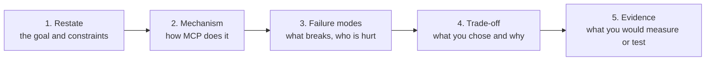

# Chapter 8: Interview questions

*The production questions interviewers ask after "what is MCP?", a quick-fire self-test, and a system design round.*

> [!NOTE]
> **📍 At a glance**
> - **What it is:** 8 production questions with tested answers, 24 click-to-reveal quick-fire questions, 4 system design problems and a one-page revision map
> - **How to use it:** answer aloud first, then reveal; for design problems, follow the answer skeleton below
> - **Level:** intermediate to senior · **Time:** about 60 minutes per full pass
> - **Builds on:** every earlier MCP chapter

**How to use this chapter**

- Eight production-style questions from the course's own interview file, each with a short answer
- Where I could test a claim, it is marked *checked*. Where a claim did not hold on the current library, the correction is shown
- A quick-fire list of concept questions follows, with the chapter that answers each
- Say the answer aloud. Then open the chapter and check what you missed

**Builds on:** every earlier MCP chapter. Chapters 1 to 7 each end with their own interview corner. This one adds the **production** questions.

**Tip from class:** concepts first. About 90% of candidates can define an MCP server. Fewer can explain what happens underneath, or the legacy-versus-modern history. Be ready to explain **why**, not only **what**.

### The answer skeleton



- Use it for every production and design question: it shows you think beyond the happy path

## 8.1 How does the agent discover MCP servers and their capabilities?

- It does **not** go looking. Servers come from **configuration** or an **allowlisted registry**
- The **handshake** has both sides declare capabilities. On the modern protocol the version and capabilities travel in `_meta` on each request instead ([Chapter 7](07-legacy-vs-modern-mcp.md))
- **`tools/list`** returns each tool's name, description and input schema. **That is what the model sees**
- **Tool descriptions are prompt input.** Pin them and review them. A changed description can change what the model does or what an attacker can make it do
- Detail: [Chapter 3](03-lifecycle-json-rpc-and-capability-negotiation.md), 3.9, and [Chapter 4](04-operation-transports-and-shutdown.md), 4.1 to 4.2

## 8.2 How do you handle authentication and authorisation between agent and server?

*From the interview file. Not run here.*

- The MCP server acts as an **OAuth 2.1 resource server**
- A `401` with resource metadata leads the client to the **authorisation code flow with PKCE**
- The token is **short-lived** and **audience-bound** to that one server
- **No passthrough:** a downstream API gets its own token through a token exchange. Never forward the user's token
- Course context: static tokens in class were for learning scope gating only ([Chapter 5](05-building-mcp-servers.md), 5.10). The authentication code is planned for the code batch
- Class advice: read up on **JWT and OAuth**

## 8.3 How do you scope OAuth per capability, especially for sensitive actions?

*From the interview file. Not run here.*

- **One tool, one scope.** `payments:read` is not `payments:transfer`
- **Check the scope on every `tools/call`**, and **filter `tools/list` by scope** so the model never sees tools it may not use
- A missing scope returns **403 `insufficient_scope`**, followed by step-up and human approval
- **Limits** (amount, environment, tenant) live in **gateway policy**, with an audit log per user and per agent
- Link to class: per-user tool access is ordinary engineering with middleware, not an MCP feature ([Chapter 4](04-operation-transports-and-shutdown.md), 4.4)

## 8.4 How do you run several replicas when sessions are stateful?

**The problem:** by default a streamable HTTP server is **stateful**. `initialize` returns an `Mcp-Session-Id` and the server keeps that session in memory. A request that lands on another replica is rejected.

*Checked on `fastmcp` 4.1.4, over HTTP:*

- `initialize` returned a session id
- A request with an **unknown** session id: **HTTP 404**, error `-32600` "Session not found"
- A request with **no** session id: **HTTP 400**, "Missing session ID"
- That is exactly the replica problem

**Three ways out:**

1. **Run stateless** (preferred for request and response tool servers). Each request is self-contained, so any replica serves it
   - ✅ *Verified:* with the stateless flag the server returned **no session id**, and a `tools/list` with no handshake worked
   - **Correction:** the interview file writes `FastMCP(..., stateless_http=True)`. ✅ *Verified:* on `fastmcp` 4.1.4 this raises `TypeError`. The flag now goes to `run` or `http_app`:

```python
mcp.run(transport="http", host="0.0.0.0", port=8000, stateless_http=True)
# or: app = mcp.http_app(stateless_http=True)
```

   - You lose server-initiated messages, which most tool servers never use
2. **Sticky routing** on the `Mcp-Session-Id` header, at the ingress or service mesh
   - Avoid Kubernetes `sessionAffinity: ClientIP`. Every request from one agent pod would pin to one replica, so load is not balanced
3. **A shared session store** such as Redis. It works, but adds a dependency for little gain

- **Modern protocol:** there are no sessions, so none of this is needed ([Chapter 7](07-legacy-vs-modern-mcp.md))
- **Verify:** scale to two or more replicas and run a multi-turn conversation

## 8.5 How do you make sensitive calls such as transfers idempotent?

**The risk:** the database commits, the agent dies before the reply, and a retry moves the money twice.

- Pass an **idempotency key** as a tool argument. MCP has none built in
- Store the key **in the same transaction** as the transfer. A repeat returns the stored result
- **Re-check balances at execution**, not at approval

*A runnable version of that pattern (mine, not from the course), checked:*

```python
import sqlite3

def setup():
    c = sqlite3.connect(":memory:")
    c.executescript("""
      CREATE TABLE accounts (id TEXT PRIMARY KEY, balance REAL NOT NULL);
      CREATE TABLE transfers (idem_key TEXT PRIMARY KEY, src TEXT, dst TEXT, amount REAL, result TEXT);
      INSERT INTO accounts VALUES ('A', 100), ('B', 0);""")
    return c

def transfer(c, idem_key, src, dst, amount):
    with c:                                           # one transaction
        row = c.execute("SELECT result FROM transfers WHERE idem_key=?", (idem_key,)).fetchone()
        if row:                                       # a retry: return the stored result
            return row[0] + " (replayed)"
        bal = c.execute("SELECT balance FROM accounts WHERE id=?", (src,)).fetchone()[0]
        if bal < amount:                              # re-check the balance at execution
            raise ValueError("insufficient funds")
        c.execute("UPDATE accounts SET balance = balance - ? WHERE id=?", (amount, src))
        c.execute("UPDATE accounts SET balance = balance + ? WHERE id=?", (amount, dst))
        result = f"moved {amount} from {src} to {dst}"
        c.execute("INSERT INTO transfers VALUES (?,?,?,?,?)", (idem_key, src, dst, amount, result))
        return result

c = setup()
print(transfer(c, "k-1", "A", "B", 30))
print(transfer(c, "k-1", "A", "B", 30))              # the agent retried after a crash
print(c.execute("SELECT id, balance FROM accounts ORDER BY id").fetchall())
```

- *Checked output:* the second call printed `moved 30 from A to B (replayed)` and the balances were `A 70`, `B 30`. The money moved once
- The key must be **unique per intended action**, and the agent must **reuse** the same key on a retry

## 8.6 How do you keep the tool list in sync when a server changes?

Treat the tool **schema and description as an API contract.**

- **Only additive changes in place:** new tools, new optional parameters
  - A breaking change (renamed or removed parameter) ships as a **new tool name** next to the old one. Remove the old one once no agent uses it
- **Agents usually load tools once at start-up.** A server change takes effect after the agents restart. Either roll the agents, or handle `notifications/tools/list_changed` to refresh at run time
  - ✅ *Verified:* a tool added to a running server appeared when the client listed tools again. **No `list_changed` notification reached the client** in that in-memory test, and the server does not advertise it by default. Why was not investigated. Do not assume your library sends it
- **Descriptions change model behaviour.** A docstring edit can change routing. Run server changes through the same **evaluation suite** as agent changes
- **In CI, snapshot `tools/list` and diff it,** so contract changes show up in review
  - Related: converted tool names can be long and generated ([Chapter 5](05-building-mcp-servers.md), 5.9)

## 8.7 How do you tell tool failures from empty results?

Keep **three outcomes** distinct:

- **Success with data**
- **Success, but empty:** an explicit result such as `{"count": 0, "items": []}`, so the model can truthfully say "no transactions"
- **Failure:** a result with **`isError: true`** and a message the model can act on, for example "Account not found; call `list_accounts` first"

**Anti-pattern:** returning `{"error": ...}` as a normal successful result. The model may treat it as data, and your metrics count it as a success.

**Monitoring:**

- Emit a **per-tool metric** labelled `ok`, `empty` or `error`
- **HTTP status will not help,** because tool errors still travel as HTTP 200 (the interview file's claim, not tested over HTTP here)
- **Page** on infrastructure errors (database down, timeouts). **Let the model handle** user-input errors (unknown account, bad date)

**Correction on invalid parameters.** The interview file says invalid requests (bad parameters) are protocol-level JSON-RPC errors. *Checked on `fastmcp` 4.1.4 over STDIO:*

- A **wrong argument type** and a **missing argument** both came back as a normal result with **`isError: true`** and a readable validation message
- An unknown **tool name** also came back as `isError: true`
- Only an unknown **method** gave a JSON-RPC `error` (`-32601`)
- So handle **both** shapes in a client, and count `isError` results as failures ([Chapter 4](04-operation-transports-and-shutdown.md), 4.3)

## 8.8 What changed in the latest spec, and how does it affect running servers?

The July 2026 spec (**2026-07-28**) made MCP **stateless**: every request stands alone, like a normal HTTP API.

- **No `initialize` handshake.** Version and capabilities travel in `_meta` on every request
- **No sessions.** `Mcp-Session-Id` is gone, so **any replica serves any request**, and there is no sticky routing
- **State moves into tools.** Cross-call state becomes a **handle** the tool returns, for example `basket_id`
- **Deprecated:** Sampling, Roots, Logging, the old HTTP + SSE transport, and Dynamic Client Registration
- **Most production servers still run 2025-11-25,** where sessions are optional but stateful by default

**What replaces the deprecated features:**

- **Roots:** pass paths as tool parameters
- **Sampling:** call the provider's API directly
- **Logging:** OpenTelemetry, or standard error
- **HTTP + SSE:** Streamable HTTP
- **Dynamic Client Registration:** Client ID Metadata Documents

- ✅ *Verified:* over STDIO a modern server accepted requests with no handshake and refused them without `_meta`. Over HTTP the library tested spoke the legacy protocol only. Full detail and the official changelog link: [Chapter 7](07-legacy-vs-modern-mcp.md)
- Dynamic Client Registration and its replacement are from the interview file and were not confirmed in the official page text I could read

## 8.9 Quick-fire concept questions

Say the answer, then reveal it. The chapter that explains each is linked.

### Basics

<details class="qa"><summary>1. What problem does MCP solve?</summary>

- It replaces about N times M custom integrations with about N plus M ([Chapter 1](01-why-mcp-exists.md))

</details>

<details class="qa"><summary>2. Is MCP a paid product or an orchestrator?</summary>

- Neither. It is a free, open specification ([Chapter 1](01-why-mcp-exists.md))

</details>

<details class="qa"><summary>3. Do I always need MCP?</summary>

- No. A plain tool suits a narrow, fixed action ([Chapter 6](06-deployment-and-building-a-client.md), 6.9)

</details>

<details class="qa"><summary>4. Host, client, server?</summary>

- App, one connection per server, a focused program ([Chapter 2](02-primitives-and-architecture.md))

</details>

<details class="qa"><summary>5. Why one client per server?</summary>

- Decoupling, safety, scalability, parallelism ([Chapter 2](02-primitives-and-architecture.md), 2.3)

</details>

<details class="qa"><summary>6. Three primitives?</summary>

- Tools (do), resources (read), prompts (a form) ([Chapter 2](02-primitives-and-architecture.md), 2.6)

</details>

<details class="qa"><summary>7. Who triggers each primitive?</summary>

- Model, application, user ([Chapter 3](03-lifecycle-json-rpc-and-capability-negotiation.md), 3.1)

</details>

### Protocol

<details class="qa"><summary>8. Why JSON-RPC and not REST?</summary>

- Lightweight, transport-agnostic, two-way, notifications, standard errors ([Chapter 3](03-lifecycle-json-rpc-and-capability-negotiation.md), 3.6)

</details>

<details class="qa"><summary>9. What is the <code>id</code> for?</summary>

- To match a response to its request ([Chapter 3](03-lifecycle-json-rpc-and-capability-negotiation.md), 3.5)

</details>

<details class="qa"><summary>10. The three lifecycle phases?</summary>

- Initialization, operation, shutdown ([Chapter 3](03-lifecycle-json-rpc-and-capability-negotiation.md), 3.4)

</details>

<details class="qa"><summary>11. How does version negotiation work?</summary>

- Client proposes its latest, server answers, client accepts or disconnects ([Chapter 3](03-lifecycle-json-rpc-and-capability-negotiation.md), 3.8)

</details>

<details class="qa"><summary>12. Why call <code>tools/list</code> after negotiation?</summary>

- Negotiation names categories, discovery names tools ([Chapter 3](03-lifecycle-json-rpc-and-capability-negotiation.md), 3.9)

</details>

<details class="qa"><summary>13. Elicitation or human-in-the-loop?</summary>

- Server asks for missing information, against an approval layer in the app ([Chapter 3](03-lifecycle-json-rpc-and-capability-negotiation.md), 3.9)

</details>

### Transports and shutdown

<details class="qa"><summary>14. STDIO or Streamable HTTP?</summary>

- Local and personal, against remote and shared ([Chapter 4](04-operation-transports-and-shutdown.md), 4.11)

</details>

<details class="qa"><summary>15. How does STDIO shut down?</summary>

- Close input, terminate, kill ([Chapter 4](04-operation-transports-and-shutdown.md), 4.8)

</details>

<details class="qa"><summary>16. Why is there no JSON-RPC at shutdown?</summary>

- The transport does the closing ([Chapter 4](04-operation-transports-and-shutdown.md), 4.6)

</details>

<details class="qa"><summary>17. Does MCP send my data to the model provider?</summary>

- Yes ([Chapter 4](04-operation-transports-and-shutdown.md), 4.4)

</details>

### Building and deploying

<details class="qa"><summary>18. Official SDK or FastMCP?</summary>

- SDK is the base, FastMCP the easy layer ([Chapter 5](05-building-mcp-servers.md), 5.1)

</details>

<details class="qa"><summary>19. Convert an API or write tools?</summary>

- Convert for speed, write for control and prompts ([Chapter 5](05-building-mcp-servers.md), 5.9)

</details>

<details class="qa"><summary>20. Two mounting mistakes in FastAPI?</summary>

- Path set twice, and `lifespan` not passed at construction ([Chapter 5](05-building-mcp-servers.md), 5.8)

</details>

<details class="qa"><summary>21. Who calls the tool, the model or the client?</summary>

- The client ([Chapter 6](06-deployment-and-building-a-client.md), 6.7)

</details>

<details class="qa"><summary>22. How do you make a server read-only?</summary>

- Do not register write tools ([Chapter 6](06-deployment-and-building-a-client.md), 6.9)

</details>

### Legacy and modern

<details class="qa"><summary>23. What is the one idea behind the modern spec?</summary>

- Stateless requests ([Chapter 7](07-legacy-vs-modern-mcp.md), 7.2)

</details>

<details class="qa"><summary>24. Removed or deprecated?</summary>

- Different lists, twelve-month floor for deprecated ([Chapter 7](07-legacy-vs-modern-mcp.md), 7.4)

</details>


## 8.10 System design round

Use the answer skeleton. Each problem lists what a strong answer covers.

<details class="qa"><summary>D1. Give a company's 3 AI assistants access to Salesforce, Jira and Gmail.</summary>

- One MCP server per system, owned by that system's team; hosts connect a client per server
- OAuth 2.1 per user, short-lived audience-bound tokens, one scope per sensitive tool, no token passthrough (8.2, 8.3)
- Read tools by default, writes behind approval; compact structured results
- Additive tool contracts, `tools/list` snapshots in CI (8.6); logs and metrics per tool

</details>

<details class="qa"><summary>D2. A payments MCP server: "transfer money" must never run twice.</summary>

- Idempotency key from the client, stored in the same transaction as the transfer, checked again at execution (8.5)
- Amount limits, human approval above a threshold, an elicitation or confirmation step
- Three outcomes kept distinct: success, empty, error with `isError` (8.7); full audit trail

</details>

<details class="qa"><summary>D3. Run one MCP server for 10,000 users across 5 replicas.</summary>

- Streamable HTTP behind TLS and a load balancer; stateless requests (the modern spec) or sticky sessions on legacy (8.4, [Chapter 7](07-legacy-vs-modern-mcp.md))
- Any shared state in a store (Redis, a database) or returned as handles
- Rate limits per user, timeouts per tool, health checks, autoscaling on latency

</details>

<details class="qa"><summary>D4. An agent connected to 15 servers picks wrong tools and costs too much.</summary>

- Every server's schemas go into each call: too many tokens, too many similar tools
- Connect per task, filter tools (a selector step or allow-list), merge overlapping servers, sharpen descriptions
- Measure tool-choice accuracy and cost per task before and after ([Chapter 2](02-primitives-and-architecture.md))

</details>

### Revision map

| Chapter | The one line to remember |
|---|---|
| [1](01-why-mcp-exists.md) | MCP moves integration upkeep to the server owner; it adds no intelligence |
| [2](02-primitives-and-architecture.md) | Host → one client per server; tools (model), resources (app), prompts (user) |
| [3](03-lifecycle-json-rpc-and-capability-negotiation.md) | JSON-RPC; initialize → operate → shut down; negotiate version and capabilities |
| [4](04-operation-transports-and-shutdown.md) | Discover then call; STDIO local, Streamable HTTP remote; results reach the model provider |
| [5](05-building-mcp-servers.md) | FastMCP; add MCP as a second front door to an existing app; scope tools by role |
| [6](06-deployment-and-building-a-client.md) | Same file, two transports; your client, not the model, calls the server |
| [7](07-legacy-vs-modern-mcp.md) | 2026-07-28: stateless requests, `_meta` every call, handles instead of sessions |
| 8 | OAuth 2.1 + PKCE, idempotency keys, additive contracts, three outcomes |

## 8.10b Debugging round (*added by Claude*)

<details class="qa"><summary>1. The server works in the Inspector but the host shows no tools.</summary>

- STDIO: something printed to `stdout` (a `print`, a library banner) corrupted the stream; send logs to `stderr` ([Ch 4](04-operation-transports-and-shutdown.md))
- Wrong command or path in the host config, or the env lacks the packages: run the exact command from the config in a terminal
- Host caches the tool list: restart the host or reconnect

</details>

<details class="qa"><summary>2. The model never picks your MCP tool.</summary>

- Read the tool's description and schema as the model sees them (`list_tools`): vague name, no "use when"
- Too many tools from many servers dilute choice: prefix names, disable unused servers, or load tools per task

</details>

<details class="qa"><summary>3. Remote server works locally, fails after deploy behind a load balancer.</summary>

- Stateful sessions land on another replica: sticky sessions or stateless HTTP mode (8.4)
- Missing or stripped auth header, wrong path (`/mcp`), or `Host`/`Origin` checks rejecting the public name

</details>

<details class="qa"><summary>4. A tool returns "success" but nothing happened.</summary>

- The tool swallowed an exception and returned text: raise `ToolError` on failure so `isError` is set ([Ch 5](05-building-mcp-servers.md), 5.10b)
- Distinguish **failure** from **empty result** explicitly (8.7) and test both

</details>

## 8.11 Added by Claude, not from the sources

Items marked *checked* were run with `fastmcp` 4.1.4.

- **Know the corrections.** In this chapter the tested library differed from the interview file in two places (the stateless flag on the constructor, and bad parameters as JSON-RPC errors) and did not send `list_changed` in my test. Saying "I checked it on the current version" lands well. Library details change, so say which version
- **Prepare one story per production topic:** authentication, replicas, idempotency, schema changes, errors and monitoring. A short real example beats a definition
- **Be honest about what you ran.** The class advice: describe a project as what it is, framed around the problem it solved. Shallow claims get exposed
- **Draw the three diagrams from memory:** host, client and server; the handshake; the legacy and modern difference. Interviewers often ask for a sketch
- **Practise both answers where the spec changed:** "how it worked" (stateful sessions) and "how it works now" (stateless requests)

## Recap

- Servers are configured, not discovered. Tool descriptions are prompt input
- Auth: OAuth 2.1 resource server, PKCE, short-lived audience-bound tokens, one scope per tool, no passthrough
- Replicas: run stateless, or use sticky routing, or a shared store. The stateless flag goes on `run` or `http_app` in the current library
- Idempotency: a key in the same transaction as the action, and a re-check at execution
- Contract changes: additive only, snapshot `tools/list`, evaluate descriptions
- Three outcomes: data, empty, error. Count `isError` results as failures. Handle both error shapes
- Modern spec: stateless, `_meta`, handles for state, deprecations with a twelve-month floor

## Practice

1. Answer 8.1 to 8.8 aloud in under a minute each. Then compare with this chapter
2. Run the idempotency example. Make the second call use a new key and watch the money move twice
3. Start a server with and without the stateless flag. Send a request with a made-up session id to each
4. Send a wrong-type argument to a tool and write down the reply shape
5. Snapshot a server's `tools/list` to a file, change a docstring, and diff
6. Draw the three diagrams in 8.11 on paper without notes
7. Answer D1 to D4 in 8.10 aloud with the answer skeleton, in five minutes each

## How this chapter was checked

- Run: session id behaviour on a stateful HTTP server (404 for an unknown id, 400 for none); the stateless flag; the constructor flag error; bad-type and missing arguments; an unknown tool and an unknown method; a tool added at run time; and the idempotency example
- **Not run:** OAuth, PKCE, scopes, gateways, replicas behind a real load balancer, Redis, metrics, HTTP status of tool errors
- Sections 8.1 to 8.3 and 8.5 to 8.8 follow the interview file. Where the test disagrees, the correction is shown

## Sources and further reading

- Live-Class-2026, `interview-questions/mcp.md`
- Live-Class-2026, `classes_transcription_summary/22 - 20 Sep - Legacy vs Modern MCP.md` and `21 - 19 Sep - MCP Deployment.md`
- Model Context Protocol specification, 2026-07-28, changelog: https://modelcontextprotocol.io/specification/2026-07-28/changelog
- The idempotency example, the corrections and 8.11 are from testing, not from the interview file
- 8.10 (system design round and revision map), the answer skeleton and the click-to-reveal quick-fire format were added in the 2026 review (Added by Claude)

Previous: [Chapter 7, Legacy vs modern MCP](07-legacy-vs-modern-mcp.md)
