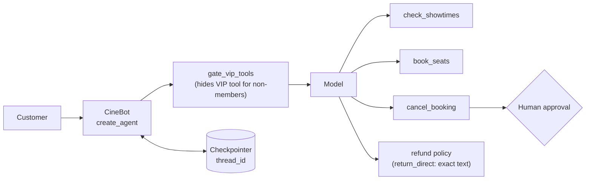

# Chapter 1: CineBot

*A movie-ticket agent that combines structured output, tools, middleware, human approval and memory in one place.*

> [!NOTE]
> **📍 Project card**
> - **Problem:** let a cinema customer check showtimes, book and cancel seats in plain language, safely
> - **Stack:** LangChain `create_agent`, custom `AgentState`, `wrap_model_call` middleware, `HumanInTheLoopMiddleware`, `InMemorySaver`
> - **You practise:** tool gating by user type, approval on irreversible actions, exact-text tools, conversation memory
> - **Status:** the course's running teaching example, assembled here into one agent and tested with a scripted model; not deployed
> - **Level:** intermediate · **Time to rebuild:** about 1 hour
> - **Builds on:** [Langchain Ch 4](../langchain/04-structured-output.md), [Ch 5](../langchain/05-tools.md), [Ch 7](../langchain/07-middleware.md), [Ch 11](../langchain/11-runtime-and-human-in-the-loop.md)

> [!WARNING]
> **Short write-up**
> - This project is documented briefly from the class material. More may be added later

**After this chapter you can:**

- Find every CineBot example in the LangChain book
- Assemble the pieces into one working agent
- Explain each design choice (tool gating, human approval, memory)

**Builds on:** [LangChain Ch4](../langchain/04-structured-output.md), [Ch5](../langchain/05-tools.md), [Ch7](../langchain/07-middleware.md), [Ch11](../langchain/11-runtime-and-human-in-the-loop.md).

## 1.1 What it is

- A movie-ticket assistant used as the **running example** in the LangChain classes
- Tools: `check_showtimes`, `book_seats`, `cancel_booking`, a refund policy, and a VIP lounge tool
- The course keeps it to explain concepts. It is not a deployed product

### Architecture



## 1.2 Where each idea appears

| Idea | Chapter |
|---|---|
| Three reply shapes (Union structured output) | LangChain Ch4, 4.6 |
| Tools and `return_direct` | LangChain Ch5 |
| Checks before booking, memory | LangChain Ch6 |
| Hide the VIP tool for non-members | LangChain Ch7 |
| Limits, fallback, PII | LangChain Ch8 |
| Guardrails, retries | LangChain Ch9 |
| Context and human approval | LangChain Ch11 |
| CineBot as an MCP server | LangChain Ch12 |

## 1.3 The assembled agent

```python
class CineState(AgentState):
    is_vip_member: bool

@wrap_model_call
def gate_vip_tools(request, handler):
    if not request.state.get("is_vip_member", False):
        request = request.override(
            tools=[t for t in request.tools if t.name != "vip_lounge_booking"])
    return handler(request)

agent = create_agent(
    model, tools=[check_showtimes, book_seats, cancel_booking,
                  get_exact_refund_policy, vip_lounge_booking],
    system_prompt="You are CineBot, a friendly cinema assistant. Check showtimes before booking.",
    state_schema=CineState,
    middleware=[gate_vip_tools,
                HumanInTheLoopMiddleware(interrupt_on={"cancel_booking": True})],
    checkpointer=InMemorySaver(),
)
```

## 1.4 Checked behaviour

Run offline with a scripted stand-in model, `langchain` 1.4.7:

- **Booking:** showtimes, then booking, both ran in order
- **Regular member** was offered 4 tools; the VIP tool was hidden
- **VIP member** was offered all 5
- **Refund policy** came back **verbatim** (`return_direct=True` skips the model's rewrite)
- **Cancel** paused for approval with no tool run. After `approve` it ran
- **Reject** returned a "User rejected the tool call" message

## 1.5 Design choices

- **Tool gating belongs in middleware**, not the prompt. A prompt rule can be talked around; a missing tool cannot be called
- **`return_direct`** for text that must not be paraphrased (policy)
- **Approval on irreversible tools** only
- **A checkpointer** is needed for the pause and resume to work, and each conversation needs a `thread_id`

## From demo to production

| Area | In this chapter | Needed for production |
|---|---|---|
| Model | Scripted stand-in | A real model, evaluated on recorded customer requests |
| Memory | `InMemorySaver` | Database-backed checkpointer; retention rules |
| Booking | Toy function | Real booking API; idempotent, transactional seat locks |
| Access | VIP flag in state | Flag from the authenticated user profile, never from the chat |
| Safety | Approval on cancel | Approval on cancel and refund; limits on seats per booking |
| Visibility | Test prints | Tracing, error and cost dashboards |

## Talking about this project

> [!TIP]
> **🎤 60-second pitch**
> - **Problem:** customers want to book cinema seats by chatting, without the bot doing anything unsafe
> - **What I built:** a LangChain agent with showtime, booking, cancel and policy tools; VIP-only tools hidden by middleware; cancellations paused for human approval; memory per conversation
> - **Key decisions:** gating in middleware, not the prompt; `return_direct` for policy text; approval only on irreversible actions
> - **How I verified it:** five scenarios with a scripted model (booking order, VIP gating, verbatim policy, approve and reject)
> - **Next:** real booking API, persistent checkpointer, evaluation with a real model
> - Be honest that it is a learning project tested offline: interviewers respect accuracy

## 1.6 Interview corner

**What interviewers listen for:** you can explain **why** each control sits where it does (middleware vs prompt, approval only where irreversible) and what changes for production

### 🟢 Basic

<details class="qa"><summary>1. How do you stop non-members using a VIP tool?</summary>

- Remove the tool from the request in a model-call hook
- Do not rely on the prompt alone

</details>

<details class="qa"><summary>2. Why does human approval need a checkpointer?</summary>

- The run pauses and must resume later from saved state

</details>

### 🟡 Intermediate

<details class="qa"><summary>3. When use <code>return_direct</code>?</summary>

- When the tool output is the final answer and must stay exact

</details>

<details class="qa"><summary>4. Why test with a scripted model?</summary>

- Fast, free, deterministic. It tests the wiring, not the model

</details>

### 🔴 Senior

<details class="qa"><summary>5. How would you make booking safe when the agent retries or two users book the last seat?</summary>

- Make `book_seats` idempotent (a booking key) and let the database enforce seat uniqueness
- *Stronger answer:* the model never decides availability; a transaction in the booking system does, and the tool returns a clear "sold out" result the model can relay

</details>

<details class="qa"><summary>6. Is <code>InMemorySaver</code> fine in production?</summary>

- No: it is lost on restart and not shared between servers
- *Stronger answer:* use a database-backed checkpointer (for example Postgres) so paused approvals survive deploys and any replica can resume a thread

</details>

> [!TIP]
> **🧩 Design question**
> - *"Turn CineBot into a production assistant for a cinema chain with 50 screens."*
> - Talk about: a real booking API behind narrow tools, idempotent bookings, a persistent checkpointer, approval for cancellations and refunds, VIP gating from the user profile, evaluations on real requests, tracing and cost limits

## 1.7 Added by Claude, not from the sources

- The assembled agent in 1.3 is **my combination** of the course's pieces, not a course file
- A scripted model proves wiring only. It says nothing about how a real model would choose tools
- The `hash`-based booking id in my test is not stable between runs; use a real id in practice

## Cheat sheet

| Design choice | Why |
|---|---|
| Gate VIP tools in `wrap_model_call` | A hidden tool cannot be called; a prompt rule can be argued around |
| `HumanInTheLoopMiddleware` on `cancel_booking` | Irreversible action needs a person |
| `return_direct=True` on the policy tool | Exact wording, no paraphrase |
| Checkpointer + `thread_id` | Pause, resume and memory need saved state |
| Scripted model in tests | Tests wiring cheaply; says nothing about real model choices |

## Recap

- CineBot is the course's running example; one agent can combine state, middleware, approval and memory
- Gate tools in middleware; approve irreversible ones; use a checkpointer

## Practice

1. Rebuild 1.3 with your own model
2. Add a `refund_booking` tool that needs approval
3. Make the stand-in model call two tools in one turn
4. Add a custom state field `is_admin` and gate a tool on it

## How this chapter was checked

- **2026 review:** the project card, architecture diagram, "From demo to production", the pitch, graded interview and cheat sheet were added (Added by Claude); the code and checks in 1.3 to 1.4 are unchanged

- Run: the five scenarios in 1.4
- **Not run:** a real model, the Colab notebooks

## Sources and further reading

- The LangChain chapters listed in 1.2

Next: [Chapter 2, Time Tracker (MCP)](02-time-tracker-mcp.md)
