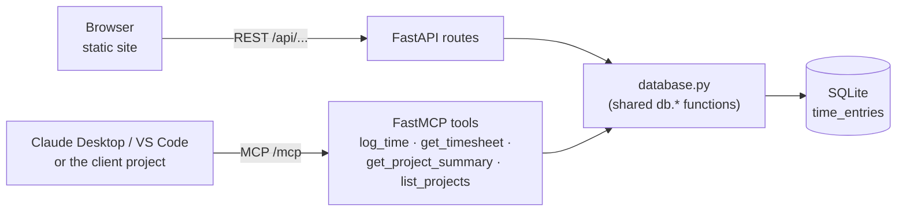

# Chapter 2: Time Tracker (MCP)

*One SQLite database, two front doors: a website for people and an MCP server for AI assistants.*

> [!NOTE]
> **📍 Project card**
> - **Problem:** employees log hours in a web app; managers want to ask an AI assistant about the same data
> - **Stack:** SQLite, FastAPI (REST), FastMCP (MCP), an MCP client project with nine demos
> - **You practise:** adding MCP to an existing app, sharing one data layer, client demos (sampling, elicitation, progress), deployment risks
> - **Status:** class project, run locally with `fastmcp` 4.1.4; the public demo URLs were not reachable from here
> - **Level:** intermediate · **Time to rebuild:** about 2 hours
> - **Builds on:** [MCP Ch 5](../mcp/05-building-mcp-servers.md), [MCP Ch 6](../mcp/06-deployment-and-building-a-client.md), [MCP Ch 7](../mcp/07-legacy-vs-modern-mcp.md)

**After this chapter you can:**

- Describe the TimeTrack project and how it grew across the classes
- Explain "one database, two front doors" (REST and MCP)
- Read the database layer and the three versions of `main.py`
- Run the nine client demos and say what each teaches and what breaks on the modern protocol
- Spot the risks: a raw SQL tool, an open public URL, temporary disks

**Builds on:** [MCP Ch5](../mcp/05-building-mcp-servers.md) (building TimeTrack), [MCP Ch6](../mcp/06-deployment-and-building-a-client.md) (deploy and client), [MCP Ch7](../mcp/07-legacy-vs-modern-mcp.md) (versions).

> **Scope.** Python and text files only. The website files in `static/` (`.js`, `.html`, `.css`) were left out at your request.

## 2.1 What it is

- A time-logging app: employees log hours against projects
- **SQLite** database, **FastAPI** REST routes, and a **FastMCP** server
- Four core tools: `log_time`, `get_timesheet`, `get_project_summary`, `list_projects`

### Architecture

## 2.2 The three folders

| Folder | What it is |
|---|---|
| `timetrack` (Weekend 11) and `timetrack mcp server` | The server: `database.py`, `main.py`, `main_to_understand.py`, `dummy.py`, `scripts/`, text notes |
| `mcp-client-and-advanced` | The **client project**: its own `main.py` with extra tools, plus `client/01...09` |
| `timetrack mcp server/mcp-client-and-advanced` | An **older** copy of the client project (8 demos, uses `ctx.sample()`) |

- The Weekend 11 copy differs from the "Complete MCP" copy only in `database.py` (the database path, see 2.3) and two whitespace changes

## 2.3 The database layer (`database.py`)

- One table, `time_entries`: `id`, `employee_name`, `project`, `entry_date` (text, `YYYY-MM-DD`), `hours` (real), `description`
- `init_db()` creates it and **seeds 5 rows** when empty (Asha Patel and Rahul Mehta; Website Redesign, Client Onboarding, Internal Tools)
- Functions: `list_all_entries`, `log_time`, `get_timesheet`, `list_projects`, `get_project_summary`
  - `log_time` rejects `hours <= 0` with a `ValueError`
  - `get_project_summary` raises `ValueError` for a project with no entries
  - Queries use `?` placeholders, so values cannot inject SQL
- **Database path, two versions:**
  - Client project: `Path(__file__).parent / "timetrack.db"`, a file next to the code
  - Server project: `TIMETRACK_DB_PATH` environment variable, default `/tmp/timetrack.db`. Made for hosts where the code folder is read-only. A `/tmp` file may vanish on restart (MCP Ch6)
- The server copy also adds `execute_query(query, params)`. See 2.7

## 2.4 One database, two front doors

- REST routes and MCP tools call the **same `db.*` functions**
- A write through one is visible through the other

*✅ *verified** (local, `fastmcp` 4.1.4):

- `POST /api/entries` returned 200; MCP `list_projects` then showed the new project
- `get_timesheet("Priya Nair")` returned `[('MCP Mastery', 3.5)]`
- An entry logged **through MCP** appeared in `GET /api/entries`
- The REST summary matched: 3.5 hours, one employee

## 2.5 The server files

**`main.py` in `timetrack mcp server` (website plus MCP):**

- Builds the MCP server first, then `mcp.http_app(path="/")`, then `FastAPI(lifespan=mcp_app.lifespan)`, then `app.mount("/mcp", mcp_app)`
- Comments warn against `path="/mcp"` plus the mount, which gives `/mcp/mcp`
- It also serves the website from `static/` (not covered)
- Run: `uv run uvicorn main:app --reload`, MCP at `/mcp`

**`main_to_understand.py` (convert FastAPI to MCP):**

- `FastMCP.from_fastapi(app=app)` turns every route into a tool
- Adds a **raw SQL tool** and a schema resource. Risks in 2.7

**`dummy.py`:**

- A five-tool calculator (`add`, `subtract`, `multiply`, `divide`, `power`). `divide` raises on zero
- It exists to practise Horizon deployment with the smallest possible server. Entrypoint `dummy.py:mcp`

**Deployment notes (text files):**

- `steps_to_remote_mcp.txt`: make a **clean separate repo** with `main.py`, `database.py`, `pyproject.toml`, `uv.lock`; push to GitHub; sign in to Horizon; pick the repo; set a server name and entrypoint `main.py:mcp`
- `mcp_htttp_connection.txt`: two `curl` calls. First `initialize` with `Content-Type: application/json` and `Accept: application/json, text/event-stream`, then `tools/list` carrying the `Mcp-Session-Id` returned by the first. It uses protocol `2025-06-18` and a trailing-slash URL

## 2.6 The client project: `main.py` with seven tools

- The four core tools, a resource (`timesheet://projects`) and a prompt (`generate_weekly_report`)
- `summarize_week(employee_name, week_start)`: reads the rows, then **calls the Anthropic API directly** for a two-sentence summary
- `log_time_with_confirmation(...)`: `ctx.elicit(...)` asks "log it anyway?" only when `hours > 10`
- `slow_tool()`: sleeps 5 times for one second, reporting progress each time. Used only for demos

**Old versus new `summarize_week`:**

| | Older copy | Current |
|---|---|---|
| How it gets text | `ctx.sample(prompt)` asks the **client's** model | `anthropic_client.messages.create(...)` in the server |
| Needs a key in | the client | the **server** process |
| Works in `fastmcp` 4.1.4 | no, `Context` has no `sample` | yes |

✅ *verified* `summarize_week` through a local stand-in for the Anthropic API (the real SDK ran; only the HTTP server was fake):

- The prompt sent had the real rows as `- Website Redesign: 6.5h (Homepage layout)` lines
- The stand-in's reply came back as the tool result
- A name with no rows returned "No entries found for ... starting ..." **without** calling the model
- The model name in the file is `claude-sonnet-4-5`. Not checked against a live account

## 2.7 The raw SQL tool, and why it is dangerous

- `execute_query_dynamically(query, params)` runs whatever SQL the model sends
- ✅ *verified* on a copy: a `SELECT` with a parameter worked. `SELECT COUNT(*)` failed because every row is forced into the six columns
- ✅ *Verified:* a `DELETE` returned an empty list and **deleted nothing** (the helper never commits). A `DROP TABLE` **did** go through
- Safer designs: named tools only, a read-only connection, or an allow-list of statements. Detail in MCP Ch5, 5.9

## 2.8 The nine client demos

| File | Teaches | Run result here |
|---|---|---|
| `01_raw_client.py` | Official SDK, three layers by hand | **Works on Linux** with `mcp` 2.3.0 |
| `02_fastmcp_client_explained.py` | Manual `__aenter__`/`__aexit__` versus `async with` | Works |
| `03_fastmcp_client_http.py` | Connect to a deployed server by URL | **Not run**: the Vercel URL did not respond |
| `04_agent_loop.py` | Agent loop with no framework | Works against a stand-in model |
| `05_sampling_demo.py` | Server calls an LLM itself | Works against a stand-in model |
| `06_elicitation_demo.py` | Server asks a question mid-tool | Works with `mode="legacy"` |
| `07_ping_and_errors.py` | Ping and a real tool error | Works with `mode="legacy"` |
| `08_timeout_and_cancellation.py` | A 1-second timeout on a 5-second tool | Works: "Request 'tools/call' timed out" |
| `09_progress_notifications.py` | Live progress updates | Works: updates `1.0/5.0` to `5.0/5.0` |

- Every demo except 03 starts `main.py` as a sub-process. Run them from inside `client/`
- **They change the database.** Demo 06 logged real rows into `timetrack.db`; reset it between runs if you need the seed data
- `main.py` imports `anthropic` at the top, so the server **fails to start** without it. In my first run every demo died with "Connection closed" until I installed the package

**Why `mode="legacy"` in 06 and 07 (checked, same server):**

| Call | `mode="auto"` | `mode="legacy"` |
|---|---|---|
| `ctx.elicit()` with a handler | "elicitation via server-initiated requests is unavailable on 2026-07-28 connections" | works |
| `client.ping()` | "Method not found" | returns `True` |

- Timeouts (08) and progress (09) worked in `auto` mode on 4.1.4, so they did not need `legacy`. The class write-up listed them as untested

**Agent loop (04):**

- Translates MCP tools to Anthropic's format: `name`, `description`, `input_schema`
- Keeps the conversation in one `messages` list. Loops until `stop_reason` is not `tool_use`
- ✅ *verified* with a stand-in that asked for two tools at once: **one** assistant message, then **one** user message holding both results. The order is right here, unlike the class's earlier loop (MCP Ch6)
- Weakness: the result is sent as `str(result)`, a Python repr. Send `result.data` or its text instead

**Environment trap (05):**

- A stdio sub-process only receives a small safe set of variables (`PATH`, `HOME`, ...), **not** your whole shell
- So `export ANTHROPIC_API_KEY=...` is not enough. The demo builds `PythonStdioTransport("../main.py", env={...})` and passes the key by hand

## 2.9 What the class's own change log says

`MCP_PROTOCOL_CHANGES_SUMMARY.txt` records an investigation on 2026-09-20, with `fastmcp` 4.0.5.

- **Root cause:** the newest MCP revision (`2026-07-28`) is stateless. The server cannot ask the client anything mid-call
- **Class A, deleted:** `ctx.sample()`. Fix: call the model from the server
- **Class B, needs the old handshake:** `ctx.elicit()` and `ping()`. Fix: `mode="legacy"`
- **Not taken:** pinning `fastmcp` back to 2.14.7, which keeps everything working. Skipped to stay with where the spec is heading
- It also records a key that was pasted into a chat during the session and says it should be revoked. No key value is in the file
- Its list of "not yet tested" demos (08, 09) matches 2.8 above: both ran
**Older eight-demo set, compared by differences:**

- Files 01, 02, 03, 07 and 08 are the same code with longer comments. The numbering shifted by one after `02_fastmcp_client_explained.py` was added
- Old demo 04 was a **client-side sampling handler**; the current 05 is a plain tool call
- Old demo 05 (elicitation) said elicitation "survives into the newest protocol revision". In `auto` mode it does not (2.8), so the new header corrects it
- Old agent loop asked "List every project in TimeTrack, then give me the summary for the first one". The current file asks "Hi.", which never uses a tool. Put the old question back to see the loop work

## 2.10 Known issues

- **`01_raw_client.py` may hang on macOS** (SDK issue #1452, per the README and the file's comment). It ran fine on Linux here, so this is platform-specific
- **The README is out of date:** it still says `ctx.sample()` is used in `main.py`. The code has already removed it
- **A public URL with no login** lets anyone write to the shared database

## From demo to production

| Area | In the class version | Needed for production |
|---|---|---|
| Database | SQLite, sometimes on `/tmp` (lost on restart) | Managed Postgres with backups and migrations |
| Access | Open URL | OAuth with scopes; employees see their own hours, managers their team |
| Tools | Includes a run-any-SQL tool | Only named tools; read-only DB user for reads |
| Protocol | Mixed `fastmcp` versions | Pinned versions; support the modern stateless spec |
| Testing | Manual demos | Automated write-then-read tests through REST and MCP |

## Portfolio upgrade: make TimeTrack show-worthy (*added by Claude*)

| Upgrade | Why it impresses | Where it's taught |
|---|---|---|
| Replace the raw-SQL tool with narrow, parameterised tools | shows you understand tool safety and SQL injection | 2.7, [MCP Ch 5](../mcp/05-building-mcp-servers.md) |
| In-memory pytest suite for every tool (+ `ToolError` cases) | servers you can change without fear | [MCP Ch 5](../mcp/05-building-mcp-servers.md), 5.10b |
| `readOnlyHint` / `destructiveHint` on tools, approval on deletes | host-side safety signals | [MCP Ch 5](../mcp/05-building-mcp-servers.md) |
| HTTP deploy with `/health`, per-user auth tokens | turns a laptop demo into a service | [MCP Ch 6](../mcp/06-deployment-and-building-a-client.md) |
| A LangChain agent consuming it via `langchain-mcp-adapters` | proves the server works with any host | [Langchain Ch 12](../langchain/12-mcp-in-langchain.md) |

**Resume bullet template:** *Built an MCP server (FastMCP) exposing a time-tracking database to AI hosts over STDIO and HTTP, with role-scoped tools, a pytest suite and a health-checked container deploy.*

## Talking about this project

> [!TIP]
> **🎤 60-second pitch**
> - **Problem:** time data lived in a web app; managers wanted to ask questions about it in plain language
> - **What I built:** an MCP server mounted beside the existing FastAPI app, both using the same database functions, plus a client project that exercises sampling, elicitation and progress
> - **Key decisions:** reuse the data layer rather than duplicate logic; named tools over raw SQL; database path from an environment variable for read-only hosts
> - **How I verified it:** wrote through REST and read through MCP, and the reverse; ran the nine client demos
> - **Next:** auth with scopes, Postgres, and the modern protocol

## 2.11 Interview corner

**What interviewers listen for:** you can explain why MCP was added **beside** an existing REST app, what is risky in the class version, and what changes on the newest protocol

### 🟢 Basic

1. Why mount MCP in the same app as REST?

- Share one database and one deployment. People use the website, agents use MCP

2. A tool needs an API key and the server runs over STDIO. Why does <code>export KEY=...</code> not work?

- The SDK passes only a safe subset of environment variables to the child process
- Pass the key through the transport's `env`

### 🟡 Intermediate

3. What changed for <code>ctx.elicit()</code> and <code>ping()</code> on the newest protocol?

- No back-channel from server to client. Elicitation moves to a "return an input-required result and be called again" pattern; ping is removed
- `mode="legacy"` restores the old handshake

4. Why is a "run any SQL" tool a bad idea?

- It hands the model the entire database. Use named tools, read-only access, or an allow-list

5. How do you test an agent loop without an API key?

- Point the SDK at a local fake server, or use a scripted model. Check that two tool calls make one assistant message and one result message

### 🔴 Senior

6. When would you not mount REST beside MCP?

- When only agents use the data. A plain MCP server is simpler

7. A scanner finds your public TimeTrack MCP URL with no auth. What is exposed, and what do you fix first?

- Every tool: anyone can read all timesheets and write entries; the raw SQL tool exposes the whole database
- *Stronger answer:* take it offline or add auth at once, remove `execute_query`, add per-user scopes and rate limits, rotate anything stored, and review logs for misuse

> [!TIP]
> **🧩 Design question**
> - *"Make TimeTrack ready for a 500-person company."*
> - Talk about: Postgres instead of SQLite on `/tmp`, migrations, SSO-based OAuth with scopes (employee vs manager), no raw SQL, row-level access (own hours vs team), audit log, rate limits, and tests that write then read back through both front doors

## 2.12 Added by Claude, not from the sources

- **Make the demos repeatable.** Copy the database file before each run, or point `TIMETRACK_DB_PATH` at a temporary file
- **Pin versions.** `fastmcp` 2, 3 and 4 behave differently on sampling, elicitation and ping (MCP Ch7)
- **The stand-in API trick:** the Anthropic SDK honours `ANTHROPIC_BASE_URL`. A 30-line local server tests server-side model calls with no key. Stdio needs the variable forwarded through `env`, too
- **Writes that never commit** fail silently in SQLite. Test a write by reading it back
- The live Vercel URLs in demo 03 and in the concurrency script are not reachable from my environment

## Cheat sheet

| File or tool | Role |
|---|---|
| `database.py` | the one data layer: `log_time`, `get_timesheet`, `list_projects`, `get_project_summary` |
| `main.py` (server) | FastAPI website + FastMCP mounted at `/mcp` |
| `main.py` (client project) | seven tools for the client demos |
| `client/01` to `09` | demos: listing, calling, sampling, elicitation, progress and more |
| `TIMETRACK_DB_PATH` | where the database lives (default `/tmp/timetrack.db`) |
| `execute_query` | the raw SQL tool: remove before production |

## Recap

- One SQLite file behind REST and MCP, verified in both directions
- Server project: website plus MCP, a calculator for practising deployment, and notes for Horizon
- Client project: seven tools, with `summarize_week` calling the model itself
- Nine demos ran, except 03. Elicitation and ping need `mode="legacy"`
- Danger: the raw SQL tool, an open public URL, `/tmp` databases

## Practice

1. Start `main.py` from the client project. Run demos 02, 08 and 09 and describe each output
2. Run demo 06 in `auto` mode, read the error, then switch to `legacy`
3. Write a fake Anthropic server and run demos 04 and 05 against it
4. Add a `delete_entry` tool that needs elicitation confirmation
5. Replace `execute_query_dynamically` with a read-only version that allows only `SELECT`
6. Make the demos repeatable with a temporary database

## How this chapter was checked

- **2026 review:** the project card, architecture diagram, "From demo to production", the pitch, graded interview and cheat sheet were added (Added by Claude); sections 2.1 to 2.10 are unchanged

- **Read fully:** both client READMEs, `database.py` (both versions), all three `main*.py`, `dummy.py`, the nine demos and their older versions (compared by differences), `concurrency_showcase.py`, the change-log text, both deployment notes
- **Run:** the shared-data test in 2.4; demos 01, 02, 06, 07, 08, 09; demos 04 and 05 against a local stand-in for the API; the `auto` versus `legacy` comparison; `main_to_understand.py` with SQL statements; the concurrency script against a local server
- **Not run:** demo 03 and the Vercel URLs, Prefect Horizon, the real Anthropic API, the website
- The older eight-demo set (`ctx.sample()` version) was compared, not run
- Left out at your request: `static/app.js`, `index.html`, `style.css`

## Sources and further reading

- Live-Class-2026, `Complete MCP/TimeTrackProject/` (all folders above)
- `mcp-client-and-advanced/README.md`, `MCP_PROTOCOL_CHANGES_SUMMARY.txt`

Previous: [Chapter 1, CineBot](01-cinebot.md) · Next: [Chapter 3, Meridian AI learner](03-meridian-ai-learner.md)
