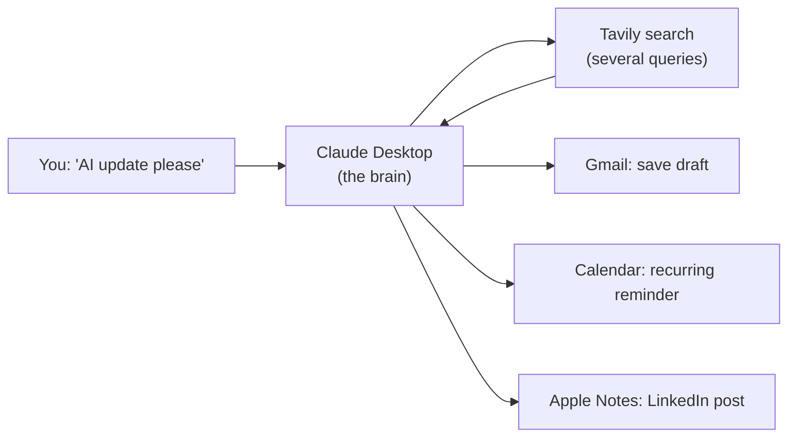

# Chapter 4: AI Updater

*A no-code MCP project: Claude Desktop plus four connectors turn "what is new in AI?" into an email draft, a reminder and a post.*

> [!NOTE]
> **📍 Project card**
> - **Problem:** keep up with AI news every day without writing code
> - **Stack:** Claude Desktop, MCP connectors for Tavily search, Gmail, Google Calendar and Apple Notes
> - **You practise:** "brain decides, tools act", prompting for quantities, checking output against sources
> - **Status:** a live class demo; not code, not scheduled automatically
> - **Level:** beginner · **Time to rebuild:** about 30 minutes
> - **Builds on:** [MCP Ch 3](../mcp/03-lifecycle-json-rpc-and-capability-negotiation.md), 3.11

> [!WARNING]
> **Short write-up**
> - This project is documented briefly from the class material. More may be added later

**After this chapter you can:**

- Describe a no-code MCP project built from connectors
- Explain "brain decides, tools act"
- Avoid the headline-count mistake from the live run

**Builds on:** [MCP Ch3](../mcp/03-lifecycle-json-rpc-and-capability-negotiation.md), 3.11.

## 4.1 What it is

- Aim: learn MCP **without writing code**, using Claude Desktop **connectors** (MCP servers)
- Output: a daily AI-news email draft, a calendar reminder, and a LinkedIn post

## 4.2 Flow

1. Ask for an AI update
2. Several searches run (Tavily)
3. Results are combined into a readable letter
4. Save as a **Gmail draft**, create a **recurring Calendar** reminder, save a post to **Apple Notes**
5. Repeat on a schedule

## 4.3 Connectors used

- Gmail, Google Calendar, Tavily, Apple Notes

## 4.4 Lessons

- **Brain decides, tools act.** The model picks tools and arguments; data moves only through tool calls
- **Say how much you want.** With no count per category, the model quietly dropped real stories
- **Test the output** against the sources

## From demo to production

| Area | In this chapter | Needed for production |
|---|---|---|
| Trigger | Typed by hand | A scheduled task |
| Quality | Model decides the count | Count per category, links required, dedupe |
| Sending | Draft only | Draft → human review → send |
| Trust | Whatever search returns | Allow-listed sources, citations checked |

## Portfolio upgrade (*added by Claude*)

- Add a small eval: 10 past days of sources, check that the digest includes the items a human marked important
- Log tokens and cost per run; show the monthly estimate in the README
- Make the sources configurable (a YAML list) so others can reuse it: reusable tools get GitHub stars

## Talking about this project

> [!TIP]
> **🎤 60-second pitch**
> - **Problem:** staying current on AI news takes time every day
> - **What I built:** a Claude Desktop flow with four MCP connectors: search, then an email draft, a calendar reminder and a social post
> - **Lesson:** the model decides and the connectors act; vague prompts silently drop content
> - **Next:** schedule it, require links, and add a human review step

## 4.5 Interview corner

**What interviewers listen for:** you understand that the model plans and the connectors act, and you know how to make a demo flow reliable

### 🟢 Basic

1. What is a connector?

- An MCP server a host can use

### 🟡 Intermediate

2. Why does the search tool not write the story?

- Tools return data; the model assembles it

3. How would you turn this demo into a reliable daily product?

- Schedule it, fix the prompt (sources, counts per category), and keep a human review before anything is sent
- *Stronger answer:* move from a chat to code (an agent with the same MCP servers), dedupe stories, cite sources, log each run, and alert on failures

### 🔴 Senior

4. The summary missed real stories. Why, and how do you fix it?

- The prompt gave no quantity, so the model chose a short list
- *Stronger answer:* ask for a number per category, require a link per item, and spot-check against the search results

> [!TIP]
> **🧩 Design question**
> - *"Design a daily AI-news digest for a 200-person company."*
> - Talk about: scheduled agent, curated source list plus search, dedupe and ranking, a fixed format with links, an editor approves before sending, feedback buttons, and cost per run tracked

## 4.6 Added by Claude, not from the sources

- The whiteboard did not label every step. Detail beyond the live run is not in the sources
- Mailing yourself drafts is safer than auto-sending

## Cheat sheet

| Connector | Job in the flow |
|---|---|
| Tavily | search the news (several queries) |
| Gmail | save the digest as a draft |
| Google Calendar | recurring reminder |
| Apple Notes | save a LinkedIn post |
| Prompt rule | "N stories per category, each with a link" |

## Recap

- Four connectors, one system prompt, three outputs
- Be explicit about quantities

## Practice

1. Rebuild the flow with your connectors
2. Add a headline count per category and compare

## How this chapter was checked

- **2026 review:** the project card, diagram, "From demo to production", the pitch, graded interview and cheat sheet were added (Added by Claude)

- Notes from the class summary and whiteboard. Nothing run

## Sources and further reading

- Live-Class-2026, class 18 summary; MCP Ch3, 3.11

Previous: [Chapter 3, Meridian AI learner](03-meridian-ai-learner.md)
