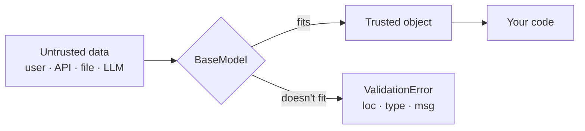
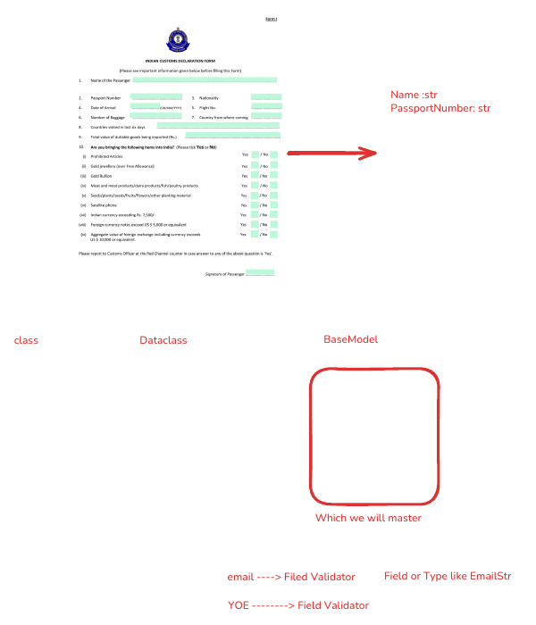

# Chapter 1: Why Pydantic, and `BaseModel`

*Type hints describe what you hope for. Pydantic checks what you actually got.*

> [!NOTE]
> **📍 At a glance**
> - **You will learn:** why hints protect nothing at run time, `BaseModel` coercion and errors, `model_config` switches, v1 vs v2
> - **You will build:** the class's signup form, three ways (plain class, dataclass, `BaseModel`), and a currency model that rejects messy LLM output
> - **Level:** beginner · **Time:** about 30 minutes
> - **Builds on:** [Python Ch 2](../python/02-python-refresher.md)

**After this chapter you can:**

- Show, in code, why type hints and dataclasses don't stop bad data
- Define a `BaseModel` with required and optional fields, and read its errors
- Predict what lax coercion does with `"28"`, `28.5` and `"True"`
- Convert between dicts, JSON text and models, and produce a JSON schema
- Pick the `model_config` switches a boundary needs, and read v1 snippets

---

## 1.1 Why it exists


- Python never enforces hints: `age: int = "twenty-eight"` runs fine
- Why (class 03): in Java or C++ you declare a variable's type, and memory is set aside for it (an `int` is a fixed-size box). A Python name only **points at** an object, so the same name can point at a string, then a list
- JavaScript is just as loose; TypeScript, a typed superset of JavaScript, exists because of it. Loose typing is fine for learning and "a very big issue" in production
- Bad data flows on silently and breaks far from where it entered
- The class notebook shows both halves of the problem:

```python
age: int = "twenty-eight"           # runs; the hint changes nothing
age = ["25", 25, None]              # also runs

def register_user(name, email, age):
    birth_year = 2026 - age         # silently assumes age is an int
    print(f"Registered {name} ({email}), born approx. {birth_year}")

register_user(name="Rohan", email="rohan@example.com", age=10000)
# Registered Rohan (rohan@example.com), born approx. -7974
```

- `"twenty-eight"` is a **type** problem. `10000` is a valid `int` but not a valid age: a **data** problem
- **Type vs data validation:** `10000` is a valid `int` but not a valid age; value rules come in [Chapter 2](02-field-and-special-types.md)

![Class whiteboard: Python and JavaScript are both dynamically typed, which "becomes a very big issue" when you deploy to production; a VS Code screenshot shows typed lists and dicts such as settings: dict[str, str]](images/whiteboard-dynamic-typing-and-type-hints.png)

- Pydantic validates **at the boundary**: user input, APIs, files, config, **LLM replies and tool arguments**
- FastAPI, the OpenAI/Anthropic SDKs and LangChain all build on it
- **Why learn it when AI writes the code?** The class's answer: restaurants exist, but you still need to know cooking to judge the dish. Claude Code or Codex will write `field_validator`s; you must be able to read and fix them
- **Prompt tip from class:** name the tool. Asking ChatGPT for "a student model" gave a plain class; asking it to "use Pydantic" gave `Field` limits and validators. "AI will write the way you tell it"



- The class compares the three ways to define a form (`Pydantic_From_Scratch.ipynb`):

```python
class FormData:                                   # plain class
    def __init__(self, name, email, message):
        self.name, self.email, self.message = name, email, message

@dataclass
class UserDataclass:                              # dataclass: hints, still no checks
    name: str
    email: str
    age: int

class UserModel(BaseModel):                       # Pydantic
    name: str
    email: str
    age: int

FormData(1234, "abc@gmail.com", "I am going to travel")      # accepted
UserDataclass("mayank", "gadfa", "not a number")             # accepted
UserModel(name="Alice", email="alice@example.com", age="not a number")
# ValidationError: age  Input should be a valid integer, unable to parse string as an integer [type=int_parsing]
```

| | Checks types at run time | Use for |
|---|---|---|
| Plain class | No | Objects with behaviour, built by your own code |
| `@dataclass` | No | Internal structures you build |
| `BaseModel` | Every field | Every boundary |



- The class's picture: every paper form is already a data model. Each box is a field with a type; some boxes need extra rules

## 1.2 `BaseModel` essentials

```python
from pydantic import BaseModel, ValidationError

class SignupForm(BaseModel):
    username: str
    age: int
    newsletter: bool = False          # default → optional
    nationality: str | None = None    # optional, may be None
```

> [!WARNING]
> `str | None` **without** a default is still required; it just accepts `None`.

- A missing required field is an error, and Pydantic reports **every** problem at once, not just the first (class notebook):

```python
class SignupForm(BaseModel):
    username: str
    email: str
    age: int
    newsletter_opt_in: bool = False   # has a default -> OPTIONAL field

SignupForm(username="Mayank")
# 2 validation errors for SignupForm
# email  Field required [type=missing]
# age    Field required [type=missing]
```

**Coercion (lax mode) on `age: int`:**

| Input | Result |
|---|---|
| `"28"`, `28.0`, `"28.0"` | `28` |
| `"28eight"`, `28.5` | `ValidationError` (lossy or ambiguous) |
| `True` | `1` |

- On `bool`: `"true"`, `"yes"`, `"1"` → `True`; `"maybe"` rejected
- *Tested (class notebook):* `{"age": "28", "is_interested": "True"}` became `age=28, is_interested=True`; `age=28.5` failed with `int_from_float`; `age=100000` was **accepted**, because it is a valid `int`
- The class's currency example (`_8_pydantic_with_ai.py`): the shape you are willing to trust

```python
class CurrencyAmount(BaseModel):
    """The shape we're willing to trust."""
    amount: float
    currency: str

CurrencyAmount(amount=100, currency="USD")               # ok
CurrencyAmount(amount="100", currency="USD").amount      # 100.0: "100" (str) coerced to float
CurrencyAmount(amount="five hundred", currency="USD")    # ValidationError: float_parsing
```

| You have / want | Call |
|---|---|
| kwargs → model | `Model(...)` |
| dict → model | `Model.model_validate(d)` |
| JSON text → model | `Model.model_validate_json(s)` |
| model → dict / JSON | `.model_dump()` / `.model_dump_json()` |
| changed copy | `.model_copy(update={...})` |
| JSON schema (for LLM tools) | `Model.model_json_schema()` |

```python
try:
    SignupForm(username="A")
except ValidationError as e:
    e.errors()[0]["loc"], e.errors()[0]["type"]     # ('email',), 'missing'
```

- The class mini-project `8_Pydantic/` is a `uv` project (`uv sync`, `uv run main.py`) built up from an empty file
- If you don't know a field's value yet, its default is `None`: Python has no `null`
- `SignupForm(**incoming_data)` unpacks a dict into keyword arguments; it is the same as `SignupForm(username=..., email=..., ...)`
- `model_dump()` returns a dict **in memory**; nothing is saved until you write it yourself, e.g. `json.dump(user.model_dump(mode="json"), f)`

## 1.3 `model_config`

*Sections 1.3 and 1.4 are added by Claude.*

```python
from pydantic import ConfigDict

class Payment(BaseModel):
    model_config = ConfigDict(extra="forbid", validate_assignment=True, str_strip_whitespace=True)
    amount: float
    currency: str
```

| Setting | Default | Turn on when |
|---|---|---|
| `extra="forbid"` | unknown keys dropped | a typo must fail (config, tool args, LLM output) |
| `validate_assignment=True` | assignment unchecked | objects change after creation |
| `frozen=True` | mutable | values must never change (also hashable) |
| `strict=True` | lax coercion | `"28"` for `int` is a bug (money, IDs, flags) |

> [!IMPORTANT]
> **🏭 In production:** `extra="forbid"` on anything a model fills in; strict mode for money and IDs; validate once at the edge, then pass the object around. Validation ≠ authorisation: a valid `user_id` may still belong to someone else. *Added by Claude.*

## 1.4 v1 vs v2

| v1 (old snippets, AI output) | v2 |
|---|---|
| `.dict()`, `.json()` | `.model_dump()`, `.model_dump_json()` |
| `parse_obj`, `parse_raw` | `model_validate`, `model_validate_json` |
| `class Config:` | `model_config = ConfigDict(...)` |
| `@validator`, `@root_validator` | `@field_validator`, `@model_validator` |
| pure Python | Rust core (`pydantic-core`), much faster |

## 1.5 Added by Claude, not from the sources

- **Import what you use.** The class notebook does `from pydantic import *`; in real code name the imports, so readers and linters see where `Field` comes from
- **Validate once, at the edge.** After `Model(...)` succeeds, pass the object around, not the raw dict
- **Required by default.** A field with no default is required; make optional fields explicit with a default
- **Read `type`, not `msg`, in code.** `type` (`missing`, `int_parsing`) is stable; `msg` is for people

## Interview corner

**What interviewers listen for:** you separate type checks from value rules, you know exactly what lax coercion accepts, and you validate at the boundary.

### 🟢 Basic

<details class="qa"><summary>1. Why Pydantic if Python has type hints?</summary>

- Hints are not enforced at run time; Pydantic checks real external data that static checkers never see
- *Stronger answer:* a dataclass has hints too and still accepts `age="not a number"`; only a validator at run time stops it

</details>

### 🟡 Intermediate

<details class="qa"><summary>2. <code>"28"</code>, <code>"28eight"</code>, <code>28.5</code> on an <code>int</code> field?</summary>

- `28`, error, error; lax converts only when lossless; `strict=True` rejects even `"28"`
- *Stronger answer:* `28.5` fails with `int_from_float`, while `28.0` passes, because no information is lost

</details>

<details class="qa"><summary>3. Why do agent frameworks rely on Pydantic?</summary>

- One class gives the JSON schema sent to the model **and** the validator for its reply, so contract and check never drift
- *Stronger answer:* the same class also documents the tool for humans, through field names and descriptions

</details>

### 🔴 Senior

<details class="qa"><summary>4. Strict or lax for a payments API?</summary>

- Strict for amounts, IDs, flags; lax for human-typed fields; `Decimal` not `float` for money
- *Stronger answer:* set strictness per field (`Field(strict=True)`), not globally, and add `extra="forbid"` so a misspelt field fails loudly

</details>

> [!TIP]
> **🧩 Design question to practise:** *"A signup API receives JSON from a mobile app and from an LLM-based assistant."* Cover: one model for both, required vs optional fields, coercion choices, `extra="forbid"`, and what the API returns on a `ValidationError`.

## Cheat sheet

```python
class User(BaseModel):
    model_config = ConfigDict(extra="forbid", validate_assignment=True)
    name: str
    age: int
    nickname: str | None = None
u = User.model_validate({"name": "A", "age": "28"})   # age → 28
u.model_dump(); u.model_dump_json(); User.model_json_schema()
```

## Recap

- Hints describe; they don't check. Plain classes and dataclasses accept anything
- `BaseModel` checks every field at run time and reports all errors at once
- No default = required; `X | None` without a default is still required
- Lax mode converts only without loss: `"28"` → 28, `28.5` → error
- Type validation is not data validation: `age=100000` passes until you add `Field` limits
- Use `model_validate`, `model_validate_json`, `model_dump` and `model_json_schema`

## Practice

1. Build the class `SignupForm` and send it `{"username": "Mayank"}`. Read both errors
2. Try `age` values `"28"`, `28.0`, `28.5`, `"28eight"` and `True`. Predict each first
3. Make `UserDataclass` and `UserModel` from the same fields and feed both bad data
4. Turn on `extra="forbid"` and send a misspelt field name

## How this chapter was checked

- **Run offline** with `pydantic` 2.14.3 (`pydantic-core` 2.50.4): every code block in this chapter, and the class notebook cells it quotes
- **1.1:** the hint did not stop `"twenty-eight"`; `register_user` printed born approx. `-7974`; the plain class and the dataclass accepted bad data; `UserModel` raised `int_parsing`
- **1.2:** two `missing` errors for `SignupForm(username="Mayank")`; the coercion results listed above; `_8_pydantic_with_ai.py` as written (`float_parsing` for `"five hundred"`, `"100"` → `100.0`)
- **1.3:** the 2026 review checked these switches on Pydantic 2.13; the code ran again on 2.14.3
- **Class transcript:** the teaching part of the 4 Jul recording, read in full on 2026-11-15, for the typing, cooking-analogy, prompt-tip and `None` points

## Sources and further reading

- Live-Class-2026, `Weekend 01 - 27-28 Jun/02-03 - 28 Jun & 4 Jul .../8_Pydantic/`: `Pydantic_From_Scratch.ipynb`, `1. Why Pydantic.py`, `README.md`, `main.py` (re-read in full 2026-11-15)
- Live-Class-2026, `_8_pydantic_with_ai.py` (Parts 1 and 2)
- Live-Class-2026 whiteboards: Day 2 `Agentic-3-0.pdf` ("Python is not type safe") and `Class-3-4.pdf` (dynamic typing, form to model); three figures in `images/`
- Class recording's transcript, 4 Jul 2026 (uploaded by you; teaching part only)
- Earlier sources for this chapter: `classes_summary/03 - 4 Jul - Pydantic Deep Dive.md` and its transcription summary
- [Pydantic docs: Models](https://docs.pydantic.dev/latest/concepts/models/), [Conversion table](https://docs.pydantic.dev/latest/concepts/conversion_table/)
- Added by Claude: 1.3, 1.4, 1.5, interview question 4

Next: [Chapter 2](02-field-and-special-types.md)
