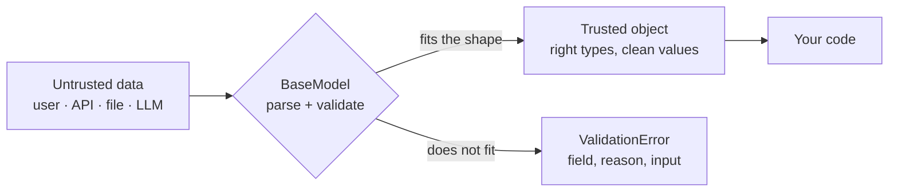

# Chapter 1: Why Pydantic, and `BaseModel`

*Type hints describe what you hope for. Pydantic checks what you actually got.*

> [!NOTE]
> **📍 At a glance**
> - **You will learn:** why Python hints protect nothing at run time, and how `BaseModel` turns untrusted data into a trusted object
> - **You will build:** a `SignupForm` that converts sensible input, rejects nonsense and dumps clean data
> - **Level:** beginner · **Time:** about 30 minutes
> - **Builds on:** [Python Ch 2](../python/02-python-refresher.md) (dataclasses and type hints)

**After this chapter you can:**

- Say why Python type hints do not protect you, and what Pydantic adds
- Tell a plain class, a dataclass and a `BaseModel` apart by what each checks
- Predict how Pydantic converts or rejects `"28"`, `"28eight"`, `28.5` and `"True"`
- Read a `ValidationError`, and use `model_dump()` and `model_dump_json()`
- Configure a model: reject unknown keys, check assignments, freeze it, turn off conversion
- Answer the "Pydantic v1 vs v2" interview question

## 1.1 Why Pydantic exists

- Java or C++ enforce a declared type. Python lets a name move from `int` to `str` to `list` without complaint
- Friendly while learning. Dangerous in production, where bad input meets databases, payments and other services
- A wrong type flows on silently and breaks far away from where it entered
- Pydantic checks data **at the boundary**: the moment it arrives from a user, an API, a file or an LLM
- It is among the most downloaded packages on PyPI. FastAPI, the OpenAI and Anthropic SDKs, and LangChain all build on it
- You still need to understand it when AI writes the code: you cannot debug or trust code you cannot read



### Three ways to define a blueprint

| Approach | Type checking at run time |
|---|---|
| Plain class with your own `__init__` | None |
| `@dataclass` | None (it only removes boilerplate) |
| Pydantic `BaseModel` | Every field, automatically |

- ✅ *Verified: the plain class and the dataclass both accepted `age="banana"`; only `BaseModel` raised (details at the end).*
- Think of a paper form: the fields are the blueprint. The three approaches differ only in whether anyone checks the boxes
- Editors show the hinted type on hover (`settings: dict[str, str]`), but that is help for you, not a check on data

| Dataclass | Pydantic `BaseModel` |
|---|---|
| Removes boilerplate only | Removes boilerplate **and** validates |
| Nothing enforced at run time | Raises `ValidationError` on bad input |
| Fine for internal structures you build yourself | Essential at the edges: API inputs and outputs, config, tool arguments, LLM replies |

*Source: Live-Class-2026, `classes_summary/03`, `classes_transcription_summary/03`, whiteboard `Class-3-4.pdf`.*

### The problem in plain Python

```python
def register_user(name, email, age):
    birth_year = 2026 - age        # silently assumes `age` is an int
    print(f"Registered {name} ({email}), born approx. {birth_year}")

register_user("Aditi", "aditi@example.com", 28)      # born approx. 1998
register_user("Rohan", "rohan@example.com", 10000)   # born approx. -7974
```

- Nothing stops garbage. `10000` is a valid `int` but not a sensible age
- That is the gap between **type validation** (is it an `int`?) and **data validation** (does the value make sense?), covered in [Chapter 2](02-field-and-special-types.md)
- ✅ *Verified: both calls give the outputs in the comments.*

**Type hints are not enforced:**

```python
age: int = 28
tags: list[str] = ["python", "pydantic", "fastapi"]
age: int = "twenty-eight"   # Python accepts this; `age` is now a string
```

- Hints describe intent. Static checkers (mypy, Pyright) read them before run time; only a Pydantic model checks real data at run time

*Source: `Pydantic_From_Scratch.ipynb`, `1. Why Pydantic.py`.*

## 1.2 `BaseModel`: the shape you are willing to trust

A messy LLM reply such as `{"amount": "five hundred", "currency": "us dollars"}` is the classic failure Pydantic catches.

```python
from pydantic import BaseModel, ValidationError

class CurrencyAmount(BaseModel):
    amount: float
    currency: str

CurrencyAmount(amount=100, currency="USD")              # fine
CurrencyAmount(amount="100", currency="USD")            # "100" becomes 100.0
CurrencyAmount(amount="five hundred", currency="USD")   # ValidationError, instantly
```

### Required, optional and defaults

- A field with a default is optional. Every other field is required
- No sensible default? Use `None` (Python's "no value")

```python
class SignupForm(BaseModel):
    username: str
    email: str
    age: int
    newsletter_opt_in: bool = False      # default makes it optional
    nationality: str | None = None       # unknown: use None
```

> [!WARNING]
> **⚠️ Pitfall: `str | None` does not mean optional**
> - `nationality: str | None` with **no default** is still required; it just accepts `None`
> - Only `= None` (or another default) makes the key optional

### Type coercion (lax mode)

Pydantic converts a reasonable mismatch and refuses a lossy or ambiguous one. On an `age: int` field:

| Input | Result |
|---|---|
| `"28"` | `28` |
| `"28.0"` or `28.0` | `28` |
| `"28eight"` | `ValidationError` |
| `28.5` | `ValidationError` (a fraction is too lossy to guess) |
| `True` | `1` |

- ✅ *Verified on Pydantic 2.13.5 (details at the end).*
- On a `bool` field: `"True"`, `"yes"`, `"1"` become `True`; `"maybe"` is rejected

### Creating, dumping and reading errors

```python
SignupForm(username="a", email="a@e.com", age="28").model_dump()
# {'username': 'a', 'email': 'a@e.com', 'age': 28, 'newsletter_opt_in': False, 'nationality': None}

try:
    SignupForm(username="Mayank")
except ValidationError as e:
    print(e.error_count())            # 2
    print(e.errors()[0]["loc"], e.errors()[0]["type"])   # ('email',) missing
```

| You have | Call |
|---|---|
| Keyword arguments | `Model(field=value, ...)` |
| A dict | `Model.model_validate(data)` |
| A JSON string | `Model.model_validate_json(text)` |
| A model, want a dict | `model.model_dump()` |
| A model, want JSON text | `model.model_dump_json()` |
| A model, want a changed copy | `model.model_copy(update={...})` |

- A missing required field is an error (`missing`), never a silent default
- `model_dump()` returns values already cleaned (`"28"` is now `28`)

### The mini-project folder

`8_Pydantic/` is a `uv` project used in the class:

| File | What it is |
|---|---|
| `1. Why Pydantic.py` | The motivating problem: typed lists and dicts |
| `Pydantic_From_Scratch.ipynb` | The step-by-step build used in this book |
| `main.py`, `test.ipynb` | A scaffold and an empty notebook (nothing to learn) |

```bash
uv sync
uv run main.py
```

*Source: the folder's `README.md`, `main.py`, `test.ipynb`.*

## 1.3 Configuring a model with `model_config`

Defaults are forgiving. Production code usually tightens them.

```python
from pydantic import BaseModel, ConfigDict

class Payment(BaseModel):
    model_config = ConfigDict(
        extra="forbid",            # unknown keys are an error, not silently dropped
        validate_assignment=True,  # m.amount = "banana" is checked too
        str_strip_whitespace=True, # " USD " becomes "USD"
    )
    amount: float
    currency: str
```

| Setting | Default | Turn it on when |
|---|---|---|
| `extra="forbid"` | `"ignore"`: unknown keys dropped | A typo in a key must fail (config files, tool arguments) |
| `validate_assignment=True` | Off: assignment not checked | Objects are changed after creation |
| `frozen=True` | Off | Values must never change; the model also becomes hashable |
| `strict=True` | Off: lax conversion | `"28"` for an `int` should be rejected, not converted |

- ✅ *Verified: `extra="forbid"` gave `extra_forbidden`; without `validate_assignment`, `m.age = "banana"` was stored as a string; `frozen=True` gave `frozen_instance`; strict mode rejected `"28"` even inside JSON text.*
- A frozen model changes only through `model_copy(update={...})`, which returns a new object

> [!IMPORTANT]
> **🏭 In production**
> - Use **`extra="forbid"`** on config and on anything a model fills in: a misspelled key should fail loudly, not vanish
> - Use **strict mode** for money, IDs and flags where a guessed conversion is a bug; keep lax mode for messy human input
> - Validate **once, at the edge**. Inside your code, pass the model around; do not re-check plain dicts everywhere
>
> *Added by Claude.*

## 1.4 Pydantic v1 vs v2

You will meet v1 code in older projects, tutorials and AI-generated snippets.

| v1 | v2 (current) |
|---|---|
| `.dict()`, `.json()` | `.model_dump()`, `.model_dump_json()` |
| `Model.parse_obj(d)`, `parse_raw(s)` | `Model.model_validate(d)`, `model_validate_json(s)` |
| `class Config:` inside the model | `model_config = ConfigDict(...)` |
| `@validator`, `@root_validator` | `@field_validator`, `@model_validator` ([Chapter 3](03-validators.md)) |
| Validation in pure Python | Core rewritten in Rust (`pydantic-core`), much faster |

- ✅ *Verified: in 2.13.5, `.dict()` still works but raises `PydanticDeprecatedSince20`.*
- New code: always the v2 names. Seeing `.dict()` or `@validator` is a sign the snippet is old

## 1.5 Added by Claude, not from the sources

- **The JSON schema comes free.** `Model.model_json_schema()` returns `properties` and `required`. Tool definitions and structured output are built from exactly this ([Chapter 5](05-validating-llm-output.md))
- **Mutable defaults are safe in Pydantic.** `tags: list[str] = []` gives each instance its own list (✅ *verified*). Plain classes and dataclasses do not protect you here; `Field(default_factory=list)` makes the intent explicit
- **Validation is not authorisation.** A perfectly valid `user_id` can still belong to someone else. Check permissions separately
- **Keep raw input when debugging LLM output.** Log the text that failed validation; the error alone rarely shows why the model produced it

## 1.6 Interview corner

**What interviewers listen for:** you know hints are not enforced, you validate at the **boundary**, and you know the v2 API and the main `model_config` switches.

### 🟢 Basic

<details class="qa"><summary>1. Why does Python need Pydantic if it has type hints?</summary>

- Hints are not enforced at run time. Pydantic checks real data when the object is created
- *Stronger answer:* static checkers cover your own code; Pydantic covers data from outside, which no static tool can see

</details>

<details class="qa"><summary>2. Dataclass or <code>BaseModel</code>?</summary>

- A dataclass only removes boilerplate. `BaseModel` also validates and converts
- *Stronger answer:* dataclasses for internal structures you build yourself; `BaseModel` at every boundary: APIs, config, tool arguments, LLM output

</details>

<details class="qa"><summary>3. What happens with <code>"28"</code>, <code>"28eight"</code> and <code>28.5</code> for an <code>int</code> field?</summary>

- `"28"` becomes `28`; the other two are rejected
- *Stronger answer:* lax mode converts only when nothing is lost; `strict=True` rejects even `"28"`

</details>

<details class="qa"><summary>4. How do you turn a model into a dict or JSON, and back?</summary>

- `model_dump()` / `model_dump_json()` out; `model_validate()` / `model_validate_json()` in
- *Stronger answer:* `model_validate_json` parses and validates in one step, so JSON errors and field errors come back the same way

</details>

### 🟡 Intermediate

<details class="qa"><summary>5. A client sends an extra key <code>"colour"</code>. What does Pydantic do?</summary>

- Ignores and drops it by default
- *Stronger answer:* set `extra="forbid"` where a misspelled key should fail, for example config or tool arguments

</details>

<details class="qa"><summary>6. You set <code>m.age = "banana"</code> after creation. Is it checked?</summary>

- Not by default; the string is stored
- *Stronger answer:* `validate_assignment=True` checks it, or `frozen=True` forbids changes and you use `model_copy(update=...)`

</details>

<details class="qa"><summary>7. What changed between Pydantic v1 and v2?</summary>

- New method names (`model_dump`, `model_validate`), `model_config`, new validator decorators
- *Stronger answer:* the core moved to Rust (`pydantic-core`), so validation is much faster; v1 names still run but raise deprecation warnings

</details>

### 🔴 Senior

<details class="qa"><summary>8. Strict or lax mode for a payments API?</summary>

- Strict for amounts, IDs and flags: a guessed conversion is a bug
- *Stronger answer:* strict per field or per model where correctness matters, lax where humans type input; and use `Decimal`, not `float`, for money ([Chapter 2](02-field-and-special-types.md))

</details>

<details class="qa"><summary>9. Why do agent frameworks lean on Pydantic?</summary>

- Tool arguments and structured replies come from a model and must be checked before use
- *Stronger answer:* one class gives the JSON schema sent to the model **and** the validator for its reply, so the contract and the check never drift apart

</details>

> [!TIP]
> **🧩 Design question**
> - *"An internal service receives JSON from five partner systems. Each partner sometimes adds fields or sends numbers as strings. How do you design validation?"*
> - Talk about: one model per partner contract, `extra` policy per partner, lax vs strict per field, logging rejected payloads, and returning `errors()` to the partner

## Cheat sheet

```python
from pydantic import BaseModel, ConfigDict, ValidationError
class User(BaseModel):
    model_config = ConfigDict(extra="forbid", validate_assignment=True)
    name: str
    age: int
    nickname: str | None = None                # optional
u = User.model_validate({"name": "A", "age": "28"})   # age -> 28
u.model_dump(); u.model_dump_json(); u.model_copy(update={"age": 29})
try: User(name="A")
except ValidationError as e: e.errors()        # [{'loc': ('age',), 'type': 'missing', ...}]
```

## Recap

- Python hints are not enforced; `BaseModel` checks every field when the object is created
- Validate once, at the boundary, then trust the object
- Lax mode converts only lossless input; strict mode converts nothing
- A default makes a field optional; `str | None` alone does not
- `model_config`: `extra="forbid"`, `validate_assignment`, `frozen`, `strict`
- New code uses the v2 names: `model_dump`, `model_validate`, `model_config`

## Practice

1. Show with a plain class, a dataclass and a `BaseModel` why only `BaseModel` rejects `age="banana"`
2. Predict the result for `age` set to `"28"`, `"28eight"`, `28.5` and `True`, then run it
3. Make a model reject unknown keys, then one that validates assignments, then a frozen one
4. Convert three lines of v1 code (`.dict()`, `parse_obj`, `class Config`) to v2
5. Write `register_user` with a `BaseModel` so `age=10000` is rejected (needs [Chapter 2](02-field-and-special-types.md))

## How this chapter was checked

- **Run** (Pydantic 2.13.5): the plain class, dataclass and model with `"banana"`; six `age` inputs; `bool` coercion; missing fields and `error_count()`; `model_dump`; unknown keys; `extra="forbid"`; assignment with and without `validate_assignment`; `frozen=True`, hashing and `model_copy`; strict mode on Python and JSON input; `.dict()` deprecation warning; mutable list default; JSON schema
- **Cheat sheet:** run as written
- **Not run:** `uv sync` and `main.py` in the mini-project folder
- The "boundary" and production advice in 1.3 and 1.5 is Added by Claude: standard engineering practice, not from the class
- The 2026 review added the diagram, 1.3, 1.4, the graded interview layout, the design question and the cheat sheet

## Sources and further reading

- Live-Class-2026, `classes_summary/03 - 4 Jul - Pydantic Deep Dive.md` and `classes_transcription_summary/03`
- Live-Class-2026, code folder `8_Pydantic/` and the whiteboard `Class-3-4.pdf`
- Pydantic docs: [Models](https://docs.pydantic.dev/latest/concepts/models/), [Configuration](https://docs.pydantic.dev/latest/concepts/config/), [Migration guide v1 to v2](https://docs.pydantic.dev/latest/migration/)

Previous: [Python Ch 2](../python/02-python-refresher.md) · Next: [Chapter 2](02-field-and-special-types.md)
