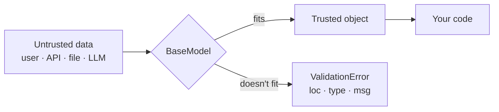

# Chapter 1: Why Pydantic, and `BaseModel`

*Type hints describe what you hope for. Pydantic checks what you actually got.*

> [!NOTE]
> **📍 At a glance**
> - **You will learn:** why hints protect nothing at run time, `BaseModel` coercion and errors, `model_config` switches, v1 vs v2
> - **Level:** beginner · **Time:** about 15 minutes
> - **Builds on:** [Python Ch 2](../python/02-python-refresher.md)

---

## 1.1 Why it exists

- Python never enforces hints: `age: int = "twenty-eight"` runs fine
- Bad data flows on silently and breaks far from where it entered
- Pydantic validates **at the boundary**: user input, APIs, files, config, **LLM replies and tool arguments**
- FastAPI, the OpenAI/Anthropic SDKs and LangChain all build on it



| | Checks types at run time | Use for |
|---|---|---|
| Plain class / `@dataclass` | No | Internal structures you build |
| `BaseModel` | Every field | Every boundary |

- **Type vs data validation:** `10000` is a valid `int` but not a valid age; value rules come in [Chapter 2](02-field-and-special-types.md)

## 1.2 `BaseModel` essentials

```python
from pydantic import BaseModel, ValidationError

class SignupForm(BaseModel):
    username: str
    age: int
    newsletter: bool = False          # default → optional
    nationality: str | None = None    # optional, may be None
```

> [!WARNING]
> `str | None` **without** a default is still required; it just accepts `None`.

**Coercion (lax mode) on `age: int`:**

| Input | Result |
|---|---|
| `"28"`, `28.0`, `"28.0"` | `28` |
| `"28eight"`, `28.5` | `ValidationError` (lossy or ambiguous) |
| `True` | `1` |

- On `bool`: `"true"`, `"yes"`, `"1"` → `True`; `"maybe"` rejected

| You have / want | Call |
|---|---|
| kwargs → model | `Model(...)` |
| dict → model | `Model.model_validate(d)` |
| JSON text → model | `Model.model_validate_json(s)` |
| model → dict / JSON | `.model_dump()` / `.model_dump_json()` |
| changed copy | `.model_copy(update={...})` |
| JSON schema (for LLM tools) | `Model.model_json_schema()` |

```python
try:
    SignupForm(username="A")
except ValidationError as e:
    e.errors()[0]["loc"], e.errors()[0]["type"]     # ('age',), 'missing'
```

## 1.3 `model_config`

```python
class Payment(BaseModel):
    model_config = ConfigDict(extra="forbid", validate_assignment=True, str_strip_whitespace=True)
    amount: float
    currency: str
```

| Setting | Default | Turn on when |
|---|---|---|
| `extra="forbid"` | unknown keys dropped | a typo must fail (config, tool args, LLM output) |
| `validate_assignment=True` | assignment unchecked | objects change after creation |
| `frozen=True` | mutable | values must never change (also hashable) |
| `strict=True` | lax coercion | `"28"` for `int` is a bug (money, IDs, flags) |

> [!IMPORTANT]
> **🏭 In production:** `extra="forbid"` on anything a model fills in; strict mode for money and IDs; validate once at the edge, then pass the object around. Validation ≠ authorisation: a valid `user_id` may still belong to someone else.

## 1.4 v1 vs v2

| v1 (old snippets, AI output) | v2 |
|---|---|
| `.dict()`, `.json()` | `.model_dump()`, `.model_dump_json()` |
| `parse_obj`, `parse_raw` | `model_validate`, `model_validate_json` |
| `class Config:` | `model_config = ConfigDict(...)` |
| `@validator`, `@root_validator` | `@field_validator`, `@model_validator` |
| pure Python | Rust core (`pydantic-core`), much faster |

## Interview corner

<details class="qa"><summary>1. Why Pydantic if Python has type hints?</summary>

- Hints are not enforced at run time; Pydantic checks real external data that static checkers never see

</details>

<details class="qa"><summary>2. <code>"28"</code>, <code>"28eight"</code>, <code>28.5</code> on an <code>int</code> field?</summary>

- `28`, error, error; lax converts only when lossless; `strict=True` rejects even `"28"`

</details>

<details class="qa"><summary>3. Why do agent frameworks rely on Pydantic?</summary>

- One class gives the JSON schema sent to the model **and** the validator for its reply, so contract and check never drift

</details>

<details class="qa"><summary>4. Strict or lax for a payments API?</summary>

- Strict for amounts, IDs, flags; lax for human-typed fields; `Decimal` not `float` for money

</details>

## Cheat sheet

```python
class User(BaseModel):
    model_config = ConfigDict(extra="forbid", validate_assignment=True)
    name: str
    age: int
    nickname: str | None = None
u = User.model_validate({"name": "A", "age": "28"})   # age → 28
u.model_dump(); u.model_dump_json(); User.model_json_schema()
```

---

*Source: Live-Class-2026 class 03 (Pydantic Deep Dive) and the `8_Pydantic` mini project; `model_config`, v1/v2 and production notes added by Claude (tested with Pydantic 2.13).*

Next: [Chapter 2](02-field-and-special-types.md)
