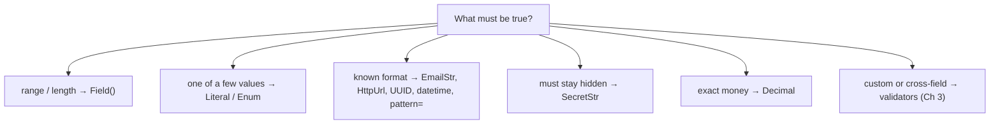

# Chapter 2: `Field()` and special types

*The type says what kind of value arrived. `Field()` and special types say whether it makes sense.*

> [!NOTE]
> **📍 At a glance**
> - **You will learn:** value limits, fixed choices, reusable types, money/dates/IDs, aliases, and API keys via `pydantic-settings`
> - **Level:** beginner · **Time:** about 15 minutes
> - **Builds on:** [Chapter 1](01-why-pydantic-and-basemodel.md)

---

## 2.1 Which tool for which rule



## 2.2 `Field()` limits

```python
class JobApplication(BaseModel):
    full_name: str = Field(min_length=2, max_length=100)
    years_experience: int = Field(gt=0, le=50, description="Total years of paid work")
```

| Limit | Works on |
|---|---|
| `gt`, `ge`, `lt`, `le`, `multiple_of` | numbers, dates |
| `min_length`, `max_length` | strings, lists |
| `pattern` | strings (regex) |

- `description=` / `examples=` are **not checks**; they go into the JSON schema, so **write descriptions for the LLM** that will fill the field
- `Annotated[int, Field(gt=0)]` is the same rule, and makes it reusable:

```python
PositiveAmount = Annotated[float, Field(gt=0)]
CountryCode = Annotated[str, Field(pattern=r"^[A-Z]{2}$")]
```

## 2.3 Fixed choices

```python
class Priority(str, Enum):
    low = "low"; high = "high"

class Ticket(BaseModel):
    channel: Literal["email", "chat", "phone"]
    priority: Priority = Priority.low
```

- `Literal` for one place, `Enum` when reused across code
- Both appear as `enum` in the schema, so the LLM sees allowed values
- Prefer them for anything you branch on (`intent`, `status`, `category`): a typo becomes an error, not a silent `else`

## 2.4 Special types

| Type | Use | Note |
|---|---|---|
| `EmailStr` | email | `pip install "pydantic[email]"` |
| `HttpUrl` | http(s) URL | |
| `SecretStr` | passwords, keys | prints `**********`; read with `.get_secret_value()` |
| `Decimal` | **money** | `float` gives `0.1 + 0.2 = 0.30000000000000004` |
| `datetime` / `date` | timestamps / days | parses ISO 8601; store **UTC with timezone** |
| `UUID` | IDs | rejects malformed IDs |

- `model_dump()` keeps Python objects; `model_dump(mode="json")` gives JSON-safe strings
- A dumped `SecretStr` is still stars: call `get_secret_value()` deliberately, at the one place that needs it

## 2.5 Aliases, hidden fields, factories

```python
class Customer(BaseModel):
    model_config = ConfigDict(validate_by_name=True)
    user_name: str = Field(alias="userName")                 # outside name → Python name
    internal_note: str = Field(default="", exclude=True)     # never dumped
    created_at: datetime = Field(default_factory=datetime.now)
    tags: list[str] = Field(default_factory=list)

Customer.model_validate({"userName": "aditi"}).model_dump(by_alias=True)   # {'userName': 'aditi', ...}
```

- `= datetime.now()` would run **once** at class definition; use `default_factory`

## 2.6 Settings and API keys

```python
from pydantic_settings import BaseSettings, SettingsConfigDict

class Settings(BaseSettings):
    model_config = SettingsConfigDict(env_file=".env", env_prefix="APP_")
    openai_api_key: SecretStr        # APP_OPENAI_API_KEY
    timeout_s: int = 30              # APP_TIMEOUT_S="45" → 45

settings = Settings()                # fails at startup if a key is missing
client = OpenAI(api_key=settings.openai_api_key.get_secret_value())
```

> [!CAUTION]
> **🔒 Security:** `.env` in `.gitignore`; keys typed `SecretStr` so `print(settings)` never leaks them; reveal the value only where the client is created.

## Interview corner

<details class="qa"><summary>1. Why <code>Decimal</code> and not <code>float</code> for money?</summary>

- Binary floats can't represent most decimals exactly; errors compound in totals

</details>

<details class="qa"><summary>2. How do you load API keys safely?</summary>

- `BaseSettings` + `.env` (git-ignored) + `SecretStr`; fail at startup, reveal only at client creation

</details>

<details class="qa"><summary>3. Why does <code>Field(description=...)</code> matter for LLMs?</summary>

- It is in the JSON schema the model reads; it is effectively part of the prompt

</details>

---

*Source: Live-Class-2026 class 03 notebook; `Decimal`, settings, aliases and security notes added by Claude (tested with Pydantic 2.13).*

Previous: [Chapter 1](01-why-pydantic-and-basemodel.md) · Next: [Chapter 3](03-validators.md)
