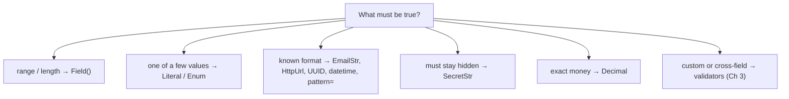

# Chapter 2: `Field()` and special types

*The type says what kind of value arrived. `Field()` and special types say whether it makes sense.*

> [!NOTE]
> **📍 At a glance**
> - **You will learn:** value limits, fixed choices, reusable types, money/dates/IDs, aliases, and API keys via `pydantic-settings`
> - **You will build:** the class's job application with length and range limits, an email field, and an account whose password never prints
> - **Level:** beginner · **Time:** about 30 minutes
> - **Builds on:** [Chapter 1](01-why-pydantic-and-basemodel.md)

**After this chapter you can:**

- Add range, length and pattern limits with `Field()`, inline or as reusable `Annotated` types
- Restrict a field to fixed choices with `Literal` or `Enum`
- Pick the right special type for emails, URLs, secrets, money, dates and IDs
- Rename fields between the outside world and Python, hide fields, and set safe defaults
- Load API keys from `.env` without ever printing them

---

## 2.1 Which tool for which rule



## 2.2 `Field()` limits

```python
class JobApplication(BaseModel):
    full_name: str = Field(min_length=2, max_length=100)
    years_experience: int = Field(gt=0, le=50, description="Total years of paid work")
```

- The class version (`JobApplicationV1`) uses `ge=0` (zero years allowed). A one-letter name fails:

```python
class JobApplicationV1(BaseModel):
    full_name: str = Field(min_length=2, max_length=100)
    years_experience: int = Field(ge=0, le=50)

JobApplicationV1(full_name="a", years_experience=5)
# full_name  String should have at least 2 characters [type=string_too_short]
```

- The class's currency model (`_8`): positive amounts, three-letter codes

```python
class BoundedAmount(BaseModel):
    amount: float = Field(gt=0, description="Must be positive")
    currency: str = Field(min_length=3, max_length=3)

BoundedAmount(amount=-50, currency="USD")   # amount  Input should be greater than 0 [type=greater_than]
```

| Limit | Works on |
|---|---|
| `gt`, `ge`, `lt`, `le`, `multiple_of` | numbers, dates |
| `min_length`, `max_length` | strings, lists |
| `pattern` | strings (regex) |

- `description=` / `examples=` are **not checks**; they go into the JSON schema, so **write descriptions for the LLM** that will fill the field
- `Annotated[int, Field(gt=0)]` is the same rule, and makes it reusable:

```python
class JobApplicationV2(BaseModel):                     # the class's second form
    full_name: Annotated[str, Field(min_length=2, max_length=100)]
    years_experience: Annotated[int, Field(ge=0, le=50)]

PositiveAmount = Annotated[float, Field(gt=0)]
CountryCode = Annotated[str, Field(pattern=r"^[A-Z]{2}$")]
```

- *Tested:* `JobApplicationV1` and `JobApplicationV2` gave the same `string_too_short` error and the same JSON schema limits (`minLength: 2`, `maximum: 50`)

## 2.3 Fixed choices

*Added by Claude: the class code doesn't use `Literal` or `Enum` yet.*

```python
class Priority(str, Enum):
    low = "low"; high = "high"

class Ticket(BaseModel):
    channel: Literal["email", "chat", "phone"]
    priority: Priority = Priority.low
```

- `Literal` for one place, `Enum` when reused across code
- Both appear as `enum` in the schema, so the LLM sees allowed values
- Prefer them for anything you branch on (`intent`, `status`, `category`): a typo becomes an error, not a silent `else`

## 2.4 Special types

| Type | Use | Note |
|---|---|---|
| `EmailStr` | email | `pip install "pydantic[email]"` |
| `HttpUrl` | http(s) URL | |
| `SecretStr` | passwords, keys | prints `**********`; read with `.get_secret_value()` |
| `Decimal` | **money** | `float` gives `0.1 + 0.2 = 0.30000000000000004` |
| `datetime` / `date` | timestamps / days | parses ISO 8601; store **UTC with timezone** |
| `UUID` | IDs | rejects malformed IDs |

- The class's email field (`JobApplicationV3`, after `pip install "pydantic[email]"`):

```python
from pydantic import BaseModel, EmailStr, Field

class JobApplicationV3(BaseModel):
    full_name: str = Field(min_length=2, max_length=100)
    years_experience: int = Field(ge=0, le=50)
    email: EmailStr
```

- *Tested (`email-validator` 2.4.0):* `"Rohan@Example.COM"` became `"Rohan@example.com"` (domain lower-cased, the part before `@` kept); `"abc@mayank-gs-india@yopmail.com"` was rejected; `"rohan@yopmail.com"` passed, because a disposable domain is still a valid email. Blocking it needs a validator ([Chapter 3](03-validators.md))
- The class's secret:

```python
from pydantic import BaseModel, SecretStr

class UserAccount(BaseModel):
    username: str
    password: SecretStr

account = UserAccount(username="rohan99", password="super-secret-123")
print(account)                              # username='rohan99' password=SecretStr('**********')
account.password.get_secret_value()         # 'super-secret-123', on purpose
```

- `model_dump()` keeps Python objects; `model_dump(mode="json")` gives JSON-safe strings
- A dumped `SecretStr` is still stars: call `get_secret_value()` deliberately, at the one place that needs it

> [!WARNING]
> **Saving a secret to a file saves the stars.** The class notebook writes `account.model_dump(mode="json")` to `account.json`. *Tested:* the file held `"password": "**********"`, and a model loaded from it had the password `**********`. That protects the secret, but the real value is gone. Store secrets in a secret manager, not in dumped JSON.

## 2.5 Aliases, hidden fields, factories

*Sections 2.5 and 2.6 are added by Claude.*

```python
class Customer(BaseModel):
    model_config = ConfigDict(validate_by_name=True)
    user_name: str = Field(alias="userName")                 # outside name → Python name
    internal_note: str = Field(default="", exclude=True)     # never dumped
    created_at: datetime = Field(default_factory=datetime.now)
    tags: list[str] = Field(default_factory=list)

Customer.model_validate({"userName": "aditi"}).model_dump(by_alias=True)   # {'userName': 'aditi', ...}
```

- `= datetime.now()` would run **once** at class definition; use `default_factory`

## 2.6 Settings and API keys

```python
from pydantic_settings import BaseSettings, SettingsConfigDict

class Settings(BaseSettings):
    model_config = SettingsConfigDict(env_file=".env", env_prefix="APP_")
    openai_api_key: SecretStr        # APP_OPENAI_API_KEY
    timeout_s: int = 30              # APP_TIMEOUT_S="45" → 45

settings = Settings()                # fails at startup if a key is missing
client = OpenAI(api_key=settings.openai_api_key.get_secret_value())
```

> [!CAUTION]
> **🔒 Security:** `.env` in `.gitignore`; keys typed `SecretStr` so `print(settings)` never leaks them; reveal the value only where the client is created. *Added by Claude.*

## 2.7 Added by Claude, not from the sources

- **Write every `description` for the model that fills the field.** It is part of the prompt
- **Prefer `Annotated` aliases** (`PositiveAmount`) when a rule appears in more than one model
- **Never `float` for money**, and never number limits on an identifier stored as text
- **A valid email is not a real or allowed email.** Format checks, then your own rules, then a confirmation message

## Interview corner

**What interviewers listen for:** you can express a rule with the simplest tool that fits, you pick the right type for money and secrets, and you keep keys out of logs.

### 🟢 Basic

<details class="qa"><summary>1. Why <code>Decimal</code> and not <code>float</code> for money?</summary>

- Binary floats can't represent most decimals exactly; errors compound in totals
- *Stronger answer:* pass money as a string (`"9.50"`) into a `Decimal` field, so no float rounding happens on the way in

</details>

### 🟡 Intermediate

<details class="qa"><summary>2. How do you load API keys safely?</summary>

- `BaseSettings` + `.env` (git-ignored) + `SecretStr`; fail at startup, reveal only at client creation
- *Stronger answer:* in production, read keys from a secret manager or the platform's secret store, not a file on disk

</details>

<details class="qa"><summary>3. Why does <code>Field(description=...)</code> matter for LLMs?</summary>

- It is in the JSON schema the model reads; it is effectively part of the prompt
- *Stronger answer:* when a model keeps filling a field wrongly, fix the description before adding retries

</details>

### 🔴 Senior

<details class="qa"><summary>4. <code>EmailStr</code> accepted <code>rohan@yopmail.com</code>. Is the field "validated"?</summary>

- Only the format is; a disposable or non-existent address passes
- Add a `field_validator` for domain rules, then confirm ownership with a link
- *Stronger answer:* split the checks by cost: format in Pydantic, domain lists in a validator, ownership and fraud checks in the service layer

</details>

> [!TIP]
> **🧩 Design question to practise:** *"A job-application form is filled in by candidates and pre-filled by an LLM from a CV."* Cover: field limits, an email type, secrets, descriptions written for the LLM, and which rules stay out of the model.

## Cheat sheet

```python
class Job(BaseModel):
    full_name: str = Field(min_length=2, max_length=100)
    years: Annotated[int, Field(ge=0, le=50, description="Years of paid work")]
    email: EmailStr                                   # pip install "pydantic[email]"
    channel: Literal["email", "chat"]
    password: SecretStr                               # prints **********
    price: Decimal                                    # money
    tags: list[str] = Field(default_factory=list)
```

## Recap

- `Field()` adds value rules: `gt`/`ge`/`lt`/`le`, lengths, `pattern`
- `Annotated[type, Field(...)]` makes a rule reusable
- `Literal`/`Enum` for fixed choices; they show up in the schema
- `EmailStr` checks format only; `SecretStr` hides values, even in dumps and files
- `Decimal` for money; `default_factory` for lists, dicts and timestamps
- Keys: `BaseSettings` + `.env` + `SecretStr`

## Practice

1. Add `le=50` to years and try `51`. Then make the same rule an `Annotated` alias
2. Validate five emails with `EmailStr` and note which ones surprise you
3. Dump a model with a `SecretStr` to JSON, reload it, and print the password
4. Build `Settings` with `APP_TIMEOUT_S="45"` in the environment and check the type

## How this chapter was checked

- **Run offline** with `pydantic` 2.14.3, `email-validator` 2.4.0, `pydantic-settings` 2.16.3: every code block in this chapter
- **2.2:** `string_too_short` for `"a"`; `greater_than` for `-50`; `JobApplicationV1` and `V2` produced the same schema limits
- **2.4:** the email results listed above; `print(account)` showed stars; the JSON dump and reload kept the stars
- **2.6:** `Settings()` with no key raised `ValidationError` (the intended start-up failure)

## Sources and further reading

- Live-Class-2026, `8_Pydantic/Pydantic_From_Scratch.ipynb` (`JobApplicationV1` to `V3`, `UserAccount`, `account.json`) and `_8_pydantic_with_ai.py` Part 3 (re-read in full 2026-11-15)
- [Pydantic docs: Fields](https://docs.pydantic.dev/latest/concepts/fields/), [Types](https://docs.pydantic.dev/latest/concepts/types/), [Settings](https://docs.pydantic.dev/latest/concepts/pydantic_settings/)
- Added by Claude: 2.3, 2.5, 2.6, 2.7, interview question 4

Previous: [Chapter 1](01-why-pydantic-and-basemodel.md) · Next: [Chapter 3](03-validators.md)
