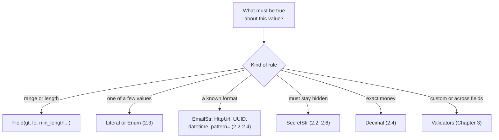

# Chapter 2: `Field()` and special types

*The type says what kind of value arrived. `Field()` and special types say whether the value makes sense.*

> [!NOTE]
> **📍 At a glance**
> - **You will learn:** value limits, fixed choices, reusable types, money and dates done right, aliases, and secrets loaded from the environment
> - **You will build:** a `JobApplication` with real limits, and an app `Settings` object that reads API keys safely
> - **Level:** beginner · **Time:** about 40 minutes
> - **Builds on:** [Chapter 1](01-why-pydantic-and-basemodel.md)

**After this chapter you can:**

- Add value limits with `Field()` (`gt`, `le`, `min_length`, `max_length`, `pattern`)
- Read both `Field()` and `Annotated[...]` syntax, and define a reusable constrained type
- Restrict a field to fixed choices with `Literal` or `Enum`
- Use `EmailStr`, `HttpUrl`, `SecretStr`, `Decimal`, `datetime` and `UUID` correctly
- Map external key names with aliases, and hide fields from output
- Load configuration and API keys with `pydantic-settings`

## 2.1 `Field()`: validating the value, not only the type

- **Type validation:** what kind of data. **Data validation:** does the value make sense
- An age of 1000 is a valid `int` but not a valid age

```python
from pydantic import BaseModel, Field

class JobApplication(BaseModel):
    full_name: str = Field(min_length=2, max_length=100)
    years_experience: int = Field(gt=0, le=50)
    portfolio_url: str
```

| Limit | Means | Works on |
|---|---|---|
| `gt`, `ge` | greater than, greater or equal | numbers, dates |
| `lt`, `le` | less than, less or equal | numbers, dates |
| `min_length`, `max_length` | length | strings, lists |
| `pattern` | regular expression must match | strings |
| `multiple_of` | divisible by | numbers |

- ✅ *Verified: `years=51` and `years=0` rejected; `years=50` passed (`le` includes the limit, `gt` does not).*
- `description=` and `examples=` are not checks. They document the field and go into the JSON schema a model reads ([Chapter 5](05-validating-llm-output.md))

### Two syntaxes

```python
from typing import Annotated
years: int = Field(gt=0, le=50)                 # plain Field
years: Annotated[int, Field(gt=0, le=50)]       # Annotated
```

- Same rule, same error. ✅ *Verified.*
- Plain `Field()` reads more easily. `Annotated` is common in generated code and in FastAPI, and it enables reusable types (2.3)

### Which tool for which check



## 2.2 Built-in special types

They save you writing regular expressions.

| Type | Checks | Note |
|---|---|---|
| `EmailStr` | a valid email address | needs `pip install "pydantic[email]"` |
| `HttpUrl` | a valid http(s) URL | adds a trailing `/` to a bare domain |
| `SecretStr` | nothing extra; **hides** the value in prints and logs | read it with `.get_secret_value()` |

- ✅ *Verified (with `email-validator`): `Rohan@Example.COM` became `Rohan@example.com` (domain lower-cased, local part kept); `not-an-email` rejected; `https://example.com` became `https://example.com/`; `ftp//x` rejected.*

### `SecretStr` in detail

```python
from pydantic import SecretStr

class UserAccount(BaseModel):
    username: str
    password: SecretStr

account = UserAccount(username="rohan99", password="super-secret-123")
print(account)                       # username='rohan99' password=SecretStr('**********')
account.model_dump()                 # {'username': 'rohan99', 'password': SecretStr('**********')}
account.password.get_secret_value()  # 'super-secret-123', on purpose only
```

> [!WARNING]
> **⚠️ Pitfall: saving a `SecretStr` saves stars**
> - The class notebook writes `json.dump(account.model_dump(mode="json"), f)`
> - ✅ *Verified:* the file holds `"password": "**********"`, not the password. `model_dump_json()` masks it too
> - To store or send the real value, call `get_secret_value()` deliberately, at the one place that needs it

*Source: `Pydantic_From_Scratch.ipynb` (`SecretStr` and `account.json` cells).*

## 2.3 Fixed choices and reusable types

**Fixed choices.** When only a few values are valid, say so in the type:

```python
from typing import Literal
from enum import Enum

class Priority(str, Enum):
    low = "low"
    high = "high"

class Ticket(BaseModel):
    channel: Literal["email", "chat", "phone"]
    priority: Priority = Priority.low
```

- ✅ *Verified: `channel="fax"` gave `literal_error`; `priority="urgent"` gave `enum`; `"high"` became `Priority.high`.*
- `Literal` for a short list used in one place. `Enum` when the same choices appear across your code
- Both appear as an `enum` list in the JSON schema, so an LLM sees the allowed values

**Reusable constrained types.** Name a rule once and reuse it:

```python
PositiveAmount = Annotated[float, Field(gt=0)]
CountryCode = Annotated[str, Field(pattern=r"^[A-Z]{2}$")]

class Invoice(BaseModel):
    price: PositiveAmount
    tax: PositiveAmount
    country: CountryCode
```

- ✅ *Verified: `tax=-1` gave `greater_than` on `('tax',)`; a `pattern` mismatch gave `string_pattern_mismatch`.*
- One definition, one fix when the rule changes

## 2.4 Money, dates and IDs

| Data | Use | Why |
|---|---|---|
| Money | `Decimal` | `0.1 + 0.2` is `0.30000000000000004` as `float` |
| Timestamps | `datetime` | Parses ISO 8601 text such as `2026-11-07T10:00:00Z` |
| Calendar dates | `date` | `2026-11-07` |
| IDs | `UUID` | Rejects malformed IDs |

```python
from decimal import Decimal
from datetime import datetime
from uuid import UUID

class Order(BaseModel):
    id: UUID
    total: Decimal = Field(gt=0, decimal_places=2)
    created_at: datetime
```

- ✅ *Verified: `Decimal("0.1") + Decimal("0.2")` gave exactly `0.3`; a float `0.1` became `Decimal('0.1')`; ISO text parsed to `datetime`, and `model_dump(mode="json")` turned all three back into strings.*
- `model_dump()` keeps Python objects; `model_dump(mode="json")` gives JSON-safe strings

> [!IMPORTANT]
> **🏭 In production**
> - **Never `float` for money.** Rounding errors compound in totals and reconciliations
> - **Store timestamps with a timezone** (UTC). A naive `datetime` means different moments on different servers
>
> *Added by Claude.*

## 2.5 Aliases, defaults and hidden fields

**Aliases** map an outside key name to a Python name:

```python
from pydantic import ConfigDict

class Customer(BaseModel):
    model_config = ConfigDict(validate_by_name=True)
    user_name: str = Field(alias="userName")
    internal_note: str = Field(default="", exclude=True)

c = Customer.model_validate({"userName": "aditi"})
c.model_dump(by_alias=True)          # {'userName': 'aditi'}  (internal_note excluded)
```

- ✅ *Verified: without `validate_by_name=True`, `Customer(user_name=...)` failed with `missing` on `userName`. With it, both names work.*
- `exclude=True` keeps a field out of every dump: internal flags, raw inputs, cached values

**Defaults that are computed each time** use `default_factory`:

```python
created_at: datetime = Field(default_factory=datetime.now)
tags: list[str] = Field(default_factory=list)
```

- A plain `= datetime.now()` would run **once**, when the class is defined, and every object would share that time

## 2.6 Settings and secrets with `pydantic-settings`

Real apps read API keys and options from the environment or a `.env` file. `BaseSettings` validates them like any model.

```python
from pydantic import SecretStr
from pydantic_settings import BaseSettings, SettingsConfigDict

class Settings(BaseSettings):
    model_config = SettingsConfigDict(env_file=".env", env_prefix="APP_")
    openai_api_key: SecretStr          # from APP_OPENAI_API_KEY
    timeout_s: int = 30                # from APP_TIMEOUT_S, "45" -> 45

settings = Settings()
```

- Install: `pip install pydantic-settings`
- ✅ *Verified (2.16.2): `APP_TIMEOUT_S="45"` became `45`; the key printed as stars; with the key missing, startup failed with `missing`.*
- The app fails **at startup** with a clear message, not deep inside the first request

> [!CAUTION]
> **🔒 Security**
> - Keep `.env` out of git (`.gitignore`) and never paste keys into notebooks you share
> - Type keys as `SecretStr` so a stray `print(settings)` or log line does not leak them
> - Read the real value only where the client is created: `OpenAI(api_key=settings.openai_api_key.get_secret_value())`
>
> *Added by Claude.*

## 2.7 Added by Claude, not from the sources

- **Number limits belong on numbers.** ✅ *Verified:* `gt=3` on a `str` field raised `TypeError: Unable to apply constraint 'gt'` when a value was checked. Use `min_length`, `max_length` or `pattern` for text ([Chapter 4](04-nested-models-and-inheritance.md), 4.4, shows this bug in the class notebook)
- **Descriptions are prompts.** When a model fills the schema, `Field(description=...)` is what tells it what a field means. Write it for the model, not only for humans
- **Prefer `Literal` over free text** for anything you branch on (`status`, `intent`, `category`). A typo becomes an error instead of an unhandled `else`

## 2.8 Interview corner

**What interviewers listen for:** type vs data validation, the right type for money and time, and how you keep secrets out of logs.

### 🟢 Basic

<details class="qa"><summary>1. Type validation or data validation?</summary>

- Type: it is an `int`. Data: it is between 1 and 50
- *Stronger answer:* `Field()` limits and validators handle data rules; the type annotation handles the first

</details>

<details class="qa"><summary>2. <code>gt</code> or <code>ge</code>?</summary>

- `gt` excludes the limit, `ge` includes it. Same for `lt` and `le`

</details>

<details class="qa"><summary>3. <code>Field(...)</code> or <code>Annotated</code>?</summary>

- Same result. `Annotated` also lets you name a reusable type (`PositiveAmount`)
- *Stronger answer:* reusable `Annotated` types keep one rule in one place across many models

</details>

<details class="qa"><summary>4. Why <code>SecretStr</code> for an API key?</summary>

- It stays hidden in prints, logs and dumps
- *Stronger answer:* and dumping to JSON saves stars, so read `get_secret_value()` only where the key is used

</details>

### 🟡 Intermediate

<details class="qa"><summary>5. <code>Literal</code> or <code>Enum</code>?</summary>

- Both restrict choices and put an `enum` in the schema
- *Stronger answer:* `Literal` for a local list; `Enum` when the values are shared and you want named constants

</details>

<details class="qa"><summary>6. The API sends <code>userName</code>; your code uses <code>user_name</code>. How?</summary>

- `Field(alias="userName")`, and `model_dump(by_alias=True)` on the way out
- *Stronger answer:* add `validate_by_name=True` if your own code builds the model with the Python name

</details>

<details class="qa"><summary>7. Why <code>default_factory</code>?</summary>

- To compute a fresh default per object (`datetime.now`, a new list)
- *Stronger answer:* `= datetime.now()` runs once at class definition, so every object would get the same time

</details>

### 🔴 Senior

<details class="qa"><summary>8. How do you load configuration and secrets in a production Python service?</summary>

- `pydantic-settings` `BaseSettings` reading environment variables or `.env`, secrets as `SecretStr`
- *Stronger answer:* validate at startup so a missing key fails the deploy, not the first user; in the cloud, inject secrets from a secret manager into env variables, never commit them

</details>

<details class="qa"><summary>9. Totals in your billing report are off by a cent. Likely cause?</summary>

- `float` arithmetic on money
- *Stronger answer:* use `Decimal` with fixed decimal places end to end, including the database column type

</details>

> [!TIP]
> **🧩 Design question**
> - *"Design the input model for a hotel booking API: guest, dates, room type, price, promo code."*
> - Talk about: `date` with a check-out-after-check-in rule ([Chapter 3](03-validators.md)), `Literal` room types, `Decimal` price, a `pattern` for promo codes, `extra="forbid"`, and aliases for the frontend's camelCase

## Cheat sheet

```python
from typing import Annotated, Literal
from decimal import Decimal
from pydantic import BaseModel, Field, EmailStr, SecretStr
Positive = Annotated[float, Field(gt=0)]
class Signup(BaseModel):
    name: str = Field(min_length=2, max_length=100, description="Full name")
    email: EmailStr                                   # pip install "pydantic[email]"
    plan: Literal["free", "pro"] = "free"
    budget: Positive
    fee: Decimal = Field(ge=0, decimal_places=2)
    password: SecretStr                               # .get_secret_value()
    code: str = Field(pattern=r"^[A-Z0-9]{6}$")
```

## Recap

- `Field()` checks values: `gt`, `ge`, `lt`, `le`, `min_length`, `max_length`, `pattern`
- `Annotated` gives the same rule and lets you name reusable types
- `Literal` and `Enum` restrict fixed choices and show them to a model
- `Decimal` for money, timezone-aware `datetime` for time, `UUID` for IDs
- Aliases map outside names; `exclude=True` hides a field; `default_factory` computes fresh defaults
- `BaseSettings` validates config at startup; `SecretStr` keeps keys out of logs

## Practice

1. Define a model with `Field()` limits from memory, then rewrite one field with `Annotated`
2. Make a reusable `Percentage` type (0 to 100) and use it in two models
3. Add a `Literal` status field and send an invalid status
4. Add `0.1 + 0.2` as `float` and as `Decimal` and explain the difference
5. Read `APP_` variables into a `Settings` class and start it with one key missing
6. Save a model with a `SecretStr` to JSON and explain what the file holds

## How this chapter was checked

- **Run** (Pydantic 2.13.5, `email-validator` 2.3.0, `pydantic-settings` 2.16.2): limits and edge values, both syntaxes, `EmailStr`, `HttpUrl`, `SecretStr` through print, `model_dump`, `model_dump(mode="json")` and `model_dump_json`, `Literal`, `Enum`, reusable `Annotated` types, `pattern`, `Decimal`, `datetime`, `UUID`, aliases with and without `validate_by_name`, `exclude`, `default_factory`, `BaseSettings` with env variables and a missing key, `gt` on a text field
- **Cheat sheet:** run as written
- Sections 2.3 to 2.6 and the production boxes were added in the 2026 review (Added by Claude: standard practice, checked against the Pydantic docs and the installed versions)

## Sources and further reading

- Live-Class-2026, `classes_summary/03` and `classes_transcription_summary/03` (Pydantic Deep Dive)
- Live-Class-2026, notebook `8_Pydantic/Pydantic_From_Scratch.ipynb`
- Pydantic docs: [Fields](https://docs.pydantic.dev/latest/concepts/fields/), [Types](https://docs.pydantic.dev/latest/concepts/types/), [Settings management](https://docs.pydantic.dev/latest/concepts/pydantic_settings/)

Previous: [Chapter 1](01-why-pydantic-and-basemodel.md) · Next: [Chapter 3](03-validators.md)
